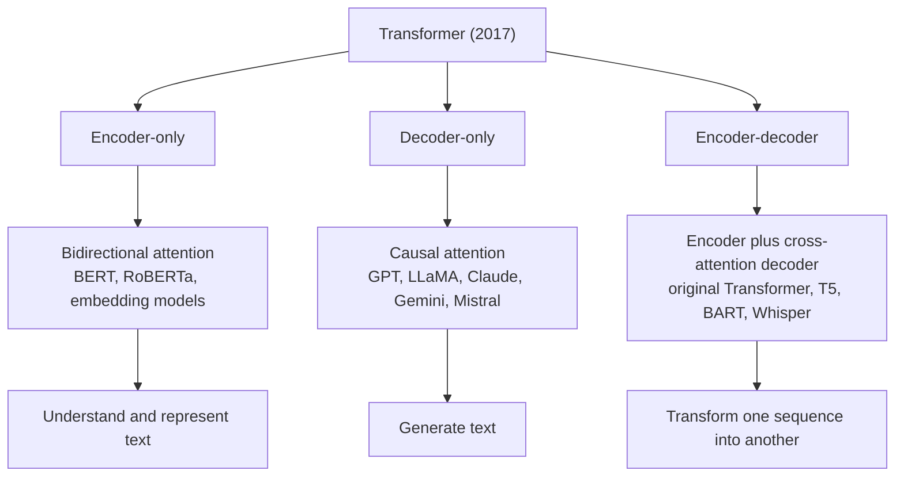
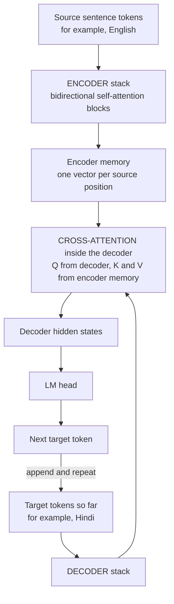
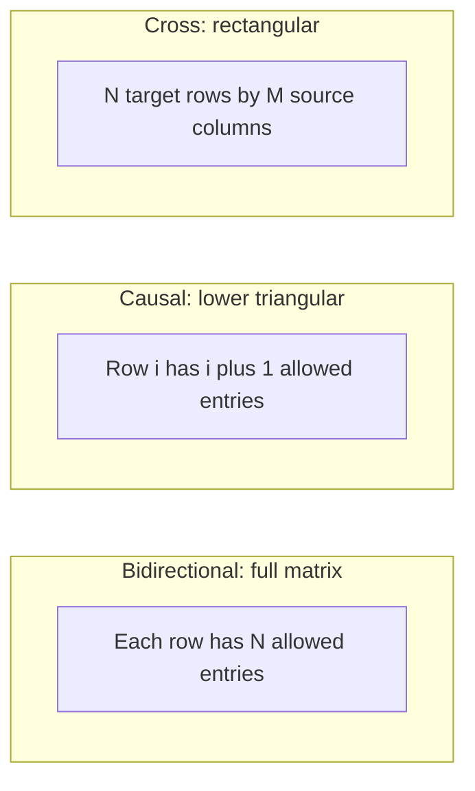
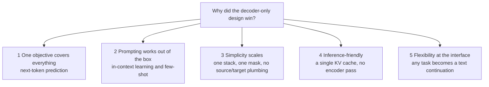
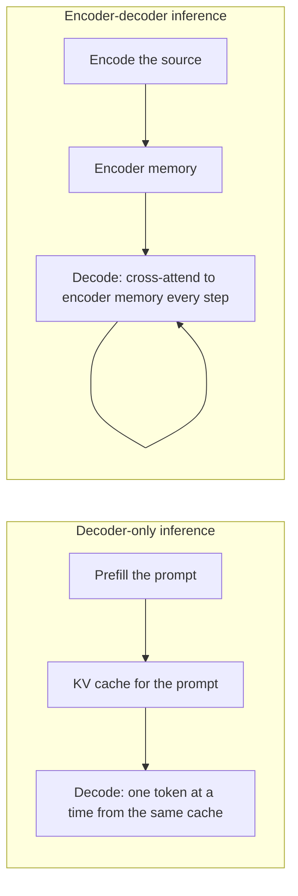
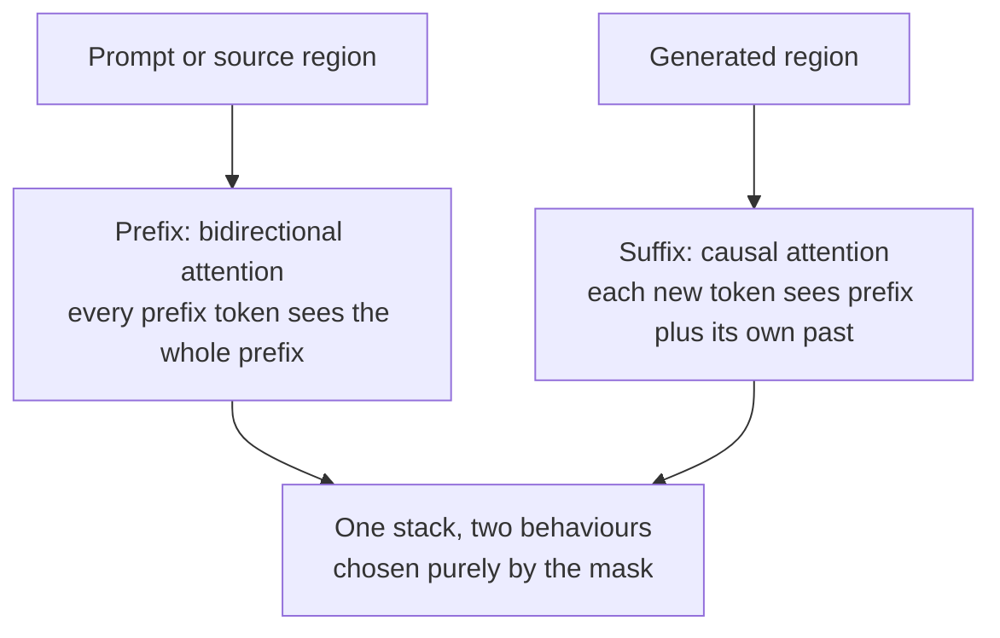
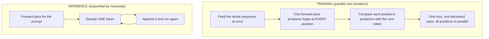
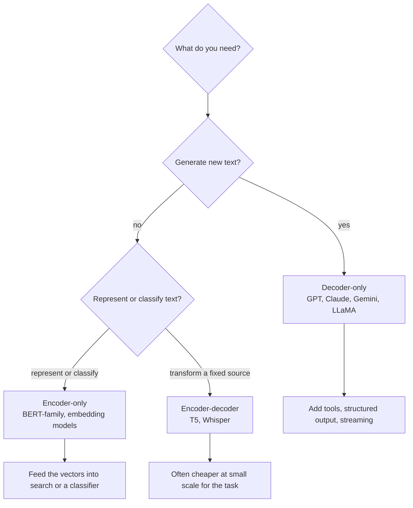

# Chapter 06 — Encoder-Decoder vs Decoder-Only & Why GPT Is Decoder-Only

> **Lecture 03 · Chapter 06 of 09** · Level: 🟢 Beginner · Phase 1 — Foundations: How LLMs Actually Work
> **Source:** `Forward-Deployed-Engineer/Lecture 02/notes/05_Transformer_Blocks_Deep_Layers_and_Logits.md`
> (§5.2, causal-mask note) · `04_Self_Attention_Mechanism_and_QKV_Architecture.md` (§4.7 self vs cross) ·
> `gen-ai-cohort/week01/learning/day01/notes/notes.md` ("Attention Is All You Need", 2017 · how a Transformer
> generates text · training vs inference) · roadmap topics for Lecture 03
> **Roadmap topics:** **encoder-decoder vs decoder-only** · **why GPT is decoder-only** ·
> $O(1)$ path length vs RNN sequential decay (the architectural consequence).

---

## 06.0 What this chapter is for

Everything so far has been **one** architecture: a stack of causal self-attention blocks. That is the
**decoder-only** design, and it is what powers GPT, LLaMA, Claude, Gemini and Mistral. But it is not the only
Transformer, and the differences decide what a model can and cannot do.

By the end of this chapter you should be able to:

1. Name the three Transformer families and one model from each.
2. Draw the original 2017 encoder-decoder Transformer and identify where **cross-attention** sits.
3. State the three attention modes (bidirectional, causal, cross) and what each can see.
4. Give **five reasons** GPT is decoder-only, and explain why the design won.
5. Say what you *lose* by dropping the encoder — and where those capabilities went instead.
6. Explain **prefix-LM** / "encoder-as-prefix" and why it matters for code and fill-in-the-middle tasks.
7. Explain the **training/inference asymmetry** (parallel training, sequential decoding) and connect it to the
   $O(1)$ path-length argument.
8. Choose the right architecture family for a given product requirement.

---

## 06.1 The three families



| Family | Attention | Training objective | Best at | Typical use |
| :--- | :--- | :--- | :--- | :--- |
| **Encoder-only** | bidirectional (every token sees every token) | masked-token prediction | understanding, classification, retrieval | embeddings, reranking, sentiment, NER, moderation |
| **Decoder-only** | causal (each token sees only the past) | next-token prediction | generation, reasoning, chat, code | GPT-4, Claude, Gemini, LLaMA, Mistral |
| **Encoder-decoder** | bidirectional encoder + causal decoder with cross-attention | span corruption / seq2seq | mapping one sequence to another | translation, classic summarisation, speech-to-text |

> [!IMPORTANT]
> **The single most important line in this chapter.** *Encoder-only models **read**; decoder-only models
> **write**; encoder-decoder models **rewrite**.* Almost every architecture choice in the industry follows from
> that sentence.

---

## 06.2 The original 2017 Transformer: encoder + decoder + cross-attention

The paper *"Attention Is All You Need"* (Vaswani et al., Google, 2017) introduced a **machine-translation**
architecture. It has two stacks, not one.



| Part | Attention type | Purpose |
| :--- | :--- | :--- |
| **Encoder** | bidirectional self-attention | build a full, order-aware representation of the *source* |
| **Decoder self-attention** | causal self-attention | keep the *target* generation left-to-right and non-cheating |
| **Decoder cross-attention** | cross-attention | let the decoder *look at the source* while generating |

> [!NOTE]
> **Cross-attention is the only genuinely new machinery here.** It is the same scaled dot-product computation —
> only the source of Q differs from the source of K and V. That is the whole idea of "attention": the operation
> does not care *where* its three inputs come from.

---

## 06.3 The three attention modes, side by side

| Mode | Row $i$ can attend to | Can it see the future? | Used in |
| :--- | :--- | :--- | :--- |
| **Bidirectional** | all $N$ positions | yes (it is allowed to) | encoder stacks, embedding models |
| **Causal** | positions $0 \ldots i$ | no | decoder stacks, all GPT-style models |
| **Cross** | all source positions | n/a (a different sequence) | encoder-decoder decoders |



Why the difference matters in practice:

| Property | Bidirectional | Causal |
| :--- | :--- | :--- |
| Representation of token $i$ | built from **both** sides of $i$ | built only from the left |
| Ideal for | classification, similarity, retrieval | generation, chat, code completion |
| Cannot do | generate text autoregressively (no next-token objective) | produce a "meaning of the whole sentence" embedding in one pass |
| Embedding quality for search | **high** — this is why embedding models are encoders | mediocre; needs pooling tricks |

> [!WARNING]
> **Do not use a decoder-only chat model as your embedding model if you can avoid it.** Because each token sees
> only its left, the final hidden state is a one-sided summary, and taking it is a weaker representation than a
> purpose-built bidirectional encoder. Dedicated embedding models (Lecture 12) exist for this reason.

---

## 06.4 Why GPT is decoder-only — five reasons



### 1. One objective covers everything

Next-token prediction is a **single, universal** objective. Translation, summarisation, classification, code
generation and question answering are all expressible as "continue this text". An encoder-decoder needs a
source/target split and a seq2seq objective; a decoder-only model needs one loss.

| Task | Decoder-only framing |
| :--- | :--- |
| Classification | `"Review: ...\nSentiment:"` → `"positive"` |
| Summarisation | `"Article: ...\nSummary:"` → the summary |
| Translation | `"Translate to Hindi: ...\nHindi:"` → the translation |
| Extraction | `"Extract JSON: ...\nJSON:"` → the JSON |
| Tool use | continue a serialised tool-call format (Lecture 08) |

### 2. Prompting works out of the box — in-context learning

Because the model is trained to continue *any* text, a prompt with examples is simply more text to continue.
This produced **few-shot / in-context learning** as an emergent capability (Lecture 05). An encoder-decoder must
usually be *fine-tuned* on a task; a decoder-only model can often be *prompted* into it.

### 3. Simplicity scales

| Design | What it must get right |
| :--- | :--- |
| Encoder-decoder | two stacks, three attention types, source/target alignment, separate positional handling, two sets of hyperparameters |
| Decoder-only | one stack, one mask, one objective |

At the scale of trillions of tokens, "fewer moving parts" is a decisive engineering advantage — and the same
stack can be reused for every task.

### 4. Inference-friendliness



A decoder-only model needs **one** KV cache and one running context. An encoder-decoder additionally computes
and stores encoder memory, and every decode step performs cross-attention over it. For chat workloads — where
the prompt *is* the input and there is no separate source — the extra machinery buys nothing.

### 5. Interface flexibility

Chat, tool calling, structured output, agents and RAG with citations are all *formats* rather than
architectures. A decoder-only model can express every one of them as text with roles and delimiters
(Lectures 06, 08, 10), so the application layer stays uniform.

> [!NOTE]
> **The historical detail worth knowing.** GPT-1/2/3 were decoder-only partly for simplicity, but the *decisive*
> result was that at sufficient scale the decoder-only model matched or beat task-specific fine-tuning on many
> benchmarks **zero-shot**, using the same weights. That turned an architecture choice into an industry
> standard.

---

## 06.5 What you give up, and where it went instead

| Lost capability | Where it lives now |
| :--- | :--- |
| Strong **bidirectional** sentence embeddings | dedicated encoder-only embedding models (Lecture 12) |
| Explicit source/target separation | prompt structure: delimiters, roles, "document" vs "question" |
| Encoder-decoder translation quality at small scale | large decoder-only models with prompting; dedicated translation models for edge cases |
| Efficient span-filling (infilling) | **prefix-LM / fill-in-the-middle** training (§06.6) |

> [!TIP]
> **The engineering translation of this table.** When you need *representations*, reach for an encoder. When you
> need *generation*, reach for a decoder. When you need a *faithful transformation of a fixed source* at low
> latency and small scale (speech, classic translation), an encoder-decoder can still be the cheapest correct
> answer.

---

## 06.6 Prefix-LM and "the encoder is just a prefix"

A neat way to see the relationship between the families: an encoder-decoder's **cross-attention** can be
simulated inside a decoder-only model by **changing the mask**.

| Mask pattern | Effect | Equivalent architecture |
| :--- | :--- | :--- |
| Full causal | every token sees only the left | decoder-only |
| Full bidirectional | every token sees everything | encoder-only |
| **Bidirectional over the prefix, causal over the suffix** | the "source" is fully visible; the "target" is generated left-to-right | **prefix-LM** (encoder-decoder behaviour) |



Where this matters in practice:

- **Fill-in-the-middle (FIM)** for code completion — the model sees both the code *before* and *after* the gap.
- **UL2 / GLM-style training** mixes causal, prefix and span objectives in one model.
- **Document-grounded generation** where the source should be fully visible but the answer must be generated.

> [!IMPORTANT]
> **The lesson.** Architecture families are, to a first approximation, **mask choices**. If you understand the
> causal mask (Chapter 03), you understand the entire design space — including why a decoder-only model can be
> trained to behave like an encoder-decoder when the task needs it.

---

## 06.7 Training vs inference: the asymmetry that shapes everything

The same causal model is used in two completely different ways.



| Phase | Parallelism | Cost shape | Consequence |
| :--- | :--- | :--- | :--- |
| **Training** | full, over all $N$ positions | compute-bound; one pass per batch | teachers the model with *every* position as an example (the label is free) |
| **Prefill** | full, over the whole prompt | compute-bound; quadratic in prompt length | prompt length affects time-to-first-token |
| **Decode** | **none** — one token per step | memory-bandwidth bound; reads the KV cache | output length affects total latency |

### Why not recurrence? (the $O(1)$ path-length recap)

Chapter 01 gave the path-length argument; here is the *architectural* consequence.

| Design | Training parallelism | Path length between distant tokens | Where the cost lands |
| :--- | :--- | :--- | :--- |
| **RNN / LSTM** | none (sequential over time) | $O(N)$ — decays with distance | long training times, weak long-range memory |
| **Transformer (causal)** | full over positions (mask makes it legal) | $O(1)$ — one hop, any distance | $O(N^2)$ attention; KV-cache memory at inference |

> [!NOTE]
> **The elegant trade.** The causal mask is what *permits* parallel training of a left-to-right model: the mask
> hides the future so every position can be computed at once, and the loss can be evaluated at all $N$ positions
> in a single pass. This is precisely why the Transformer replaced recurrence — and why "training loss at every
> position" is the engine of scaling.

---

## 06.8 Choosing a family: a decision table

| Your requirement | Recommended family | Why |
| :--- | :--- | :--- |
| Chat, agents, code generation, reasoning | **decoder-only** | generation + prompting + tool formats |
| Embeddings, semantic search, clustering, reranking | **encoder-only** | bidirectional representation, cheap, small |
| Classification / NER / moderation at low cost | **encoder-only** (or a small decoder) | no generation needed; far cheaper per call |
| Speech-to-text, fixed-source translation, OCR post-processing | **encoder-decoder** | explicit source/target; strong at faithful transformation |
| Code completion with both-sided context | decoder-only trained with **FIM** | prefix-LM behaviour via masking |
| Long-document summarisation with a hard budget | **decoder-only** with chunking (map-reduce) | encoder memory would be huge; retrieval + generation is cheaper |



---

## 06.9 Pseudo-code: the same block, three mask choices

```ts
// PSEUDO-CODE — one block implementation serves all three families. Only the mask differs.
type MaskMode = "bidirectional" | "causal" | "prefix";

function buildAttentionMask(mode: MaskMode, seqLen: number, prefixLen = 0): number[][] {
  const mask: number[][] = [];
  for (let i = 0; i < seqLen; i++) {
    const row: number[] = [];
    for (let j = 0; j < seqLen; j++) {
      let blocked: boolean;
      switch (mode) {
        case "bidirectional":
          blocked = false;                                  // encoder: everything visible
          break;
        case "causal":
          blocked = j > i;                                  // decoder: no future
          break;
        case "prefix":
          // Prefix region: fully visible. Suffix region: causal from the prefix onwards.
          blocked = i < prefixLen ? false : j > i;
          break;
      }
      row.push(blocked ? -Infinity : 0);
    }
    mask.push(row);
  }
  return mask;
}

// Encoder-decoder is the same idea plus one extra attention call:
//   decoderBlock = causalSelfAttention  ->  crossAttention(Q=decoder, K=V=encoderMemory)  ->  FFN
```

> [!TIP]
> **One sentence to carry away.** *Architecture families differ mainly in which positions may attend to which,
> and in how many attention calls a block makes.* Decoder-only: one causal call. Encoder-only: one bidirectional
> call. Encoder-decoder: a causal call **plus** a cross call. Prefix-LM: one call with a two-region mask.

---

## Common mistakes

- **Saying "GPT is a Transformer, so all Transformers are GPT-like".** GPT is *decoder-only*; the original
  Transformer is encoder-decoder, and BERT is encoder-only.
- **Assuming cross-attention is always present.** It exists only in encoder-decoder decoders. A GPT-style model
  has none.
- **Using a chat model for embeddings and expecting encoder-quality vectors.** Causal attention gives a one-sided
  representation (§06.3).
- **Believing a decoder-only model cannot "see" the whole prompt.** It sees the whole prompt — it simply cannot
  see *ahead of* the position it is predicting from. The prompt is fully in the past.
- **Thinking bidirectional attention is "better" because it sees more.** It is better for *understanding* tasks
  and useless for autoregressive generation.
- **Confusing "decoder-only" with "no encoder anywhere".** Embedding models and rerankers in your RAG stack are
  usually encoders (Lecture 12).
- **Assuming training and inference are symmetric.** Training is fully parallel; decode is one token per step and
  memory-bound. Capacity planning must use the decode numbers.
- **Believing you must choose a family forever.** FIM/prefix-LM shows the same weights can behave like both.
- **Ignoring the encoder-decoder option for latency-sensitive fixed-source tasks.** For speech and translation at
  small scale it can be cheaper and more faithful.
- **Assuming bigger context is free for encoder-decoder models.** Encoder memory and cross-attention scale with
  the source length.

## Key takeaways

1. Three families: **encoder-only** (reads), **decoder-only** (writes), **encoder-decoder** (rewrites).
2. The original 2017 Transformer was **encoder-decoder for translation**, with **cross-attention** as the new
   piece.
3. Three attention modes: **bidirectional**, **causal**, **cross** — all the same formula, different mask and
   different Q/K/V sources.
4. **GPT is decoder-only** because one objective (next-token prediction) covers every task, prompting works out
   of the box, the design is simpler to scale, inference needs only one KV cache, and any task can be framed as
   text continuation.
5. What was lost by dropping the encoder — **bidirectional embeddings** and explicit source/target separation —
   moved to dedicated encoder models and to prompt structure.
6. **Architecture families are largely mask choices**; prefix-LM shows one stack behaving like an encoder-decoder
   via a two-region mask (and enables fill-in-the-middle).
7. The causal mask is what makes **parallel training** of a left-to-right model possible: every position can be
   trained at once, and the label is free.
8. Training is **compute-bound and parallel**; decoding is **sequential and memory-bandwidth bound**. Prefill
   governs time-to-first-token, decode governs total latency.
9. The Transformer's $O(1)$ path length is why it replaced recurrence; the $O(N^2)$ attention cost is the price,
   and the KV cache is where that price lands at inference.
10. Choose by requirement: **generation → decoder-only**, **representation → encoder-only**,
    **fixed-source transformation → encoder-decoder**.

## Self-check questions

1. Name the three Transformer families, one model for each, and the attention mode each uses.
2. Draw the original 2017 architecture and mark where cross-attention sits and what supplies its Q, K and V.
3. Give the three attention modes and state what each row is allowed to see.
4. List five reasons GPT is decoder-only.
5. Why is a decoder-only model a poor choice of embedding model? What should you use instead?
6. What is prefix-LM, and which real product feature depends on it?
7. Explain how the causal mask enables parallel training of a left-to-right model.
8. Compare RNN and Transformer on path length, training parallelism and where the cost lands.
9. Which family would you choose for (a) a moderation classifier, (b) a code assistant, (c) speech-to-text?
   Justify each in one line.
10. Write the mask rule for prefix-LM over a sequence with a 5-token prefix.

---

### Navigation

- **Previous:** [Chapter 05 — The Transformer Block & the Residual Stream](./05_The_Transformer_Block_and_the_Residual_Stream.md)
- **Next:** [Chapter 07 — Logits, the LM Head & Softmax](./07_Logits_the_LM_Head_and_Softmax.md)
- **Source:** `Forward-Deployed-Engineer/Lecture 02/notes/05_Transformer_Blocks_Deep_Layers_and_Logits.md`
  (§5.2, causal masking) · `04_Self_Attention_Mechanism_and_QKV_Architecture.md` (§4.7) ·
  `gen-ai-cohort/week01/learning/day01/notes/notes.md` (Transformer · generation loop · training vs inference)
- **Back to index:** [../index.md](../index.md)