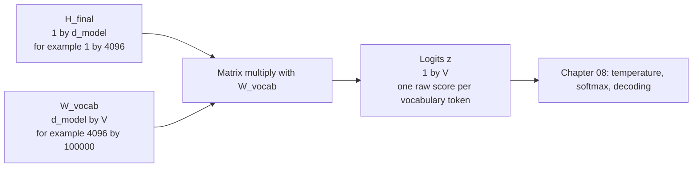
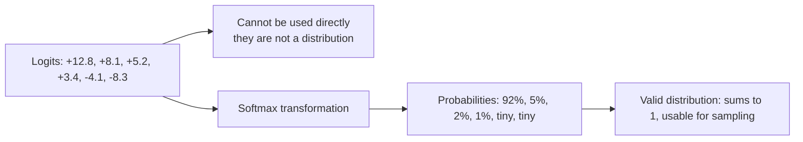
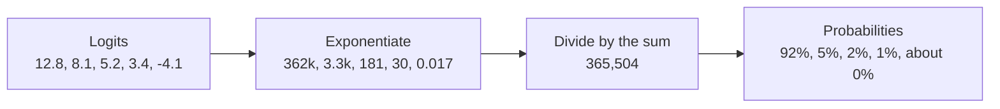
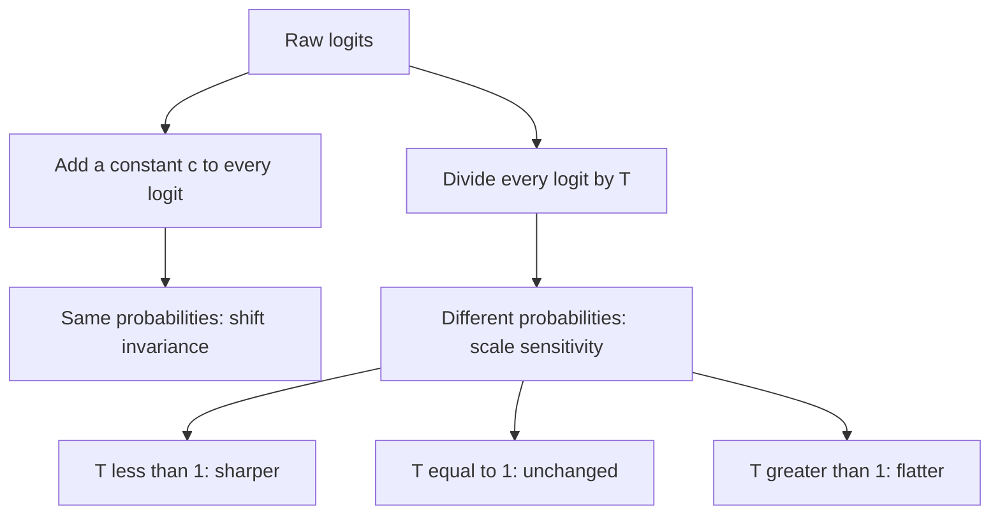
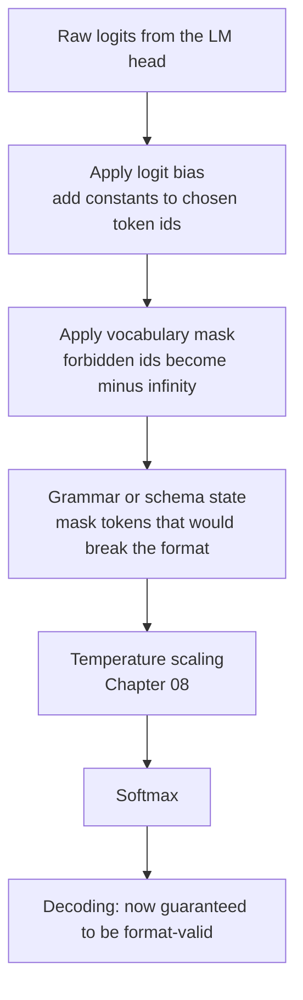
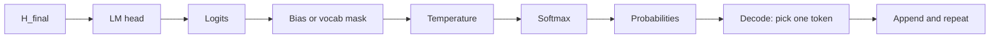

# Chapter 07 — Logits, the LM Head & Softmax

> **Lecture 03 · Chapter 07 of 09** · Level: 🟢 Beginner · Phase 1 — Foundations: How LLMs Actually Work
> **Source:** `Forward-Deployed-Engineer/Lecture 02/notes/05_Transformer_Blocks_Deep_Layers_and_Logits.md`
> (§5.5–5.6) · `06_Softmax_Decoding_Strategies_and_Temperature.md` (§6.1) ·
> `07_Complete_LLM_Pipeline_and_Key_Takeaways.md` (§7.2 stages 8–10) ·
> `Excalidraw-Notes.svg` (`Hfinal → vector(Delhi) → 90%`, `vector(kolkata) → 5%`, `remaining → 5%`) ·
> `gen-ai-cohort/week01/learning/day01/notes/notes.md` (Softmax)
> **Roadmap topics:** **logits projection head → probability distribution** · **softmax** ·
> "logits are not probabilities" (a roadmap misconception to correct).

---

## 07.0 What this chapter is for

The transformer stack has finished. Every token now has a rich context-aware vector — but the model still has
not produced a single word. This chapter is the bridge: how a $d_{\text{model}}$-dimensional hidden state becomes
a score for every entry in a 100k-token vocabulary, and how those raw scores become the **probability
distribution** that decoding (Chapter 08) will sample from.

By the end of this chapter you should be able to:

1. Write the LM head projection and give the shape of $W_{\text{vocab}}$ and the output.
2. Explain **weight tying** and why it saves parameters.
3. State the properties of **logits** precisely (range, sum, meaning) and reproduce the worked logit table.
4. Write the softmax formula and explain the three reasons for exponentiation.
5. Reproduce the lecture's worked softmax computation, including the `banana` surprise.
6. Explain the shift-invariance and scale-sensitivity of softmax, and why max-subtraction is safe.
7. Read **log probabilities** in an API response and explain why log-space arithmetic is used.
8. Explain **logit bias** and **constrained decoding** as pre-softmax manipulation of the distribution.
9. Avoid the production trap of treating logits as probabilities.

---

## 07.1 From hidden state to vocabulary scores: the LM head

After all $L$ blocks, each token has a final hidden state. For **next-token prediction**, only the **last
position's** hidden state is used:

$$\mathbf{h}_{\text{final}} \in \mathbb{R}^{d_{\text{model}}}, \qquad \mathbf{z} = \mathbf{h}_{\text{final}} W_{\text{vocab}} + \mathbf{b}$$

$$W_{\text{vocab}} \in \mathbb{R}^{d_{\text{model}} \times |V|}, \qquad \mathbf{z} \in \mathbb{R}^{|V|}$$



| Question | Answer |
| :--- | :--- |
| Which position is used? | the **last** one — it is the only position whose causal attention has seen the whole prompt |
| What about the other positions? | they are used **during training** (every position predicts its next token) and are discarded at inference |
| What is this layer called? | the **LM head** (language-model head), or the unembedding matrix |
| Why is it a single linear layer? | because the model already did the hard work; this is just a change of basis into vocabulary space |

> [!NOTE]
> **Why only the last position at inference.** A causal model's position-$i$ hidden state summarises tokens
> $0 \ldots i$. Only the final position has seen the entire prompt, so only it can predict "what comes after the
> prompt". During training every position is used, which is exactly what makes the loss so data-efficient
> (Chapter 06 §06.7).

---

## 07.2 The LM head in numbers, and weight tying

| Model scale | $d_{\text{model}}$ | $|V|$ | LM-head parameters |
| :--- | :--- | :--- | ---: |
| GPT-2 small | 768 | 50,257 | ≈ 38.6M |
| LLaMA-3 8B | 4096 | 128,256 | ≈ 525M |
| GPT-3 | 12,288 | ~50,257 | ≈ 618M |

Two observations:

1. **The head can be enormous.** For a small model it can hold 30% of all parameters; for a large model it is a
   few percent.
2. **It is a pure linear map with no non-linearity.** The "decision" was made by the stack; the head only
   re-expresses it in vocabulary coordinates.

### Weight tying

> [!IMPORTANT]
> **In many implementations, $W_{\text{vocab}} = W_{\text{emb}}^{T}$.** The matrix that maps token IDs to vectors
> and the matrix that maps vectors to token scores are **the same matrix, transposed**. This is called **weight
> tying** (or tied embeddings).

| Benefit | Explanation |
| :--- | :--- |
| **Fewer parameters** | the embedding table is not duplicated; large savings for small models |
| **Geometric consistency** | the space where the model *reads* tokens is the space where it *writes* them — a token's output score is the dot product of the hidden state with that token's own embedding |
| **Regularisation** | the shared matrix sees more gradient signal |

> [!TIP]
> **The intuition behind tying.** If the embedding for `Delhi` points in a direction that means "capital city of
> India", then the hidden state after `"The capital of India is"` should point in roughly the same direction, and
> a dot product between them should be large. Tying makes that comparison explicit — the model is literally
> asking "which token's meaning am I currently most aligned with?"

---

## 07.3 What logits are — and are not

The output vector $\mathbf{z}$ is called **logits** (from logistic regression, where the "logit" is the
log-odds value *before* a sigmoid or softmax is applied). Each entry $z_i$ is an unnormalised raw score
indicating how compatible token $i$ is with being the next token after this context.

For the prompt `"The capital of India is"`:

| Vocabulary token | Raw logit $z_i$ | Meaning |
| :--- | :--- | :--- |
| **Delhi** | **+12.8** | extremely high compatibility |
| Mumbai | +8.1 | moderate compatibility |
| Kolkata | +5.2 | some compatibility |
| Punjab | +3.4 | low compatibility |
| banana | −4.1 | very incompatible |
| `<EOS>` | −8.3 | should not end here |

The lecture's hand-drawn version of the same step:

```text
H_final  ->  vector(Delhi)      ->  90%
H_final  ->  vector(Kolkata)    ->   5%
H_final  ->  vector(remaining)  ->   5%
```

**Critical properties of logits:**

| Property | Value |
| :--- | :--- |
| Range | any real number — negative, zero, positive |
| Sum | **does not** sum to 1 (and has no required sum at all) |
| Are they probabilities? | **no** |
| Are they comparable across models? | no — the scale is arbitrary per model |
| Ordering | larger value = stronger preference for that token |
| How to turn them into probabilities | apply **softmax** (§07.4) |



> [!WARNING]
> **The single most common implementation mistake in this area: treating logits as probabilities.** Symptoms:
> dividing logits by their sum and calling it a probability, multiplying logits together for sequence scoring,
> comparing logits across providers, or reporting "confidence" as a raw logit. Logits are an **unnormalised
> score in log-space**; probability is a different object.

---

## 07.4 Softmax: logits → a valid probability distribution

$$P(y_i \mid \text{context}) = \frac{e^{z_i}}{\displaystyle\sum_{j=1}^{|V|} e^{z_j}}$$

### Why exponentiate? Three reasons

| Reason | Explanation |
| :--- | :--- |
| **Positivity** | $e^x > 0$ for every real $x$, so negative logits become small positive numbers |
| **Amplification** | the exponential disproportionately boosts larger values, sharpening the contrast between candidates |
| **Monotonicity** | $z_i > z_j \Rightarrow e^{z_i} > e^{z_j}$, so the **ranking is preserved** — softmax never reorders the model's preferences |

### The worked computation (from the lecture)

| Token | Logit $z_i$ | $e^{z_i}$ | Probability $P(y_i)$ |
| :--- | ---: | ---: | ---: |
| **Delhi** | +12.8 | 361,999 | **92.0%** |
| Mumbai | +8.1 | 3,294 | 5.0% |
| Kolkata | +5.2 | 181 | 2.0% |
| Punjab | +3.4 | 30 | 1.0% |
| banana | −4.1 | 0.017 | ≈ 0.000004% |
| **Total** | — | ~365,504 | **100.0%** |



> [!NOTE]
> **The `banana` lesson.** A token with logit −4.1 still receives a **non-zero** probability. In theory the model
> could emit `banana` after `"The capital of India is"`; in practice it happens about 4 times in 100 million. This
> is the precise mechanical reason language models are *usually* sensible but never *guaranteed* correct — and
> the reason Chapter 08's sampling controls exist.

---

## 07.5 Three softmax properties that matter in code

| Property | Statement | Consequence |
| :--- | :--- | :--- |
| **Shift invariance** | $\text{softmax}(z + c) = \text{softmax}(z)$ for any constant $c$ | subtracting the row max is *exactly* equivalent — this is why the stability trick is free |
| **Scale sensitivity** | $\text{softmax}(z / T) \neq \text{softmax}(z)$ in general | dividing by a temperature genuinely changes the distribution — this is Chapter 08's main knob |
| **Ranking preservation** | $z_i > z_j \Rightarrow P_i > P_j$ | the top logit is always the top probability, so `argmax` is identical before and after |



> [!TIP]
> **These three properties are the mathematical basis of decoding controls.** Shift invariance makes softmax
> implementable; scale sensitivity makes temperature meaningful; ranking preservation means "top-1" is well
> defined regardless of the temperature you choose. Chapter 08 does nothing but exploit them.

---

## 07.6 Log probabilities in the API

Providers can return **log probabilities** (`logprobs`) instead of (or alongside) sampled tokens. This is the
same information as the probability, expressed in log space:

$$\log P(y_i) = z_i - \log\!\left(\sum_j e^{z_j}\right)$$

| Why log space | Explanation |
| :--- | :--- |
| **Numerical range** | probabilities of long sequences underflow to 0; log-probabilities stay finite |
| **Multiplicative becomes additive** | $\log(P(a)\cdot P(b)) = \log P(a) + \log P(b)$ — you sum instead of multiplying |
| **Perplexity** | $\text{perplexity} = \exp\!\left(-\frac{1}{N}\sum \log P\right)$ — a standard model-quality metric |
| **Confidence signal** | a token with log-probability −0.05 is near-certain; −6 is a coin flip among many options |

```text
A typical logprobs payload (illustrative):

token: "Delhi"    logprob: -0.08   top alternatives:
    "Delhi"      -0.08
    "New"        -3.10
    "Mumbai"     -3.45
    "the"        -5.02

Reading it: exp(-0.08) = 0.923  ->  about 92% confidence, consistent with the logit table above.
```

| Use case | How logprobs help |
| :--- | :--- |
| **Confidence gating** | route low-confidence outputs to a human or a second model (Lecture 09 HITL, Lecture 31 guardrails) |
| **Classification via scoring** | score each candidate label and pick the highest — no free-text parsing needed (Lecture 10) |
| **Evals** | measure calibration and detect prompt regressions numerically (Lecture 30) |
| **Debugging prompts** | see *what the model was considering*, which is often more informative than the output |

> [!NOTE]
> **A practical warning.** Log probabilities are *not* calibrated probabilities of correctness. A model can be
> 99% confident and wrong. Treat logprobs as a *relative* signal within one call, not as a guarantee.

---

## 07.7 Logit bias and constrained decoding: editing the distribution

Because softmax is a pure function of the logits, you can **modify the logits before the softmax** to steer
generation. This is the mechanism behind several features you will build later.

| Technique | How it works | Where it is used |
| :--- | :--- | :--- |
| **Logit bias** | add a constant to specific token IDs' logits (negative to forbid, positive to encourage) | provider APIs expose this directly |
| **Vocabulary masking** | set forbidden token IDs to $-\infty$ | structured output (JSON schema), tool-call grammars |
| **Grammar-constrained decoding** | keep a parser state and mask every token that would violate the grammar | Lecture 10 structured outputs |
| **Suppress tokens** | forbid e.g. `<EOS>` until a minimum length, or forbid whitespace in an ID field | production hardening |



> [!IMPORTANT]
> **The architectural insight.** Decoding-time controls and attention-time masks are the *same idea* in two
> places: set forbidden options to $-\infty$ **before** the softmax, so the normalisation ignores them. The
> causal mask forbids *positions*; logit bias and grammars forbid *vocabulary entries*. That is why
> "constrained decoding" can guarantee valid JSON without changing a single model weight (Lecture 10).

---

## 07.8 Pseudo-code: LM head, softmax and logprobs

```ts
// PSEUDO-CODE — the projection and normalisation stages. Decoding is Chapter 08.
type Vector = number[];

interface LmHead {
  wVocab: Vector[];      // d_model rows, each of length |V| (often the transpose of the embedding table)
  bias?: Vector;         // optional, |V| long; many models omit it
}

function projectToLogits(hFinal: Vector /* length d_model */, head: LmHead): Vector {
  // One linear map: representation space -> vocabulary space.
  const logits = matmulVec(head.wVocab, hFinal);        // length |V|
  return head.bias ? addVec(logits, head.bias) : logits;
}

function softmax(logits: Vector, temperature = 1): Vector {
  // 1. Temperature scaling (Chapter 08). T = 1 leaves the model's distribution untouched.
  const scaled = logits.map(z => z / temperature);

  // 2. Numerical stability: subtract the max. Valid because softmax is shift-invariant.
  const max = Math.max(...scaled);
  const exps = scaled.map(z => Math.exp(z - max));

  // 3. Normalise: the result is a valid probability distribution summing to 1.
  const total = exps.reduce((a, b) => a + b, 0);
  return exps.map(e => e / total);
}

function toLogprobs(probabilities: Vector): Vector {
  // Log-space is how APIs expose confidence, and how sequence scores stay finite.
  return probabilities.map(p => Math.log(p));           // note: log(0) = -Infinity
}

// Three rules to keep in your head:
//   logits    -> any real numbers, not a distribution, model-specific scale
//   probs     -> in (0, 1), sum to exactly 1
//   logprobs  -> in (-inf, 0], sum is meaningless, additive for sequences
```

---

## 07.9 The full picture, stage by stage

| Stage | Input | Operation | Output | Where |
| :---: | :--- | :--- | :--- | :---: |
| 1 | last hidden state | LM head linear projection | logits $\mathbf{z} \in \mathbb{R}^{|V|}$ | §07.1 |
| 2 | logits | optional logit bias / vocabulary mask | steered logits | §07.7 |
| 3 | logits | divide by temperature $T$ | scaled logits | Chapter 08 |
| 4 | scaled logits | softmax (max-subtracted) | probability distribution | §07.4 |
| 5 | probabilities | greedy argmax or sampling | one token id | Chapter 08 |
| 6 | token id | decode to text, append to context | new context | Chapter 08 |



> [!TIP]
> **Where each later lecture plugs in.** Structured output and JSON-schema enforcement = step 2
> (Lecture 10). Cost and latency control = steps 5–6 plus the KV cache (Lectures 04, 25). Confidence gating and
> evals = the logprobs of step 4 (Lectures 09, 30, 31).

---

## Common mistakes

- **Treating logits as probabilities.** No sum-to-1, can be negative, and the scale differs between models.
- **Comparing logits across providers.** Each model has its own arbitrary logit scale; only probabilities and
  logprobs are interpretable within a model.
- **Multiplying probabilities across a long sequence.** They underflow to zero; add log-probabilities instead.
- **Applying softmax to the wrong axis.** It must be over the **vocabulary** dimension (per position), not across
  positions.
- **Forgetting that temperature interacts with top-p/top-k.** Controls are applied in a specific order
  (Chapter 08); changing the order changes the output.
- **Assuming the LM head is the "thinking" part.** It is a linear re-expression; the reasoning happened in the
  stack.
- **Believing weight tying always holds.** Many models tie, many do not; check the config rather than assuming.
- **Using the hidden state of the last *token you care about* rather than the last position.** For next-token
  prediction it is the final position of the sequence.
- **Reading logprobs as "probability of being correct".** They are the model's own distribution, and models are
  often confidently wrong.
- **Ignoring logit bias as a production lever.** It is a zero-training-cost way to forbid tokens (brand names,
  forbidden phrases) — but it is not a security boundary.

## Key takeaways

1. The **LM head** is a single linear projection $\mathbf{z} = \mathbf{h}_{\text{final}}W_{\text{vocab}} + b$ from
   $d_{\text{model}}$ to $|V|$, producing one raw score per vocabulary token.
2. At inference only the **last position's** hidden state is projected; during training every position is used.
3. **Weight tying** ($W_{\text{vocab}} = W_{\text{emb}}^{T}$) saves parameters and aligns the read and write
   spaces.
4. **Logits are not probabilities**: any real value, no required sum, model-specific scale.
5. **Softmax** turns logits into a distribution via exponentiate-then-normalise. Exponentiation gives
   positivity, amplification and (crucially) **preserved ranking**.
6. The worked example: logits 12.8 / 8.1 / 5.2 / 3.4 / −4.1 become 92% / 5% / 2% / 1% / ≈0% — and a tiny
   non-zero probability for nonsense is exactly why sampling controls exist.
7. Softmax is **shift-invariant** (so max-subtraction is free), **scale-sensitive** (so temperature works) and
   **order-preserving** (so `argmax` is stable).
8. **Log probabilities** are the API-friendly form of the distribution: finite range, additive across tokens,
   and the basis of perplexity.
9. **Logit bias and vocabulary masks** let you edit the distribution *before* the softmax — the mechanism behind
   constrained decoding and guaranteed-valid JSON.
10. Logprobs are a useful confidence signal, but they are **not** calibrated correctness probabilities.

## Self-check questions

1. Write the LM head equation and give the shape of $W_{\text{vocab}}$, $\mathbf{h}_{\text{final}}$ and
   $\mathbf{z}$.
2. Why is only the last position projected at inference, while training uses all positions?
3. What is weight tying, and what are its two benefits?
4. State four properties of logits, including one that distinguishes them from probabilities.
5. Convert logits 5, 4, 3, 2, 1 into probabilities with $T = 1$ (approximate values are fine).
6. Give the three reasons softmax exponentiates.
7. Prove that subtracting the maximum is safe, using shift invariance.
8. Why is scale sensitivity important? What would break if softmax were scale-invariant too?
9. A provider returns one token with logprob −0.05 and another with −4.0. Translate both to approximate
   probabilities and explain how you would use that difference in a product.
10. Explain how vocabulary masking relates to the causal mask — what do the two have in common?

---

### Navigation

- **Previous:** [Chapter 06 — Encoder-Decoder vs Decoder-Only & Why GPT Is Decoder-Only](./06_Encoder_Decoder_vs_Decoder_Only_and_Why_GPT.md)
- **Next:** [Chapter 08 — Decoding Strategies & Sampling Controls](./08_Decoding_Strategies_and_Sampling_Controls.md)
- **Source:** `Forward-Deployed-Engineer/Lecture 02/notes/05_Transformer_Blocks_Deep_Layers_and_Logits.md`
  (§5.5–5.6) · `06_Softmax_Decoding_Strategies_and_Temperature.md` (§6.1) · `Excalidraw-Notes.svg`
- **Back to index:** [../index.md](../index.md)