# Chapter 08 — Decoding Strategies & Sampling Controls

> **Lecture 03 · Chapter 08 of 09** · Level: 🟢 Beginner · Phase 1 — Foundations: How LLMs Actually Work
> **Source:** `Forward-Deployed-Engineer/Lecture 02/notes/06_Softmax_Decoding_Strategies_and_Temperature.md`
> (§6.2–6.6) · `07_Complete_LLM_Pipeline_and_Key_Takeaways.md` (takeaways 18–20, stages 9–11) ·
> `Excalidraw-Notes.svg` (`Greedy`, `Sampling`, `T = 0.5 / 1 / 2`, `sample -> 5, 4, 3, 2, 1`) ·
> `gen-ai-cohort/week01/learning/day01/notes/notes.md` (Temperature · Top-p / nucleus sampling)
> **Roadmap topics:** **softmax, temperature, top-p / top-k sampling, greedy vs beam** ·
> **greedy vs stochastic sampling; beam search; repetition / frequency / presence penalties** ·
> **how decoding strategies change the character of the output** · streaming as a consequence of
> autoregressive generation.

---

## 08.0 What this chapter is for

Chapters 02–07 built a machine that produces a **probability distribution** over the next token. That machine
never picks a token. This chapter is about the component that does — and about the handful of parameters that
decide whether your product feels precise, creative, repetitive, or unhinged.

By the end of this chapter you should be able to:

1. Explain the **model vs decoder** separation and why it matters architecturally.
2. Describe **greedy decoding** and its three failure modes.
3. Describe **beam search**, its length-bias problem and why chat APIs do not expose it.
4. Explain **sampling** as a weighted lottery, and derive why the same prompt gives different answers.
5. Reproduce the lecture's **temperature** calculations for $T = 0.5$, $1.0$ and $2.0$.
6. Explain **top-k**, **top-p (nucleus)**, **min-p** and **typical** sampling, and when to use each.
7. Explain **repetition / frequency / presence penalties** as additive logit adjustments.
8. State the **order of operations** in a real decoding pipeline.
9. Explain **non-determinism** and how far seeds and temperature 0 get you.
10. Explain why **streaming** is a consequence of autoregressive generation, not a feature bolted on.
11. Choose a parameter set for a given task from a recipe table.

---

## 08.1 Two separate systems: the model and the decoder

The lecture calls this separation "a critical architectural point that is often missed":

| Stage | What it does | What it can see | Output |
| :--- | :--- | :--- | :--- |
| **Stage 1 — the neural network** | forward pass through $L$ blocks, LM head, softmax | the whole context | a probability distribution over $|V|$ tokens |
| **Stage 2 — the decoding strategy** | an algorithm that selects **one** token | only the probability vector | one token id |

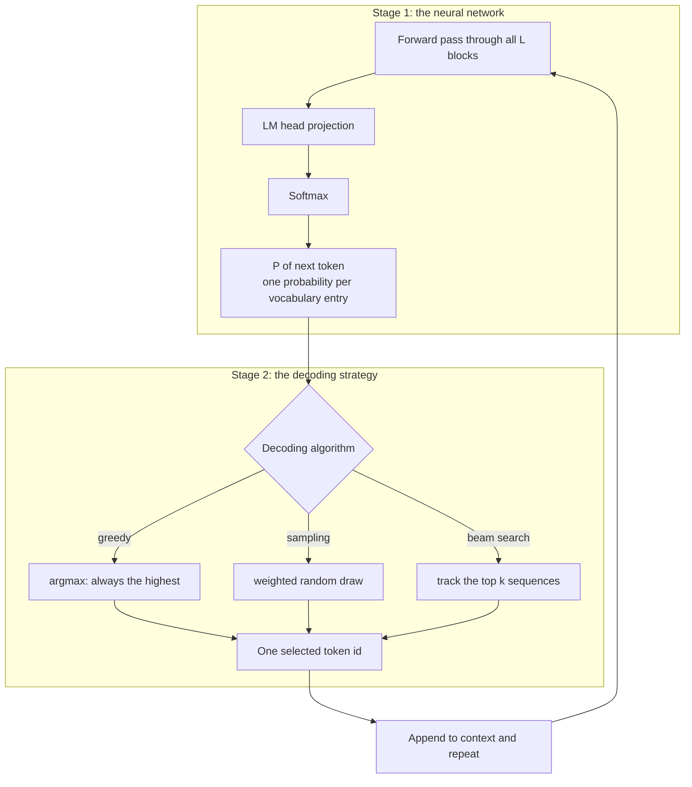

> [!IMPORTANT]
> **The model never selects a token.** It only *proposes a distribution*. The selection happens outside the
> model, in the serving stack. This is why you can change temperature, top-p and penalties **without touching a
> single weight** — and why the same checkpoint can power a deterministic code assistant and a creative writing
> tool.

---

## 08.2 Greedy decoding

The simplest strategy: **always take the highest-probability token**.

$$\hat{y} = \arg\max_i P(y_i \mid \text{context})$$

For the distribution `Java 40%, Python 35%, C++ 10%, JavaScript 8%, Rust 4%, other 3%`, greedy picks **Java** —
every single time.

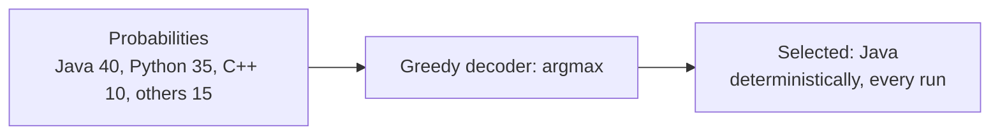

| Advantages | Disadvantages |
| :--- | :--- |
| fast and simple | **repetition loops**: each chosen token makes the same token likely again |
| **deterministic** — same input, same output | **no diversity**: every generation from the same prompt is identical |
| never picks an obviously wrong token | **locally optimal, globally suboptimal**: the best token now may lead to a worse sequence overall |

> [!TIP]
> **When greedy is right.** Deterministic, reproducible outputs matter for code generation, extraction,
> classification and anything you will unit-test. Greedy (or temperature 0) is the correct default for those —
> and it is *not* the right default for brainstorming, copywriting or dialogue variety.

---

## 08.3 Beam search

Beam search keeps **$k$ candidate sequences** (the "beam") alive at every step instead of committing to one.

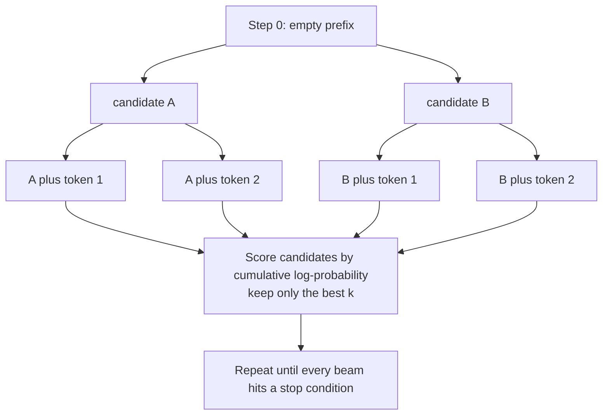

| Property | Detail |
| :--- | :--- |
| Scoring | cumulative **log-probability** of the sequence — hence the additive log-space of Chapter 07 |
| Cost | $k\times$ the memory and compute of greedy; the KV cache must hold $k$ hypotheses |
| **Length bias** | longer sequences accumulate more negative log-probability, so beams prefer short outputs — corrected with **length normalisation** |
| Strength | good for tasks with a single correct answer (translation, OCR, speech recognition) |
| Weakness | bland, "safe" text; no diversity; can be *worse* than sampling for open-ended generation |

> [!WARNING]
> **Why the chat APIs you use do not expose beam search.** Beam search optimises for the most probable
> *sequence*, and for open-ended dialogue the most probable sequence is usually the most generic one — it
> maximises likelihood, not usefulness. Providers instead expose temperature, top-p and penalties, which are
> *local* controls on the next-token distribution.

---

## 08.4 Sampling: the weighted lottery

Instead of always taking the maximum, sampling treats the distribution as a **weighted lottery**: each token
receives tickets proportional to its probability, and **one ticket is drawn at random**.

```text
Java:        40 tickets
Python:      35 tickets
C++:         10 tickets
JavaScript:   8 tickets
Rust:         4 tickets
other:        3 tickets
---------------------
total:      100 tickets
```

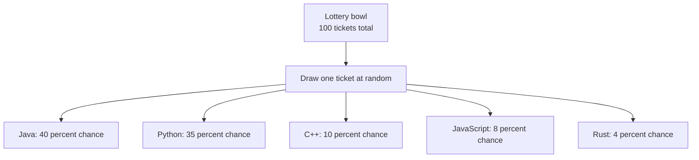

### Why this explains non-deterministic LLM behaviour

**This is the root cause of "I asked the same question twice and got different answers."**

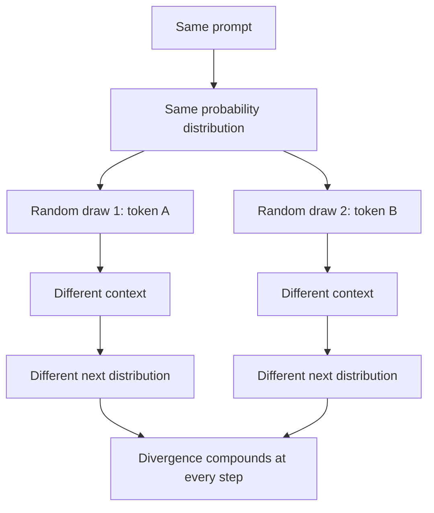

| Step | Why it compounds |
| :--- | :--- |
| 1 | the draw selects a token different from the argmax |
| 2 | that token is now part of the context, so the next distribution changes |
| 3 | the next draw happens from a different distribution, and so on |
| $N$ | two runs of the same prompt are two different paths through a tree of possibilities |

> [!NOTE]
> **Unrestricted sampling is risky.** Sampling over the *whole* vocabulary means the −4.1 logit `banana` is
> always in the pool. The controls in §08.6–08.9 exist to **trim the tail** before drawing: top-k, top-p, min-p
> and penalties all restrict or reshape the pool. They reduce variance; they never eliminate it.

---

## 08.5 Temperature: shaping the distribution

**Temperature ($T$)** rescales the logits **before** the softmax, controlling the trade-off between confidence
and diversity:

$$P(y_i \mid \text{context}) = \frac{e^{z_i / T}}{\displaystyle\sum_{j=1}^{|V|} e^{z_j / T}}, \qquad z_i' = \frac{z_i}{T}$$

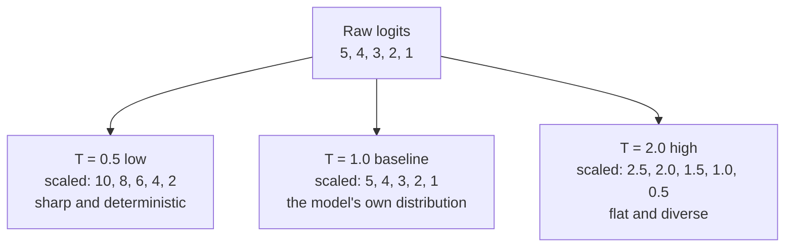

### The lecture's three worked cases

Starting logits: `Python 5, Java 4, JavaScript 3, C++ 2, Rust 1`.

| Case | Calculation | Effect |
| :--- | :--- | :--- |
| **$T = 1.0$** | $5/1, 4/1, 3/1, 2/1, 1/1$ | unchanged — the model's raw learned preferences |
| **$T = 0.5$** | $5/0.5 = 10$, $4/0.5 = 8$, … | gaps **doubled** ($1 \to 2$); the leader dominates |
| **$T = 2.0$** | $5/2 = 2.5$, $4/2 = 2.0$, … | gaps **halved** ($1 \to 0.5$); the tail gains mass |

### Side-by-side probabilities

| Token | $T = 0.5$ (sharp) | $T = 1.0$ (baseline) | $T = 2.0$ (flat) |
| :--- | ---: | ---: | ---: |
| **Python** | **88%** | **65%** | **40%** |
| Java | 10% | 24% | 27% |
| JavaScript | 1.5% | 8% | 18% |
| C++ | 0.4% | 3% | 12% |
| Rust | 0.1% | 0.5% | 3% |

### When to use which temperature

| Temperature | Shape | Best for | Risk |
| :--- | :--- | :--- | :--- |
| $T = 0 \to 0.3$ | nearly deterministic | code, math, extraction, factual Q&A | repetitive, robotic |
| $T = 0.5 \to 0.8$ | sharp but varied | technical writing, summarising | some variance |
| $T = 1.0$ | the model's natural distribution | chat baseline | balanced |
| $T = 1.2 \to 1.5$ | flat, "creative" | creative writing, brainstorming | some nonsense |
| $T > 2.0$ | near-uniform | research / experimentation | high hallucination rate |

> [!CAUTION]
> **Two boundary cases worth stating precisely.** $T = 0$ is *equivalent to greedy decoding* (the softmax
> approaches a one-hot distribution). $T \to \infty$ approaches a **uniform** distribution, where every token is
> equally likely — random noise, regardless of what the model learned.
>
> Note also: temperature **does not change the ranking** (softmax is order-preserving), so it never changes
> *which* token is most likely — only *how much more likely* it is.

---

## 08.6 Top-k sampling

Keep only the **$k$ highest-probability tokens**, renormalise, and sample from those.

$$P'(y_i) = \begin{cases} \dfrac{P(y_i)}{\sum_{j \in \text{top-}k} P(y_j)} & i \in \text{top-}k \\[2mm] 0 & \text{otherwise} \end{cases}$$

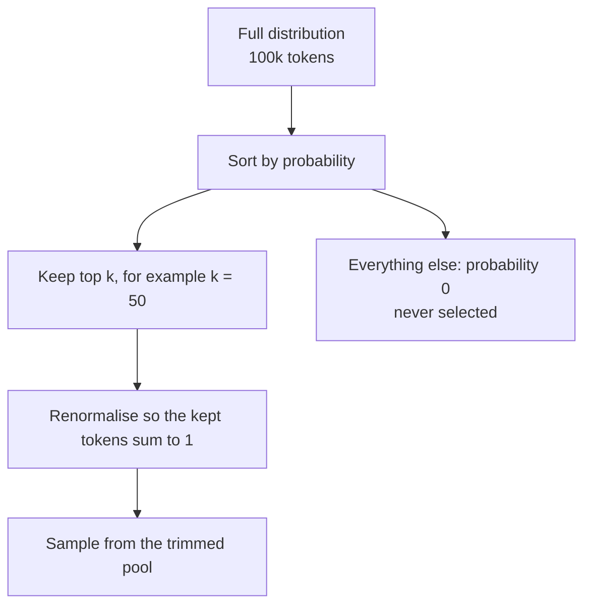

| Property | Behaviour |
| :--- | :--- |
| Strength | simple, fast, guaranteed to exclude the far tail |
| Weakness | **fixed $k$ regardless of the shape of the distribution** |
| Failure mode A | a *flat* distribution: the top 50 tokens may be almost equally likely, so nonsense slips in |
| Failure mode B | a *peaked* distribution: the top 50 includes many tokens with negligible probability, diluting the pool |
| Typical values | $k = 20$–$100$ (some providers default to 40) |

---

## 08.7 Top-p (nucleus) sampling

Keep the **smallest set of tokens whose cumulative probability reaches $p$**, then renormalise and sample.

```text
Distribution sorted descending, with cumulative probability:

token A  0.42   cumulative 0.42
token B  0.26   cumulative 0.68
token C  0.13   cumulative 0.81
token D  0.08   cumulative 0.89
token E  0.05   cumulative 0.94   <- the p = 0.9 boundary falls inside this token
token F  0.03   cumulative 0.97
... the rest of the vocabulary, each approximately 0

With p = 0.9 the nucleus is {A, B, C, D, E}: renormalise and sample from those five only.
```

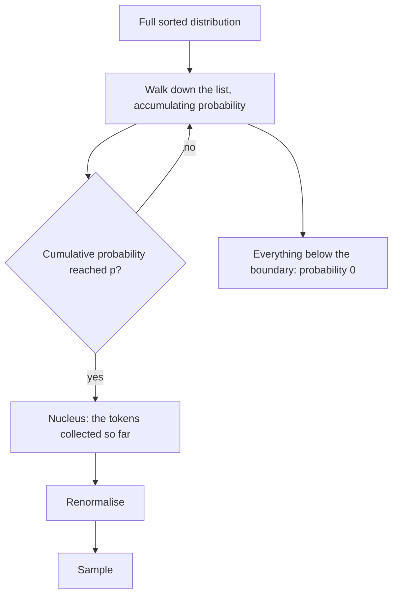

| Property | Behaviour |
| :--- | :--- |
| Strength | **adapts to the shape of the distribution** — a confident step keeps few tokens, an uncertain step keeps many |
| Weakness | still includes everything above the boundary, however implausible |
| Typical values | $p = 0.9$ (chat), $p = 0.95$–$0.98$ (creative), $p = 0.7$–$0.8$ (precise) |

### Top-k vs top-p

| | Top-k | Top-p |
| :--- | :--- | :--- |
| Criterion | a fixed **count** | cumulative **probability mass** |
| Pool size | constant | varies per step |
| Peaked distribution | over-includes implausible tokens | tightens automatically |
| Flat distribution | under-includes a genuinely uncertain step | widens automatically |
| Verdict | a blunt but reliable cap | the better general default; usually combined with a top-k cap |

---

## 08.8 Two more controls you will meet: min-p and typical sampling

Both are refinements of the same idea — *decide the pool by the shape of the distribution*.

| Method | Rule | Why it helps |
| :--- | :--- | :--- |
| **Min-p** | keep tokens with $P_i \ge p_{\min} \cdot P_{\max}$ | relative threshold: when the top token is at 90%, the pool collapses to almost nothing; when the top is at 5%, the pool stays wide |
| **Typical sampling** | keep tokens whose *information content* $-\log P_i$ is near the distribution's entropy | removes both the over-confident and the bizarre tails |

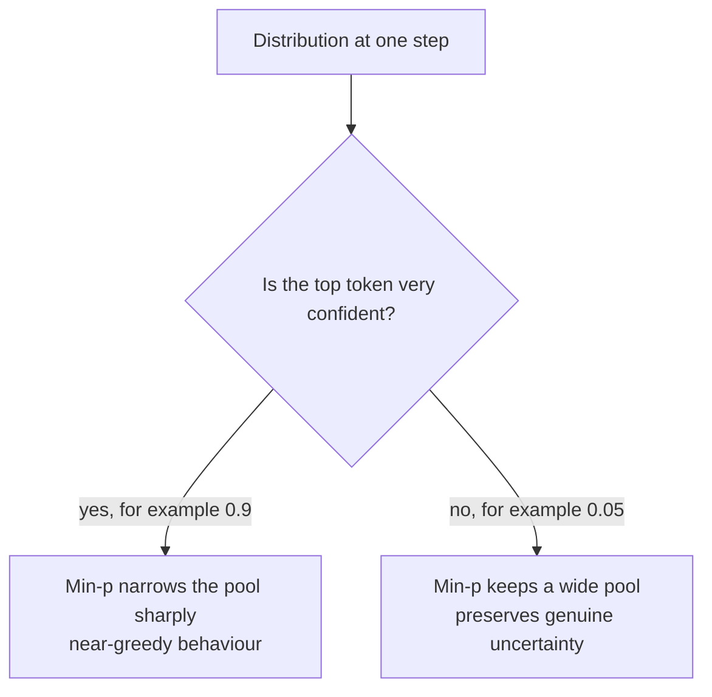

> [!TIP]
> **Why these exist.** Top-k is *shape-blind* and top-p is *magnitude-blind to the leader*. Min-p is a cheap,
> robust fix that behaves like greedy when the model is sure and like sampling when it is not — which is exactly
> what you want for a general-purpose assistant. If a provider offers it, it is usually a better default than
> tuning top-p by hand.

---

## 08.9 Penalties, stop conditions and length limits

These controls do not reshape the *pool*; they **modify logits based on what has already been generated**.

| Control | Mechanism | Effect |
| :--- | :--- | :--- |
| **Repetition penalty** | divide (or subtract from) the logits of tokens already in the output | discourages any repeat; can damage legitimately repeated tokens (names, code identifiers) |
| **Frequency penalty** | subtract an amount proportional to how **often** a token has appeared | proportional discouragement; good for breaking loops |
| **Presence penalty** | subtract a **fixed** amount if a token has appeared at all | encourages introducing new topics/words; ignores how many times |
| **Stop sequences** | halt generation when a string appears | structural control (end of a JSON block, `"\n\nUser:"`) |
| **Max output tokens** | hard cap on generated length | cost and latency control; prevents runaway loops |
| **Logit bias** | add/subtract a constant for specific token IDs | forbid or encourage specific words (Chapter 07 §07.7) |

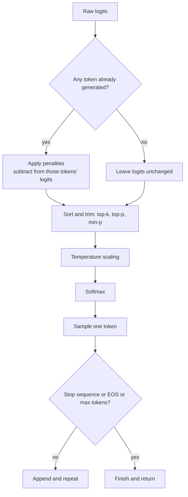

> [!WARNING]
> **Penalties are blunt instruments.** A repetition penalty strong enough to fix a loop will also mangle code
> (where `const`, `{`, `}` and variable names *must* repeat) and names (where a surname appears ten times).
> Prefer the smallest value that fixes the actual problem, and measure on your own data rather than copying a
> value from a blog post.

---

## 08.10 Order of operations, and pseudo-code

The order matters, because these operations do not commute.

| # | Step | Why here |
| :---: | :--- | :--- |
| 1 | logits from the LM head | the model's raw opinion |
| 2 | logit bias / vocabulary mask | structural constraints first (schema, forbidden tokens) |
| 3 | penalties | depend on the tokens already generated |
| 4 | **temperature** | scales the logits; changes relative gaps |
| 5 | **top-k / top-p / min-p** | trims the pool using probabilities, so must come after temperature |
| 6 | softmax | produce the final distribution |
| 7 | renormalise the trimmed pool | so the sampled distribution sums to 1 |
| 8 | sample or argmax | select one token |
| 9 | stop check, append, repeat | continue or finish |

```ts
// PSEUDO-CODE — the decode step. Every provider runs a variant of this loop.
function decodeStep(
  logits: Vector,                 // length |V|, straight from the LM head
  generated: TokenId[],           // what we have produced so far
  cfg: { temperature: number; topK?: number; topP?: number; minP?: number;
         presence?: number; frequency?: number; repetition?: number; bias?: Map<TokenId, number> },
): TokenId {
  let z = logits.slice();

  // 1. structural constraints (schema, forbidden tokens)
  if (cfg.bias) for (const [id, delta] of cfg.bias) z[id] += delta;

  // 2. penalties, computed from what has already been produced
  const counts = countTokens(generated);
  for (const id of counts.keys()) {
    if (cfg.presence)   z[id] -= cfg.presence;
    if (cfg.frequency)  z[id] -= cfg.frequency * counts.get(id)!;
    if (cfg.repetition) z[id] = z[id] > 0 ? z[id] / cfg.repetition : z[id] * cfg.repetition;
  }

  // 3. temperature (T = 0 means "greedy": skip straight to argmax)
  if (cfg.temperature === 0) return argmax(z);
  z = z.map(v => v / cfg.temperature);

  // 4. pool trimming, applied to PROBABILITIES so temperature is already baked in
  let probs = softmax(z);
  if (cfg.topK) probs = keepTopK(probs, cfg.topK);
  if (cfg.topP) probs = keepNucleus(probs, cfg.topP);
  if (cfg.minP) probs = keepAboveRelative(probs, cfg.minP);

  // 5. renormalise the survivors and draw one token
  const pool = renormalise(probs);
  return weightedRandomDraw(pool);
}
```

> [!TIP]
> **A note on providers that "do it for you".** Hosted APIs implement this loop server-side, so you only pass
> the parameters. But the *order* they apply is fixed by the provider, and providers differ in how they order
> penalties versus temperature — which is one reason identical parameter values behave slightly differently
> across vendors. When you migrate a prompt between providers, re-tune rather than copy.

---

## 08.11 Determinism, seeds, and what you can actually rely on

You will eventually be asked: *"can we make the model give the same answer every time?"* Here is the honest
answer, in order of strength.

| Technique | Determinism achieved | Caveats |
| :--- | :--- | :--- |
| **Temperature 0 / greedy** | removes *sampling* randomness | floating-point non-associativity, batching and kernel selection can still change results; some providers note that temperature 0 is only "mostly" deterministic |
| **Fixed seed** | removes *sampling* randomness if the provider honours it | not all providers expose or guarantee a seed; not stable across model versions |
| **Fixed model version** | pins the weights | providers deprecate versions; a "same" alias may move |
| **Fixed everything** (pinned version + seed + params + no tools + no retrieval) | reproducible for practical purposes | still no bit-identical guarantee, and any context difference (history, retrieved docs, timestamps) changes the output |

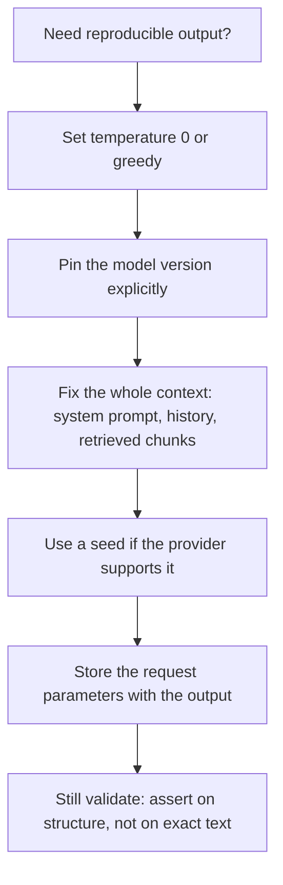

> [!IMPORTANT]
> **The engineering conclusion: never unit-test exact generated text.** Assert on *properties* — valid JSON,
> required fields present, classification label in the allowed set, no forbidden phrase, schema-valid tool call.
> Exact-text tests break on every provider update and teach you nothing about quality (Lecture 30 — Evals).

---

## 08.12 Why ChatGPT streams text

Streaming is **not a special feature** — it is a natural consequence of autoregressive generation.

Because the model produces **one token at a time**, each token exists as soon as it is sampled. The application
server can forward it immediately over a streaming connection (Server-Sent Events or WebSockets) instead of
waiting for the whole response.

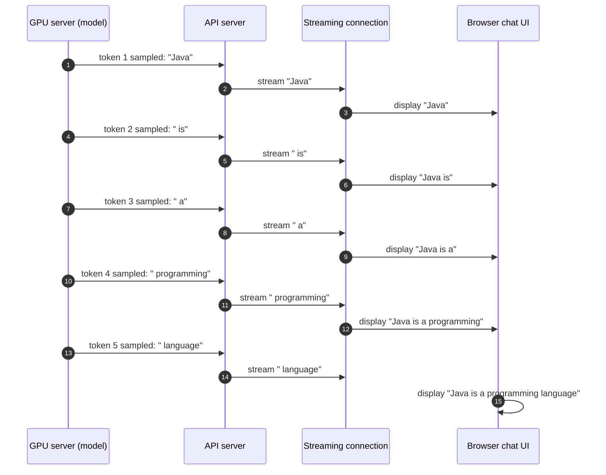

| Concept | What it is | Who controls it |
| :--- | :--- | :--- |
| **Autoregressive generation** | token-by-token forward passes through the model | model architecture |
| **UI streaming** | a network protocol delivering tokens incrementally | application server + client |

> [!NOTE]
> **Two independent concerns.** You can have autoregressive generation *without* streaming (wait for the full
> response, then display it), and you can stream a pre-generated response. Streaming is about **time to first
> token**, not about the model — and it matters commercially, because perceived latency is dominated by the first
> visible token. Depth in **Lecture 07 — AI Streaming**.

---

## 08.13 Recipes: parameter sets per task

| Task | Temperature | Top-p | Top-k / min-p | Penalties | Rationale |
| :--- | :--- | :--- | :--- | :--- | :--- |
| **Code generation / refactor** | 0 – 0.2 | 1.0 (off) or 0.95 | top-k small | none | determinism and correctness; penalties break repeated syntax |
| **Structured extraction / JSON** | 0 | — | grammar-constrained | none | output must be schema-valid; use constrained decoding (Lecture 10) |
| **Factual Q&A over documents (RAG)** | 0 – 0.3 | 0.9 | top-k 40 | none | grounding over fluency; low variance |
| **Classification / routing** | 0 | — | — | none | single correct label; use logprobs for confidence |
| **Summarisation** | 0.3 – 0.5 | 0.9 | — | light frequency penalty | faithful but not robotic |
| **General chat assistant** | 0.7 – 1.0 | 0.9 – 0.95 | min-p 0.05 | none | balanced |
| **Copywriting / marketing** | 0.8 – 1.1 | 0.95 | — | small presence penalty | variety without drift |
| **Brainstorming / idea generation** | 1.0 – 1.3 | 0.95 – 0.98 | — | presence penalty | maximise diversity; expect some junk |
| **Creative fiction** | 1.0 – 1.4 | 0.95 – 0.98 | — | frequency penalty | long-form variety; watch coherence |
| **Data augmentation / synthetic data** | 1.2 – 1.5 | 0.98 | — | presence penalty | volume and diversity matter more than polish |

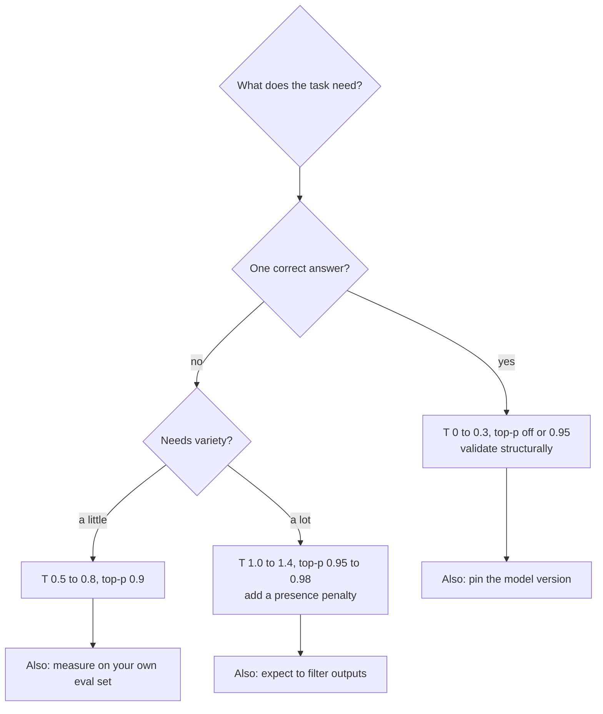

> [!TIP]
> **The rule of thumb that survives every project.** Start at **temperature 0** for anything you will test or
> measure, and only raise it when you can point at the *quality* you are buying with the added variance. Most
> production systems ship with a low temperature and a good prompt, not with a creative temperature and a
> prayer.

---

## Common mistakes

- **Believing the model chooses the token.** The model produces a distribution; the decoder chooses.
- **Saying temperature "adds creativity".** It **flattens the distribution**, which lets lower-ranked tokens be
  drawn more often. That is a mechanism, not a personality.
- **Thinking temperature changes which token is most likely.** Ranking is preserved; only the gaps change.
- **Setting temperature 0 and expecting bit-identical outputs forever.** Pin the model version and the whole
  context too, and still assert on properties.
- **Using top-p and top-k without checking the order of operations.** They are applied after temperature, and
  providers differ in their internal ordering.
- **Assuming top-k is always safe.** A fixed $k$ on a flat distribution still admits nonsense.
- **Copying penalty values between tasks.** A repetition penalty that helps prose destroys code.
- **Forgetting `max_tokens`.** A looping model with no cap is an unbounded bill.
- **Treating beam search as "greedy but better".** It optimises sequence likelihood, which is often not what
  users want, and it costs $k\times$ the compute.
- **Confusing streaming with generation.** Streaming is a transport decision; the model always generates one
  token at a time.
- **Believing a higher temperature is required for "better writing".** Usually a better prompt and a lower
  temperature win.

## Key takeaways

1. **The model and the decoder are separate systems**: the model proposes a distribution, the decoder picks a
   token. All sampling parameters live outside the weights.
2. **Greedy** (`argmax`) is deterministic, can loop, and lacks diversity; it is the right default for
   correctness-critical tasks.
3. **Beam search** tracks $k$ sequences by cumulative log-probability; it suits tasks with one right answer and
   is not exposed for chat because it maximises likelihood rather than usefulness.
4. **Sampling** is a weighted lottery; the compounding of one random choice into the next distribution is why
   the same prompt gives different answers.
5. **Temperature** divides logits before softmax: $T<1$ sharpens, $T=1$ is the model's own distribution, $T>1$
   flattens. $T=0$ is greedy; $T\to\infty$ is uniform noise.
6. **Top-k** trims to a fixed count; **top-p** trims to a cumulative probability mass. Top-p adapts to the
   distribution's shape, which is why it is the better general default.
7. **Min-p and typical sampling** use the leader's probability (or information content) to decide the pool —
   near-greedy when the model is confident, wide when it is uncertain.
8. **Penalties** (repetition / frequency / presence) are additive logit adjustments driven by what has already
   been generated; **stop sequences** and **max tokens** are structural controls.
9. The **order of operations** is bias/mask → penalties → temperature → top-k/top-p/min-p → softmax →
   renormalise → sample; it is not commutative.
10. **Streaming** follows directly from autoregressive generation; it improves *perceived* latency but does not
    change the model.
11. For production: **start at temperature 0**, raise it only for measured quality gains, and **assert on
    structure rather than exact text**.

## Self-check questions

1. Name the two stages of generation and say what each can see.
2. Give the three failure modes of greedy decoding, with an example of each.
3. How does beam search score sequences, and why does that create a length bias? What fixes it?
4. Explain, in three steps, why sampling makes two runs of the same prompt diverge.
5. Starting from logits 5, 4, 3, 2, 1, compute the adjusted logits and approximate probabilities for
   $T = 0.5$ and $T = 2.0$.
6. Why is $T = 0$ equivalent to greedy decoding, and what does $T \to \infty$ produce?
7. Compare top-k and top-p on a peaked distribution and on a flat one. Which is more robust, and why?
8. What problem does min-p solve that top-p does not?
9. Write the order of operations for one decode step, and explain why temperature must come before top-p.
10. You need reproducible classification labels. List four things you would pin or fix.
11. Explain the difference between autoregressive generation and UI streaming, and give one product reason
    streaming matters.
12. Choose a parameter set for (a) a JSON extractor, (b) a customer-support assistant, (c) an ad-copy generator,
    and justify each choice in one sentence.

---

### Navigation

- **Previous:** [Chapter 07 — Logits, the LM Head & Softmax](./07_Logits_the_LM_Head_and_Softmax.md)
- **Next:** [Chapter 09 — Position, Masking & Attention Geometry](./09_Position_Masking_and_Attention_Geometry.md)
- **Source:** `Forward-Deployed-Engineer/Lecture 02/notes/06_Softmax_Decoding_Strategies_and_Temperature.md`
  (§6.2–6.6) · `Excalidraw-Notes.svg` · `gen-ai-cohort/week01/learning/day01/notes/notes.md`
- **Back to index:** [../index.md](../index.md)