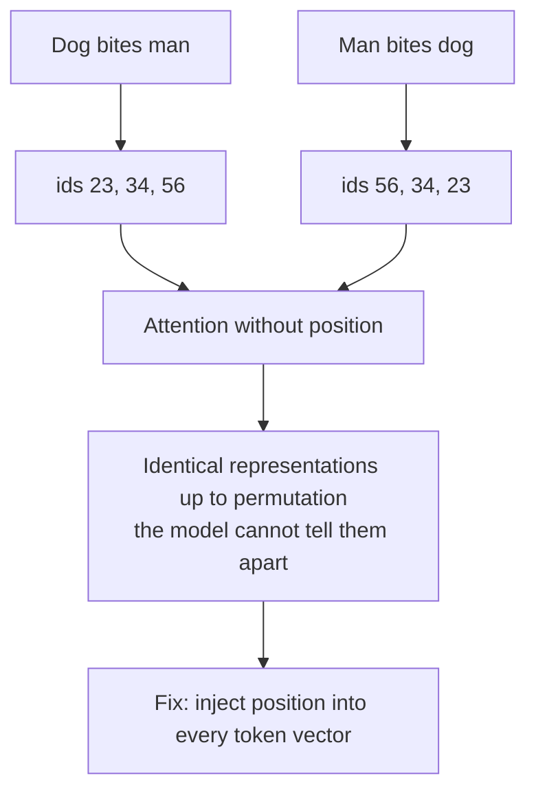
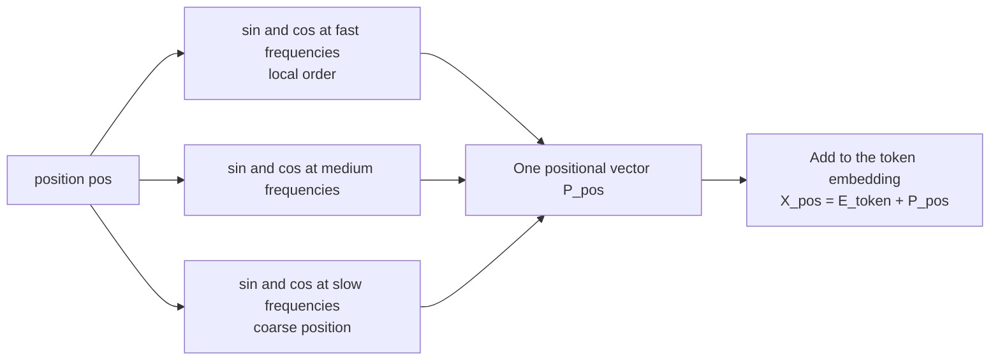
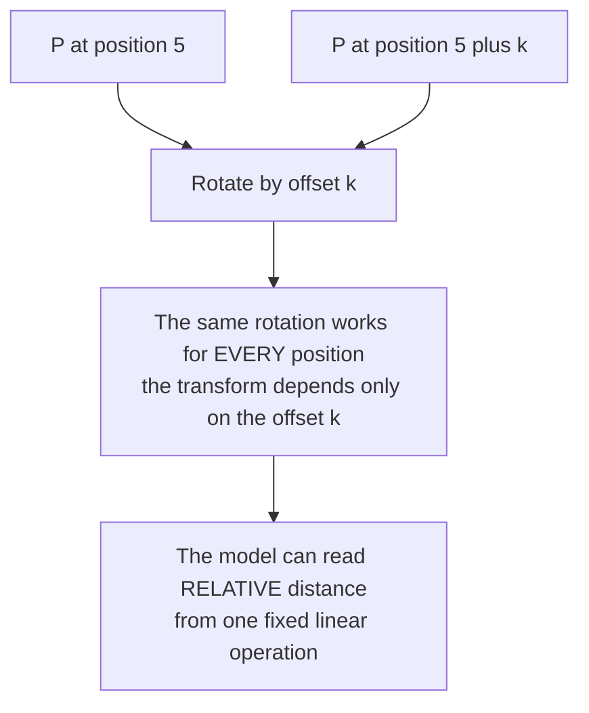
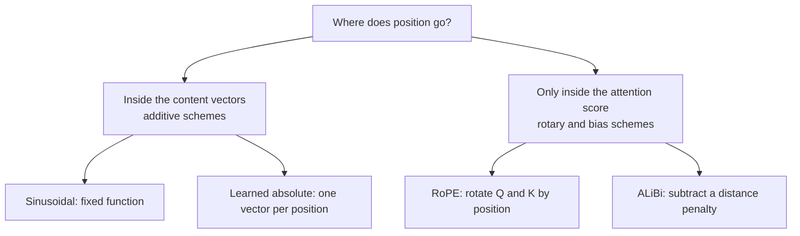
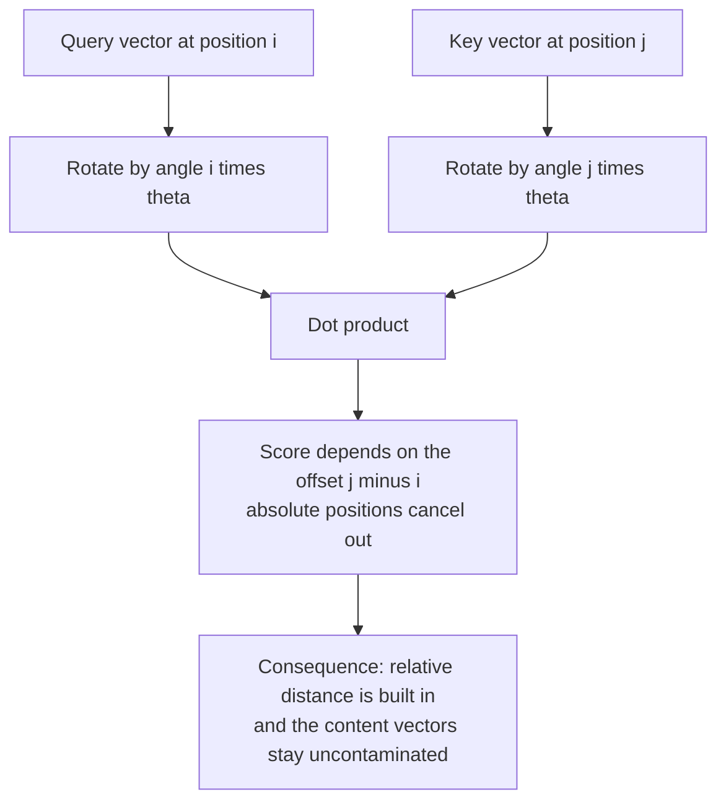
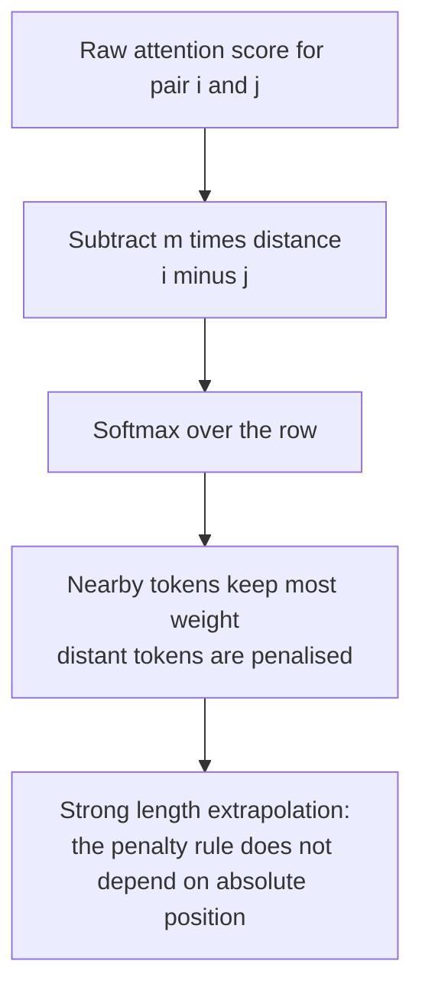
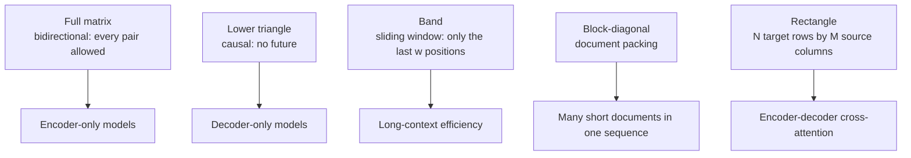
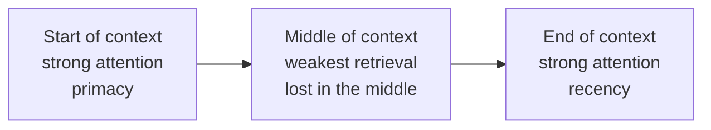

# Chapter 09 — Position, Masking & Attention Geometry

> **Lecture 03 · Chapter 09 of 09** · Level: 🟢 Beginner · Phase 1 — Foundations: How LLMs Actually Work
> **Source:** `Forward-Deployed-Engineer/Lecture 02/notes/03_Positional_Encodings_and_Vector_Embeddings.md`
> (§3.1–3.2, linear-offset property) — revisited here from the **attention** side ·
> `05_Transformer_Blocks_Deep_Layers_and_Logits.md` (§5.4 causal mask) ·
> `gen-ai-cohort/week01/learning/day01/notes/notes.md` (Step 3 — Positional Encoding)
> **Roadmap topics:** **positional encodings: sinusoidal form & the linear-offset property** ·
> causal masking · how position enters the attention score.

---

## 09.0 What this chapter is for

Lecture 02 (Chapter 07) introduced positional encoding as an **input-side** idea: add a position vector to each
token embedding so the model can tell order apart. This chapter asks the question that belongs to *this*
lecture: **what does position actually do to the attention computation?**

The answer is subtle and worth the chapter. Attention scores are dot products, so position only matters if it
changes the *geometry* of queries and keys. That is exactly what the modern schemes do — and understanding it
explains "lost in the middle", why reordering retrieved chunks changes answers, and why long context is not the
same as usable context.

By the end of this chapter you should be able to:

1. Explain permutation invariance and why it forces position to be injected.
2. Describe the **sinusoidal** form and state the **linear-offset property**, with a rotation-matrix proof sketch.
3. Explain how **additive** positional vectors enter the attention score.
4. Explain **RoPE** — rotating Q and K so the score depends on the **relative** offset — and why it is the modern
   default.
5. Explain **ALiBi** and its built-in recency preference.
6. Compare the four schemes and name the models that use each.
7. Draw the geometry of **causal**, **padding**, and **sliding-window** masks.
8. Explain the practical consequences: prompt layout, chunk order, and long-context degradation.

---

## 09.1 Why attention needs position at all

Self-attention is **permutation-invariant**: if you shuffle the tokens, each token's output is just shuffled too.
Nothing in $QK^{T}$ depends on order.

```text
"Dog bites man"   ->  token ids [23, 34, 56]
"Man bites dog"   ->  token ids [56, 34, 23]
```

Without position, the attention weights and the outputs would be identical up to permutation. Same input,
different meaning: unacceptable.



> [!IMPORTANT]
> **The design requirement in one line.** Position must be injected **before** attention, and it must change the
> **dot products** — otherwise attention cannot distinguish orders.

---

## 09.2 The sinusoidal form and the linear-offset property

The original 2017 scheme builds a positional vector $\mathbf{P}_{pos} \in \mathbb{R}^{d_{\text{model}}}$ from
sine and cosine waves at a **geometric ladder of frequencies**:

$$PE_{(pos,\,2i)} = \sin\!\left(\frac{pos}{10000^{2i/d_{\text{model}}}}\right), \qquad PE_{(pos,\,2i+1)} = \cos\!\left(\frac{pos}{10000^{2i/d_{\text{model}}}}\right)$$

and adds it to the token embedding: $\mathbf{X}_{pos} = \mathbf{E}_{\text{token}} + \mathbf{P}_{pos}$.

| Dimension pair | Wavelength | Behaviour |
| :--- | :--- | :--- |
| low $i$ (first pairs) | very short ($\approx 2\pi$) | changes fast — fine-grained local order |
| high $i$ (last pairs) | very long (up to $\approx 10000 \cdot 2\pi$) | changes slowly — coarse position |



Think of it as **clock hands spinning at different speeds**: the fast hands give the second, the slow hands give
the hour. Together they identify a moment uniquely, and every value stays in $[-1, 1]$.

### The linear-offset property

Because each dimension pair is a rotation, the vector at position $pos + k$ is a **fixed linear transform** of
the vector at position $pos$ — for every $k$, independent of $pos$:

$$\mathbf{P}_{pos+k} = R_k \, \mathbf{P}_{pos}$$



Why this matters: a dot product between two position-aware vectors can be made to depend primarily on the
**offset** between them rather than on their absolute positions. That is what lets the model generalise "the
token two places back" to any position in the sequence — including positions it rarely saw during training.

> [!NOTE]
> **Absolute in form, relative in effect.** Sinusoidal encodings are added as *absolute* vectors, but the
> linear-offset property lets the model extract *relative* information. This is why they extrapolate somewhat
> better than learned absolute embeddings — and why later schemes made relativity explicit (RoPE, ALiBi).

### How additive position enters the attention score

With additive position, the query and key of token $i$ become $Q_i = (\mathbf{E}_i + \mathbf{P}_i)W_Q$ and
$K_j = (\mathbf{E}_j + \mathbf{P}_j)W_K$, so the score expands into four terms:

$$Q_i \cdot K_j = \underbrace{E_i \cdot E_j}_{\text{content}} + \underbrace{E_i \cdot P_j}_{\text{content vs position}} + \underbrace{P_i \cdot E_j}_{\text{position vs content}} + \underbrace{P_i \cdot P_j}_{\text{position vs position}}$$

| Term | Interpretation |
| :--- | :--- |
| $E_i \cdot E_j$ | pure semantic similarity — what attention "wants" |
| $E_i \cdot P_j$ and $P_i \cdot E_j$ | cross terms; the model can learn to bias towards certain positions |
| $P_i \cdot P_j$ | the relative-position signal (via the linear-offset property) |

> [!TIP]
> **The cost of the additive approach.** Position is mixed into the *content* vectors, so it cannot be removed
> later: every subsequent layer sees position-contaminated content. That is the motivation for RoPE, which keeps
> the content vectors untouched and rotates them only at the moment of scoring.

---

## 09.3 The four positional schemes, compared

| Scheme | Mechanism | Where position lives | Length behaviour | Used by |
| :--- | :--- | :--- | :--- | :--- |
| **Sinusoidal (absolute)** | add fixed sin/cos vectors | inside the content vectors | weak extrapolation | original Transformer |
| **Learned absolute** | add a **learned** vector per position | inside the content vectors | hard cap at trained length | GPT-2, BERT |
| **RoPE (rotary)** | **rotate Q and K** by position-dependent angles | only inside the attention score | relative; extensible with scaling tricks | LLaMA, Mistral, Qwen, most current open models |
| **ALiBi** | subtract a **distance-proportional bias** from scores | only inside the attention score | strong extrapolation | BLOOM, MPT, some long-context models |



| Property | Sinusoidal | Learned absolute | RoPE | ALiBi |
| :--- | :--- | :--- | :--- | :--- |
| Extra parameters | none | $N_{\max} \times d$ | none | none (or one slope per head) |
| Relative or absolute | absolute with relative effect | absolute | **relative** | **relative** |
| Beyond trained length | poor | impossible | needs scaling (interpolation / NTK / YaRN) | comparatively strong |
| Recency preference | none explicit | none | weak decay | **explicit and tunable** |
| Position contaminates content | yes | yes | **no** | **no** |

---

## 09.4 RoPE: rotating queries and keys

**Rotary position embedding** takes a different route: leave the vectors alone, and instead **rotate** each
query and key by an angle proportional to its position, in 2-dimensional blocks.

$$\tilde{Q}_i = R_{\Theta, i}\, Q_i, \qquad \tilde{K}_j = R_{\Theta, j}\, K_j$$

where $R_{\Theta, pos}$ is a block-diagonal rotation matrix (2×2 rotations for each pair of dimensions) with
angles $pos \cdot \theta_m$ for a ladder of frequencies $\theta_m$.

### Why this gives relativity — the derivation sketch

In two dimensions, a rotation by angle $\alpha$ is
$\begin{pmatrix} \cos\alpha & -\sin\alpha \\ \sin\alpha & \cos\alpha \end{pmatrix}$. The dot product of two
rotated vectors is:

$$(R_{\alpha}q)\cdot(R_{\beta}k) = \lVert q \rVert \lVert k \rVert \cos\!\left(\phi - (\beta - \alpha)\right)$$

where $\phi$ is the angle between $q$ and $k$ in the unrotated space. Notice what appears in the formula:
**only the difference $\beta - \alpha$** — the **position offset $j - i$**. Absolute positions cancel.



| RoPE property | Why it matters |
| :--- | :--- |
| Score depends on $j - i$ | relative distance is exact, not approximate |
| No positional vectors added | content is never contaminated; the residual stream stays clean |
| Applied per head, per layer | each head can read different frequency bands |
| Distances **decay** with offset | attention naturally prefers nearby tokens — helps locality, hurts "lost in the middle" |
| Extensible | long-context models rescale the frequencies: linear position interpolation, NTK-aware scaling, YaRN |

> [!IMPORTANT]
> **RoPE is the default because it is relative, cheap and extensible.** It adds zero parameters, gives exact
> relative geometry, and — crucially — it can be *stretched* after training. Almost every long-context open model
> uses RoPE with some frequency-scaling scheme, and that is exactly why its advertised context length is larger
> than its training length.

### How context extension works (in one table)

| Technique | Idea | Trade-off |
| :--- | :--- | :--- |
| **Position interpolation** | compress positions so a 32k-trained model accepts 128k by scaling indices down | cheap; quality drops without fine-tuning |
| **NTK-aware scaling** | scale the *frequencies* rather than the positions | better quality retention |
| **YaRN** | combine interpolation with per-frequency-band attention-temperature adjustment | current best practice for many models |
| **Fine-tune on long data** | train on the target length | most reliable; costs compute |

> [!WARNING]
> **Advertised context length ≠ usable context length.** A model stretched from 8k to 128k with a scaling trick
> can *accept* 128k tokens while its accuracy degrades quietly in the middle of that window. Always validate
> long-context behaviour on **your** tasks rather than trusting the model card — the same "capacity versus
> attention quality" distinction made in Lecture 02, Chapter 08.

---

## 09.5 ALiBi: a distance penalty instead of a position vector

**Attention with Linear Biases** removes positional vectors entirely. It adds a **negative bias proportional to
distance** directly to the attention scores:

$$\text{score}_{ij} = \frac{Q_i \cdot K_j}{\sqrt{d_k}} - m_h \cdot (i - j), \qquad i \ge j$$

where $m_h$ is a per-head slope (fixed geometric sequence, not learned).



| ALiBi property | Consequence |
| :--- | :--- |
| No positional embeddings at all | fewer parameters and a cleaner residual stream |
| Linear recency bias | a built-in "nearby matters more" prior |
| Different slope per head | some heads are strongly local, others nearly position-free |
| Extrapolation | trains at 1k and still works at 4k+ without any positional parameters to outgrow |

> [!NOTE]
> **Why recency bias is a double-edged sword.** A built-in preference for nearby tokens helps local coherence and
> makes long-context behaviour stable. It also means a fact stated 40k tokens ago competes against everything
> said since — one mechanism behind "lost in the middle" (§09.8).

---

## 09.6 The geometry of masks

A mask is a **shape drawn on the $N \times N$ score matrix**. Different shapes implement different
architectures and different cost profiles.



| Mask | Shape on the matrix | What it implements |
| :--- | :--- | :--- |
| **Causal** | lower triangle ($j \le i$) | left-to-right generation |
| **Padding** | whole columns removed | ignore batch padding |
| **Sliding window** | band of width $w$ around the diagonal | local attention; $O(N \cdot w)$ instead of $O(N^2)$ |
| **Sink + window** | a band plus the first token | keeps a global anchor while staying cheap |
| **Cross-attention** | a rectangle (targets × source) | encoder-decoder conditioning |
| **Document mask** | block diagonal | pack many short documents into one long sequence without cross-contamination |

```text
Sliding window of width 3, causal, on a 6-token sequence (X = allowed):

        to:  t1  t2  t3  t4  t5  t6
from t1       X   .   .   .   .   .
from t2       X   X   .   .   .   .
from t3       X   X   X   .   .   .
from t4       .   X   X   X   .   .
from t5       .   .   X   X   X   .
from t6       .   .   .   X   X   X
```

| Consequence of the band | Detail |
| :--- | :--- |
| Cost | per-token work is constant ($w$) instead of growing with $N$ |
| Information flow | distant tokens need **multiple layers** to influence each other — one hop per layer through the window |
| Quality | usually a small loss on long-range tasks, a large saving in memory and time |
| Where you see it | long-context and on-device models; hybrid models that interleave windowed and full-attention layers |

> [!IMPORTANT]
> **The unifying rule, restated.** Masking is always *"set the forbidden entries to $-\infty$ before the
> softmax"* — whether the forbidden entries are positions (causal, padding, window) or vocabulary tokens (logit
> bias, constrained decoding, Chapter 07 §07.7). One mechanism, two axes of control.

---

## 09.7 Pseudo-code: position and mask together

```ts
// PSEUDO-CODE — how position and masking are wired into one attention call.
type Matrix = number[][];

function positionAwareAttention(
  X: Matrix,                                   // N x d_model, position-FREE content (RoPE style)
  w: { wq: Matrix; wk: Matrix; wv: Matrix },
  opts: { positions: number[]; causal: boolean; window?: number; rope?: boolean },
): Matrix {
  let Q = matmul(X, w.wq);
  let K = matmul(X, w.wk);
  const V = matmul(X, w.wv);

  // 1. POSITION, RoPE style: rotate Q and K by their own position.
  //    Absolute positions cancel in the dot product, so the score depends on the offset.
  if (opts.rope) {
    Q = rotateByPosition(Q, opts.positions);
    K = rotateByPosition(K, opts.positions);
  }

  let scores = scale(matmul(Q, transpose(K)), 1 / Math.sqrt(Q[0].length));

  // 2. MASK, one additive matrix for every rule.
  for (let i = 0; i < X.length; i++) {
    for (let j = 0; j < X.length; j++) {
      const future = opts.causal && j > i;
      const tooFar = opts.window !== undefined && i - j >= opts.window;
      if (future || tooFar) scores[i][j] = -Infinity;
    }
  }

  // 3. Softmax and mix. Note: positions never touched X itself.
  return matmul(softmaxRows(scores), V);
}

// Additive alternative (sinusoidal or learned absolute): position is added to X BEFORE
// this function, so it flows into Q, K and V and contaminates the content.
//   X = addPositionalVector(embed(tokens), positions)
```

| Design choice | Where it happens | Consequence |
| :--- | :--- | :--- |
| Sinusoidal / learned absolute | **before** attention, on $\mathbf{X}$ | contaminates content, flows into $V$ as well as $Q,K$ |
| RoPE | **inside** attention, on $Q$ and $K$ only | content and values stay clean |
| ALiBi | **inside** attention, added to the scores | no positional vectors anywhere |

---

## 09.8 Why this matters in your application

Everything above is not trivia — it directly explains product behaviour you will be asked about.

### 1. "Lost in the middle"

Empirically, models retrieve evidence from the **beginning** and **end** of a long context far more reliably
than from the middle.



Two mechanisms combine to cause it:

| Mechanism | Explanation |
| :--- | :--- |
| **Positional decay** | RoPE and ALiBi both penalise distance, so a distant token competes with everything nearer |
| **Attention sinks and recency** | early tokens and the most recent tokens attract disproportionate attention mass |

| Mitigation | How it works |
| :--- | :--- |
| Put instructions and key constraints at the **top** and repeat them at the **bottom** | exploits primacy and recency |
| **Rerank** retrieved chunks and place the best ones at the edges | the highest-value evidence sits where attention is strongest |
| Keep the context **smaller** | fewer distractors; usually a bigger win than any formatting trick |
| Use **citations / structured tags** so the model can reference evidence explicitly | reduces reliance on raw positional memory |

### 2. Chunk order changes answers

Because attention is position-sensitive, **the same set of retrieved chunks in a different order can produce a
different answer**. This is a real bug class in RAG systems (Lectures 16–17).

| Practice | Reason |
| :--- | :--- |
| Sort chunks deterministically (e.g. by score, then by document id) | reproducibility |
| Place the top-1 chunk **last** or **first**, not in the middle | exploits primacy/recency |
| Log the exact chunk order with every response | you cannot debug a non-reproducible context |

### 3. Long context is not the same as usable context

| Claim | Reality |
| :--- | :--- |
| "It has a 200k window, so I can paste 200k tokens" | it can *accept* them; accuracy at the middle degrades |
| "More context always helps" | distractors dilute attention; precision often falls |
| "Context length is free" | quadratic attention and linear KV-cache growth say otherwise (Chapter 03 §03.7) |

### 4. Position affects more than retrieval

| Effect | Explanation |
| :--- | :--- |
| **Instruction ordering** | an instruction placed after contradictory data is followed more reliably than one placed before it |
| **Few-shot example order** | recency means the last example has the strongest influence on format |
| **Tool schema ordering** | a very long tool list buries later tools in the middle of the context (Lecture 08) |
| **System-prompt position** | system prompts sit at the very start — strong primacy — which is why they are hard to override from the middle |

> [!TIP]
> **The practical checklist that follows from this chapter.** (1) Keep the context as small as you can.
> (2) Put the most important material at the edges. (3) Order deterministically and log the order.
> (4) Validate long-context behaviour on your own tasks. (5) Never trust an advertised window as a promise of
> quality.

---

## Common mistakes

- **Saying "attention knows word order".** It does not; attention is permutation-invariant and position is
  injected separately.
- **Believing positional encoding is always learned.** Sinusoidal, RoPE and ALiBi are all **fixed functions**
  with no positional parameters (ALiBi has only fixed per-head slopes).
- **Concatenating positional vectors instead of adding them.** Addition keeps the dimension fixed, which the
  architecture requires.
- **Assuming a bigger advertised context window means better long-context use.** "Lost in the middle" is about
  *where* the evidence sits, not how much fits.
- **Thinking RoPE adds positional vectors.** It rotates queries and keys; nothing is added to the content.
- **Believing RoPE is unbounded.** Without frequency scaling, quality degrades past the trained length; with
  scaling, it degrades more quietly.
- **Ignoring chunk order in a prompt.** With positional decay and attention sinks, ordering changes answers.
- **Putting the most important instruction in the middle of a long context.** Primacy and recency both work
  against you there.
- **Forgetting that masks are applied before the softmax.** Applying them after leaves rows un-normalised.
- **Assuming sliding-window attention behaves like full attention.** Distant tokens need multiple layers to
  interact, which changes what the model can reason about.

## Key takeaways

1. **Attention is permutation-invariant**, so position must be injected — and it must change the **dot products**,
   not just the input vectors.
2. **Sinusoidal** encodings use sin/cos at a geometric ladder of frequencies; the **linear-offset property**
   ($\mathbf{P}_{pos+k} = R_k\mathbf{P}_{pos}$) makes relative distance readable from a fixed linear operation.
3. **Additive** position contaminates the content vectors (it flows into $V$ as well as $Q,K$).
4. **RoPE** rotates Q and K so the score depends only on the offset $j - i$: exact relativity, no extra
   parameters, no content contamination, and it can be stretched with interpolation / NTK / YaRN scaling.
5. **ALiBi** subtracts a distance-proportional bias from the scores, giving strong extrapolation and an explicit
   recency preference.
6. Length behaviour: learned absolute caps hard; sinusoidal extrapolates weakly; RoPE needs scaling; ALiBi
   extrapolates well.
7. **Masks are shapes on the $N \times N$ score matrix**: causal (lower triangle), padding, sliding window (band),
   block-diagonal (document packing), rectangular (cross-attention).
8. **Masking and logit bias are the same mechanism** on two different axes — positions and vocabulary.
9. **Position affects products**: lost in the middle, chunk-order sensitivity, instruction ordering, few-shot
   example order, tool-list ordering.
10. **Advertised context length is capacity, not quality.** Validate long-context behaviour on your own tasks and
    keep the context as small as it can be while still working.

## Self-check questions

1. Show, with token ids, why `"Dog bites man"` and `"Man bites dog"` are indistinguishable without positional
   encoding.
2. Write the sinusoidal formula for a dimension pair and explain why multiple frequencies are used.
3. State the linear-offset property and explain why it lets the model read *relative* distance.
4. Expand $Q_i \cdot K_j$ for additive position into its four terms and label each.
5. Why does RoPE not contaminate the content vectors, and why does that matter for the residual stream?
6. Sketch the 2-D derivation showing that the RoPE dot product depends only on $\beta - \alpha$.
7. Explain ALiBi's score formula and how its per-head slopes create a recency prior.
8. Name the four positional schemes and one model family for each.
9. Draw the causal mask and the sliding-window mask for a 5-token sequence and state what each forbids.
10. Explain "lost in the middle" using positional decay and attention sinks, then give two mitigations.
11. Your RAG system gives different answers when the retriever returns the same chunks in a different order.
    Explain why, and how you would fix it.
12. A model card claims a 1M-token context. What two experiments would you run before believing it?

---

### Navigation

- **Previous:** [Chapter 08 — Decoding Strategies & Sampling Controls](./08_Decoding_Strategies_and_Sampling_Controls.md)
- **Next:** [Lecture_03_Complete_Notes.md](./Lecture_03_Complete_Notes.md) — the consolidated notes for this lecture
- **Source:** `Forward-Deployed-Engineer/Lecture 02/notes/03_Positional_Encodings_and_Vector_Embeddings.md`
  (§3.1–3.2) · `05_Transformer_Blocks_Deep_Layers_and_Logits.md` (§5.4) ·
  `gen-ai-cohort/week01/learning/day01/notes/notes.md` (Step 3 — Positional Encoding)
- **Back to index:** [../index.md](../index.md)