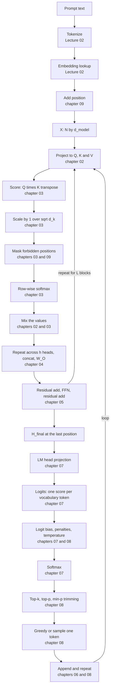
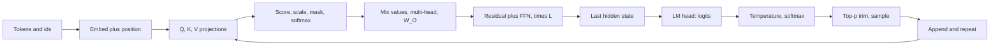

# Lecture 03 — Complete Notes
## Attention, Transformer Architecture & Decoding Strategies

> **Phase:** 1 · Foundations · **Level:** 🟢 Beginner · **Prerequisites:** Lecture 02
> **Scope:** a single-pass consolidation of the nine chapter notes in this folder.
> **How to use this file:** read it to *revise and navigate*. It is deliberately shorter than the chapters,
> and every section links to the chapter that explains it in full.
>
> | Chapter | File |
> | :--- | :--- |
> | 01 · Why attention: from static vectors to dynamic context | [01_Why_Attention_From_Static_Vectors_to_Dynamic_Context.md](./01_Why_Attention_From_Static_Vectors_to_Dynamic_Context.md) |
> | 02 · Queries, keys & values: the attention search engine | [02_Queries_Keys_Values_The_Attention_Search_Engine.md](./02_Queries_Keys_Values_The_Attention_Search_Engine.md) |
> | 03 · Scaled dot-product attention, by hand | [03_Scaled_Dot_Product_Attention_by_Hand.md](./03_Scaled_Dot_Product_Attention_by_Hand.md) |
> | 04 · Multi-head attention & head specialisation | [04_Multi_Head_Attention_and_Head_Specialisation.md](./04_Multi_Head_Attention_and_Head_Specialisation.md) |
> | 05 · The transformer block & the residual stream | [05_The_Transformer_Block_and_the_Residual_Stream.md](./05_The_Transformer_Block_and_the_Residual_Stream.md) |
> | 06 · Encoder-decoder vs decoder-only & why GPT is decoder-only | [06_Encoder_Decoder_vs_Decoder_Only_and_Why_GPT.md](./06_Encoder_Decoder_vs_Decoder_Only_and_Why_GPT.md) |
> | 07 · Logits, the LM head & softmax | [07_Logits_the_LM_Head_and_Softmax.md](./07_Logits_the_LM_Head_and_Softmax.md) |
> | 08 · Decoding strategies & sampling controls | [08_Decoding_Strategies_and_Sampling_Controls.md](./08_Decoding_Strategies_and_Sampling_Controls.md) |
> | 09 · Position, masking & attention geometry | [09_Position_Masking_and_Attention_Geometry.md](./09_Position_Masking_and_Attention_Geometry.md) |

---

## 1. Executive summary

**The lecture in seven sentences.**

1. A static embedding lookup cannot express context-dependent meaning (`bank`, `it`, `his`), so the model needs a
   mechanism that lets every token **read its neighbours** — that mechanism is **self-attention**
   ([01](./01_Why_Attention_From_Static_Vectors_to_Dynamic_Context.md)).
2. Attention is a **soft, differentiable database lookup**: every token emits a **Query** (what I look for), a
   **Key** (what I am findable as) and a **Value** (what I contribute), all from three learned projections of the
   same vector ([02](./02_Queries_Keys_Values_The_Attention_Search_Engine.md)).
3. The whole computation is
   $\text{softmax}\!\left(\frac{QK^{T}}{\sqrt{d_k}}\right)V$ — **score, scale, mask, softmax, mix** — and the
   $1/\sqrt{d_k}$ divisor keeps the dot products at unit variance so the softmax stays soft and gradients keep
   flowing ([03](./03_Scaled_Dot_Product_Attention_by_Hand.md)).
4. Real models run $h$ such computations in parallel with $d_{\text{head}} = d_{\text{model}}/h$, concatenate them
   and mix them with $W^{O}$ — **multi-head attention** buys several independent relationship distributions for
   roughly the cost of one full-width head ([04](./04_Multi_Head_Attention_and_Head_Specialisation.md)).
5. Attention is only one sub-layer: a block is **LayerNorm → attention → residual → LayerNorm → FFN → residual**,
   where the **residual stream** carries information past every sub-layer and the **FFN** (≈2/3 of the
   parameters) is the only place new non-linear features are computed
   ([05](./05_The_Transformer_Block_and_the_Residual_Stream.md)).
6. GPT-style models are **decoder-only** — one causal mask, one next-token objective, one KV cache — which is why
   prompting, in-context learning and tool formats all work out of the box
   ([06](./06_Encoder_Decoder_vs_Decoder_Only_and_Why_GPT.md)).
7. The stack's final hidden state is projected by the **LM head** to one logit per vocabulary token, softmax turns
   those logits into a **probability distribution**, and a **decoder** — greedy, beam or sampling with
   temperature / top-k / top-p / penalties — picks one token; the loop then repeats
   ([07](./07_Logits_the_LM_Head_and_Softmax.md), [08](./08_Decoding_Strategies_and_Sampling_Controls.md)).

**The one-line thesis, restated for this lecture:** *the model proposes a probability distribution; attention
decides what each token knows, and your decoding parameters decide what character the output has.*

---

## 2. The lecture in one diagram

**The mental model to keep:** *attention moves information between positions; the block computes within each
position; the head turns the result into vocabulary scores; the decoder chooses; the loop repeats — one token per
forward pass.*

---

## 3. Cheat sheet

### 3.1 The formulas that matter

| Formula | What it says | Chapter |
| :--- | :--- | :---: |
| $Q = XW_Q,\; K = XW_K,\; V = XW_V$ | three learned views of the same token | [02](./02_Queries_Keys_Values_The_Attention_Search_Engine.md) |
| $\text{Attention}(Q,K,V) = \text{softmax}\!\left(\dfrac{QK^{T}}{\sqrt{d_k}}\right)V$ | the whole mechanism | [03](./03_Scaled_Dot_Product_Attention_by_Hand.md) |
| $Z_i = \sum_j w_{ij}V_j,\; \sum_j w_{ij}=1$ | output is a convex combination of values | [02](./02_Queries_Keys_Values_The_Attention_Search_Engine.md) |
| $\text{Var}(Q\cdot K) \approx d_k$ | why the $\sqrt{d_k}$ divisor exists | [03](./03_Scaled_Dot_Product_Attention_by_Hand.md) |
| $\text{softmax}(z)_i = \dfrac{e^{z_i-\max z}}{\sum_k e^{z_k-\max z}}$ | numerically safe softmax (shift-invariant) | [03](./03_Scaled_Dot_Product_Attention_by_Hand.md) |
| $M_{ij} = -\infty$ for $j>i$ | causal mask, applied **before** softmax | [03](./03_Scaled_Dot_Product_Attention_by_Hand.md) |
| $\text{MultiHead} = \text{Concat}(\text{head}_1..\text{head}_h)W^{O}$ | $h$ independent views, mixed | [04](./04_Multi_Head_Attention_and_Head_Specialisation.md) |
| $d_{\text{head}} = d_{\text{model}}/h$ | head width arithmetic | [04](./04_Multi_Head_Attention_and_Head_Specialisation.md) |
| $H_{\text{out}} = H_{\text{in}} + \text{sublayer}(\text{LN}(H_{\text{in}}))$ | pre-LN residual block | [05](./05_The_Transformer_Block_and_the_Residual_Stream.md) |
| $\text{FFN}(x) = \text{GELU}(xW_1)W_2$ | the per-token non-linearity, ≈4× expansion | [05](./05_The_Transformer_Block_and_the_Residual_Stream.md) |
| $z = h_{\text{final}}W_{\text{vocab}} + b$ | LM head: representation → vocabulary | [07](./07_Logits_the_LM_Head_and_Softmax.md) |
| $P(y_i) = e^{z_i/T} / \sum_j e^{z_j/T}$ | softmax with temperature | [07](./07_Logits_the_LM_Head_and_Softmax.md), [08](./08_Decoding_Strategies_and_Sampling_Controls.md) |
| $P_{pos+k} = R_k P_{pos}$ | the sinusoidal linear-offset property | [09](./09_Position_Masking_and_Attention_Geometry.md) |
| $(R_\alpha q)\cdot(R_\beta k) \propto \cos(\phi-(\beta-\alpha))$ | RoPE: scores depend on the **offset** only | [09](./09_Position_Masking_and_Attention_Geometry.md) |

### 3.2 Shapes, in one table

| Object | Shape | Notes |
| :--- | :--- | :--- |
| $X$ | $N \times d_{\text{model}}$ | position-aware inputs |
| $Q, K$ | $N \times d_k$ | $d_k = d_{\text{model}}/h$ |
| $V$ | $N \times d_v$ | usually $d_v = d_k$ |
| $QK^{T}$ | $N \times N$ | the quadratic object |
| attention weights | $N \times N$ | each **row** sums to 1 |
| $Z$ | $N \times d_v$ | context-aware output |
| block output | $N \times d_{\text{model}}$ | **same shape as the input** — that is why blocks stack |
| logits | $|V|$ | one score per vocabulary token, for the **last** position |

### 3.3 Parameter budget (GPT-2-small-shaped, $d_{\text{model}}=768$, $d_{\text{ff}}=3072$)

| Component | Per layer | Share of a block |
| :--- | ---: | ---: |
| Attention ($3d^2$ projections + $d^2$ output) | ≈ 2.36M | ≈ 33% |
| FFN ($2 \cdot d \cdot d_{\text{ff}}$) | ≈ 4.72M | ≈ 67% |
| **Block total** | **≈ 7.08M** | 100% |

Detail: [05 §05.4](./05_The_Transformer_Block_and_the_Residual_Stream.md).

### 3.4 The five attention steps, and what breaks if you skip one

| Step | Operation | If you skip it |
| :---: | :--- | :--- |
| 1 | Score: $S = QK^{T}$ | nothing to normalise |
| 2 | Scale: $S/\sqrt{d_k}$ | softmax saturates, gradients vanish, training stalls |
| 3 | Mask: forbidden entries to $-\infty$ | the model reads the future; great training loss, broken generation |
| 4 | Softmax (row-wise, max-subtracted) | not a distribution; `NaN` on large logits |
| 5 | Mix: $Z = AV$ | no context-aware output at all |

### 3.5 The decoding pipeline, in order

| # | Control | What it does | Typical value |
| :---: | :--- | :--- | :--- |
| 1 | logit bias / vocabulary mask | forbid or boost specific tokens | schema-driven |
| 2 | penalties | discourage tokens already used | 0 by default; small if looping |
| 3 | **temperature** | scales logit gaps | 0 for precision, 0.7–1.0 for chat, 1.2+ for creative |
| 4 | **top-k** | keep the $k$ highest | 20–100 (or off) |
| 5 | **top-p** | keep the smallest set reaching cumulative $p$ | 0.9–0.95 |
| 6 | min-p (optional) | keep tokens ≥ $p_{\min}\cdot P_{\max}$ | 0.02–0.1 |
| 7 | softmax + renormalise | final distribution over the survivors | — |
| 8 | greedy or sample | select one token | greedy for determinism |
| 9 | stop check | EOS, stop string, max tokens | always set `max_tokens` |

Detail: [08 §08.10](./08_Decoding_Strategies_and_Sampling_Controls.md).

---

## 4. Decision tables

### 4.1 Which architecture family?

| Requirement | Family | Why | Chapter |
| :--- | :--- | :--- | :---: |
| Chat, agents, code, reasoning | **decoder-only** | generation + prompting + tool formats | [06](./06_Encoder_Decoder_vs_Decoder_Only_and_Why_GPT.md) |
| Embeddings, search, reranking | **encoder-only** | bidirectional representation | [06](./06_Encoder_Decoder_vs_Decoder_Only_and_Why_GPT.md) |
| Classification at low cost | **encoder-only** or a small decoder | no generation needed | [06](./06_Encoder_Decoder_vs_Decoder_Only_and_Why_GPT.md) |
| Speech-to-text, fixed-source translation | **encoder-decoder** | explicit source/target; faithful transformation | [06](./06_Encoder_Decoder_vs_Decoder_Only_and_Why_GPT.md) |
| Code completion with both-sided context | decoder-only + **FIM** | prefix-LM masking | [06](./06_Encoder_Decoder_vs_Decoder_Only_and_Why_GPT.md) |

### 4.2 Which positional scheme, and what it means for you?

| Scheme | Relative? | Extrapolation | Practical consequence |
| :--- | :--- | :--- | :--- |
| Sinusoidal | relative effect | weak | historical; the original Transformer |
| Learned absolute | no | hard cap | GPT-2/BERT-era; do not expect long context |
| **RoPE** | **yes** | needs scaling (interpolation / NTK / YaRN) | current default; long context must be validated |
| **ALiBi** | yes | strong | explicit recency prior; cheap long-context behaviour |

### 4.3 Which decoding settings?

| Task | Temp | Top-p | Notes |
| :--- | :---: | :---: | :--- |
| Code, extraction, classification | 0 | off | determinism; validate structurally |
| RAG question answering | 0–0.3 | 0.9 | grounding over fluency |
| Summarisation | 0.3–0.5 | 0.9 | faithful but not robotic |
| Chat assistant | 0.7–1.0 | 0.9–0.95 | balanced; consider min-p |
| Copywriting | 0.8–1.1 | 0.95 | variety without drift |
| Brainstorming / synthetic data | 1.0–1.4 | 0.95–0.98 | expect to filter outputs |

Detail and rationale: [08 §08.13](./08_Decoding_Strategies_and_Sampling_Controls.md).

### 4.4 Which mask?

| Mask | Shape | Use it for | Chapter |
| :--- | :--- | :--- | :---: |
| Causal | lower triangle | decoder-only generation | [03](./03_Scaled_Dot_Product_Attention_by_Hand.md), [09](./09_Position_Masking_and_Attention_Geometry.md) |
| Bidirectional | full matrix | encoders, embeddings | [06](./06_Encoder_Decoder_vs_Decoder_Only_and_Why_GPT.md) |
| Padding | whole columns | batched inference | [03](./03_Scaled_Dot_Product_Attention_by_Hand.md) |
| Sliding window | band | long-context efficiency | [09](./09_Position_Masking_and_Attention_Geometry.md) |
| Rectangular | targets × source | cross-attention | [06](./06_Encoder_Decoder_vs_Decoder_Only_and_Why_GPT.md) |
| Block-diagonal | blocks | packing documents without cross-talk | [09](./09_Position_Masking_and_Attention_Geometry.md) |

---

## 5. The end-to-end walkthrough (one token, start to finish)

The prompt `"The capital of India is"` — traced through the whole machine.

| Stage | What happens | Numbers | Chapter |
| :---: | :--- | :--- | :---: |
| 1 | tokenize | `["The", " capital", " of", " India", " is"]` | Lecture 02 |
| 2 | look up ids | `[464, 3361, 286, 3794, 318]` | Lecture 02 |
| 3 | embed | 5 vectors of width $d_{\text{model}}$ | Lecture 02 |
| 4 | add position | 5 position-aware vectors; $X$ is $5 \times d_{\text{model}}$ | [09](./09_Position_Masking_and_Attention_Geometry.md) |
| 5 | project | $Q, K, V$ are $5 \times d_k$ per head | [02](./02_Queries_Keys_Values_The_Attention_Search_Engine.md) |
| 6 | score and scale | a $5 \times 5$ score matrix, divided by $\sqrt{d_k}$ | [03](./03_Scaled_Dot_Product_Attention_by_Hand.md) |
| 7 | mask | upper triangle set to $-\infty$ | [03](./03_Scaled_Dot_Product_Attention_by_Hand.md) |
| 8 | softmax | 5 rows, each summing to 1 | [03](./03_Scaled_Dot_Product_Attention_by_Hand.md) |
| 9 | mix | $Z$ is $5 \times d_v$ | [03](./03_Scaled_Dot_Product_Attention_by_Hand.md) |
| 10 | multi-head | $h$ such results concatenated, mixed by $W^O$ | [04](./04_Multi_Head_Attention_and_Head_Specialisation.md) |
| 11 | block × $L$ | residual + FFN, repeated | [05](./05_The_Transformer_Block_and_the_Residual_Stream.md) |
| 12 | take the last position | $h_{\text{final}}$, one vector | [07](./07_Logits_the_LM_Head_and_Softmax.md) |
| 13 | LM head | logits: `Delhi +12.8`, `Mumbai +8.1`, `Kolkata +5.2`, `Punjab +3.4`, `banana −4.1` | [07](./07_Logits_the_LM_Head_and_Softmax.md) |
| 14 | temperature + softmax | `92%`, `5%`, `2%`, `1%`, `≈0%` | [07](./07_Logits_the_LM_Head_and_Softmax.md), [08](./08_Decoding_Strategies_and_Sampling_Controls.md) |
| 15 | trim the pool | top-p 0.9 keeps only the plausible candidates | [08](./08_Decoding_Strategies_and_Sampling_Controls.md) |
| 16 | select | greedy: `Delhi`; sampling: usually `Delhi` | [08](./08_Decoding_Strategies_and_Sampling_Controls.md) |
| 17 | append and loop | context becomes `"... India is Delhi"` | [08](./08_Decoding_Strategies_and_Sampling_Controls.md) |

**Cost, restated.** Attention is $O(N^2 \cdot d)$ per head per layer; the KV cache grows linearly with context
and concurrency; the FFN holds about 2/3 of the parameters; the LM head costs $d_{\text{model}} \times |V|$
parameters. Those four numbers explain almost every inference-cost decision you will make.

---

## 6. Misconceptions corrected

| # | Misconception | Correction | Chapter |
| :---: | :--- | :--- | :---: |
| 1 | "Embeddings know the context." | The lookup is static; attention's **output** is context-aware. | [01](./01_Why_Attention_From_Static_Vectors_to_Dynamic_Context.md) |
| 2 | "Attention is hard retrieval." | It is **soft**: every token always contributes something. | [01](./01_Why_Attention_From_Static_Vectors_to_Dynamic_Context.md) |
| 3 | "Attention weights explain the output." | They are a debugging clue, never causal proof. | [01](./01_Why_Attention_From_Static_Vectors_to_Dynamic_Context.md) |
| 4 | "Attention knows word order." | It is permutation-invariant; position is injected separately. | [01](./01_Why_Attention_From_Static_Vectors_to_Dynamic_Context.md), [09](./09_Position_Masking_and_Attention_Geometry.md) |
| 5 | "Q, K and V are three different tokens." | They are three projections of the **same** token vector. | [02](./02_Queries_Keys_Values_The_Attention_Search_Engine.md) |
| 6 | "One projection matrix would do." | Dot products are symmetric; $W_Q \neq W_K$ preserves directionality. | [02](./02_Queries_Keys_Values_The_Attention_Search_Engine.md) |
| 7 | "The scaling factor is cosmetic." | It controls score variance; without it softmax saturates and training stalls. | [03](./03_Scaled_Dot_Product_Attention_by_Hand.md) |
| 8 | "Masks are applied after softmax." | They are an additive $-\infty$ **before** softmax. | [03](./03_Scaled_Dot_Product_Attention_by_Hand.md) |
| 9 | "The causal mask is only a training detail." | It is required at inference too; without it, quality collapses. | [03](./03_Scaled_Dot_Product_Attention_by_Hand.md) |
| 10 | "Multi-head multiplies the cost by $h$." | Mixing FLOPs equal one full-width head; only score memory grows. | [04](./04_Multi_Head_Attention_and_Head_Specialisation.md) |
| 11 | "Each head sees different tokens." | Every head sees all tokens, through a different projection. | [04](./04_Multi_Head_Attention_and_Head_Specialisation.md) |
| 12 | "Transformer = attention." | A block also has LayerNorm, residuals and an FFN (≈2/3 of parameters). | [05](./05_The_Transformer_Block_and_the_Residual_Stream.md) |
| 13 | "The FFN mixes tokens." | It is strictly per-token; attention does the mixing. | [05](./05_The_Transformer_Block_and_the_Residual_Stream.md) |
| 14 | "Residual connections are optional." | They are the reason deep networks train at all. | [05](./05_The_Transformer_Block_and_the_Residual_Stream.md) |
| 15 | "All Transformers are GPT-like." | GPT is decoder-only; BERT is encoder-only; T5 is encoder-decoder. | [06](./06_Encoder_Decoder_vs_Decoder_Only_and_Why_GPT.md) |
| 16 | "Logits are probabilities." | They are unnormalised scores, can be negative, and do not sum to 1. | [07](./07_Logits_the_LM_Head_and_Softmax.md) |
| 17 | "Logprobs tell you the chance of being right." | They are the model's own distribution; models are confidently wrong. | [07](./07_Logits_the_LM_Head_and_Softmax.md) |
| 18 | "The model picks the token." | The model proposes a distribution; the **decoder** selects. | [08](./08_Decoding_Strategies_and_Sampling_Controls.md) |
| 19 | "Temperature adds creativity." | It flattens the distribution; it does not change the ranking. | [08](./08_Decoding_Strategies_and_Sampling_Controls.md) |
| 20 | "Temperature 0 makes output perfectly reproducible." | It removes sampling randomness only; pin version and context too. | [08](./08_Decoding_Strategies_and_Sampling_Controls.md) |
| 21 | "Beam search is greedy but better." | It maximises sequence likelihood, which is often not what users want. | [08](./08_Decoding_Strategies_and_Sampling_Controls.md) |
| 22 | "Streaming is a special model feature." | It is a consequence of autoregressive generation. | [08](./08_Decoding_Strategies_and_Sampling_Controls.md) |
| 23 | "Positional encoding is always learned." | Sinusoidal, RoPE and ALiBi are fixed functions. | [09](./09_Position_Masking_and_Attention_Geometry.md) |
| 24 | "RoPE adds positional vectors." | It rotates Q and K; content stays clean. | [09](./09_Position_Masking_and_Attention_Geometry.md) |
| 25 | "A bigger advertised window means better long-context use." | Capacity ≠ quality; validate "lost in the middle" behaviour yourself. | [09](./09_Position_Masking_and_Attention_Geometry.md) |

---

## 7. Glossary

### 7.1 Attention

| Term | Meaning | Chapter |
| :--- | :--- | :---: |
| **Self-attention** | Attention where Q, K and V all come from the same sequence | [01](./01_Why_Attention_From_Static_Vectors_to_Dynamic_Context.md) |
| **Cross-attention** | Q from one sequence (the decoder), K and V from another (the encoder) | [01](./01_Why_Attention_From_Static_Vectors_to_Dynamic_Context.md), [06](./06_Encoder_Decoder_vs_Decoder_Only_and_Why_GPT.md) |
| **Query (Q)** | The learned projection expressing "what am I looking for" | [02](./02_Queries_Keys_Values_The_Attention_Search_Engine.md) |
| **Key (K)** | The learned projection expressing "what am I findable as" | [02](./02_Queries_Keys_Values_The_Attention_Search_Engine.md) |
| **Value (V)** | The learned projection carrying "what I contribute when selected" | [02](./02_Queries_Keys_Values_The_Attention_Search_Engine.md) |
| **Scaled dot-product attention** | $\text{softmax}(QK^T/\sqrt{d_k})V$ | [03](./03_Scaled_Dot_Product_Attention_by_Hand.md) |
| **Attention weight** | One row of the post-softmax $N \times N$ matrix; sums to 1 | [03](./03_Scaled_Dot_Product_Attention_by_Hand.md) |
| **Attention sink** | A token that absorbs disproportionate attention mass, often position 0 | [04](./04_Multi_Head_Attention_and_Head_Specialisation.md) |
| **Induction head** | A head implementing "if A then B earlier, and A again, predict B" | [04](./04_Multi_Head_Attention_and_Head_Specialisation.md) |
| **Multi-head attention** | $h$ parallel attention computations, concatenated and mixed by $W^O$ | [04](./04_Multi_Head_Attention_and_Head_Specialisation.md) |
| **Head** | One of the $h$ parallel attention computations | [04](./04_Multi_Head_Attention_and_Head_Specialisation.md) |
| **$d_{\text{head}}$** | Per-head width, $d_{\text{model}}/h$ (typically 64–128) | [04](./04_Multi_Head_Attention_and_Head_Specialisation.md) |
| **MQA / GQA** | Multi-query / grouped-query attention: share K and V across heads to shrink the KV cache | [04](./04_Multi_Head_Attention_and_Head_Specialisation.md) |
| **Causal mask** | Triangular additive mask setting future positions to $-\infty$ | [03](./03_Scaled_Dot_Product_Attention_by_Hand.md) |
| **Padding mask** | Mask hiding batch-padding columns | [03](./03_Scaled_Dot_Product_Attention_by_Hand.md) |
| **Sliding-window attention** | Attention restricted to a band of $w$ recent positions | [09](./09_Position_Masking_and_Attention_Geometry.md) |

### 7.2 The block and the stack

| Term | Meaning | Chapter |
| :--- | :--- | :---: |
| **Transformer block** | LayerNorm → attention → residual → LayerNorm → FFN → residual | [05](./05_The_Transformer_Block_and_the_Residual_Stream.md) |
| **Residual stream** | The shared vector bus every sub-layer reads from and adds into | [05](./05_The_Transformer_Block_and_the_Residual_Stream.md) |
| **LayerNorm** | Per-token normalisation to zero mean and unit variance with learned scale and shift | [05](./05_The_Transformer_Block_and_the_Residual_Stream.md) |
| **Pre-LN** | Applying normalisation *before* each sub-layer (the modern default) | [05](./05_The_Transformer_Block_and_the_Residual_Stream.md) |
| **RMSNorm** | A cheaper LayerNorm variant without mean subtraction or bias | [05](./05_The_Transformer_Block_and_the_Residual_Stream.md) |
| **FFN / MLP** | Expand → non-linearity (GELU/SwiGLU) → contract; per token; ≈2/3 of parameters | [05](./05_The_Transformer_Block_and_the_Residual_Stream.md) |
| **Decoder-only** | One causal stack; GPT, LLaMA, Claude, Gemini | [06](./06_Encoder_Decoder_vs_Decoder_Only_and_Why_GPT.md) |
| **Encoder-only** | One bidirectional stack; BERT, embedding models | [06](./06_Encoder_Decoder_vs_Decoder_Only_and_Why_GPT.md) |
| **Encoder-decoder** | Bidirectional encoder plus a causal decoder with cross-attention; T5, Whisper | [06](./06_Encoder_Decoder_vs_Decoder_Only_and_Why_GPT.md) |
| **Prefix-LM** | Bidirectional over a prefix, causal over the suffix; basis of fill-in-the-middle | [06](./06_Encoder_Decoder_vs_Decoder_Only_and_Why_GPT.md) |
| **Prefill / decode** | The one parallel pass over the prompt / the one-token-at-a-time loop | [06](./06_Encoder_Decoder_vs_Decoder_Only_and_Why_GPT.md), [08](./08_Decoding_Strategies_and_Sampling_Controls.md) |
| **KV cache** | Stored keys and values from earlier positions, so decode is cheap | [02](./02_Queries_Keys_Values_The_Attention_Search_Engine.md) |

### 7.3 Output, probability and decoding

| Term | Meaning | Chapter |
| :--- | :--- | :---: |
| **LM head** | The linear projection from $d_{\text{model}}$ to $|V|$ logits | [07](./07_Logits_the_LM_Head_and_Softmax.md) |
| **Weight tying** | Reusing the embedding matrix (transposed) as the LM head | [07](./07_Logits_the_LM_Head_and_Softmax.md) |
| **Logits** | Unnormalised scores, one per vocabulary token; not probabilities | [07](./07_Logits_the_LM_Head_and_Softmax.md) |
| **Softmax** | Exponentiate and normalise logits into a distribution | [07](./07_Logits_the_LM_Head_and_Softmax.md) |
| **Logprob** | $\log P$; the API-friendly form of the distribution, additive across tokens | [07](./07_Logits_the_LM_Head_and_Softmax.md) |
| **Perplexity** | $\exp(-\frac{1}{N}\sum \log P)$; a prediction-quality metric | [07](./07_Logits_the_LM_Head_and_Softmax.md) |
| **Logit bias / vocabulary mask** | Editing logits before the softmax to forbid or boost tokens | [07](./07_Logits_the_LM_Head_and_Softmax.md) |
| **Constrained decoding** | Masking tokens that would violate a grammar or schema | [07](./07_Logits_the_LM_Head_and_Softmax.md) |
| **Greedy decoding** | Always take the argmax | [08](./08_Decoding_Strategies_and_Sampling_Controls.md) |
| **Beam search** | Track the top $k$ sequences by cumulative log-probability | [08](./08_Decoding_Strategies_and_Sampling_Controls.md) |
| **Sampling** | Draw a token from the distribution (a weighted lottery) | [08](./08_Decoding_Strategies_and_Sampling_Controls.md) |
| **Temperature** | Divide logits by $T$ before softmax: sharper ($T<1$) or flatter ($T>1$) | [08](./08_Decoding_Strategies_and_Sampling_Controls.md) |
| **Top-k** | Keep the $k$ highest-probability tokens | [08](./08_Decoding_Strategies_and_Sampling_Controls.md) |
| **Top-p (nucleus)** | Keep the smallest set reaching cumulative probability $p$ | [08](./08_Decoding_Strategies_and_Sampling_Controls.md) |
| **Min-p** | Keep tokens with $P_i \ge p_{\min}P_{\max}$ | [08](./08_Decoding_Strategies_and_Sampling_Controls.md) |
| **Presence / frequency / repetition penalty** | Logit adjustments based on tokens already generated | [08](./08_Decoding_Strategies_and_Sampling_Controls.md) |
| **Streaming** | Delivering tokens to the client as they are generated | [08](./08_Decoding_Strategies_and_Sampling_Controls.md) |

### 7.4 Position

| Term | Meaning | Chapter |
| :--- | :--- | :---: |
| **Positional encoding** | The signal that injects order into a permutation-invariant model | [09](./09_Position_Masking_and_Attention_Geometry.md) |
| **Sinusoidal encoding** | Fixed sin/cos vectors at a geometric ladder of frequencies | [09](./09_Position_Masking_and_Attention_Geometry.md) |
| **Linear-offset property** | $\mathbf{P}_{pos+k} = R_k\mathbf{P}_{pos}$: a fixed rotation per offset | [09](./09_Position_Masking_and_Attention_Geometry.md) |
| **RoPE** | Rotary position embedding: rotate Q and K by position-dependent angles | [09](./09_Position_Masking_and_Attention_Geometry.md) |
| **ALiBi** | Attention with linear biases: subtract a distance-proportional penalty | [09](./09_Position_Masking_and_Attention_Geometry.md) |
| **Lost in the middle** | Middle-of-context evidence is used less reliably than evidence at the edges | [09](./09_Position_Masking_and_Attention_Geometry.md) |

---

## 8. Twenty self-check questions

| # | Question | Chapter |
| :---: | :--- | :--- |
| 1 | Using `bank` and the `tired` / `wide` pair, explain why a static embedding table cannot represent context. | [01](./01_Why_Attention_From_Static_Vectors_to_Dynamic_Context.md) |
| 2 | Give the three questions attention answers, and explain why the operation must be **differentiable**. | [01](./01_Why_Attention_From_Static_Vectors_to_Dynamic_Context.md) |
| 3 | Compare RNN and self-attention on path length, training parallelism, and where the cost lands. | [01](./01_Why_Attention_From_Static_Vectors_to_Dynamic_Context.md) |
| 4 | Write the three projection equations with shapes, and say which of Q, K, V is used by all other tokens. | [02](./02_Queries_Keys_Values_The_Attention_Search_Engine.md) |
| 5 | Why must $W_Q \neq W_K$? Use the symmetry of the dot product in your answer. | [02](./02_Queries_Keys_Values_The_Attention_Search_Engine.md) |
| 6 | Reproduce the lecture's `"on"` trace: raw scores, scaled scores, weights, weighted sum. | [03](./03_Scaled_Dot_Product_Attention_by_Hand.md) |
| 7 | Derive the $\sqrt{d_k}$ scaling from the variance of a dot product, and say what breaks without it. | [03](./03_Scaled_Dot_Product_Attention_by_Hand.md) |
| 8 | Write the causal mask for a 4-token sequence in both the 0/1 and the additive $-\infty$ forms, and explain why $-\infty$ is required. | [03](./03_Scaled_Dot_Product_Attention_by_Hand.md) |
| 9 | Write the multi-head formula, give the shape of each tensor, and show the mixing FLOPs equal one full-width head. | [04](./04_Multi_Head_Attention_and_Head_Specialisation.md) |
| 10 | Explain how MQA and GQA shrink the KV cache, and why that changes API pricing and concurrency. | [04](./04_Multi_Head_Attention_and_Head_Specialisation.md) |
| 11 | List the six operations of a transformer block in order, and name what breaks if each is removed. | [05](./05_The_Transformer_Block_and_the_Residual_Stream.md) |
| 12 | Explain the residual stream as a bus using *read*, *delta* and *write*, and give two capabilities it enables. | [05](./05_The_Transformer_Block_and_the_Residual_Stream.md) |
| 13 | Compute the FFN and attention parameter counts for $d_{\text{model}} = 768$, $d_{\text{ff}} = 3072$, and give the ratio. | [05](./05_The_Transformer_Block_and_the_Residual_Stream.md) |
| 14 | Give five reasons GPT is decoder-only, and name one capability that moved to encoder models instead. | [06](./06_Encoder_Decoder_vs_Decoder_Only_and_Why_GPT.md) |
| 15 | Explain prefix-LM and the mask rule that makes one stack behave like an encoder-decoder. | [06](./06_Encoder_Decoder_vs_Decoder_Only_and_Why_GPT.md) |
| 16 | Convert logits 12.8 / 8.1 / 5.2 / 3.4 / −4.1 into probabilities, and explain why `banana` is not impossible. | [07](./07_Logits_the_LM_Head_and_Softmax.md) |
| 17 | State the three softmax properties and say which makes max-subtraction free and which makes temperature meaningful. | [07](./07_Logits_the_LM_Head_and_Softmax.md) |
| 18 | Starting from logits 5, 4, 3, 2, 1, compute adjusted logits and probabilities for $T = 0.5$ and $T = 2.0$. | [08](./08_Decoding_Strategies_and_Sampling_Controls.md) |
| 19 | Write the order of operations for one decode step, and explain why temperature must precede top-p. | [08](./08_Decoding_Strategies_and_Sampling_Controls.md) |
| 20 | Explain "lost in the middle" using positional decay, then give two prompt-layout mitigations. | [09](./09_Position_Masking_and_Attention_Geometry.md) |

---

## 9. What to do next

| Next step | Where |
| :--- | :--- |
| Build the lecture's build task (attention by hand for a 3-token sequence + a decoding playground) | [Assignment/task.md](../Assignment/task.md) |
| Rebuild the lecture's code | [../code](../code) |
| Go from *calling* a model to *choosing and configuring* it across providers | **Lecture 04 — LLM APIs, Multi-SDK & Token Economics** |
| Turn prompting into an engineering discipline | **Lecture 05 — Prompt Engineering** |
| See how the KV cache and quadratic attention become real serving problems | **Lecture 25 — vLLM and PagedAttention** |
| See how logit masking becomes guaranteed-valid JSON | **Lecture 10 — Structured Outputs** |

> **Gate for Lecture 03 (from the roadmap):** you can **draw the transformer block from memory** and
> **explain temperature without saying "creativity"**.
>
> The block is LayerNorm → multi-head attention → residual → LayerNorm → FFN → residual
> ([05 §05.2](./05_The_Transformer_Block_and_the_Residual_Stream.md)). Temperature divides the logits by $T$
> before the softmax, changing the **gaps** between them: $T<1$ sharpens, $T>1$ flattens, and the ranking is
> never changed ([08 §08.5](./08_Decoding_Strategies_and_Sampling_Controls.md)). If you can state both without
> reaching for the word "creativity", you have passed.

---

### Sources

- `Forward-Deployed-Engineer/Lecture 02/notes/04_Self_Attention_Mechanism_and_QKV_Architecture.md` (chapters 01–03)
- `Forward-Deployed-Engineer/Lecture 02/notes/05_Transformer_Blocks_Deep_Layers_and_Logits.md` (chapters 04–07)
- `Forward-Deployed-Engineer/Lecture 02/notes/06_Softmax_Decoding_Strategies_and_Temperature.md` (chapters 07–08)
- `Forward-Deployed-Engineer/Lecture 02/notes/07_Complete_LLM_Pipeline_and_Key_Takeaways.md` (chapters 05, 07)
- `Forward-Deployed-Engineer/Lecture 02/notes/03_Positional_Encodings_and_Vector_Embeddings.md` (chapter 09)
- `Forward-Deployed-Engineer/Lecture 02/notes/Excalidraw-Notes.svg` — the `"on"` trace, the QKV sketch, the
  temperature panels, the `H_final → vector(Delhi)` logits sketch, the triangular mask sketch
- `gen-ai-cohort/week01/learning/day01/notes/notes.md` — "Attention Is All You Need" (2017), the token-by-token
  generation loop, self-attention and multi-head attention, softmax, temperature, top-p, training vs inference
- Vaswani et al., *"Attention Is All You Need"* (2017) — scaled dot-product attention, multi-head attention, the
  encoder-decoder architecture, sinusoidal positional encodings
- Su et al., *"RoFormer: Enhanced Transformer with Rotary Position Embedding"* — RoPE
- Press et al., *"Train Short, Test Long: Attention with Linear Biases Enables Input Length Extrapolation"* — ALiBi
- Holtzman et al., *"The Curious Case of Neural Text Degeneration"* — nucleus (top-p) sampling
- Shazeer, *"Fast Transformer Decoding: One Write-Head is All You Need"* — MQA; Ainslie et al. — GQA
