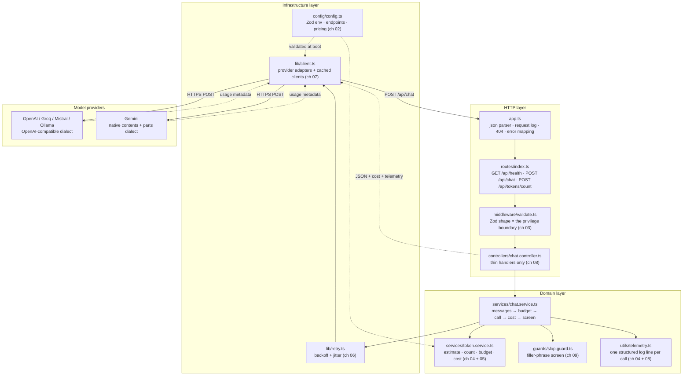
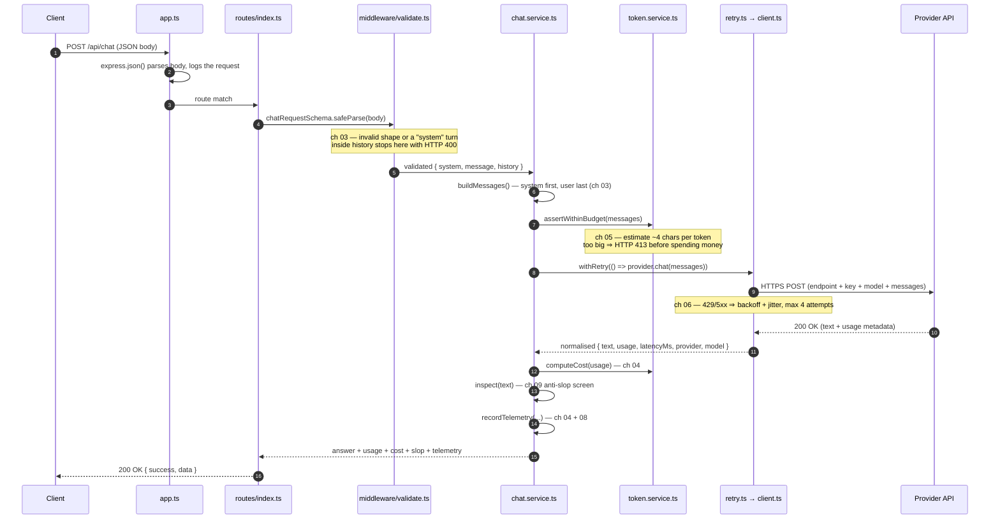

# Chapter 00: Overview, Architecture & File Structure

> **Chapter goal:** understand *what* this codebase is, *why* it is deliberately small, how a single
> HTTP request travels through it, and which file belongs to which notes chapter — before writing a line of code.

---

## 0.1 What this codebase is

This is the **minimum working service** that proves the Lecture 04 notes. It is not a framework and it
is not "enterprise-shaped": every file has one job, and you can trace any request end-to-end in one sitting.

| Rule followed | Why |
| :--- | :--- |
| One concern per file | You can find the retry logic without reading the routing layer |
| No abstraction until it is needed twice | `buildMessages()` exists because two endpoints need it — nothing else does |
| Configuration is validated once, at boot | A bad `.env` must not become a 3 a.m. incident (chapter 08) |
| Every diagram/decision maps to a notes chapter | The code is *evidence* for the notes, not a second curriculum |

**What it is not:** no database, no auth layer, no streaming, no tool calling, no RAG. Those belong to
later lectures. Here we only answer: *how does my application talk to a model, and what does that cost?*

---

## 0.2 Architecture



Read the diagram as three bands:

1. **HTTP layer** — knows about requests, status codes and JSON. It knows *nothing* about prompts or tokens.
2. **Domain layer** — knows about messages, budgets, cost and output quality. It knows *nothing* about Express.
3. **Infrastructure layer** — knows about the network: endpoints, clients, retries, secrets.

## 0.3 The life of one request

`POST /api/chat { "message": "Explain prefill vs decode." }` — every notes chapter, in order:



Two failure paths are worth memorising now:

| Where it stops | Status | Cause |
| :--- | :--- | :--- |
| `validate.ts` | `400` | Bad request shape, empty message, a `system` turn in history, >20 turns |
| `token.service.ts` | `413` | Estimated input exceeds `AI_MAX_INPUT_TOKENS` |

Both are **free** — no provider call happens. That is the entire point of chapters 03 and 05.

---

## 0.4 Design principles applied

1. **One owner per concern.** The SDK's own retry is switched off (`maxRetries: 0`) because
   `lib/retry.ts` owns retries. Two retry policies stacked is how you get a 12-second stall.
2. **Validate at the edge, budget before the call, price after the call.** Three different moments,
   three different files.
3. **Fail fast at boot.** `config/config.ts` calls `process.exit(1)` rather than letting a missing key
   surface as a 500 on the first customer request.
4. **Normalise at the seam.** Providers disagree about field names; only `lib/client.ts` is allowed to
   know that. Everything above it speaks `inputTokens` / `outputTokens`.
5. **Make cost visible.** Every call returns and logs its own price. A feature you cannot price is a
   feature you cannot ship.

## 0.5 File structure

```text
Basic Code/
├── .env                          # real secrets (git-ignored) — chapter 02
├── .env.example                  # committed template — chapter 02
├── .gitignore                    # node_modules/, dist/, .env
├── package.json                  # scripts + dependencies — chapter 01
├── package-lock.json             # reproducible installs
├── tsconfig.json                 # ES2022 · NodeNext · strict — chapter 01
├── test-requests.http            # ready-to-run requests (VS Code REST Client)
├── README.md                     # how to run it, code ↔ notes mapping
├── implementations guide/        # ← you are here (chapters 00 → 09)
└── src/
    ├── server.ts                 # chapter 09 — boot the HTTP listener
    ├── app.ts                    # chapter 09 — Express app, 404, error mapping
    ├── config/
    │   └── config.ts             # chapter 02 — Zod env, endpoints, pricing
    ├── lib/
    │   ├── client.ts             # chapter 05 — provider adapters + cached clients
    │   └── retry.ts              # chapter 06 — backoff, jitter, retryable statuses
    ├── services/
    │   ├── token.service.ts      # chapter 04 — estimate, count, budget, cost
    │   └── chat.service.ts       # chapter 08 — the whole pipeline in one function
    ├── controllers/
    │   └── chat.controller.ts    # chapter 09 — thin HTTP handlers
    ├── middleware/
    │   └── validate.ts           # chapter 03 — Zod request shape
    ├── guards/
    │   └── slop.guard.ts         # chapter 07 — filler-phrase screen
    ├── routes/
    │   └── index.ts              # chapter 09 — /health, /chat, /tokens/count
    └── utils/
        └── telemetry.ts          # chapter 08 — one log line per call
```

Why `lib/` and not `services/`? `lib/` holds **infrastructure** (network, clients, retries) and knows
nothing about our domain. `services/` holds **domain logic** (messages, budgets, cost, quality) and knows
nothing about Express. That single split is what keeps the codebase readable at 10× its size.

---

## 0.6 Chapter roadmap

Follow the chapters in order — each one only depends on files introduced earlier.

| Chapter | File(s) built | Notes chapters | What you learn |
| :--- | :--- | :--- | :--- |
| **[01](./01_Project_Setup_and_TypeScript.md)** | `package.json`, `tsconfig.json`, `.gitignore`, `.env.example` | 08 | Project init, ESM + TypeScript setup, dependencies |
| **[02](./02_Config_Endpoints_and_Environment.md)** | `src/config/config.ts` | 02 · 08 | The four invariant components, Zod-validated env, fail-fast boot, pricing table |
| **[03](./03_Message_Roles_and_Validation.md)** | `src/middleware/validate.ts` | 03 | Role hierarchy, the privilege boundary as a request shape, 400 before spending |
| **[04](./04_Token_Counting_Budget_and_Cost.md)** | `src/services/token.service.ts` | 04 · 05 | Character→token estimation, context budgeting, prefill vs decode cost |
| **[05](./05_Multi_Provider_Adapters_and_Client_Singleton.md)** | `src/lib/client.ts` | 04 · 07 · 08 | One `Provider` interface, OpenAI-compatible adapters, the Gemini naming trap, cached clients |
| **[06](./06_Rate_Limits_Retry_and_Backoff.md)** | `src/lib/retry.ts` | 06 | Retryable vs fatal errors, exponential backoff, jitter, `Retry-After` |
| **[07](./07_AI_Slop_Guard.md)** | `src/guards/slop.guard.ts` | 09 | AI slop, why a deterministic screen beats a second model, explainable scoring |
| **[08](./08_Telemetry_and_The_Chat_Service.md)** | `src/utils/telemetry.ts`, `src/services/chat.service.ts` | 03–09 | The full pipeline, normalised usage, telemetry records |
| **[09](./09_Controllers_Routes_Server_and_End_to_End_Verification.md)** | `src/controllers/`, `src/routes/`, `src/app.ts`, `src/server.ts` | 08 | Controllers, routing, error mapping, and a full end-to-end verification |

**Prerequisites:** Node.js 20+, npm, and an API key for at least one provider (or Ollama running locally).

Chapter 01 starts with the project skeleton and the compiler configuration.


