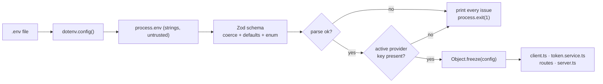

# Chapter 02: Configuration, Endpoints & Fail-Fast Boot

> **Chapter goal:** build `src/config/config.ts` — the single place that knows the four invariant components
> of an LLM call (endpoint, auth, model, input), validates the environment before the server starts, and
> holds the pricing table used later for cost calculation.

**Notes chapters covered:** 02 (the LLM API protocol) · 04 (pricing) · 08 (config singleton, fail fast).

**Files built:** `src/config/config.ts`

**Commands:**

```bash
mkdir -p src/config
```

---

## 2.1 Why configuration gets its own module

The notes' chapter 02 lists four components that every LLM call must have, regardless of provider:

| Component | Where it lives | If it is wrong |
| :--- | :--- | :--- |
| **Endpoint** (URL) | `PROVIDER_ENDPOINTS` | 404 from the wrong host |
| **Authentication** | `*_API_KEY` | 401 on every call, after paying the round trip |
| **Model** | `AI_MODEL` | 404 "model not found", or a silent downgrade |
| **Input** (parameters + payload) | `AI_TEMPERATURE`, `AI_MAX_TOKENS` | Unbounded output = unbounded bill |

Scattering these across files is how a service ends up with one provider hard-coded in three places. Instead:
**read the environment once, validate it once, freeze it, and let every other module import the frozen object.**



The two exits are the point: **a misconfigured service never starts.** Compare that with the alternative —
booting happily and returning a 500 to the first real customer because `OPENAI_API_KEY` was empty.

## 2.2 Full code: `src/config/config.ts`

File path: `code/Basic Code/src/config/config.ts`

```typescript
import dotenv from 'dotenv';
import { z } from 'zod';

dotenv.config();

/**
 * Chapter 02 — the four invariant components of every LLM call:
 * endpoint, authentication, model and input defaults. They live here, in one place.
 */
export const PROVIDER_ENDPOINTS = {
  openai: 'https://api.openai.com/v1',
  groq: 'https://api.groq.com/openai/v1',
  mistral: 'https://api.mistral.ai/v1',
  ollama: 'http://localhost:11434/v1',
} as const;

const envSchema = z.object({
  PORT: z.coerce.number().int().default(8080),
  AI_PROVIDER: z.enum(['openai', 'groq', 'mistral', 'ollama', 'gemini']).default('openai'),
  AI_MODEL: z.string().default('gpt-4o-mini'),
  AI_TEMPERATURE: z.coerce.number().min(0).max(2).default(0.2),
  AI_MAX_TOKENS: z.coerce.number().int().positive().default(400),
  AI_MAX_INPUT_TOKENS: z.coerce.number().int().positive().default(8000),
  OPENAI_API_KEY: z.string().default(''),
  GROQ_API_KEY: z.string().default(''),
  MISTRAL_API_KEY: z.string().default(''),
  GEMINI_API_KEY: z.string().default(''),
  OLLAMA_BASE_URL: z.string().default(PROVIDER_ENDPOINTS.ollama),
});

/** Which key belongs to which provider. Ollama runs locally, so it has none. */
const KEY_FOR: Record<string, 'OPENAI_API_KEY' | 'GROQ_API_KEY' | 'MISTRAL_API_KEY' | 'GEMINI_API_KEY' | ''> = {
  openai: 'OPENAI_API_KEY',
  groq: 'GROQ_API_KEY',
  mistral: 'MISTRAL_API_KEY',
  gemini: 'GEMINI_API_KEY',
  ollama: '',
};

const parsed = envSchema.safeParse(process.env);

// Chapter 08 — fail fast, fail loud: a bad deploy dies at boot, not on the first request.
if (!parsed.success) {
  console.error('❌ Invalid environment configuration:');
  for (const issue of parsed.error.issues) {
    console.error(`   • ${issue.path.join('.') || '(root)'}: ${issue.message}`);
  }
  process.exit(1);
}

const env = parsed.data;
const requiredKey = KEY_FOR[env.AI_PROVIDER];

if (requiredKey && !env[requiredKey]) {
  console.error(`❌ AI_PROVIDER=${env.AI_PROVIDER} requires ${requiredKey} in .env`);
  process.exit(1);
}

/** The endpoint actually used, so `/api/health` can show the live wiring. */
const activeEndpoint = (): string => {
  if (env.AI_PROVIDER === 'ollama') return env.OLLAMA_BASE_URL;
  if (env.AI_PROVIDER === 'gemini') return 'https://generativelanguage.googleapis.com';
  return PROVIDER_ENDPOINTS[env.AI_PROVIDER];
};

/** Frozen boot-time configuration — nothing can drift at runtime (chapter 08). */
export const config = Object.freeze({ ...env, AI_ENDPOINT: activeEndpoint() });

/**
 * Chapter 04 — price per 1M tokens (USD). Prices are data, not code: they change,
 * so they belong in a table you can update without touching business logic.
 */
export const PRICING: Record<string, { input: number; output: number }> = {
  'gpt-4o-mini': { input: 0.15, output: 0.6 },
  'llama-3.3-70b-versatile': { input: 0.59, output: 0.79 },
  'gemini-2.5-flash': { input: 0.3, output: 2.5 },
  default: { input: 0.5, output: 1.5 },
};
```

## 2.3 Block-by-block explanation

### Block 1 — load the file into the process
```typescript
import dotenv from 'dotenv';
import { z } from 'zod';

dotenv.config();
```
`dotenv.config()` reads `.env` and copies each line into `process.env`. It must run **before** the schema
reads `process.env`, which is why these three lines are the first statements in the file. Nothing else in
the codebase calls `dotenv` — configuration is loaded exactly once, at module load, and every other module
imports the result.

### Block 2 — the endpoint table (invariant component #1)
```typescript
export const PROVIDER_ENDPOINTS = {
  openai: 'https://api.openai.com/v1',
  groq: 'https://api.groq.com/openai/v1',
  mistral: 'https://api.mistral.ai/v1',
  ollama: 'http://localhost:11434/v1',
} as const;
```
Four different hosts, **one identical request shape**. Groq, Mistral and Ollama each expose an
OpenAI-compatible path, which is why chapter 05 can implement all four with a single adapter.
`as const` makes the values literal types instead of `string`, so a typo like `PROVIDER_ENDPOINTS.openAPI`
fails at compile time rather than at runtime.

### Block 3 — the schema: coercion and defaults
```typescript
const envSchema = z.object({
  PORT: z.coerce.number().int().default(8080),
  AI_PROVIDER: z.enum(['openai', 'groq', 'mistral', 'ollama', 'gemini']).default('openai'),
  AI_MODEL: z.string().default('gpt-4o-mini'),
  AI_TEMPERATURE: z.coerce.number().min(0).max(2).default(0.2),
  AI_MAX_TOKENS: z.coerce.number().int().positive().default(400),
  AI_MAX_INPUT_TOKENS: z.coerce.number().int().positive().default(8000),
  OPENAI_API_KEY: z.string().default(''),
  GROQ_API_KEY: z.string().default(''),
  MISTRAL_API_KEY: z.string().default(''),
  GEMINI_API_KEY: z.string().default(''),
  OLLAMA_BASE_URL: z.string().default(PROVIDER_ENDPOINTS.ollama),
});
```
Three Zod features do all the work:

| Feature | Why it is needed |
| :--- | :--- |
| `z.coerce.number()` | `process.env` values are **always strings**. `"8080"` must become `8080`, otherwise `PORT + 1` would be `"80801"` |
| `.default(...)` | A missing variable is not an error for optional settings; it is a documented default |
| `z.enum([...])` | `AI_PROVIDER` is the one variable where a typo must be fatal — `AI_PROVIDER=opemai` cannot be silently accepted |

Note what is *not* validated here: whether the key is non-empty. That check is deliberately separate
(Block 6) because it depends on which provider was selected. Zod validates *shape*; the next step validates
*cross-field business rules*.

### Block 4 — which key belongs to which provider
```typescript
const KEY_FOR: Record<string, 'OPENAI_API_KEY' | 'GROQ_API_KEY' | 'MISTRAL_API_KEY' | 'GEMINI_API_KEY' | ''> = {
  openai: 'OPENAI_API_KEY',
  groq: 'GROQ_API_KEY',
  mistral: 'MISTRAL_API_KEY',
  gemini: 'GEMINI_API_KEY',
  ollama: '',
};
```
A lookup table instead of an `if/else` chain, for one reason: it is data you can read at a glance.
`ollama: ''` is the trick — the empty string means "no key required", and the next block treats `''` as falsy,
so Ollama skips the check entirely. No special-casing anywhere else.

### Block 5 — validate and fail fast
```typescript
const parsed = envSchema.safeParse(process.env);

// Chapter 08 — fail fast, fail loud: a bad deploy dies at boot, not on the first request.
if (!parsed.success) {
  console.error('❌ Invalid environment configuration:');
  for (const issue of parsed.error.issues) {
    console.error(`   • ${issue.path.join('.') || '(root)'}: ${issue.message}`);
  }
  process.exit(1);
}
```
- **`safeParse` not `parse`.** `parse` throws; `safeParse` returns a discriminated result, which lets us
  print *all* problems at once. A config error should tell you everything that is wrong in one boot, not
  one variable per restart.
- **`issue.path.join('.')`** produces `AI_TEMPERATURE: Number must be less than or equal to 2` — the variable
  name is included, which is the difference between a 30-second fix and a 30-minute one.
- **`process.exit(1)`** with a non-zero code is what tells Kubernetes / ECS / systemd "this container failed".
  Combined with a restart policy, a bad deploy is rejected instead of serving broken traffic.

### Block 6 — the conditional key requirement
```typescript
const env = parsed.data;
const requiredKey = KEY_FOR[env.AI_PROVIDER];

if (requiredKey && !env[requiredKey]) {
  console.error(`❌ AI_PROVIDER=${env.AI_PROVIDER} requires ${requiredKey} in .env`);
  process.exit(1);
}
```
This is the rule the notes describe as **conditional requirements**: not "all keys must be present", but
"*the key for the provider you actually chose* must be present". Running with `AI_PROVIDER=ollama` on a
laptop with no cloud account is therefore valid, while `AI_PROVIDER=gemini` without `GEMINI_API_KEY` stops
at boot with an actionable message:

```text
❌ AI_PROVIDER=gemini requires GEMINI_API_KEY in .env
```

### Block 7 — the active endpoint
```typescript
const activeEndpoint = (): string => {
  if (env.AI_PROVIDER === 'ollama') return env.OLLAMA_BASE_URL;
  if (env.AI_PROVIDER === 'gemini') return 'https://generativelanguage.googleapis.com';
  return PROVIDER_ENDPOINTS[env.AI_PROVIDER];
};
```
Two providers do not use the static table, so they are handled first:
- **Ollama** is user-configurable (it might run on another host or port), so the URL comes from `OLLAMA_BASE_URL`.
- **Gemini** is not in `PROVIDER_ENDPOINTS` at all, because it is not an OpenAI-compatible endpoint.

After those two branches, TypeScript has narrowed `env.AI_PROVIDER` to `'openai' | 'groq' | 'mistral'`, which
are exactly the keys of `PROVIDER_ENDPOINTS` — so the last line type-checks without a cast. That narrowing is
a small but real benefit of using `as const` in Block 2.

### Block 8 — freeze the result
```typescript
export const config = Object.freeze({ ...env, AI_ENDPOINT: activeEndpoint() });
```
- **The spread** copies the validated fields into a new object and adds one computed field, `AI_ENDPOINT`.
- **`Object.freeze`** makes the object immutable. `config.AI_MODEL = 'gpt-4o'` anywhere else in the codebase
  now fails loudly instead of silently changing behaviour for the rest of the process lifetime.
- **`export const config`** is the *singleton* the notes ask for: one validated configuration object, shared
  by reference, created once.

### Block 9 — the pricing table (chapter 04)
```typescript
export const PRICING: Record<string, { input: number; output: number }> = {
  'gpt-4o-mini': { input: 0.15, output: 0.6 },
  'llama-3.3-70b-versatile': { input: 0.59, output: 0.79 },
  'gemini-2.5-flash': { input: 0.3, output: 2.5 },
  default: { input: 0.5, output: 1.5 },
};
```
All values are **USD per 1,000,000 tokens**, split into two columns because the two halves of a call are
priced differently:

| | Input (prefill) | Output (decode) |
| :--- | :--- | :--- |
| What it is | Your prompt, `system` message, history | Tokens the model *generates* |
| Cost profile | Cheap — processed in one parallel pass | Expensive — generated one token at a time |
| `gpt-4o-mini` | $0.15 / 1M | $0.60 / 1M |

Two design points worth copying:

1. **Prices are data, not logic.** Providers change prices; when they do, you edit this table and nothing else.
   Hard-coding `0.15` inside a cost function means a code review to fix a number.
2. **`default` is the fallback.** `PRICING[model] ?? PRICING.default` in chapter 04 means an unknown model
   still produces an estimate instead of `NaN`. An approximate number you can act on beats `NaN` every time.

> ⚠️ These are illustrative figures for the exercise. Always check the provider's current pricing page — the
> *shape* of the table is what matters here, not the exact cents.

---

## 2.4 Verify it

```bash
# 1. valid config → server boots (a real key is in .env)
npx tsx src/server.ts        # (once chapter 09 exists)

# 2. invalid provider value → every issue printed, exit code 1
AI_PROVIDER=opemai npx tsx src/server.ts
#    ❌ Invalid environment configuration:
#       • AI_PROVIDER: Invalid enum value. Expected 'openai' | 'groq' | 'mistral' | 'ollama' | 'gemini', received 'opemai'
#    exit code 1

# 3. provider selected without its key → conditional requirement fires
AI_PROVIDER=gemini npx tsx src/server.ts
#    ❌ AI_PROVIDER=gemini requires GEMINI_API_KEY in .env
#    exit code 1

# 4. local provider, no key at all → valid
AI_PROVIDER=ollama PORT=8093 npx tsx src/server.ts
```

Verified output from this build:

```text
❌ AI_PROVIDER=gemini requires GEMINI_API_KEY in .env
exit_code=1
```

> **Common mistakes**
> - Calling `dotenv.config()` in several files. Load once here; import `config` everywhere else.
> - Using `parse` instead of `safeParse`, so only the first error is ever shown.
> - Reading `process.env.PORT` directly in `server.ts` instead of `config.PORT` — that is how the validated
>   and the actual value drift apart.

Chapter 03 builds the request-shape validation that enforces the role hierarchy from the notes.


