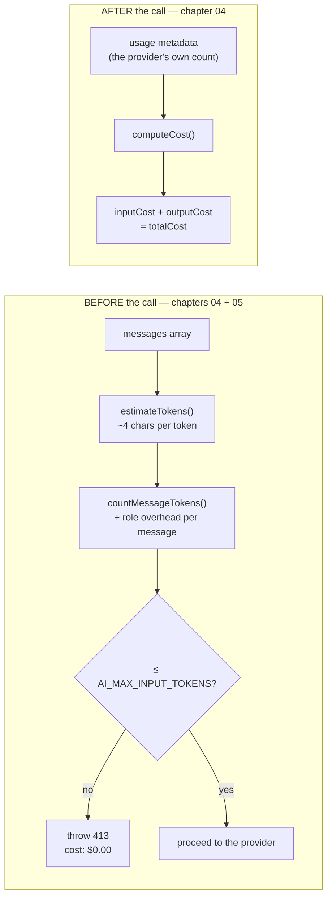
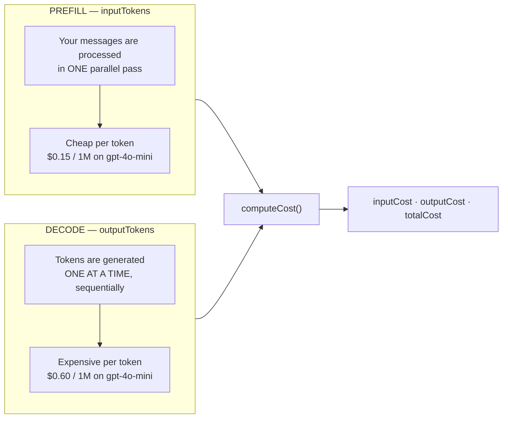

# Chapter 04: Token Counting, Context Budgeting & Cost

> **Chapter goal:** build `src/services/token.service.ts` — estimate tokens before the call, refuse the call
> when the input exceeds the budget, and price the call after it using the provider's real usage metadata.

**Notes chapters covered:** 04 (token economics, prefill vs decode, metadata, cost) · 05 (token counting and context budgeting).

**Files built:** `src/services/token.service.ts`

**Commands:**

```bash
mkdir -p src/services
```

---

## 4.1 The two questions this file answers



**Why estimate at all, when the provider returns the real number?** Because the real number arrives *after*
you have paid for it. The estimate exists to make the decision "should I send this at all?" — and it is
allowed to be wrong by ±10%, because it is a guard rail, not an invoice.

**Why use the provider's number for cost?** Because the invoice is based on *its* count, not yours. Your
estimate is for control; the returned usage is for accounting. Keeping the two separate is the whole trick.

---

## 4.2 Full code: `src/services/token.service.ts`

File path: `code/Basic Code/src/services/token.service.ts`

```typescript
import { config, PRICING } from '../config/config.js';
import type { ChatMessage, TokenUsage } from '../lib/client.js';

/**
 * Chapter 05 — ~4 characters per token for English prose.
 * A heuristic, not a tokenizer: good enough to budget before you pay for a call.
 */
export const estimateTokens = (text: string): number => Math.ceil(text.length / 4);

/** Every chat message also pays for its role markers and separators. */
const MESSAGE_OVERHEAD_TOKENS = 4;

export const countMessageTokens = (messages: ChatMessage[]): number =>
  messages.reduce((total, message) => total + estimateTokens(message.content) + MESSAGE_OVERHEAD_TOKENS, 0);

/**
 * Chapter 05 — context budgeting: refuse the call locally (HTTP 413) instead of
 * paying for a provider-side rejection. The estimate must fit AI_MAX_INPUT_TOKENS.
 */
export const assertWithinBudget = (messages: ChatMessage[]): number => {
  const estimatedInputTokens = countMessageTokens(messages);
  const budget = config.AI_MAX_INPUT_TOKENS;

  if (estimatedInputTokens > budget) {
    throw Object.assign(
      new Error(
        `Estimated ${estimatedInputTokens} input tokens exceeds the budget of ${budget}. ` +
          'Trim the history or raise AI_MAX_INPUT_TOKENS.',
      ),
      { status: 413 },
    );
  }

  return estimatedInputTokens;
};

export interface CostBreakdown {
  currency: 'USD';
  inputCost: number;
  outputCost: number;
  totalCost: number;
}

/**
 * Chapter 04 — token economics: prefill (input) tokens are cheap, decode (output)
 * tokens are expensive. cost = (tokens / 1M) × price-per-1M.
 */
export const computeCost = (usage: TokenUsage, model: string = config.AI_MODEL): CostBreakdown => {
  const rate = PRICING[model] ?? PRICING.default;
  const inputCost = (usage.inputTokens / 1_000_000) * rate.input;
  const outputCost = (usage.outputTokens / 1_000_000) * rate.output;

  return { currency: 'USD', inputCost, outputCost, totalCost: inputCost + outputCost };
};
```

## 4.3 Block-by-block explanation

### Block 1 — the estimate
```typescript
export const estimateTokens = (text: string): number => Math.ceil(text.length / 4);
```
One line, and the most consequential line in the file. English prose averages **roughly 4 characters per
token** (the notes' rule of thumb), so:

| Text | Characters | Estimate |
| :--- | --: | --: |
| `"hi"` | 2 | 1 |
| `"Explain prefill vs decode."` | 27 | 7 |
| A 2,000-word article | ~12,000 | 3,000 |

Two things to be honest about:

- **`Math.ceil`, not `Math.round`.** Rounding *up* is the safe direction: over-estimating rejects a request
  that would have fit, under-estimating sends one that gets rejected (and paid for) by the provider.
- **It is not a tokenizer.** The real `tiktoken` BPE count for English is usually 3–5 chars/token, but code,
  JSON, and non-Latin scripts tokenize far worse — often 1–2 chars/token. For those inputs this estimate is
  optimistic. The notes' chapter 05 covers why; a production system uses the real tokenizer. A guard rail
  with a known error bar is still worth having.

### Block 2 — message overhead
```typescript
const MESSAGE_OVERHEAD_TOKENS = 4;

export const countMessageTokens = (messages: ChatMessage[]): number =>
  messages.reduce((total, message) => total + estimateTokens(message.content) + MESSAGE_OVERHEAD_TOKENS, 0);
```
Each message is not just its content. The chat template adds **role markers and separators** around every
turn (`<|im_start|>user … <|im_end|>` and friends). Those tokens are billed but never appear in
`message.content`, so a naive sum under-counts.

`reduce` walks the array once, accumulating `content + 4` per message. For a request with a system message,
a two-turn history and a user message, that is 4 messages × 4 = **16 tokens of pure overhead** — small here,
but it is the difference between a correct budget and one that silently overshoots.

> Why a constant and not a real formula? Because the exact overhead is tokenizer- and provider-specific.
> The notes make the same simplification: model the *shape* of the cost, not every cent of it.

### Block 3 — the budget guard
```typescript
export const assertWithinBudget = (messages: ChatMessage[]): number => {
  const estimatedInputTokens = countMessageTokens(messages);
  const budget = config.AI_MAX_INPUT_TOKENS;

  if (estimatedInputTokens > budget) {
    throw Object.assign(
      new Error(
        `Estimated ${estimatedInputTokens} input tokens exceeds the budget of ${budget}. ` +
          'Trim the history or raise AI_MAX_INPUT_TOKENS.',
      ),
      { status: 413 },
    );
  }

  return estimatedInputTokens;
};
```
This is the function that saves money, so it is worth reading closely:

- **It throws, it does not return a boolean.** A guard that can be ignored eventually will be. Throwing makes
  the caller *handle* it — here, the error propagates to the Express error handler in chapter 09.
- **`Object.assign(new Error(...), { status: 413 })`** attaches an HTTP status to a plain `Error` without
  inventing a custom error class. Chapter 09 reads `error.status` and returns exactly that code, and
  chapter 06's retry logic reads it too — and refuses to retry, because retrying a too-large request cannot
  help. One field, two consumers.
- **Why `413` (Payload Too Large)?** It is the closest standard code: the request body is fine, but the
  *derived* payload is bigger than what this service is willing to send. `400` would imply the client sent
  malformed data, which is not true — the request was well-formed and simply too big for the budget.
- **The message is actionable.** It reports both numbers and names the two levers (trim history, raise the
  budget). Compare `"Request too large"`, which tells the caller nothing.
- **It returns the estimate** so the caller can report it in the response and the telemetry record. One
  computation, two uses.

### Block 4 — the cost function
```typescript
export const computeCost = (usage: TokenUsage, model: string = config.AI_MODEL): CostBreakdown => {
  const rate = PRICING[model] ?? PRICING.default;
  const inputCost = (usage.inputTokens / 1_000_000) * rate.input;
  const outputCost = (usage.outputTokens / 1_000_000) * rate.output;

  return { currency: 'USD', inputCost, outputCost, totalCost: inputCost + outputCost };
};
```

The formula is the notes' chapter 04 formula, verbatim:

```text
cost = (tokens ÷ 1,000,000) × price-per-1M-tokens
```

Four decisions inside four lines:

1. **Two separate multiplications, not one.** Input and output have different prices (see the table in
   chapter 02), so they cannot be added into a single token count and multiplied once. Doing so is the most
   common cost bug in production.
2. **`PRICING[model] ?? PRICING.default`.** An unknown or newly released model id still produces a number.
   A slightly wrong estimate is useful; `NaN` poisons every downstream sum.
3. **The model is a parameter with a default.** The provider adapter already reports which model answered
   (`result.model`), so the caller passes it explicitly — important when a router or a fallback means the
   model that answered is not the model you configured.
4. **The result is structured, not a single number.** `inputCost`, `outputCost`, `totalCost` and `currency`
   are all returned, because the interesting question is never "how much?" but "*which half* is expensive?".
   That breakdown is what makes a cost optimisation conversation possible.

#### Worked example

A call on `gpt-4o-mini` ($0.15 in / $0.60 out per 1M) with `prompt_tokens = 1,200` and
`completion_tokens = 300`:

```text
inputCost  = (1,200 / 1,000,000) × 0.15 = $0.00018
outputCost = (  300 / 1,000,000) × 0.60 = $0.00018
totalCost  = $0.00036
```

Read that again: **300 output tokens cost exactly as much as 1,200 input tokens.** Output is 4× the price
per token, which is why `AI_MAX_TOKENS` (the output cap) matters more than it looks. At 100,000 calls a day
this single endpoint costs **$36/day** — a number you can only state because `computeCost` exists.

---

## 4.4 Prefill vs decode, in the code



| | Prefill (input) | Decode (output) |
| :--- | :--- | :--- |
| Where it comes from | `usage.prompt_tokens` / `promptTokenCount` | `usage.completion_tokens` / `candidatesTokenCount` |
| Processing | Parallel, one forward pass | Sequential, one token per step |
| Drives | **Time to first token** | **Time to last token** and most of the bill |
| Controlled by | Trimming history, summarising, RAG | `AI_MAX_TOKENS`, asking for shorter answers |
| In this code | `assertWithinBudget()` before the call | `computeCost()` after the call |

That asymmetry is the notes' central economic point, and it explains two decisions in this codebase:
the **input budget** is generous (8,000) while the **output cap** is tight (400), and the retry logic in
chapter 06 treats a 429 as expected rather than exceptional — long decode phases hold the connection open
and are the most likely thing to be throttled.

---

## 4.5 Verify it

```bash
npx tsx src/server.ts &      # once chapter 09 exists

# 1. count without spending: the estimate + per-message breakdown
curl -s -X POST localhost:8080/api/tokens/count -H 'Content-Type: application/json' \
  -d '{"message":"Explain the difference between prefill and decode in one paragraph.","history":[{"role":"user","content":"hi"},{"role":"assistant","content":"hello"}]}'

# 2. force the budget guard: a 10-token budget and a long message
AI_MAX_INPUT_TOKENS=10 npx tsx src/server.ts &
curl -s -X POST localhost:8080/api/chat -H 'Content-Type: application/json' \
  -d '{"message":"This message is definitely longer than ten tokens worth of characters, so the guard must trigger."}'
```

Verified output from this build:

```json
{"success":true,"data":{"estimatedInputTokens":51,"budget":8000,"withinBudget":true,
 "perMessage":[{"role":"system","characters":59,"estimatedTokens":15},
               {"role":"user","characters":2,"estimatedTokens":1},
               {"role":"assistant","characters":5,"estimatedTokens":2},
               {"role":"user","characters":67,"estimatedTokens":17}]}}
```

```json
{"error":"Context budget exceeded","message":"Estimated 48 input tokens exceeds the budget of 10. Trim the history or raise AI_MAX_INPUT_TOKENS."}
```

Check the arithmetic in the first response: `15 + 1 + 2 + 17 = 35` tokens of content, plus `4 messages × 4`
overhead = **51**. The overhead is 31% of the total here — proof that Block 2 is not a rounding detail.

> **Common mistakes**
> - Multiplying `total_tokens` by a single price. Input and output are priced differently; use the split.
> - Using the estimate for accounting. The invoice uses the provider's count — use `usage` for cost and the
>   estimate only for the pre-call decision.
> - Comparing a raw character count against a *token* budget. Different units, silently wrong answers.
> - Leaving `AI_MAX_TOKENS` at a large value "to be safe". That is the expensive half of the bill.

Chapter 05 builds the provider adapters that return the `usage` metadata this file prices.


