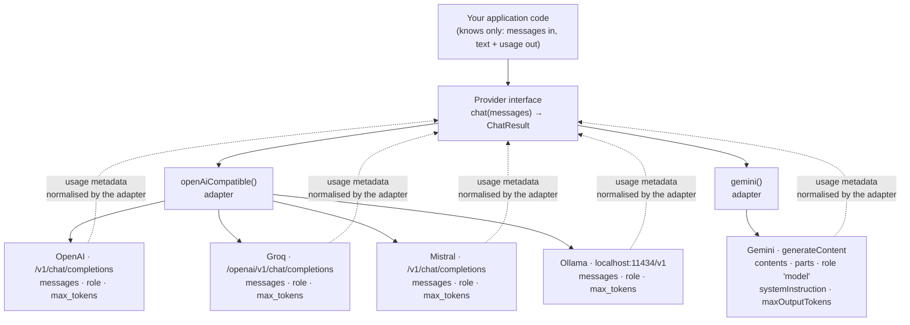

# Chapter 05: Multi-Provider Adapters & the Client Singleton

> **Chapter goal:** build `src/lib/client.ts` — one `Provider` interface implemented by two adapters
> (OpenAI-compatible and Gemini), plus a lazily-built, cached client per provider so HTTP connections are reused.

**Notes chapters covered:** 04 (usage metadata) · 07 (multi-SDK integration) · 08 (client singleton).

**Files built:** `src/lib/client.ts`

**Commands:**

```bash
mkdir -p src/lib
```

---

## 5.1 The problem: same capability, different dialects

The notes' chapter 07 has one message: **the SDK is a convenience, the HTTP contract is the truth.** Every
provider is "a `POST` with a key, a model id and some messages" — but the *field names* disagree.



**Four providers share one adapter** because Groq, Mistral and Ollama deliberately expose an
OpenAI-compatible endpoint. Only Gemini needs a second adapter — and that second adapter is the *proof* that
the abstraction earns its keep. If every provider looked the same, `Provider` would be ceremony.

### The naming trap table

| Concept | OpenAI-compatible | Gemini |
| :--- | :--- | :--- |
| Message array | `messages` | `contents` |
| One message's text | `content: "..."` (a string) | `parts: [{ text: "..." }]` |
| Assistant role name | `"assistant"` | `"model"` |
| System instruction | a `{ role: 'system' }` message | a separate `systemInstruction` field |
| Output cap | `max_tokens` | `maxOutputTokens` |
| Input token count | `usage.prompt_tokens` | `usageMetadata.promptTokenCount` |
| Output token count | `usage.completion_tokens` | `usageMetadata.candidatesTokenCount` |
| Auth header | `Authorization: Bearer …` | `x-goog-api-key` |

Every one of those rows is a place where "just copy the code and change the URL" breaks. The adapter exists
to absorb all eight rows, so the rest of the codebase sees none of them.

## 5.2 Full code: `src/lib/client.ts`

File path: `code/Basic Code/src/lib/client.ts`

```typescript
import { GoogleGenAI } from '@google/genai';
import OpenAI from 'openai';
import { config, PROVIDER_ENDPOINTS } from '../config/config.js';

/** Chapter 03 — the three roles this basic service uses. */
export type Role = 'system' | 'user' | 'assistant';

export interface ChatMessage {
  role: Role;
  content: string;
}

/** Chapter 04 — usage metadata, normalised. Every provider names these fields differently. */
export interface TokenUsage {
  inputTokens: number;
  outputTokens: number;
  totalTokens: number;
}

export interface ChatResult {
  text: string;
  usage: TokenUsage;
  latencyMs: number;
  provider: string;
  model: string;
}

/** Chapter 07 — the seam that keeps routes, controllers and services provider-agnostic. */
export interface Provider {
  name: string;
  chat(messages: ChatMessage[]): Promise<ChatResult>;
}

/**
 * Chapter 07 — OpenAI, Groq, Mistral and Ollama all speak the same wire format,
 * so one SDK plus a different `baseURL` is enough.
 * `maxRetries: 0` on purpose: chapter 06 owns the retry policy — one owner per concern.
 */
const openAiCompatible = (name: string, baseURL: string, apiKey: string): Provider => {
  const client = new OpenAI({ apiKey: apiKey || 'not-needed', baseURL, maxRetries: 0, timeout: 30_000 });

  return {
    name,
    async chat(messages) {
      const startedAt = Date.now();

      const response = await client.chat.completions.create({
        model: config.AI_MODEL,
        messages: messages.map(({ role, content }) => ({ role, content })) as OpenAI.Chat.ChatCompletionMessageParam[],
        temperature: config.AI_TEMPERATURE,
        max_tokens: config.AI_MAX_TOKENS,
      });

      return {
        text: response.choices[0]?.message?.content?.trim() ?? '',
        usage: {
          inputTokens: response.usage?.prompt_tokens ?? 0,
          outputTokens: response.usage?.completion_tokens ?? 0,
          totalTokens: response.usage?.total_tokens ?? 0,
        },
        latencyMs: Date.now() - startedAt,
        provider: name,
        model: config.AI_MODEL,
      };
    },
  };
};

/**
 * Chapter 07 — Gemini does NOT speak the OpenAI dialect: the body uses `contents`
 * with `parts`, the assistant role is called `model`, and the system role is a
 * separate `systemInstruction` field. That is exactly why an adapter is needed.
 */
const gemini = (apiKey: string): Provider => {
  const ai = new GoogleGenAI({ apiKey });

  return {
    name: 'gemini',
    async chat(messages) {
      const startedAt = Date.now();

      const response = await ai.models.generateContent({
        model: config.AI_MODEL,
        contents: messages
          .filter((message) => message.role !== 'system')
          .map((message) => ({
            role: message.role === 'assistant' ? 'model' : 'user',
            parts: [{ text: message.content }],
          })),
        config: {
          systemInstruction: messages
            .filter((message) => message.role === 'system')
            .map((message) => message.content)
            .join('\n'),
          temperature: config.AI_TEMPERATURE,
          maxOutputTokens: config.AI_MAX_TOKENS,
        },
      });

      const usage = response.usageMetadata;

      return {
        text: response.text?.trim() ?? '',
        usage: {
          inputTokens: usage?.promptTokenCount ?? 0,
          outputTokens: usage?.candidatesTokenCount ?? 0,
          totalTokens: usage?.totalTokenCount ?? 0,
        },
        latencyMs: Date.now() - startedAt,
        provider: 'gemini',
        model: config.AI_MODEL,
      };
    },
  };
};

/** Chapter 08 — a client per provider, built on first use and then cached for the process lifetime. */
const FACTORIES: Record<string, () => Provider> = {
  openai: () => openAiCompatible('openai', PROVIDER_ENDPOINTS.openai, config.OPENAI_API_KEY),
  groq: () => openAiCompatible('groq', PROVIDER_ENDPOINTS.groq, config.GROQ_API_KEY),
  mistral: () => openAiCompatible('mistral', PROVIDER_ENDPOINTS.mistral, config.MISTRAL_API_KEY),
  ollama: () => openAiCompatible('ollama', config.OLLAMA_BASE_URL, ''),
  gemini: () => gemini(config.GEMINI_API_KEY),
};

const clients = new Map<string, Provider>();

/** Chapter 07 — the only place the rest of the app asks "which provider?" */
export const getProvider = (): Provider => {
  const name = config.AI_PROVIDER;
  let provider = clients.get(name);

  if (!provider) {
    provider = FACTORIES[name]();
    clients.set(name, provider);
  }

  return provider;
};
```

## 5.3 Block-by-block explanation

### Block 1 — the shared types
```typescript
export type Role = 'system' | 'user' | 'assistant';

export interface ChatMessage {
  role: Role;
  content: string;
}

export interface TokenUsage {
  inputTokens: number;
  outputTokens: number;
  totalTokens: number;
}

export interface ChatResult {
  text: string;
  usage: TokenUsage;
  latencyMs: number;
  provider: string;
  model: string;
}
```
These four types are the **contract**. Note what is *absent* from them: no `prompt_tokens`, no
`candidatesTokenCount`, no `maxOutputTokens`, no vendor prefix anywhere. That absence is the point — if a
provider's naming leaked into these types, every caller would inherit the vendor's vocabulary.

`TokenUsage` deliberately mirrors OpenAI's `prompt/completion/total` triple because it is the most common
shape, and the Gemini adapter translates into it.

`ChatResult` carries two fields that are not part of the model's answer but are essential for operations:

| Field | Used by | Why it matters |
| :--- | :--- | :--- |
| `latencyMs` | telemetry (ch 08) | Wall-clock time, measured **inside** the adapter so it excludes retry sleeps |
| `provider` / `model` | telemetry, cost (ch 04) | With fallbacks and routing, the model that answered may not be the one you configured |

### Block 2 — the interface
```typescript
export interface Provider {
  name: string;
  chat(messages: ChatMessage[]): Promise<ChatResult>;
}
```
Two members. That is the entire abstraction.

- **`name`** exists so telemetry and error messages can say *which* provider answered without the caller
  having to know.
- **`chat(messages)`** takes the domain type and returns the domain type. Nothing about HTTP, nothing about
  headers, nothing about JSON shapes.
- **It is an interface, not a base class.** Adapters share no implementation — one uses the OpenAI SDK, the
  other the Google SDK — so there is nothing to inherit. Composition beats inheritance here.

> **The adapter rule:** everything provider-specific must live *below* this interface. If you ever need to
> write `if (config.AI_PROVIDER === 'gemini')` in a service or a controller, the abstraction has failed.

### Block 3 — the OpenAI-compatible adapter
```typescript
const openAiCompatible = (name: string, baseURL: string, apiKey: string): Provider => {
  const client = new OpenAI({ apiKey: apiKey || 'not-needed', baseURL, maxRetries: 0, timeout: 30_000 });
```
A **factory** that closes over its own client. One function, four providers, because the only difference
between them is the `baseURL` and the key. Each parameter is a deliberate choice:

| Option | Value | Why |
| :--- | :--- | :--- |
| `apiKey` | `apiKey \|\| 'not-needed'` | Ollama needs no key, but the SDK refuses to construct without a non-empty string. A placeholder keeps one code path for all four providers |
| `baseURL` | per provider | The *only* line that changes between OpenAI, Groq, Mistral and Ollama |
| `maxRetries: 0` | **switched off** | The SDK's built-in retry is disabled because chapter 06 owns retrying. Two retry policies stacked means 3 attempts × 4 attempts = up to 12 sleeps you did not intend |
| `timeout: 30_000` | 30 s | A decode phase can legitimately take many seconds; without a cap, a hung socket holds a connection until the OS gives up |

```typescript
    async chat(messages) {
      const startedAt = Date.now();

      const response = await client.chat.completions.create({
        model: config.AI_MODEL,
        messages: messages.map(({ role, content }) => ({ role, content })) as OpenAI.Chat.ChatCompletionMessageParam[],
        temperature: config.AI_TEMPERATURE,
        max_tokens: config.AI_MAX_TOKENS,
      });
```
- **`startedAt` before the await.** Latency is measured around the actual network call, so retry sleeps
  (chapter 06) are not counted as provider latency — otherwise a retried call would look like a slow model.
- **`model` / `temperature` / `max_tokens` come from `config`.** These are the notes' "invariant components":
  they are configuration, not per-request logic, so no caller can pass them.
- **The `messages.map(...)` + `as` cast** normalises our internal `ChatMessage` into the SDK's discriminated
  union. The cast is needed because `role: 'system' | 'user' | 'assistant'` is not assignable to the SDK's
  *union of single-role* message types. Doing the mapping in one place, at the boundary, is the honest way to
  handle it — as opposed to typing `messages: any` and losing all downstream safety.

```typescript
      return {
        text: response.choices[0]?.message?.content?.trim() ?? '',
        usage: {
          inputTokens: response.usage?.prompt_tokens ?? 0,
          outputTokens: response.usage?.completion_tokens ?? 0,
          totalTokens: response.usage?.total_tokens ?? 0,
        },
        latencyMs: Date.now() - startedAt,
        provider: name,
        model: config.AI_MODEL,
      };
```
- **`choices[0]?.message?.content`** — optional chaining on all three levels. A provider may return an empty
  `choices` array (content filter, tool call, refusal). `?? ''` turns that into an empty string, and
  chapter 08 turns an empty string into a `502` — one predictable failure instead of a `TypeError`.
- **`usage?.prompt_tokens ?? 0`** — the rename happens here, once. Every other file in the codebase now
  speaks `inputTokens` / `outputTokens`, which is why `computeCost()` never needed to know about OpenAI.

### Block 4 — the Gemini adapter
```typescript
const gemini = (apiKey: string): Provider => {
  const ai = new GoogleGenAI({ apiKey });
```
A different SDK, a different constructor — and therefore a different factory. Same `Provider` return type.

```typescript
      const response = await ai.models.generateContent({
        model: config.AI_MODEL,
        contents: messages
          .filter((message) => message.role !== 'system')
          .map((message) => ({
            role: message.role === 'assistant' ? 'model' : 'user',
            parts: [{ text: message.content }],
          })),
        config: {
          systemInstruction: messages
            .filter((message) => message.role === 'system')
            .map((message) => message.content)
            .join('\n'),
          temperature: config.AI_TEMPERATURE,
          maxOutputTokens: config.AI_MAX_TOKENS,
        },
      });
```
This block is the whole naming-trap table, resolved in one place:

1. **`contents`, not `messages`.** Gemini's field name for the conversation array.
2. **The system message is *removed* from the array.** Gemini has no `system` role inside `contents`; policy
   is passed as a separate top-level `systemInstruction`. Filtering it out and re-attaching it as a field is
   exactly the translation an adapter exists to perform.
3. **`role: 'assistant' → 'model'`.** Same concept, different word. A `.map()` with a ternary is enough — no
   lookup table needed for a two-way rename.
4. **`parts: [{ text }]`.** Gemini messages are multi-part (text, image, audio…), so a string must be wrapped.
   Today there is one part; tomorrow an image could be added as a second part without changing this shape.
5. **`maxOutputTokens`, not `max_tokens`.** Same meaning, different spelling.
6. **`.join('\n')`** because `systemInstruction` is a single value, while our domain model allows several
   system messages. Joining them keeps the domain flexible without leaking that flexibility downward.

```typescript
      const usage = response.usageMetadata;

      return {
        text: response.text?.trim() ?? '',
        usage: {
          inputTokens: usage?.promptTokenCount ?? 0,
          outputTokens: usage?.candidatesTokenCount ?? 0,
          totalTokens: usage?.totalTokenCount ?? 0,
        },
        ...
      };
```
- **`response.text`** is a getter on the SDK response that concatenates the candidate parts — a convenience
  the adapter is allowed to use because it stops here. Above this line, the caller only knows `result.text`.
- **`candidatesTokenCount`** is Gemini's name for "output tokens". Note it is *not* `completionTokenCount` —
  guessing these names is why the notes insist on reading the SDK's own types instead of memorising patterns.
- **The return shape is identical to Block 3's.** That is the test of a good adapter: the caller cannot tell
  which branch produced the result.

### Block 5 — the factories table
```typescript
const FACTORIES: Record<string, () => Provider> = {
  openai: () => openAiCompatible('openai', PROVIDER_ENDPOINTS.openai, config.OPENAI_API_KEY),
  groq: () => openAiCompatible('groq', PROVIDER_ENDPOINTS.groq, config.GROQ_API_KEY),
  mistral: () => openAiCompatible('mistral', PROVIDER_ENDPOINTS.mistral, config.MISTRAL_API_KEY),
  ollama: () => openAiCompatible('ollama', config.OLLAMA_BASE_URL, ''),
  gemini: () => gemini(config.GEMINI_API_KEY),
};
```
Note the type: `() => Provider`, **not** `Provider`. The table holds *recipes*, not instances. That is the
difference between eager and lazy construction, and it is not cosmetic:

- **Eager** (`Record<string, Provider>`) builds all five clients when the module is imported — including a
  Gemini client with an empty key, which makes the Google SDK print
  `API key should be set when using the Gemini API.` on every boot of a service that never uses Gemini.
- **Lazy** builds only what is actually used, on the first call.

The four `openAiCompatible(...)` rows differ in exactly two arguments: the name and the endpoint. The fifth
row points at a completely different factory — which is the visual proof that four providers share one
implementation and one does not.

### Block 6 — the cached getter (the singleton)
```typescript
const clients = new Map<string, Provider>();

export const getProvider = (): Provider => {
  const name = config.AI_PROVIDER;
  let provider = clients.get(name);

  if (!provider) {
    provider = FACTORIES[name]();
    clients.set(name, provider);
  }

  return provider;
};
```
A memoised factory — "build once, then reuse" — and the notes' reason for a singleton is performance:
the SDK keeps an **HTTP agent with keep-alive connections**. Building a client per request would repeat the
TCP and TLS handshake on every single call, adding tens of milliseconds and extra sockets for no benefit.

Why a `Map` and not a single `let cached: Provider`?
- The key is the provider name, so the cache stays correct if `AI_PROVIDER` changes between environments
  (or in a future where one process serves several providers).
- `clients.get(name)` returning `undefined` is the "not built yet" signal — no `null` checks, no boolean flag.

Why does the *lazy* version still count as a singleton? Because for a given provider name there is exactly one
instance for the process lifetime. "Lazy" describes *when* it is created, not *how many* are created.

---

## 5.4 Adding a sixth provider

The whole point of the seam. To add Anthropic (whose dialect is closer to Gemini than to OpenAI — a separate
`system` parameter and a different message shape), the change is confined to this file:

```typescript
// 1. add the provider to the enum in config/config.ts
AI_PROVIDER: z.enum(['openai', 'groq', 'mistral', 'ollama', 'gemini', 'anthropic'])

// 2. add a factory in lib/client.ts
anthropic: () => anthropicAdapter(config.ANTHROPIC_API_KEY),

// 3. write the adapter — the ONLY new code
const anthropicAdapter = (apiKey: string): Provider => ({ name: 'anthropic', async chat(messages) { /* ... */ } });
```

Zero changes in routes, controllers, services, telemetry or cost. If adding a provider requires touching
`chat.service.ts`, the adapter boundary has been placed in the wrong spot.

---

## 5.5 Verify it

```bash
# provider switch: only .env changes, no code changes
AI_PROVIDER=ollama PORT=8093 npx tsx src/server.ts &
curl -s localhost:8093/api/health
```

Verified output from this build:

```json
{"status":"UP","provider":"ollama","model":"gpt-4o-mini","endpoint":"http://localhost:11434/v1",
 "temperature":0.2,"maxOutputTokens":400,"inputBudget":8000,"uptimeSeconds":6}
```

The `provider` and `endpoint` fields changed; every other line of code stayed identical. And after switching
the factories to lazy construction, the boot log no longer contains the Gemini key warning:

```text
=======================================================
🚀 Lecture 04 — Basic API Service
📡 Server        : http://localhost:8080
🤖 Provider      : openai
🧠 Model         : gpt-4o-mini
🔗 Endpoint      : https://api.openai.com/v1
📥 Input budget  : 8000 tokens
```

> **Common mistakes**
> - Letting the SDK's retry and your own retry both run. Set `maxRetries: 0` and own it yourself.
> - Constructing a client per request. You lose connection reuse and leak sockets under load.
> - Building every provider's client at boot "just in case" — unused clients warn, allocate and can fail.
> - Leaking provider field names upward (`prompt_tokens` in a controller). Translate once, at the adapter.
> - Assuming a `200 OK` means usable content. Check `choices[0]?.message?.content` and handle the empty case.

Chapter 06 builds the retry policy that this file deliberately handed over.


