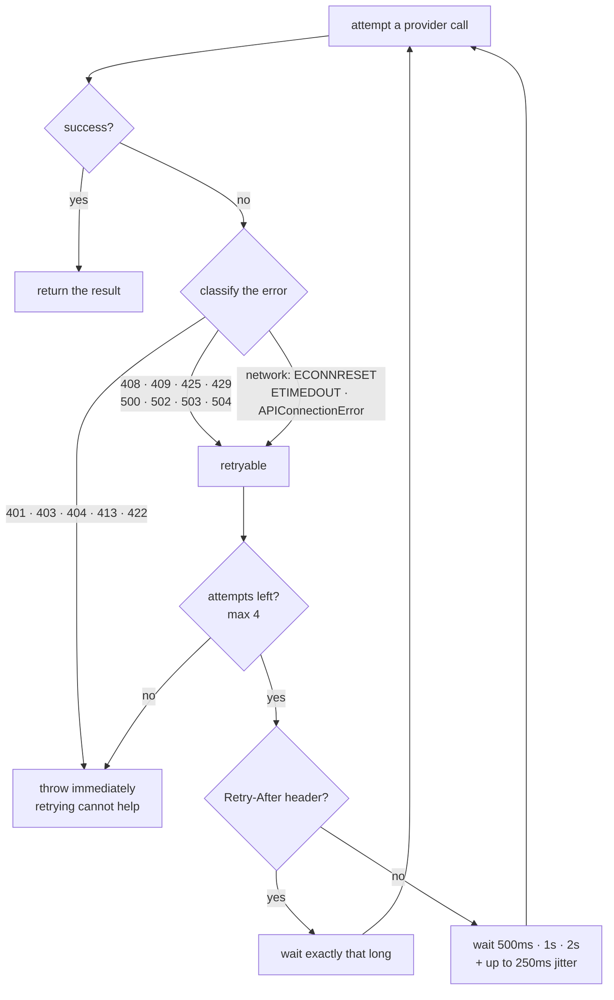

# Chapter 06: Rate Limits, Retry & Exponential Backoff

> **Chapter goal:** build `src/lib/retry.ts` — decide which failures are worth retrying, wait the right amount
> of time (with jitter), and stop after a bounded number of attempts.

**Notes chapter covered:** 06 (rate limits, quotas, throttling and retry/backoff).

**Files built:** `src/lib/retry.ts`

---

## 6.1 Why a 429 is a normal Tuesday

The notes make a distinction that most code gets wrong:

| | Client mistake (4xx) | Provider throttling (429) |
| :--- | :--- | :--- |
| Meaning | *Your request is wrong* | *Your request was fine, but not right now* |
| Retry helps? | **No** — the same request fails identically | **Yes** — after the window resets |
| Fix | Change the code | Wait, then repeat |

Rate limits come in two dimensions, and both are hit by this codebase:

- **RPM (requests per minute)** — hit by *volume of calls*.
- **TPM (tokens per minute)** — hit by *size of calls*. A single call with an 8,000-token prompt can exhaust a
  small TPM quota in one shot, which is exactly why chapter 04 budgets input tokens.



Three ideas are doing the work here: **classify before you retry**, **back off exponentially**, and **add
jitter** so that many clients do not wake up at the same instant.

## 6.2 Full code: `src/lib/retry.ts`

File path: `code/Basic Code/src/lib/retry.ts`

```typescript
/**
 * Chapter 06 — rate limits, throttling and retry/backoff.
 * Rule: retry only what is safe to retry, back off exponentially, add jitter, and stop.
 */

/** HTTP statuses where a retry can actually succeed. */
const RETRYABLE_STATUS = new Set([408, 409, 425, 429, 500, 502, 503, 504]);

/** Network-level failures that are worth another attempt. */
const RETRYABLE_NETWORK_CODES = new Set([
  'ECONNRESET',
  'ECONNREFUSED',
  'ETIMEDOUT',
  'EAI_AGAIN',
  'UND_ERR_CONNECT_TIMEOUT',
]);

const BASE_DELAY_MS = 500;
const MAX_DELAY_MS = 8_000;
const MAX_ATTEMPTS = 4;

const sleep = (ms: number): Promise<void> => new Promise((resolve) => setTimeout(resolve, ms));

const statusOf = (error: unknown): number | undefined => {
  const status = (error as { status?: unknown })?.status;
  return typeof status === 'number' ? status : undefined;
};

/** Providers send `Retry-After` (seconds) on 429 — that hint beats any backoff we can guess. */
const retryAfterMs = (error: unknown): number | undefined => {
  const headers = (error as { headers?: Record<string, string> })?.headers;
  const seconds = Number(headers?.['retry-after']);
  return Number.isFinite(seconds) && seconds > 0 ? seconds * 1_000 : undefined;
};

const isRetryable = (error: unknown): boolean => {
  const status = statusOf(error);

  if (status !== undefined) return RETRYABLE_STATUS.has(status);

  const code = (error as { code?: unknown })?.code;
  return (
    (error as { name?: string })?.name === 'APIConnectionError' ||
    (typeof code === 'string' && RETRYABLE_NETWORK_CODES.has(code))
  );
};

/**
 * Exponential backoff with jitter:
 *   500ms → 1000ms → 2000ms (capped at 8s) plus up to 250ms of random jitter so that
 * many concurrent clients do not retry in the same instant ("thundering herd").
 *
 * 401 (bad key) and 413 (budget) are never retried: no amount of waiting fixes them.
 */
export const withRetry = async <T>(operation: () => Promise<T>, label = 'llm-call'): Promise<T> => {
  for (let attempt = 1; ; attempt += 1) {
    try {
      return await operation();
    } catch (error) {
      if (!isRetryable(error) || attempt >= MAX_ATTEMPTS) throw error;

      const backoffMs = Math.min(BASE_DELAY_MS * 2 ** (attempt - 1), MAX_DELAY_MS);
      const delayMs = retryAfterMs(error) ?? backoffMs + Math.random() * 250;

      console.warn(
        `↻ ${label}: attempt ${attempt}/${MAX_ATTEMPTS} failed ` +
          `(status ${statusOf(error) ?? 'network'}) — retrying in ${Math.round(delayMs)}ms`,
      );

      await sleep(delayMs);
    }
  }
};
```

---

## 6.3 Block-by-block explanation

### Block 1 — the retryable status set
```typescript
const RETRYABLE_STATUS = new Set([408, 409, 425, 429, 500, 502, 503, 504]);
```
A whitelist, not a "retry everything that is not 400" blacklist. Every code here means *transient*:

| Status | Meaning | Why a retry can work |
| :--- | :--- | :--- |
| `408` | Request Timeout | The request may simply have been slow |
| `409` | Conflict | The state changed; a fresh attempt may now succeed |
| `425` | Too Early | Explicitly "try again later" |
| `429` | Too Many Requests | **The rate-limit case** — the window will reset |
| `500` | Internal Server Error | Provider-side bug; often transient |
| `502` / `503` / `504` | Bad Gateway / Unavailable / Gateway Timeout | Infrastructure restarting or shedding load |

And the codes deliberately **excluded**, which matter just as much:

| Not retried | Why |
| :--- | :--- |
| `400` | Malformed request — identical on every attempt |
| `401` / `403` | Bad or unauthorised key — verified in this build: a wrong key fails in ~1 s instead of 4 attempts × sleeps |
| `404` | Wrong model id or endpoint |
| `413` | **Our own budget guard** — the request is too big and will always be too big |
| `422` | Unprocessable content |

Using a `Set` rather than an array gives O(1) lookup and, more importantly, communicates "this is a
membership test" at the call site.

### Block 2 — network-level failures
```typescript
const RETRYABLE_NETWORK_CODES = new Set([
  'ECONNRESET', 'ECONNREFUSED', 'ETIMEDOUT', 'EAI_AGAIN', 'UND_ERR_CONNECT_TIMEOUT',
]);
```
Not every failure has an HTTP status. A socket can die before any response exists, and those errors carry a
Node `code` instead:

| Code | Meaning |
| :--- | :--- |
| `ECONNRESET` | The connection was killed mid-flight (load balancer, provider restart) |
| `ECONNREFUSED` | Nothing listening — common with Ollama not yet started |
| `ETIMEDOUT` | The OS-level connect timeout expired |
| `EAI_AGAIN` | DNS resolution failed temporarily |
| `UND_ERR_CONNECT_TIMEOUT` | Undici's connect timeout — the code Node's own `fetch` emits |

These are the *most* worth retrying, because nothing about the request was wrong.

### Block 3 — the three knobs
```typescript
const BASE_DELAY_MS = 500;
const MAX_DELAY_MS = 8_000;
const MAX_ATTEMPTS = 4;
```
Named constants instead of magic numbers, so the policy is auditable in one place. The resulting worst case:

```text
attempt 1 → sleep  500ms
attempt 2 → sleep 1000ms
attempt 3 → sleep 2000ms
attempt 4 → no sleep, throw
────────────────────────────
total waiting: 3.5s, plus up to 3 × 250ms of jitter
```

**Why 4 attempts and not 10?** Because a retry chain is a *latency multiplier*. If a user request has a 30 s
budget and each attempt can take 30 s, retrying four times can consume two minutes. The notes' rule:
retries buy resilience, but they must be bounded by the caller's own timeout, not by optimism.

### Block 4 — `sleep`
```typescript
const sleep = (ms: number): Promise<void> => new Promise((resolve) => setTimeout(resolve, ms));
```
`setTimeout` is callback-based; the codebase is `async/await`. This one-liner bridges them, so the retry loop
can simply `await sleep(delayMs)` and read like prose. (Node 20 has `timers/promises` with a ready-made
`sleep`, but a three-line helper keeps the dependency surface smaller.)

### Block 5 — reading a status out of an unknown error
```typescript
const statusOf = (error: unknown): number | undefined => {
  const status = (error as { status?: unknown })?.status;
  return typeof status === 'number' ? status : undefined;
};
```
The SDK throws `APIError` objects with a `status` property, but a `catch` block receives `unknown` and cannot
assume anything. This helper narrows safely:

- **`error as { status?: unknown }`** — a structural cast, not a class check. It works for the OpenAI SDK, the
  Google SDK, and our own `Object.assign(new Error(), { status: 413 })` from chapter 04. One helper for all
  three sources is exactly why the `status` convention was chosen back in chapter 04.
- **`typeof status === 'number'`** — protects against an SDK that puts a *string* status in the field. If the
  type is wrong, we return `undefined` and the error falls through to the network check rather than being
  misclassified.

### Block 6 — honouring `Retry-After`
```typescript
const retryAfterMs = (error: unknown): number | undefined => {
  const headers = (error as { headers?: Record<string, string> })?.headers;
  const seconds = Number(headers?.['retry-after']);
  return Number.isFinite(seconds) && seconds > 0 ? seconds * 1_000 : undefined;
};
```
When a provider throttles you, it usually tells you exactly how long to wait via the `Retry-After` header
(seconds). Two things make this better than a guessed backoff:

- **It is authoritative.** The provider knows when its window resets; we do not. Waiting 2 s when it asked for
  12 s produces another 429 and burns an attempt for nothing.
- **It avoids the 3-attempts-wasted pattern.** Without it, a strict quota turns one slow success into a hard
  failure after three sleeps that were each too short.

Note the defensive parsing: `Number(...)` on a missing header yields `NaN`, and `Number.isFinite(NaN)` is
`false`, so a missing header cleanly falls through to `?? backoffMs + jitter` in the retry loop. `Retry-After`
can also be an HTTP date rather than seconds — this basic version handles the seconds form, which is what
OpenAI-style APIs send.

### Block 7 — the classifier
```typescript
const isRetryable = (error: unknown): boolean => {
  const status = statusOf(error);

  if (status !== undefined) return RETRYABLE_STATUS.has(status);

  const code = (error as { code?: unknown })?.code;
  return (
    (error as { name?: string })?.name === 'APIConnectionError' ||
    (typeof code === 'string' && RETRYABLE_NETWORK_CODES.has(code))
  );
};
```
The decision tree in three steps, in priority order:

1. **If there is an HTTP status, it decides.** A status is the provider's own verdict; it outranks any guess
   we could make from the error shape. `413` (our budget guard) is not in the set, so it is fatal — correct,
   because retrying an oversized request is pure waste.
2. **Otherwise, check for a connection failure.** `APIConnectionError` is the OpenAI SDK's name for "never
   reached the server". Checking `name` rather than importing the class keeps this file SDK-agnostic — it does
   not import `openai` at all.
3. **Otherwise, check the Node error code.** Covers the raw socket and DNS failures from Block 2.

Anything that fails all three — for example a `TypeError` from our own code — is treated as **not retryable**.
That default is deliberate: retrying an unknown error can turn a fast, clear bug into a slow, confusing one.

### Block 8 — the retry loop
```typescript
export const withRetry = async <T>(operation: () => Promise<T>, label = 'llm-call'): Promise<T> => {
  for (let attempt = 1; ; attempt += 1) {
    try {
      return await operation();
    } catch (error) {
      if (!isRetryable(error) || attempt >= MAX_ATTEMPTS) throw error;
      ...
    }
  }
};
```
Line by line:

- **`<T>(operation: () => Promise<T>)`** — a generic wrapper. It knows nothing about LLMs, so it can wrap any
  async call. The provider call is passed as a *function* (`() => provider.chat(messages)`), not as an
  already-started promise, because a promise cannot be re-awaited — you need a fresh call per attempt.
- **`for (let attempt = 1; ; attempt += 1)`** — an unbounded `for` with **no** exit condition, which looks
  alarming until you see that the loop body *always* either returns or throws. There is no path that
  increments forever. The alternative (`while (true)`) is the same thing spelled differently.
- **`return await operation()`** — the `await` is required so that a rejection is caught by *this* `try`. A bare
  `return operation()` would return the promise to the caller and the `catch` would never fire.
- **`if (!isRetryable(error) || attempt >= MAX_ATTEMPTS) throw error`** — the single exit. Two conditions:
  not worth retrying, or out of attempts. `attempt >= MAX_ATTEMPTS` (not `>`) is what makes 4 the total number
  of calls, since attempts are 1-indexed.

### Block 9 — backoff, jitter, and the log line
```typescript
      const backoffMs = Math.min(BASE_DELAY_MS * 2 ** (attempt - 1), MAX_DELAY_MS);
      const delayMs = retryAfterMs(error) ?? backoffMs + Math.random() * 250;

      console.warn(
        `↻ ${label}: attempt ${attempt}/${MAX_ATTEMPTS} failed ` +
          `(status ${statusOf(error) ?? 'network'}) — retrying in ${Math.round(delayMs)}ms`,
      );

      await sleep(delayMs);
```
- **`BASE_DELAY_MS * 2 ** (attempt - 1)`** — the exponential step. With `BASE_DELAY_MS = 500`:
  `attempt 1 → 500 × 2⁰ = 500`, `attempt 2 → 500 × 2¹ = 1000`, `attempt 3 → 500 × 2² = 2000`.
  `2 ** (attempt - 1)` uses the exponent operator and the `- 1` makes the *first* retry the base delay.
- **`Math.min(..., MAX_DELAY_MS)`** — the cap. Without it the sequence would double forever, and a long-lived
  retry chain would sleep for minutes. `2 ** (attempt - 1)` grows fast; the cap makes the policy predictable.
- **`?? backoffMs + jitter`** — the provider's hint wins when present, otherwise our computed backoff. Note the
  operator precedence here is intentional: `??` has lower precedence than `+`, so the right-hand side is
  `(backoffMs + jitter)`.
- **`Math.random() * 250`** — **jitter**, and it is not decoration. If 100 server instances all get throttled
  at the same second, a deterministic backoff makes all 100 retry at the same millisecond — a self-inflicted
  thundering herd that produces a second 429 wave. Randomising each wait spreads them out.
- **`console.warn` before the sleep**, not after. The log line explains the gap that is about to happen, so
  anyone reading the log sees the cause before the delay. `statusOf(error) ?? 'network'` distinguishes an HTTP
  status from a connection failure in one glance.
- **`label`** defaults to `'llm-call'` and is passed as `'chat'` by the service. With several retryable
  operations in one request, the label is what tells you *which* one is struggling.

---

## 6.4 What this file deliberately does not do

A basic build should be honest about its limits. This is a *client-side* retry only:

| Missing capability | Why it is out of scope here | What production adds |
| :--- | :--- | :--- |
| A **circuit breaker** | Needs state across requests | Stop calling a provider that has failed N times, fail fast instead |
| **Client-side rate limiting** | Needs a shared counter | A token bucket / queue per provider key, so you never send the 429-triggering request |
| **Idempotency keys** | Needs a request id + server support | Safe retries for *mutating* operations; chat is read-only, so it is safe by default |
| **A dead-letter queue** | Needs durable storage | Park failed requests and replay them |
| **Fallback to another provider** | Needs a routing policy | Retry on the same provider, then fall back to the next one |

The last row is worth noting: because `getProvider()` (chapter 05) returns an interface, a fallback is a small
change to `chat.service.ts` — try provider A through `withRetry`, and on failure try provider B through the
same helper. Nothing in the retry logic changes.

---

## 6.5 Verify it

The behaviour that matters most is what *doesn't* happen. From the live test run of this build:

```text
[2026-10-26T10:58:42.929Z] POST /api/chat
❌ 401 401 Incorrect API key provided: sk-repla*****************-key.
```

A wrong key produced **one** attempt and an immediate 401 — no retry log lines, no 3.5 s of sleeping. That is
`isRetryable()` correctly classifying 401 as fatal. If you saw four `↻ chat: attempt …` lines here, the
classifier would be wrong and every bad-key incident would take 4× longer to surface.

To watch a retryable path, point the service at a stopped Ollama:

```bash
AI_PROVIDER=ollama OLLAMA_BASE_URL=http://localhost:9999/v1 npx tsx src/server.ts &
curl -s -X POST localhost:8080/api/chat -H 'Content-Type: application/json' -d '{"message":"hi"}'
# ↻ chat: attempt 1/4 failed (status network) — retrying in 512ms
# ↻ chat: attempt 2/4 failed (status network) — retrying in 1043ms
# ↻ chat: attempt 3/4 failed (status network) — retrying in 2098ms
# → 500 after ~3.6s
```

Note the jitter: `512ms`, `1043ms`, `2098ms` — each slightly above the clean 500/1000/2000 because of the
random component.

> **Common mistakes**
> - Retrying every error. A retried 401 is a slower 401; a retried 413 can never succeed.
> - Retrying without a cap. An unbounded loop converts a provider outage into a self-inflicted DoS.
> - Sleeping a fixed amount. Fixed delays synchronise clients; exponential + jitter spreads them.
> - Ignoring `Retry-After`. The provider told you the answer and you guessed instead.
> - Leaving the SDK's own retry enabled *and* writing your own. Retries multiply: 3 × 4 = 12 attempts.
> - Retrying non-idempotent operations. Fine for chat, dangerous for "charge the customer".

Chapter 07 builds the anti-slop guard that screens what the model finally returns.


