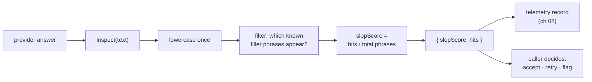
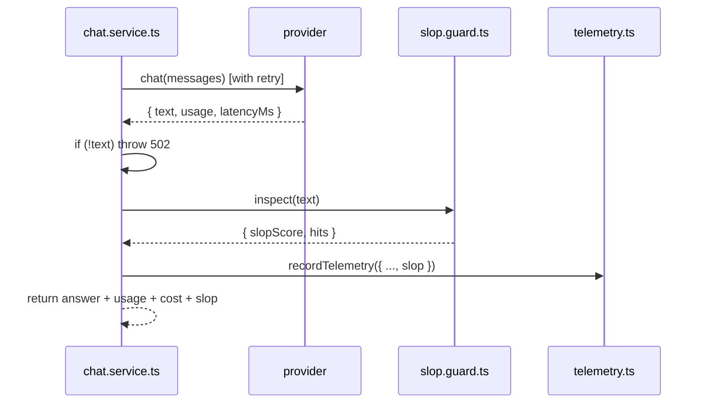

# Chapter 07: The AI Slop Guard

> **Chapter goal:** build `src/guards/slop.guard.ts` — a deterministic, explainable screen for the filler
> phrases and hedge patterns that make an answer read as generated rather than written.

**Notes chapter covered:** 09 (AI slop and model collapse).

**Files built:** `src/guards/slop.guard.ts`

**Commands:**

```bash
mkdir -p src/guards
```

---

## 7.1 Why a guard at all

The notes' chapter 09 makes a distinction that shapes this file:

| | AI slop | Model collapse |
| :--- | :--- | :--- |
| What it is | Low-effort, filler-heavy *output* from a healthy model | Degradation of the *model itself* from training on its own output |
| Whose problem | Yours, today — every generated answer | Everyone's, over years — a training-data problem |
| Can you fix it in code? | **Yes** — screen it, then improve the prompt | No — it is a data-provenance problem |
| Symptom | "It is important to note that…" | Loss of diversity, tail-mode collapse |

This file addresses the first row. It cannot fix the second, and it does not pretend to.



Three design decisions, each explained below: **deterministic** (no second model), **explainable** (it returns
the phrases it found, not just a number), and **cheap** (no network, no tokens, microseconds).

## 7.2 Full code: `src/guards/slop.guard.ts`

File path: `code/Basic Code/src/guards/slop.guard.ts`

```typescript
/**
 * Chapter 09 — AI slop and model collapse.
 * The deterministic half of the anti-slop checklist: filler phrases are countable,
 * so the screen is cheap, explainable and testable.
 */
const SLOP_PHRASES = [
  "as an ai language model",
  "in today's fast-paced world",
  'it is important to note that',
  'in conclusion,',
  'i hope this helps',
  'delve into',
];

export interface SlopReport {
  /** 0 = clean, 1 = every known filler phrase is present. */
  slopScore: number;
  hits: string[];
}

export const inspect = (text: string): SlopReport => {
  const lowerCased = text.toLowerCase();
  const hits = SLOP_PHRASES.filter((phrase) => lowerCased.includes(phrase));

  return { slopScore: Number((hits.length / SLOP_PHRASES.length).toFixed(2)), hits };
};
```

---

## 7.3 Block-by-block explanation

### Block 1 — the phrase list
```typescript
const SLOP_PHRASES = [
  "as an ai language model",
  "in today's fast-paced world",
  'it is important to note that',
  'in conclusion,',
  'i hope this helps',
  'delve into',
];
```
Six phrases, all lowercase, all chosen for a reason:

| Phrase | Why it signals slop |
| :--- | :--- |
| `as an ai language model` | The model is narrating its own constraints instead of answering |
| `in today's fast-paced world` | A stock opener that carries no information about the question |
| `it is important to note that` | A hedge that adds length without adding content |
| `in conclusion,` | A summarising tic — useful in a 5-page essay, noise in a 3-sentence answer |
| `i hope this helps` | Chatbot sign-off; unwanted in a programmatic API response |
| `delve into` | A statistically over-represented verb in generated text |

Two properties make this list work as a *screen* rather than a *judgement*:

- **Every phrase is lowercase.** The list is compared against a lowercased copy of the answer, so one list
  covers all capitalisations. Storing mixed case would silently miss "In Conclusion,".
- **It is short and auditable.** A reviewer can read all six and disagree with one — which is the point. A
  learned classifier would be more accurate and impossible to argue with.

> This is deliberately *not* a "good writing detector". It is a smoke alarm: it catches a specific, known,
> cheap-to-detect failure mode. It will happily pass a beautifully sloppy answer that avoids all six phrases.

### Block 2 — the report type
```typescript
export interface SlopReport {
  /** 0 = clean, 1 = every known filler phrase is present. */
  slopScore: number;
  hits: string[];
}
```
Two fields, and the second one is the important one:

- **`slopScore`** — a normalised 0–1 value, easy to chart, alert on, and average across calls.
- **`hits`** — the actual phrases found. A score of `0.33` is a metric; `["in conclusion,", "delve into"]` is
  an *explanation*. When someone asks "why did this answer get flagged?", the answer is already in the payload.

This is the same principle as chapter 02's config errors: never report a number when you can report the reason
behind it.

### Block 3 — the scan
```typescript
export const inspect = (text: string): SlopReport => {
  const lowerCased = text.toLowerCase();
  const hits = SLOP_PHRASES.filter((phrase) => lowerCased.includes(phrase));

  return { slopScore: Number((hits.length / SLOP_PHRASES.length).toFixed(2)), hits };
};
```
- **`text.toLowerCase()` once**, outside the loop. Lowercasing inside the filter would repeat the work six
  times on a possibly multi-kilobyte string — a small thing that becomes a real cost at scale.
- **`.filter(...)` returns the matches**, which is exactly the `hits` array. No separate counting variable, no
  index bookkeeping: the filter *is* the scan.
- **`.toFixed(2)` then `Number(...)`** — `toFixed` returns a *string* (`"0.33"`), so the `Number()` wrapper is
  needed to keep `slopScore` a number. `Number` also drops trailing zeros, so `0.50` becomes `0.5`.
- **No thresholds inside the guard.** The guard measures; it does not decide. Whether a `slopScore` of `0.33`
  should trigger a retry is a *product* decision, and it belongs in the caller or a config value — not buried
  in a utility. That separation is what lets you tune the policy without touching the measurement.

#### Worked example

```text
answer: "In conclusion, it is important to note that this helps. I hope this helps!"

lowerCased → "in conclusion, it is important to note that this helps. i hope this helps!"
hits       → ["it is important to note that", "in conclusion,", "i hope this helps"]
slopScore  → 3 / 6 = 0.5
```

Half the known phrases in a 12-word answer. The prompt, not the model, is what needs fixing.

---

## 7.4 Why not a second model as the judge?

The obvious "better" alternative is to ask a model to score the output for slop. The notes' position, and the
reason this file is deterministic:

| Approach | Cost | Latency | Determinism | Explainability | Failure mode |
| :--- | :--- | :--- | :--- | :--- | :--- |
| **Phrase screen** (this file) | $0 | ~0 ms | Same input → same score | Lists the exact phrases | Misses slop phrased differently |
| LLM-as-judge | +1 paid call | +0.5–3 s | Varies run to run | Vague ("looks generated") | The judge can itself produce slop |

For a *basic* build, the deciding factors are **cost** and **determinism**: a guard that doubles the price of
every request to catch six known phrases is a bad trade, and a guard whose verdict changes between identical
runs cannot be tested. Start deterministic; escalate to a model-based judge only for the cases the screen
provably misses.

---

## 7.5 Where the guard sits in the pipeline



The guard runs **after** the call and **before** the response is returned, so its result travels with the
answer. In this basic build the score is reported, not enforced — the caller sees `slop.slopScore` and can
decide. That is the honest minimum: measure first, enforce once you know your baseline.

Three ways to escalate later, in increasing order of cost:

1. **Report it** (this build) — the score appears in the response and the telemetry log.
2. **Alert on it** — a dashboard panel for mean `slopScore`, with an alert when it trends up. A rising score
   usually means a prompt or model change, and it is visible before customers complain.
3. **Enforce it** — reject or re-ask when `slopScore > threshold`. Note this costs a second paid call, so it
   needs a budget (chapter 04) and a retry policy (chapter 06) of its own.

---

## 7.6 Verify it

The guard is a pure function, so it can be checked without a provider, a key, or a server. Create a scratch
file `src/scratch.ts`:

```typescript
import { inspect } from './guards/slop.guard.js';

console.log(JSON.stringify(inspect('In conclusion, it is important to note that this works. I hope this helps!')));
console.log(JSON.stringify(inspect('The retry uses exponential backoff with jitter.')));
```

```bash
npx tsx src/scratch.ts
rm src/scratch.ts        # delete it when you are done
```

Verified output from this build:

```json
{"slopScore":0.5,"hits":["it is important to note that","in conclusion,","i hope this helps"]}
{"slopScore":0,"hits":[]}
```

Check the first line against §7.3's worked example: three hits out of six phrases = `0.5`, and the `hits` array
names exactly which ones. The second line is a clean technical sentence — no hits, score `0`.

> Note the `.js` extension in the import even though the file is `slop.guard.ts`. That is the NodeNext rule
> from chapter 01 in action: the import must name the *compiled* file, because that is what exists at runtime.

> **Common mistakes**
> - Treating `slopScore` as a quality score. It measures *six specific phrases*, nothing more.
> - Putting the threshold inside the guard. Measurement and policy must stay separable.
> - Lowercasing inside the filter — six passes over the same string.
> - Leaving `toFixed` without `Number(...)`, so `slopScore` silently becomes a string in JSON (`"0.5"`),
>   breaking every numeric comparison downstream.
> - Trying to fix model collapse here. That is a training-data problem; a phrase list cannot touch it.

Chapter 08 builds the telemetry record and the chat service that ties every previous chapter together.


