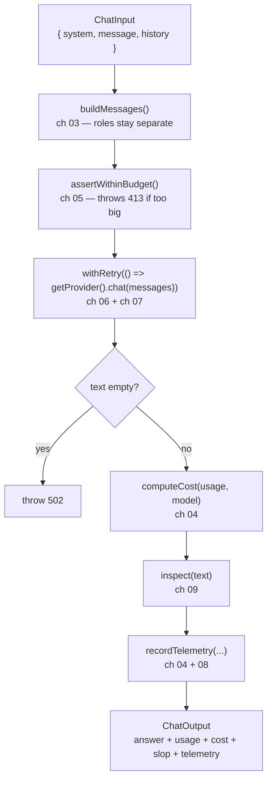

# Chapter 08: Telemetry & The Chat Service

> **Chapter goal:** build `src/utils/telemetry.ts` (one structured record per call) and
> `src/services/chat.service.ts` (the pipeline that ties chapters 03 → 09 together).

**Notes chapters covered:** 04 (usage metadata, cost) · 08 (telemetry and the service layer) — plus every
earlier chapter, orchestrated.

**Files built:** `src/utils/telemetry.ts`, `src/services/chat.service.ts`

**Commands:**

```bash
mkdir -p src/utils
```

---

## 8.1 The pipeline, in one function



Two files, two responsibilities:

| File | Responsibility | Knows about |
| :--- | :--- | :--- |
| `utils/telemetry.ts` | Turn a finished call into one log line | Tokens, cost, latency, slop — no HTTP, no provider SDK |
| `services/chat.service.ts` | Order the steps and own the failure modes | Messages, budgets, retries — no Express |

## 8.2 Full code: `src/utils/telemetry.ts`

File path: `code/Basic Code/src/utils/telemetry.ts`

```typescript
import type { SlopReport } from '../guards/slop.guard.js';
import type { TokenUsage } from '../lib/client.js';
import type { CostBreakdown } from '../services/token.service.js';

/**
 * Chapter 04 + 08 — the fields you can never reconstruct later, so log them on
 * every single call: provider, model, latency, token counts and cost.
 */
export interface TelemetryRecord {
  at: string;
  provider: string;
  model: string;
  latencyMs: number;
  inputTokens: number;
  outputTokens: number;
  totalTokens: number;
  estimatedInputTokens: number;
  costUsd: number;
  slopScore: number;
}

export interface TelemetryInput {
  provider: string;
  model: string;
  latencyMs: number;
  usage: TokenUsage;
  estimatedInputTokens: number;
  cost: CostBreakdown;
  slop: SlopReport;
}

/** One structured line per call — grep-able now, dashboard-able later. */
export const recordTelemetry = (input: TelemetryInput): TelemetryRecord => {
  const record: TelemetryRecord = {
    at: new Date().toISOString(),
    provider: input.provider,
    model: input.model,
    latencyMs: input.latencyMs,
    inputTokens: input.usage.inputTokens,
    outputTokens: input.usage.outputTokens,
    totalTokens: input.usage.totalTokens,
    estimatedInputTokens: input.estimatedInputTokens,
    costUsd: Number(input.cost.totalCost.toFixed(6)),
    slopScore: input.slop.slopScore,
  };

  console.log(`[telemetry] ${JSON.stringify(record)}`);
  return record;
};
```

### Block-by-block explanation

#### Block 1 — `import type`
```typescript
import type { SlopReport } from '../guards/slop.guard.js';
import type { TokenUsage } from '../lib/client.js';
import type { CostBreakdown } from '../services/token.service.js';
```
`import type` is erased completely at compile time — no runtime import, no module-loading cycle. That matters
here because `telemetry.ts` references types from three other modules while being imported *by* the service
that imports them. With plain `import`, those would be circular imports at runtime; with `import type`, they
simply do not exist in the emitted JavaScript.

#### Block 2 — two types, deliberately different
```typescript
export interface TelemetryRecord { ... }   // what gets logged: flat, primitive
export interface TelemetryInput  { ... }   // what the caller passes: nested, domain types
```
- **`TelemetryInput`** mirrors the caller's world: `usage`, `cost` and `slop` are the objects the service
  already holds, so no unpacking is required at the call site.
- **`TelemetryRecord`** is flat: every field is a `string` or a `number`.

Why flatten? Because the record is destined for a log pipeline. Flat, primitive, single-line JSON is what
`jq`, Loki, CloudWatch Insights and Datadog can index and aggregate without configuration. A nested
`{ usage: { inputTokens: … } }` works too, but `inputTokens` as a top-level field is what lets you write
`avg(inputTokens) by provider` on day one. **Shape your telemetry for the query you will run, not for the
object you happen to have.**

#### Block 3 — the fields that matter
```typescript
  at: new Date().toISOString(),
```
ISO-8601 UTC. Not `Date.now()` (a number nobody can read) and not a locale string (ambiguous across regions).

```typescript
  provider: input.provider,
  model: input.model,
```
Both, not just one. The provider tells you *who* answered; the model tells you *what* answered. After a model
migration these two fields are how you compare cost and latency before and after.

```typescript
  inputTokens: input.usage.inputTokens,
  outputTokens: input.usage.outputTokens,
  totalTokens: input.usage.totalTokens,
  estimatedInputTokens: input.estimatedInputTokens,
```
**Both** the estimate and the actual. Keeping them side by side is how you calibrate the estimator from
chapter 04: if `estimatedInputTokens` is consistently 30% below `inputTokens`, your 4-chars-per-token
assumption is wrong for this workload (probably code or non-Latin text), and you fix it with evidence.

```typescript
  costUsd: Number(input.cost.totalCost.toFixed(6)),
```
- **The unit is in the field name.** `costUsd`, not `cost`. Ambiguous units are how teams end up 100× off.
- **`toFixed(6)` then `Number(...)`.** Six decimals because a single call costs fractions of a cent
  (`0.00036`), and `Number()` converts the string back so the JSON contains `0.00036`, not `"0.000360"`.
  Without the `Number()` wrapper, `costUsd` would be a *string* in the log — and `sum(costUsd)` would
  silently produce string concatenation in many pipelines.

```typescript
  slopScore: input.slop.slopScore,
```
The chapter 07 metric, in the same record as the cost. This is what makes a quality/cost trade-off visible:
"the cheaper model scored 0.4 slop vs 0.05 on the expensive one" is a decision you can only make if both
numbers are in the same row.

#### Block 4 — emit and return
```typescript
  console.log(`[telemetry] ${JSON.stringify(record)}`);
  return record;
};
```
- **A single line**, prefixed with `[telemetry]`, so you can `grep '\[telemetry\]'` in local development and
  route on the prefix in production.
- **`JSON.stringify`** produces machine-parseable output; `console.log` of an object would print Node's
  inspector format instead, which is not valid JSON.
- **It returns the record** so the caller can include it in the HTTP response. That is what makes the cost
  visible to whoever called the API, not just to whoever reads the server log — a small decision with a large
  effect on how quickly cost bugs get noticed.

> **Why not a logging library?** `winston`/`pino` add transports, levels and formatting. For a basic build,
> one `console.log` of structured JSON gives 90% of the value for 0 dependencies. The interface —
> `recordTelemetry(input)` — is the part worth keeping, because swapping the implementation later is then a
> one-file change.

## 8.3 Full code: `src/services/chat.service.ts`

File path: `code/Basic Code/src/services/chat.service.ts`

```typescript
import type { SlopReport } from '../guards/slop.guard.js';
import type { ChatMessage, TokenUsage } from '../lib/client.js';
import type { TelemetryRecord } from '../utils/telemetry.js';
import { recordTelemetry } from '../utils/telemetry.js';
import { getProvider } from '../lib/client.js';
import { withRetry } from '../lib/retry.js';
import { assertWithinBudget, computeCost, type CostBreakdown } from './token.service.js';
import { inspect } from '../guards/slop.guard.js';

export interface ChatInput {
  system: string;
  message: string;
  history: ChatMessage[];
}

export interface ChatOutput {
  answer: string;
  provider: string;
  model: string;
  latencyMs: number;
  usage: TokenUsage;
  estimatedInputTokens: number;
  cost: CostBreakdown;
  slop: SlopReport;
  telemetry: TelemetryRecord;
}

/**
 * Chapter 03 — one place builds the message array, so the role boundary can never
 * drift between endpoints: instructions in `system`, untrusted data in `user`.
 */
export const buildMessages = ({ system, message, history }: ChatInput): ChatMessage[] => [
  { role: 'system', content: system },
  ...history,
  { role: 'user', content: message },
];

/**
 * The whole lecture in one function:
 *   build messages (03) → budget them (05) → call the active provider with retry (06 + 07)
 *   → price the result (04) → screen the answer (09) → log the ledger (04 + 08).
 */
export const chat = async (input: ChatInput): Promise<ChatOutput> => {
  const messages = buildMessages(input);

  const estimatedInputTokens = assertWithinBudget(messages); // chapter 05

  const result = await withRetry(() => getProvider().chat(messages), 'chat'); // chapter 06 + 07

  if (!result.text) {
    throw Object.assign(new Error('Provider returned an empty completion.'), { status: 502 });
  }

  const cost = computeCost(result.usage, result.model); // chapter 04
  const slop = inspect(result.text); // chapter 09

  const telemetry = recordTelemetry({
    provider: result.provider,
    model: result.model,
    latencyMs: result.latencyMs,
    usage: result.usage,
    estimatedInputTokens,
    cost,
    slop,
  });

  return {
    answer: result.text,
    provider: result.provider,
    model: result.model,
    latencyMs: result.latencyMs,
    usage: result.usage,
    estimatedInputTokens,
    cost,
    slop,
    telemetry,
  };
};
```

### Block-by-block explanation

#### Block 1 — the two types that describe the boundary
```typescript
export interface ChatInput {
  system: string;
  message: string;
  history: ChatMessage[];
}
```
`ChatInput` is **identical in shape to the validated request body** from chapter 03. That is not a coincidence:
`validateBody(chatRequestSchema)` replaces `req.body` with exactly this shape, so the controller can pass
`req.body` straight in. One shape, two files, zero mapping code.

```typescript
export interface ChatOutput {
  answer: string;
  provider: string;
  model: string;
  latencyMs: number;
  usage: TokenUsage;
  estimatedInputTokens: number;
  cost: CostBreakdown;
  slop: SlopReport;
  telemetry: TelemetryRecord;
}
```
Every field is a *different kind of fact* about the same call:

| Field group | Answers the question |
| :--- | :--- |
| `answer` | What did the model say? |
| `provider`, `model` | Who said it? |
| `latencyMs` | How long did the user wait? |
| `usage`, `estimatedInputTokens` | How many tokens, and did my estimate hold up? |
| `cost` | What did it cost? |
| `slop` | Was the answer any good? |
| `telemetry` | What did we write to the log? |

A response that answers only the first row is a demo. A response that answers all seven is a service you can
operate — and every extra field cost one line of code, because the data was already in hand.

#### Block 2 — `buildMessages`, the role boundary
```typescript
export const buildMessages = ({ system, message, history }: ChatInput): ChatMessage[] => [
  { role: 'system', content: system },
  ...history,
  { role: 'user', content: message },
];
```
Three lines, and the notes' chapter 03 made structural:

- **System first.** The policy is the first thing the model sees, and there is exactly one of it — the caller
  cannot add another (chapter 03 rejects a `system` turn inside `history`).
- **`...history` spread in the middle**, in the order the caller supplied. The notes' rule is oldest-first, and
  since the spread preserves array order, the contract is "history arrives chronological". No sorting, no
  reversing — the caller owns the order, and the shape makes that explicit.
- **The user message last.** The actual question is the final turn, immediately before generation — which is
  where models attend most strongly.
- **It is exported** because chapter 09's `/tokens/count` endpoint needs the *same* array to count tokens
  without calling a provider. If the array were built inline inside `chat()`, the count endpoint would have to
  duplicate the logic — and the two would drift apart. Extracting it is a two-line change that removes a whole
  class of future bug.

#### Block 3 — budget before spending
```typescript
  const estimatedInputTokens = assertWithinBudget(messages); // chapter 05
```
Note the ordering: the budget check happens **before** `withRetry`, and before any provider is even resolved.
A request that is too large fails in microseconds at $0.00. If this line came after the call, the guard would
still "work" — while paying for the very request it was supposed to prevent.

#### Block 4 — the retried call
```typescript
  const result = await withRetry(() => getProvider().chat(messages), 'chat'); // chapter 06 + 07
```
One line, three chapters:

- **`getProvider()`** (ch 07) resolves the active adapter from the config, cached after first use.
- **`() => … .chat(messages)`** passes a *function*, not a promise. `withRetry` needs to be able to invoke the
  call again, so it must receive something callable. This is the single most common mistake when wrapping an
  async call in a retry helper.
- **`'chat'`** is the label that appears in retry log lines, so `↻ chat: attempt 2/4 …` identifies which
  operation is struggling.
- **`await`** unwraps the final successful result — or rethrows the fatal error unchanged, which is what lets
  a 413 or a 401 pass through with its `status` intact for the error handler in chapter 09.

#### Block 5 — the empty-answer guard
```typescript
  if (!result.text) {
    throw Object.assign(new Error('Provider returned an empty completion.'), { status: 502 });
  }
```
A `200 OK` with no usable content is a real and common outcome: a content filter, a refusal, a tool-only
response, or a provider-side bug. Without this check the caller would receive `answer: ""` and have to guess
whether the model was silent or the integration is broken.

Two details, both deliberate:

- **`502 Bad Gateway`, not `500`.** The failure is upstream — the provider gave us something unusable. `502`
  is the semantically correct signal, and it separates "our code broke" from "the dependency misbehaved" in
  your dashboards.
- **The same `Object.assign(new Error(), { status })` convention** used by the budget guard in chapter 04. One
  convention, two producers, one consumer (chapter 09's error handler). No custom error class hierarchy for a
  basic build.

#### Block 6 — price it
```typescript
  const cost = computeCost(result.usage, result.model); // chapter 04
```
Note the second argument: **`result.model`, not `config.AI_MODEL`**. They are the same string today, but
`result.model` is what the adapter reported as having actually answered. When a future routing or fallback
layer means the answering model differs from the configured one, this line is already correct — and the cost
is priced against the model that really ran.

#### Block 7 — screen it
```typescript
  const slop = inspect(result.text); // chapter 09
```
Chapter 07's guard, applied to the finished answer. It runs after the empty check so it never inspects `""`
(which would trivially score 0 and look like a clean answer).

#### Block 8 — record the ledger
```typescript
  const telemetry = recordTelemetry({
    provider: result.provider,
    model: result.model,
    latencyMs: result.latencyMs,
    usage: result.usage,
    estimatedInputTokens,
    cost,
    slop,
  });
```
Fields are passed **explicitly**, one by one, rather than spread as `...result`. Two reasons:

1. **A spread would leak `text`** — the entire model answer — into the telemetry input object, which is one
   refactor away from being logged. Prompt and answer content in logs is a privacy and cost problem; explicit
   fields make the boundary visible in the code.
2. **It documents the contract.** Reading this call tells you exactly what a telemetry record contains,
   without opening `telemetry.ts`.

#### Block 9 — the response
```typescript
  return {
    answer: result.text,
    ...
    telemetry,
  };
```
Every field is returned, including `telemetry` — so the caller sees the same ledger that was logged. A
developer integrating against this endpoint can read `cost.totalCost` and `slop.slopScore` from the response
without access to the server's stdout, which is what turns cost awareness from a monthly surprise into a
per-call fact.

---

## 8.4 Reading the telemetry line

A single `POST /api/chat` produces one line like this (shape from a real successful call):

```json
[telemetry] {"at":"2026-10-26T10:41:02.311Z","provider":"openai","model":"gpt-4o-mini","latencyMs":842,
"inputTokens":58,"outputTokens":41,"totalTokens":99,"estimatedInputTokens":51,"costUsd":0.000033,
"slopScore":0}
```

What each field lets you do:

| Field | Query it answers |
| :--- | :--- |
| `at` | When did this happen? (join with deploys, incidents, model migrations) |
| `provider`, `model` | Which one answered — and does the mix match the plan? |
| `latencyMs` | p50/p95/p99 latency, per provider and per model |
| `inputTokens` vs `estimatedInputTokens` | Is the estimator calibrated? (`51` vs `58` → ~14% under) |
| `outputTokens` | Are answers longer than intended? (a prompt-quality signal) |
| `costUsd` | Daily spend = `sum(costUsd)`; cost per customer = group by your own key |
| `slopScore` | Quality trend over time and across model versions |

Note `51` vs `58`: the estimate was 14% low on this input, which is inside the expected error bar for a
4-chars-per-token heuristic on a short prompt. The budget guard (chapter 04) accounts for that by rounding up.

> **Common mistakes**
> - Logging the prompt or the answer. It is the most common accidental data leak, and it makes logs expensive.
> - Spreading `...result` into telemetry instead of naming fields — the answer text follows along.
> - Forgetting the return value, so the response cannot report its own cost.
> - Pricing with `config.AI_MODEL` when a router or fallback could have answered with something else.
> - Treating `costUsd` as a string (missing the `Number()` wrapper) and getting concatenated totals.

Chapter 09 builds the controllers, routes, Express app and server — and verifies the whole pipeline end to end.


