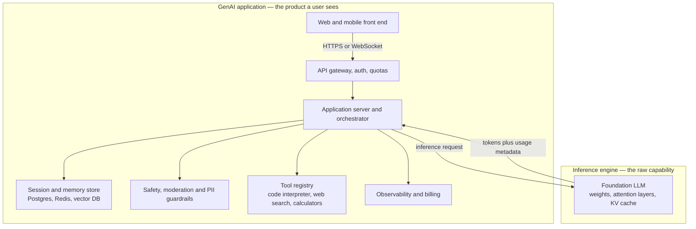
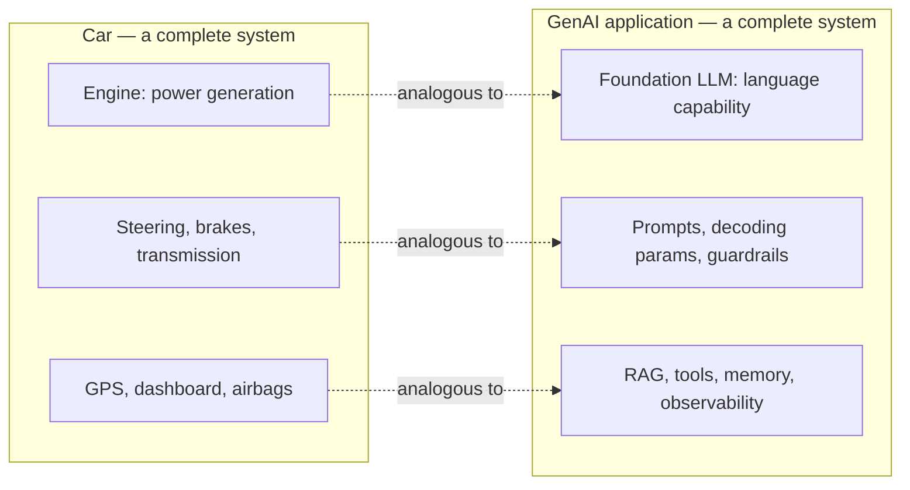
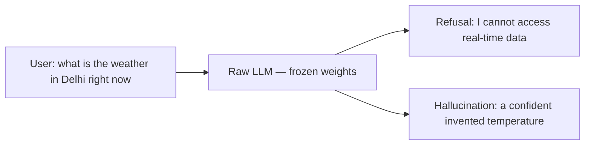
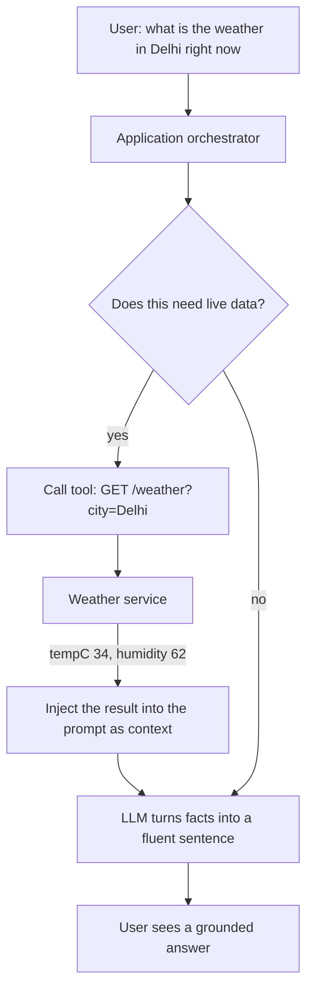
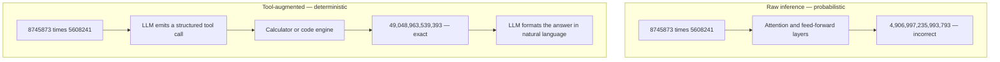
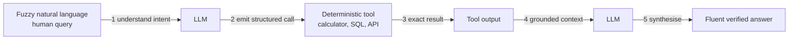
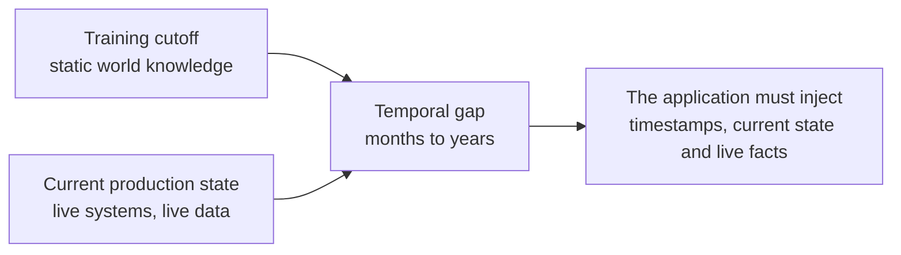
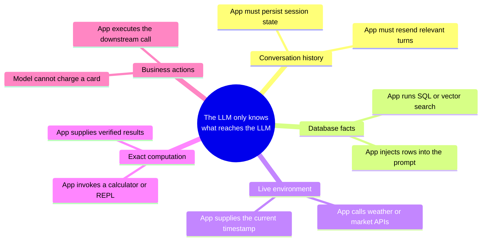
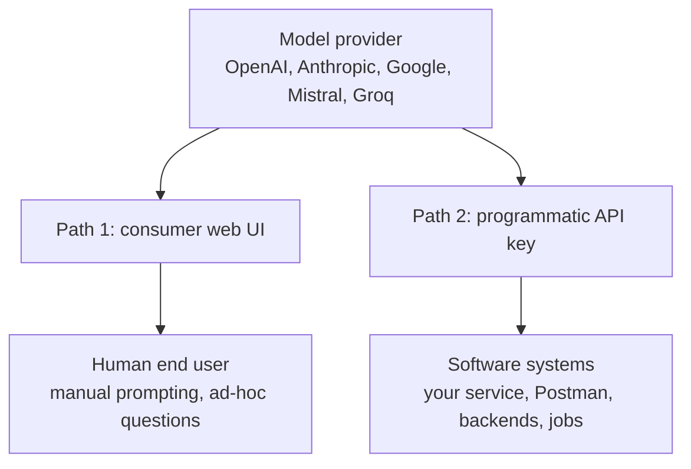
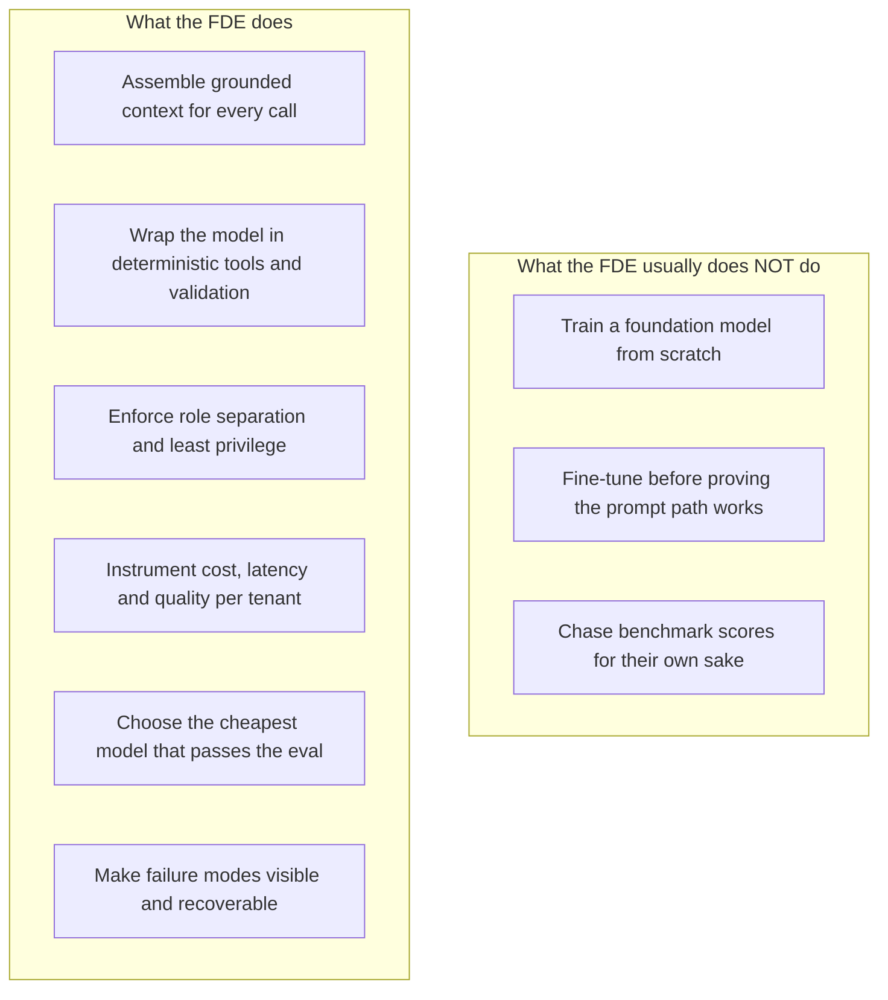

# Chapter 01 — GenAI Applications vs Raw LLMs: The Engine vs Car Model

> **Lecture 04 · Chapter 01 of 09** · Level: 🟢 Beginner · Phase 2 — The Application Layer: Talking to Models
> **Source:** `Forward-Deployed-Engineer/Lecture 03/notes/01_GenAI_Applications_vs_Raw_LLMs_and_The_Engine_Analogy.md` ·
> `gen-ai-cohort/week01/learning/day01/notes/notes.md` (GPT vs ChatGPT · the car analogy) ·
> `gen-ai-cohort/week01/learning/day01/notes/interview.md` (Q1 — GPT vs ChatGPT)
> **Roadmap topics:** GenAI applications vs raw LLMs — the *engine vs car* analogy · why an LLM needs
> external deterministic tools · the cardinal rule *"the LLM only knows what reaches the LLM"* ·
> consumer web UI vs programmatic API key · the knowledge-cutoff problem.

---

## 01.0 What this chapter is for

Every engineering mistake in this lecture — leaking an API key, blowing up the token bill, letting a user
hijack your prompt, shipping a service that "sometimes returns nothing" — traces back to one confusion:
**believing that the model *is* the product.**

This chapter removes that confusion. It draws the line between:

- a **raw LLM**: a frozen statistical engine that maps a sequence of tokens to a probability distribution
  over the next token, and
- a **GenAI application**: the software system built *around* that engine — context assembly, memory,
  guardrails, tools, telemetry, billing, user interface.

The rest of the lecture (chapters 02–08) is the engineering of that "around". Chapter 09 (AI slop and
model collapse) is what happens to the whole ecosystem when nobody does that engineering.

By the end of this chapter you should be able to:

1. Explain why **ChatGPT is not an LLM**, and name at least six components of a production GenAI app.
2. Reproduce the **engine vs car** mapping from memory, in both directions.
3. Give the weather example and the arithmetic example, and say precisely *why* the raw model fails both.
4. State the **cardinal rule** — *the LLM only knows what reaches the LLM* — and derive the application's
   responsibilities from it.
5. Explain the **knowledge-cutoff** problem in one paragraph.
6. Distinguish the **consumer web UI** from the **programmatic API**, and say why only one of them can be
   embedded in enterprise software.

---

## 01.1 The illusion: "I typed into ChatGPT, so I talked to a neural network"

A user opens ChatGPT, Claude, Gemini or DeepSeek and types:

```text
Explain Docker to me like I am a beginner.
```

Text goes in, text streams out, in under a second. The interaction *feels* like talking to a single model.
It is not. What the user is actually talking to is a **distributed cloud application** in which the model is
one dependency among many.



Read the diagram as a checklist. Each box is a piece of software somebody had to write. When you build your
own service in chapter 08 you will rebuild a miniature version of this diagram — minus the front end and
the safety team, plus your own domain logic.

> [!IMPORTANT]
> **The sentence to remember.** An LLM is a *capability*; a GenAI application is a *system*. The capability
> predicts tokens. The system decides which tokens it ever gets to see, and what happens to the tokens it
> produces.

### Two specific traps this illusion creates

| Trap | What it looks like | Why it is wrong |
| :--- | :--- | :--- |
| **"The model remembers me."** | Users expect continuity across sessions and devices | The model is **stateless**. Continuity is a database feature, not a model feature (chapter 03). |
| **"The model can look things up."** | Users ask for today's prices, ticket status, weather | The model has **no live I/O**. Retrieval is application code that *pastes* facts into the prompt (chapter 01.4). |

---

## 01.2 The engine vs car analogy

The clearest mental model in the whole lecture is mechanical:

```text
Car    ──►  GenAI application
Engine ──►  Large Language Model
```

An engine is a genuine engineering marvel. It burns fuel, rotates a crankshaft and produces raw mechanical
power. But an engine on a workbench is **not** a car, because:

- you cannot sit in it,
- you cannot steer it,
- you cannot brake with it,
- and it has no idea where you want to go.

Every one of those missing things is a *system* concern, and every one of them has an exact analogue in a
GenAI application:

| Automotive part | What it does in a car | GenAI application component | What it does for the model |
| :--- | :--- | :--- | :--- |
| **Engine** | Produces raw torque | **Raw foundation LLM** | Produces a next-token probability distribution |
| **Transmission and gears** | Regulates how power is delivered | **Decoding parameters** (`temperature`, `top_p`, `max_tokens`) | Turn raw logits into a calibrated, controlled output (Lecture 03, ch 08) |
| **Steering wheel** | Chooses the direction | **System instructions and orchestrator** | Fix the persona, scope, format and task |
| **Brakes and seatbelts** | Stop the vehicle, protect passengers | **Guardrails, moderation, output validation** | Block unsafe or malformed output before it reaches a user or a database |
| **Fuel tank and sensors** | Supply energy, report state | **Context window and token budget** | Decide how much prompt and history actually fit (chapter 05) |
| **GPS and navigation** | Finds the route | **Retrieval (RAG) and search services** | Inject the *relevant* facts instead of hoping the model knows them |
| **Dashboard gauges** | Speed, RPM, temperature | **Observability and telemetry** | Latency, token usage, cost, error rate per tenant (chapters 04 and 08) |
| **Accessories** (AC, wipers, cruise control) | Extra capabilities | **Tool calling** | Weather APIs, SQL, calculators, compilers (Lecture 08) |



> [!TIP]
> **The analogy is not decoration — it is a job description.** As a Forward Deployed Engineer you almost
> never train the engine. You **build the vehicle**: the harness, the information pipeline, the
> deterministic guardrails and the integrations that make a probabilistic engine usable inside a business
> process that cannot tolerate "usually right".

### Where the analogy breaks (and why that matters)

| Analogy claim | Reality | Consequence |
| :--- | :--- | :--- |
| "Same engine, same car" | The same prompt can produce different output on two calls | You cannot test by string equality; assert on **structure** (chapters 04 and 08) |
| "The engine is deterministic" | Decoding samples from a distribution | Set `temperature` low and pin model versions for reproducible behaviour (chapter 02) |
| "Fuel is fuel" | Prompt tokens and completion tokens have different prices *and* different physics | Cost and latency models differ per stream (chapter 04) |
| "You own the engine" | You rent it over HTTP, with quotas and outages | Rate limits, retries and fallbacks are part of the vehicle (chapters 06 and 07) |

---

## 01.3 Raw LLM vs tool-augmented application, in two scenarios

### Scenario A — real-time information

User prompt: `"What is the weather in Delhi right now?"`

A raw model has exactly two sources of information: the **frozen weights** learned during pre-training, and
the **exact text** in the incoming request. Neither contains today's weather in Delhi. So the model has only
two bad options: refuse, or hallucinate a plausible-sounding number.



In an application, the *orchestrator* — not the model — resolves the request:



Note the division of labour: **the application fetches facts; the model phrases them.** The model never
touches the network itself.

### Scenario B — arithmetic

Ask a raw model to multiply two 7-digit numbers, e.g. `8745873 × 5608241`. The correct answer is
`49,048,963,539,393`. A model will typically produce something like `4,906,997,235,993,793` — right order of
magnitude, right leading digit, right trailing digit, and completely wrong.



Why does the raw model fail? Because it is doing **pattern completion over token sequences**, not
arithmetic. It has learned the *shape* of multiplications — digit counts, carries, plausible digit
frequencies — and reproduces that shape. In finance, billing, inventory or compliance, "almost right" is a
bug report and possibly a lawsuit.

> [!WARNING]
> **Never let raw inference compute a number someone will act on.** Prices, totals, taxes, dates, quantities,
> IDs and balances must come from a deterministic system and be *formatted* by the model — never *produced*
> by it.

### The LLM as a semantic router and translation bridge

Computers already have flawless deterministic tools: calculators, relational databases, compilers, payment
APIs. But those tools demand **rigid structured input** (JSON, SQL, typed arguments), while humans speak in
**fuzzy ambiguous language**.

That gap is the LLM's real job in a software architecture: it is the **bridge from human ambiguity to
deterministic execution**, and back again.



This "LLM as router" pattern is the seed of everything in Lectures 08–10 (tool calling, agents, structured
outputs). For this lecture it is enough to hold two facts: the model is **excellent at intent and language**,
and **unreliable at computation and state**.

---

## 01.4 The knowledge-cutoff problem

Every foundation model is **frozen** at the end of training. Its weights encode a snapshot of the world:

```text
model training cutoff ....... mid 2024 (example)
current production time ..... 2026
```

Between those two points, the world moved: new regulations, renamed microservices, changed prices, new
product tiers, and — every single second — updated customer records. A reasoning system that believes it is
still mid-2024 cannot run a 2026 business process.



Three consequences you must design around:

| Consequence | Symptom | Application-side fix |
| :--- | :--- | :--- |
| **Stale facts** | "Our Pro plan is $49" (it is now $59) | Retrieve pricing from the source of truth and inject it |
| **Unknown entities** | The model has never heard of your new internal service | Inject a glossary or retrieved docs into the prompt |
| **No time awareness** | "Tomorrow" is computed from a stale date | Inject the current timestamp *and* the user's timezone into every prompt |

> [!TIP]
> **Cheap, high-value hygiene:** put the current date, timezone and the tenant's identity into the prompt
> assembly code — not into the model. A single line of context injection removes a whole class of
> "the assistant got the date wrong" bugs.

---

## 01.5 The cardinal rule of GenAI engineering

Every pattern in this lecture descends from one sentence:

> [!IMPORTANT]
> ### The cardinal rule
> **The LLM only knows what reaches the LLM.**
>
> If a fact is not serialised into the token stream of the prompt, then for the model it **does not exist**.
> Not "is hard to find" — does not exist.

The model has no telepathy to your database, no cookie jar, no company wiki, no clock, no socket. Whatever
your application *forgets to paste* is invisible.



### The context-injection responsibility matrix

| Capability people expect | What the raw LLM actually has | The application's obligation |
| :--- | :--- | :--- |
| **Multi-turn memory** | Nothing — every request is independent | Persist the transcript; resend the relevant turns each call (chapter 03) |
| **Enterprise knowledge** | Only public data up to the cutoff | Chunk, embed, index, retrieve and inject (RAG — Lectures 12–17) |
| **Customer account state** | No knowledge of your records | Query CRM/billing services and inject tier, plan and open tickets |
| **Exact calculation** | Probabilistic approximation | Provide a tool: calculator, SQL, code sandbox (Lecture 08) |
| **Side effects** | Zero ability to mutate the world | Validate the model's *request*, then execute the API call yourself |
| **Freshness** | Frozen weights | Inject timestamps and live values at assembly time |

> [!NOTE]
> Read the right-hand column as a **code review checklist**. Every entry is something *your* service must do
> before the request leaves your process. This is precisely the work that chapters 04–08 make measurable and
> observable.

---

## 01.6 Two ways to interact with a model

There are exactly two supported paths into a commercial foundation model:



| Dimension | Consumer web UI | Programmatic API |
| :--- | :--- | :--- |
| **Audience** | Humans | Software |
| **Session state** | Provider keeps the chat history for you | **Stateless** — every request is isolated, you resend history |
| **Auth** | Login, cookies, MFA | `Authorization: Bearer <API_KEY>` header |
| **Automation** | Manual typing only | Triggered by HTTP routes, webhooks, queues, cron jobs |
| **Customisation** | System prompt hidden, tools fixed | You own the system prompt, parameters, tools, logging |
| **Embeddable in enterprise software** | No | Yes — this is the only viable path |
| **Cost control** | Subscription | Per-token metering, per-tenant attribution (chapter 04) |
| **Testing** | Manual | Repeatable, automatable, assertable (chapter 07) |

The entire remainder of this lecture lives on **path 2**. Chapter 02 opens the request up and shows you the
wire format; chapter 03 shows you the message structure; chapters 04–06 show you what it costs and what
limits it; chapter 07 shows you how one service can speak to six providers; chapter 08 assembles the
service.

---

## 01.7 What this means for your job as an FDE

The engine-vs-car model reframes the work:



| Question | Amateur answer | FDE answer |
| :--- | :--- | :--- |
| "Why is the answer wrong?" | "The model is bad" | "What did we fail to inject? Which roles were collapsed? Which facts were stale?" |
| "How do we improve quality?" | "Try a bigger model" | "Fix the retrieval, split the roles, add an eval set, then *maybe* escalate the model tier" |
| "How do we control cost?" | "Ask users to be brief" | "Cap output tokens, trim system prompt, cache, tier models, attribute cost per tenant" |
| "How do we ship safely?" | "Test it a few times by hand" | "Schema-validate inputs and outputs, assert structure in CI, log every call with its token usage" |

> [!IMPORTANT]
> **The FDE thesis for this lecture.** You are not shipping a model. You are shipping a *service* that
> happens to rent intelligence — and services need configuration, validation, retries, budgets, logs and
> tests.

---

## 01.8 Common mistakes

- **Believing ChatGPT-like behaviour is free.** The chat history, tool use and guardrails you enjoy in the
  web UI are *your* responsibility through the API. Nothing is remembered for you.
- **Treating the model as a database.** Asking it for prices, balances, ticket counts or "the latest
  version" of anything without injecting the data. The cardinal rule is violated the moment you do this.
- **Treating the model as a calculator.** Multi-digit arithmetic, date math and unit conversions must be
  tool calls or library calls.
- **Assuming the model knows the current date.** It does not; inject it.
- **Concluding "the LLM cannot do X" after one failure.** Usually the failure was context assembly, not
  capability.
- **Skipping straight to a big model** instead of fixing the prompt, roles and retrieval — you pay 10× for
  the same wrong answer.
- **Forgetting that the web UI path is a dead end for product work.** If it cannot be called by software,
  it cannot be shipped.
- **Ignoring the cutoff date when designing.** Any question whose answer changes over time needs an
  injection strategy, not a bigger model.

---

## 01.9 Key takeaways

1. **An LLM is a capability; a GenAI application is a system.** ChatGPT ≠ the model behind it.
2. **Engine vs car.** The model supplies raw power; the application supplies steering (instructions),
   brakes (guardrails), fuel accounting (token budget), navigation (retrieval), gauges (telemetry) and
   accessories (tools).
3. **Raw inference is probabilistic; business logic is deterministic.** Use the model for language and
   intent, never for arithmetic, state or truth.
4. **The LLM's superpower is being a translation bridge** from ambiguous human language to structured
   deterministic calls — and back.
5. **Models are frozen at a cutoff date.** Freshness, current state and timestamps must be injected by the
   application.
6. **The cardinal rule: the LLM only knows what reaches the LLM.** Every expected capability maps to a
   concrete application obligation.
7. **Only the programmatic API is embeddable.** It is stateless, authenticated by a bearer key, and
   automated — which is why the next chapter starts with a raw HTTP request.

---

## 01.10 Self-check questions

1. Name six components of a production GenAI application that are *not* the model.
2. Give three automotive parts and their GenAI analogues, with one sentence each on why the mapping holds.
3. Why can a raw LLM not answer "what is the weather in Delhi right now" — give both possible failure
   modes.
4. Explain the arithmetic failure using the phrase "shape of the computation", not "the model is dumb".
5. State the cardinal rule, then derive three concrete obligations for a service that must answer questions
   about customer accounts.
6. What exactly is stateless about the API, and what does that force you to build?
7. Your assistant confidently reports a price from two years ago. Diagnose it in one sentence.
8. Why is the consumer web UI unsuitable as an integration surface for enterprise software? Give three
   reasons.
9. In the engine-vs-car analogy, which part is `temperature`, and which part is the token budget?
10. A colleague says "let us fine-tune a model to fix this bug". What three questions do you ask first?

---

### Navigation

- **Next:** [Chapter 02 — The LLM API Protocol: HTTP, the Four Invariant Components & Postman](./02_The_LLM_API_Protocol_HTTP_Components_and_Postman.md)
- **Source:** `Forward-Deployed-Engineer/Lecture 03/notes/01_GenAI_Applications_vs_Raw_LLMs_and_The_Engine_Analogy.md` ·
  `gen-ai-cohort/week01/learning/day01/notes/notes.md` · `interview.md` (Q1)
- **Back to index:** [../index.md](../index.md)
