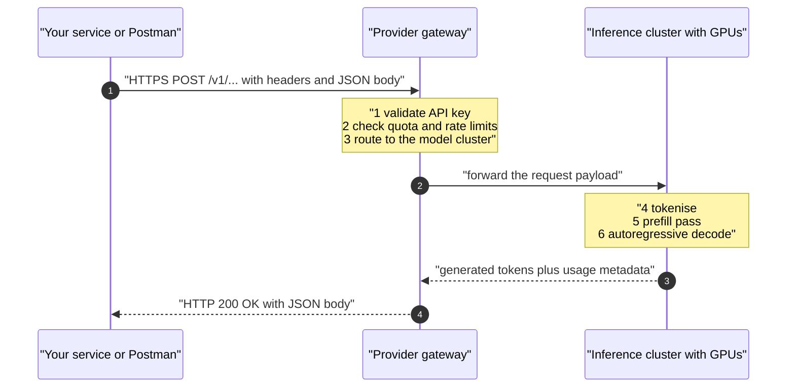
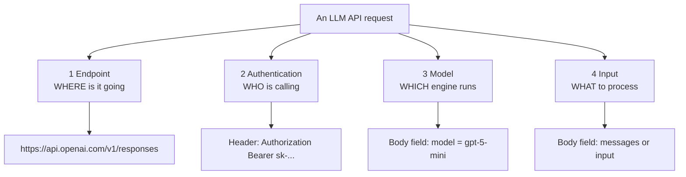
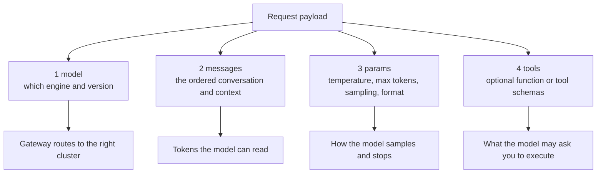
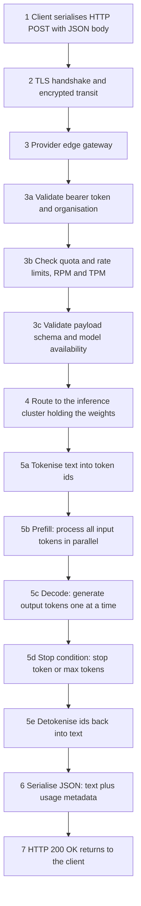
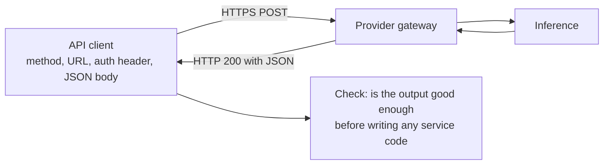
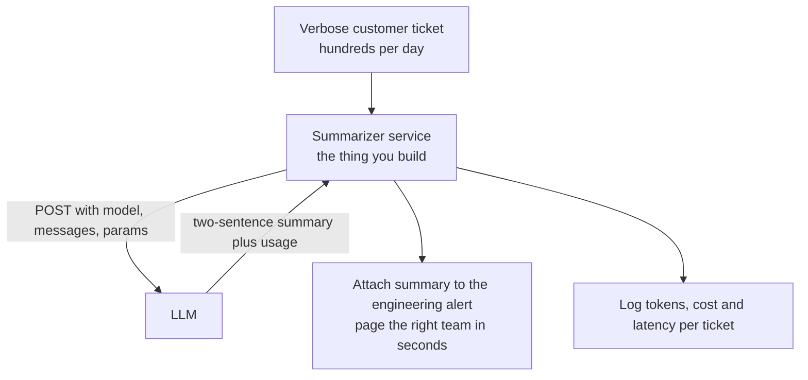

# Chapter 02 — The LLM API Protocol: HTTP, the Four Invariant Components & Postman

> **Lecture 04 · Chapter 02 of 09** · Level: 🟢 Beginner · Phase 2 — The Application Layer: Talking to Models
> **Source:** `Forward-Deployed-Engineer/Lecture 03/notes/02_LLM_API_Architecture_and_The_Postman_Protocol.md` ·
> `gen-ai-cohort/week02/learning/day03/notes/03-accessing-llms-sdk-vs-api.md` (REST API section) ·
> `gen-ai-cohort/week01/learning/day01/notes/open ai.md` (request parameters, response shape)
> **Roadmap topics:** LLM API architecture and the request/response protocol (what Postman shows you) ·
> the **4 invariant request components** — model, messages, params, optional tools (and, at transport level:
> endpoint, auth, model, input) · model tiers and model identifiers · the request lifecycle ·
> the enterprise support-ticket-triage case study.

---

## 02.0 What this chapter is for

Chapter 01 said "the model is an engine you rent". This chapter opens the rental contract.

The good news is anticlimactic: **talking to an LLM is an ordinary HTTP POST with a JSON body.** There is no
esoteric binary protocol, no GPU socket, no magic. Once you internalise that, every provider — OpenAI,
Anthropic, Google, Mistral, Groq, a local Ollama daemon — becomes a variation on one theme, and every SDK
becomes "a typed wrapper around this same POST".

By the end of this chapter you should be able to:

1. Draw the client → gateway → inference-cluster → response sequence from memory.
2. Name the **four invariant components** of every LLM request, both at transport level and at payload level.
3. Explain why the *model identifier* is a routing decision, not a label.
4. Read a parameter block and say what each parameter changes about the output.
5. Trace what happens between clicking **Send** and seeing JSON back, in eight steps.
6. Validate any new prompt/model combination in Postman **before** writing service code.
7. Recognise the common HTTP error codes an LLM gateway can return, and what each one tells you to fix.

---

## 02.1 The transport reality: it is just HTTP

At the infrastructure level, calling a model is:

- an **HTTP request** carrying a JSON payload over TLS;
- authenticated by the provider's gateway;
- routed to an inference cluster that runs a forward pass through the transformer;
- answered with an **HTTP response** carrying generated text plus metadata.



There is **no architectural difference** between your service POSTing a payment to an internal API and your
service POSTing a prompt to a model provider. Same sockets, same status codes, same retry logic, same
observability. The only genuinely new things are the *payload shape* and the *billing model*.

> [!NOTE]
> **Why this matters psychologically.** Engineers who believe "AI is different" skip validation, retries and
> logging. Engineers who see an HTTP call apply twenty years of hard-won web-engineering discipline — which
> is exactly what chapters 06 and 08 are about.

---

## 02.2 The four invariant components (transport view)

Whatever the vendor and whatever the SDK, every call must supply the same four things. Ask the four
questions — *where, who, which engine, what* — and you have the whole protocol:



| # | Component | Question it answers | Where it lives | Example |
| :---: | :--- | :--- | :--- | :--- |
| 1 | **Endpoint** | *Where?* | URL path | `https://api.openai.com/v1/responses`, `/v1/chat/completions`, `/v1/messages` |
| 2 | **Authentication** | *Who?* | Request header | `Authorization: Bearer <API_KEY>` (Anthropic adds a version header) |
| 3 | **Model** | *Which engine?* | JSON body | `"model": "gpt-5-mini"` |
| 4 | **Input** | *What to process?* | JSON body | `"input": "..."` or `"messages": [...]` |

### 1 · Endpoint — where

The URL identifies both the **service** and the **API version**. The version segment (`/v1/`) is a contract:
it tells you which request/response schema the gateway expects. Different providers use different paths for
the same idea:

| Provider | Typical inference path | Notes |
| :--- | :--- | :--- |
| OpenAI | `/v1/responses`, `/v1/chat/completions` | Two generations of API; both still in use |
| Anthropic | `/v1/messages` | Requires an `anthropic-version` header |
| Google Gemini | `/v1beta/models/<model>:generateContent` | The model name is *in the path* |
| Mistral | `/v1/chat/completions` | OpenAI-compatible shape |
| Groq | `/openai/v1/chat/completions` | OpenAI-compatible by design |
| Ollama (local) | `http://localhost:11434/api/generate`, `/v1/chat/completions` | Runs on your machine; no auth by default |

### 2 · Authentication — who

Inference needs tens of gigabytes of high-bandwidth GPU memory and a lot of electricity. No provider gives
that away anonymously. The key identifies the **tenant**, enables **billing**, and enforces **rate limits** —
which is why a leaked key is a financial incident, not just a privacy one.

- **Rule:** credentials are production secrets. Never in source code, never in a client-side bundle, never in
  a log line, never in a screenshot.
- **Scope:** prefer per-project/per-environment keys with the narrowest possible permissions, so a leaked dev
  key cannot touch production spend.
- **Rotation:** keys must be rotatable in minutes, without a deploy. Chapter 08 covers the operational side.

### 3 · Model identifier — which engine

Providers do not offer one monolithic model; they offer a **fleet** positioned along cost/latency/quality
frontiers. Choosing the model *is* a routing decision with direct cost and quality consequences.

| Tier | Optimised for | Good at | Poor at | Cost/latency |
| :--- | :--- | :--- | :--- | :--- |
| **Flagship / reasoning** | Maximum capability | Architecture design, complex debugging, long-document synthesis, multi-step logic | Cheap high-volume work | High cost, high latency |
| **Mini / efficient** | Throughput and price | Summarisation, classification, extraction, tagging, routing | Hard maths and deep multi-step reasoning | Low cost, low latency |
| **Specialised** | One modality or task | Embeddings, moderation, speech, vision | General chat | Varies |

Three identifier subtleties that bite in production:

1. **Aliases move, snapshots do not.** `gpt-5-mini` may point at a newer snapshot next month. For
   reproducible evals, pin the dated snapshot and upgrade deliberately.
2. **The same name is not the same model across providers.** `llama-3.3-70b-versatile` on one host is a
   specific quantisation and configuration; a "70B" elsewhere is a different artefact.
3. **Model names appear in different places.** OpenAI and Mistral put them in the JSON body; Gemini puts them
   in the URL path. This is exactly why an adapter layer (chapter 07) earns its keep.

### 4 · Input — what to process

The payload the model will actually read: instructions, user text, retrieved context, and (in chat APIs) the
conversation history. This is the *only* channel through which the cardinal rule can be satisfied — and the
only channel that costs input tokens.

> [!IMPORTANT]
> **The input is not "the user's message".** It is everything your service decides to send: system
> instructions, tool schemas, retrieved documents, history, and the user's text. Chapter 03 dissects its
> structure; chapter 05 puts a budget on its size.

---

## 02.3 The four payload components (what the roadmap calls the invariant request)

Transport tells you *where* things live; the payload tells you *what* they are. Every modern LLM call is a
combination of four payload elements — the fourth optional:



| Component | Required? | Purpose | Failure if missing |
| :--- | :---: | :--- | :--- |
| **model** | yes | Selects weights, context window, price and capabilities | `400` invalid model, or the wrong price tier silently |
| **messages** / **input** | yes | The entire readable context | `400` missing input |
| **params** | no (defaults apply) | Shape the output: randomness, length, format | Defaults may be `temperature 1` and an unbounded length — expensive and unpredictable |
| **tools** | no | Lets the model request deterministic actions | The model can only talk, not act (Lecture 08) |

### The parameter block, annotated

Defaults differ per provider and change over time — always set what matters explicitly. This is
**pseudo-code**, to show the shape of the idea:

```ts
// pseudo-code — the parameter block of one call, annotated
const request = {
  model: "provider-model-id",         // routing + price + context window
  messages: [ /* see chapter 03 */ ], // the readable context (input tokens)
  temperature: 0.2,                   // sampling sharpness: low = predictable
  top_p: 1,                           // nucleus sampling; usually leave at 1 if using temperature
  max_tokens: 400,                    // hard cap on OUTPUT tokens: cost and latency brake
  stop: ["\n\nUser:"],                // strings that end generation early
  stream: false,                      // true = token-by-token delivery (Lecture 07)
  response_format: { type: "text" },  // or a JSON/schema mode for structured output (Lecture 10)
  n: 1,                               // number of alternative completions; multiplies output cost
  seed: 1234,                         // best-effort determinism, where supported
};
```

| Parameter | What it changes | Production guidance |
| :--- | :--- | :--- |
| `temperature` | Shape of the probability distribution before sampling | Start at 0–0.3 for extraction and summarisation; raise only with evidence |
| `top_p` | Truncates the candidate pool by cumulative probability | Tune *one* of temperature/top_p, not both |
| `max_tokens` | Upper bound on generated tokens | **Always set it.** It is your cost and latency ceiling |
| `stop` | Strings that terminate generation | Useful for template-style outputs; keep them unambiguous |
| `stream` | Whether tokens arrive incrementally | Needed for perceived latency; adds pipeline complexity (Lecture 07) |
| `response_format` | Constrains output to JSON or a schema | The correct way to get machine-readable output (Lecture 10) |
| `n` | Number of completions | `n > 1` multiplies output cost — only for ranking workflows |
| `seed` | Best-effort reproducibility | Not a guarantee; pin model snapshot *and* params for stable evals |

> [!TIP]
> **The three parameters that pay for themselves on day one:** `max_tokens` (cost ceiling), `temperature`
> (behavioural stability) and `response_format` (parseability). Everything else can be tuned later with data.

---

## 02.4 The request lifecycle: what happens after you press Send

This is the same journey whether the client is Postman, `curl`, or an Express service.



| Step | What is happening | What can go wrong | Where you fix it |
| :---: | :--- | :--- | :--- |
| 1–2 | Serialisation and TLS | DNS, proxy, TLS, corporate egress rules | Infra config; `baseURL` overrides (ch 07) |
| 3a | Key and org validation | `401` invalid key, `403` forbidden model | Key management (ch 08) |
| 3b | Quota and rate limits | `429` too many requests | Retry/backoff, throttling (ch 06) |
| 3c | Schema and model checks | `400` bad payload, `404` unknown model, `413` too large | Request validation, model config (ch 05, 08) |
| 4 | Routing to a cluster | `503` capacity, `504` timeout | Retries, fallbacks, provider choice (ch 06, 07) |
| 5a–5e | Tokenise, prefill, decode, stop, detokenise | Truncated output, `finish_reason = length` | `max_tokens`, prompt and budget design (ch 04, 05) |
| 6–7 | Response assembly | Truncated JSON, partial stream on disconnect | Streaming and cancellation handling (Lecture 07) |

Two facts from this pipeline matter for the rest of the lecture:

- **Prefill is parallel, decode is sequential.** Input tokens are cheap in *time*; output tokens are not
  (chapter 04).
- **Every step before step 4 is your problem too.** Validation, keys, quotas and retries are application
  concerns, not provider magic.

---

## 02.5 The Postman prototype: prove the wire before writing code

Before a single line of service code, an experienced FDE validates the *prompt + model + payload* using a
raw API client. Reasons this is not optional:

- It separates **model quality problems** from **application bugs**. If the summary is bad in Postman, the
  problem is the prompt/model — not your Express routing.
- It exposes the **exact response shape** you will have to parse later.
- It proves the **key, endpoint and model name** work together — three things that are easy to get wrong.
- It is a **shareable artefact**: the request can be exported and used as the contract for the code.



### The five-step recipe

| Step | Action | The detail people forget |
| :---: | :--- | :--- |
| **1** | Create a key in the provider console and store it safely | Never paste it into a document, ticket or screenshot |
| **2** | Create a new HTTP request, method `POST`, paste the inference URL | `POST`, not `GET`; the path includes the version |
| **3** | Authorise with a **bearer token** | The client injects `Authorization: Bearer <key>` |
| **4** | Set `Content-Type: application/json` | Missing this returns a confusing `400` |
| **5** | Send a raw JSON body with `model` and the input | Also send your parameters (`temperature`, `max_tokens`) so the prototype matches production |

The body, as data (not code) — note how small a real request is:

```json
{
  "model": "gpt-5-mini",
  "temperature": 0.2,
  "max_tokens": 200,
  "messages": [
    {
      "role": "user",
      "content": "Summarize this support ticket in two sentences:\n\nOur production deployment has failed three times since yesterday. The payment-service container keeps restarting and customers occasionally get 502 errors during checkout. A manual restart helped for about twenty minutes."
    }
  ]
}
```

The same request expressed in JavaScript pseudo-code — the shape the SDK will hide from you later:

```ts
// pseudo-code — the raw REST call the SDK will eventually make for you
const res = await fetch(`${BASE_URL}/v1/chat/completions`, {
  method: "POST",
  headers: {
    "Content-Type": "application/json",
    Authorization: `Bearer ${env.API_KEY}`, // read from the environment, never inline
  },
  body: JSON.stringify(request),            // the object from 02.3
});
const data = await res.json();             // { choices, usage, id, model, ... }
```

### Why not skip straight to the SDK?

You will use the SDK (chapter 07) — but only after you have seen the wire format. Engineers who never see the
raw request cannot debug: they cannot tell whether a failure came from their prompt, their parameters, the
model name, the endpoint, or the SDK's own transformation.

---

## 02.6 Errors, status codes and what they mean

An LLM gateway is an HTTP service, so it fails like one. Learn the vocabulary once and it applies to all
providers:

| Status | Meaning | Typical cause | Correct response |
| :---: | :--- | :--- | :--- |
| `400` | Bad request | Malformed JSON, unknown parameter, wrong role shape | Fix the payload; never retry blindly |
| `401` | Unauthorised | Missing/invalid/revoked key | Fix configuration; alert |
| `403` | Forbidden | Key lacks access to that model or region | Fix permissions; do not retry |
| `404` | Not found | Model name does not exist (or was retired) | Fix the model identifier |
| `409` | Conflict | Duplicate request id / state conflict | Make the operation idempotent |
| `413` | Payload too large | Prompt exceeds request size or context window | Trim context (chapter 05) |
| `422` | Unprocessable | Semantically invalid fields | Fix the payload |
| `429` | Too many requests | RPM or TPM exceeded | **Retry with backoff** and throttle (chapter 06) |
| `500` | Provider error | Internal fault | Retry with backoff, then fail over |
| `502` / `503` | Bad gateway / unavailable | Capacity, deploy, regional incident | Retry, then fall back to another model/provider |
| `504` | Gateway timeout | Generation exceeded the gateway's patience | Lower `max_tokens`, stream, or raise client timeout |
| timeout (no response) | Client or network gave up | Slow generation, flaky network | Set explicit client timeouts; make retries safe |

> [!WARNING]
> **Never retry a `4xx` that is not `429`.** A wrong key will still be wrong on the fifth attempt — you just
> multiplied your latency and your logs. Retry only *transient* failures: `429`, `5xx`, timeouts, connection
> resets. Chapter 06 gives the algorithm.

The error body is usually structured (a machine-readable code plus a human message). Log both, but **never
log the request headers** — that is where the bearer token lives.

---

## 02.7 The first FDE problem: enterprise support-ticket triage

The lecture grounds the protocol in a real enterprise scenario.

**The situation.** You are deployed as an FDE at a B2B SaaS company. The support engineering queue is
overwhelmed: hundreds of verbose, panic-driven incident reports arrive daily. A triage engineer spends 5–10
minutes reading each ticket just to work out *which* microservice team to page.

**The raw material.** A real ticket looks like this:

```text
Hi team,

Our production deployment has failed three times since yesterday.
It looks like the payment-service container keeps restarting.
Customers are occasionally getting 502 errors during checkout.

We already tried restarting the deployment manually but the issue
returned after approximately twenty minutes.
Can someone investigate urgently?
```

**The objective.** An ingestion service that receives the ticket, calls a model, and produces an exact
two-line executive summary that is attached to the engineering alert:

```text
Production payment-service is repeatedly restarting and causing intermittent 502 errors.
Manual restarts only temporarily resolve the issue.
```



Why this is a good first problem:

| Property | Why it matters |
| :--- | :--- |
| **Read-only** | The model produces text; nothing is mutated. No side-effect risk yet (that comes in Lecture 08) |
| **High volume, low complexity** | A small efficient model is enough, so cost discipline is visible immediately |
| **Measurable quality** | "Two sentences, names the failing service, names the symptom" is assertable |
| **Clear baseline** | Compare against 5–10 minutes of human reading time per ticket |
| **Safe to fail** | A bad summary is annoying, not catastrophic — the right place to learn the pipeline |

This is the same service you will build in chapter 08 and in `code/`, and it is deliberately the *simplest
possible shape* of a GenAI microservice: one endpoint, one prompt, one model, one measurable output.

---

## 02.8 Pre-flight checklist: before you write any service code

- [ ] The **endpoint** and API version are correct and reachable from your machine.
- [ ] The **key** works and is stored somewhere safe (not in the repo).
- [ ] The **model identifier** exists, is available to your account, and is pinned (snapshot, not moving alias).
- [ ] The **message structure** is right for this provider (roles, order, system support).
- [ ] **Parameters** are explicit: `temperature`, `max_tokens`, and output format.
- [ ] The **response shape** has been inspected, not assumed — you know where the text and the `usage` live.
- [ ] **Failure modes** have been observed at least once: wrong key, unknown model, oversized prompt.
- [ ] The **cost** of one call is known (chapter 04) and the **latency** is acceptable.
- [ ] The **prompt is versioned** in your notes/repo, with the model and parameters it was tested with.

> [!TIP]
> **Copy the working request into the repo as a fixture.** A recorded request/response pair becomes your
> contract test when you refactor to an SDK (chapter 07) and when you swap providers.

---

## 02.9 Common mistakes

- **Using `GET`, or forgetting `Content-Type: application/json`.** Produces confusing `400`s that look like
  prompt problems.
- **Hard-coding the key in the API-client collection and then sharing the collection.** Exported collections
  leak keys.
- **Assuming the model name is universal.** `gpt-5-mini` does not exist on Gemini, and Gemini's model goes in
  the URL rather than the body.
- **Leaving parameters at provider defaults.** Defaults drift between model versions; unpinned behaviour is
  unreproducible behaviour.
- **Retrying a `400`/`401`/`404`.** Wasteful and noisy; only `429` and `5xx` are retryable.
- **Skipping the prototype step and writing service code first.** You lose the ability to separate prompt
  problems from application problems.
- **Reading the response by eye instead of parsing metadata.** The text is not the whole response (chapter 04).
- **Not recording which model and parameters produced a "good" result.** You cannot reproduce or A/B it later.
- **Treating the endpoint as stable forever.** API versions get deprecated; pin versions deliberately and watch
  changelogs.

---

## 02.10 Key takeaways

1. **Calling an LLM is an HTTP POST with a JSON body.** No magic protocol, no special hardware on your side.
2. **Four invariant components at transport level:** endpoint (*where*), authentication (*who*), model
   (*which engine*), input (*what*).
3. **Four payload components:** `model`, `messages`, `params`, and optional `tools`.
4. **The model identifier is a routing and pricing decision**, not a label — pin snapshots for reproducibility.
5. **Explicit parameters beat defaults:** `max_tokens` caps cost and latency, `temperature` stabilises
   behaviour, `response_format` makes output parseable.
6. **The lifecycle is deterministic up to step 4:** serialise → TLS → authenticate → rate-check → validate →
   route → tokenise → prefill → decode → detokenise → JSON. Most production failures live in the steps you
   control.
7. **Prototype in a raw API client first.** It isolates prompt quality from application bugs and hands you the
   response shape you will code against.
8. **Learn the status codes once.** `429` and `5xx` are retryable; every other `4xx` is a bug in your request.

---

## 02.11 Self-check questions

1. List the four invariant components of an LLM request and say where each physically lives in the HTTP
   message.
2. Why is the *model identifier* described as a routing decision? Give two consequences of getting it wrong.
3. Name the four payload components and say which one is optional and why.
4. Which three parameters would you set explicitly on day one, and what does each protect against?
5. Walk through the request lifecycle in eight steps, and name one failure that can occur at each of the first
   five.
6. Your service returns `401` for every request in staging but works locally. What do you check first, and why
   should you not add a retry?
7. Your service returns `429` under load. What is the *first* thing to check — and what is the second?
8. Why is `404 model_not_found` a *configuration* bug rather than a runtime bug?
9. Give three reasons a raw API-client prototype pays for itself before you write service code.
10. In the support-triage case study, name four properties that make it a good first GenAI service.

---

### Navigation

- **Previous:** [Chapter 01 — GenAI Applications vs Raw LLMs](./01_GenAI_Applications_vs_Raw_LLMs_The_Engine_vs_Car_Model.md)
- **Next:** [Chapter 03 — Message Roles & Prompt Hygiene](./03_Message_Roles_and_Prompt_Hygiene.md)
- **Source:** `Forward-Deployed-Engineer/Lecture 03/notes/02_LLM_API_Architecture_and_The_Postman_Protocol.md` ·
  `gen-ai-cohort/week02/learning/day03/notes/03-accessing-llms-sdk-vs-api.md` (REST API)
- **Back to index:** [../index.md](../index.md)