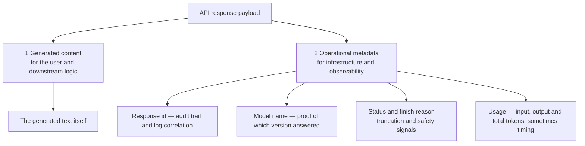
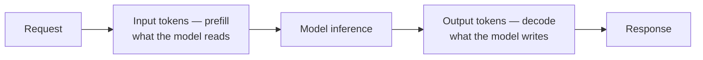
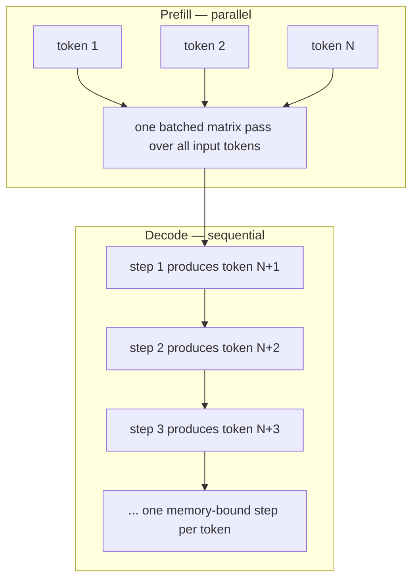
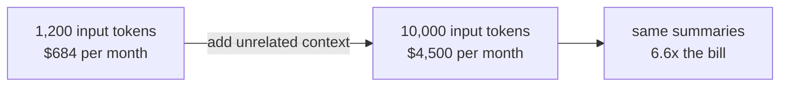
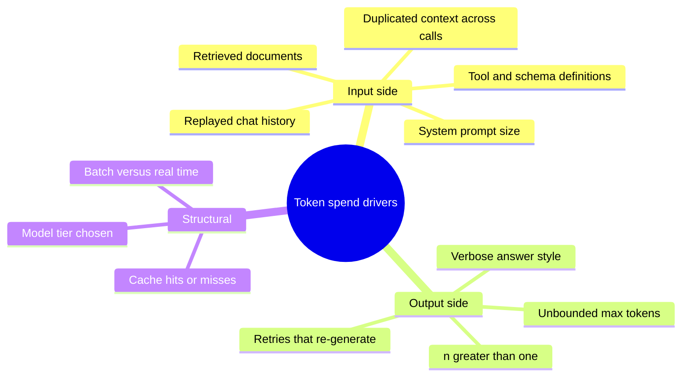
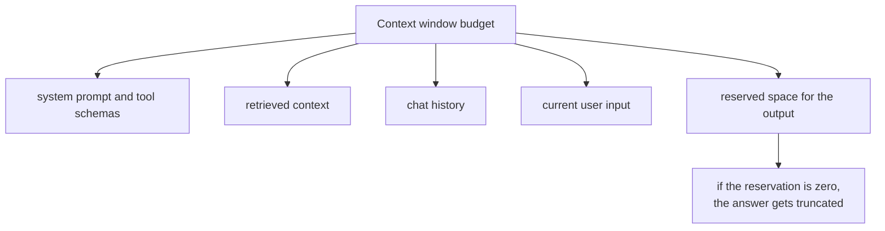
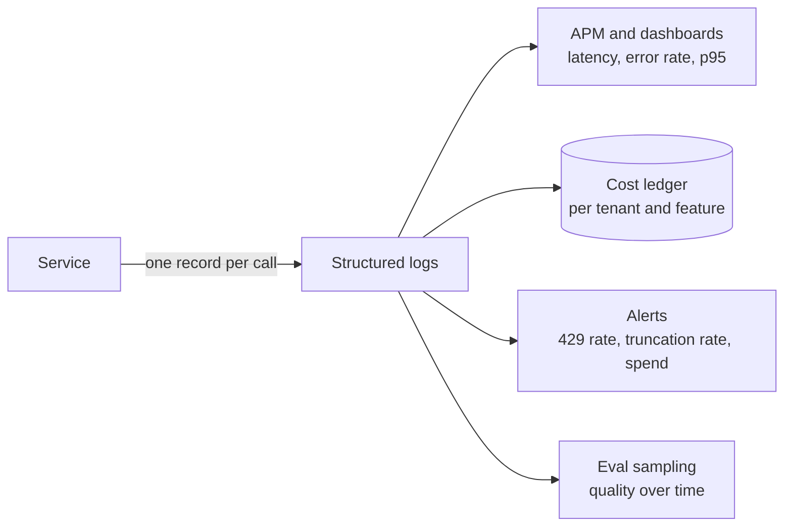
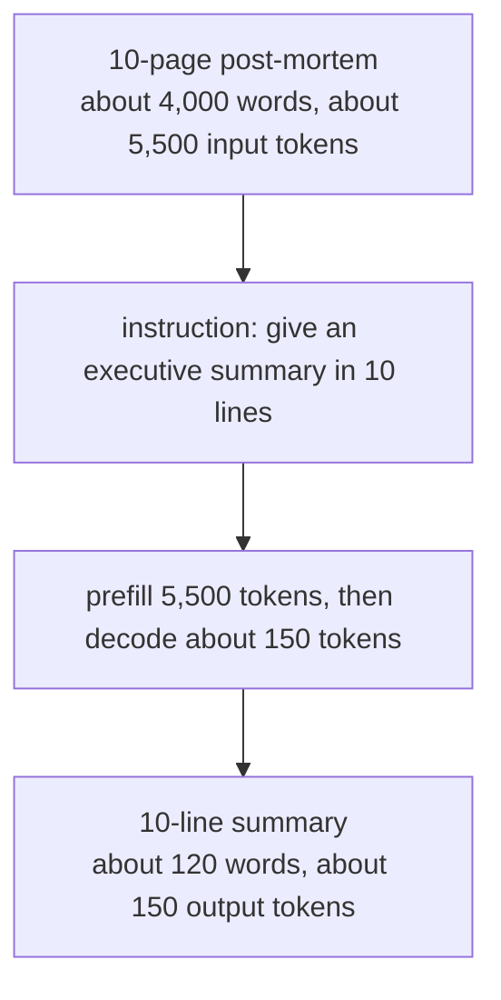
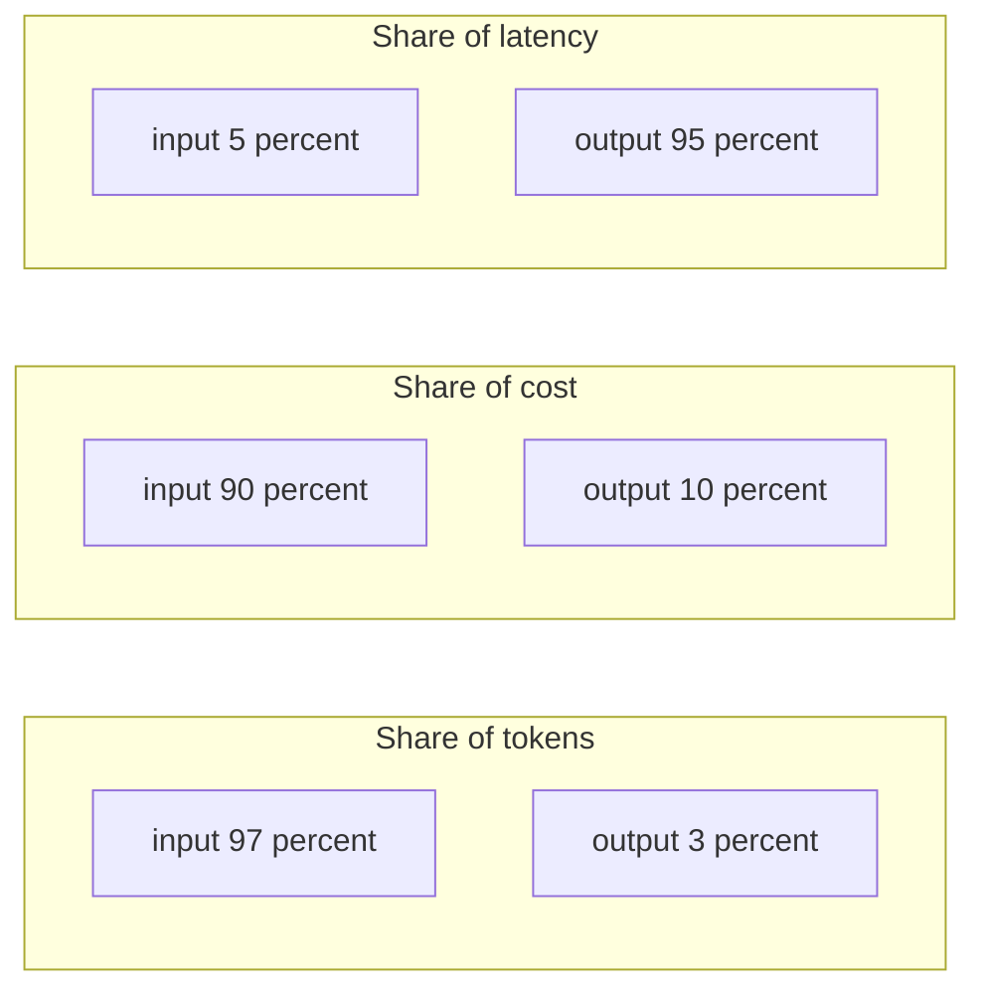

# Chapter 04 — Token Economics: Prefill vs Decode, Usage Metadata, Latency & Cost

> **Lecture 04 · Chapter 04 of 09** · Level: 🟢 Beginner · Phase 2 — The Application Layer: Talking to Models
> **Source:** `Forward-Deployed-Engineer/Lecture 03/notes/03_Token_Economics_Metadata_and_Production_Engineering.md` ·
> `Forward-Deployed-Engineer/Lecture 03/notes/06_…_Prompt_Hygiene.md` (§6.2 — response metadata in TypeScript) ·
> `gen-ai-cohort/week01/learning/day01/notes/open ai.md` (§3–4 — raw response object, `usage`) ·
> `gen-ai-cohort/week01/learning/day01/notes/groq.md` (timing metadata) ·
> `gen-ai-cohort/week02/learning/day03/notes/02-context-and-token-management.md` (§10–11 — cost structure)
> **Roadmap topics:** the response envelope and `usage` metadata · input vs output token pricing ·
> latency (TTFT, ITL) · context-window saturation · the 10-page incident-report token ledger ·
> telemetry, auditing and cost attribution.

---

## 04.0 What this chapter is for

Chapters 01–03 taught you how to *say* something to a model. This chapter teaches you what that costs — in
money, in seconds, and in headroom.

Tokens are not a theoretical curiosity. They are the **unit of billing**, the **unit of latency** and the
**unit of capacity**. An engineer who cannot estimate a token bill cannot make a credible architecture
proposal; an engineer who cannot read `usage` cannot run a GenAI service responsibly.

By the end of this chapter you should be able to:

1. Separate the **generated content** from the **operational metadata** in a response, and say who consumes each.
2. Explain the mechanical difference between **input (prefill)** and **output (decode)** tokens, and why it
   produces a 3–4× price gap.
3. Compute the cost of a call, a day, and a month — and explain how a careless prompt multiplies the bill.
4. Model latency as $\text{TTFT} + (N_{\text{out}} \times \text{ITL})$ and use it to make product decisions.
5. Explain context-window saturation and the KV-cache/OOM consequence in self-hosted inference.
6. Design the telemetry record you will write for **every** call, and say what each field is for.
7. Use unit economics to choose between model tiers, caching, summarisation and RAG.

---

## 04.1 The response envelope: content and metadata

A response is more than text. Every serious provider returns two tiers of data:



```json
{
  "id": "resp_01j8k9x4m2nb7v5c1p9q3w8z",
  "object": "response",
  "status": "completed",
  "model": "gpt-5-mini",
  "output": [
    {
      "type": "message",
      "role": "assistant",
      "content": [
        {
          "type": "output_text",
          "text": "Production payment-service is repeatedly restarting and causing intermittent 502 errors. Manual restarts only temporarily resolve the issue."
        }
      ]
    }
  ],
  "usage": { "input_tokens": 150, "output_tokens": 40, "total_tokens": 190 }
}
```

| Tier | Field | Consumed by | Why you must not throw it away |
| :--- | :--- | :--- | :--- |
| Content | `output[*].content[*].text` (or `choices[0].message.content`) | UI, downstream business logic | It is the product |
| Metadata | `id` | Logs, APM, support tickets | Correlates a user complaint to an exact provider-side event |
| Metadata | `model` | Auditing | Proves which model version produced a regulated output |
| Metadata | `status` / `finish_reason` | Reliability | `length` means truncated output — a silent data-integrity bug |
| Metadata | `usage` | Finance and capacity | Billing, chargeback, quota forecasting, cache-hit analysis |

> [!IMPORTANT]
> **The division of responsibility.** Content goes to the user; **metadata goes to your telemetry pipeline.**
> A service that discards `usage` has no idea what it costs, no way to attribute spend per tenant, and no way
> to forecast quota exhaustion. Chapter 08 turns this into a concrete log schema.

---

## 04.2 The two token streams: prefill vs decode

In Lecture 03 tokens were linguistic units. In production they split into two streams with completely
different physics:



| Attribute | **Input tokens** (prompt / prefill) | **Output tokens** (generation / decode) |
| :--- | :--- | :--- |
| **What it is** | System prompt, history, retrieved context, user text, tool schemas | The newly generated completion |
| **Hardware behaviour** | **Compute-bound:** all tokens are projected and attended **in parallel** in one pass | **Memory-bandwidth bound:** one token at a time, each requiring a full read of weights and KV cache |
| **Latency profile** | Low marginal cost per token (one batched forward pass) | High per token — linear in the number of generated tokens |
| **Price** | Baseline (1×) | Typically **3× to 4×** the input price |
| **Your control** | Trimming, retrieval, caching, deduplication | `max_tokens`, output contract, streaming |
| **Failure mode** | `413`/context overflow, wasted spend | Truncation (`finish_reason: length`), latency, runaway cost |



> [!TIP]
> **The one-line mental model.** *Reading is cheap and parallel; writing is expensive and serial.* Every cost
> and latency decision in this lecture follows from that sentence.

---

## 04.3 Cost: the formula and three worked examples

Providers bill per token, with **asymmetric prices**:

$$\text{Total Cost} = \left( N_{\text{input}} \times P_{\text{input}} \right) + \left( N_{\text{output}} \times P_{\text{output}} \right)$$

where $N_{\text{input}}$ includes *everything* you sent — system prompt, history, retrieved documents, tool
schemas — and prices are usually quoted per **1 million tokens**.

### Example 1 — one summarisation call

| Quantity | Value | Cost at \$0.15/M in, \$0.60/M out |
| :--- | ---: | ---: |
| Input tokens (ticket + instruction) | 1,200 | \$0.00018 |
| Output tokens (two sentences) | 80 | \$0.000048 |
| **Total** | 1,280 | **\$0.000228** |

A fifth of a cent per ticket. Sounds free — until you multiply.

### Example 2 — the same service at enterprise volume

100,000 tickets per day:

```text
Daily input  = 100,000 × 1,200 = 120,000,000 tokens → 120 × $0.15 = $18.00
Daily output = 100,000 ×    80 =   8,000,000 tokens →   8 × $0.60 =  $4.80
Daily total  = $22.80  →  ≈ $684 per month
```

### Example 3 — the careless version of the same service

An engineer "improves" the prompt by appending verbose logs, an unused knowledge base extract, and redundant
boilerplate — raising input from 1,200 to 10,000 tokens per ticket. Output is unchanged.

```text
Daily input  = 100,000 × 10,000 = 1,000,000,000 tokens → 1,000 × $0.15 = $150.00/day
Monthly cost ≈ $4,500  — for exactly the same business value
```



> [!WARNING]
> **Cost grows linearly with sloppy context, and there is no ceiling unless you build one.** Two guardrails
> belong in every service from day one: a **request-size limit** on inputs, and a **`max_tokens` cap** on
> outputs.

### Where the money actually goes



---

## 04.4 Latency: TTFT, ITL and the one formula that matters

Users do not experience "tokens". They experience waiting. Break end-to-end latency into its real parts:

```mermaid
gantt
    title Request latency profile
    dateFormat X
    axisFormat %s ms
    section Network
    Request transit :0, 200
    section Prefill
    Tokenise and prefill, ends at TTFT :200, 600
    section Decode
    Token 1 :600, 650
    Token 2 :650, 700
    Token 3 :700, 750
    Remaining tokens :750, 1500
    section Return
    Response transit :1500, 1650
```



1. **Time to first token (TTFT).** From request sent to first token emitted. Dominated by network round-trip,
   tokenisation and **prefill** of the whole input. Long inputs make TTFT worse — every input token is work
   before a single output token exists.
2. **Inter-token latency (ITL)**, also called time per output token (TPOT). The gap between successive output
   tokens. Because decode is sequential, total decode time is **linear in output length**:

$$\text{Total Latency} \approx \text{TTFT}(N_{\text{input}}) + \left( N_{\text{output}} \times \text{ITL} \right) + \Delta t_{\text{network}}$$

| Lever | Effect on TTFT | Effect on total latency | Cost effect |
| :--- | :--- | :--- | :--- |
| Shorter input (trim context) | ↓↓ | ↓ | ↓ |
| Fewer output tokens (`max_tokens`, tighter output contract) | – | ↓↓ (linear) | ↓ |
| Streaming | unchanged | perceived ↓↓ (first words appear at TTFT) | – |
| Smaller/faster model | ↓ | ↓↓ | ↓ |
| Prompt caching (stable prefix) | ↓↓ | ↓ | ↓ |
| Provider with faster decode hardware | – | ↓↓ | varies |

> [!TIP]
> **The single most effective latency fix is usually an instruction, not an infrastructure change.** "Answer in
> exactly two sentences" cuts $N_{\text{output}}$ — and therefore latency — linearly. Streaming (Lecture 07)
> does not make generation faster; it makes *waiting* shorter.

---

## 04.5 Context-window saturation and memory

Every model has a fixed maximum context. The constraint applies to the **sum** of input and output:

$$N_{\text{input}} + N_{\text{output}} \le C_{\text{max\_context}}$$

If you send a 32,700-token prompt to a 32,768-token model, only 68 tokens remain for the answer. The model
does not warn you politely — it stops mid-sentence with `finish_reason: "length"`, and if your code writes
that string to a database, you have silently corrupted data.



Two further consequences:

| Consequence | Detail |
| :--- | :--- |
| **KV-cache growth** | In self-hosted inference (vLLM, TensorRT-LLM) the key/value cache grows with context length, so long contexts consume GPU memory and risk out-of-memory crashes |
| **"Lost in the middle"** | Information buried in a very long prompt is more likely to be missed — relevance beats volume (Lecture 06) |

Chapter 05 turns this into a concrete **budgeting algorithm**; the point here is that the context window is a
*capacity*, not a target.

---

## 04.6 Turning metadata into telemetry

The engineering discipline of this chapter is: **write down what each call cost, every time.** A practical
per-call record:

```ts
// pseudo-code — the audit record your service writes for every model call
type CallRecord = {
  callId: string;            // correlation id, reused across logs and traces
  tenantId: string;          // who pays for this token
  feature: string;           // which prompt/feature, e.g. "ticket-summarizer"
  promptId: string;          // versioned prompt identifier
  provider: string;          // openai | anthropic | gemini | groq | mistral | ollama
  model: string;             // exact model snapshot used
  inputTokens: number;       // from usage
  outputTokens: number;      // from usage
  cachedTokens?: number;     // where the provider reports cache hits
  costUsd: number;           // computed locally from a price table
  ttftMs?: number;           // measured client-side
  totalMs: number;           // measured client-side
  finishReason: string;      // stop | length | content_filter | tool_calls
  status: "ok" | "retry" | "error";
  errorCode?: string;        // provider code, never the raw key
};
```

| Field group | Question it answers later |
| :--- | :--- |
| `tenantId`, `feature`, `promptId` | "Which customer and which feature is driving this bill?" |
| `provider`, `model` | "Did quality change when we upgraded the model?" |
| `inputTokens`, `outputTokens`, `cachedTokens` | "Where can we trim?" |
| `costUsd` | "What is our unit cost per ticket, per user, per day?" |
| `ttftMs`, `totalMs` | "Is the product fast enough?" |
| `finishReason`, `status`, `errorCode` | "Is anything truncating or failing silently?" |



Three rules for this pipeline:

1. **Never log the raw request headers or the key** — that is where the credential lives.
2. **Treat prompt text as sensitive.** Log a prompt id and hashes; store the text only where policy allows.
3. **Compute cost locally from a versioned price table.** Provider dashboards lag; you need per-tenant numbers
   in real time (and price tables change — make them data, not constants in code).

---

## 04.7 Case study: the 10-page incident report

An incident-management platform processes major production outages. Each post-mortem is a long document, and
the ask is a short executive summary.



| Phase | Content | Words | Tokens | Cost at \$0.15/M in, \$0.60/M out | Latency profile |
| :--- | :--- | ---: | ---: | ---: | :--- |
| **Input (prefill)** | Incident history, container metrics, stack traces, instruction | ~4,000 | **5,500** | \$0.000825 | Parallel — about 250 ms |
| **Output (decode)** | 10 bullets with root cause and mitigation | ~120 | **150** | \$0.000090 | Sequential — about 30 ms/token ≈ 4.5 s |
| **Total** | Full round trip | ~4,120 | **5,650** | **\$0.000915** | **≈ 4.95 s** |

### The asymmetry, in one line each

- **Input was 97% of the data volume and about 90% of the cost.**
- **Output was 3% of the data volume but about 95% of the total latency.**



Three engineering conclusions you can carry into any project:

1. **To cut cost, attack the input.** Summarise the history, retrieve less, cache the stable prefix, dedupe
   documents. This is why RAG (Lectures 16–17) is a cost technique as much as a quality technique.
2. **To cut latency, attack the output.** A tighter output contract is the cheapest performance work you will
   ever do.
3. **Both are visible only if you log `usage`.** This case study is impossible to write from provider
   dashboards alone; it needs your own per-call records.

---

## 04.8 Unit economics: the decisions this chapter unlocks

| Decision | Question to answer with numbers | Typical answer |
| :--- | :--- | :--- |
| **Which model tier?** | What does one call cost per tier, and does the cheap tier pass the eval? | Start small; escalate only the failing subset |
| **Cache or re-compute?** | What fraction of input is a stable prefix? | Cache stable system prompt and shared context where supported |
| **Summarise history or replay it?** | Tokens of summary vs tokens of history | Summarise past a threshold (chapter 05, Lecture 06) |
| **Retrieve or stuff?** | Cost of 40k tokens of context vs a 2k-token retrieval | Retrieve; relevance beats volume |
| **Batch or real-time?** | Is a delayed answer acceptable? | Batch/async for bulk work; real-time only where the user waits |
| **Stream or not?** | Is perceived latency a product requirement? | Stream long answers; skip streaming for short structured output |

> [!IMPORTANT]
> **The FDE framing.** Cost is an architectural property, not an afterthought. If you cannot state the cost per
> call, per tenant and per month before launch, you have not finished the design.

---

## 04.9 Common mistakes

- **Discarding `usage`.** The single most common production mistake: the service works, and nobody knows what it
  costs.
- **Treating the context window as a target.** Filling 128k "because it fits" multiplies cost, latency and
  confusion.
- **Leaving `max_tokens` unset.** A looping model becomes an unbounded bill and an unbounded latency.
- **Blaming "the model is slow" when the prompt is 20k tokens.** TTFT is dominated by prefill of *your* input.
- **Ignoring `finish_reason`.** `length` means your downstream data is silently truncated.
- **Forgetting output tokens cost 3–4× input tokens.** Teams optimise the cheap stream and ignore the expensive
  one.
- **Re-sending unchanged context on every call** without checking whether the provider offers caching.
- **Comparing providers on price per token only.** Price × tokens × retries × latency is the real number.
- **Hard-coding prices in source code.** They change; make the price table configuration with a version.
- **Logging prompts and responses wholesale.** Costly, and a privacy/compliance problem (chapter 08).
- **Skipping the unit-economics estimate before launch.** The first invoice should never be a surprise.

---

## 04.10 Key takeaways

1. **Every response has two tiers:** generated content for the product, and metadata (`id`, `model`,
   `finish_reason`, `usage`) for engineering. Keep both.
2. **Input tokens are prefilled in parallel and are compute-bound; output tokens are decoded sequentially and are
   memory-bandwidth bound.** This is why output is 3–4× the price and dominates latency.
3. **Cost = $N_{\text{in}} P_{\text{in}} + N_{\text{out}} P_{\text{out}}$.** A sloppy prompt can multiply a
   monthly bill by ~6× with zero quality gain.
4. **Latency ≈ TTFT(input) + N_output × ITL.** Constrain output length to make the product feel fast.
5. **The context window is a shared budget** across system prompt, tools, retrieval, history, input and reserved
   output — and a KV-cache/GPU-memory constraint in self-hosted inference.
6. **Log one record per call** with tenant, feature, prompt id, model, tokens, computed cost, TTFT, total time and
   finish reason.
7. **Attack cost on the input side, latency on the output side** — and let evals decide when to escalate model
   tier.
8. **Unit economics is part of the design review**, not an afterthought.

---

## 04.11 Self-check questions

1. Name five metadata fields in a response and the question each one answers.
2. Explain, mechanically, why output tokens cost more than input tokens.
3. A service does 50,000 calls/day with 900 input and 120 output tokens, at \$0.20/M in and \$0.80/M out.
   Compute the monthly cost.
4. Your p95 latency is 9 s with 6,000 input and 800 output tokens. Which change helps most, and by roughly how
   much?
5. What is `finish_reason: "length"` telling you, and why is it a data-integrity risk?
6. Why can a long context crash a self-hosted inference server but not a hosted API?
7. Write the six fields you would put in a per-call audit record and justify each in five words.
8. Give three input-side and three output-side cost levers, with the trade-off each introduces.
9. In the incident-report case study, input is 97% of tokens but output is 95% of latency. Explain both facts
   from the prefill/decode difference.
10. Your CFO asks for cost per resolved support ticket. What must you log to answer, and what must you *not*
    log?

---

### Navigation

- **Previous:** [Chapter 03 — Message Roles & Prompt Hygiene](./03_Message_Roles_and_Prompt_Hygiene.md)
- **Next:** [Chapter 05 — Token Counting & Context Budgeting](./05_Token_Counting_and_Context_Budgeting_with_Tokenizers.md)
- **Source:** `Forward-Deployed-Engineer/Lecture 03/notes/03_Token_Economics_Metadata_and_Production_Engineering.md` ·
  `gen-ai-cohort/week01/learning/day01/notes/open ai.md` · `groq.md` ·
  `gen-ai-cohort/week02/learning/day03/notes/02-context-and-token-management.md`
- **Back to index:** [../index.md](../index.md)