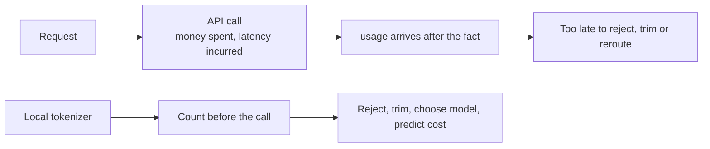
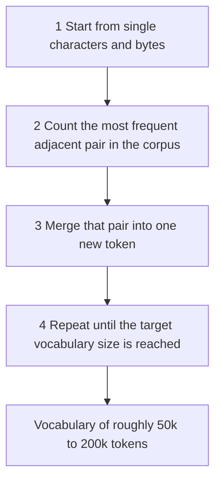
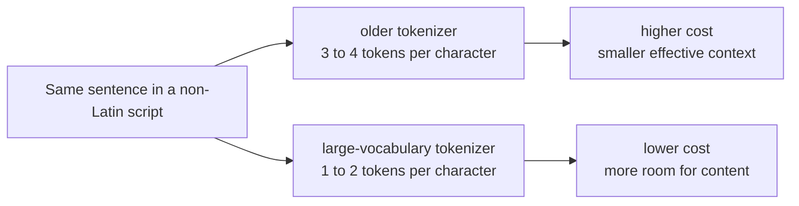
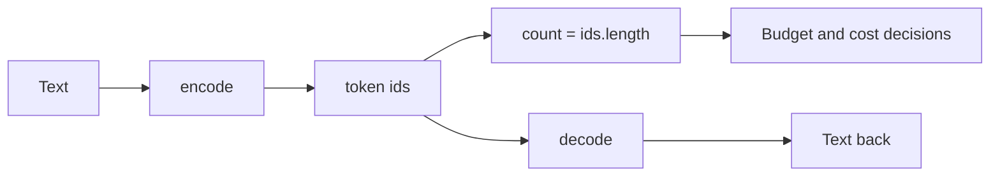
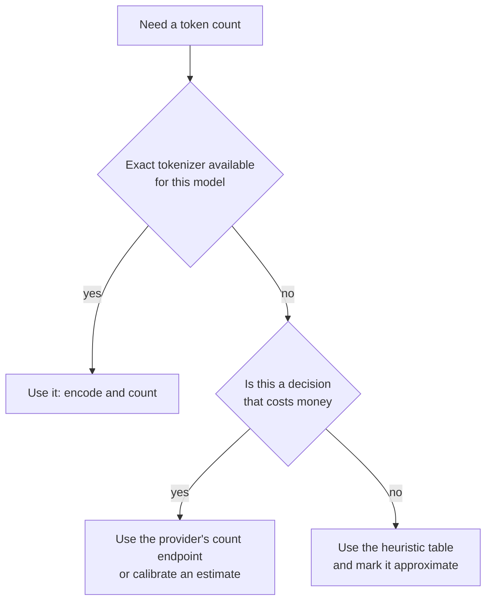
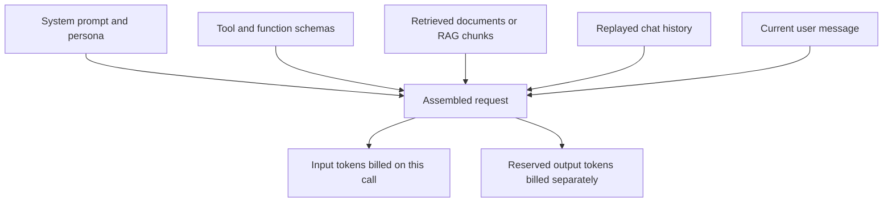
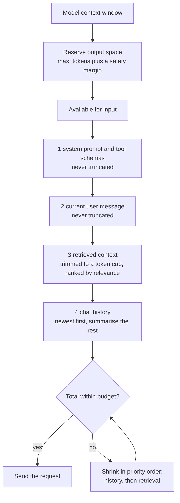
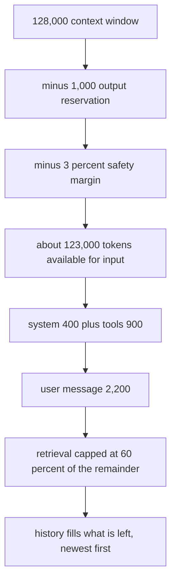
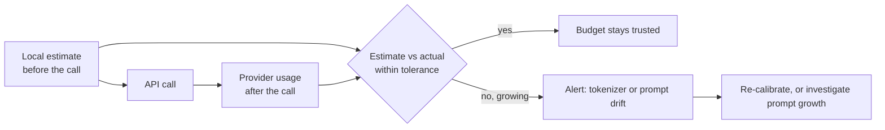

# Chapter 05 — Token Counting & Context Budgeting with Tokenizers

> **Lecture 04 · Chapter 05 of 09** · Level: 🟢 Beginner · Phase 2 — The Application Layer: Talking to Models
> **Source:** `gen-ai-cohort/week01/learning/day01/notes/notes.md` (§Tokens · BPE · tokenizer comparison ·
> the multilingual token tax · `tiktoken` example · context window) ·
> `gen-ai-cohort/week02/learning/day03/notes/02-context-and-token-management.md` (§3–§11 — what counts toward
> tokens, context window sizes, problems with large contexts, cost optimisation) ·
> `Forward-Deployed-Engineer/Lecture 03/notes/03_Token_Economics_Metadata_and_Production_Engineering.md` (§3.3)
> **Roadmap topics:** tokenizer libraries (`tiktoken`) for local token counting and cost estimation ·
> context-window budgeting · truncation and context-management strategies.

---

## 05.0 What this chapter is for

Chapter 04 gave you the cost and latency formulas. Both contain the same variable: **$N_{\text{input}}$**. This
chapter is about measuring it *before* you spend it.

There is a real engineering gap here. The provider tells you the token count **after** the call, in `usage`.
But the decisions you need to make — reject this payload, trim that history, choose this model, predict that
bill — must happen **before** the call. That is what a local tokenizer is for.

By the end of this chapter you should be able to:

1. Explain why you need local token counting when the API already returns `usage`.
2. Describe Byte-Pair Encoding in four steps and say why vocabulary size differs between models.
3. Use a tokenizer library (`tiktoken` and equivalents) conceptually: encode, decode, count — and know its
   limits.
4. Estimate token counts when no exact tokenizer exists for the target model.
5. List **everything** that counts as input tokens, including the hidden cost of tool schemas and JSON.
6. Write the **budgeting algorithm**: reserve output, allocate the rest, truncate safely.
7. Reconcile local estimates against provider `usage` and alert on drift.

---

## 05.1 Why count locally at all?

The provider returns `usage` — so why not just trust it?



| Need | Why the post-hoc `usage` is not enough |
| :--- | :--- |
| **Reject oversized payloads** | You want a `413`-style response *before* paying for a doomed request |
| **Choose the model** | Model choice depends on whether the prompt fits a smaller context window |
| **Predict cost** | Finance wants a forecast; `usage` is a receipt, not a forecast |
| **Trim history** | You must decide which turns fit — that is arithmetic, not hindsight |
| **Respect TPM quotas** | Chapter 06's throttling needs a token estimate per request, not per response |
| **Detect regressions** | "Input tokens grew 40% this week" is an alert you can only raise by counting |
| **Unit tests** | Assert that a prompt stays under a token budget in CI |

> [!IMPORTANT]
> **The rule.** Count locally for **decisions**; trust `usage` for **billing reconciliation**. Use both, and
> alert when they diverge.

---

## 05.2 How tokenizers work: BPE in four steps

An LLM does not read words or characters; it reads **tokens** — subword units from a fixed vocabulary. Modern
models build that vocabulary with **Byte-Pair Encoding (BPE)**:



The result is a vocabulary that keeps frequent words as single tokens (`the`, `and`, `function`) while splitting
rare or novel words into sub-word pieces (`tokenization` → `token` + `ization`). This is why:

- **Token counts are not word counts.** "JavaScript is awesome!" is roughly 5 tokens.
- **Rare words cost more.** A brand name, a code identifier, or a non-English word may take 3–4 tokens.
- **Numbers are expensive.** Digits often split into small chunks, so long IDs and timestamps are costly.

### Vocabulary size and the "token tax"

| Tokenizer | Used by | Vocabulary | Characteristic |
| :--- | :--- | ---: | :--- |
| `gpt2` | Legacy GPT-2 | ~50k | Baseline; weak on non-English text |
| `cl100k_base` | GPT-3.5 / GPT-4 era | ~100k | Better, but non-Latin scripts still split heavily |
| `o200k_base` | GPT-4o-era models | ~200k | Large vocabulary; handles non-English, numbers and dates much better |



The **multilingual token tax** is the practical consequence: the *same meaning* can cost two to four times more
tokens depending on the script and the tokenizer. If your product serves non-English users, tokenizer choice is
a product-level cost decision, not a detail.

> [!NOTE]
> **Vocabulary size is not quality.** A bigger vocabulary means fewer tokens per sentence (cheaper, more room in
> context). It says nothing about how smart the model is.

---

## 05.3 Local counting with a tokenizer library

`tiktoken` is the reference tokenizer library for OpenAI-style encodings. The idea is three operations —
**encode, decode, count** — and it is the same idea in every ecosystem (`gpt-tokenizer` in JS/TS, Hugging Face
`tokenizers` for open weights).

```ts
// pseudo-code — the shape of local token counting
import { getEncoding } from "tiktoken";   // illustration of the API shape

const enc = getEncoding("o200k_base");    // pick the encoding that matches the target model

const ids = enc.encode("Summarize this support ticket");  // text -> token ids
const text = enc.decode(ids);                             // token ids -> text
const n = ids.length;                                     // the number you budget with
```



### Practical usage patterns

| Pattern | Why it matters |
| :--- | :--- |
| **Count each fragment separately, then sum** | System prompt + history + retrieval + user text + tool schemas — you need to know *which* fragment is big |
| **Cache the count of the stable prefix** | The system prompt and tool schemas do not change; count them once |
| **Count before truncation and after** | Proves the trim actually achieved the budget |
| **Count in tests** | A CI assertion like "the summariser prompt stays under 1,500 tokens" prevents silent growth |
| **Use a per-provider tokenizer where available** | Token counts are tokenizer-specific; a mismatch means your estimate drifts |

### The limits of local counting

| Limit | Consequence | Mitigation |
| :--- | :--- | :--- |
| Encodings are model-family specific | Counting Claude or Gemini text with an OpenAI encoding gives an **estimate**, not truth | Use the provider's own counting endpoint or tokenizer when precision matters |
| Chat templates add tokens | Roles, separators and control tokens are counted too | Calibrate: compare your estimate against `usage` on real calls |
| Tool/JSON schemas add hidden tokens | Structured payloads serialise into many tokens | Count the serialised form, not the object |
| Images, audio, PDFs are not text tokens | Multimodal inputs bill by their own rules (Lecture 24) | Read the provider's pricing for that modality |
| Tokenisers change with model versions | The same text can count differently after an upgrade | Re-calibrate after every model change |

> [!TIP]
> **Calibrate once, then trust your estimate.** Take 20 representative calls, compare your local count against the
> provider's `usage.prompt_tokens`, and record the ratio. If your estimator is consistently 3–5% low, add that
> margin to your budget — permanently.

---

## 05.4 Estimation without a tokenizer

Sometimes you cannot run a tokenizer: the target model is closed, the runtime is a browser, or you just need a
sanity check. Use heuristics, and label them as estimates.

| Text | Approximate tokens | Use case |
| :--- | ---: | :--- |
| 1 token | ~4 characters of English | Rough char-based sizing |
| 100 words | ~130 tokens | Quick prose estimate |
| 1 page | ~500–700 tokens | Document sizing |
| 1,000 words | ~1,300 tokens | Report sizing |
| 1 line of dense JSON | 2–4× its character count / 4 | Structured payloads are token-hungry |
| Non-Latin script | 1–4 tokens **per character** | Do not use the English heuristic |



> [!WARNING]
> **Never make a hard `413`-style rejection decision from a heuristic.** Under-count and you pay for a doomed
> request; over-count and you reject valid customer input. Heuristics are for sizing and sanity checks; exact
> counting is for gates.

---

## 05.5 What actually counts as input tokens

Teams routinely under-estimate because they count only the user's message. In a real service, the input is
assembled from several sources, and **every one of them is billed on every call**:



| Source | Typical size | Hidden cost driver |
| :--- | ---: | :--- |
| System prompt | 100–1,000 tokens | Verbose personas; instructions repeated in every call |
| Tool schemas | 200–4,000 tokens | Every tool definition is serialised into the prompt on every call |
| Retrieved context | 500–50,000 tokens | "Top-k = 20" without a token cap |
| Chat history | grows unboundedly | Naive "send the whole transcript" designs |
| Current user message | 10–20,000 tokens | Pasted logs, base64 blobs, spreadsheets |
| **Output reservation** | your `max_tokens` | Not free: it caps what can be generated, and caps what you might pay |

> [!WARNING]
> **The tool-schema trap.** Adding six tools can add thousands of input tokens to *every* request — even the
> requests that use no tools. In tool-heavy agents, schema size often dominates the bill. Keep schemas terse,
> and load tool groups dynamically rather than always.

---

## 05.6 The budgeting algorithm

A budget turns the context window from a hopeful maximum into an enforced allocation.



```ts
// pseudo-code — the budgeting algorithm
function budgetRequest({ model, system, tools, retrieved, history, userText }) {
  const C_MAX = model.contextWindow;              // e.g. 128,000
  const OUT   = model.maxOutputReservation;       // e.g. 1,000 (your cap plus margin)
  const SAFETY = 0.03;                            // calibration margin from 05.3

  let available = Math.floor((C_MAX - OUT) * (1 - SAFETY));

  const fixed = countTokens(system) + countTokens(serialize(tools));
  available -= fixed;
  if (available < countTokens(userText)) {
    throw new RequestTooLargeError("even without history this prompt does not fit");
  }
  available -= countTokens(userText);

  // 3 retrieval: cap it, keep the highest-ranked chunks
  const context = takeTopChunksUntilTokenCap(retrieved, Math.floor(available * 0.6));
  available -= countTokens(context);

  // 4 history: newest first, then summarise whatever does not fit
  const { kept, summarised } = fitHistoryNewestFirst(history, available);
  if (summarised.length > 0) kept.unshift({ role: "system", content: summarise(summarised) });

  return buildMessages({ system, tools, context, kept, userText });
}
```

### Allocation guidance

| Fragment | Recommended share of the input budget | Rationale |
| :--- | :--- | :--- |
| System prompt + tool schemas | ≤ 10% | Should be small and stable; enables caching |
| Current user message | Whatever is needed, but capped | Reject or chunk absurdly large payloads |
| Retrieved context | ~50–70% of what remains | Retrieval is where quality comes from |
| History | Whatever remains | Useful, but summarisable |
| Output reservation | 10–25% of the window | Prevents truncation of the answer |

### The truncation strategies (from the source notes)

| Strategy | What it does | When to use |
| :--- | :--- | :--- |
| **Sliding window** | Keep only the newest N turns | Chat, where recent context dominates |
| **Conversation summarisation** | Replace old turns with a short summary | Long sessions; preserves facts cheaply |
| **Retrieval (RAG)** | Inject only relevant chunks instead of a whole corpus | Knowledge-heavy tasks |
| **Semantic filtering** | Drop duplicates, empty messages and formatting noise | Always; free savings |
| **Chunk-and-map** | Split a huge document, summarise each part, then combine | Documents larger than the window |

> [!IMPORTANT]
> **Priority order is a policy, not a preference.** System prompt and the current user message are
> non-negotiable; retrieval and history are elastic. Write that policy down once and implement it in one place,
> so every feature inherits it.

---

## 05.7 A worked budget, end to end

Model context window: **128,000 tokens**. Output cap: **1,000 tokens**. Safety margin: **3%**.



| Fragment | Tokens | Running remainder |
| :--- | ---: | ---: |
| Context window | 128,000 | 128,000 |
| − output reservation (`max_tokens` 1,000) | 1,000 | 127,000 |
| − 3% calibration margin | ~3,810 | ~123,190 |
| − system prompt | 400 | ~122,790 |
| − tool schemas | 900 | ~121,890 |
| − current user message | 2,200 | ~119,690 |
| − retrieved context (capped at 60% of the remainder) | ~71,800 | ~47,890 |
| − chat history (newest first, summarised beyond) | up to ~47,890 | 0 |
| **Total input** | **≈ 123,190** | fits |

What this example teaches:

- **A 128k window does not mean 128k of useful prompt.** You gave up ~5,000 tokens before writing a word of
  content.
- **The cap on retrieval is a policy you choose**, not a natural limit. Without it, retrieval would eat the whole
  remainder and history would vanish.
- **The 3% margin is not paranoia.** It absorbs tokenizer differences and chat-template overhead — exactly the
  drift you measured in 05.3.
- **Cost follows the table.** Multiply the token column by the price per million and you have a per-call cost
  estimate *before* making the call.

---

## 05.8 Reconciliation: local estimate vs provider `usage`

Two numbers now exist for every call: your local estimate, and the provider's reported `usage`. Treat the gap as
a monitored metric.



| Signal | Likely cause | Action |
| :--- | :--- | :--- |
| Estimate consistently 3–5% low | Chat-template overhead not counted | Bake the margin into the budget |
| Estimate suddenly 20% low | Model upgrade changed the tokenizer, or a prompt fragment grew | Re-calibrate; diff the prompt |
| `outputTokens` near `max_tokens` often | Output contract too tight, or the model rambles | Raise the cap or tighten instructions; watch `finish_reason: length` |
| Input tokens growing week over week | History not trimmed, or retrieval top-k increased | Audit the budget code and the retrieval config |
| Cost per call rising with flat traffic | Model tier changed, or retries multiplied | Check model config and retry rate (chapter 06) |

> [!TIP]
> **Put token counts in your dashboards, not just in your logs.** Two panels catch most regressions: *average
> input tokens per call* and *average output tokens per call*, both split by feature. A step change in either is
> almost always a code change, not a model change.

---

## 05.9 Common mistakes

- **Counting only the user's message.** The system prompt, tool schemas, retrieval and history all bill.
- **Using a heuristic as a hard gate.** Under-counting wastes money; over-counting rejects valid input.
- **Assuming one tokenizer fits all models.** Token counts are tokenizer-specific; calibrate per provider.
- **Ignoring the multilingual token tax.** The same meaning can cost 2–4× more in another script.
- **Setting `top-k` on retrieval without a token cap.** "Relevant" is not "small".
- **Filling the context window because it fits.** Cost, latency and accuracy all get worse.
- **Forgetting to reserve output space.** The answer gets truncated and `finish_reason: length` is ignored.
- **Truncating the system prompt** when trimming. The output contract silently disappears.
- **Never re-calibrating after a model upgrade.** Your budget drifts while your tests still pass.
- **No CI assertion on prompt size.** Prompt growth is invisible until the invoice arrives.

---

## 05.10 Key takeaways

1. **Count locally for decisions; trust `usage` for billing.** They serve different purposes.
2. **BPE builds sub-word vocabularies**; vocabulary size (~50k–200k) determines the "token tax" per language and
   per content type.
3. **Use a real tokenizer where possible** (`tiktoken`-style encode/count), and fall back to calibrated heuristics
   only for sizing.
4. **Everything sent is billed:** system prompt, tool schemas, retrieved context, history, user text — plus the
   output you reserve.
5. **Budget in a fixed priority order:** reserve output → system and tools → user message → retrieval → history;
   truncate only the elastic parts.
6. **Choose a truncation strategy deliberately:** sliding window, summarisation, RAG, semantic filtering, or
   chunk-and-map.
7. **Reconcile the estimate against `usage`** and alert on drift — it is your earliest warning of tokenizer or
   prompt regressions.
8. **Assert token budgets in tests**, so prompt growth cannot ship unnoticed.

---

## 05.11 Self-check questions

1. Give three decisions that require a token count *before* the call.
2. Describe BPE in four steps and explain why `tokenization` might be two tokens while `the` is one.
3. Why does the same sentence cost more tokens in an older tokenizer, and what is this effect called?
4. Name six sources of input tokens in a RAG service that also uses tools.
5. Write the priority order of the budget and say which fragments are never truncated.
6. Your retrieval step returns 20 chunks of ~1,500 tokens each. What is the problem and what are two fixes?
7. Estimate the tokens in a 2,000-word English document and in the same content in a non-Latin script. Why do the
   numbers differ?
8. Your local estimate is 4% below the provider's `prompt_tokens` every time. What do you do, and why not just
   ignore it?
9. Design a CI test that fails when a prompt exceeds its token budget.
10. A model upgrade ships overnight and your bill rises 15% with flat traffic. List three token-level hypotheses.

---

### Navigation

- **Previous:** [Chapter 04 — Token Economics](./04_Token_Economics_Prefill_Decode_Metadata_and_Cost.md)
- **Next:** [Chapter 06 — Rate Limits, Quotas, Throttling & Retry/Backoff](./06_Rate_Limits_Quotas_Throttling_and_Retry_Backoff.md)
- **Source:** `gen-ai-cohort/week01/learning/day01/notes/notes.md` (tokens, BPE, `tiktoken`, context window) ·
  `gen-ai-cohort/week02/learning/day03/notes/02-context-and-token-management.md`
- **Back to index:** [../index.md](../index.md)