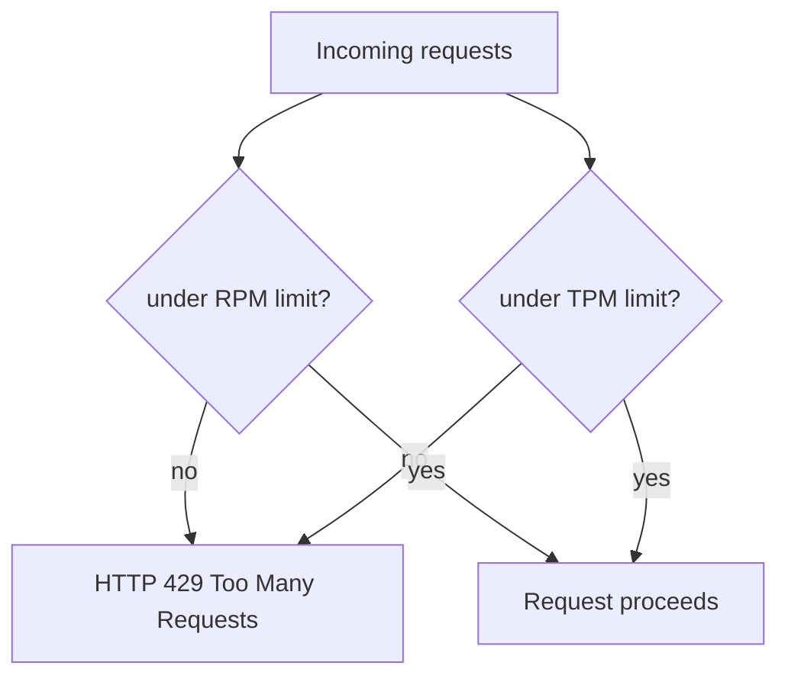
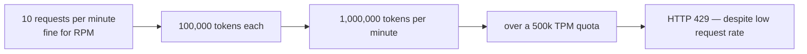
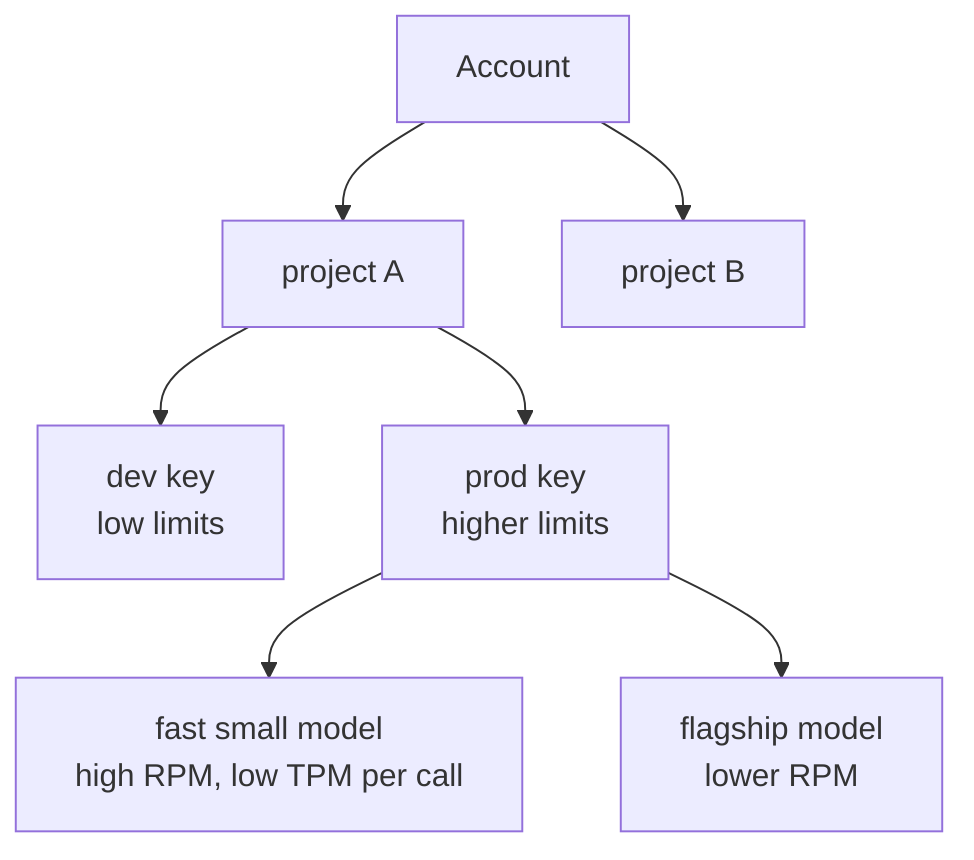
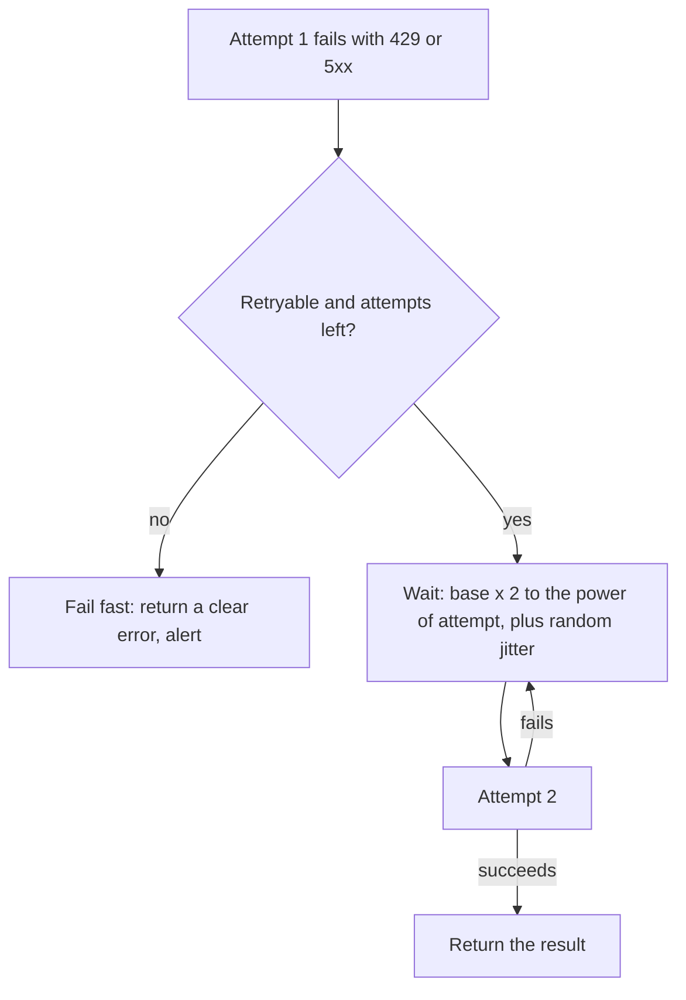
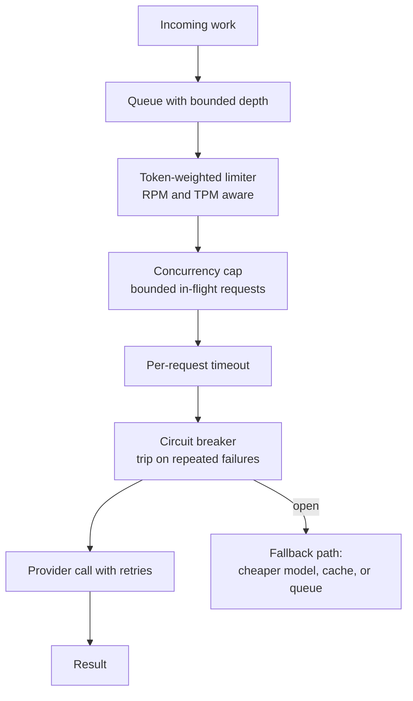
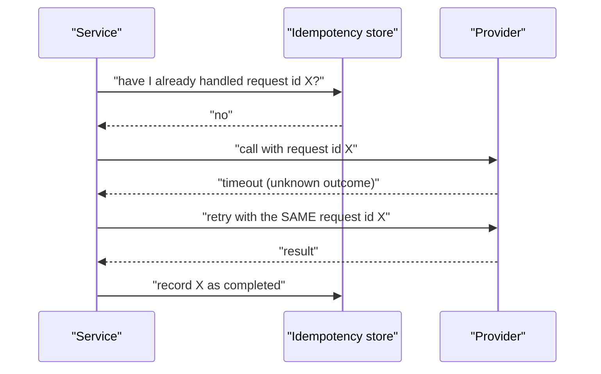
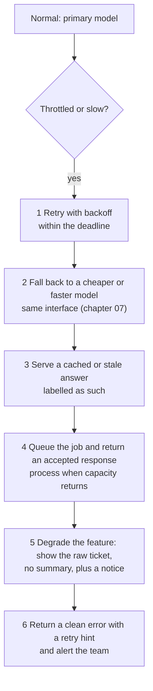
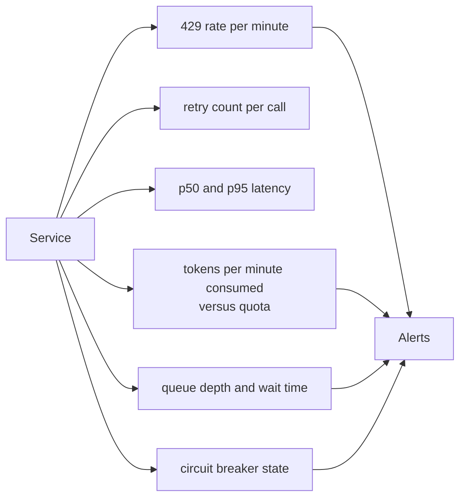

# Chapter 06 — Rate Limits, Quotas, Throttling & Retry/Backoff

> **Lecture 04 · Chapter 06 of 09** · Level: 🟢 Beginner · Phase 2 — The Application Layer: Talking to Models
> **Source:** `Forward-Deployed-Engineer/Lecture 03/notes/03_Token_Economics_Metadata_and_Production_Engineering.md`
> (§3.4 — quotas, TPM vs RPM) · `…/05_Building_the_Production_Support_Ticket_Summarizer.md` (client singleton with
> `maxRetries` and `timeout`) · `…/06_Framework_Abstractions_Response_Metadata_and_Prompt_Hygiene.md` (§6.1 — the
> resilience pillar) · `gen-ai-cohort/week02/learning/day03/notes/03-accessing-llms-sdk-vs-api.md` (best practices
> and common mistakes: ignoring rate limits and retry strategies)
> **Roadmap topics:** rate limits, **throttling**, quotas · retry and exponential backoff · timeouts and client
> resilience · graceful degradation.

---

## 06.0 What this chapter is for

Chapters 02–05 designed the *happy path*. In production the happy path is maybe 97% of traffic — and the other 3%
is what pages an engineer at 2 a.m.

Providers protect their GPU fleets with **quotas**, and enforce them with **HTTP 429**. Your service must be
built so that hitting a limit degrades gracefully instead of failing loudly, and so that retrying does not make
things worse.

By the end of this chapter you should be able to:

1. Distinguish **RPM** and **TPM** quotas, and explain how a low request rate can still exceed a token quota.
2. List the other quota dimensions that exist in practice (daily caps, concurrency, spend limits, per-model
   limits, project scoping).
3. Read a `429` correctly, including the retry and rate-limit headers.
4. Implement **exponential backoff with jitter**, with a maximum attempt count and a total deadline.
5. Say which failures are retryable and which are bugs you must not retry.
6. Add the client-side protections that prevent you from ever hitting the limit: timeouts, concurrency caps,
   token-bucket throttling, queues and circuit breakers.
7. Make retries safe (idempotency) and design a degradation ladder for when the model is unavailable.
8. Instrument and alert on limit-related signals.

---

## 06.1 The two ceilings: RPM and TPM

Providers enforce two independent thresholds:

| Quota | Measures | Typical failure trigger |
| :--- | :--- | :--- |
| **RPM** — requests per minute | Number of HTTP calls | Fan-out, polling, retry storms |
| **TPM** — tokens per minute | Total tokens (input **and** output) across all calls in a rolling window | Large prompts, long outputs, big contexts |



### Why RPM alone is a trap

A service sending only **10 requests per minute** is nowhere near a 500 RPM limit. But if each request carries a
100,000-token legal brief, that is **1,000,000 tokens per minute** — instantly over a 500k TPM quota, and the
provider returns `429`.



> [!IMPORTANT]
> **Design rule.** Throttle on **tokens**, not just requests. Your client-side limiter must weight each request by
> its estimated token cost (chapter 05), or you will discover your true limit in production.

---

## 06.2 The wider quota landscape

RPM/TPM are the headline numbers, but real accounts carry several simultaneous ceilings:

| Dimension | Example | Consequence for design |
| :--- | :--- | :--- |
| **RPM** | 500 requests/min | Cap request concurrency |
| **TPM** | 500,000 tokens/min | Token-weighted throttling |
| **RPD / TPD** | requests or tokens per day | Bulk jobs must spread across the day |
| **Concurrent requests** | e.g. 50 in flight | Bound your own in-flight counter |
| **Per-model limits** | lower limits on flagship or preview models | Tiering must respect different ceilings |
| **Spend caps** | monthly budget per project | Alert before you hit the wall, not after |
| **Scope** | per project, per organisation, per region | Separate keys per environment prevent dev traffic starving prod |
| **Tier** | free/tier-1/tier-2 accounts have different limits | Capacity planning must include the account tier |
| **Provisioned throughput** | purchased capacity with a committed spend | Predictable limits and latency at a cost |



> [!TIP]
> **Separate keys per environment is a resilience control, not just hygiene.** It stops a staging load test from
> consuming the production quota, and it makes per-environment cost attribution trivial (chapter 04).

---

## 06.3 Reading a `429` correctly

A `429` is not "the service is broken" — it is the provider telling you **how to behave**. Read the headers
before you retry.

| Header (typical) | Meaning | How to use it |
| :--- | :--- | :--- |
| `Retry-After` | Seconds to wait before retrying | Honour it exactly; do not guess a shorter delay |
| `x-ratelimit-limit-requests` | RPM ceiling | Log it; compare with your configured throttle |
| `x-ratelimit-remaining-requests` | RPM headroom | Feed a dynamic limiter; scale down before you hit zero |
| `x-ratelimit-reset-requests` | When the request window resets | Schedule the retry instead of hammering |
| `x-ratelimit-limit-tokens` / `-remaining-tokens` | TPM ceiling and headroom | Detect that the token budget, not the request rate, is the binding constraint |
| Error `code` / `type` | `rate_limit_exceeded`, `insufficient_quota`, … | Distinguish *transient* throttling from *exhausted billing* |

> [!WARNING]
> **`rate_limit_exceeded` and `insufficient_quota` are different problems.** The first is transient — back off and
> retry. The second means the account has no credit or no access: retrying is pointless, and the correct action is
> to alert a human.

---

## 06.4 Retry with exponential backoff and jitter

Retrying immediately is worse than not retrying: it converts a brief throttle into a sustained overload for both
the provider and your own service. The standard remedy is **exponential backoff with jitter**.



```ts
// pseudo-code — backoff with jitter, a deadline and a retry budget
async function callWithRetry(fn, { maxAttempts = 4, baseMs = 500, deadlineMs = 30_000 }) {
  const started = now();
  let attempt = 0;

  while (true) {
    attempt += 1;
    try {
      return await fn();
    } catch (err) {
      if (!isRetryable(err) || attempt >= maxAttempts) throw err;
      if (now() - started > deadlineMs) throw err;      // total budget exhausted

      const serverHint = err.retryAfterMs;              // honour Retry-After when present
      const backoff = baseMs * 2 ** (attempt - 1);      // 500, 1000, 2000 ...
      const jitter = Math.random() * baseMs;            // spread out retry storms
      const waitMs = serverHint ?? backoff + jitter;

      await sleep(Math.min(waitMs, remaining(deadlineMs, started)));
    }
  }
}
```

| Rule | Why |
| :--- | :--- |
| **Cap the attempts** (3–5) | Prevents infinite loops and unbounded spend |
| **Cap the total deadline** | A retry that finishes after the caller gave up is wasted money |
| **Add jitter** | Without it, all clients retry in lockstep and re-trigger the limit |
| **Honour `Retry-After`** | The provider knows when capacity returns |
| **Retry only idempotent work** | Or accept the risk of duplicate side effects (see 06.6) |
| **Never retry non-retryable errors** | `400`, `401`, `403`, `404`, `422` are bugs, not blips |
| **Count and log retries** | A rising retry rate is an early warning of capacity problems |

### Which failures are retryable?

| Status / condition | Retry? | Notes |
| :--- | :---: | :--- |
| `429` rate limit | ✅ | Back off; honour `Retry-After` |
| `500` internal error | ✅ | Transient provider fault |
| `502` / `503` / `504` | ✅ | Capacity, deploys, timeouts |
| Connection reset, DNS blip, socket timeout | ✅ | Network transients |
| Client timeout with no response | ⚠️ | Retry only if the operation is idempotent — the model may have already generated (and billed) |
| `400` bad request | ❌ | Your payload is wrong |
| `401` / `403` | ❌ | Key or permission problem |
| `404` model not found | ❌ | Configuration bug |
| `413` payload too large | ❌ | Trim the context (chapter 05) |
| `422` unprocessable | ❌ | Fix the request |
| `insufficient_quota` | ❌ | Billing/access; escalate to a human |

---

## 06.5 Prevention: client-side protections

Backoff is damage control. The better strategy is to **never hit the limit**.



| Protection | What it does | Key parameter to set deliberately |
| :--- | :--- | :--- |
| **Timeout** | Stops a hung request from consuming a worker forever | Must be longer than your p99 generation time, shorter than the caller's patience |
| **Concurrency cap** | Bounds simultaneous in-flight calls | Derived from your quota and the model's latency |
| **Token-weighted limiter** | Throttles on estimated tokens/min, not just requests/min | Use the chapter 05 estimator |
| **Bounded queue with backpressure** | Absorbs bursts; rejects or delays when full | Return `503`-style "try again" rather than unbounded memory growth |
| **Circuit breaker** | Stops calling a failing dependency for a cool-down period | Trip threshold, half-open probe interval |
| **Bulkheads** | Isolate one feature's traffic from another's | Separate limits per feature/tenant tier |
| **Caching** | Avoids calls entirely for repeated inputs | Cache key = normalised prompt + model + params |
| **Batching / async jobs** | Moves non-urgent work off the interactive path | Acceptable delay budget |

> [!IMPORTANT]
> **A queue is not a solution by itself.** If arrival rate permanently exceeds service rate, the queue grows
> forever. You need either more capacity, a cheaper model, or an explicit shedding policy — plus a metric that
> tells you which of the three you need.

---

## 06.6 Idempotency: making retries safe

A retry that succeeds twice is a **duplicate side effect**: two emails, two charges, two tickets. Make retries
safe before you enable them.



| Technique | Applies to |
| :--- | :--- |
| **Client-supplied request id / idempotency key** | Any call with side effects downstream |
| **Dedupe cache keyed on a content hash** | Summarisation and classification (same input, same answer) |
| **Two-phase action:** model proposes, code commits | Anything that changes money, access or data (see chapter 03) |
| **Store the model response with the request id** | Lets a retry return the first result instead of regenerating (and re-billing) |

> [!TIP]
> **Retrying a text generation is usually harmless; retrying a *tool execution* is not.** Keep that distinction
> explicit in code: the model call may be retried freely, the downstream action must be guarded by an
> idempotency key.

---

## 06.7 The degradation ladder

When the provider is unavailable or you are throttled, a good service degrades in steps instead of returning a
raw `500` to a user.



| Rung | User experience | Cost | When it is acceptable |
| :--- | :--- | :--- | :--- |
| Retry with backoff | Slightly slower | same | Always first |
| Cheaper model fallback | Slightly lower quality | lower | When quality bars allow it |
| Cached/stale answer | Instant, possibly outdated | zero | Read-mostly features with tolerance for staleness |
| Async queue | Delayed | same | Batch and non-interactive work |
| Feature degradation | Reduced functionality, honest | zero | Interactive features where a partial answer beats none |
| Clean error + alert | Explicit failure | zero | When no safe degradation exists |

> [!IMPORTANT]
> **Decide the ladder before launch, not during an incident.** Write down, per feature, which rung is acceptable
> — and make sure every rung is observable so you know which one you are on.

---

## 06.8 Observability: the metrics that predict an outage



| Metric | Why it matters | Suggested alert |
| :--- | :--- | :--- |
| **429 rate** | Direct evidence of quota pressure | > 1% of calls over 5 min |
| **Retry rate / retries per call** | Retry storms hide latency and cost | average > 0.2 |
| **p95 latency** | Timeouts appear here before users complain | above the client timeout minus margin |
| **Tokens per minute vs quota** | Predicts the 429 before it happens | > 70% of the known TPM limit |
| **Queue depth / wait time** | Backpressure building | depth growing for N minutes |
| **Circuit-breaker state** | Which dependency is unhealthy | any open breaker |
| **Spend rate** | Cost overrun looks like an outage to finance | > X% of the daily budget |
| **Cache hit rate** | The cheapest capacity you already paid for | below an expected floor |

> [!TIP]
> **Alert on trends, not single events.** One `429` is normal; a rising `429` *rate* alongside a rising retry rate
> and a falling cache-hit rate is the signature of an imminent capacity problem — and it is visible minutes before
> users notice.

---

## 06.9 Common mistakes

- **Throttling on requests only.** A handful of giant prompts can exhaust TPM with almost no RPM.
- **Retrying immediately, or in a tight loop.** Converts a blip into an outage and multiplies cost.
- **Retrying without jitter.** All replicas retry in lockstep and re-trigger the limit together.
- **Retrying non-retryable errors.** `400`/`401`/`404` will never succeed; you only add noise.
- **Retrying without a total deadline.** The caller has already timed out; you are spending money for nothing.
- **Treating `insufficient_quota` as transient.** It needs a human, not a retry.
- **No client timeout.** A single hung request can exhaust your connection pool.
- **Unbounded queues.** They hide overload until memory or latency explodes.
- **Retrying a tool execution without an idempotency key.** Duplicate emails, charges and tickets.
- **Sharing one API key across environments.** Staging load tests starve production.
- **No degradation plan.** The first incident becomes a design meeting.
- **Ignoring `Retry-After`.** The provider told you exactly what to do and you did the opposite.

---

## 06.10 Key takeaways

1. **Two independent ceilings: RPM (requests) and TPM (tokens).** Throttle on tokens as well as requests.
2. **Quotas are multi-dimensional:** daily caps, concurrency, per-model limits, spend caps and account tier all
   bind at different times.
3. **A `429` is instruction, not failure.** Read `Retry-After` and the `x-ratelimit-*` headers.
4. **Retry only transient failures** (`429`, `5xx`, network) — with exponential backoff, jitter, a capped attempt
   count and a total deadline.
5. **Prevent rather than repair:** timeouts, concurrency caps, token-weighted limiters, bounded queues, circuit
   breakers, bulkheads and caching.
6. **Make retries idempotent** before enabling them, especially for anything with side effects.
7. **Design a degradation ladder** — cheaper model, cached answer, async queue, feature degradation, clean error —
   and make each rung observable.
8. **Alert on rates and trends**, not on single events: 429 rate, retry rate, latency, token consumption vs quota,
   queue depth.

---

## 06.11 Self-check questions

1. Distinguish RPM and TPM, and construct a scenario where RPM is fine but TPM is exceeded.
2. Name four quota dimensions other than RPM and TPM, and one design consequence of each.
3. Which headers would you read on a `429`, and what decision does each inform?
4. Write the backoff formula and explain the role of jitter in one sentence.
5. Give three reasons to cap the *total* retry deadline rather than only the attempt count.
6. Classify as retryable or not: `429`, `400`, `503`, `404`, `insufficient_quota`, socket timeout.
7. Why is a bounded queue better than an unbounded one, and what must happen when the queue is full?
8. A retry caused a customer to receive two identical emails. What was missing, and where should it have lived?
9. Describe a five-rung degradation ladder for a summarisation feature, with the user-visible behaviour at each
   rung.
10. Name four metrics you would alert on to catch quota exhaustion before users do.

---

### Navigation

- **Previous:** [Chapter 05 — Token Counting & Context Budgeting](./05_Token_Counting_and_Context_Budgeting_with_Tokenizers.md)
- **Next:** [Chapter 07 — Multi-SDK Integration](./07_Multi_SDK_Integration_OpenAI_Gemini_Groq_Mistral_Anthropic_Ollama.md)
- **Source:** `Forward-Deployed-Engineer/Lecture 03/notes/03_…Token_Economics…` (§3.4) · `…/05_…Support_Ticket_Summarizer.md` ·
  `…/06_…Prompt_Hygiene.md` (§6.1) · `gen-ai-cohort/week02/learning/day03/notes/03-accessing-llms-sdk-vs-api.md`
- **Back to index:** [../index.md](../index.md)