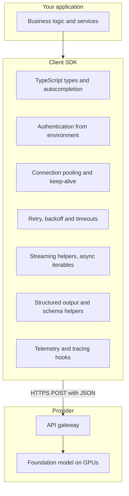
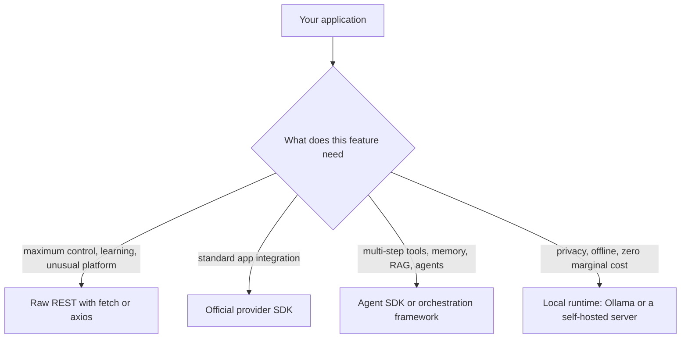
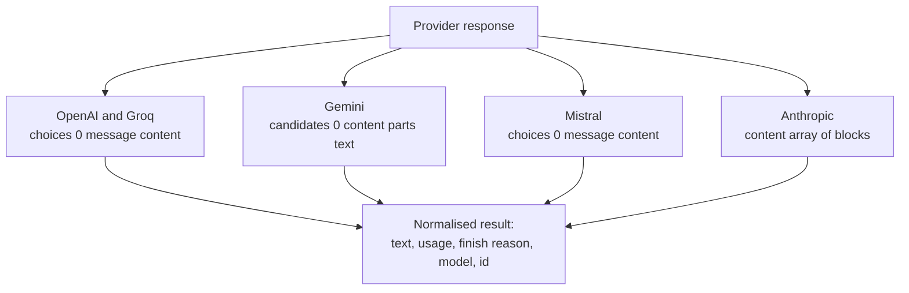
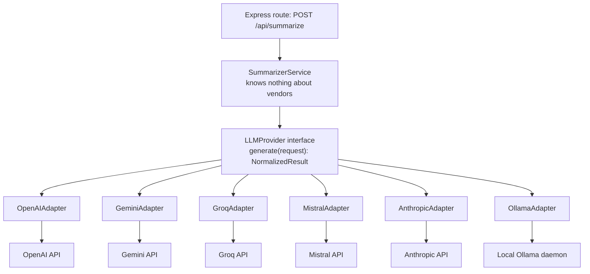
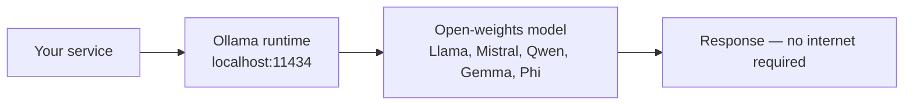
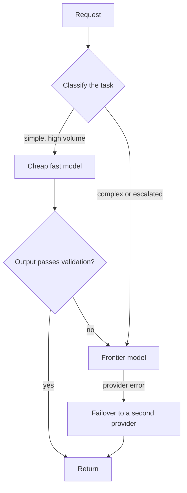

# Chapter 07 — Multi-SDK Integration: OpenAI · Gemini · Groq · Mistral · Claude · Ollama

> **Lecture 04 · Chapter 07 of 09** · Level: 🟢 Beginner · Phase 2 — The Application Layer: Talking to Models
> **Source:** `gen-ai-cohort/week01/learning/day01/notes/open ai.md` · `gemini.md` · `groq.md` · `mistral.md` ·
> `notes.md` (§Beyond OpenAI — comparison table) ·
> `gen-ai-cohort/week02/learning/day03/notes/03-accessing-llms-sdk-vs-api.md` (SDK · Agent SDK · local models ·
> which option to choose · production architecture) ·
> `Forward-Deployed-Engineer/Lecture 03/notes/04_Node_Express_JS_TS_Environment_and_Architecture.md` (§4.2 — the
> JS/TS AI ecosystem) · `…/06_…Prompt_Hygiene.md` (§6.1 — the seven pillars of AI abstractions)
> **Roadmap topics:** **multi-SDK integration** — OpenAI, Google Gemini, Groq, Mistral, Anthropic Claude and
> **Ollama (local)** · SDK access vs direct REST inference — when each is right · provider comparison ·
> framework abstractions.

---

## 07.0 What this chapter is for

Chapter 02 taught you the wire format; this chapter teaches you **portability**.

The lecture's completion gate is explicit: *one codebase that can answer the same prompt through three different
providers behind a single interface, and reports token cost per call.* That is not a party trick — it is how real
teams survive provider outages, model deprecations, price changes and regional availability.

By the end of this chapter you should be able to:

1. Explain what an SDK does and does **not** do (it contains no intelligence).
2. Compare the four access layers: raw REST, official SDK, agent SDK, and a local runtime.
3. Recall the call signature and response shape of each major provider — and the naming traps between them.
4. Design a **single provider interface** (adapter/ports-and-adapters) so business logic never imports a vendor
   SDK directly.
5. Normalise responses into one shape that carries text, usage and finish reason.
6. Configure providers via environment variables and `baseURL` overrides (proxies, gateways, Azure,
   OpenAI-compatible endpoints).
7. Decide when to run a model **locally with Ollama** and when to use a hosted provider.
8. Add routing, fallback and cost accounting on top of that interface.

---

## 07.1 What an SDK is — and what it is not

An SDK is a **typed convenience wrapper around the HTTP request from chapter 02**. It contains no model weights,
no intelligence, and no magic.



| The SDK **does** | The SDK **does not** |
| :--- | :--- |
| Hold your key and build the auth header | Generate intelligence |
| Serialise and parse JSON with types | Know your business rules |
| Retry, back off, pool connections, enforce timeouts | Guarantee quality |
| Provide streaming primitives | Store your conversation history |
| Offer schema/structured-output helpers | Make your prompts good |
| Emit telemetry hooks | Decide which provider is cheapest |

### The seven pillars of an AI abstraction (why not raw `fetch`)

| # | Pillar | With raw `fetch` | With an AI SDK |
| :---: | :--- | :--- | :--- |
| 1 | **Multi-provider portability** | Rewrite headers and schemas per vendor | Unified clients and adapters |
| 2 | **Real-time streaming** | Hand-parse chunked transfer and `data:` lines | `for await (const chunk of stream)` |
| 3 | **Structured output** | Regex and hope | Schema-enforced responses |
| 4 | **Conversation memory** | Manually persist and slice arrays | Memory patterns and helpers |
| 5 | **Tool calling** | Author schemas, parse calls, run loops by hand | Declared tools and automated loops |
| 6 | **Observability** | Measure TTFT and tokens yourself | OpenTelemetry-style hooks |
| 7 | **Resilience** | Every 429 becomes an exception | Built-in retries, backoff and timeouts |

> [!IMPORTANT]
> **The SDK is a convenience, not a strategy.** Vendor lock-in is created by *importing a vendor SDK inside
> business logic*, not by using an SDK at all. Chapter 07.6 fixes that with one thin adapter.

---

## 07.2 The four access layers



| Dimension | Raw REST | Official SDK | Agent SDK / framework | Local runtime (Ollama) |
| :--- | :--- | :--- | :--- | :--- |
| HTTP handling | Manual | Automatic | Automatic | Automatic or manual |
| Auth | Manual headers | Automatic from env | Automatic | Usually none locally |
| JSON parsing | Manual | Typed | Typed | Typed or manual |
| Streaming | Manual chunk parsing | Built-in | Built-in | Built-in |
| Tool calling | Manual loops | Supported | Built-in workflows | Supported by many models |
| Memory | Manual | Manual | Built-in patterns | Manual |
| Multi-step agents | Manual | Manual | Designed for it | Depends on the model |
| Cost | Pay per token | Pay per token | Pay per token | Hardware and electricity |
| Best for | Learning, custom platforms, debugging | Most production apps | Agents and RAG systems | Privacy, offline, dev loops |
| Failure surface | Everything is yours | SDK + provider | Framework + SDK + provider | Your own machine |

> [!TIP]
> **The pragmatic production answer:** official SDKs behind **your own adapter interface** (07.6), with a raw-REST
> path kept as an escape hatch for providers or features the SDK does not cover.

---

## 07.3 Provider-by-provider: clients and the naming trap

Every provider solves the same problem with slightly different names. Learn the table once and you will never be
confused again.

| Provider | npm package | Client construction | Call | Model location | Env var |
| :--- | :--- | :--- | :--- | :--- | :--- |
| **OpenAI** | `openai` | `new OpenAI({ apiKey })` | `client.chat.completions.create({...})` (or `client.responses.create`) | body | `OPENAI_API_KEY` |
| **Anthropic** | `@anthropic-ai/sdk` | `new Anthropic({ apiKey })` | `client.messages.create({...})` | body | `ANTHROPIC_API_KEY` |
| **Google Gemini** | `@google/genai` | `new GoogleGenAI({ apiKey })` | `ai.models.generateContent({ model, contents, config })` | **argument, and in the path** | `GEMINI_API_KEY` |
| **Mistral** | `@mistralai/mistralai` | `new Mistral({ apiKey })` | `client.chat.complete({...})` | body | `MISTRAL_API_KEY` |
| **Groq** | `groq-sdk` | `new Groq({ apiKey })` | `client.chat.completions.create({...})` | body | `GROQ_API_KEY` |
| **Ollama (local)** | `ollama` or plain `fetch` | base URL `http://localhost:11434` | `POST /api/generate` or `/v1/chat/completions` | body | none |

The four naming traps that cost teams real time:

1. **`chat.completions.create` (OpenAI, Groq) vs `chat.complete` (Mistral) vs `messages.create` (Anthropic) vs
   `models.generateContent` (Gemini).** Same idea, four names.
2. **Parameter casing.** OpenAI/Groq use `max_tokens`; Mistral and Gemini use camelCase (`maxTokens`,
   `maxOutputTokens`); Anthropic uses `max_tokens` but requires it.
3. **Where the system prompt goes.** A `system` message in OpenAI/Groq/Mistral, a top-level `system` parameter in
   Anthropic, and `systemInstruction` inside `config` in Gemini.
4. **Where the model name goes.** Body for most; **URL path** for Gemini.

```ts
// pseudo-code — the same request, four providers, one intent
// OpenAI / Groq
client.chat.completions.create({
  model, messages, temperature, max_tokens: 300,
});

// Anthropic
anthropic.messages.create({
  model, system: SYSTEM_PROMPT, max_tokens: 300,
  messages: [{ role: "user", content: ticket }],
});

// Gemini
ai.models.generateContent({
  model, contents: ticket,
  config: { systemInstruction: SYSTEM_PROMPT, temperature, maxOutputTokens: 300 },
});

// Mistral
mistral.chat.complete({
  model, messages, temperature, maxTokens: 300,
});
```

---

## 07.4 Response shapes compared

The request differs; so does the response. **Where the text lives** and **where the usage lives** are the two
things your adapter must normalise.



| Provider | Text path | Finish reason | Usage fields | Extras worth knowing |
| :--- | :--- | :--- | :--- | :--- |
| **OpenAI** | `choices[0].message.content` | `choices[0].finish_reason` (`stop`, `length`, `content_filter`, `tool_calls`) | `usage.prompt_tokens`, `completion_tokens`, `total_tokens` | `id`, `model`, `system_fingerprint` for versioning |
| **Groq** | `choices[0].message.content` | `choices[0].finish_reason` | same names as OpenAI, **plus timings**: `queue_time`, `prompt_time`, `completion_time`, `total_time` | `x_groq.id`; timings let you compute tokens/second and queue delay |
| **Mistral** | `choices[0].message.content` | `choices[0].finishReason` (**camelCase**) | `usage.promptTokens`, `completionTokens`, `totalTokens` (**camelCase**) | `safePrompt` flag for built-in moderation |
| **Gemini** | `response.text` (convenience getter) or `candidates[0].content.parts[*].text` | `candidates[0].finishReason` (`STOP`, `MAX_TOKENS`, `SAFETY`, …) | `usageMetadata.promptTokenCount`, `candidatesTokenCount`, `totalTokenCount` | `safetyRatings[]` per harm category; `avgLogprobs` |
| **Anthropic** | `content[]` blocks of type `text` | `stop_reason` (`end_turn`, `max_tokens`, `stop_sequence`, `tool_use`) | `usage.input_tokens`, `output_tokens` | Content blocks make tool use first-class |

Two practical consequences:

- **Gemini is the biggest normalisation outlier.** Its `finishReason` values are a different enum (`STOP` vs
  `stop`), its usage field names are different, and it returns **safety ratings** you can log as an extra quality
  signal. Do not assume OpenAI-shaped parsing.
- **Groq's timing metadata is a gift.** `completion_time` lets you compute real tokens/second per call, which is
  exactly the metric you want when comparing providers on latency (chapter 04).

> [!NOTE]
> **Why the adapter must normalise usage, not just text.** Cost accounting (chapter 04) needs a single
> `{ inputTokens, outputTokens, cachedTokens }` shape. If each caller reads a provider-specific path, every new
> provider becomes a code change in ten places.

---

## 07.5 Capability comparison

Choose providers on **capabilities and constraints**, not on brand. The dimensions that actually decide
architecture:

| Dimension | Why it decides architecture | Example differences |
| :--- | :--- | :--- |
| **Context window** | Determines whether your retrieval design fits | Small (tens of thousands) to very large (hundreds of thousands or more) |
| **Native multimodality** | Whether you need a separate vision/audio pipeline | One provider family is natively multimodal from the ground up |
| **Latency profile** | Interactive vs batch features | Specialised hardware can be several times faster on tokens/second |
| **Open weights** | Self-hosting, fine-tuning, air-gapped deployment | Some providers publish downloadable weights |
| **Reasoning depth** | Complex multi-step tasks vs high-volume simple tasks | Flagship vs mini tiers within every provider |
| **Safety features** | Built-in moderation, safety ratings | Some return per-category safety ratings; others offer moderation endpoints |
| **Tool use maturity** | Whether agents are practical | Varies by model and API generation |
| **Price shape** | Input/output ratio, cached-input discounts, batch discounts | Drives tiering and caching decisions |
| **Regional/data residency** | Compliance | Determines which providers you may use at all |

> [!TIP]
> **Rank providers per feature, not globally.** "Which model is best?" is unanswerable; "which model passes our
> ticket-summary eval at the lowest cost per 1,000 tickets?" is a decision you can make with data (Lecture 30).

---

## 07.6 The adapter pattern: one interface, many providers

This is the centrepiece of the chapter — and the lecture's completion gate.



```ts
// pseudo-code — the port (interface) and the normalised result
type LLMRequest = {
  model: string;
  messages: Message[];        // roles from chapter 03
  temperature?: number;
  maxTokens?: number;
  tools?: ToolSpec[];         // optional, Lecture 08
};

type NormalizedResult = {
  text: string;
  provider: string;
  model: string;
  finishReason: "stop" | "length" | "content_filter" | "tool_calls" | "other";
  usage: { inputTokens: number; outputTokens: number; cachedTokens?: number };
  raw: unknown;               // kept for debugging, never used by business logic
};

interface LLMProvider {
  readonly name: string;
  generate(req: LLMRequest): Promise<NormalizedResult>;
}
```

```ts
// pseudo-code — one adapter; every other provider follows the same shape
class OpenAIAdapter implements LLMProvider {
  readonly name = "openai";
  private client = createOpenAIClientOnce();     // singleton, chapter 08

  async generate(req: LLMRequest): Promise<NormalizedResult> {
    const res = await this.client.chat.completions.create({
      model: req.model,
      messages: toOpenAIMessages(req.messages),
      temperature: req.temperature,
      max_tokens: req.maxTokens,
    });

    return {
      text: res.choices[0]?.message?.content ?? "",
      provider: this.name,
      model: res.model,
      finishReason: mapFinishReason(res.choices[0]?.finish_reason),
      usage: {
        inputTokens: res.usage?.prompt_tokens ?? 0,
        outputTokens: res.usage?.completion_tokens ?? 0,
      },
      raw: res,
    };
  }
}
```

```ts
// pseudo-code — the service depends on the interface, never on a vendor
class SummarizerService {
  constructor(private providers: Record<string, LLMProvider>, private cfg: Config) {}

  async summarize(ticket: string) {
    const provider = this.providers[this.cfg.AI_PROVIDER];   // chosen by config
    const result = await provider.generate({
      model: this.cfg.AI_MODEL,
      messages: [
        { role: "system", content: SYSTEM_PROMPT },
        { role: "user", content: ticket },
      ],
      temperature: this.cfg.AI_TEMPERATURE,
      maxTokens: this.cfg.AI_MAX_TOKENS,
    });

    return { summary: result.text.trim(), cost: estimateCost(result.usage, result.model) };
  }
}
```

### What this buys you

| Benefit | How it shows up |
| :--- | :--- |
| **Provider swap = config change** | `AI_PROVIDER=groq` instead of editing business logic |
| **Outage failover** | Try primary; on `503`, call the next adapter (06.7) |
| **Cost comparison** | Same request through several adapters, cost per call reported (the gate) |
| **Testability** | A fake adapter in tests — no network, no keys, no cost |
| **One place for normalisation** | Finish-reason mapping, usage mapping, error mapping |
| **Migration safety** | Deprecate a provider by deleting one file |

> [!IMPORTANT]
> **The rule that prevents lock-in.** No file under `services/` may import a vendor SDK. Only files under
> `providers/` may. That single import rule is the difference between a two-hour provider swap and a two-week
> refactor.

---

## 07.7 Configuration: keys, base URLs and OpenAI-compatible endpoints

Every provider is configured the same way — environment variables validated at boot (chapter 08), never hard-coded.

```ts
// pseudo-code — provider configuration shape
const PROVIDERS = {
  openai:    { envKey: "OPENAI_API_KEY",    baseUrl: "https://api.openai.com/v1" },
  anthropic: { envKey: "ANTHROPIC_API_KEY", baseUrl: "https://api.anthropic.com" },
  gemini:    { envKey: "GEMINI_API_KEY",    baseUrl: "https://generativelanguage.googleapis.com" },
  mistral:   { envKey: "MISTRAL_API_KEY",   baseUrl: "https://api.mistral.ai/v1" },
  groq:      { envKey: "GROQ_API_KEY",      baseUrl: "https://api.groq.com/openai/v1" },
  ollama:    { envKey: null,                baseUrl: "http://localhost:11434" },
};
```

| Configuration concern | Practical approach |
| :--- | :--- |
| **Keys** | One env var per provider; only the active provider's key is required |
| **Base URL override** | Lets you point an SDK at a proxy, a gateway, an Azure deployment, or a self-hosted OpenAI-compatible server |
| **OpenAI-compatible gateways** | Many hosts (including local runtimes and some clouds) expose `/v1/chat/completions`; one adapter can serve several of them |
| **Region / residency** | Keep region in configuration so compliance rules are not scattered in code |
| **Per-environment keys** | Separate dev/staging/prod keys so limits and spend are isolated (chapter 06) |
| **Timeouts and retries** | Configure per provider — their p99 latencies differ |
| **Price table** | Versioned data, not code constants (chapter 04) |

> [!TIP]
> **The `baseURL` escape hatch is the most under-used line of configuration in AI engineering.** It lets you
> switch to a proxy, a gateway that logs and meters, a regional endpoint, or a local server — with **zero** changes
> to business logic.

---

## 07.8 Local models with Ollama

A local runtime runs the model **on your own machine**. No data leaves the host, no per-request fee, and it works
offline once the model is downloaded.



### Why teams run locally

| Reason | Detail |
| :--- | :--- |
| **Privacy** | Prompts and data never leave the machine — useful for regulated or sensitive workloads |
| **No marginal cost** | No per-token billing; you pay in hardware and electricity |
| **Offline development** | Work on a plane, in an air-gapped environment, or when a provider is down |
| **Fast iteration** | No quota, no key management, no billing while prototyping |
| **Full control** | You choose the quantisation, the version and the serving parameters |
| **Experimentation** | Compare open weights before committing to a hosted contract |

### The trade-offs (state them honestly)

| Trade-off | Consequence |
| :--- | :--- |
| **Hardware requirements** | Model size, quantisation and context length all compete for GPU/RAM |
| **Quality gap** | Open weights at a given size are usually behind the best hosted frontier models |
| **Operational burden** | You now run and monitor an inference service (Lecture 25 covers vLLM/PagedAttention for scale) |
| **Throughput limits** | One local GPU serves far fewer concurrent users than a hosted fleet |
| **No elastic capacity** | Traffic spikes cannot be absorbed by someone else's spare GPUs |
| **Different tokenizer and behaviour** | Prompts may need tuning; token counts differ (chapter 05) |

### Cloud vs local, side by side

| Dimension | Hosted cloud API | Local runtime (Ollama) |
| :--- | :--- | :--- |
| Internet required | Yes | No, after model download |
| Per-request cost | Yes, per token | None |
| Data privacy | Data sent to the provider | Data stays on your machine |
| Setup effort | Minutes | Model download plus local resources |
| Frontier model access | Yes, immediately | Depends on published open weights |
| Hardware needed | None | Meaningful GPU/RAM for large models |
| Scaling | Elastic | Bounded by your hardware |
| Ops burden | Provider's problem | Yours |

### How it fits the adapter pattern

The local runtime exposes an HTTP API (a native endpoint such as `/api/generate`, and often an
OpenAI-compatible `/v1/chat/completions`). That means it becomes **one more adapter** behind the same interface —
often the *same* adapter as OpenAI with a different `baseURL`.

```ts
// pseudo-code — the local provider is just another adapter
const ollamaProvider: LLMProvider = new OpenAICompatibleAdapter({
  name: "ollama",
  baseUrl: "http://localhost:11434/v1",   // the escape hatch from 07.7
  apiKey: "not-needed-locally",
});
```

### When to choose which

| Situation | Recommendation |
| :--- | :--- |
| Prototyping prompts and schemas | **Local** — free, fast, no quota |
| Sensitive/PII-heavy data with strict residency | **Local**, or a hosted provider with the right contract |
| Highest quality on hard reasoning | **Hosted frontier model** |
| Very high volume, simple task | **Hosted small model** (cheapest per call), or local at high utilisation |
| Offline or air-gapped deployment | **Local** |
| Unpredictable traffic | **Hosted** — elastic capacity |
| Cost-sensitive with steady load | **Hybrid**: local for bulk, hosted for escalation |
| Strict latency SLO on long outputs | Measure both; specialised hosted hardware often wins |

> [!IMPORTANT]
> **Local is a deployment choice, not a different architecture.** Because the interface is the same HTTP/JSON
> contract, moving a feature from local to hosted (or the reverse) should be a configuration change — which is
> exactly why the adapter from 07.6 is worth writing on day one.

---

## 07.9 Routing, fallback and cost control across providers

Once several adapters exist, you can make **routing decisions** in one place.



| Strategy | Trigger | Trade-off |
| :--- | :--- | :--- |
| **Cheap-first with escalation** | Task complexity, or a failed validation | Requires a validation signal; saves the most money |
| **Latency-based routing** | Time budget per feature | Needs per-provider latency telemetry |
| **Provider failover** | `5xx`, timeouts, open circuit breaker | Second provider must accept the same prompt |
| **Cost-cap routing** | Tenant or daily budget approaching | Degrades quality deliberately |
| **Data-residency routing** | Tenant region or contract | Fewer providers to choose from |
| **Shadow traffic** | Compare a candidate model on real prompts | Extra cost; needs a quality comparison |
| **Canary by percentage** | Roll out a new model safely | Needs per-variant metrics |

> [!TIP]
> **Record the routing decision in the audit record.** A `routingReason` field ("primary", "escalated",
> "failover:503", "cost-cap") turns "why did quality change last Tuesday?" into a query instead of an
> investigation.

---

## 07.10 Testing across providers

| Test | What it protects |
| :--- | :--- |
| **Contract test per adapter** | A recorded request/response pair per provider, asserting the normalised shape |
| **Golden-prompt eval** | The same prompt through each provider, scored by the same rubric (Lecture 30) |
| **Cost assertion** | "Cost per call stays under X" in CI, using the price table |
| **Error-mapping test** | A simulated `429`/`503` maps to the right internal error and the right retry behaviour |
| **Fake adapter in unit tests** | Business logic tested with zero network and zero spend |
| **Prompt-parity test** | The same semantic prompt renders correctly for every provider's role model (chapter 03) |
| **Local-vs-hosted comparison** | The same task scored on the local model, to know when local is "good enough" |

> [!NOTE]
> **Never let provider-specific parsing leak into tests of business logic.** If a service test imports a vendor
> SDK, the adapter boundary has already been breached.

---

## 07.11 Common mistakes

- **Importing a vendor SDK inside business logic.** Instant lock-in; every provider change becomes a refactor.
- **Assuming OpenAI's response shape everywhere.** Gemini's `finishReason` enum, camelCase usage fields and
  `parts[]` content are all different.
- **Forgetting that Gemini puts the model in the URL and the system instruction in `config`.**
- **Mixing parameter casing** (`max_tokens` vs `maxTokens` vs `maxOutputTokens`) and silently getting defaults.
- **Reading only the text and dropping usage**, so cross-provider cost comparison is impossible.
- **Hard-coding a provider as "the" provider.** Outages and deprecations are certainties, not risks.
- **Believing an SDK makes you portable.** The SDK is the *cause* of lock-in if it is called directly everywhere.
- **Treating a local model as a drop-in frontier replacement.** Quality, tokenizer and context limits differ.
- **Assuming local means free.** Hardware, electricity and operations are real costs.
- **No failover path**, so one provider's `503` becomes your outage.
- **No contract tests**, so an adapter silently starts returning empty strings.
- **Comparing providers on price per token only**, ignoring retries, latency and quality.
- **Shipping a provider without a data-residency review.**

---

## 07.12 Key takeaways

1. **An SDK is a typed HTTP wrapper.** No intelligence, no quality guarantee — just ergonomics and resilience.
2. **Four access layers exist:** raw REST (control, learning), official SDK (production default), agent SDK
   (tools, memory, RAG, multi-step), local runtime (privacy, offline, no marginal cost).
3. **Providers differ in four ways that matter:** call signature, parameter naming, where the system prompt goes,
   and the response shape.
4. **Normalise into one `NormalizedResult`** carrying text, usage, finish reason, model and id — that is what makes
   cost accounting and failover possible.
5. **Put every vendor behind an adapter.** Business logic depends on an interface; only adapters import SDKs.
6. **Configuration, not code, chooses the provider** — and a `baseURL` override reaches proxies, gateways, regional
   endpoints and local servers.
7. **Ollama is a deployment choice on the same interface**, best for prototyping, privacy, offline work and steady
   bulk load.
8. **Routing, fallback and cost caps belong in one place**, and the chosen route should appear in the audit record.
9. **Test per adapter:** contract tests, golden prompts, cost assertions and error mapping.

---

## 07.13 Self-check questions

1. Name five things an SDK does for you and three things it cannot do.
2. Compare raw REST, official SDK, agent SDK and local runtime for a high-volume summarisation feature.
3. Write the call signature for OpenAI, Anthropic, Gemini and Mistral from memory.
4. List four normalisation differences between OpenAI and Gemini responses.
5. Where does Groq's response differ usefully from OpenAI's, and what metric does that unlock?
6. Draw the adapter pattern and explain why `services/` must not import a vendor SDK.
7. You must switch providers in one hour because of an outage. What makes that possible — or impossible?
8. Name four situations where running a model locally is the right call, and three where it is not.
9. What is an OpenAI-compatible endpoint, and why is it useful for a local runtime?
10. Design a routing policy for a support summariser with a strict cost cap and a latency SLO.
11. What three tests would you write for a new provider adapter?
12. Your team wants to add a sixth provider. List every file that should need to change.

---

### Navigation

- **Previous:** [Chapter 06 — Rate Limits, Quotas & Retry/Backoff](./06_Rate_Limits_Quotas_Throttling_and_Retry_Backoff.md)
- **Next:** [Chapter 08 — Building the Service](./08_Building_the_Service_Express_TypeScript_Config_Singletons_and_Telemetry.md)
- **Source:** `gen-ai-cohort/week01/learning/day01/notes/` (`open ai.md`, `gemini.md`, `groq.md`, `mistral.md`,
  `notes.md`) · `gen-ai-cohort/week02/learning/day03/notes/03-accessing-llms-sdk-vs-api.md` ·
  `Forward-Deployed-Engineer/Lecture 03/notes/04_…` (§4.2) · `…/06_…` (§6.1)
- **Back to index:** [../index.md](../index.md)