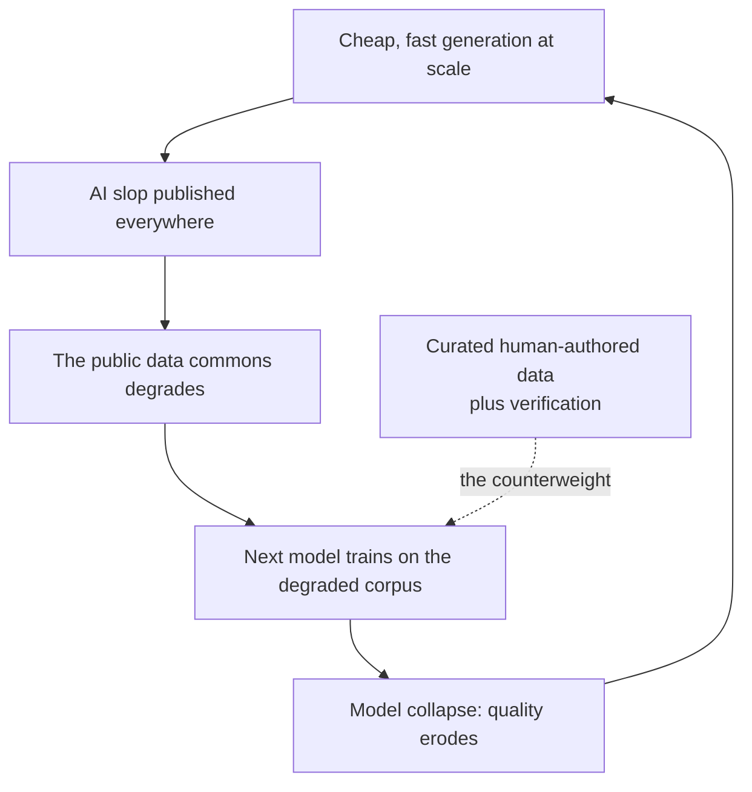
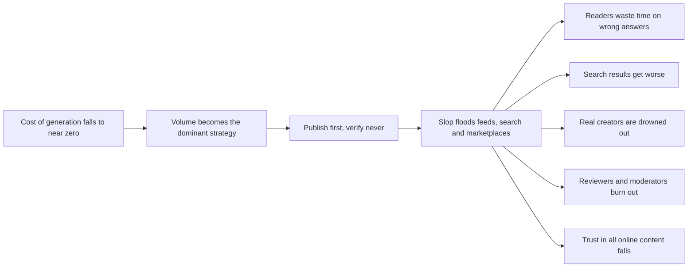
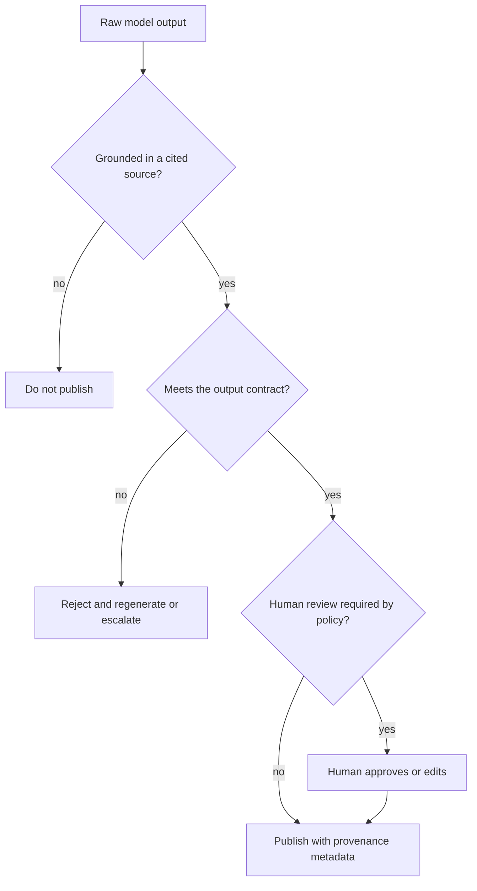
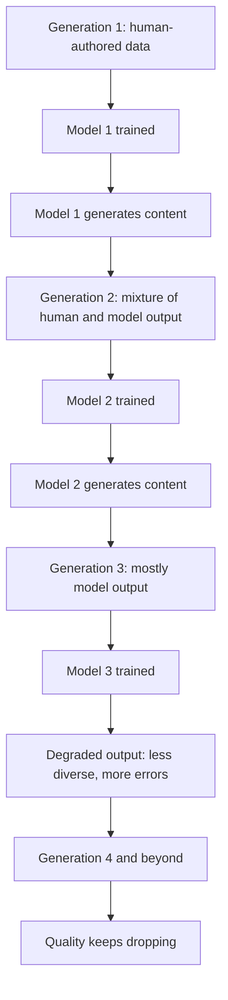
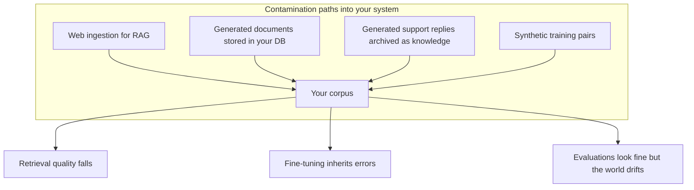
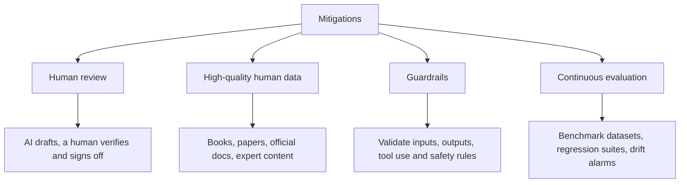
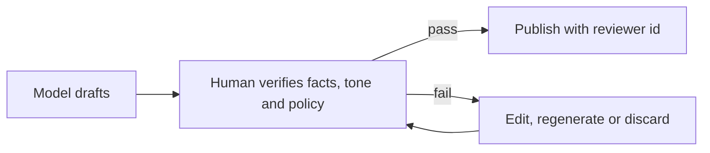
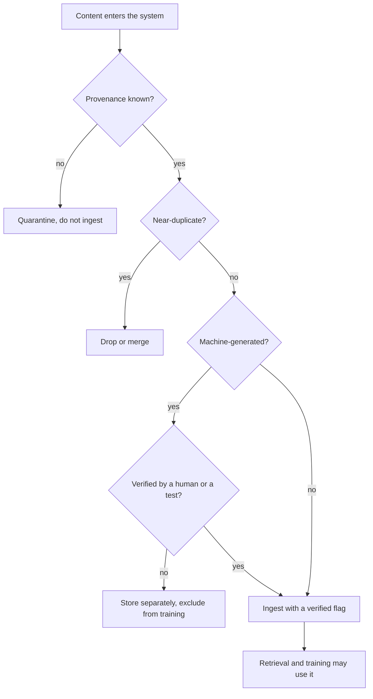

# Chapter 09 — AI Slop & Model Collapse

> **Lecture 04 · Chapter 09 of 09** · Level: 🟢 Beginner · Phase 2 — The Application Layer: Talking to Models
> **Source:** `gen-ai-cohort/week02/learning/day03/notes/04-structured-output-and-function-calling.md` (§5 AI Slop ·
> §6 Model Collapse · §7 mitigation strategies · the interview questions on both terms) ·
> `gen-ai-cohort/week02/learning/day03/notes/row-class.md` (mitigation topics)
> **Roadmap topics:** **AI slop** and **model collapse** — what they are and why they matter.

---

## 09.0 Why an API lecture ends with this chapter

Chapters 01–08 built a machine that converts money into text at scale. This chapter asks the uncomfortable
question that follows: **what happens when everyone has that machine?**

Two failure modes are already visible in the ecosystem, and both have direct engineering consequences:

- **AI slop** — the flood of low-quality, unverified generated content that degrades the public data commons and
  the trust of anyone reading it.
- **Model collapse** — the degradation of models trained on that flood, generation after generation.

Neither is a philosophical curiosity. Both are *data pipeline* problems, and you own data pipelines.

By the end of this chapter you should be able to:

1. Define AI slop and model collapse precisely, and distinguish them.
2. Trace where slop comes from and who is harmed.
3. Draw the recursive training loop that causes collapse, and explain what specifically degrades.
4. State the honest caveats — collapse is not inevitable, and why.
5. Explain why provenance, human review and evaluation are *engineering* requirements, not ethics footnotes.
6. Apply a mitigation checklist to your own product and to any fine-tuning dataset you touch.
7. Recognise slop-risk in your own output pipeline before it becomes a reputational or legal problem.

---

## 09.1 Two terms, side by side

| | **AI slop** | **Model collapse** |
| :--- | :--- | :--- |
| **What it is** | Large amounts of low-quality, repetitive or unverified AI-generated content published on the internet | Gradual degradation of model quality when newer models are trained primarily on AI-generated content instead of high-quality human-created data |
| **Where it lives** | The **data commons** (web, feeds, marketplaces, reviews, docs) | The **training pipeline** and therefore every downstream model |
| **Who feels it first** | Readers, searchers, and anyone doing research | Everyone using the next generation of models |
| **Timescale** | Immediate (days) | Generational (months to years) |
| **Root cause** | Cheap generation + volume incentives + no verification | Recursive learning without a human-data anchor or filtering |
| **Your lever** | Verification, provenance, publishing discipline | Data curation, filtering, evaluation, human-in-the-loop |

---

## 09.2 AI slop: where it comes from and who pays

**Definition.** AI slop is large amounts of low-quality, repetitive or unverified AI-generated content published
on the internet.

Typical forms:

| Form | Why it exists |
| :--- | :--- |
| **Fake blogs and SEO farms** | Search traffic monetised at near-zero production cost |
| **Spam articles and clickbait** | Volume beats quality in attention markets |
| **AI-generated comments and reviews** | Astroturfing, ranking manipulation, fake social proof |
| **Low-quality tutorials** | Plausible-looking instructions that were never executed |
| **Duplicated documentation** | Republished official docs with errors introduced |
| **Fabricated citations and references** | Confident text with invented sources |
| **Mass-generated product listings** | Catalogue padding to capture long-tail queries |

### The economic engine behind slop

Three incentives line up perfectly:

1. **Marginal cost ≈ 0.** Generating 1,000 articles costs a few dollars; writing one well costs hours.
2. **Volume pays.** Ranking, feeds and marketplaces reward quantity and recency, not correctness.
3. **Verification is the expensive step.** Executing the code, checking the citation, testing the recipe, reading
   the primary source — this is the part slop skips.

> [!IMPORTANT]
> **The engineering insight.** Slop is not a moral failure; it is a **pipeline with verification removed**. Which
> means the fix is also a pipeline fix: put verification back in, and make it cheap.

### Slop inside your own product

Slop does not only live on the public web. It appears inside products too:

| In-product symptom | Root cause |
| :--- | :--- |
| Confident but wrong summaries | No grounding, no source citation, no verification step |
| Generic filler in reports | Output contract missing (length, required facts, forbidden phrases) |
| Duplicate near-identical tickets or notes | No dedupe or similarity check before writing |
| "AI-generated" support replies nobody trusts | No human review gate, no quality signal |
| Knowledge base bloated with machine-written pages | Generated content published without curation |

> [!TIP]
> **Add provenance to everything you publish.** A machine-readable field recording the model, prompt version,
> timestamp and whether a human reviewed it costs almost nothing and makes downstream filtering possible — for you
> and for anyone training on that corpus.

---

## 09.3 Model collapse: the recursive loop

**Definition.** Model collapse is the gradual degradation of model quality when newer models are trained
primarily on AI-generated content instead of high-quality human-created data.

### What specifically degrades

| Dimension | What happens | Why |
| :--- | :--- | :--- |
| **Tail of the distribution** | Rare events, unusual phrasings and minority viewpoints disappear first | They are rarely sampled, so they are rarely re-learned |
| **Diversity** | Output becomes homogeneous; it collapses onto a few safe patterns | Repeated sampling concentrates probability mass |
| **Errors** | Mistakes are re-learned as if they were facts | There is no ground truth in the corpus to contradict them |
| **Reasoning quality** | Degrades as training text becomes plausible but unverified | Plausibility is not correctness |
| **Calibration** | Confidence stops tracking correctness | Models learn the style of certainty without the substance |
| **Variance** | The output distribution narrows — the "tails shrivel" | Recursive training on the model's own samples |

### The honest caveats

Collapse is a **risk**, not an inevitability. Four things change the outcome:

| Counterweight | Effect |
| :--- | :--- |
| **Accumulation vs replacement** | If each generation *adds* fresh human data instead of replacing it, the loop is broken |
| **Filtering and deduplication** | Removing machine-generated or duplicate content preserves the human signal |
| **Synthetic data with verification** | Synthetic data that is *checked* (tests pass, a solver confirms, a human reviews) behaves like high-quality data, not like slop |
| **Curated corpora and provenance** | Licensed books, papers, official docs and expert content as an anchor set — and metadata that makes filtering possible at all |

> [!NOTE]
> **Why "synthetic data is bad" is the wrong lesson.** Synthetic data with a *verification signal* — unit tests, a
> formal checker, a retrieval-grounded fact, a human review — is one of the most useful training resources we have.
> The failure mode is **unverified synthetic data recursively reused**, which is precisely what slop is.

---

## 09.4 Why this matters to you as a builder

Three direct consequences land on your desk:

1. **Your inputs get dirtier.** If your RAG corpus ingests the open web, a growing fraction of it is
   machine-generated and unverified. Retrieval quality depends on **corpus hygiene** (Lectures 16–18).
2. **Your outputs may become someone else's training data.** If you publish unverified generated content at scale,
   you are contributing to the problem — and you may be liable for what it claims.
3. **Your fine-tuning data may be contaminated.** If you fine-tune on transcripts, tickets or documents that were
   themselves generated, you inherit their errors and lose their diversity.

| Practice | Why it protects you |
| :--- | :--- |
| **Provenance metadata on every document** | You can filter by origin (human, model, model+review) |
| **Ingestion allowlists** | Only trusted sources enter the corpus |
| **Deduplication at ingest** | Removes the most common slop signature: near-identical pages |
| **Human review gates for published content** | Verification is where quality is created |
| **Separate "generated" from "verified" in storage** | Retrieval and training can treat them differently |
| **Continuous evaluation against a human-written anchor set** | Detects drift that aggregate metrics hide |

> [!IMPORTANT]
> **The FDE framing.** You cannot control the open web, but you can control **your** pipeline. Provenance, curation
> and evaluation are the three controls that keep slop out of your system and your system out of the slop.

---

## 09.5 Mitigation strategies

The source notes list four families of mitigation. Here they are, extended with the engineering detail that makes
each one real.

### 1 · Human review

| Design decision | Guidance |
| :--- | :--- |
| **Where the gate sits** | Before anything irreversible (publishing, sending, billing, deploying) |
| **What reviewers see** | The draft, the sources it used, and the prompt version |
| **Reviewer cost** | Cheapest on high-volume/low-risk content; mandatory on regulated or financial content |
| **Reviewer load** | Track it — reviewer fatigue is how slop passes review |
| **Feedback capture** | Edits and rejections are your best eval data (Lecture 30) |

### 2 · High-quality human data

Prefer **curated sources** over whatever the crawler happened to find:

| Source class | Why it is a good anchor |
| :--- | :--- |
| Books and long-form journalism | Edited, fact-checked, diverse in style |
| Research papers and standards | Precise language, verifiable claims |
| Official documentation and changelogs | Ground truth for APIs and behaviour |
| Verified educational content | Structured explanations with known provenance |
| Expert-written articles and internal runbooks | Domain knowledge that is not on the public web |
| Human-reviewed transcripts and tickets | Real user language plus a quality signal |

### 3 · Guardrails

Validate at every boundary — the four the source notes name, plus where each belongs:

| Guardrail | Validates | Where it lives |
| :--- | :--- | :--- |
| **Input validation** | Shape, size, injection attempts | Middleware (chapter 08) |
| **Output validation** | Schema, length, forbidden content, grounding | Service layer (chapters 03, 08) |
| **Tool-use validation** | Allowlisted tools, parameter ranges, permissions | Tool registry (Lecture 08) |
| **Safety rules** | Policy categories, PII, regulated content | Platform guardrails (Lecture 31) |

### 4 · Continuous evaluation

| Practice | Cadence | Signal it protects |
| :--- | :--- | :--- |
| **Regression suite on a golden set** | Every prompt/model change | Format and behaviour regressions |
| **Human-scored sample** | Weekly | Quality drift that automated metrics miss |
| **Human-authored anchor set** | Quarterly | Diversity and coverage — the first things collapse |
| **Truncation and error-rate alarms** | Continuous | Silent quality failures |
| **Corpus hygiene report** | Monthly | Rising share of generated/unverified content in retrieval |

> [!TIP]
> **Keep a "human anchor" set and never let a model write it.** A few hundred human-authored examples with known
> correct answers is the cheapest insurance against both quality drift and diversity loss.

---

## 09.6 Anti-slop checklist for your own pipeline

- [ ] Every ingested document carries **provenance** (source, author type, timestamp).
- [ ] Ingestion uses an **allowlist** of trusted sources, not "everything reachable".
- [ ] **Deduplication** runs at ingest, not after the corpus is already polluted.
- [ ] Generated content is **stored separately** from verified content, with an explicit flag.
- [ ] Nothing generated reaches a customer or the public without the **verification gate**.
- [ ] Any **fine-tuning or eval dataset** is filtered for machine-generated and duplicate rows.
- [ ] A **human-authored anchor set** exists and is version-controlled.
- [ ] Evaluation runs on every prompt or model change, with a recorded score.
- [ ] Published content carries **provenance metadata** so others can filter it.
- [ ] The team can answer "how much of our corpus is model-generated?" with a number.

---

## 09.7 Common mistakes

- **Treating slop as somebody else's problem.** Your RAG corpus and your knowledge base are slop vectors too.
- **Removing verification to increase throughput.** That is literally the definition of producing slop.
- **Fine-tuning on unverified generated data.** You are training on errors and losing diversity.
- **Assuming a bigger model fixes a contaminated corpus.** It retrieves the same garbage more fluently.
- **Judging quality by a single aggregate metric.** Tail diversity and calibration degrade before the average score
  moves.
- **Letting generated content into the "verified" bucket** because a human skimmed it once.
- **No provenance.** Without it, filtering and auditing are impossible.
- **Ignoring evaluation drift** because "nothing changed in the code". The world changed.
- **Publishing at scale with no review gate**, then discovering the liability after the fact.
- **Believing collapse is inevitable**, so nothing is worth doing. Accumulation, filtering and verified synthetic
  data all change the trajectory.
- **Believing collapse is impossible** because "models keep getting better". Those models are trained on curated
  data by teams who take this seriously.

---

## 09.8 Key takeaways

1. **AI slop** is low-quality, repetitive or unverified generated content flooding the commons; **model collapse**
   is the degradation that follows when models train on it.
2. **Slop is a pipeline with verification removed.** The remedy is to put verification back — human review, tests,
   grounding, schema validation.
3. **Collapse degrades the tail first:** rare events, diversity, calibration and variance go before the headline
   metric does.
4. **Collapse is a risk, not a fate.** Accumulation of fresh human data, filtering, deduplication and *verified*
   synthetic data all change the outcome.
5. **Your system has three contamination paths** — web ingestion, generated documents stored as knowledge, and
   synthetic training data. Guard all three.
6. **Provenance metadata is the enabling control** for every other mitigation; without it, filtering is impossible.
7. **Keep a human-authored anchor set** and evaluate against it continuously.
8. **The FDE responsibility sits upstream of the model:** curation, verification, evaluation and publishing
   discipline are engineering work, not ethics decoration.

---

## 09.9 Self-check questions

1. Define AI slop and model collapse in one sentence each, and state the difference in timescale.
2. Give four examples of slop and the incentive that produces each.
3. Explain why "verification is the expensive step" is the core economic fact about slop.
4. Draw the recursive training loop and mark where a human-data anchor breaks it.
5. Which properties of a model degrade first in collapse, and why is the *tail* the first casualty?
6. Give three reasons collapse is not inevitable.
7. When is synthetic data useful rather than harmful? Name the ingredient that makes the difference.
8. List three ways machine-generated content can enter *your* corpus, and one control for each.
9. Why is a single aggregate quality metric insufficient to detect collapse-style degradation?
10. Write five items from the anti-slop checklist you would implement first in an existing product, and justify the
    order.

---

### Navigation

- **Previous:** [Chapter 08 — Building the Service](./08_Building_the_Service_Express_TypeScript_Config_Singletons_and_Telemetry.md)
- **Complete notes:** [Lecture_04_Complete_Notes.md](./Lecture_04_Complete_Notes.md)
- **Source:** `gen-ai-cohort/week02/learning/day03/notes/04-structured-output-and-function-calling.md` (§5–§7) ·
  `row-class.md`
- **Back to index:** [../index.md](../index.md)