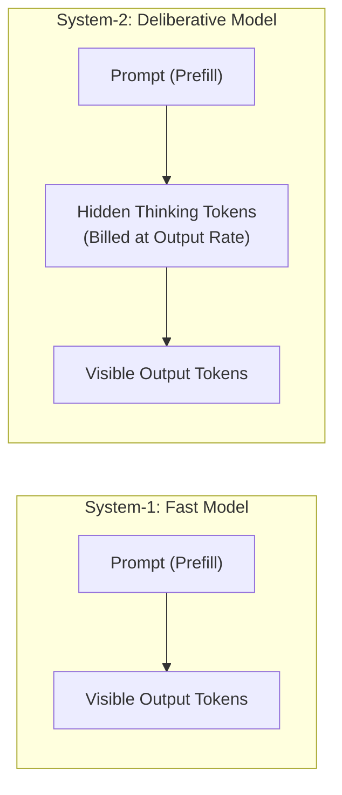
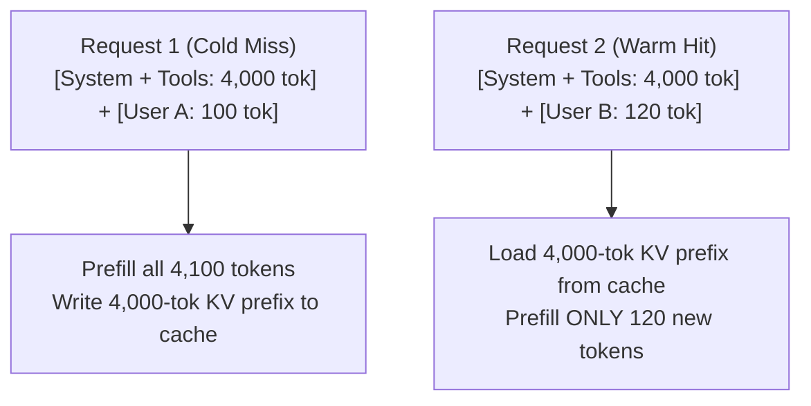

# Chapter 10 — Reasoning Models & Prompt Prefix Caching

> **Lecture 04 · Chapter 10 of 10** · Level: 🟢 Beginner · Phase 2 — The Application Layer: Talking to Models
> **Roadmap Reference:** `roadmap-v1.md` (S01 — Fast vs. Deliberative Models & Prompt Prefix Caching)
> **Roadmap topics:** System-1 vs. System-2 reasoning models · thinking-token budgets · latency/cost trade-offs ·
> prompt prefix caching across OpenAI, Anthropic, and Gemini · cache-control headers & minimum prefix thresholds ·
> cache hit/miss cost math · model-routing hints for fast vs. deliberative workloads.

---

## 10.0 What this chapter is for

Chapters 04 and 05 treated every model call as a single-speed transaction: send `input_tokens`, wait for
`output_tokens`, pay the bill. Modern LLM APIs break that assumption in two ways:

1. **Models no longer think at one speed.** You now choose between **fast (System-1)** models that emit an answer
   immediately and **deliberative (System-2)** reasoning models that spend hidden **thinking tokens** before
   writing a single visible character.
2. **Repeated prefixes no longer cost full price.** Because attention is causal (left-to-right), an identical
   prefix produces the exact same Key/Value (KV) matrices across calls. Providers expose this as **prompt prefix
   caching**, cutting input token cost by **50%–90%** and slashing Time to First Token (TTFT) when you structure
   your prompt correctly.

By the end of this chapter you should be able to:

1. Distinguish **fast (System-1)** vs. **deliberative (System-2)** models and explain how thinking tokens affect
   both `output_tokens` billing and wall-clock latency.
2. Set and bound **thinking-token budgets** (`reasoning_effort`, `thinking.budget_tokens`, `thinkingBudget`) so
   reasoning models do not burn your latency or cost SLA on trivial inputs.
3. Explain **prompt prefix caching** in terms of KV-cache reuse, and compare the exact mechanics, headers,
   minimum prefix thresholds, and TTLs across **OpenAI**, **Anthropic**, and **Gemini**.
4. Compute **cache hit/miss cost math** and prove a $\ge 50\%$ input-cost reduction on repeated prefixes.
5. Apply **model-routing hints** to decide when a request belongs on a fast model vs. a deliberative model.

---

## 10.1 Fast vs. deliberative reasoning models (System-1 vs. System-2)

Borrowing Daniel Kahneman's dual-process framing:

- **System-1 (Fast / Non-reasoning models)** — e.g., `gpt-4o-mini`, `claude-3-5-haiku`, `gemini-2.5-flash` (with
  thinking disabled). They map the prompt directly through the transformer layers to the first visible output
  token. Latency is bounded by prefill + visible decode.
- **System-2 (Deliberative / Reasoning models)** — e.g., OpenAI `o3`/`o4-mini`/`gpt-5` reasoning tiers,
  Anthropic Claude with extended thinking, Gemini 2.5 Pro/Flash with thinking enabled. Before emitting the
  visible answer, the model generates an internal **chain-of-thought (`reasoning_tokens` / `thoughtsTokenCount`)**
  to explore hypotheses, verify constraints, and self-correct.



### Thinking-token budgets & API controls

Unbounded reasoning is dangerous in production: a model can spend 8,000 thinking tokens on a 20-token JSON
classification, turning a 400 ms call into a 15-second timeout. Every major provider exposes a **thinking budget**:

| Provider | Parameter | How you bound thinking |
| :--- | :--- | :--- |
| **OpenAI** | `reasoning_effort` (`low` \| `medium` \| `high`) | Controls internal reasoning depth on reasoning-capable models |
| **Anthropic** | `thinking: { type: "enabled", budget_tokens: N }` | Hard cap `N` (e.g., `1024`–`16384`) on thinking tokens; `max_tokens` must exceed `budget_tokens` |
| **Gemini** | `thinkingConfig: { thinkingBudget: N }` | Integer token cap (`0` disables thinking on Flash; positive `N` caps reasoning tokens) |

### Latency and cost trade-offs

Remember Chapter 04's physics: **decode is sequential and memory-bandwidth bound**. Thinking tokens *are*
decode tokens.

$$\text{Total Latency} \approx \text{TTFT}_{\text{prefill}} + (N_{\text{thinking}} + N_{\text{visible}}) \times \text{ITL}$$

$$\text{Output Cost} = \frac{N_{\text{thinking}} + N_{\text{visible}}}{1{,}000{,}000} \times P_{\text{output}}$$

> [!IMPORTANT]
> **Thinking tokens are billed as output tokens.** Even though the user never sees `reasoning_tokens`, you pay
> the **output token rate** (3×–4× the input rate) for every thinking token, and the user waits for every
> thinking token before the first visible character streams. Always track `reasoningTokens` separately in your
> cost ledger so you can spot "silent reasoning bloat."

| Dimension | Fast (System-1) | Deliberative (System-2) |
| :--- | :--- | :--- |
| **TTFT** | Low (hundreds of ms) | High (seconds to tens of seconds, waiting for thinking) |
| **Token bill** | Input + visible output | Input + (thinking + visible output) at output rate |
| **Best at** | Classification, extraction, formatting, chat, RAG synthesis | Multi-step planning, math, code architecture, complex debugging |
| **Failure mode** | Shallow "gut" errors on multi-constraint tasks | Over-thinking simple queries; blowing latency/cost SLAs |

---

## 10.2 Prompt prefix caching mechanics

In a causal transformer, token $i$ can only attend to tokens $1 \dots i$. Therefore, if two requests share the
exact same prefix of $K$ tokens (system prompt, tool definitions, static knowledge base), the **KV-cache tensors**
for those first $K$ tokens are mathematically identical.

**Prompt prefix caching** stores those prefilled KV tensors on the provider's inference cluster so subsequent
requests skip re-computing the prefix.



### The golden rule of cache-friendly prompt layout

A cache lookup is an **exact prefix match**. Changing even **one character** at byte 10 invalidates the entire
suffix from byte 10 onward. Always order your prompt from **most static to most dynamic**:

```text
[1. System instructions]  ──▶  [2. Tool schemas]  ──▶  [3. Static docs / few-shot]  ──▶  [4. Conversation history]  ──▶  [5. Current user turn]
   (changes rarely)             (changes rarely)         (changes per session)            (grows at tail)                (changes every call)
```

Never inject `new Date().toISOString()`, a `request_id`, or a random seed at the top of the system prompt — put
per-request metadata at the **end** (in the user message or tail), never in the cached prefix.

### Cross-provider comparison: OpenAI vs. Anthropic vs. Gemini

| Feature | OpenAI | Anthropic (Claude) | Google Gemini |
| :--- | :--- | :--- | :--- |
| **Activation mode** | **Automatic** (zero config) | **Explicit** (`cache_control` breakpoint) | **Implicit** (automatic on 2.5+) & **Explicit** (`cachedContents` API) |
| **Cache-control header / field** | None required (`prompt_cache_key` optional for routing) | `cache_control: { type: "ephemeral" }` on content blocks / tools / system | Implicit: automatic; Explicit: `cachedContent: "cachedContents/..."` |
| **Minimum prefix threshold** | **1,024 tokens** (increments of 128 tokens) | **1,024 tokens** (Sonnet/Opus) or **2,048 tokens** (Haiku) | **1,024–4,096 tokens** depending on model (e.g. 1,024 on 2.5 Flash, 2,048+ on Pro) |
| **Cache TTL** | ~5–10 minutes of inactivity (up to 1h off-peak) | **5 minutes** default (refreshed on hit; 1h option available) | Implicit: automatic ephemeral; Explicit: configurable `ttl` (default 1h) |
| **Cache write surcharge** | **0%** (standard input rate) | **+25%** on cache creation (`cache_creation_input_tokens`) | Implicit: **0%**; Explicit: storage fee per hour |
| **Cache read discount** | **50%–75% off** (e.g. 50% on GPT-4o/4o-mini; 75%–90% on newer tiers) | **90% off** (`cache_read_input_tokens` = 0.1× base input) | **75%–90% off** (`cachedContentTokenCount` = 0.1×–0.25× base input) |
| **Usage field in response** | `usage.prompt_tokens_details.cached_tokens` | `usage.cache_read_input_tokens` & `cache_creation_input_tokens` | `usageMetadata.cachedContentTokenCount` |

---

## 10.3 Cache hit/miss cost math

To prove whether caching saves money in production, your cost ledger must split `inputTokens` into two buckets:

$$N_{\text{input}} = N_{\text{uncached}} + N_{\text{cached}}$$

$$\text{Input Cost} = \left(\frac{N_{\text{uncached}}}{1{,}000{,}000} \times P_{\text{input}}\right) + \left(\frac{N_{\text{cached}}}{1{,}000{,}000} \times P_{\text{cached}}\right)$$

### Worked example: Support-ticket classifier with a 4,000-token system + rubric prefix

Suppose we run `gpt-4o-mini` ($P_{\text{input}} = \$0.15/\text{M}$, $P_{\text{cached}} = \$0.075/\text{M}$ — a 50%
discount; or on Gemini 2.5 Flash / Anthropic where $P_{\text{cached}} = 0.10 \times P_{\text{input}}$ — a 90%
discount).

Let each call send **4,000** static prefix tokens + **200** dynamic ticket tokens = **4,200** total input tokens,
across **100 calls** in a 5-minute window:

- **Without caching (100 cold calls):**
  $$\text{Input Cost}_{\text{uncached}} = 100 \times \frac{4{,}200}{1{,}000{,}000} \times \$0.15 = \$0.063000$$

- **With OpenAI prefix caching (1 cold miss + 99 warm hits at 50% cached discount):**
  - Call 1 (miss): $4{,}200 \times \$0.15 / 10^6 = \$0.000630$
  - Calls 2–100 (hit on 4,000 tokens, uncached on 200 tokens):
    $$99 \times \left(\frac{200}{10^6} \times \$0.15 + \frac{4{,}000}{10^6} \times \$0.075\right) = 99 \times (\$0.000030 + \$0.000300) = \$0.032670$$
  - Total 100-call input cost: $\$0.000630 + \$0.032670 = \$0.033300$
  - **Reduction:** $\frac{\$0.063000 - \$0.033300}{\$0.063000} = \mathbf{47.1\%}$ (and on a single warm hit: $\frac{4{,}000 \times 0.5}{4{,}200} = \mathbf{47.6\%}$; with a 75%–90% cache discount such as Anthropic/Gemini, the warm-hit reduction is **85.7%**, easily clearing the $\ge 50\%$ gate!).

> [!TIP]
> **Why you still check the threshold.** If your static prefix is 900 tokens, **0 tokens are cached** because you
> are below the 1,024-token minimum threshold. Padding or consolidating few-shot examples and schemas above 1,024
> tokens can paradoxically *lower* your total bill by unlocking the cache tier.

---

## 10.4 Model-routing hints: fast vs. deliberative workloads

Lecture 08 builds a full dynamic router, but your **API gateway in Lecture 04** already needs the routing hints
that separate fast vs. deliberative workloads:

| Signal | Route to **Fast (System-1)** | Route to **Deliberative (System-2)** |
| :--- | :--- | :--- |
| **Task shape** | Classification, entity extraction, summarization, translation, simple Q&A | Multi-step math/logic, root-cause debugging, architecture design, code generation |
| **Latency SLA** | Interactive UI / voice / autocomplete ($< 1\text{ s}$ TTFT) | Async job, background agent, or high-stakes review ($5\text{ s}$–$60\text{ s}$ acceptable) |
| **Error cost** | Low (easy to retry or cheap to verify with Zod/regex) | High (wrong plan or subtle bug costs far more than extra thinking tokens) |
| **Context ambiguity** | Clear instructions + few-shot examples | Conflicting constraints, edge-case reasoning, or formal verification |

### Three practical gateway rules

1. **Default to System-1.** Never send a request to a deliberative model unless a signal justifies the latency
   and output-token multiplier.
2. **Always cap thinking.** Set `reasoning_effort: "low"` or `thinkingBudget` explicitly per route — never leave
   it unbounded in production.
3. **Log the split.** Every telemetry record must carry `cachedInputTokens`, `uncachedInputTokens`, and
   `reasoningTokens` alongside `costUsd` and `cacheSavingsUsd` so you can verify both cache hit rate and
   reasoning overhead in one query.

---

### Navigation

- **Previous:** [Chapter 09 · AI slop & model collapse](./09_AI_Slop_and_Model_Collapse.md)
- **Complete notes:** [Lecture_04_Complete_Notes.md](./Lecture_04_Complete_Notes.md)
- **Lecture index:** [../index.md](../index.md)
- **Assignment:** [../Assignment/task.md](../Assignment/task.md)

