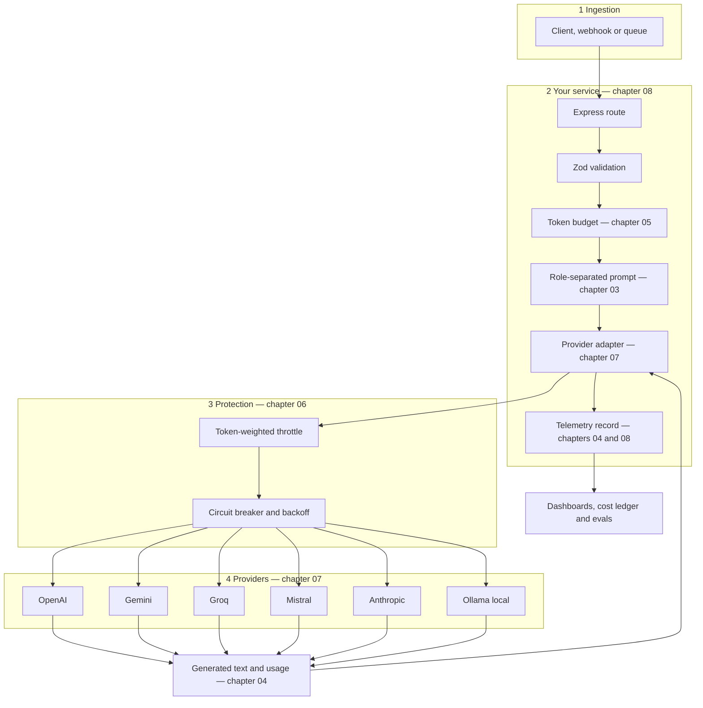
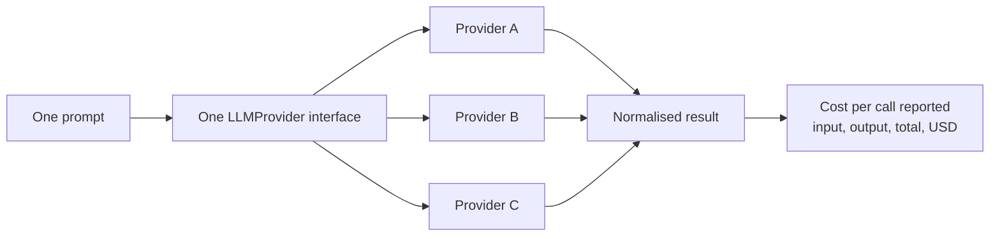

# Lecture 04 — Complete Notes
## LLM APIs, Multi-SDK Integration & Token Economics

> **Phase:** 2 · The Application Layer: Talking to Models · **Level:** 🟢 Beginner · **Prerequisites:** Lectures 02–03
> **Scope:** a single-pass consolidation of the nine chapter notes in this folder.
> **How to use this file:** read it to *revise and navigate*. It is deliberately shorter than the chapters, and
> every section links to the chapter that explains it in full.
>
> | Chapter | File |
> | :--- | :--- |
> | 01 · GenAI applications vs raw LLMs — the engine vs car model | [01_GenAI_Applications_vs_Raw_LLMs_The_Engine_vs_Car_Model.md](./01_GenAI_Applications_vs_Raw_LLMs_The_Engine_vs_Car_Model.md) |
> | 02 · The LLM API protocol — HTTP, the four invariant components & Postman | [02_The_LLM_API_Protocol_HTTP_Components_and_Postman.md](./02_The_LLM_API_Protocol_HTTP_Components_and_Postman.md) |
> | 03 · Message roles & prompt hygiene | [03_Message_Roles_and_Prompt_Hygiene.md](./03_Message_Roles_and_Prompt_Hygiene.md) |
> | 04 · Token economics — prefill vs decode, usage metadata, latency & cost | [04_Token_Economics_Prefill_Decode_Metadata_and_Cost.md](./04_Token_Economics_Prefill_Decode_Metadata_and_Cost.md) |
> | 05 · Token counting & context budgeting with tokenizers | [05_Token_Counting_and_Context_Budgeting_with_Tokenizers.md](./05_Token_Counting_and_Context_Budgeting_with_Tokenizers.md) |
> | 06 · Rate limits, quotas, throttling & retry/backoff | [06_Rate_Limits_Quotas_Throttling_and_Retry_Backoff.md](./06_Rate_Limits_Quotas_Throttling_and_Retry_Backoff.md) |
> | 07 · Multi-SDK integration — OpenAI · Gemini · Groq · Mistral · Claude · Ollama | [07_Multi_SDK_Integration_OpenAI_Gemini_Groq_Mistral_Anthropic_Ollama.md](./07_Multi_SDK_Integration_OpenAI_Gemini_Groq_Mistral_Anthropic_Ollama.md) |
> | 08 · Building the service — Express, TypeScript/ESM, Zod config, singletons & telemetry | [08_Building_the_Service_Express_TypeScript_Config_Singletons_and_Telemetry.md](./08_Building_the_Service_Express_TypeScript_Config_Singletons_and_Telemetry.md) |
> | 09 · AI slop & model collapse | [09_AI_Slop_and_Model_Collapse.md](./09_AI_Slop_and_Model_Collapse.md) |

---

## 1. Executive summary

**The lecture in ten sentences.**

1. An LLM is a *capability* and a GenAI application is a *system*: the engine supplies power, the vehicle supplies
   steering, brakes, fuel accounting, navigation, gauges and accessories — and as an FDE you build the vehicle,
   not the engine ([01](./01_GenAI_Applications_vs_Raw_LLMs_The_Engine_vs_Car_Model.md)).
2. Because the model is probabilistic, frozen at a training cutoff and blind to your systems, the **cardinal rule**
   is *the LLM only knows what reaches the LLM* — every expected capability becomes a concrete context-injection
   obligation ([01](./01_GenAI_Applications_vs_Raw_LLMs_The_Engine_vs_Car_Model.md)).
3. Talking to a model is an ordinary **HTTPS POST with a JSON body**, built from four invariant components —
   endpoint, authentication, model, input at transport level; `model`, `messages`, `params` and optional `tools` at
   payload level — which is why you prototype the wire in an API client before writing service code
   ([02](./02_The_LLM_API_Protocol_HTTP_Components_and_Postman.md)).
4. The `messages` array is where meaning *and* risk live: roles (`system`/`developer`, `user`, `assistant`, `tool`)
   form a **privilege hierarchy**, so instructions go in the system role and untrusted data in the user role —
   concatenating them is prompt injection, the LLM analogue of SQL injection
   ([03](./03_Message_Roles_and_Prompt_Hygiene.md)).
5. Tokens are the unit of billing, latency and capacity: **input tokens are prefilled in parallel and are
   compute-bound; output tokens are decoded sequentially and are memory-bandwidth bound** — which is why output
   costs 3–4× more and dominates latency ([04](./04_Token_Economics_Prefill_Decode_Metadata_and_Cost.md)).
6. You cannot manage what you cannot measure, so you **count tokens locally for decisions** and reconcile against
   the provider's `usage` for billing, budgeting in a fixed priority order: reserve output, then system and tools,
   then the user message, then retrieval, then history
   ([05](./05_Token_Counting_and_Context_Budgeting_with_Tokenizers.md)).
7. Providers enforce **RPM and TPM quotas** and answer with `429`, so a production client needs token-weighted
   throttling, timeouts, concurrency caps, circuit breakers and **exponential backoff with jitter** — plus a
   documented degradation ladder ([06](./06_Rate_Limits_Quotas_Throttling_and_Retry_Backoff.md)).
8. Portability comes from **one provider interface**: every vendor sits behind an adapter that normalises text,
   usage and finish reason, so switching provider becomes a configuration value — with a local runtime (Ollama) as
   just another adapter ([07](./07_Multi_SDK_Integration_OpenAI_Gemini_Groq_Mistral_Anthropic_Ollama.md)).
9. The service that ties it together is **configuration + validation + service + adapter + telemetry + secrets
   hygiene**, where every call produces one structured record carrying tenant, prompt id, model, tokens, cost,
   latency and finish reason ([08](./08_Building_the_Service_Express_TypeScript_Config_Singletons_and_Telemetry.md)).
10. Finally, scale has a cost beyond money: **AI slop** is a pipeline with verification removed, and **model
    collapse** is what happens when models train on it — so provenance, curation and continuous evaluation are
    engineering requirements ([09](./09_AI_Slop_and_Model_Collapse.md)).

**The one-line thesis, restated for this lecture:** *the model is a rented engine with a meter on it — your job is
to steer it, budget it, secure it, observe it, and keep the whole vehicle portable across suppliers.*

---

## 2. The lecture in one diagram



---

## 3. Cheat sheet

### 3.1 The request, in one block

```ts
// pseudo-code — every LLM call has exactly these four payload parts
{
  model,        // which engine: routing, price, context window
  messages,     // what it reads: system + history + user (roles matter)
  params,       // temperature, max_tokens, response_format, stream, seed
  tools,        // optional: what the model may ask you to execute
}
```

### 3.2 The four transport components

| # | Component | Question | Where |
| :---: | :--- | :--- | :--- |
| 1 | Endpoint | Where? | URL path, versioned |
| 2 | Authentication | Who? | `Authorization: Bearer <key>` |
| 3 | Model | Which engine? | Body (URL path for Gemini) |
| 4 | Input | What? | `messages` / `input` |

### 3.3 Roles

| Role | Written by | Trusted? | Contains |
| :--- | :--- | :---: | :--- |
| `system` / `developer` | You | Yes | Persona, task, output contract, scope, security rules |
| `user` | Anyone | **No** | Their request and their data, delimited |
| `assistant` | The model (replayed by you) | Medium | Prior answers; also used to steer |
| `tool` | Your code | Yes | Raw tool results inside a tool loop |

### 3.4 The two formulas that matter

$$\text{Total Cost} = \left( N_{\text{input}} \times P_{\text{input}} \right) + \left( N_{\text{output}} \times P_{\text{output}} \right)$$

$$\text{Total Latency} \approx \text{TTFT}(N_{\text{input}}) + \left( N_{\text{output}} \times \text{ITL} \right) + \Delta t_{\text{network}}$$

Also: $N_{\text{input}} + N_{\text{output}} \le C_{\text{max\_context}}$, and $P_{\text{output}} \approx 3\times$–$4\times P_{\text{input}}$.

### 3.5 Prefill vs decode

| | Input (prefill) | Output (decode) |
| :--- | :--- | :--- |
| Hardware | Compute-bound, parallel | Memory-bandwidth bound, sequential |
| Price | 1× | 3×–4× |
| Latency | small marginal cost | linear in token count |
| Lever | trim, retrieve, cache, dedupe | `max_tokens`, output contract, streaming |

### 3.6 Token estimates

| Text | Tokens |
| :--- | ---: |
| 1 token | ~4 English characters |
| 100 words | ~130 |
| 1 page | ~500–700 |
| 1,000 words | ~1,300 |
| Non-Latin script | 1–4 tokens **per character** |

### 3.7 Status codes

| Code | Meaning | Retry? |
| :---: | :--- | :---: |
| `400` / `422` | Bad payload | ❌ |
| `401` / `403` | Key or permission | ❌ |
| `404` | Unknown model | ❌ |
| `413` | Too large / context overflow | ❌ trim |
| `429` | Rate limit | ✅ backoff, honour `Retry-After` |
| `500` / `502` / `503` / `504` | Provider fault | ✅ backoff, then failover |
| `insufficient_quota` | Billing/access | ❌ escalate |

### 3.8 Provider call signatures

| Provider | Call | System prompt | Model |
| :--- | :--- | :--- | :--- |
| OpenAI | `chat.completions.create` | `system` role | body |
| Anthropic | `messages.create` | top-level `system` param | body |
| Gemini | `models.generateContent` | `config.systemInstruction` | argument and URL |
| Mistral | `chat.complete` | `system` role | body |
| Groq | `chat.completions.create` | `system` role | body |
| Ollama | `POST /api/generate` or `/v1/chat/completions` | `system` role | body |

### 3.9 Environment variables

```ini
PORT=8080
AI_PROVIDER=openai            # openai | anthropic | gemini | groq | mistral | ollama
AI_MODEL=gpt-5-mini
AI_TEMPERATURE=0.2
AI_MAX_TOKENS=400
OPENAI_API_KEY=sk-...
REQUEST_TIMEOUT_MS=30000
LOG_LEVEL=info
```

### 3.10 The per-call telemetry record

| Field group | Fields |
| :--- | :--- |
| Identity | `callId`, `tenantId`, `feature`, `promptId` |
| Route | `provider`, `model`, `routingReason` |
| Usage | `inputTokens`, `outputTokens`, `cachedTokens` |
| Money | `costUsd` (from a versioned price table) |
| Time | `ttftMs`, `totalMs` |
| Health | `finishReason`, `status`, `errorCode` |

---

## 4. Decision tables

### 4.1 Which access layer? ([chapter 07](./07_Multi_SDK_Integration_OpenAI_Gemini_Groq_Mistral_Anthropic_Ollama.md))

| Situation | Raw REST | Official SDK | Agent SDK / framework | Local runtime |
| :--- | :---: | :---: | :---: | :---: |
| Learning the protocol / debugging the wire | ✅ | – | – | – |
| Production app calling one model | – | ✅ | – | – |
| Multi-step tools, memory, RAG, agents | – | – | ✅ | – |
| Unusual platform, proxy or custom gateway | ✅ | ⚠️ | – | – |
| Privacy, offline, air-gapped | – | – | – | ✅ |
| Steady bulk load with cost sensitivity | – | ✅ | – | ✅ hybrid |
| Unpredictable traffic | – | ✅ | ✅ | ❌ |
| Prototyping prompts with no quota | – | – | – | ✅ |

### 4.2 Which model tier? ([chapter 02](./02_The_LLM_API_Protocol_HTTP_Components_and_Postman.md))

| Task profile | Start with | Escalate when |
| :--- | :--- | :--- |
| Classification, tagging, extraction, summarisation | Mini / efficient | Eval score below the bar on a **subset** |
| Routing, intent detection | Mini / efficient | Ambiguous cases only |
| Complex reasoning, multi-step logic, long-document synthesis | Flagship / reasoning | – |
| Regulated or financial output | Flagship + validation + human review | – |
| Latency-critical interactive | Fast small model, streamed | Only if quality fails |
| Bulk batch jobs | Cheapest passing model, async | – |

**Rule:** the cheapest model that **passes the eval** wins; escalate per-request, not globally.

### 4.3 Retry, or fail? ([chapter 06](./06_Rate_Limits_Quotas_Throttling_and_Retry_Backoff.md))

| Condition | Action | Notes |
| :--- | :--- | :--- |
| `429` | Retry with backoff + jitter | Honour `Retry-After` |
| `500` / `502` / `503` / `504` | Retry, then fail over | Cap attempts and total deadline |
| Socket timeout / reset | Retry if idempotent | The call may already be billed |
| `400` / `422` | Fail immediately | Fix the payload |
| `401` / `403` | Fail and alert | Key or permission problem |
| `404` | Fail immediately | Configuration bug |
| `413` | Fail; trim context | Budget problem (chapter 05) |
| `insufficient_quota` | Fail and escalate to a human | Not transient |
| Output empty or truncated | Fail the request, alert, do **not** silently return | Data-integrity issue |

### 4.4 Context strategy when the budget is exceeded ([chapter 05](./05_Token_Counting_and_Context_Budgeting_with_Tokenizers.md))

| Situation | Strategy | Preserves |
| :--- | :--- | :--- |
| Long chat, recent context matters | Sliding window (newest N turns) | Recency |
| Long chat, facts matter | Rolling summarisation of old turns | Facts, cheaply |
| Huge knowledge base | Retrieval (RAG) instead of stuffing | Relevance |
| Duplicated or noisy context | Semantic filtering and dedupe | Signal |
| One document larger than the window | Chunk-and-map, then combine | Coverage |
| Tools dominate the prompt | Dynamic tool loading by intent | Schema size |

**Never truncate:** the system prompt and the current user message.

### 4.5 Degradation ladder when the provider fails ([chapter 06](./06_Rate_Limits_Quotas_Throttling_and_Retry_Backoff.md))

| Rung | Behaviour | Acceptable for |
| :---: | :--- | :--- |
| 1 | Retry with backoff inside the deadline | Everything |
| 2 | Fall back to a cheaper/faster model on the same interface | Non-critical quality |
| 3 | Serve a cached or stale answer, labelled | Read-mostly features |
| 4 | Queue the job, return "accepted" | Batch and async work |
| 5 | Degrade the feature honestly (no summary + notice) | Interactive features |
| 6 | Clean error with a retry hint + alert | When nothing safe exists |

### 4.6 Local vs hosted ([chapter 07](./07_Multi_SDK_Integration_OpenAI_Gemini_Groq_Mistral_Anthropic_Ollama.md))

| Priority | Choose |
| :--- | :--- |
| Highest quality on hard reasoning | Hosted frontier model |
| Lowest cost per call at high volume | Hosted small model, or local at high utilisation |
| Data must not leave the boundary | Local, or a contractually suitable hosted provider |
| Offline / air-gapped | Local |
| Elastic capacity for spikes | Hosted |
| Fast prompt iteration with no quota | Local |

---

## 5. Misconceptions

| # | The misconception | The correction | Chapter |
| :---: | :--- | :--- | :---: |
| 1 | "ChatGPT *is* the model." | ChatGPT is an application; the model is one dependency inside it. | [01](./01_GenAI_Applications_vs_Raw_LLMs_The_Engine_vs_Car_Model.md) |
| 2 | "The API remembers my conversation." | Every request is stateless; you resend history. | [03](./03_Message_Roles_and_Prompt_Hygiene.md) |
| 3 | "The model can look up current data." | It has no live I/O; your service injects facts. | [01](./01_GenAI_Applications_vs_Raw_LLMs_The_Engine_vs_Car_Model.md) |
| 4 | "The model can do arithmetic." | It predicts plausible digit sequences; use a tool. | [01](./01_GenAI_Applications_vs_Raw_LLMs_The_Engine_vs_Car_Model.md) |
| 5 | "The model knows today's date." | Inject the timestamp and timezone. | [01](./01_GenAI_Applications_vs_Raw_LLMs_The_Engine_vs_Car_Model.md) |
| 6 | "Talking to an LLM needs a special protocol." | It is an HTTPS POST with JSON. | [02](./02_The_LLM_API_Protocol_HTTP_Components_and_Postman.md) |
| 7 | "The model name is the same everywhere." | Identifiers, tiers and even locations differ per provider. | [02](./02_The_LLM_API_Protocol_HTTP_Components_and_Postman.md) |
| 8 | "Provider defaults are sensible for production." | Defaults drift; set `temperature` and `max_tokens` explicitly. | [02](./02_The_LLM_API_Protocol_HTTP_Components_and_Postman.md) |
| 9 | "Roles are just labels." | They are a privilege hierarchy trained into the model. | [03](./03_Message_Roles_and_Prompt_Hygiene.md) |
| 10 | "A good system prompt makes injection impossible." | Role separation raises the bar; layer output validation and least privilege. | [03](./03_Message_Roles_and_Prompt_Hygiene.md) |
| 11 | "You can hand-build the chat prompt string." | Chat templates and control tokens are model-specific; use the roles array. | [03](./03_Message_Roles_and_Prompt_Hygiene.md) |
| 12 | "Input and output tokens cost the same." | Output is typically 3–4× the input price. | [04](./04_Token_Economics_Prefill_Decode_Metadata_and_Cost.md) |
| 13 | "Long outputs are the slow part because of network." | Decode is sequential and memory-bound; output length dominates latency. | [04](./04_Token_Economics_Prefill_Decode_Metadata_and_Cost.md) |
| 14 | "The response is just text." | It also carries `usage`, `finish_reason`, model and id — keep them. | [04](./04_Token_Economics_Prefill_Decode_Metadata_and_Cost.md) |
| 15 | "If it fits in the context window, send it." | Bigger contexts cost more, run slower and reduce accuracy. | [05](./05_Token_Counting_and_Context_Budgeting_with_Tokenizers.md) |
| 16 | "Token counts are word counts." | Sub-word tokens; ~4 characters per token in English only. | [05](./05_Token_Counting_and_Context_Budgeting_with_Tokenizers.md) |
| 17 | "One tokenizer works for every model." | Counts are tokenizer-specific; calibrate per provider. | [05](./05_Token_Counting_and_Context_Budgeting_with_Tokenizers.md) |
| 18 | "Rate limits are about requests per minute." | TPM usually binds first; throttle on tokens. | [06](./06_Rate_Limits_Quotas_Throttling_and_Retry_Backoff.md) |
| 19 | "Just retry on failure." | Retry only transient errors, with jitter, capped attempts and a deadline. | [06](./06_Rate_Limits_Quotas_Throttling_and_Retry_Backoff.md) |
| 20 | "A queue solves overload." | If arrivals exceed service rate, the queue grows forever — shed or scale. | [06](./06_Rate_Limits_Quotas_Throttling_and_Retry_Backoff.md) |
| 21 | "Using an SDK causes lock-in." | Importing a vendor SDK *inside business logic* causes lock-in; adapters fix it. | [07](./07_Multi_SDK_Integration_OpenAI_Gemini_Groq_Mistral_Anthropic_Ollama.md) |
| 22 | "All providers return the same JSON." | Text paths, usage names and finish-reason enums differ. | [07](./07_Multi_SDK_Integration_OpenAI_Gemini_Groq_Mistral_Anthropic_Ollama.md) |
| 23 | "Local models are free." | You pay in hardware, electricity, throughput limits and ops. | [07](./07_Multi_SDK_Integration_OpenAI_Gemini_Groq_Mistral_Anthropic_Ollama.md) |
| 24 | "You can put the API key in the frontend if it is obfuscated." | Anything shipped to a browser is public. | [08](./08_Building_the_Service_Express_TypeScript_Config_Singletons_and_Telemetry.md) |
| 25 | "Synthetic data is always harmful." | Verified synthetic data is valuable; *unverified* recursive reuse is the problem. | [09](./09_AI_Slop_and_Model_Collapse.md) |

---

## 6. Glossary

| Term | Meaning | Chapter |
| :--- | :--- | :---: |
| **AI slop** | Large amounts of low-quality, repetitive or unverified AI-generated content published online | [09](./09_AI_Slop_and_Model_Collapse.md) |
| **Agent SDK** | A framework adding tools, memory, multi-step reasoning and RAG patterns on top of a model client | [07](./07_Multi_SDK_Integration_OpenAI_Gemini_Groq_Mistral_Anthropic_Ollama.md) |
| **Assistant message** | The role holding the model's own prior output, replayed to maintain continuity | [03](./03_Message_Roles_and_Prompt_Hygiene.md) |
| **Backoff, exponential** | Increasing the wait between retries geometrically so a throttled service can recover | [06](./06_Rate_Limits_Quotas_Throttling_and_Retry_Backoff.md) |
| **BPE (Byte-Pair Encoding)** | The algorithm that builds a sub-word vocabulary by repeatedly merging the most frequent token pair | [05](./05_Token_Counting_and_Context_Budgeting_with_Tokenizers.md) |
| **Cardinal rule** | *The LLM only knows what reaches the LLM* — context injection is the application's obligation | [01](./01_GenAI_Applications_vs_Raw_LLMs_The_Engine_vs_Car_Model.md) |
| **Chat template** | The provider-side rendering of the messages array into one control-token-delimited string | [03](./03_Message_Roles_and_Prompt_Hygiene.md) |
| **Context window** | The maximum number of tokens (input plus output) a model can attend to in one call | [05](./05_Token_Counting_and_Context_Budgeting_with_Tokenizers.md) |
| **Control token** | A special token marking structure, for example the start of a system or user turn | [03](./03_Message_Roles_and_Prompt_Hygiene.md) |
| **Cost per call** | $N_{\text{in}}P_{\text{in}} + N_{\text{out}}P_{\text{out}}$, computed locally from a versioned price table | [04](./04_Token_Economics_Prefill_Decode_Metadata_and_Cost.md) |
| **Decode phase** | The sequential, memory-bandwidth-bound generation of output tokens | [04](./04_Token_Economics_Prefill_Decode_Metadata_and_Cost.md) |
| **Degradation ladder** | The ordered set of fallbacks used when a provider is throttled or unavailable | [06](./06_Rate_Limits_Quotas_Throttling_and_Retry_Backoff.md) |
| **Developer role** | A newer application-authority role, complementing or replacing `system` | [03](./03_Message_Roles_and_Prompt_Hygiene.md) |
| **Engine vs car** | The analogy: the LLM is the engine; the GenAI application is the complete vehicle | [01](./01_GenAI_Applications_vs_Raw_LLMs_The_Engine_vs_Car_Model.md) |
| **Finish reason** | Why generation stopped — `stop`, `length`, `content_filter`, `tool_calls` | [04](./04_Token_Economics_Prefill_Decode_Metadata_and_Cost.md) |
| **Idempotency key** | A client-supplied identifier that makes a retry safe by deduplicating effects | [06](./06_Rate_Limits_Quotas_Throttling_and_Retry_Backoff.md) |
| **ITL / TPOT** | Inter-token latency, or time per output token — the cost of each decoded token | [04](./04_Token_Economics_Prefill_Decode_Metadata_and_Cost.md) |
| **KV cache** | The stored key/value tensors that make sequential decoding possible and consume GPU memory | [04](./04_Token_Economics_Prefill_Decode_Metadata_and_Cost.md) |
| **Model collapse** | Quality degradation when newer models train mainly on AI-generated rather than human-created data | [09](./09_AI_Slop_and_Model_Collapse.md) |
| **Model tier** | A position on the cost/latency/quality frontier — flagship, mini/efficient, specialised | [02](./02_The_LLM_API_Protocol_HTTP_Components_and_Postman.md) |
| **Multilingual token tax** | The extra tokens and cost non-Latin scripts incur under older tokenizers | [05](./05_Token_Counting_and_Context_Budgeting_with_Tokenizers.md) |
| **Output tokens** | Newly generated tokens; billed 3–4× the input price and the dominant latency term | [04](./04_Token_Economics_Prefill_Decode_Metadata_and_Cost.md) |
| **Prefill phase** | The parallel, compute-bound processing of all input tokens before generation begins | [04](./04_Token_Economics_Prefill_Decode_Metadata_and_Cost.md) |
| **Prompt injection** | Untrusted text being interpreted as instructions; the LLM analogue of SQL injection | [03](./03_Message_Roles_and_Prompt_Hygiene.md) |
| **Prompt version** | A stable identifier for a prompt plus the model and parameters it was tested with | [03](./03_Message_Roles_and_Prompt_Hygiene.md) |
| **Provenance** | Metadata recording where content came from and whether a human verified it | [09](./09_AI_Slop_and_Model_Collapse.md) |
| **RPM / TPM** | Requests per minute and tokens per minute quota ceilings | [06](./06_Rate_Limits_Quotas_Throttling_and_Retry_Backoff.md) |
| **Role separation** | Putting instructions in `system` and untrusted data in `user` as a security boundary | [03](./03_Message_Roles_and_Prompt_Hygiene.md) |
| **SDK** | A typed convenience wrapper over the provider's HTTP API; contains no model intelligence | [07](./07_Multi_SDK_Integration_OpenAI_Gemini_Groq_Mistral_Anthropic_Ollama.md) |
| **System message** | The application-authority role holding persona, task, output contract and security rules | [03](./03_Message_Roles_and_Prompt_Hygiene.md) |
| **TTFT** | Time to first token; dominated by network, tokenisation and prefill of the input | [04](./04_Token_Economics_Prefill_Decode_Metadata_and_Cost.md) |
| **Token budget** | The enforced allocation of the context window across system, tools, retrieval, history and output | [05](./05_Token_Counting_and_Context_Budgeting_with_Tokenizers.md) |
| **Tool message** | The role carrying raw tool output inside a function-calling loop | [03](./03_Message_Roles_and_Prompt_Hygiene.md) |
| **`usage`** | The provider's token accounting fields on a response, used for billing reconciliation | [04](./04_Token_Economics_Prefill_Decode_Metadata_and_Cost.md) |
| **User message** | The role carrying untrusted human or third-party input | [03](./03_Message_Roles_and_Prompt_Hygiene.md) |

---

## 7. Twenty self-check questions

1. State the cardinal rule and derive three obligations for a service that answers questions about customer
   accounts. ([01](./01_GenAI_Applications_vs_Raw_LLMs_The_Engine_vs_Car_Model.md))
2. Give four automotive parts and their GenAI analogues, one sentence each.
   ([01](./01_GenAI_Applications_vs_Raw_LLMs_The_Engine_vs_Car_Model.md))
3. Name the four transport components and the four payload components of an LLM request.
   ([02](./02_The_LLM_API_Protocol_HTTP_Components_and_Postman.md))
4. Walk the request lifecycle in eight steps and name one failure at each of the first five.
   ([02](./02_The_LLM_API_Protocol_HTTP_Components_and_Postman.md))
5. Which three parameters would you set explicitly on day one, and what does each protect?
   ([02](./02_The_LLM_API_Protocol_HTTP_Components_and_Postman.md))
6. Explain why the API being stateless forces you to build a memory system.
   ([03](./03_Message_Roles_and_Prompt_Hygiene.md))
7. Write the two-line diff that turns a vulnerable concatenated prompt into a role-separated one.
   ([03](./03_Message_Roles_and_Prompt_Hygiene.md))
8. Give four defences against prompt injection beyond role separation, and say where each lives.
   ([03](./03_Message_Roles_and_Prompt_Hygiene.md))
9. Why do output tokens cost more than input tokens? Answer in terms of hardware.
   ([04](./04_Token_Economics_Prefill_Decode_Metadata_and_Cost.md))
10. A service runs 40,000 calls/day at 800 input and 150 output tokens, \$0.25/M in and \$1.00/M out. Compute the
    monthly cost. ([04](./04_Token_Economics_Prefill_Decode_Metadata_and_Cost.md))
11. In the 10-page incident report, why is input 97% of tokens but output 95% of latency?
    ([04](./04_Token_Economics_Prefill_Decode_Metadata_and_Cost.md))
12. Name six sources of input tokens in a RAG service that also uses tools.
    ([05](./05_Token_Counting_and_Context_Budgeting_with_Tokenizers.md))
13. Write the budget priority order and say which fragments must never be truncated.
    ([05](./05_Token_Counting_and_Context_Budgeting_with_Tokenizers.md))
14. Your local token estimate is consistently 4% below `usage.prompt_tokens`. What do you do, and why?
    ([05](./05_Token_Counting_and_Context_Budgeting_with_Tokenizers.md))
15. Construct a scenario where RPM is fine but TPM is exceeded, and give two fixes.
    ([06](./06_Rate_Limits_Quotas_Throttling_and_Retry_Backoff.md))
16. Write the backoff formula and explain the role of jitter in one sentence.
    ([06](./06_Rate_Limits_Quotas_Throttling_and_Retry_Backoff.md))
17. Classify as retryable or not: `429`, `400`, `503`, `404`, `insufficient_quota`, socket timeout.
    ([06](./06_Rate_Limits_Quotas_Throttling_and_Retry_Backoff.md))
18. Draw the adapter pattern and explain why `services/` must not import a vendor SDK.
    ([07](./07_Multi_SDK_Integration_OpenAI_Gemini_Groq_Mistral_Anthropic_Ollama.md))
19. List eight fields in the per-call telemetry record and the question each one answers.
    ([08](./08_Building_the_Service_Express_TypeScript_Config_Singletons_and_Telemetry.md))
20. Define AI slop and model collapse, and name three controls that keep both out of your pipeline.
    ([09](./09_AI_Slop_and_Model_Collapse.md))

---

## 8. The completion gate, and how to use these notes

**The gate.** *One codebase that can answer the same prompt through **three different providers** with a **single
interface**, and reports **token cost per call**.*



| Gate element | Where it is taught | How to prove it |
| :--- | :--- | :--- |
| One interface, three providers | [07](./07_Multi_SDK_Integration_OpenAI_Gemini_Groq_Mistral_Anthropic_Ollama.md) | A config change swaps provider; no service code edited |
| Cost per call reported | [04](./04_Token_Economics_Prefill_Decode_Metadata_and_Cost.md), [05](./05_Token_Counting_and_Context_Budgeting_with_Tokenizers.md) | The response includes tokens and computed USD from a versioned price table |
| Safe prompt | [03](./03_Message_Roles_and_Prompt_Hygiene.md) | System/user separation plus an adversarial fixture in the test suite |
| Reliable under load | [06](./06_Rate_Limits_Quotas_Throttling_and_Retry_Backoff.md) | Backoff, timeouts, concurrency caps and a degradation ladder |
| Observable | [08](./08_Building_the_Service_Express_TypeScript_Config_Singletons_and_Telemetry.md) | One structured record per call, plus the eight-panel dashboard |
| Honest about data | [09](./09_AI_Slop_and_Model_Collapse.md) | Provenance, a verification gate and an eval against a human anchor set |

**Suggested revision path.**

1. Read the executive summary above (about 10 minutes).
2. Read the cheat sheet and the decision tables (about 15 minutes).
3. Skim the misconceptions table and tick the ones you *used* to believe (about 10 minutes).
4. Answer the 20 self-check questions; open the linked chapter only for the ones you cannot answer (about 40
   minutes).
5. Build the service in `code/` and run the gate end to end.

---

### Navigation

- **Chapter 01:** [GenAI applications vs raw LLMs](./01_GenAI_Applications_vs_Raw_LLMs_The_Engine_vs_Car_Model.md)
- **Chapter 09:** [AI slop & model collapse](./09_AI_Slop_and_Model_Collapse.md)
- **Lecture index:** [../index.md](../index.md)
- **Workspace README:** [../README.md](../README.md)
- **Roadmap:** [../../roadmap.md](../../roadmap.md)
- **Source notes:** `Forward-Deployed-Engineer/Lecture 03/notes/01…07` ·
  `gen-ai-cohort/week01/learning/day01/notes/` · `gen-ai-cohort/week02/learning/day03/notes/`