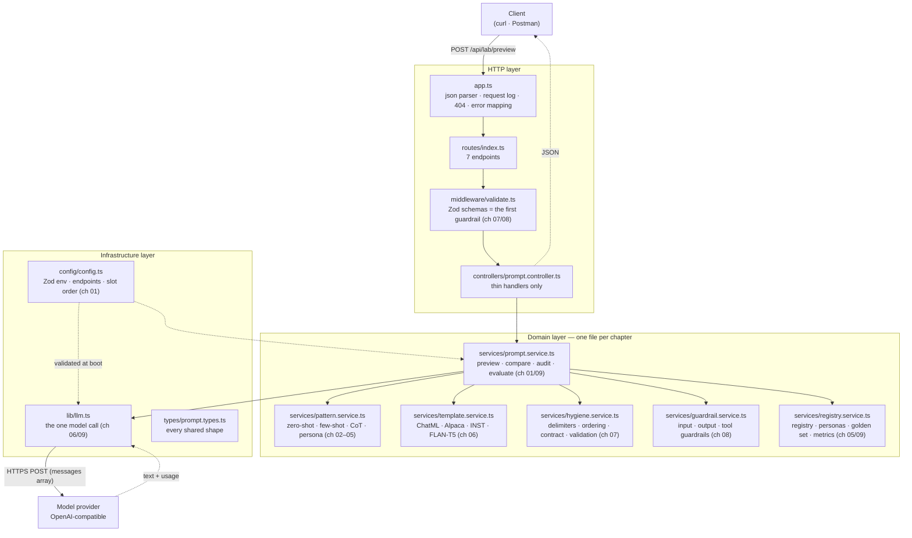
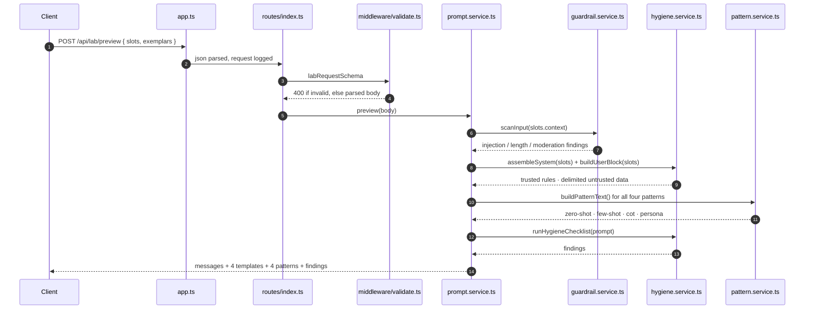
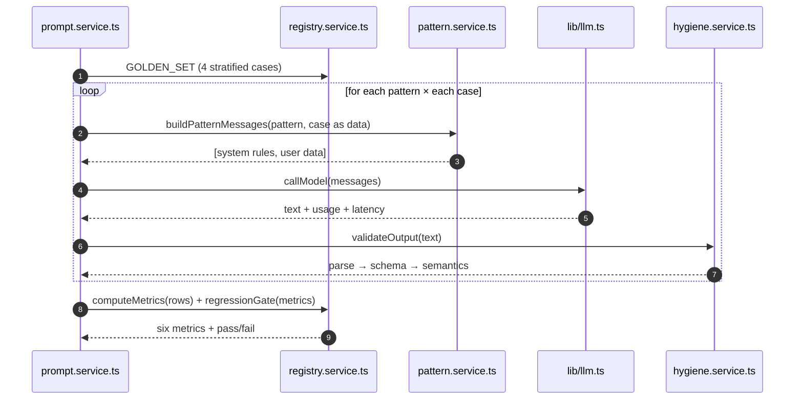

# Chapter 00: Overview, Architecture & File Structure

> **Chapter goal:** understand *what* this codebase is, *why* it is deliberately small, how a request travels
> through it, and which file belongs to which notes chapter — before reading a line of code.

---

## 0.1 What this codebase is

This is the **minimum working service** that proves the Lecture 05 notes. It is the roadmap's **prompt-pattern
lab**: the same task solved with zero-shot / few-shot / CoT / persona, with a comparison table and a stored prompt
registry.

| Rule followed | Why |
| :--- | :--- |
| One chapter → one file | You can read the code for chapter 07 without reading the routing layer |
| No abstraction until needed twice | `assembleSystem()` exists because four builders need it — nothing else does |
| Configuration validated once, at boot | A bad `.env` must not become a 3 a.m. incident (chapter 08) |
| Every comment names its chapter | The code is *evidence* for the notes, not a second curriculum |

**What it is not:** no database, no auth, no streaming, no tool-calling loop, no RAG, no vector store. Those belong
to later lectures. Here we only answer: *what exactly do I send, how do I keep it safe, and how do I know a change
helped?*

---

## 0.2 Architecture



Read the diagram as three bands:

1. **HTTP layer** — knows about requests, status codes and JSON. It knows *nothing* about prompts.
2. **Domain layer** — knows about slots, patterns, contracts, findings and metrics. It knows *nothing* about Express.
3. **Infrastructure layer** — knows about the network, the environment and the model provider.

---

## 0.3 File structure

```text
code/Basic Code/
├── .env                    # your local values (git-ignored)
├── .env.example            # the template — copy this to .env
├── .gitignore
├── package.json
├── package-lock.json
├── tsconfig.json
├── src/
│   ├── server.ts                       # boot + endpoint banner
│   ├── app.ts                          # express app, request log, 404, error mapping
│   ├── config/
│   │   └── config.ts                   # ch 01 — Zod env, endpoints, slot order
│   ├── types/
│   │   └── prompt.types.ts             # every shared type (slots, exemplar, persona, metrics…)
│   ├── lib/
│   │   └── llm.ts                      # ch 06/09 — the single model call
│   ├── middleware/
│   │   └── validate.ts                 # ch 07/08 — Zod request schemas + validateBody
│   ├── routes/
│   │   └── index.ts                    # 7 endpoints
│   ├── controllers/
│   │   └── prompt.controller.ts        # thin handlers
│   └── services/
│       ├── pattern.service.ts          # ch 02–05 — the four techniques + craft-rule checks
│       ├── template.service.ts         # ch 06 — the four chat templates
│       ├── hygiene.service.ts          # ch 07 — delimiters, contract, validation ladder
│       ├── guardrail.service.ts        # ch 08 — input/output/tool guardrails
│       ├── registry.service.ts         # ch 05/09 — personas, registry, golden set, metrics
│       └── prompt.service.ts           # ch 01/09 — orchestration (the loop)
└── implementations guide/
    ├── 00_Overview_and_File_Structure.md      ← you are here
    ├── 01_Project_Setup_Config_and_Types.md
    ├── 02_Zero_Shot_and_Few_Shot_Patterns.md
    ├── 03_Chain_of_Thought_and_Persona.md
    ├── 04_Chat_Templates.md
    ├── 05_Prompt_Hygiene_and_Output_Contract.md
    ├── 06_Guardrails_and_Injection_Defence.md
    ├── 07_Prompt_Registry_Golden_Set_and_Metrics.md
    ├── 08_Prompt_Service_Controllers_Routes_and_Server.md
    └── 09_End_to_End_Verification.md
```

---

## 0.4 Which file belongs to which notes chapter

| Notes chapter | Files |
| :--- | :--- |
| 01 · Discipline | `config/config.ts` (slot order) · `hygiene.assembleSystem()` · `prompt.service.ts` |
| 02 · Zero-shot | `pattern.buildZeroShot()` |
| 03 · Few-shot + ICL | `pattern.buildFewShot()` · `pattern.checkExemplars()` (the four craft rules) |
| 04 · CoT | `pattern.buildCot()` |
| 05 · Persona | `pattern.renderPersona()` · `registry.PERSONAS` |
| 06 · Chat templates | `template.service.ts` · `lib/llm.ts` (why we send messages, not strings) |
| 07 · Hygiene | `hygiene.service.ts` (whole file) · `middleware/validate.ts` |
| 08 · Guardrails | `guardrail.service.ts` (whole file) |
| 09 · Versioning & evals | `registry.service.ts` (whole file) · `prompt.service.ts` |

---

## 0.5 The life of one request

`POST /api/lab/preview` — no model call, so it exercises chapters 01–07 in one shot:



`POST /api/lab/compare` adds the model call and the metrics:



---

## 0.6 Commands you will need

```bash
# from: code/Basic Code/
cp .env.example .env      # then put a real key in it (optional — see chapter 09)
npm install               # installs express, zod, dotenv, openai
npm run typecheck         # tsc --noEmit
npm run build             # tsc → dist/
npm run dev               # tsx watch src/server.ts
```

> [!TIP]
> **Five of the seven endpoints work with no API key at all.** `/api/health`, `/api/prompts`,
> `/api/prompts/:id`, `/api/lab/preview` and `/api/audit` never touch a provider, so you can study chapters
> 01–08 with zero spend. Only `/api/lab/compare` and `/api/eval/run` need a model.

---

### Navigation

- **Next:** [Chapter 01 — Project Setup, Config & Types](./01_Project_Setup_Config_and_Types.md)
- **Notes:** [../../notes/01_Prompt_Engineering_as_an_Engineering_Discipline.md](../../../notes/01_Prompt_Engineering_as_an_Engineering_Discipline.md)

