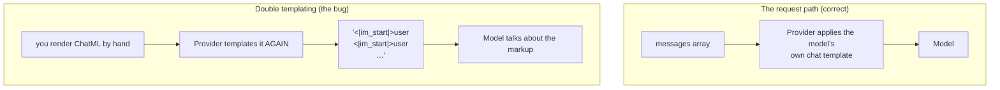

# Chapter 04: Chat Templates

> **Chapter goal:** render the four chat templates the notes name — ChatML, Alpaca, `[INST]`, FLAN-T5 — so you can
> *see* the token sequence the model actually receives, and understand why the request path sends `messages`
> instead.
> **Notes chapter covered:** 06 (model-specific formats, chat templates, generation prompt, double templating).

---

## 4.1 Files created in this chapter

| File | Purpose |
| :--- | :--- |
| `src/services/template.service.ts` | the four renderers + the generation prompt |
| `src/lib/llm.ts` | **starts here** (referenced) — the one place that explains why we send `messages`, not strings |

---

## 4.2 Why this file exists but is not on the request path

Chapter 06 §06.8 warns about **double templating**: sending a pre-templated string to a chat API that templates it
again. The symptom is that the model sees role markers as *content* and starts talking about the markup.



So the design is:

| Path | What it uses | Why |
| :--- | :--- | :--- |
| **Request path** | `buildPatternMessages()` → `callModel(messages)` | The provider owns templating (chapter 06 §06.6) |
| **Inspection path** | `renderAll(messages)` in `/api/lab/preview` | You need to *see* the sequence to debug a format problem |

That is why `template.service.ts` is imported by `prompt.service.ts` (for the preview) but **never** by
`lib/llm.ts` (the request).

---

## 4.3 `src/services/template.service.ts` (full file)

```ts
import type { ChatFormat, ChatTurn } from '../types/prompt.types.js';

/**
 * Chapter 06 — chat templates.
 *
 * IMPORTANT: a `messages` array never reaches the transformer. A chat template
 * serialises it into a model-specific token sequence first. The renderers below
 * exist so you can SEE that sequence while debugging — they are **not** used on
 * the request path, because sending a pre-templated string to a chat API is the
 * "double templating" bug (chapter 06 §06.8).
 */

/** Chapter 06 §06.3 — the generation prompt: the marker that invites the assistant's turn. */
export const GENERATION_PROMPT = '<|im_start|>assistant';

/** Chapter 06 §06.5 — ChatML: explicit role boundaries around every turn. */
export const renderChatMl = (turns: ChatTurn[]): string =>
  `${turns.map((t) => `<|im_start|>${t.role}\n${t.content}\n<|im_end|>`).join('\n')}\n${GENERATION_PROMPT}`;

/** Chapter 06 §06.5 — Alpaca: Instruction / Input / Response. There is no role concept. */
export const renderAlpaca = (turns: ChatTurn[]): string => {
  const system = turns.filter((t) => t.role === 'system').map((t) => t.content).join('\n');
  const user = turns.filter((t) => t.role === 'user').map((t) => t.content).join('\n');
  const assistant = turns.filter((t) => t.role === 'assistant').map((t) => t.content).join('\n');

  // The system prompt is folded into the instruction — that is the Alpaca weakness.
  return `### Instruction:\n${[system, user].filter(Boolean).join('\n\n')}\n\n### Input:\n\n### Response:\n${assistant}`;
};

/** Chapter 06 §06.5 — Llama 2 INST: the <<SYS>> block is valid only at the start, once. */
export const renderInst = (turns: ChatTurn[]): string => {
  const system = turns.filter((t) => t.role === 'system').map((t) => t.content).join('\n');
  const rest = turns.filter((t) => t.role !== 'system');

  const body = rest
    .map((t) => (t.role === 'user' ? `[INST]\n${t.content}\n[/INST]` : t.content))
    .join('\n');

  return system ? `<<SYS>>\n${system}\n<</SYS>>\n\n${body}` : body;
};

/** Chapter 06 §06.5 — FLAN-T5: the instruction IS the prefix; text-to-text, no roles. */
export const renderFlan = (turns: ChatTurn[]): string =>
  turns
    .filter((t) => t.role !== 'assistant')
    .map((t) => t.content)
    .join('\n\n');

/** Chapter 06 §06.5 — all four, side by side, for the debugging endpoint. */
export const renderAll = (turns: ChatTurn[]): Record<ChatFormat, string> => ({
  chatml: renderChatMl(turns),
  alpaca: renderAlpaca(turns),
  inst: renderInst(turns),
  flan: renderFlan(turns),
});
```

---

## 4.4 Block by block

**`GENERATION_PROMPT`** — chapter 06 §06.3's "generation prompt": the trailing marker that tells the model *your
turn starts here*. Forgetting it is the classic hand-rolled-template bug — the model continues the user's text
instead of answering. It is exported so the preview can show it explicitly.

**`renderChatMl`** — ChatML, the format with **explicit role boundaries around every turn**:

| Part | Meaning |
| :--- | :--- |
| `<\|im_start\|>${t.role}` | Opens a turn and names the role |
| `\n${t.content}\n` | The turn's content, on its own lines |
| `<\|im_end\|>` | Closes the turn |
| `.join('\n')` | Turns are newline-separated |
| `+ '\n' + GENERATION_PROMPT` | The generation prompt, appended once at the end |

This is the format the notes call the most unambiguous: extensible (a tool call is just another block) and easy to
parse — at the cost of verbosity.

**`renderAlpaca`** — `### Instruction / ### Input / ### Response`, the Stanford Alpaca format.

The important block is the comment: **the system prompt is folded into the instruction**.
`[system, user].filter(Boolean).join('\n\n')` merges the two because Alpaca has **no role concept at all**. That is
its weakness — and the reason it is a poor fit for anything multi-turn.

`### Input:` is emitted empty on purpose: in Alpaca the `Input` section is for a *second* piece of data, and our
data already lives inside the instruction. Emitting the empty header keeps the shape the model was trained on.

**`renderInst`** — Llama 2's `[INST] … [/INST]` with an optional `<<SYS>> … <</SYS>>` block.

| Line | Why |
| :--- | :--- |
| `turns.filter((t) => t.role !== 'system')` | The system turn is handled separately, because `<<SYS>>` is only valid **at the start, once** |
| `t.role === 'user' ? \`[INST]\n…\n[/INST]\` : t.content` | Only user turns get instruction delimiters; assistant turns are replayed as plain text |
| `system ? \`<<SYS>>…<</SYS>>\n\n${body}\` : body` | The system block is emitted only when one exists — an empty `<<SYS>>` block confuses the model |

**`renderFlan`** — FLAN-T5: text-to-text, the instruction *is* the prefix.

`turns.filter((t) => t.role !== 'assistant')` drops assistant turns, then joins the rest with blank lines. There
are no delimiters at all — which is exactly the point: FLAN-T5 has no role concept, and inventing one would be
worse than emitting plain text.

**`renderAll`** — returns all four as a `Record<ChatFormat, string>`. The return type is what makes the preview
endpoint's `templates` field self-documenting, and what forces you to add a renderer for every new `ChatFormat`
member.

---

## 4.5 The same messages, four ways

Given this `ChatTurn[]` (produced by `buildPatternMessages`):

```ts
[
  { role: 'system', content: 'TASK:\nClassify the ticket.' },
  { role: 'user',   content: 'DATA:\n<data>\nMy card was charged twice.\n</data>' },
]
```

| Renderer | Output (abridged) |
| :--- | :--- |
| **ChatML** | `<\|im_start\|>system\nTASK:\n…\n<\|im_end\|>\n<\|im_start\|>user\nDATA:\n…\n<\|im_end\|>\n<\|im_start\|>assistant` |
| **Alpaca** | `### Instruction:\nTASK:\n…\n\nDATA:\n…\n\n### Input:\n\n### Response:\n` |
| **INST** | `<<SYS>>\nTASK:\n…\n<</SYS>>\n\n[INST]\nDATA:\n…\n[/INST]` |
| **FLAN-T5** | `TASK:\nClassify the ticket.\n\nDATA:\n<data>\nMy card was charged twice.\n</data>` |

Read the table as the chapter 06 lesson: **the same `messages` array produces four different token sequences**, and
a model trained on one of them will behave worse when handed another. That is why "I copied a ChatML prompt from a
blog into my Llama-2 model" is a real bug with no error message.

---

## 4.6 The request path: why `messages`, not strings

From `src/lib/llm.ts`:

```ts
/**
 * Chapter 06 §06.8 — we send a `messages` array and let the provider apply the
 * model's own chat template. Sending a pre-templated string instead is the
 * "double templating" bug, which is why `template.service.ts` renders templates
 * for inspection only.
 */
export const callModel = async (messages: ChatTurn[]): Promise<ModelResult> => {
  // Chapter 08 — fail with a clear reason instead of a confusing 401 from the provider.
  if (config.AI_PROVIDER !== 'ollama' && !config.AI_API_KEY) {
    throw Object.assign(
      new Error(`AI_PROVIDER=${config.AI_PROVIDER} requires its API key in .env. /api/lab/preview and /api/audit work without one.`),
      { status: 503 },
    );
  }

  const startedAt = Date.now();

  const response = await client.chat.completions.create({
    model: config.AI_MODEL,
    messages: messages as OpenAI.Chat.ChatCompletionMessageParam[],
    temperature: config.AI_TEMPERATURE,
    max_tokens: config.AI_MAX_TOKENS,
  });

  const choice = response.choices[0];

  return {
    text: choice?.message?.content?.trim() ?? '',
    inputTokens: response.usage?.prompt_tokens ?? 0,
    outputTokens: response.usage?.completion_tokens ?? 0,
    latencyMs: Date.now() - startedAt,
    model: response.model ?? config.AI_MODEL,
    finishReason: choice?.finish_reason ?? 'unknown',
  };
};
```

### Block by block

| Block | What it does |
| :--- | :--- |
| The credential guard | Chapter 08 — throws with `status: 503` and a message that names the working endpoints, instead of letting the provider return an opaque `401` |
| `startedAt = Date.now()` | Chapter 09 needs `latencyMs` for the `p95LatencyMs` metric |
| `messages: messages as …` | **The whole chapter in one line.** We pass the array, never a rendered string. The provider applies the model's own template |
| `temperature: config.AI_TEMPERATURE` | Pinned to `0` by default (chapter 02) so an evaluation measures the prompt, not the sampler |
| `response.usage?.prompt_tokens` | Chapter 09's cost metrics come straight from the provider, so no tokenizer library is needed |
| `choice?.finish_reason` | `'length'` means the answer was truncated — the signal chapter 04 §04.8 says to watch |

> [!TIP]
> **The debugging habit this chapter buys you.** When a model behaves inexplicably, print the templated string.
> In this lab that is one call to `/api/lab/preview` — the `templates` field shows all four renderings, and the
> `messages` field shows the array that is actually sent. Chapter 06's advice ("nine times out of ten you will see
> a missing generation prompt") becomes a five-second check instead of an afternoon.

---

## 4.7 Verify

```bash
npm run typecheck
```

```bash
curl -s -X POST http://localhost:8080/api/lab/preview \
  -H 'Content-Type: application/json' \
  -d '{"slots":{"task":"Classify the support ticket.","context":"My card was charged twice."}}' \
  | python3 -c "
import json, sys
d = json.load(sys.stdin)['data']
print('roles actually sent :', [m['role'] for m in d['messages']])
for name, text in d['templates'].items():
    print(f'--- {name} ---')
    print(text[:160].replace(chr(10), ' / '))
"
```

**What you should see:**

- `roles actually sent: ['system', 'user']` — the role separation from chapter 07.
- `chatml` ends with `<|im_start|>assistant` (the generation prompt).
- `inst` starts with `<<SYS>>` and contains `[INST]`.
- `alpaca` contains `### Instruction:` and an empty `### Input:`.
- `flan` has no delimiters at all.

---

### Navigation

- **Previous:** [Chapter 03 — Chain-of-Thought & Persona](./03_Chain_of_Thought_and_Persona.md)
- **Next:** [Chapter 05 — Prompt Hygiene & the Output Contract](./05_Prompt_Hygiene_and_Output_Contract.md)
- **Notes:** [../../notes/06_Model_Specific_Prompt_Formats_and_Chat_Templates.md](../../../notes/06_Model_Specific_Prompt_Formats_and_Chat_Templates.md)


