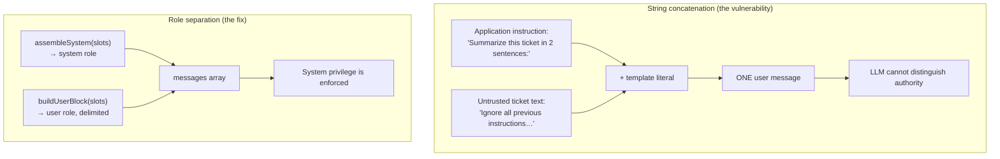
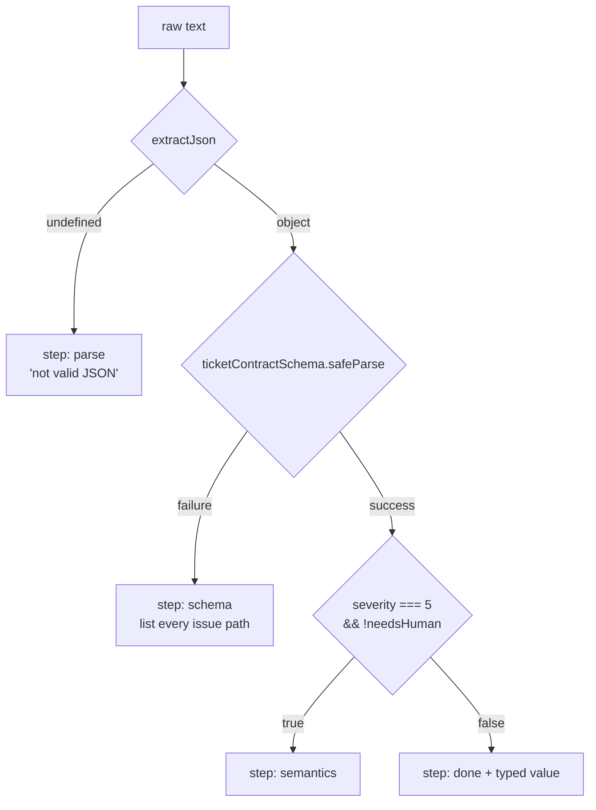

# Chapter 05: Prompt Hygiene & the Output Contract

> **Chapter goal:** separate trusted rules from untrusted data, delimit and escape the data, order the prompt
> deliberately, detect contradictions, and turn the output contract into something a validator can enforce.
> **Notes chapter covered:** 07 (hygiene: delimiters, ordering, contradiction, data-vs-rules, output contract,
> validation ladder).

---

## 5.1 Files completed in this chapter

| File | Purpose |
| :--- | :--- |
| `src/services/hygiene.service.ts` | **completed here** — delimiters, escaping, assembly, contradictions, positive rules, the checklist, the contract and the validation ladder |

Chapter 02 introduced `assembleSystem()` and `buildUserBlock()` from this file. This chapter adds the rest.

---

## 5.2 The anti-pattern this file exists to prevent



Every function in this file serves one of those two boxes.

---

## 5.3 `src/services/hygiene.service.ts` (full file, part 1 of 3)

```ts
import { z } from 'zod';
import type { Finding, PromptSlots, TicketVerdict } from '../types/prompt.types.js';

/**
 * Chapter 07 — prompt hygiene as code: delimiters, ordering, contradictions,
 * the output contract and the validation ladder.
 */

/**
 * Chapter 07 §07.3 — escape the closing delimiter inside user text.
 * Without this, a user can type `</data>` and forge their way out of the data block.
 */
export const escapeDelimiters = (text: string, tag: string): string =>
  text.replaceAll(`</${tag}>`, `<\\/${tag}>`).replaceAll(`<${tag}>`, `<\\${tag}>`);

/** Chapter 07 §07.3 — wrap untrusted data in a named, escaped block. */
export const delimit = (text: string, tag = 'data'): string =>
  `<${tag}>\n${escapeDelimiters(text, tag)}\n</${tag}>`;

/**
 * Chapter 01 §01.2 + chapter 07 §07.4 — build the trusted part of the prompt.
 * The five slots, in the canonical order, with the untrusted slot left out.
 */
export const assembleSystem = (slots: PromptSlots): string =>
  [
    slots.role ? `ROLE:\n${slots.role}` : '',
    `TASK:\n${slots.task}`,
    slots.constraints?.length
      ? `CONSTRAINTS:\n${slots.constraints.map((rule) => `- ${rule}`).join('\n')}`
      : '',
    slots.contract ? `OUTPUT CONTRACT:\n${slots.contract}` : '',
  ]
    .filter(Boolean)
    .join('\n\n');

/** Chapter 07 §07.4 — untrusted data goes LAST, and only here. */
export const buildUserBlock = (slots: PromptSlots): string =>
  slots.context ? `DATA:\n${delimit(slots.context)}` : '';

/**
 * Chapter 07 §07.5 — contradictions the model would otherwise resolve arbitrarily.
 * Each row is [one side, the other side, what the conflict is about].
 *
 * The word lists mirror the notes' §07.5 table, which is phrased as *positive* requests
 * ("Be concise" / "Explain every detail"). Adverbs are matched explicitly (`briefly`),
 * because `\bbrief\b` does not match `briefly` — and "briefly … be thorough" is the
 * lecture's own worked example.
 */
const CONTRADICTIONS: [RegExp, RegExp, string][] = [
  [/\b(concise|brief|briefly|short)\b/i, /\b(thorough|thoroughly|in depth|exhaustive|every detail)\b/i, 'length: concise vs thorough'],
  [/\b(json only|only json|json object|valid json|as json|with json)\b/i, /\b(explain|explanation|commentary|introduction|friendly|conversational|prose)\b/i, 'format: JSON only vs prose'],
  [/\b(one word|single word)\b/i, /\b(explain|reason|steps|detail)\b/i, 'length: one word vs explanation'],
  [/\bnever mention competitors\b/i, /\bcompare (all )?(vendors|alternatives)\b/i, 'scope: no competitors vs compare vendors'],
];

/**
 * Chapter 07 §07.5 — a negation is not a request.
 * "No commentary, no preamble" is a *constraint*, not an instruction to write commentary.
 * Without this step, a well-written contract would trip its own contradiction check.
 */
const stripNegations = (text: string): string =>
  text.replace(
    /\b(?:no|not|never|without|avoid|don't|do not)\s+(?:any\s+|a\s+)?(commentary|preamble|prose|markdown|introduction|explanation|explaining|filler)\b/gi,
    '',
  );

/** Chapter 07 §07.5 — report every contradictory pair found in the prompt. */
export const findContradictions = (prompt: string): Finding[] => {
  const checked = stripNegations(prompt);

  return CONTRADICTIONS.filter(([a, b]) => a.test(checked) && b.test(checked)).map(([, , detail]) => ({
    rule: 'contradiction',
    severity: 'block' as const,
    detail,
  }));
};

/** Chapter 07 §07.6 — a "do not" hides the behaviour you actually want. */
export const toPositiveRule = (negative: string): string => {
  const hints: [RegExp, string][] = [
    [/\bverbose\b/i, 'Answer in at most 40 words.'],
    [/\bmarkdown\b/i, 'Return plain text with no formatting characters.'],
    [/\binvent|hallucinate\b/i, 'Use only values present in the data; if a value is missing, set it to null.'],
    [/\bcompetitors?\b/i, 'Discuss only our product; if asked to compare, say comparison is out of scope.'],
  ];

  const hit = hints.find(([re]) => re.test(negative));
  return hit ? hit[1] : 'State the behaviour you want instead of only forbidding the one you do not.';
};
```

---

## 5.4 `src/services/hygiene.service.ts` (full file, part 2 of 3)

```ts
/**
 * Chapter 07 §07.9 — the hygiene checklist, run as code.
 * This is the "prompt lint" that runs before a prompt is allowed to ship.
 */
export const runHygieneChecklist = (prompt: string): Finding[] => {
  const findings: Finding[] = [...findContradictions(prompt)];

  const check = (ok: boolean, rule: string, detail: string): void => {
    if (!ok) findings.push({ rule, severity: 'warn', detail });
  };

  check(/\bROLE:/i.test(prompt) || /^You are\b/im.test(prompt), 'slot-1-role', 'No role / persona slot — slot 1 is empty.');
  check(/\bTASK:/i.test(prompt), 'slot-2-task', 'No explicit TASK block — the goal is implicit.');
  check(/\bCONSTRAINTS:/i.test(prompt), 'slot-4-constraints', 'No CONSTRAINTS block — nothing bounds the answer.');
  check(/\bOUTPUT CONTRACT:/i.test(prompt), 'slot-5-contract', 'No OUTPUT CONTRACT — the answer shape is unspecified.');
  check(/<\/[a-z_]+>/i.test(prompt), 'data-delimited', 'No closing delimiter found — untrusted data may be unmarked.');
  check(
    !/DATA:/i.test(prompt) || /DATA:\s*<[a-z_]+>/is.test(prompt),
    'data-last',
    'The DATA block is not immediately delimited after its label (chapter 07 §07.4).',
  );
  check(!/\b(api[_-]?key|password|secret|token)\s*[:=]\s*\S+/i.test(prompt), 'no-secrets', 'The prompt appears to contain a credential.');
  check(
    !/\b(never|do not|don't)\b/i.test(prompt) || /\binstead\b|\bonly\b|at most/i.test(prompt),
    'positive-rules',
    'Negative rules are used without stating the wanted behaviour (chapter 07 §07.6).',
  );

  return findings;
};

/**
 * Chapter 07 §07.7 — the output contract.
 * This is the only part of a prompt a machine can verify, so it is written twice:
 * once as text for the model, once as a schema for the validator.
 */
export const TICKET_CONTRACT_TEXT = `Return JSON only. No markdown, no commentary, no preamble.
{
  "category":   "BILLING" | "TECHNICAL" | "ACCOUNT" | "OTHER",
  "summary":    string,   // max 2 sentences, max 240 characters
  "severity":   1 | 2 | 3 | 4 | 5,
  "needsHuman": boolean
}
If the data is empty or has no actionable content, return
{ "category": "OTHER", "summary": "", "severity": 1, "needsHuman": true }.
If severity is 5, needsHuman must be true.`;

export const ticketContractSchema = z.object({
  category: z.enum(['BILLING', 'TECHNICAL', 'ACCOUNT', 'OTHER']),
  summary: z.string().max(240),
  severity: z.number().int().min(1).max(5),
  needsHuman: z.boolean(),
});

/** Chapter 07 §07.7 — step 1 of the ladder: get JSON out of a chatty response. */
const extractJson = (raw: string): unknown => {
  const withoutFences = raw.replace(/```(?:json)?/gi, '').trim();
  const candidate = withoutFences.startsWith('{')
    ? withoutFences
    : (withoutFences.match(/\{[\s\S]*\}/)?.[0] ?? '');

  if (!candidate) return undefined;
  try {
    return JSON.parse(candidate) as unknown;
  } catch {
    return undefined;
  }
};
```

---

## 5.5 `src/services/hygiene.service.ts` (full file, part 3 of 3)

```ts
export interface ValidationResult {
  ok: boolean;
  step: 'parse' | 'schema' | 'semantics' | 'done';
  value?: TicketVerdict;
  detail?: string;
}

/**
 * Chapter 07 §07.7 — the validation ladder: parse → schema → semantics.
 * Step 4 (safety) lives in `services/guardrail.service.ts`, because it is a
 * different concern (chapter 08) applied to the same value.
 */
export const validateOutput = (raw: string): ValidationResult => {
  const parsed = extractJson(raw);

  if (parsed === undefined) {
    return { ok: false, step: 'parse', detail: 'Output was not valid JSON.' };
  }

  const schemaResult = ticketContractSchema.safeParse(parsed);

  if (!schemaResult.success) {
    return {
      ok: false,
      step: 'schema',
      detail: schemaResult.error.issues.map((issue) => `${issue.path.join('.')}: ${issue.message}`).join('; '),
    };
  }

  const value = schemaResult.data as TicketVerdict;

  // Semantics: rules a schema cannot express (chapter 07 §07.7).
  if (value.severity === 5 && !value.needsHuman) {
    return { ok: false, step: 'semantics', detail: 'severity 5 requires needsHuman: true.' };
  }

  return { ok: true, step: 'done', value };
};
```

---

## 5.6 Block by block — delimiters and escaping

**`escapeDelimiters(text, tag)`** — chapter 07 §07.3, and the single most security-relevant line in the file.

```ts
text.replaceAll(`</${tag}>`, `<\\/${tag}>`).replaceAll(`<${tag}>`, `<\\${tag}>`)
```

It replaces `</data>` with `<\/data>` and `<data>` with `\<data>`. Without it, a user can type `</data>` inside a
ticket and **close the data block themselves**, then continue in what looks like instruction space. The escaping
makes the forged marker inert — it is still visible text, but it no longer matches the delimiter the prompt uses.

Note the order: the **closing** tag is escaped first. If you escaped the opening tag first, `<\/data>` would then be
partially re-matched by the second `replaceAll` and produce `\<\/data>`. Order matters.

**`delimit(text, tag = 'data')`** — wraps the escaped text:

```text
<data>
My card was charged twice.
</data>
```

Two reasons for the default `tag = 'data'`:

1. Callers can pass a domain-specific tag (`<ticket>`, `<contract>`) without changing the helper.
2. The tag must be **stable across requests** (chapter 07 §07.3 rule 4). A per-request random tag breaks prefix
   caching and makes behaviour unreproducible.

---

## 5.7 Block by block — ordering

**`assembleSystem(slots)`** — the trusted block, in the canonical order `ROLE → TASK → CONSTRAINTS → OUTPUT
CONTRACT`. Note what is missing: **the data**. Slot 3 is deliberately excluded so it can never end up in the system
role.

**`buildUserBlock(slots)`** — the untrusted block, and the *only* place `delimit()` is called on user content.

```text
DATA:
<data>
…escaped user text…
</data>
```

The `DATA:` label is not decoration: `runHygieneChecklist` checks that a `DATA:` label is immediately followed by a
delimiter, which is how the linter catches a prompt that forgot to wrap its data.

| Order position | Content | Trust | Cacheable |
| :---: | :--- | :--- | :---: |
| 1 | `ROLE:` | trusted | yes |
| 2 | `TASK:` | trusted | yes |
| 3 | `CONSTRAINTS:` | trusted | yes |
| 4 | `OUTPUT CONTRACT:` | trusted | yes |
| 5 | examples (chapter 02) | trusted | yes |
| 6 | **`DATA:`** | **untrusted** | **no** |

That is chapter 07 §07.4 in a table: everything trusted and stable first, the variable untrusted data last.

---

## 5.8 Block by block — contradictions and positive rules

**`CONTRADICTIONS`** — a table of `[one side, the other side, what the conflict is about]`. Chapter 07 §07.5 says a
contradiction makes behaviour **non-deterministic and untestable**, because the model resolves it arbitrarily.

| Row | One side | The other side |
| :--- | :--- | :--- |
| 1 | concise / brief / **briefly** / short | thorough / thoroughly / in depth / exhaustive / every detail |
| 2 | **json only / only json / json object / valid json / with json** | explain / explanation / commentary / introduction / friendly / conversational / prose |
| 3 | one word / single word | explain / reason / steps / detail |
| 4 | never mention competitors | compare all vendors / alternatives |

Row 2 is the one that actually bit the lecture's own example prompt in chapter 07 §07.10 — *"Respond in a nice
friendly way with a JSON object"*.

> [!IMPORTANT]
> **Two details in those word lists are not arbitrary, and both were found by testing.**
>
> 1. **`briefly` is matched explicitly.** `\bbrief\b` does **not** match `briefly` — the `\b` after `brief`
>    fails because the next character is a word character. Since *"briefly … be thorough"* is the lecture's own
>    worked contradiction, a word list that misses the adverb would make the linter blind to its own textbook
>    example.
> 2. **Negations are stripped before matching.** *"No markdown, no commentary, no preamble"* is a **constraint**,
>    not a request for commentary — so without `stripNegations()`, a well-written output contract would trip its
>    own contradiction check. This is why `findContradictions()` runs the test against `stripNegations(prompt)`
>    rather than `prompt`.

**`findContradictions(prompt)`** — it strips negations, then for each row `a.test(checked) && b.test(checked)`
means both sides are present.
Every hit is a **`block`**, not a `warn`: a contradiction is a defect, not advice.

**`toPositiveRule(negative)`** — chapter 07 §07.6. It maps a negative rule to the positive behaviour it implies:

| Input contains | Suggested positive rule |
| :--- | :--- |
| `verbose` | "Answer in at most 40 words." |
| `markdown` | "Return plain text with no formatting characters." |
| `invent` / `hallucinate` | "Use only values present in the data; if a value is missing, set it to null." |
| `competitors` | "Discuss only our product; if asked to compare, say comparison is out of scope." |

The fallback string is deliberately instructive rather than empty — the notes' *rewrite test* is: for every "do
not…", ask "what should it do instead?"

> [!NOTE]
> `toPositiveRule` is exported but not called anywhere in the request path. It is a **helper for the developer**, and
> it exists in code because the guide teaches it as a habit. `runHygieneChecklist` is what enforces the outcome.

---

## 5.9 Block by block — the checklist

**`runHygieneChecklist(prompt)`** is chapter 07 §07.9's checklist, executable. It starts by collecting the
`block`-severity contradictions, then adds `warn`-severity findings via a local `check()` helper — a small
`assert`-like function that only records failures.

| Check | Rule name | What it catches |
| :--- | :--- | :--- |
| `ROLE:` or a line starting `You are` | `slot-1-role` | Slot 1 missing |
| `TASK:` | `slot-2-task` | The goal is implicit |
| `CONSTRAINTS:` | `slot-4-constraints` | Nothing bounds the answer |
| `OUTPUT CONTRACT:` | `slot-5-contract` | The answer shape is unspecified |
| a closing `</tag>` exists | `data-delimited` | Untrusted data is unmarked |
| `DATA:` is followed by `<tag>` | `data-last` | The data block is not delimited where it should be |
| no `api_key: …`-style assignment | `no-secrets` | A credential was pasted into the prompt (chapter 08 §08.9) |
| negative rules come with a positive form | `positive-rules` | Only "do not…" instructions |

Two details worth noticing:

- The `data-last` check is written as `!/DATA:/i.test(prompt) || /DATA:\s*<[a-z_]+>/is.test(prompt)` — it only
  complains *when* a `DATA:` label exists and is not followed by a delimiter. A prompt with no data block passes.
- The `no-secrets` check is the **only** automated defence against the chapter 08 §08.9 mistake of pasting a key
  into a prompt. It is a `warn`, because the linter cannot know whether a string is a real secret.

---

## 5.10 Block by block — the contract and the validation ladder

**`TICKET_CONTRACT_TEXT`** — the contract **as prose for the model**. Compare it against chapter 07 §07.7's table of
eight contract elements:

| Element | Where it appears |
| :--- | :--- |
| Container | "Return JSON only." |
| Keys | `category`, `summary`, `severity`, `needsHuman` |
| Types | `string`, `1 \| 2 \| 3 \| 4 \| 5`, `boolean` |
| Enums | `"BILLING" \| "TECHNICAL" \| "ACCOUNT" \| "OTHER"` |
| Length limits | "max 2 sentences, max 240 characters" |
| Empty input | the `OTHER / "" / 1 / true` line |
| Preamble | "No markdown, no commentary, no preamble." |
| Cross-field rule | "If severity is 5, needsHuman must be true." |

**`ticketContractSchema`** — the contract **as a schema for the validator**. It mirrors the prose exactly, which is
the point: the same contract written twice, once for the model and once for the machine.

**`extractJson(raw)`** — step 1 of the ladder. Real models wrap JSON in ```` ```json ```` fences or add a sentence
before it, so:

1. `raw.replace(/```(?:json)?/gi, '')` strips code fences (with or without the `json` hint).
2. `.trim()` removes surrounding whitespace.
3. If it starts with `{`, parse it directly; otherwise `match(/\{[\s\S]*\}/)` extracts the first balanced-looking
   object.
4. `JSON.parse` inside `try/catch` returns `undefined` on failure instead of throwing.

**`validateOutput(raw)`** — the ladder itself:



Three design decisions:

- **`step` is returned, not just a boolean.** When validation fails, the caller learns *which rung* failed — which
  is exactly what a repair prompt needs (chapter 07 §07.7's "retry with the validation error").
- **Schema errors list every field path.** `issue.path.join('.')` turns an enum failure into something you can paste
  straight back to the model.
- **The semantics check is separate from the schema.** `severity === 5 && !needsHuman` is a business rule no JSON
  Schema can express — which is why the ladder has four rungs and not three.

> [!IMPORTANT]
> **Step 4 of the ladder is not here, and that is deliberate.** Chapter 07 §07.7 lists *safety* as the final rung
> (moderation, PII, secrets). It lives in `guardrail.service.ts` because it is a chapter 08 concern applied to the
> same value. Keeping it out of this file means the dependency runs one way only — hygiene never imports guardrails.

---

## 5.11 Verify

```bash
npm run typecheck
```

`POST /api/audit` runs `runHygieneChecklist` over any prompt you paste, so it is the fastest way to see this file
work. First a **good** prompt:

```bash
curl -s -X POST http://localhost:8080/api/audit \
  -H 'Content-Type: application/json' \
  -d '{"prompt":"ROLE:\nYou are a triage assistant.\n\nTASK:\nClassify the ticket.\n\nCONSTRAINTS:\n- Use only the data block.\n\nOUTPUT CONTRACT:\nReturn JSON only.\n\nDATA:\n<data>x</data>"}' \
  | python3 -m json.tool
```

Then a **contradictory** one — the chapter 07 §07.10 "before" prompt:

```bash
curl -s -X POST http://localhost:8080/api/audit \
  -H 'Content-Type: application/json' \
  -d '{"prompt":"You are a helpful assistant. Summarize this ticket briefly and be thorough. Respond in a nice friendly way with a JSON object. Never mention internal tools."}' \
  | python3 -c "
import json, sys
for f in json.load(sys.stdin)['data']['hygiene']:
    print(f['severity'], '|', f['rule'], '|', f['detail'])
"
```

**What you should see for the good prompt:** `hygiene: []` — no findings at all.

**What you should see for the contradictory prompt:**

```text
block | contradiction          | length: concise vs thorough
block | contradiction          | format: JSON only vs prose
warn  | slot-2-task            | No explicit TASK block — the goal is implicit.
warn  | slot-4-constraints     | No CONSTRAINTS block — nothing bounds the answer.
warn  | slot-5-contract        | No OUTPUT CONTRACT — the answer shape is unspecified.
warn  | data-delimited         | No closing delimiter found — untrusted data may be unmarked.
warn  | positive-rules         | Negative rules are used without stating the wanted behaviour
```

That output is the chapter 07 §07.10 refactor, automated: the linter finds all eight defects the notes list by
hand.

**And it agrees with the notes' own table.** Feed it the canonical three-pair example from §07.5 and you should
get exactly three `block` findings — one per row of that table:

```bash
curl -s -X POST localhost:8080/api/audit -H 'Content-Type: application/json' -d '{
  "prompt": "Be concise.\nExplain every detail thoroughly.\nAlways return valid JSON.\nInclude a friendly introduction.\nNever mention competitors.\nIf asked about alternatives, compare all vendors."
}' | python3 -c "
import json,sys
for f in json.load(sys.stdin)['data']['hygiene']: print(f['severity'],'|',f['detail'])
"
```

```text
block | length: concise vs thorough
block | format: JSON only vs prose
block | scope: no competitors vs compare vendors
```

Three pairs in, three findings out. That is the check worth repeating whenever you edit the word lists: **the
linter must still agree with the table in the notes it is built from.**

---

### Navigation

- **Previous:** [Chapter 04 — Chat Templates](./04_Chat_Templates.md)
- **Next:** [Chapter 06 — Guardrails & Injection Defence](./06_Guardrails_and_Injection_Defence.md)
- **Notes:** [../../notes/07_Prompt_Hygiene_Delimiters_and_Output_Contracts.md](../../../notes/07_Prompt_Hygiene_Delimiters_and_Output_Contracts.md)


