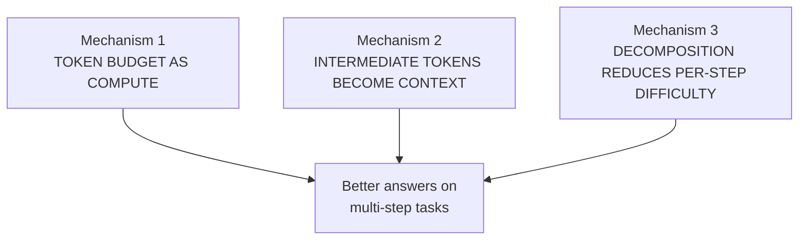
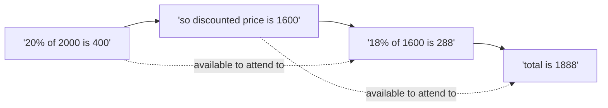
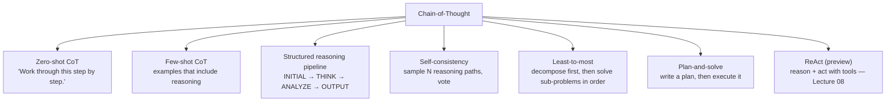
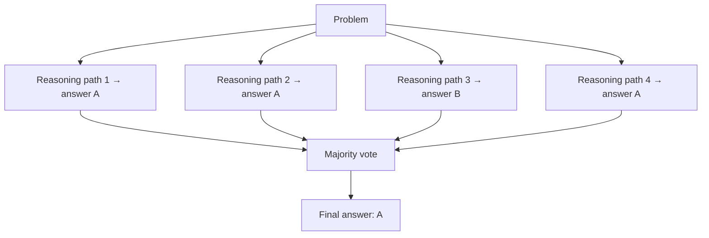
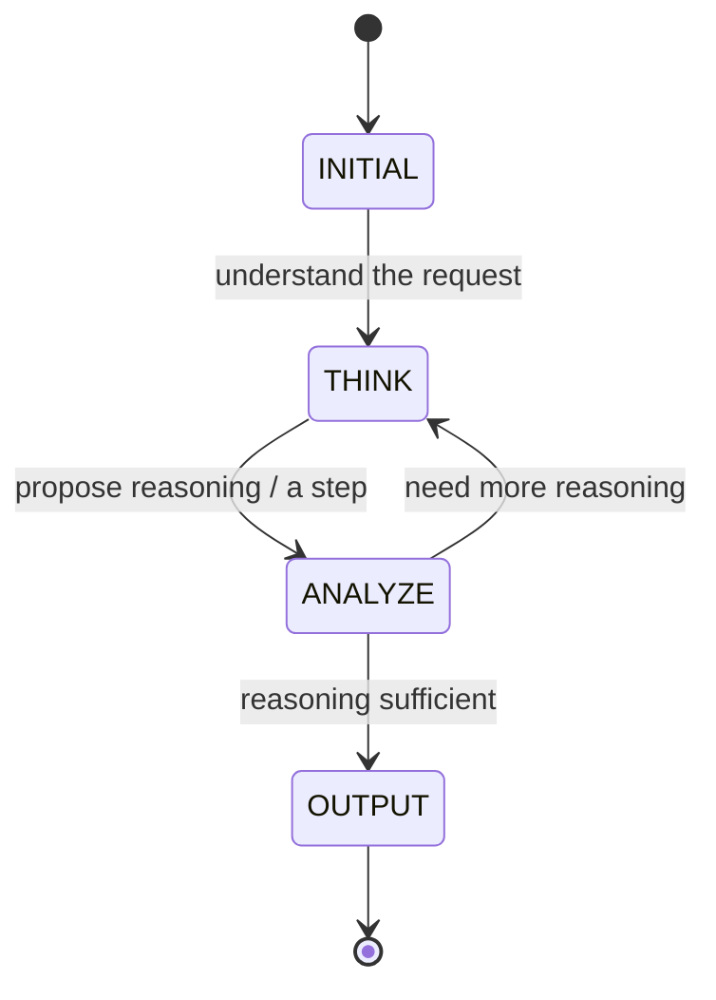
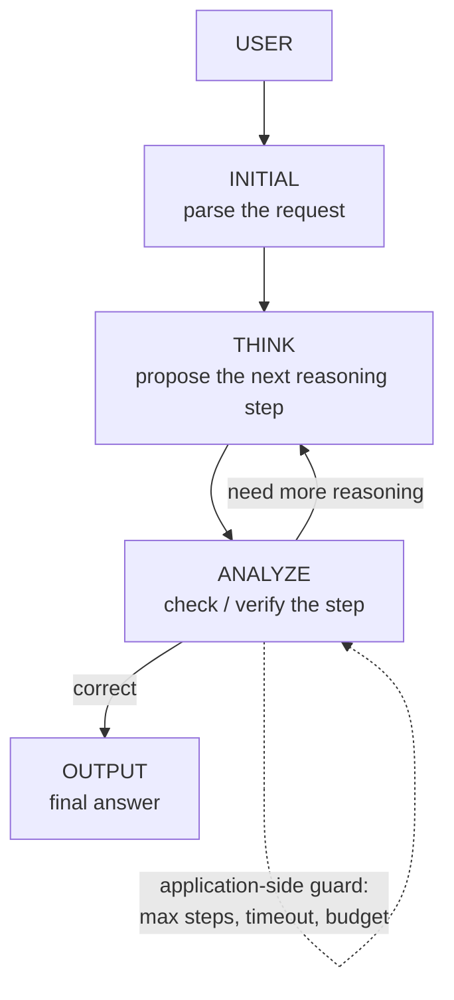
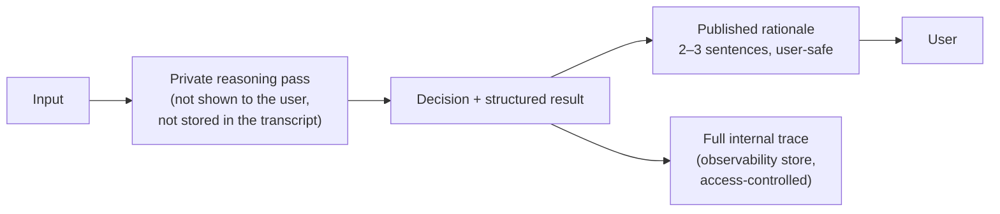
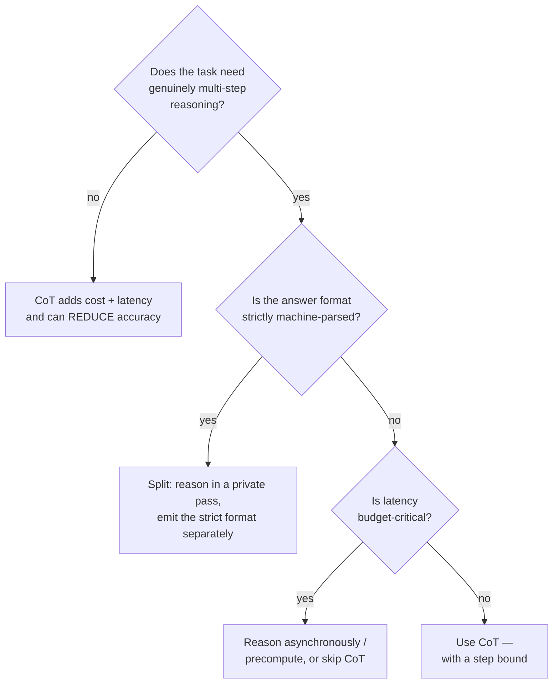
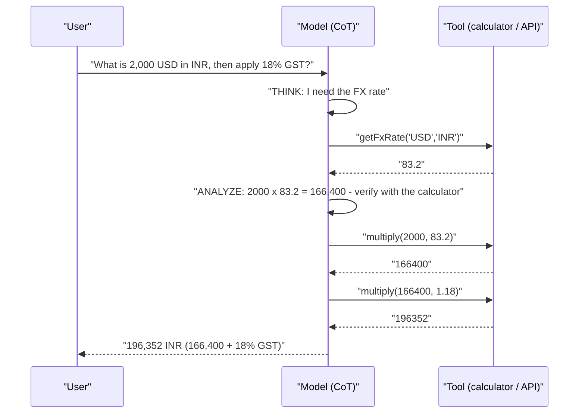
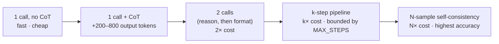

# Chapter 04 — Chain-of-Thought & Structured Reasoning

> **Lecture 05 · Chapter 04 of 09** · Level: 🟢 Beginner · Phase 2 — The Application Layer: Talking to Models
> **Source:** `gen-ai-cohort/week01/learning/day02/notes/prompting-notes/03 COT.md` (all sections) ·
> `gen-ai-cohort/week01/learning/day02/notes/row-class.md` (§1 Chain-of-Thought Prompting) ·
> `gen-ai-cohort/week01/learning/day02/notes/🚀 One-Line Summary of Day 02.md` (§6 CoT, §7 Why Reasoning Helps,
> §8 Zero-Shot CoT, §9 Few-Shot CoT, §10 Structured Reasoning Pipeline)
> **Roadmap topics:** Chain-of-Thought prompting · CoT variants — **and the cases where CoT *hurts*** · structured
> reasoning pipeline (`INITIAL → THINK → ANALYZE → OUTPUT`) · reasoning scaffolds and verification.
> **Prerequisites:** Chapters 02–03 (zero-shot and few-shot baselines) · Lecture 02 (token-by-token generation,
> why each output token costs a forward pass) · Lecture 03 (decoding).

---

## 04.0 What this chapter is for

Chapters 02 and 03 taught the model **what** to produce. This chapter teaches it **how to get there** — by giving
the generation process a visible, structured path from problem to answer.

The chapter has four jobs:

1. Explain why multi-step problems fail under a "one-shot answer" prompt, in terms of token generation.
2. Present the CoT family: zero-shot CoT, few-shot CoT, structured reasoning pipelines, and the variants.
3. Be honest about **when CoT hurts** — this is the part most tutorials omit and interviewers ask about.
4. Show how to keep reasoning **structured and inspectable** in production without exposing private
   chain-of-thought to end users.

By the end of this chapter you should be able to:

1. Explain CoT as "spending output tokens on intermediate state".
2. Write zero-shot CoT, few-shot CoT and a structured state-machine prompt for the same task.
3. Draw and explain the `INITIAL → THINK → ANALYZE → OUTPUT` pipeline and say why the application — not the model
   — owns the state.
4. List at least five cases where CoT makes results *worse*, more expensive or riskier.
5. Describe the difference between *private* chain-of-thought and a *published* concise rationale.
6. Account for the cost and latency of a reasoning scaffold.

---

## 04.1 What Chain-of-Thought is, and why multi-step tasks fail

> **Chain of Thought (CoT) prompting is a reasoning-oriented technique that encourages decomposition of complex
> tasks into intermediate steps before producing a final result.**

It is particularly useful for problems involving:

- mathematics,
- logic,
- multi-step planning,
- code reasoning,
- symbolic tasks,
- complex decision-making.

Consider a task that is trivially easy in one step:

```text
2 + 3 = ?
```

versus one that is not:

```text
A shop gives a 20% discount on a ₹2,000 product.
After the discount, 18% GST is added.
What is the final price?
```

The second requires several operations:

```text
₹2,000 → apply 20% discount → discounted price → apply 18% GST → final price
```


A model that jumps straight to the final answer is being asked to perform all of that arithmetic *inside a single
token*. It has no scratch paper. Give it scratch paper and the error rate drops sharply.

### The naive prompt vs the CoT prompt

```text
NAIVE
--------------------------------------------------
Question → LLM → Answer
```

```text
COT-STYLE
--------------------------------------------------
Question
   ↓
Understand the problem
   ↓
Break into steps
   ↓
Solve sub-problems
   ↓
Check the result
   ↓
Final answer
```

---

## 04.2 Why CoT works — three mechanisms



### Mechanism 1 — output tokens are compute

A decoder-only model performs **one forward pass per output token** (Lecture 02). A prompt that demands the answer
in one token gives the model exactly one forward pass' worth of computation to do everything. A prompt that asks
for five intermediate steps gives it five. Reasoning tokens are literally a compute budget you buy with output
tokens.

```text
Straight-to-answer:  Problem → [1 step] → Answer
CoT:                 Problem → [step] → [step] → [step] → Answer
```

### Mechanism 2 — intermediate tokens become context

Generation is autoregressive: every token the model writes is appended to the context and conditions the next
token. Intermediate reasoning therefore *feeds itself forward* — the model can attend to the subtotal it just
computed instead of having to hold it "in mind".



### Mechanism 3 — decomposition lowers per-step difficulty

Each sub-problem is easier than the whole. A model that can do single-digit arithmetic reliably can often chain
five such operations correctly — but not when the whole chain must be produced as one opaque step.

> [!IMPORTANT]
> **The correct framing:** CoT does not make the model smarter. It changes *how much computation happens before
> the answer* and *how much structure that computation has*. This is why it helps on multi-step tasks and does
> nothing at all on single-step ones.

---

## 04.3 The CoT family — variants and when each is used



| Variant | Prompt shape | Best for | Extra cost |
| :--- | :--- | :--- | :--- |
| **Zero-shot CoT** | Append "Work through the problem carefully step by step." | Quick improvement on maths/logic with no examples | Output tokens |
| **Few-shot CoT** | Show 2–3 examples that include the reasoning, not just the answer | Teaching a *specific* reasoning format | Prompt + output tokens |
| **Structured pipeline** | Fixed states (`THINK`, `ANALYZE`, …) with a required output schema | Applications that must *control* the loop | Output tokens + parsing |
| **Self-consistency** | Same prompt sampled N times; majority answer wins | High-stakes maths/logic where accuracy matters more than cost | N× tokens |
| **Least-to-most** | "First list the sub-problems; then solve them one by one." | Problems whose structure must be discovered | Output tokens |
| **Plan-and-solve** | "Write a plan, then execute each step." | Multi-step tasks with a natural plan | Output tokens |

### Zero-shot CoT

The cheapest form — a single sentence added to a normal prompt:

```text
Work through the problem carefully step by step, then give the final answer.
```

It requires no examples and often produces a large accuracy improvement on arithmetic and logic. It is also the
least controllable: the model decides the steps, their order and their granularity.

### Few-shot CoT

Here the *examples themselves* contain reasoning, teaching the model the desired solution format:

```text
Problem:
A product costs ₹1,000 and is discounted 10%. What is the price?

Approach:
1. Compute the discount: 10% of 1000 = 100
2. Subtract: 1000 − 100 = 900

Answer:
₹900
```

Then provide the next problem. The model learns the desired **solution format** — which is exactly the few-shot
craft rules from chapter 03 applied to reasoning.

### Self-consistency (the accuracy-at-any-cost variant)



Self-consistency samples the *same* prompt several times at non-zero temperature and takes the majority answer.
Reasoning paths differ, so a single bad path does not decide the outcome. The cost is linear in the number of
samples — appropriate for high-value, low-volume problems (financial reconciliation, eligibility decisions) and
inappropriate for a chat response you want in 400 ms.

> [!TIP]
> **Self-consistency is an evaluation technique you can also ship.** Even if you do not use majority voting in
> production, sampling N times during evaluation tells you whether a failure is a *systematic* error (all paths
> wrong) or a *sampling* error (some paths right). That distinction determines whether you fix the prompt or the
> temperature.

---

## 04.4 The structured reasoning pipeline

The source notes' most valuable pattern for engineering: instead of letting the model produce arbitrary reasoning
prose, the **application defines a small state machine** and the model fills each state.

```text
INITIAL → THINK → ANALYZE → OUTPUT
```



Each step emits a small structured object, so the *application* can read and act on the current state:

```json
{ "step": "ANALYZE", "text": "Verify the calculated result." }
```



### Why a state machine beats free-form reasoning

| Free-form CoT | Structured pipeline |
| :--- | :--- |
| Model decides when to stop | **Application** decides via a max-step bound |
| Output is prose, hard to parse | Each step is a typed object |
| Cannot be paused or resumed | Can be paused, resumed, logged, replayed |
| Cannot be inspected mid-flight | Each transition is observable |
| Reasoning and answer are mixed | Answer is a distinct final state |
| Retry means starting over | Retry can re-run one state |

```ts
// pseudo-code — the application owns the loop, not the model
const MAX_STEPS = 6;

let state: 'INITIAL' | 'THINK' | 'ANALYZE' | 'OUTPUT' = 'INITIAL';
let scratchpad: Step[] = [];

for (let step = 0; step < MAX_STEPS && state !== 'OUTPUT'; step++) {
  const result = await callModel({
    messages: buildMessages(state, scratchpad),   // state is explicit in the prompt
    responseFormat: STEP_SCHEMA,                  // { step, text } — validated
    temperature: 0,
  });

  const parsed = parseStep(result);               // never trust free text
  scratchpad.push(parsed);

  state = nextState(parsed.step);                 // application-controlled transition
  if (state === 'OUTPUT') return extractAnswer(parsed);
}

return escalate('reasoning budget exhausted');    // bounded failure, not an infinite loop
```

> [!IMPORTANT]
> **This is the bridge from prompting to agency.** *"LLMs become much more powerful when surrounded by controlled
> software loops instead of being treated as a single text-generation function."* The state machine here is the
> same idea that Lecture 08 turns into tool-calling loops and Lecture 11 turns into an agent SDK. The pattern to
> remember: **the model proposes a step; the application decides what happens next.**

---

## 04.5 Private chain-of-thought vs a published rationale

*Added topic:* the source notes raise this as a production concern, and it deserves its own section.

```text
UNSAFE: expose the raw reasoning
--------------------------------------------------
User sees: "Hmm, the customer says they were charged twice...
            but their plan probably doesn't include refunds...
            let me guess the policy is 30 days... so deny."
```

Two separate problems appear:

1. **Trust.** Raw reasoning exposes uncertainty, wrong intermediate guesses and speculation. A user reading it
   loses confidence — and may reasonably quote it back at you.
2. **Security and leakage.** Private reasoning can leak internal policy, thresholds, customer data from other
   records, or the shape of your system prompt (chapter 08 covers prompt extraction).

The production pattern: **reason privately, publish concisely.**



| What | Where it goes | Who sees it |
| :--- | :--- | :--- |
| Raw step-by-step reasoning | Internal trace store only | Engineers, auditors (access-controlled) |
| Decision and structured fields | Application state | The application |
| Concise rationale | User-facing response | The end user |
| System prompt, thresholds, policy | Never in a user-visible field | Nobody outside the service |

```ts
// pseudo-code — reason privately, answer publicly
const reasoning = await callModel({ messages: privateMessages, temperature: 0 });

const answer = await callModel({
  messages: [
    { role: 'system', content: PUBLIC_CONTRACT },     // "2-sentence rationale, no internals"
    { role: 'user',   content: `<internal_trace>${reasoning.text}</internal_trace>` },
  ],
  temperature: 0,
});

logInternalTrace({ reasoning: reasoning.text, answer: answer.text, promptVersion: 'summarise@1.4.0' });
return { answer: answer.text };                        // only the safe version leaves the service
```

> [!WARNING]
> **Two different things are called "chain-of-thought" in production, and confusing them causes incidents.** The
> *technique* (make the model reason step by step) is good and internal. The *artifact* (the reasoning text) is
> sensitive and should be treated like an internal document: logged, access-controlled, and never rendered to a
> user by default.

---

## 04.6 When CoT *hurts*

This section is deliberately blunt, because "always add 'think step by step'" is the most common over-applied
advice in the field.



| # | Where CoT hurts | What actually happens | Better approach |
| :---: | :--- | :--- | :--- |
| 1 | **Simple, single-step tasks** | Classification, extraction, translation, rewriting gain nothing; accuracy can drop as the model second-guesses an obvious answer | Plain zero-shot or few-shot (ch 02–03) |
| 2 | **Strict output formats** | Reasoning text leaks into the JSON, breaking the parser; the model "thinks out loud" instead of answering | Reason privately, emit the contract in a second pass (§04.5) |
| 3 | **Latency-critical UX** | Reasoning tokens are generated *before* the answer, so time-to-first-useful-token balloons | Skip CoT, or stream and hide the reasoning (Lecture 07) |
| 4 | **High-volume, cost-sensitive workloads** | Reasoning tokens are **output** tokens, billed at the higher rate; a 400-token reasoning block per call is expensive at scale | CoT only for the hard subset (routing by difficulty) |
| 5 | **Knowledge-missing tasks** | The model produces a long, confident, *wrong* chain — an elaborated hallucination that is harder to spot than a short wrong answer | Retrieval / tools first; CoT does not add facts |
| 6 | **Arithmetic and exact computation** | A fluent chain with one bad subtraction is still wrong, and looks more authoritative | A calculator tool (Lecture 08) |
| 7 | **Adversarial / untrusted input** | Reasoning traces are another surface for injection and for leaking internals; "reasoning" can be steered by hostile text in the input | Delimiters, role separation, guardrails (ch 07–08) |
| 8 | **Exact-match evaluation** | Reasoning text varies between runs, so string-equality tests fail even when the answer is right | Compare the *answer field* only (ch 09) |
| 9 | **Few-shot CoT with a wrong reasoning style** | The model copies the *style* of your examples' reasoning, including any flawed steps | Curate reasoning examples as carefully as outputs |
| 10 | **Distillation / IP exposure** | Published reasoning traces are high-quality training data for someone else's smaller model | Keep traces internal; access-control them (ch 08) |

> [!WARNING]
> **The "elaborated hallucination" problem is the most dangerous.** A short wrong answer is easy to catch. A
> 600-token wrong derivation with correct-looking intermediate arithmetic reads like expertise. CoT increases the
> *plausibility* of wrong answers as well as the accuracy of right ones — which is precisely why it must be
> paired with verification (a check step, a validator, or a tool) rather than trusted on its own.

### The decision table in one line each

```text
Single-step task            → no CoT
Multi-step, private         → CoT + private pass
Multi-step, user-visible    → CoT + concise published rationale
Multi-step + strict schema  → two-pass (reason → format)
Multi-step + latency budget → precompute or skip
Multi-step + exact maths    → tool, not CoT
Untrusted input + CoT       → add guardrails first
```

---

## 04.7 CoT plus tools — reasoning about actions

CoT and tool calling are complementary, not alternatives:

| Layer | Job | Example |
| :--- | :--- | :--- |
| **CoT** | Decide *what to do next* | "I need the current exchange rate before I can convert." |
| **Tool** | *Do* the exact thing | call the FX API |
| **CoT** | Interpret the result and decide the next step | "Rate is 83.2, so the invoice is ₹…" |



This is the seed of the **ReAct** pattern (reason → act → observe → reason) that Lecture 08 formalises. The
prompt-engineering lesson is that CoT is what makes the model *ask for* the right tool — a model forced to answer
in one token has no opportunity to notice that it needs one.

---

## 04.8 Cost and latency accounting for reasoning

Reasoning is not free. Budget it explicitly.

| Component | Billed as | Effect |
| :--- | :--- | :--- |
| Reasoning prompt ("think step by step") | Input tokens (tiny) | Negligible |
| Reasoning output tokens | **Output tokens** (expensive) | Cost + latency |
| Verification pass | Extra call | Cost + latency |
| Self-consistency (N samples) | N × full call | Cost × N, latency = slowest sample |
| Structured pipeline (k steps) | k × call | Cost × k, latency = sum of steps |



```ts
// pseudo-code — measure reasoning cost per request, per prompt version
const t0 = performance.now();
const res = await callModel({ messages, temperature: 0, maxTokens: 900 });
const latencyMs = performance.now() - t0;

record({
  promptId: 'invoice-calc', promptVersion: '2.1.0',
  inputTokens: res.usage.promptTokens,
  outputTokens: res.usage.completionTokens,   // reasoning tokens land here
  latencyMs,
  finishReason: res.finishReason,             // 'length' means reasoning was truncated
});
```

> [!TIP]
> **Watch `finish_reason`.** If a CoT response ends with `length`, the reasoning was cut off before the answer —
> you have not just lost quality, you have probably lost the answer entirely. Reasoning scaffolds must always be
> paired with a `max_tokens` that leaves room for the conclusion.

---

## 04.9 Common mistakes

- **Applying CoT to every task.** "Think step by step" on a translation or a classification adds cost and can hurt
  accuracy.
- **Exposing raw chain-of-thought to users.** It leaks internals, undermines trust, and hands an attacker a view
  of your policy.
- **Assuming CoT adds knowledge.** It restructures computation; it does not add facts.
- **Using CoT for exact arithmetic.** A tool is correct; a reasoning chain is merely plausible.
- **No step bound in a structured pipeline.** Without `MAX_STEPS`, a reasoning loop can run indefinitely.
- **Letting reasoning text pollute a strict output format.** Use a two-pass design.
- **Few-shot CoT with flawed reasoning examples.** The model copies the flaws, in the right format.
- **Forgetting the token cost.** Reasoning tokens are output tokens, billed at the higher rate on every call.
- **Truncating the reasoning with `max_tokens`.** The answer never arrives; check `finish_reason`.
- **Evaluating with exact string match.** Reasoning text varies; compare the answer field.
- **Believing a long derivation.** Elaborated hallucinations are *more* convincing, not more correct.

---

## 04.10 Key takeaways

1. **CoT is decomposition, not intelligence.** It gives the model output tokens to work with before answering.
2. **It works through three mechanisms:** token budget as compute, intermediate tokens as context, and lower
   per-step difficulty.
3. **The family matters:** zero-shot CoT, few-shot CoT, structured pipelines, self-consistency, least-to-most,
   plan-and-solve — each with a different cost profile.
4. **A structured pipeline (`INITIAL → THINK → ANALYZE → OUTPUT`) puts the *application* in control of the loop** —
   bounded, observable, resumable.
5. **CoT hurts on single-step tasks, strict formats, latency-critical paths, cost-sensitive volumes, missing
   knowledge and exact arithmetic.**
6. **Reason privately, publish concisely.** Raw reasoning is an internal artifact, not a user-facing feature.
7. **CoT and tools are complementary.** Reasoning decides; tools compute and act.
8. **Always bound the reasoning** with a max-step count, a token budget and a validation step.

---

## 04.11 Self-check questions

1. Explain CoT in terms of output tokens and forward passes. Why does that explanation predict where CoT helps?
2. Give the naive prompt and the CoT prompt for the discount-plus-GST example, and compute the answer.
3. Name four CoT variants and one task each is best suited to.
4. Draw the `INITIAL → THINK → ANALYZE → OUTPUT` pipeline and state who controls each transition.
5. Why is a structured pipeline more production-friendly than free-form reasoning? Give four reasons.
6. List five cases where CoT makes things worse, and the correct alternative for each.
7. What is an "elaborated hallucination", and why is it more dangerous than a short wrong answer?
8. Design a two-pass prompt that reasons privately and returns strict JSON publicly. What is the extra cost?
9. Why must a CoT prompt always leave room for the final answer in `max_tokens`? Which field tells you it did not?
10. Your CoT prompt improves accuracy on maths from 60 % to 85 % but doubles cost. What would you check before
    shipping it, and what routing rule might you adopt?

---

### Navigation

- **Previous:** [Chapter 03 — Few-Shot Prompting & In-Context Learning](./03_Few_Shot_Prompting_and_In_Context_Learning.md)
- **Next:** [Chapter 05 — Role-Play & Persona Prompting](./05_Role_Play_and_Persona_Prompting.md)
- **Source:** `gen-ai-cohort/week01/learning/day02/notes/prompting-notes/03 COT.md` · `row-class.md` (§1) ·
  `🚀 One-Line Summary of Day 02.md` (§6–§10)


