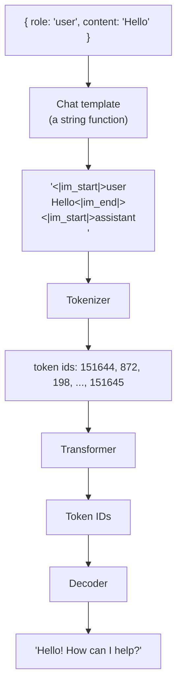
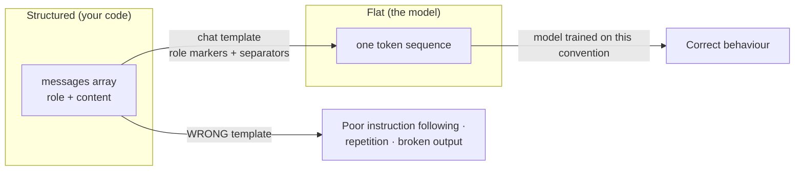
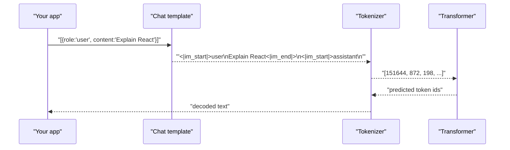
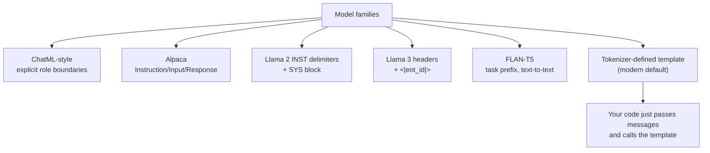
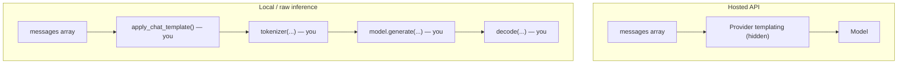
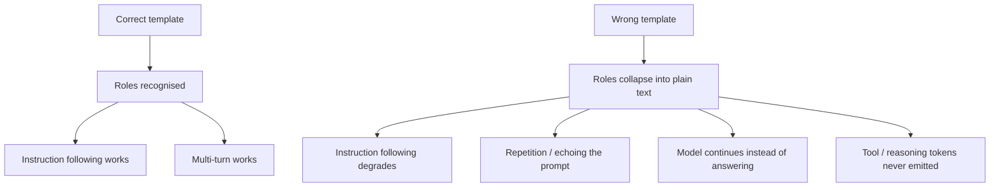
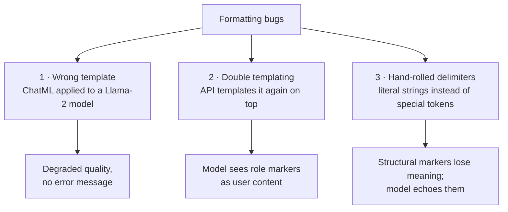
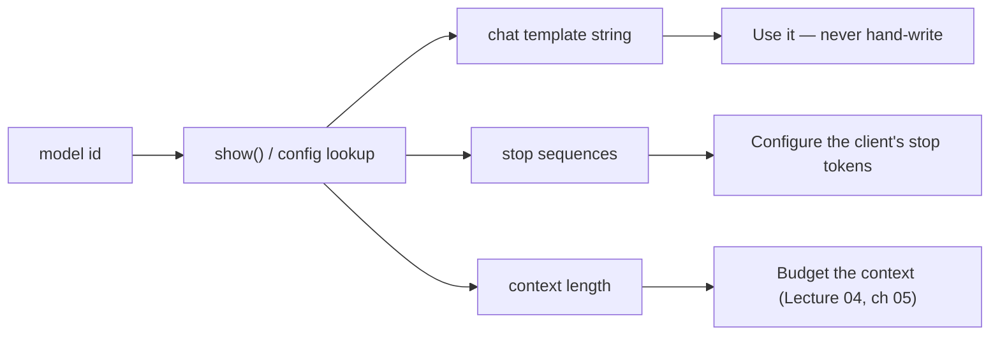

# Chapter 06 — Model-Specific Prompt Formats & Chat Templates

> **Lecture 05 · Chapter 06 of 09** · Level: 🟢 Beginner · Phase 2 — The Application Layer: Talking to Models
> **Source:** `gen-ai-cohort/week01/learning/day02/notes/03 model-specific-formats.md` (all sections) ·
> `gen-ai-cohort/week01/learning/day02/notes/row-class.md` (§3 Model-Specific Prompt Formatting) ·
> `gen-ai-cohort/week01/learning/day02/notes/🚀 One-Line Summary of Day 02.md` (§24–§30) ·
> `gen-ai-cohort/week01/learning/day02/notes/02 llm-chat-roles.md` (roles are the high-level structure)
> **Roadmap topics:** model-specific formats — **ChatML, Alpaca, INST, FLAN-T5** (and why raw formats still
> matter) · chat templates · special tokens · API vs raw/local inference.
> **Prerequisites:** Lecture 04, chapter 03 (the `messages` array and roles) · Lecture 02 (tokenization, special
> tokens, BOS/EOS) · Lecture 03 (decoding).

---

## 06.0 What this chapter is for

Everything in chapters 02–05 assumed a friendly abstraction: you write a `messages` array, a provider turns it
into an answer. This chapter opens that abstraction and shows what the model actually reads.

Three things follow from that:

1. **You will debug a prompt that "should work" and discover the problem was formatting**, not wording.
2. **You will move from hosted APIs to local inference** (Ollama, Hugging Face, llama.cpp) — and there, *you* are
   responsible for the chat template.
3. **You will understand tool-calling and reasoning tokens** (Lectures 08 and 10), because those are also
   special-token protocols, not magic.

By the end of this chapter you should be able to:

1. Explain why a JSON `messages` array never reaches the transformer unchanged.
2. Draw the pipeline: messages → chat template → serialised text → tokenizer → token IDs → transformer → decode.
3. Recognise ChatML, Alpaca, Llama `[INST]`/`<<SYS>>`, Llama-3 header and FLAN-T5 formats on sight.
4. Say who performs templating in each deployment mode (hosted API, Ollama, transformers, llama.cpp).
5. Diagnose the three classic formatting bugs: wrong template, double templating and hand-rolled delimiters.
6. Explain why raw formats still matter even when you only use hosted APIs.

---

## 06.1 The illusion: "the model receives my JSON object"

When we use an LLM API we usually write:

```javascript
const messages = [
  { role: "system", content: "You are a helpful assistant." },
  { role: "user",   content: "What is JavaScript?" }
];
```

It looks like the model receives that object. **It usually does not.**

At some layer the conversation must be converted into a representation the model was trained to understand.

```text
JavaScript messages
        │
        ▼
┌──────────────────────┐
│ API / Chat template  │
└──────────┬───────────┘
           │
           ▼
 Formatted token sequence
           │
           ▼
       Tokenizer
           │
           ▼
      Transformer
           │
           ▼
        Output
```

> **The core concept:** a chat model is trained with **particular conventions** for representing roles and turns.
> Get the convention wrong and the model is reading a language it was never taught.



---

## 06.2 Why formatting exists

A transformer fundamentally processes a sequence of tokens. It does not inherently see:

```javascript
{ role: "user", content: "Hello" }
```

as a special JavaScript object. The information must eventually become a token sequence.

For example, this conversation:

```text
SYSTEM:    "You are a tutor."
USER:      "Explain closures."
ASSISTANT:
```

is serialised using a **model-specific template**. The exact serialisation depends on the model and its
tokenizer/template. Three consequences:

1. **The role boundary must be represented in-band.** Since the model sees one flat token sequence, the roles have
   to be encoded as text — usually as *special tokens* the tokenizer maps to single IDs.
2. **The template is part of the model.** A model fine-tuned with `[INST]` delimiters expects `[INST]`. The weights
   were trained on that pattern.
3. **Templating is a function, and it is testable.** It takes structured messages and returns a string. You can
   unit-test it, log it and diff it.



---

## 06.3 The general pipeline

```text
             Chat messages
                   │
                   ▼
           Chat template
                   │
                   ▼
        Serialized text / tokens
                   │
                   ▼
               Tokenizer
                   │
                   ▼
              Token IDs
                   │
                   ▼
             Transformer
                   │
                   ▼
          Predicted tokens
                   │
                   ▼
               Response
```

Concretely:

```text
messages
   ↓
<|user|> Explain React <|end|>
   ↓
Tokenizer
   ↓
[Token IDs...]
   ↓
Model
   ↓
[Token IDs...]
   ↓
Decoder
   ↓
"React is..."
```



> [!NOTE]
> **The generation prompt.** Notice the trailing `<|im_start|>assistant` in the serialised form. That is the
> *generation prompt* — the marker telling the model "your turn starts here". Forgetting it is one of the most
> common hand-rolled-template bugs: the model does not know it is supposed to answer.

---

## 06.4 Terminology you must know

| Term | Meaning | Why it matters |
| :--- | :--- | :--- |
| **Chat template** | A template describing how structured conversation messages become the model's expected token sequence | It is model-specific; using the wrong one silently degrades quality |
| **Special tokens** | Tokens with reserved semantic purposes, e.g. `<|bos|>`, `<|eos|>`, `<|user|>`, `<|assistant|>` | They mark role boundaries and generation start/stop |
| **Instruction format** | The overall convention for instructions, inputs, responses and roles | `Alpaca`, `[INST]`, `ChatML` are different conventions |
| **Tokenizer** | Converts text into tokens/token IDs | The same string tokenises differently across models |
| **BOS / EOS** | Beginning-of-sequence / end-of-sequence tokens | Control where generation starts and stops |
| **Generation prompt** | The trailing role marker that invites the assistant's turn | Missing it → the model continues the *user's* text |
| **Control tokens** | Special tokens that carry structural meaning rather than text | They are how roles are enforced in a flat sequence |

> [!WARNING]
> **Special tokens are not "just text".** Writing `<|im_end|>` as a literal string in your prompt is *not* the same
> as emitting the special token `<|im_end|>`: the tokenizer maps the reserved sequence to a dedicated ID with a
> reserved meaning. If you hand-write the string, it may be tokenized as several ordinary tokens and lose its
> structural meaning entirely.

---

## 06.5 The formats, one by one

### ChatML (Chat Markup Language)

Uses `<|im_start|>role` and `<|im_end|>` markers around every message.

```text
<|im_start|>system
You are a math tutor.
<|im_end|>
<|im_start|>user
What is 2 + 2?
<|im_end|>
<|im_start|>assistant
```

| Property | Detail |
| :--- | :--- |
| Associated with | OpenAI research / historical chat formatting; widely adopted by open models |
| Main idea | **Explicit role boundaries** around every turn |
| Strength | Unambiguous; extensible (tool calls are just another role/block) |
| Weakness | Verbose; the exact token set differs between implementations |

### Alpaca format

A three-section instruction format.

```text
### Instruction:
Explain recursion.

### Input:
Give a beginner-friendly explanation.

### Response:
Recursion is a technique where a function...
```

| Property | Detail |
| :--- | :--- |
| Associated with | Stanford Alpaca |
| Main idea | `Instruction / Input / Response` blocks |
| Strength | Simple, readable, easy to author by hand |
| Weakness | No native role concept (system prompt is bolted into the instruction); poor for multi-turn |

### Llama 2 `[INST]` and `<<SYS>>`

```text
[INST]
Explain recursion in simple terms.
[/INST]
```

Older Llama-family formats also include a system block:

```text
<<SYS>>
You are a programming tutor.
<</SYS>>

[INST]
Explain recursion in simple terms.
[/INST]
```

| Property | Detail |
| :--- | :--- |
| Associated with | Llama 2 |
| Main idea | Instruction delimiters plus a system block |
| Strength | Compact; system block is explicit |
| Weakness | System block only valid at the start; awkward for long multi-turn |

### Llama 3 header tokens

Llama 3 moved to explicit header/end-of-turn special tokens:

```text
<|begin_of_text|><|start_header_id|>system<|end_header_id|>

You are a helpful assistant.<|eot_id|><|start_header_id|>user<|end_header_id|>

Explain recursion.<|eot_id|><|start_header_id|>assistant<|end_header_id|>
```

| Property | Detail |
| :--- | :--- |
| Associated with | Llama 3 family |
| Main idea | Header/end-of-turn special tokens |
| Strength | Clean role semantics; supports tools |
| Weakness | Very verbose; must be produced exactly |

### FLAN-T5

Google's text-to-text instruction format uses direct task prefixes:

```text
Translate to German:

The weather is nice today.
```

| Property | Detail |
| :--- | :--- |
| Associated with | FLAN-T5 |
| Main idea | Text-to-text; the instruction *is* the prefix |
| Strength | Extremely simple; encoder-decoder friendly |
| Weakness | No role concept at all; not suited to chat |

### Modern, tokenizer-defined chat templates

Most open models now ship a **template in the tokenizer configuration** (a Jinja-style template that maps a
`messages` array to the exact string). The practical implication: *you do not choose the format — the model does*.



### Comparison table

| Format / concept | Associated with | Main idea |
| :--- | :--- | :--- |
| **ChatML-style** | OpenAI research / historical chat formatting | Explicit role boundaries |
| **Alpaca** | Stanford Alpaca | Instruction / Input / Response |
| **Llama 2 `[INST]`** | Llama 2 | Instruction delimiters + system block |
| **Llama 3 templates** | Llama 3 family | Header / end-of-turn special tokens |
| **FLAN-T5** | Google | Text-to-text instruction format |
| **Modern chat templates** | Many open models | Tokenizer-defined conversation template |

---

## 06.6 API vs raw model — who does the templating?

This distinction is decisive for your career as an FDE: it tells you *when you become responsible for the format*.

### Hosted API

```text
Your JavaScript
     ↓
SDK
     ↓
Provider API
     ↓
Formatting handled by the provider
     ↓
Model
```

You work with `messages` and never see a special token.

### Local / lower-level inference

```text
Your application
     ↓
Chat template      ← YOU supply / select this
     ↓
Tokenizer          ← YOU call this
     ↓
Model
     ↓
Decoder            ← YOU decode this
```

Here you must understand `special tokens`, `chat template`, `generation prompt` and `tokenizer`.



| Deployment | Who templates? | What you must know |
| :--- | :--- | :--- |
| Hosted API (OpenAI, Gemini, …) | Provider | Roles only; formatting is opaque |
| Ollama (local runtime) | The runtime, from the model's Modelfile | That a template *exists*; how to inspect it |
| Hugging Face `transformers` | You call `tokenizer.apply_chat_template(...)` | The template, special tokens, generation prompt |
| llama.cpp / GGUF | You (or the built-in chat handler) | The exact template string; BOS/EOS handling |
| Custom inference server | You, end to end | Everything above |

### The pattern in pseudo-code

```ts
// pseudo-code — local inference: you own the templating step
function buildChatPrompt(
  messages: Array<{ role: 'system' | 'user' | 'assistant'; content: string }>,
  template: string,                       // from the model's tokenizer config
): string {
  // never hand-write the delimiters — always use the model's template
  return applyChatTemplate(template, messages, {
    addGenerationPrompt: true,            // the trailing "assistant" marker
    addBos: true,                         // beginning-of-sequence token
  });
}

const prompt = buildChatPrompt(messages, model.chatTemplate);
const tokens = tokenizer.encode(prompt);           // text → token ids
const outIds = await model.generate(tokens, { maxNewTokens: 256, temperature: 0 });
const text   = tokenizer.decode(outIds, { skipSpecialTokens: true });
```

> [!TIP]
> **When something is inexplicably wrong on a local model, print the templated string.** Nine times out of ten you
> will see a missing generation prompt, a system block in the wrong place, or a template from a *different* model
> version. This is the local-inference equivalent of reading the raw HTTP response.

---

## 06.7 Why formatting matters

When using a model directly, the correct chat template helps the model distinguish:

```text
System instruction
        ↓
User instruction
        ↓
Assistant response
```

Incorrect formatting can result in:

- poor instruction following,
- repetition,
- unexpected output,
- formatting problems,
- degraded performance.



### The symptoms, translated

| Symptom you observe | Likely formatting cause |
| :--- | :--- |
| Model repeats your question | No generation prompt / no assistant marker |
| Model answers as if there is no system prompt | System block placed after the first user turn |
| Model rambles and never stops | Missing EOS token, or wrong stop sequence |
| Output contains `<|im_start|>` literally | You hand-wrote delimiters as ordinary text |
| Multi-turn conversations behave like single-turn | History not templated, or templated with a different template |
| Local model much worse than the hosted version of "the same" model | Wrong template, or the model is a different fine-tune |
| Tool calls never appear | Tool-call special tokens absent from the template |

---

## 06.8 The three classic formatting bugs



### Bug 1 — Wrong template

You copy a ChatML prompt into a model that expects `[INST]`, or you point a local runtime at the wrong template.
**No error is raised** — the model simply reads unfamiliar markup and behaves worse. The fix is to always take the
template from the model's own configuration, never from a blog post.

### Bug 2 — Double templating

You build the templated string yourself, then pass it as a plain user message to an API that templates it *again*.

```text
You send (already templated):
  "<|im_start|>user\nWhat is 2+2?<|im_end|>\n<|im_start|>assistant\n"

The API wraps it:
  "<|im_start|>user
   <|im_start|>user
   What is 2+2?<|im_end|>
   <|im_start|>assistant
   <|im_end|>
   <|im_start|>assistant
   "
```

The model now sees role markers as *content*. Symptoms: the model talks about the markup, echoes `<|im_start|>`,
or answers a question it thinks is about formatting.

> **Rule:** if you use a chat API, send **messages**. If you use a raw completion endpoint, send **a templated
> string**. Never both.

### Bug 3 — Hand-rolled delimiters

```text
✘ Hand-rolled
--------------------------------------------------
"<|im_start|>system\nYou are a tutor.<|im_end|>\n..."
```

Typed as a plain string, the tokenizer may split `<|im_start|>` into several ordinary tokens — so the model sees
the *characters* but not the *control token*. The template function exists precisely to emit the real special
tokens.

```text
✔ Templated by the model's own template function
--------------------------------------------------
applyChatTemplate(model.template, messages)   → real special token IDs
```

> [!WARNING]
> **This bug is a security issue as well as a quality issue.** If user text can contain the literal string
> `<|im_end|>` and your pipeline hand-rolls delimiters, a user can *forge a role boundary* and inject what looks
> like a system message. Using the model's template (and escaping user content) is a hardening measure, not just a
> correctness one — see chapter 08.

---

## 06.9 Inspecting the template (a practical skill)

```ts
// pseudo-code — discover the template before you use it
async function inspectModelFormat(modelId: string) {
  const info = await runtime.show(modelId);      // e.g. Ollama: GET /api/show
  return {
    template: info.template,                     // the chat template string
    family: info.details.family,                 // llama, qwen, mistral, ...
    stopTokens: info.parameters.stop,            // stop sequences the model expects
    contextLength: info.model_info['*.context_length'],
  };
}
```



Checklist before shipping a local/raw model integration:

```text
□ Which template does the model expect? (read the model config, not a tutorial)
□ Does the template add the generation prompt for me, or must I?
□ Are BOS/EOS tokens added exactly once (not zero, not twice)?
□ Are the stop sequences configured to match the template?
□ Is user content escaped so it cannot forge a role marker?
□ Does the tokenizer actually map my delimiter to a special token ID?
```

---

## 06.10 Why raw formats still matter (even with hosted APIs)

You may reasonably ask: *if the provider templates everything, why learn ChatML at all?* Four reasons:

| Reason | Explanation |
| :--- | :--- |
| **Debugging** | You cannot debug a prompt-format bug you cannot name |
| **Portability** | Moving to Ollama / HF / llama.cpp makes you the template owner overnight |
| **Tool calling and reasoning tokens** | These are special-token protocols (Lectures 08, 10) — the same concept, new vocabulary |
| **Cost and caching** | Template details affect token counts and prefix-cache hit rates (Lecture 04, ch 04–05) |
| **Security** | Role markers are a trust boundary; knowing how they are encoded is prerequisite to hardening them (chapter 08) |

> [!IMPORTANT]
> **The mental model to keep:** *roles are the high-level conversation structure; chat templates convert that
> structure into the model-specific token sequence the model was trained to understand.* This becomes essential as
> you move **API → Ollama → Hugging Face → custom inference → agents**, because that is exactly where the
> abstraction layers start changing.

---

## 06.11 Common mistakes

- **Assuming the model sees your JSON object.** It sees one flat token sequence produced by a template.
- **Using the wrong template for a model.** No error — just quietly worse behaviour.
- **Double templating.** Sending a pre-templated string to a chat API that templates it again.
- **Hand-writing special tokens.** They lose their control meaning and become ordinary text.
- **Forgetting the generation prompt.** The model continues your text instead of answering.
- **Adding BOS twice (or not at all)** when doing raw inference.
- **Copying a prompt from a blog post without checking the model family.** ChatML text in a Llama-2 prompt.
- **Ignoring stop sequences.** Generation runs on, or stops mid-token.
- **Assuming "the same model" locally and hosted are identical.** Templates, quantisation and fine-tunes differ.
- **Not escaping user content that can contain role markers.** This is a prompt-injection vector (chapter 08).
- **Never printing the templated string while debugging.** The single highest-value five seconds you can spend.

---

## 06.12 Key takeaways

1. **A `messages` array never reaches the transformer.** A chat template serialises it into a token sequence first.
2. **Templates are model-specific.** ChatML, Alpaca, Llama `[INST]`/`<<SYS>>`, Llama-3 headers, FLAN-T5 — each is a
   different convention the model was trained on.
3. **Special tokens are control tokens, not text.** Hand-writing them destroys their meaning.
4. **Know the pipeline:** messages → chat template → text → tokenizer → token IDs → transformer → decode.
5. **The generation prompt is the "your turn" marker.** Missing it is the classic bug.
6. **Who templates depends on deployment:** the provider for hosted APIs; *you* for Ollama/HF/llama.cpp.
7. **Three classic bugs:** wrong template, double templating, hand-rolled delimiters.
8. **Raw formats still matter** for debugging, portability, tool calling, cost and security.
9. **Print the templated string when debugging.** It converts a mystery into a diff.

---

## 06.13 Self-check questions

1. Draw the full pipeline from a `messages` array to decoded text, naming each stage.
2. Why must role boundaries be represented "in-band"? What mechanism does the tokenizer provide?
3. Name four instruction formats and, for each, one sentence on when it is used.
4. What is a generation prompt, and what breaks when it is missing?
5. In which deployment modes are *you* responsible for templating? What must you then know?
6. Explain double templating with an example, and describe the symptoms you would see.
7. Why is hand-writing `<|im_start|>` different from using the model's template function? Include the security
   consequence.
8. A local model answers much worse than the hosted version of the "same" model. List four formatting-related
   explanations.
9. Give three reasons raw formats matter even if you only ever call hosted APIs.
10. Write a six-item checklist you would run before shipping a local model integration.

---

### Navigation

- **Previous:** [Chapter 05 — Role-Play & Persona Prompting](./05_Role_Play_and_Persona_Prompting.md)
- **Next:** [Chapter 07 — Prompt Hygiene, Delimiters & Output Contracts](./07_Prompt_Hygiene_Delimiters_and_Output_Contracts.md)
- **Source:** `gen-ai-cohort/week01/learning/day02/notes/03 model-specific-formats.md` · `row-class.md` (§3) ·
  `🚀 One-Line Summary of Day 02.md` (§24–§30) · `02 llm-chat-roles.md`


