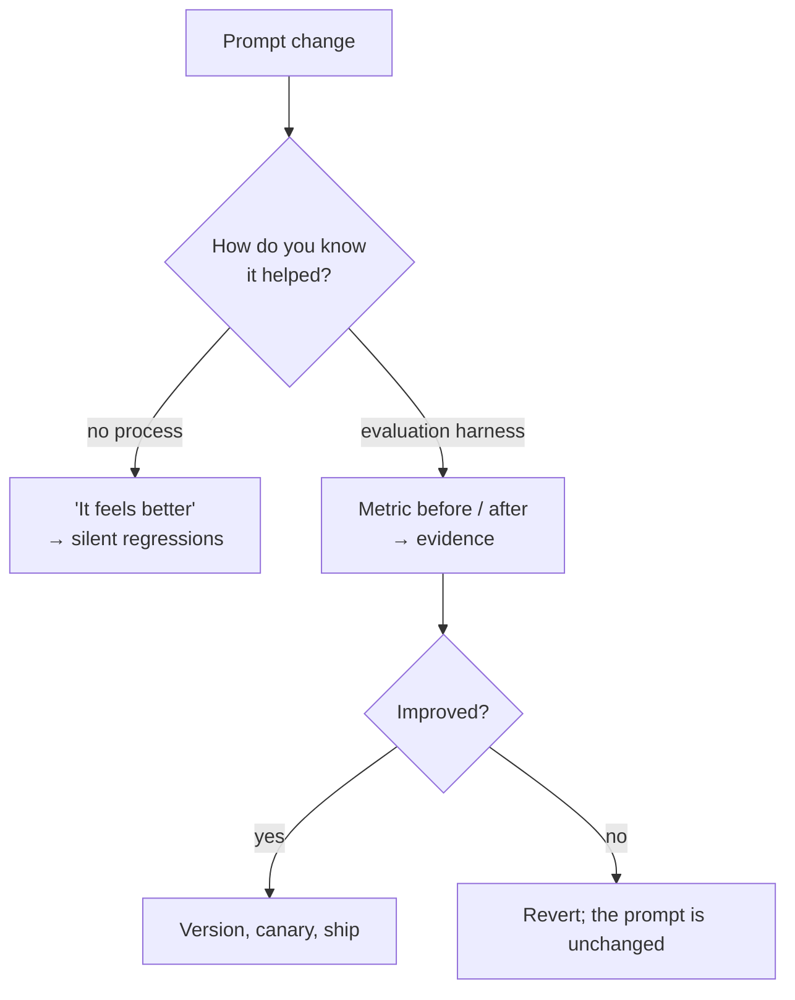
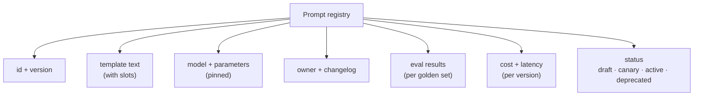
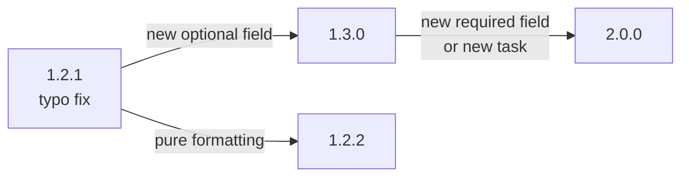
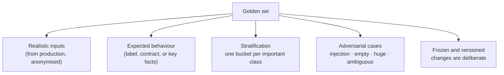
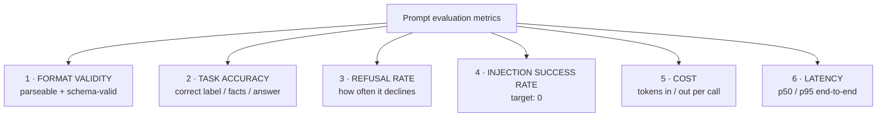
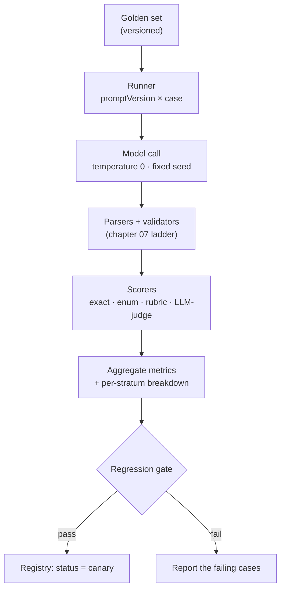
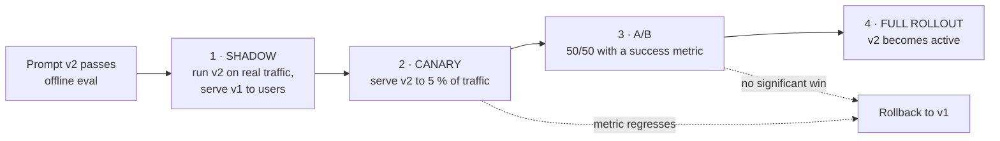
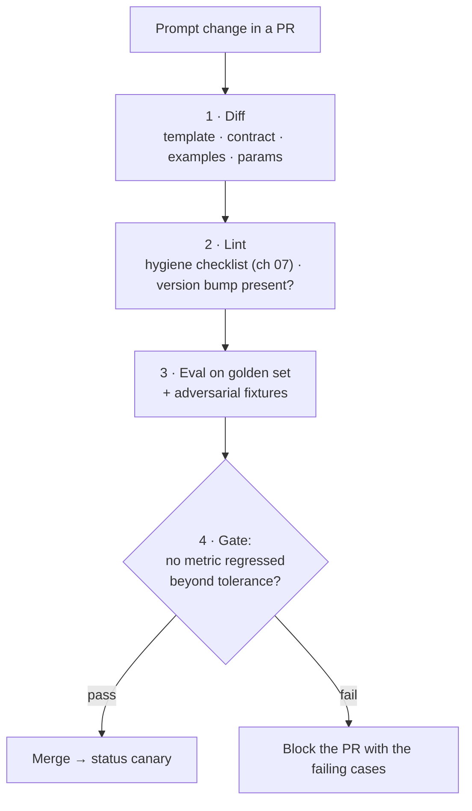
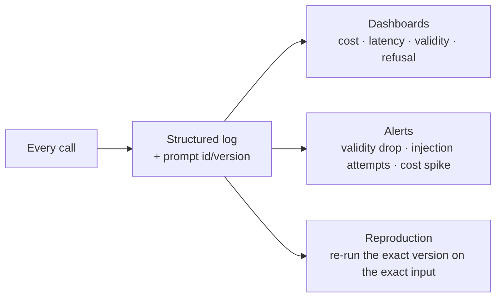
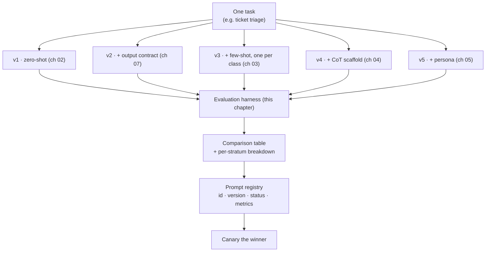

# Chapter 09 — Prompt Versioning, Evaluation & the Prompt Registry

> **Lecture 05 · Chapter 09 of 09** · Level: 🟢 Beginner · Phase 2 — The Application Layer: Talking to Models
> **Source:** `gen-ai-cohort/week01/learning/day02/notes/🚀 One-Line Summary of Day 02.md` (§39 Guardrails Are Not
> Just Prompts · the evaluate step) · `gen-ai-cohort/week01/learning/day02/notes/04 llm-security-and-guardrails.md`
> (monitoring and the security checklist) · `gen-ai-cohort/week01/learning/day02/notes/row-class.md` (§1) ·
> Lecture 04, chapter 08 (telemetry and structured logging) and the roadmap's Lecture 05 **Build** task
> (a prompt-pattern lab with a comparison table and a stored prompt registry)
> **Roadmap topics:** prompt versioning and evaluation of prompt changes · the prompt registry · comparison of
> zero-shot / few-shot / CoT / persona on one task · measuring a prompt change.
> **Prerequisites:** Chapters 01–08 (the techniques being versioned and measured) · Lecture 04, chapters 04 and 08
> (token economics, telemetry) · Lecture 30 previews evals in depth.

---

## 09.0 What this chapter is for

Chapters 01–08 gave you the *techniques*. This chapter makes them **engineering**: reproducible, measurable and
reversible.

Three questions drive it:

1. **Which prompt produced this output?** (versioning)
2. **Is the new prompt better than the old one?** (evaluation)
3. **Can I roll back if it is not?** (registry + deployment)

By the end of this chapter you should be able to:

1. Explain why a prompt must have an id and a version, and what each semver component means for prompts.
2. Design a prompt-registry entry and a changelog.
3. Curate a golden set and explain stratification.
4. Define the six metrics that matter for prompt evaluation.
5. Build a small evaluation harness and a regression gate.
6. Describe canary and A/B deployment for prompts, including the statistics you must not fool yourself with.
7. Explain how prompt-level telemetry answers "which prompt version caused this incident?".

---

## 09.1 Prompts are code — and worse than code

| Property | Application code | A prompt |
| :--- | :--- | :--- |
| Deterministic output | Usually yes | **No** — sampling, model versions, provider changes |
| Testable by assertion | Exact equality works | Must assert on **structure** and **properties** |
| Reviewable diff | Yes | Yes (if stored as text in the repo) |
| Breaking change is obvious | Type error, failing test | **Silent quality drop** with no error |
| Behaviour depends on | Your code | Your code **and the model, the template and the provider** |



The consequence: **a prompt without a version number is an unreproducible experiment.** When a customer reports bad
output, you need to know which prompt produced it, with which model and which parameters.

---

## 09.2 The prompt registry

A **prompt registry** is the single source of truth for every prompt in the system: its text, its id, its version,
its owner and its measured performance.



### A registry entry

```ts
// pseudo-code — a registry entry is data, not a string in a service file
type PromptRecord = {
  id: string;                       // 'ticket-triage'
  version: string;                  // '2.0.0'  (semver)
  status: 'draft' | 'canary' | 'active' | 'deprecated';
  owner: string;                    // team or person accountable
  model: { name: string; temperature: number; maxTokens: number; seed?: number };
  template: {
    system: string;                 // slots 1,2,4,5
    user: string;                   // slot 3 (data, delimited)
    fewShot?: Array<{ input: string; output: string }>;
  };
  contract: unknown;                // the output schema
  changelog: Array<{ version: string; date: string; change: string; evalDelta: string }>;
  metrics?: {
    goldenSetId: string;
    formatValidity: number;         // 0..1
    taskAccuracy: number;           // 0..1
    refusalRate: number;            // 0..1
    injectionSuccessRate: number;   // 0..1  (target 0)
    avgInputTokens: number;
    avgOutputTokens: number;
    p95LatencyMs: number;
  };
};
```

### A changelog that is actually useful

```text
ticket-triage
  2.0.0  2026-02-11  Split instruction and data into system/user roles; added <ticket> delimiters
                     and an explicit output contract.  formatValidity 0.71 → 0.99; injectionSuccess 0.4 → 0.0
  1.3.0  2026-02-04  Added severity field to the contract.  formatValidity 0.98 → 0.99
  1.2.1  2026-01-28  Fixed a contradiction: removed "be thorough" (kept "max 2 sentences").
                     taskAccuracy 0.83 → 0.88
  1.2.0  2026-01-20  Added sentiment field.  formatValidity 0.93 → 0.98
  1.1.0  2026-01-14  Added 3 few-shot examples (one per class).  taskAccuracy 0.74 → 0.83
  1.0.0  2026-01-10  Initial zero-shot version.  baseline
```

> [!TIP]
> **Record the metric delta in the changelog, not just the change.** "Added examples" is a description; "added
> examples → accuracy 0.74 → 0.83 for +410 input tokens/call" is a decision. The second one lets a future engineer
> decide whether to keep the investment.

---

## 09.3 Semantic versioning for prompts

Adopt semver so a version number *means* something:

| Component | Bump when… | Example | Expected effect |
| :--- | :--- | :--- | :--- |
| **MAJOR** | The contract or task changes; callers must adapt | New required field; changed task | Breaking — coordinate with callers |
| **MINOR** | Behaviour improves; the contract is compatible | New optional field; better examples | Backward compatible |
| **PATCH** | Wording, typos, formatting, non-behavioural fixes | Fix a typo; reorder constraints | No expected behavioural change |



Practical rules:

```text
□ The version lives with the prompt, not in a wiki.
□ Every call logs the prompt id AND version (chapter 04 telemetry).
□ MAJOR changes get a migration note for callers.
□ A PATCH that changes metrics is not a PATCH — it is a MINOR (you learned something).
□ Deprecated versions stay resolvable for as long as logs reference them.
```

---

## 09.4 The golden set

An **evaluation harness** is only as good as the data it runs on. The **golden set** is a curated, labelled set of
inputs with known-good expected behaviour.



### Curation rules

| Rule | Why |
| :--- | :--- |
| **Draw from real traffic** (anonymised) | Synthetic examples miss the messiness that breaks prompts |
| **Stratify by class** | A 90 % majority class will hide a total failure on the 10 % |
| **Include the rare-but-critical class** | Fraud, escalation, safety flags matter most |
| **Include boundary cases** | Where one label ends and another begins |
| **Include adversarial cases** | Injection, empty input, oversized input, wrong language |
| **Freeze it** | Otherwise you "improve" by moving the target |
| **Version it** | `golden-v3` — a metric without its dataset id is meaningless |
| **Keep it out of the prompt** | Never tune on the exact test set; hold out a slice |

```ts
// pseudo-code — a stratified golden set for a triage classifier
const GOLDEN_V3 = {
  id: 'ticket-triage-golden',
  version: '3',
  strata: {
    BILLING:   [/* 25 real tickets */],
    TECHNICAL: [/* 25 real tickets */],
    ACCOUNT:   [/* 20 real tickets */],
    OTHER:     [/* 15 real tickets */],
    boundary:  [/* 10 deliberately ambiguous tickets */],
    empty:     [/*  5 empty / whitespace-only tickets */],
    adversarial: [/* 5 injection attempts */],
  },
};
```

> [!IMPORTANT]
> **How big should it be?** Big enough to distinguish a real improvement from noise, small enough to run in CI in
> under a minute. For classification with a handful of classes, 50–150 stratified cases is usually enough to catch
> regressions. Note the word *stratified* — 1 000 examples drawn randomly from a 95 %-majority class tell you almost
> nothing.

---

## 09.5 The six metrics that matter



| # | Metric | Definition | Typical target |
| :---: | :--- | :--- | :--- |
| 1 | **Format validity** | % of outputs that parse and satisfy the contract | > 0.99 |
| 2 | **Task accuracy** | % correct on the golden set (label match, fact match, rubric) | depends on task |
| 3 | **Refusal rate** | % of *legitimate* requests declined | low, but not zero (calibrated refusal) |
| 4 | **Injection success rate** | % of adversarial fixtures that change behaviour | **0** |
| 5 | **Cost** | avg input + output tokens per call, and $ per 1 000 calls | budgeted |
| 6 | **Latency** | p50/p95 wall-clock per call | budgeted |

### Why *all six*, and not just accuracy

```text
Accuracy 0.95 → 0.97   but   cost ×3, latency ×2, refusal 0.02 → 0.18
```

That is a **regression** dressed as an improvement. Prompt evaluation without cost and latency is how teams ship
quality that the business cannot afford, and without a refusal metric you cannot see over-cautious behaviour that
users experience as "the bot is useless".

> [!TIP]
> **Add a seventh informal metric: the "would I ship this?" review.** Every prompt version should be read once by
> a human against a handful of outputs. Metrics catch regressions; reading catches nonsense that scores well.

---

## 09.6 The evaluation harness



```ts
// pseudo-code — a minimal harness you can build in an afternoon
async function evaluate(prompt: PromptRecord, golden: GoldenSet) {
  const rows = [];

  for (const [stratum, cases] of Object.entries(golden.strata)) {
    for (const c of cases) {
      const t0 = Date.now();
      const raw = await callModel({
        messages: buildMessages(prompt, c.input),
        temperature: 0,                        // determinism first
        seed: 42,
        maxTokens: prompt.model.maxTokens,
      });
      const latencyMs = Date.now() - t0;

      const parsed   = parseAndValidate(raw.text, prompt.contract);
      const score    = scoreCase(parsed, c.expected, c.rubric);   // task-specific

      rows.push({
        stratum, caseId: c.id,
        formatValid: parsed.ok,
        correct: parsed.ok && score.ok,
        refused: isRefusal(raw.text),
        injected: c.adversarial ? score.changedBehaviour : null,
        inputTokens: raw.usage.promptTokens,
        outputTokens: raw.usage.completionTokens,
        latencyMs,
      });
    }
  }

  return aggregate(rows);   // { formatValidity, taskAccuracy, refusalRate, injectionSuccessRate, cost, p95 }
}
```

### Determinism in evaluation

| Setting | Why |
| :--- | :--- |
| `temperature: 0` | Removes sampling as an explanation for a difference |
| Fixed `seed` (where supported) | Makes runs reproducible |
| **Pinned model version** | A provider silently updating the model invalidates your baseline |
| Same tokenizer / template | Especially for local models (chapter 06) |
| Same `max_tokens` | Otherwise truncation differences look like quality differences |

> [!WARNING]
> **Evaluate the answer field, not the whole string.** If your prompt uses CoT or reasoning, the output text varies
> between runs even at temperature 0. Score the *contract fields* — the label, the facts, the boolean — not the
> prose. This is the same point chapter 04 makes about "reasoning text varies".

### Scoring options, cheapest first

| Method | Cost | Good for | Watch out for |
| :--- | :--- | :--- | :--- |
| **Exact / enum match** | ~0 | Classification, structured fields | Only works on closed sets |
| **Schema + rule checks** | ~0 | Format, ranges, cross-field rules | Cannot judge meaning |
| **Keyword / regex assertions** | ~0 | "must contain X", "must not contain Y" | Brittle phrasing |
| **Fact overlap** | Low | Summaries, extraction (key facts present?) | Misses ordering and nuance |
| **LLM-as-judge with a rubric** | Medium | Open-ended quality, tone, helpfulness | Needs calibration; can be biased |
| **Human review on a sample** | High | Final gate, ambiguous cases | Does not scale; use for the hardest strata |

> [!IMPORTANT]
> **Calibrate your LLM-judge before trusting it.** Run the judge on cases where you *know* the answer and check its
> agreement with human labels. An uncalibrated judge is a metric that measures the judge.

---

## 09.7 Deploying a prompt change: shadow, canary, A/B

Offline evaluation on a golden set is necessary but not sufficient. Real traffic is the final test.



| Stage | Who sees v2 | What you learn | Rollback cost |
| :--- | :--- | :--- | :--- |
| **Shadow** | Nobody | Distribution shift, latency, cost, crash rate on real inputs | Zero |
| **Canary** | 1–5 % | Real-world quality and error rates at low blast radius | Low |
| **A/B** | ~50 % | Whether the change moves a business metric | Medium |
| **Full** | 100 % | Steady state | High |

### The statistics you must not fool yourself with

```text
□ Is the difference larger than run-to-run variance?  → repeat the eval 3× and compare spreads
□ Is the sample big enough?                            → 20 cases cannot detect a 2 % change
□ Is the metric the one you care about?                → "sounds better" is not a metric
□ Is the segment uniform?                              → a win overall can be a loss for one stratum
□ Did the model or provider change under you?           → pin versions; record them per call
```

> [!WARNING]
> **Always report the per-stratum breakdown, not just the average.** A change that improves `BILLING` by 10 % and
> degrades `TECHNICAL` by 12 % shows up as a small overall win — while quietly breaking the most important class.

---

## 09.8 Prompt diffing and the CI regression gate

Prompts belong in version control, and a prompt change should trigger the same gate as a code change.



```ts
// pseudo-code — the regression gate
const BASELINE = { formatValidity: 0.99, taskAccuracy: 0.88, refusalRate: 0.04, injectionSuccessRate: 0.0 };
const TOLERANCE = { taskAccuracy: 0.01, refusalRate: 0.02 };   // allowed noise

function gate(now: Metrics): GateResult {
  const fails: string[] = [];

  if (now.formatValidity < BASELINE.formatValidity) fails.push('format validity regressed');
  if (now.taskAccuracy < BASELINE.taskAccuracy - TOLERANCE.taskAccuracy) fails.push('accuracy regressed');
  if (now.refusalRate  > BASELINE.refusalRate  + TOLERANCE.refusalRate)  fails.push('refusals increased');
  if (now.injectionSuccessRate > 0) fails.push('injection success is non-zero');

  return { ok: fails.length === 0, fails };
}
```

### What to diff

| Diff | Why it matters |
| :--- | :--- |
| System template text | Wording changes behaviour |
| Contract (keys, enums, limits) | Callers depend on it |
| Few-shot examples | The most behaviour-changing part (chapter 03) |
| Model name / version | Silently changes everything |
| `temperature`, `max_tokens`, `seed` | Reproducibility |
| Delimiters and escaping | Security-relevant |
| Prompt version number | If it changed and the version did not, the process failed |

> [!TIP]
> **Cheap gate, big payoff.** A CI job that runs 100 golden cases + 5 adversarial fixtures at temperature 0 costs
> cents and takes under a minute. That job is the difference between "prompt engineering" and "prompt hoping".

---

## 09.9 Observability: which prompt produced this?

Every call must record enough to reconstruct the answer. This is the telemetry record from Lecture 04, chapter 08 —
now with the prompt identity added.

```ts
// pseudo-code — the per-call record that makes incidents debuggable
record({
  requestId, tenantId, userId,
  promptId: 'ticket-triage', promptVersion: '2.0.0',   // ← the crucial fields
  goldenSetVersion: '3',
  model: 'gpt-5-mini', temperature: 0, seed: 42,
  inputTokens, outputTokens, costUsd,
  latencyMs, ttftMs,
  finishReason,                    // 'stop' | 'length' | 'content_filter'
  validation: { parse: true, schema: true, semantics: true, safety: true },
  guardrailFlags: [],              // moderation categories, PII hits
  evalBucket: 'canary',            // shadow | canary | ab | full
});
```



### Drift: the failure mode nobody instruments

A prompt can degrade **without any code change**:

| Source of drift | Symptom | Detection |
| :--- | :--- | :--- |
| Provider updates the model | Behaviour shifts overnight | Track metrics over time; pin versions |
| Input distribution changes | Accuracy falls on new traffic | Monitor input length/language/topic mix |
| Retrieved corpus goes stale | Wrong answers, confidently | Track "answer not found in context" rate |
| Template or tokenizer changes | Format validity falls | Record template hash per call |
| Usage pattern changes | Cost spikes | Cost per tenant over time |

> [!TIP]
> **The one metric that catches the most.** Track **format validity** and **refusal rate** continuously — they move
> first when something breaks, before anyone reports a bad answer.

---

## 09.10 The lecture's build: a prompt-pattern lab

The roadmap's Build task for this lecture is a **prompt-pattern lab**: the same task solved with zero-shot /
few-shot / CoT / persona, a side-by-side comparison table, and a stored prompt registry. Here is the shape of it.



### The comparison table you should be able to produce

| Variant | Format validity | Task accuracy | Refusal | Injection success | In tokens | Out tokens | p95 latency |
| :--- | ---: | ---: | ---: | ---: | ---: | ---: | ---: |
| v1 · zero-shot | 0.71 | 0.74 | 0.01 | 0.40 | 180 | 90 | 700 ms |
| v2 · + contract | 0.96 | 0.76 | 0.01 | 0.40 | 240 | 110 | 730 ms |
| v3 · + few-shot (3) | 0.98 | 0.86 | 0.02 | 0.20 | 690 | 110 | 950 ms |
| v4 · + CoT | 0.97 | 0.89 | 0.03 | 0.20 | 720 | 380 | 1 500 ms |
| v5 · + persona | 0.98 | 0.89 | 0.03 | 0.20 | 790 | 400 | 1 600 ms |
| **v2 + delimiters + guardrails** | **0.99** | 0.78 | 0.02 | **0.00** | 260 | 110 | 740 ms |

Read that table as an engineer would:

- **The contract (v2) bought the most for the least** — format validity 0.71 → 0.96 for ~60 extra input tokens.
- **Few-shot (v3) bought accuracy** at a 3× prompt-token cost.
- **CoT (v4) bought a little more accuracy** for a large output-token cost and doubled latency.
- **The persona (v5) bought almost nothing** for this task — which is exactly the kind of finding you can only get
  by measuring.
- **Security is orthogonal:** delimiters + role separation dropped the injection success rate to zero *without*
  hurting accuracy — and it is the change you should make first, regardless of the accuracy ranking.

> [!IMPORTANT]
> **This is the whole lecture in one artifact.** The table is what "prompt engineering as an engineering
> discipline" looks like when it is finished: named variants, a frozen golden set, six metrics, a per-stratum
> breakdown and a versioned registry entry.

---

## 09.11 Common mistakes

- **Prompts in code without ids or versions.** Incidents become unreproducible.
- **Tuning on the evaluation set.** You will "improve" the metric and change nothing real.
- **Skipping cost and latency metrics.** A quality win the business cannot afford is a regression.
- **Ignoring the refusal metric.** Over-cautious behaviour is invisible until users complain.
- **Reporting only the average.** Per-stratum breakdowns catch the class you actually care about.
- **No adversarial fixtures in the harness.** Security is then untested by definition.
- **Changing the prompt without bumping the version.** The changelog becomes a lie.
- **Not pinning the model version.** The provider changes it; your baseline evaporates.
- **Scoring the whole output string.** Reasoning text varies; score the contract fields.
- **Trusting an uncalibrated LLM-judge.** Measure the judge before you measure the prompt.
- **No CI gate.** Regressions ship silently, and prompt quality ratchets downward.
- **Never reading the outputs.** Metrics catch regressions, not nonsense.

---

## 09.12 Key takeaways

1. **A prompt is a versioned artifact.** No version, no reproducibility.
2. **Keep a prompt registry:** id, version, status, owner, template, contract, metrics, changelog with deltas.
3. **Use semver meaningfully:** MAJOR = contract/task change, MINOR = compatible improvement, PATCH = non-behavioural.
4. **Curate a stratified, frozen, versioned golden set** drawn from real traffic, including adversarial cases.
5. **Measure six things:** format validity, task accuracy, refusal rate, injection success rate, cost, latency.
6. **Evaluate at temperature 0 with pinned model versions**, and score contract fields rather than prose.
7. **Deploy in stages:** shadow → canary → A/B → full, with a defined rollback.
8. **Gate prompt changes in CI** with the same seriousness as code changes.
9. **Log prompt id + version on every call.** That is what makes an incident debuggable.
10. **Watch for drift:** prompts degrade with no code change when models, inputs or corpora move.

---

## 09.13 Self-check questions

1. Why is a prompt "worse than code" from a testing perspective? Name three reasons.
2. What are the seven fields of a useful prompt-registry entry, and why does the changelog record metric deltas?
3. Give a MAJOR, a MINOR and a PATCH example for a `ticket-triage` prompt, and say what callers must do for each.
4. What makes a golden set *stratified*, and what failure does stratification prevent?
5. Name the six evaluation metrics. Which one has a target of exactly zero, and why?
6. Why must evaluation run at `temperature: 0` with a pinned model version? What does that *not* guarantee?
7. Explain the difference between shadow, canary and A/B deployment for a prompt change. What does each stage catch?
8. Design a CI regression gate: which metrics, which tolerances, and what happens when it fails?
9. Your prompt's accuracy is unchanged but the p95 latency doubled and cost tripled. What do you do, and what
   question do you ask the product owner?
10. Rebuild the comparison table from §09.10 for a task of your choice, and state which variant you would ship and
    why — including the security row.

---

### Navigation

- **Previous:** [Chapter 08 — Prompt Injection, Guardrails & Extraction Attacks](./08_Prompt_Injection_Guardrails_and_Extraction_Attacks.md)
- **Next:** [Lecture 05 — Complete Notes](./Lecture_05_Complete_Notes.md)
- **Source:** `gen-ai-cohort/week01/learning/day02/notes/🚀 One-Line Summary of Day 02.md` (§39 and the evaluate step) ·
  `04 llm-security-and-guardrails.md` (monitoring, security checklist) · `row-class.md` (§1) ·
  `roadmap.md` → Lecture 05 → **Build** (prompt-pattern lab + prompt registry)


