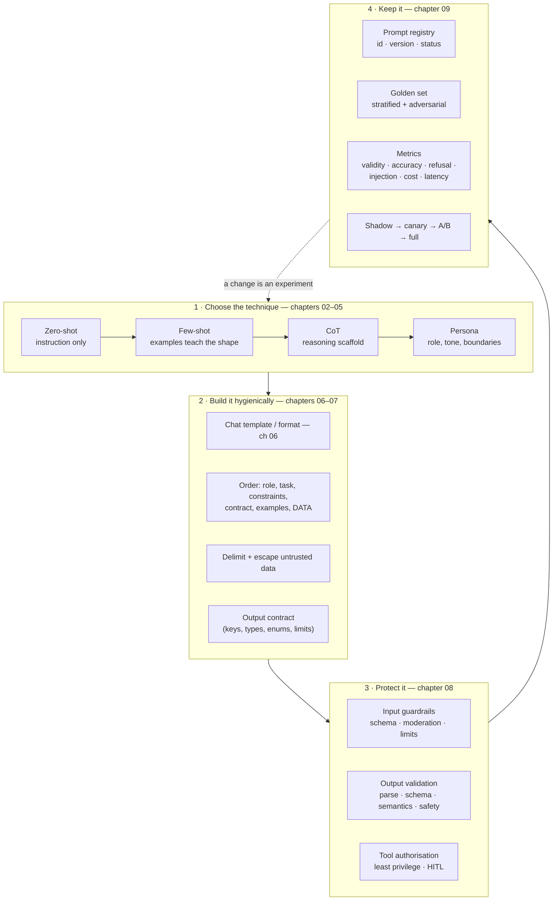

# Lecture 05 — Complete Notes
## Prompt Engineering: Zero/Few-Shot, CoT, Persona & Prompt Hygiene

> **Phase:** 2 · The Application Layer: Talking to Models · **Level:** 🟢 Beginner · **Prerequisites:** Lecture 04
> **Scope:** a single-pass consolidation of the nine chapter notes in this folder.
> **How to use this file:** read it to *revise and navigate*. It is deliberately shorter than the chapters, and every
> section links to the chapter that explains it in full.
>
> | Chapter | File |
> | :--- | :--- |
> | 01 · Prompt engineering as an engineering discipline | [01_Prompt_Engineering_as_an_Engineering_Discipline.md](./01_Prompt_Engineering_as_an_Engineering_Discipline.md) |
> | 02 · Zero-shot prompting | [02_Zero_Shot_Prompting.md](./02_Zero_Shot_Prompting.md) |
> | 03 · Few-shot prompting & in-context learning | [03_Few_Shot_Prompting_and_In_Context_Learning.md](./03_Few_Shot_Prompting_and_In_Context_Learning.md) |
> | 04 · Chain-of-Thought & structured reasoning | [04_Chain_of_Thought_and_Structured_Reasoning.md](./04_Chain_of_Thought_and_Structured_Reasoning.md) |
> | 05 · Role-play & persona prompting | [05_Role_Play_and_Persona_Prompting.md](./05_Role_Play_and_Persona_Prompting.md) |
> | 06 · Model-specific formats & chat templates | [06_Model_Specific_Prompt_Formats_and_Chat_Templates.md](./06_Model_Specific_Prompt_Formats_and_Chat_Templates.md) |
> | 07 · Prompt hygiene, delimiters & output contracts | [07_Prompt_Hygiene_Delimiters_and_Output_Contracts.md](./07_Prompt_Hygiene_Delimiters_and_Output_Contracts.md) |
> | 08 · Prompt injection, guardrails & extraction attacks | [08_Prompt_Injection_Guardrails_and_Extraction_Attacks.md](./08_Prompt_Injection_Guardrails_and_Extraction_Attacks.md) |
> | 09 · Prompt versioning, evaluation & the prompt registry | [09_Prompt_Versioning_Evaluation_and_the_Prompt_Registry.md](./09_Prompt_Versioning_Evaluation_and_the_Prompt_Registry.md) |

---

## 1. Executive summary

**The lecture in ten sentences.**

1. Prompt engineering is a *discipline*, not a list of magic phrases: its outputs are artifacts — templates,
   contracts, versions and eval results — and it is measured, not felt
   ([01](./01_Prompt_Engineering_as_an_Engineering_Discipline.md)).
2. Every prompt has **five slots** — role, task, context, constraints, output contract — and a missing slot is the
   usual root cause of "the model didn't do what I asked"; a prompt is best modelled as a **function signature**
   whose output type you must be able to write ([01](./01_Prompt_Engineering_as_an_Engineering_Discipline.md)).
3. Prompting works mechanically because the prompt is the **prefix that conditions the next-token distribution**;
   therefore GIGO — garbage in, garbage out — and irrelevant context narrows the distribution in the *wrong*
   direction ([01](./01_Prompt_Engineering_as_an_Engineering_Discipline.md)).
4. **Zero-shot** is instruction + context + constraints + format with **no examples**: it is the baseline every
   other technique must beat, and constraints are not examples
   ([02](./02_Zero_Shot_Prompting.md)).
5. **Few-shot** teaches a pattern by demonstration using **in-context learning** — weights never change, so
   examples are re-sent and re-billed on every call; craft them by four rules: define the task, keep examples
   consistent, cover important classes, use representative examples
   ([03](./03_Few_Shot_Prompting_and_In_Context_Learning.md)).
6. **Chain-of-Thought** gives the model output tokens to think with before answering — it helps multi-step tasks
   and **hurts** on single-step tasks, strict output formats, latency-critical paths, cost-sensitive volumes,
   missing knowledge and exact arithmetic; reason privately and publish concisely
   ([04](./04_Chain_of_Thought_and_Structured_Reasoning.md)).
7. **Persona** changes behaviour, framing and vocabulary — it does **not** create knowledge and is **not** a
   security boundary; use the seven fields plus a fallback
   ([05](./05_Role_Play_and_Persona_Prompting.md)).
8. A `messages` array never reaches the transformer: a **chat template** serialises it into a model-specific token
   sequence (**ChatML · Alpaca · `[INST]`/`<<SYS>>` · Llama-3 headers · FLAN-T5**), and when you move to
   Ollama/Hugging Face/llama.cpp **you** own that step ([06](./06_Model_Specific_Prompt_Formats_and_Chat_Templates.md)).
9. **Prompt hygiene** is structural: separate untrusted data from instructions (role separation — the LLM analogue
   of parameterised queries), delimit and escape it, order instructions deliberately, remove contradictions and
   state a machine-checkable output contract
   ([07](./07_Prompt_Hygiene_Delimiters_and_Output_Contracts.md)).
10. Because untrusted text can carry instructions (**direct and indirect prompt injection**), you need **input,
    output and tool guardrails**, moderation APIs in the right places, least privilege and human-in-the-loop — and
    then you must **version and evaluate** every prompt change against a stratified golden set
    ([08](./08_Prompt_Injection_Guardrails_and_Extraction_Attacks.md),
    [09](./09_Prompt_Versioning_Evaluation_and_the_Prompt_Registry.md)).

**The one-line thesis, restated for this lecture:** *a prompt is an interface — you design it with five slots,
secure it by separating rules from data, verify it with a contract, and maintain it with a version and a metric.*

---

## 2. The lecture in one diagram



---

## 3. Cheat sheet

### 3.1 The five slots

| # | Slot | Question | Home |
| :---: | :--- | :--- | :--- |
| 1 | Role / persona | Who is answering? | `system` |
| 2 | Task | What exactly must be done? | `system` + `user` |
| 3 | Context / data | What is in scope? | `user`, delimited |
| 4 | Constraints | What is mandatory / forbidden? | `system` |
| 5 | Output contract | What shape is a valid answer? | `system` + `params` |

### 3.2 The technique table

| Technique | Examples? | Best for | Main cost | Chapter |
| :--- | :---: | :--- | :--- | :---: |
| Zero-shot | ❌ | Translation, summary, extraction, classification, creative | — | [02](./02_Zero_Shot_Prompting.md) |
| One-shot | ✅ 1 | One canonical unusual shape | +tokens | [03](./03_Few_Shot_Prompting_and_In_Context_Learning.md) |
| Few-shot | ✅ 2+ | Custom labels, strict formats, house style | +tokens/call | [03](./03_Few_Shot_Prompting_and_In_Context_Learning.md) |
| CoT (zero-shot) | ❌ | Multi-step maths/logic | +output tokens | [04](./04_Chain_of_Thought_and_Structured_Reasoning.md) |
| CoT (few-shot) | ✅ | A specific reasoning format | +prompt +output | [04](./04_Chain_of_Thought_and_Structured_Reasoning.md) |
| Structured pipeline | — | App-controlled loops (`THINK`/`ANALYZE`) | k × calls | [04](./04_Chain_of_Thought_and_Structured_Reasoning.md) |
| Self-consistency | — | High-stakes, low-volume accuracy | N × calls | [04](./04_Chain_of_Thought_and_Structured_Reasoning.md) |
| Persona | ❌ | Audience, tone, scope, framing | +prompt tokens | [05](./05_Role_Play_and_Persona_Prompting.md) |
| Few-shot + persona | ✅ | Production assistants | +tokens | [03](./03_Few_Shot_Prompting_and_In_Context_Learning.md) |

### 3.3 The prompt-engineering ladder

```text
0 · wording  →  1 · structure  →  2 · examples  →  3 · reasoning
   →  4 · retrieval (RAG)  →  5 · tools  →  6 · fine-tune  →  7 · distill
```

### 3.4 The few-shot craft rules

```text
1 · DEFINE THE TASK          instruction first, then examples
2 · CONSISTENT EXAMPLES      identical structure, labels, separators
3 · COVER IMPORTANT CLASSES  one per label; include rare + boundary cases
4 · REPRESENTATIVE EXAMPLES  draw from real (anonymised) production traffic
   (+ ordering: put the canonical example LAST — recency bias)
```

### 3.5 The structured reasoning pipeline

```text
INITIAL → THINK → ANALYZE → OUTPUT
        ↑          │
        └── need more reasoning
```

### 3.6 The persona fields

```text
identity · expertise · audience · tone · responsibilities
· rules · output format · FALLBACK
```

### 3.7 The model formats

| Format | Marker | Note |
| :--- | :--- | :--- |
| ChatML | `<\|im_start\|>role … <\|im_end\|>` | Explicit role boundaries |
| Alpaca | `### Instruction / ### Input / ### Response` | No native roles |
| Llama 2 | `[INST] … [/INST]`, `<<SYS>> … <</SYS>>` | System block first only |
| Llama 3 | `<\|start_header_id\|>role<\|end_header_id\|> … <\|eot_id\|>` | Header/end-of-turn tokens |
| FLAN-T5 | task prefix, text-to-text | No role concept |
| Modern | tokenizer-defined template | **Never hand-write it** |

### 3.8 Canonical prompt ordering

```text
ROLE → TASK → CONSTRAINTS → OUTPUT CONTRACT → EXAMPLES → DATA (delimited)
                                                  (+ restate the critical rule for long prompts)
```

### 3.9 The hygiene checklist (short form)

```text
□ rules in system, untrusted data in user
□ data delimited AND the delimiter named AND escaped in user input
□ no contradictions (or explicit precedence)
□ output contract: keys · types · enums · limits · empty case
□ validation: parse → schema → semantics → safety
□ stable prefix (cacheable) · no duplicated rules
□ prompt has an id + version
```

### 3.10 The defence-in-depth stack

```text
role separation → delimiters/escaping → instruction hardening
→ input guardrails → output validation → least privilege
→ tool authorisation (+HITL) → isolation → monitoring & limits
```

### 3.11 The six evaluation metrics

| Metric | Target |
| :--- | :--- |
| Format validity | > 0.99 |
| Task accuracy | task-dependent |
| Refusal rate (legitimate requests) | low, not zero |
| **Injection success rate** | **0** |
| Cost (tokens in/out, $/1k calls) | budgeted |
| Latency (p50 / p95) | budgeted |

### 3.12 The per-call telemetry record

```ts
// pseudo-code — the fields that make an incident reproducible
{ requestId, tenantId, promptId, promptVersion, goldenSetVersion,
  model, temperature, seed, inputTokens, outputTokens, costUsd,
  latencyMs, finishReason, validation, guardrailFlags, evalBucket }
```

---

## 4. Decision tables

### 4.1 Which technique? ([02](./02_Zero_Shot_Prompting.md)–[05](./05_Role_Play_and_Persona_Prompting.md))

| The failure is… | Use | Because |
| :--- | :--- | :--- |
| Nothing yet — first attempt | **Zero-shot** | Cheapest baseline; often enough |
| Wrong output **shape** | **Output contract** ([07](./07_Prompt_Hygiene_Delimiters_and_Output_Contracts.md)) | Machine-checkable; cheapest fix |
| Unusual shape that must be *shown* | **Few-shot** ([03](./03_Few_Shot_Prompting_and_In_Context_Learning.md)) | Demonstrations teach format |
| Custom labels / proprietary vocabulary | **Few-shot** + define the term | Labels have no public meaning |
| Inconsistent boundary decisions | **Few-shot**, one per class | Examples settle the boundaries |
| Multi-step reasoning | **CoT** ([04](./04_Chain_of_Thought_and_Structured_Reasoning.md)) | Output tokens as compute |
| Wrong **tone / audience / scope** | **Persona** ([05](./05_Role_Play_and_Persona_Prompting.md)) | Behavioural prior |
| Missing **facts** | **Retrieval** — not prompting | Prompts cannot add knowledge |
| Wrong **arithmetic / lookups** | **Tool** — not prompting | Exactness requires code |
| House style at 10⁷ calls | **Fine-tune / distill** — after evals | Prompt cost dominates |

### 4.2 When does CoT hurt? ([04](./04_Chain_of_Thought_and_Structured_Reasoning.md))

| Situation | Verdict |
| :--- | :--- |
| Single-step task (classify, extract, translate) | ❌ Skip CoT |
| Strict machine-parsed output | ⚠️ Two-pass (reason privately, then format) |
| Latency-critical UX | ❌ Skip or precompute |
| High-volume, cost-sensitive | ⚠️ Route only the hard subset |
| Knowledge missing from the model | ❌ Retrieve first |
| Exact arithmetic | ❌ Use a calculator tool |
| Untrusted input + tools | ⚠️ Add guardrails first |
| Exact-match evaluation | ⚠️ Score the answer field only |

### 4.3 Prompting vs the neighbouring levers ([01](./01_Prompt_Engineering_as_an_Engineering_Discipline.md))

| Lever | Changes | Reversible | Cost | Lecture |
| :--- | :--- | :---: | :--- | :---: |
| Prompting | Behaviour, format, reasoning | Instantly | Tokens | **05** |
| RAG | Facts in context | Yes | Index + tokens | 16–17 |
| Tools | Capabilities, side effects | Yes | Infra + latency | 08–09 |
| Structured outputs | Guarantees on shape | Yes | Slight | 10 |
| Fine-tuning | Weights | No | Data + compute | later |
| Distillation | Which model serves | No | Data + compute | later |

### 4.4 Where does the data go? ([07](./07_Prompt_Hygiene_Delimiters_and_Output_Contracts.md))

| Content | Role | Delimited? | Notes |
| :--- | :--- | :---: | :--- |
| Persona, task, constraints, contract | `system` | — | Trusted, stable, cacheable prefix |
| Few-shot exemplars | `system` or `user` prefix | ✅ | Keep byte-identical for caching |
| User request text | `user` | ✅ | Untrusted |
| Retrieved documents | `user` / tool result | ✅ | **Untrusted** — indirect injection vector |
| Tool results | tool role | ✅ | Untrusted |
| Conversation history | `assistant` / `user` | — | Never let users write `assistant` |
| Secrets, credentials | **nowhere in the prompt** | — | Secret manager only |

### 4.5 Which guardrail, where? ([08](./08_Prompt_Injection_Guardrails_and_Extraction_Attacks.md))

| Check | Input | Output | Tool | Retrieved content |
| :--- | :---: | :---: | :---: | :---: |
| Schema / format validation | ✅ | ✅ | ✅ (args) | — |
| Length / size limits | ✅ | ✅ | ✅ | ✅ |
| Content moderation | ✅ | ✅ | — | ✅ |
| PII / secret detection | — | ✅ | ✅ | — |
| Business-rule validation | — | ✅ | ✅ | — |
| Authorisation / least privilege | ✅ | — | ✅ | — |
| Rate limiting | ✅ | — | ✅ | — |
| Human approval | — | — | ✅ (critical) | — |

### 4.6 Is the prompt change safe to ship? ([09](./09_Prompt_Versioning_Evaluation_and_the_Prompt_Registry.md))

```text
□ Golden set (versioned, stratified) run at temperature 0
□ No metric regressed beyond tolerance — INCLUDING cost and latency
□ Injection success rate still 0
□ Per-stratum breakdown reviewed (not just the average)
□ Prompt version bumped; changelog records the metric delta
□ Model version pinned and recorded
□ Rollback path defined (previous version resolvable)
□ Shadow → canary before full rollout
```

### 4.7 Which deployment stage? ([09](./09_Prompt_Versioning_Evaluation_and_the_Prompt_Registry.md))

| Stage | Traffic | Catches | Rollback |
| :--- | :--- | :--- | :--- |
| Offline eval | 0 % | Regressions on the golden set | Free |
| Shadow | 0 % (real inputs) | Distribution shift, cost, latency, crashes | Free |
| Canary | 1–5 % | Real-world quality and errors | Cheap |
| A/B | ~50 % | Whether it moves a business metric | Moderate |
| Full | 100 % | Steady state | Expensive |

---

## 5. Misconceptions

| # | Misconception | Reality | Chapter |
| :---: | :--- | :--- | :---: |
| 1 | "Prompt engineering is finding magic phrases." | It is design + measurement. If you cannot state how you would know it improved, it is not engineering. | [01](./01_Prompt_Engineering_as_an_Engineering_Discipline.md) |
| 2 | "Detailed instructions are few-shot." | Constraints and formats are not examples. Only input→output pairs make it few-shot. | [02](./02_Zero_Shot_Prompting.md) |
| 3 | "Zero-shot means no constraints." | Zero-shot means **no examples**. Constraints are welcome. | [02](./02_Zero_Shot_Prompting.md) |
| 4 | "Raising temperature makes it smarter." | Temperature changes sampling, not comprehension. It cannot fix a vague prompt. | [02](./02_Zero_Shot_Prompting.md) |
| 5 | "Few-shot trains the model." | In-context learning changes the forward pass, not the weights. Nothing persists. | [03](./03_Few_Shot_Prompting_and_In_Context_Learning.md) |
| 6 | "More examples is better." | More tokens, latency, cost and context pressure; unbalanced sets teach the wrong default. | [03](./03_Few_Shot_Prompting_and_In_Context_Learning.md) |
| 7 | "Always say 'think step by step'." | CoT hurts on single-step tasks, strict formats, latency-critical paths and exact arithmetic. | [04](./04_Chain_of_Thought_and_Structured_Reasoning.md) |
| 8 | "A long chain of reasoning is trustworthy." | Elaborated hallucinations are *more* convincing, not more correct. Verify. | [04](./04_Chain_of_Thought_and_Structured_Reasoning.md) |
| 9 | "Show the user the chain of thought." | Raw reasoning leaks internals and undermines trust. Reason privately; publish concisely. | [04](./04_Chain_of_Thought_and_Structured_Reasoning.md) |
| 10 | "A persona makes the model an expert." | It changes framing and vocabulary. Wrong facts stay wrong. | [05](./05_Role_Play_and_Persona_Prompting.md) |
| 11 | "The system prompt keeps us safe." | Prompts guide; **code enforces**. A persona is not a security boundary. | [05](./05_Role_Play_and_Persona_Prompting.md), [08](./08_Prompt_Injection_Guardrails_and_Extraction_Attacks.md) |
| 12 | "The model receives my JSON messages." | It receives a token sequence produced by a model-specific chat template. | [06](./06_Model_Specific_Prompt_Formats_and_Chat_Templates.md) |
| 13 | "I can hand-write the special tokens." | Hand-written delimiters are ordinary text; they lose their control meaning — and let users forge role boundaries. | [06](./06_Model_Specific_Prompt_Formats_and_Chat_Templates.md) |
| 14 | "Concatenating the instruction and the data is fine." | It is the LLM analogue of SQL injection. Role separation is the parameterised query. | [07](./07_Prompt_Hygiene_Delimiters_and_Output_Contracts.md) |
| 15 | "'Return JSON' is an output contract." | A contract names keys, types, enums, limits and the empty case — and something validates it. | [07](./07_Prompt_Hygiene_Delimiters_and_Output_Contracts.md) |
| 16 | "Retrieved documents are trusted." | Retrieved content and tool results are untrusted input: the indirect-injection channel. | [08](./08_Prompt_Injection_Guardrails_and_Extraction_Attacks.md) |
| 17 | "The system prompt is a secret." | It can be extracted or inferred. Never put credentials in it. | [08](./08_Prompt_Injection_Guardrails_and_Extraction_Attacks.md) |
| 18 | "Moderation APIs make us safe." | They are probabilistic classifiers — one layer, not the layer. | [08](./08_Prompt_Injection_Guardrails_and_Extraction_Attacks.md) |
| 19 | "A bigger model fixes injection." | It changes the success rate, not the architecture. | [08](./08_Prompt_Injection_Guardrails_and_Extraction_Attacks.md) |
| 20 | "'It feels better' is enough to ship a prompt change." | Without a golden set and metrics, regressions ship silently. | [09](./09_Prompt_Versioning_Evaluation_and_the_Prompt_Registry.md) |
| 21 | "Evaluation means checking accuracy." | Cost, latency, refusal rate and injection success rate are equally first-class. | [09](./09_Prompt_Versioning_Evaluation_and_the_Prompt_Registry.md) |
| 22 | "Prompts do not need version numbers." | A prompt without a version is an unreproducible experiment. | [09](./09_Prompt_Versioning_Evaluation_and_the_Prompt_Registry.md) |

---

## 6. Glossary

| Term | Meaning |
| :--- | :--- |
| **Zero-shot** | Prompting with an instruction, context and optional constraints/format but **no examples**. |
| **One-shot / few-shot** | Prompting with 1 / 2+ input→output demonstrations. |
| **Exemplar / demonstration** | A single input→output pair inside a few-shot prompt. |
| **In-context learning (ICL)** | The model conditioning on prompt examples without any weight update. |
| **Chain-of-Thought (CoT)** | Prompting that encourages intermediate reasoning steps before the final answer. |
| **Zero-shot CoT** | CoT triggered by an instruction ("work through this step by step") with no examples. |
| **Few-shot CoT** | CoT taught by examples whose outputs contain reasoning. |
| **Self-consistency** | Sampling several reasoning paths and taking the majority answer. |
| **Least-to-most** | Decompose into sub-problems first, then solve them in order. |
| **Plan-and-solve** | Write a plan, then execute it step by step. |
| **Structured reasoning pipeline** | An application-defined state machine (`INITIAL → THINK → ANALYZE → OUTPUT`) the model fills. |
| **Persona / role prompting** | Giving the model an identity, expertise, tone, rules, format and boundaries. |
| **Persona drift** | The persona's influence fading as the conversation grows. |
| **Chat template** | The function that serialises a `messages` array into a model-specific token sequence. |
| **Special / control token** | A reserved token with structural meaning (role markers, BOS/EOS, end-of-turn). |
| **Generation prompt** | The trailing assistant marker that invites the model's turn. |
| **ChatML** | A role-boundary format using `<\|im_start\|>role … <\|im_end\|>`. |
| **Alpaca format** | An `### Instruction / ### Input / ### Response` instruction format. |
| **`[INST]` / `<<SYS>>`** | Llama 2 instruction delimiters and system block. |
| **FLAN-T5 format** | Google's text-to-text, task-prefix instruction format. |
| **Double templating** | Applying a chat template twice (once by you, once by the API). |
| **Delimiter** | A marker (e.g. `<ticket>…</ticket>`) that bounds untrusted data. |
| **Delimiter escaping** | Removing or escaping the closing delimiter from user input so it cannot be forged. |
| **Output contract** | The explicit specification of a valid response's container, keys, types, enums and limits. |
| **Validation ladder** | parse → schema → semantics → safety, applied to every model output. |
| **GIGO** | Garbage In, Garbage Out: output quality is bounded by prompt quality. |
| **Prompt injection** | Untrusted content containing instructions that change model behaviour. |
| **Direct injection** | Injection supplied by the user. |
| **Indirect injection** | Injection arriving through fetched content — documents, web pages, tool results. |
| **Goal hijacking** | Injection that changes what the system is trying to do. |
| **Data exfiltration** | Injection that gets private data out through the response or a tool call. |
| **Input guardrail** | Validation applied before the model sees the request. |
| **Output guardrail** | Validation applied after generation, before use. |
| **Tool guardrail** | Authorisation and argument checks before a tool executes. |
| **Moderation / safety API** | A classifier that labels content as safe or unsafe by category. |
| **Prompt extraction** | Attempting to obtain the hidden system prompt. |
| **Model extraction** | Attempting to reproduce a model's behaviour by querying it. |
| **Distillation** | Training a smaller student model from a larger teacher's outputs. |
| **Least privilege** | Giving each component only the permissions it needs. |
| **Human-in-the-loop (HITL)** | Human approval before sensitive or irreversible actions. |
| **Prompt registry** | The versioned store of prompts with owners, contracts, metrics and changelogs. |
| **Golden set** | A frozen, stratified, labelled dataset used to evaluate prompt changes. |
| **Format validity** | The fraction of outputs that parse and satisfy the contract. |
| **Refusal rate** | The fraction of legitimate requests the model declines. |
| **Injection success rate** | The fraction of adversarial fixtures that change behaviour (target: 0). |
| **Shadow / canary / A/B** | Deployment stages for a prompt change with increasing exposure. |
| **Regression gate** | A CI check that blocks a prompt change which degrades a metric. |

---

## 7. Twenty self-check questions

Answers are in the linked chapters.

1. **Give the working definition of prompt engineering** and explain why "magic phrases" is unfalsifiable.
   ([01](./01_Prompt_Engineering_as_an_Engineering_Discipline.md))
2. **Name the five slots** of a well-formed prompt and place each of these fragments in the right slot: a persona
   line, an output schema, a ticket body, "never invent order IDs", "summarise in two sentences".
   ([01](./01_Prompt_Engineering_as_an_Engineering_Discipline.md))
3. **Why is a prompt best modelled as a function signature?** What must be true about the output type before you
   can write the prompt? ([01](./01_Prompt_Engineering_as_an_Engineering_Discipline.md))
4. **Explain, in terms of next-token prediction**, why "in exactly 3 bullets" is a stronger instruction than
   "please be careful". ([01](./01_Prompt_Engineering_as_an_Engineering_Discipline.md))
5. **State GIGO** and give three engineering consequences — one of which is a security consequence.
   ([01](./01_Prompt_Engineering_as_an_Engineering_Discipline.md))
6. **Which prompt is zero-shot and why?** (a) "You are a lawyer. Summarise in 5 bullets." (b) `Input: X → Output: Y`
   followed by a target. ([02](./02_Zero_Shot_Prompting.md))
7. **List three task families where zero-shot is the right first choice**, and explain the mechanism that makes
   each work. ([02](./02_Zero_Shot_Prompting.md))
8. **Explain in-context learning** in two sentences, and give two engineering consequences of the fact that weights
   never change. ([03](./03_Few_Shot_Prompting_and_In_Context_Learning.md))
9. **State the four rules of few-shot craft** and, for each, name the failure it prevents.
   ([03](./03_Few_Shot_Prompting_and_In_Context_Learning.md))
10. **Your few-shot classifier never predicts `NEUTRAL`.** Diagnose it with this lecture's vocabulary and describe
    the fix. ([03](./03_Few_Shot_Prompting_and_In_Context_Learning.md))
11. **Explain CoT as a compute budget.** Why does that explanation predict where CoT helps and where it does not?
    ([04](./04_Chain_of_Thought_and_Structured_Reasoning.md))
12. **List five cases where CoT hurts**, with the correct alternative for each.
    ([04](./04_Chain_of_Thought_and_Structured_Reasoning.md))
13. **Draw the `INITIAL → THINK → ANALYZE → OUTPUT` pipeline** and state who controls each transition and why that
    matters. ([04](./04_Chain_of_Thought_and_Structured_Reasoning.md))
14. **Why does a persona not improve factual accuracy?** Give two things it does change and two failure modes it
    can create. ([05](./05_Role_Play_and_Persona_Prompting.md))
15. **Give three things a system prompt cannot enforce**, and name the mechanism that *can* enforce each.
    ([05](./05_Role_Play_and_Persona_Prompting.md), [08](./08_Prompt_Injection_Guardrails_and_Extraction_Attacks.md))
16. **Draw the pipeline from a `messages` array to decoded text.** Where does the chat template fit, and who owns
    it in a hosted API versus Ollama? ([06](./06_Model_Specific_Prompt_Formats_and_Chat_Templates.md))
17. **Explain the concatenation anti-pattern** and why it is the LLM analogue of SQL injection. What is the
    "parameterised query" equivalent? ([07](./07_Prompt_Hygiene_Delimiters_and_Output_Contracts.md))
18. **Give the canonical instruction ordering** and three reasons data belongs last.
    ([07](./07_Prompt_Hygiene_Delimiters_and_Output_Contracts.md))
19. **Distinguish direct from indirect prompt injection**, and list four guardrail positions with one check each.
    ([08](./08_Prompt_Injection_Guardrails_and_Extraction_Attacks.md))
20. **Name the six evaluation metrics**, explain why cost and latency belong in a *quality* decision, and describe
    the four stages of deploying a prompt change.
    ([09](./09_Prompt_Versioning_Evaluation_and_the_Prompt_Registry.md))

---

## 8. The completion gate, and how to use these notes

The roadmap's gate for this lecture:

> **Gate:** you can convert a vague request into a versioned prompt with delimiters, an explicit output contract
> and a known failure mode.

### Gate self-assessment

| # | Can you… | Chapter |
| :---: | :--- | :---: |
| 1 | Convert a vague request into a five-slot prompt | [01](./01_Prompt_Engineering_as_an_Engineering_Discipline.md) |
| 2 | Choose between zero-shot / few-shot / CoT / persona and justify the choice with a metric | [02](./02_Zero_Shot_Prompting.md)–[05](./05_Role_Play_and_Persona_Prompting.md) |
| 3 | Write a few-shot set that satisfies all four craft rules | [03](./03_Few_Shot_Prompting_and_In_Context_Learning.md) |
| 4 | State when CoT makes things worse | [04](./04_Chain_of_Thought_and_Structured_Reasoning.md) |
| 5 | Say which chat template a model expects, and who owns templating in each deployment mode | [06](./06_Model_Specific_Prompt_Formats_and_Chat_Templates.md) |
| 6 | Separate instructions from data, delimit and escape it, and order the prompt deliberately | [07](./07_Prompt_Hygiene_Delimiters_and_Output_Contracts.md) |
| 7 | Write an output contract that a validator can enforce | [07](./07_Prompt_Hygiene_Delimiters_and_Output_Contracts.md) |
| 8 | Name a realistic failure mode of your prompt **and** the guardrail that catches it | [08](./08_Prompt_Injection_Guardrails_and_Extraction_Attacks.md) |
| 9 | Give your prompt an id, a version and a measured baseline | [09](./09_Prompt_Versioning_Evaluation_and_the_Prompt_Registry.md) |
| 10 | Explain why a persona is not a security boundary | [05](./05_Role_Play_and_Persona_Prompting.md), [08](./08_Prompt_Injection_Guardrails_and_Extraction_Attacks.md) |

**Scoring:** 9–10 → the gate is genuinely passed; move to Lecture 06. 6–8 → re-read the chapters you missed and
rebuild the lab. Below 6 → rework chapters 01, 07 and 09 first; everything else depends on them.

### How to use these notes

| Situation | Read |
| :--- | :--- |
| I have 10 minutes before an interview | §1 executive summary + §3 cheat sheet + §5 misconceptions |
| I am writing a prompt right now | §3.8 ordering + §3.9 hygiene checklist + chapter [07](./07_Prompt_Hygiene_Delimiters_and_Output_Contracts.md) |
| My prompt returns the wrong format | Chapter [07](./07_Prompt_Hygiene_Delimiters_and_Output_Contracts.md) §07.7 |
| My prompt is vulnerable | Chapter [08](./08_Prompt_Injection_Guardrails_and_Extraction_Attacks.md) §08.7 and §08.10 |
| A local model behaves badly | Chapter [06](./06_Model_Specific_Prompt_Formats_and_Chat_Templates.md) §06.8 |
| I need to prove a change helped | Chapter [09](./09_Prompt_Versioning_Evaluation_and_the_Prompt_Registry.md) §09.5–§09.8 |
| I need to choose a technique | §4.1 decision table |
| I am building the lab | Chapter [09](./09_Prompt_Versioning_Evaluation_and_the_Prompt_Registry.md) §09.10 |

### Where this lecture leads

| Next | Why |
| :--- | :--- |
| **Lecture 06 — Chatbots: Statelessness, Context, Memory & Hallucination** | Prompts inside a multi-turn conversation: history, context budgets, lost-in-the-middle, calibrated refusal |
| **Lecture 07 — AI Streaming** | Delivering a prompt's output token by token; TTFT and cancellation |
| **Lecture 08 — Tool Calling** | The prompt as a *protocol*: tool schemas, the execution loop, ReAct |
| **Lecture 10 — Structured Outputs** | Turning the output contract into a guarantee (constrained decoding) |
| **Lecture 16 — RAG** | Retrieved content as untrusted context; grounding instead of hoping |
| **Lecture 30 — Evals & Testing** | The full evaluation discipline this chapter introduced |
| **Lecture 31 — Security & Guardrails** | The full treatment of what chapter 08 introduced |

---

### Navigation

- **Previous chapter:** [Chapter 09 — Prompt Versioning, Evaluation & the Prompt Registry](./09_Prompt_Versioning_Evaluation_and_the_Prompt_Registry.md)
- **Lecture workspace:** [../README.md](../README.md) · [../index.md](../index.md) · [../code](../code) · [../Assignment/task.md](../Assignment/task.md)
- **Roadmap:** [../../roadmap.md](../../roadmap.md) → *Lecture 05 — Prompt Engineering*
- **Source:** `gen-ai-cohort/week01/learning/day02/notes/` (`row-class.md`, `prompting-notes/01…04`,
  `02 llm-chat-roles.md`, `03 model-specific-formats.md`, `04 llm-security-and-guardrails.md`,
  `🚀 One-Line Summary of Day 02.md`) ·
  `Forward-Deployed-Engineer/Lecture 03/notes/06_Framework_Abstractions_Response_Metadata_and_Prompt_Hygiene.md`


