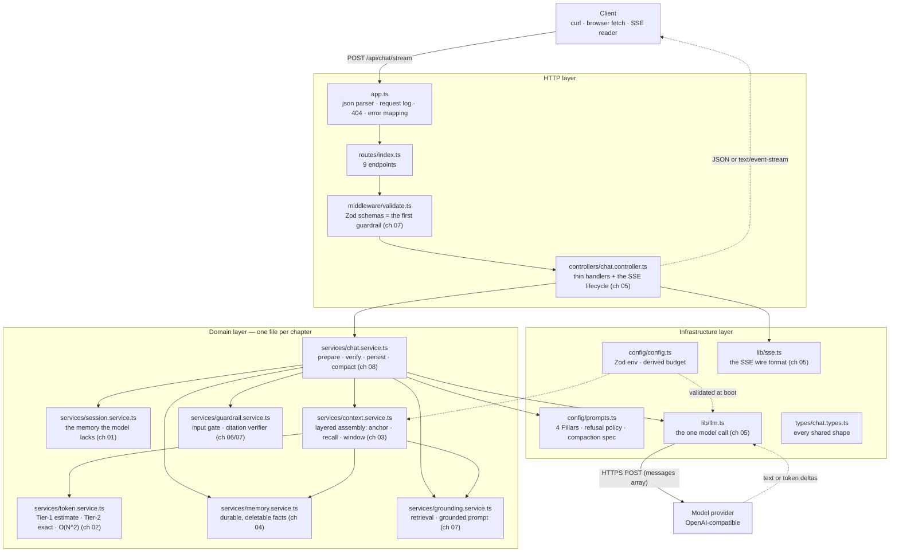
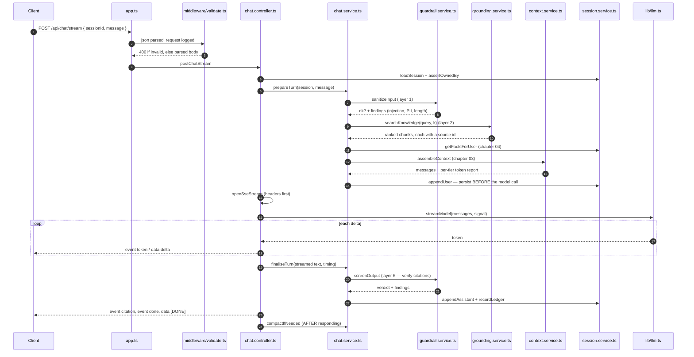

# Chapter 00: Overview, Architecture & File Structure

> **Chapter goal:** understand *what* this codebase is, *why* it is deliberately small, how one message
> travels through it, and which file belongs to which notes chapter — before reading a line of code.

---

## 0.1 What this codebase is

This is the **minimum working chatbot service** that proves the Lecture 06 notes. It is the roadmap's
**stateless multi-turn assistant**: a session store the model does not have, a token budget, a layered
context manager, durable application memory, SSE streaming, grounded refusal and a deterministic verifier.

| Rule followed | Why |
| :--- | :--- |
| One notes chapter → one file | You can read the code for chapter 03 without reading the routing layer |
| No abstraction until needed twice | `contentWords()` exists because three services need it — nothing else does |
| Configuration validated once, at boot | A bad `.env` must not become a 3 a.m. incident (chapter 08) |
| Every comment names its chapter and section | The code is *evidence* for the notes, not a second curriculum |
| Nothing is a black box | Every claim the notes make (the O(N²) bill, the refusal, the verification) is observable through an endpoint |

**What it is not:** no database, no auth server, no vector store, no tool-calling loop, no fine-tuning, no
prompt registry. Those belong to other lectures. Here we answer only: *who owns the conversation, what
exactly enters the context window, what happens when it does not fit, and how do I know the answer is true?*

> **It runs with no API key.** With an empty `OPENAI_API_KEY` the service boots in **OFFLINE mode** and
> every endpoint still works against a deterministic stub, so chapters 01–08 are studyable with zero spend.
> Set a real key and the same code path calls the real provider — nothing else changes.

---

## 0.2 Architecture



Read the diagram as three bands:

1. **HTTP layer** — knows about requests, status codes, JSON and SSE framing. It knows *nothing* about tokens.
2. **Domain layer** — knows about roles, budgets, context layers, facts, findings and verification. It knows
   *nothing* about Express.
3. **Infrastructure layer** — knows about the environment, the network, the provider and the wire format.

---

## 0.3 File structure

```text
code/Basic Code/
├── .env                        # your local values (git-ignored)
├── .env.example                # the template you copy to .env
├── .gitignore                  # node_modules, dist, .env, *.log
├── package.json                # deps + scripts
├── tsconfig.json               # ESM + NodeNext, strict
├── implementations guide/      # these chapters
└── src/
    ├── server.ts               # boot: listen + print the endpoint map
    ├── app.ts                  # express wiring: json, log, 404, error mapping
    ├── config/
    │   ├── config.ts           # Zod-validated env + the derived token budget
    │   └── prompts.ts          # deploy-time prompt artefacts (4 Pillars, refusal policy)
    ├── types/
    │   └── chat.types.ts       # Role · ChatTurn · SessionState · ContextPolicy · AssemblyReport · Finding …
    ├── middleware/
    │   └── validate.ts         # Zod request schemas + x-user-id ownership check
    ├── routes/
    │   └── index.ts            # the 9 endpoints
    ├── controllers/
    │   └── chat.controller.ts  # thin handlers + the SSE stream lifecycle
    ├── lib/
    │   ├── llm.ts              # callModel() + streamModel() + OFFLINE stub
    │   └── sse.ts              # openSseStream · sendEvent · sendHeartbeat · sendDone · sendError
    └── services/
        ├── session.service.ts  # chapter 01 — the session store
        ├── token.service.ts    # chapter 02 — token arithmetic
        ├── context.service.ts  # chapter 03 — the context manager
        ├── memory.service.ts   # chapter 04 — application memory
        ├── guardrail.service.ts# chapters 06/07 — input gate + output verifier
        ├── grounding.service.ts# chapter 07 — retrieval + grounded prompt
        └── chat.service.ts     # chapter 08 — the orchestrator
```

---

## 0.4 Which file belongs to which notes chapter

| Notes chapter | Files |
| :--- | :--- |
| 01 · Statelessness & roles | `session.service.ts` (whole file) · `config/prompts.ts` (4 Pillars) · `types/chat.types.ts` (`Role`, `ChatTurn`, `SessionState`) |
| 02 · Context window & tokens | `token.service.ts` (whole file) · `config/config.ts` (the derived budget) · `types/chat.types.ts` (`Tier`, `TurnLedger`) |
| 03 · Context management | `context.service.ts` (whole file) · `types/chat.types.ts` (`ContextPolicy`, `AssemblyReport`) |
| 04 · Context vs weights | `memory.service.ts` (whole file) · `types/chat.types.ts` (`UserFact`) |
| 05 · Streaming & SSE | `lib/sse.ts` · `lib/llm.ts` (`streamModel`) · `chat.controller.ts` (`postChatStream`) |
| 06 · Hallucination | `guardrail.service.ts` (`screenOutput`, `verifyClaims`) · `config/prompts.ts` (refusal policy) |
| 07 · Engineering defences | `guardrail.service.ts` (`sanitizeInput`) · `grounding.service.ts` (whole file) · `chat.service.ts` (`finaliseTurn`) |
| 08 · Complete architecture | `chat.service.ts` (whole file) · `routes/index.ts` · `app.ts` · `server.ts` |

> **Why the guide order is not exactly the notes order.** These chapters follow the **code dependency
> order** — you cannot read `chat.service.ts` before `context.service.ts`, because it calls it. The table
> above is the bridge: use it to jump from a notes chapter to the file that implements it.

---

## 0.5 The life of one message

`POST /api/chat/stream` — the full path, in the order the code executes it:



The two "persist" steps are **not adjacent**: the user turn is written *before* generation (durability),
the assistant turn *after* it (it does not exist until then). That asymmetry is the design, not an accident.

---

## 0.6 Commands you will need

```bash
# from: code/Basic Code/
cp .env.example .env      # optional — every endpoint works with no key
npm install               # express, zod, dotenv, openai, gpt-tokenizer
npm run typecheck         # tsc --noEmit
npm run build             # tsc → dist/
npm run dev               # tsx watch src/server.ts
```

> [!TIP]
> **Eight of the nine endpoints work with no API key at all.** Only a *live* model call needs one, and in
> OFFLINE mode even `/api/chat` and `/api/chat/stream` answer — from a deterministic stub that reads the
> `[CONTEXT]` block and cites it. That means the guardrails, the verifier and the SSE framing are all real
> even when the model is not.

---

### Navigation

- **Next:** [Chapter 01 — Project Setup & Environment](./01_Project_Setup_and_Environment.md)
- **Notes:** [../../notes/08_Complete_Enterprise_Chatbot_Architecture.md](../../../notes/08_Complete_Enterprise_Chatbot_Architecture.md)

