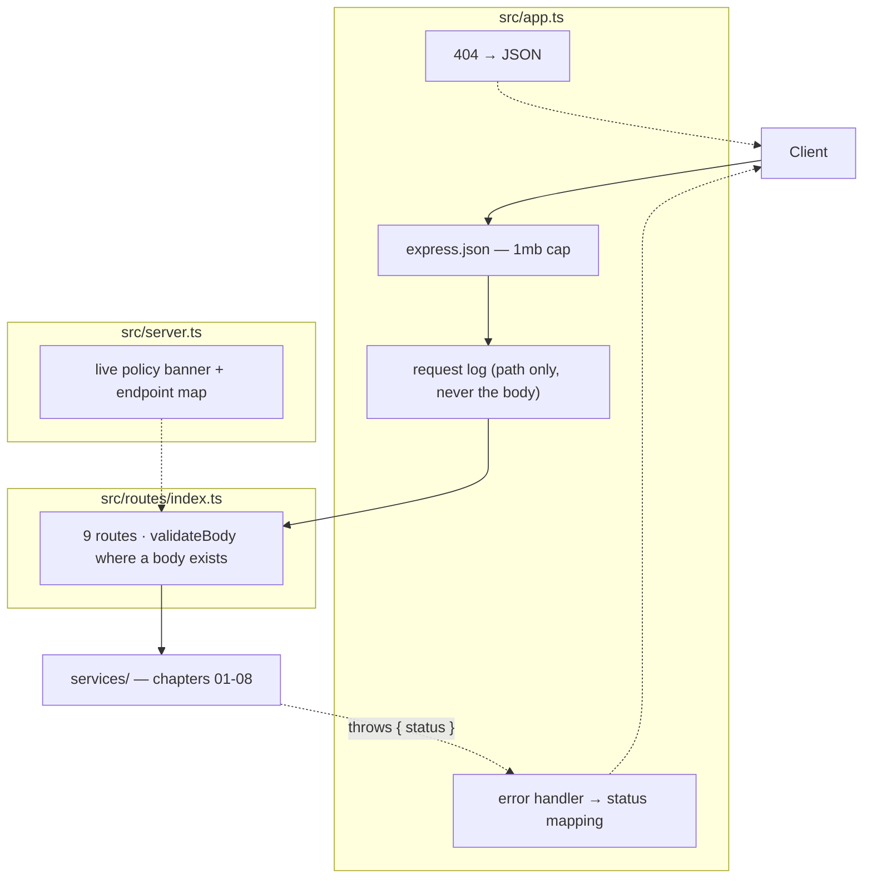

# Chapter 12: Routes, App & Server

> **Chapter goal:** wire the endpoints, map every error to a status the client can act on, and make the boot
> banner tell you the whole policy at a glance.
> **Notes chapters covered:** 08 §08.1 (the topology), §08.5 (consolidated engineering principles —
> fail fast, fail loud), 07 §07.3 (error mapping).

---

## 12.1 Files created in this chapter

| File | Purpose |
| :--- | :--- |
| `src/routes/index.ts` | the nine endpoints, each annotated with its notes chapter |
| `src/app.ts` | express wiring: json parsing, request log, 404, and the error → status mapping |
| `src/server.ts` | boot: listen, then print the live policy and the endpoint map |

---

## 12.2 Commands

```bash
npm run dev     # tsx watch src/server.ts
```

---

## 12.3 `src/routes/index.ts` (full file)

```ts
import { Router } from 'express';
import {
  getHealth,
  getSession,
  postChat,
  postChatStream,
  postMemory,
  postPreview,
  postProjection,
  postSession,
  removeSession,
} from '../controllers/chat.controller.js';
import {
  chatRequestSchema,
  memoryRequestSchema,
  previewRequestSchema,
  projectionRequestSchema,
  validateBody,
} from '../middleware/validate.js';

export const router = Router();

/** Chapter 08 §08.5 — the live wiring and the active policy, in one response. */
router.get('/health', getHealth);

/** Chapter 01 §01.2 — the session store is the memory the model does not have. */
router.post('/session', postSession);
router.get('/session/:sessionId', getSession);
router.delete('/session/:sessionId', removeSession); // chapter 04 §04.8

/** Chapter 04 §04.9 — durable, typed, categorised, deletable facts. */
router.post('/session/:sessionId/memory', validateBody(memoryRequestSchema), postMemory);

/** Chapters 02 + 03 + 07 — inspect the payload and the budget. No model call, no writes. */
router.post('/context/preview', validateBody(previewRequestSchema), postPreview);

/** Chapter 02 §02.5 — the O(N^2) accumulation projection. */
router.post('/context/projection', validateBody(projectionRequestSchema), postProjection);

/** Chapter 08 §08.6 — one message, end to end, buffered. */
router.post('/chat', validateBody(chatRequestSchema), postChat);

/** Chapter 05 §05.7 — the same turn, streamed over SSE. */
router.post('/chat/stream', validateBody(chatRequestSchema), postChatStream);
```

### Block by block

The router is a **map of the lecture**. Every line carries the chapter it implements, so you can read the
endpoint list as a table of contents:

| Method | Path | Notes | Why it exists |
| :--- | :--- | :--- | :--- |
| `GET` | `/api/health` | 08 §08.5 | the live wiring and the active policy |
| `POST` | `/api/session` | 01 §01.2 | create the memory the model lacks |
| `GET` | `/api/session/:sessionId` | 01 §01.11, 02 §02.6, 06 §06.9 | transcript + cost + refusal rate |
| `DELETE` | `/api/session/:sessionId` | 04 §04.8 | the right to be forgotten |
| `POST` | `/api/session/:sessionId/memory` | 04 §04.9 | a durable, typed fact |
| `POST` | `/api/context/preview` | 02, 03, 04, 07 | inspect the payload and the budget, no model call |
| `POST` | `/api/context/projection` | 02 §02.5 | the $O(N^2)$ accumulation curve |
| `POST` | `/api/chat` | 08 §08.6 | one message, end to end, buffered |
| `POST` | `/api/chat/stream` | 05 §05.7 | the same turn over SSE |

**Note where `validateBody` is applied and where it is not.**

```ts
router.post('/chat', validateBody(chatRequestSchema), postChat);
router.post('/session', postSession); // no body needed — identity comes from the header
```

The two `GET`s and the `POST /session` have no body schema, so they take no validator. Everything that accepts
a body does. That is §07.3's "the request shape IS the first guardrail", applied consistently rather than
wherever it was convenient.

**Why `POST /api/context/preview` and not `GET`.** Semantically it is a read, but the payload contains a
conversation id and a message that can be up to 8,000 characters — far too large for a query string, and a
query string would put user text into access logs. `POST` is the correct verb when the request *body* is the
input, regardless of whether the operation mutates.

---

## 12.4 `src/app.ts` (full file)

```ts
import express, { NextFunction, Request, Response } from 'express';
import { router } from './routes/index.js';

export const app = express();

app.use(express.json({ limit: '1mb' }));

/** One log line per request; the timestamp is what you grep for later. */
app.use((req: Request, _res: Response, next: NextFunction) => {
  console.log(`[${new Date().toISOString()}] ${req.method} ${req.path}`);
  next();
});

app.use('/api', router);

app.use((_req: Request, res: Response) => {
  res.status(404).json({ error: 'Not Found', message: 'The requested resource does not exist.' });
});

/**
 * Chapter 07 §07.3 — map an error to the status the client can act on.
 * 401 = no x-user-id · 403 = session owned by someone else · 404 = unknown session.
 */
app.use((error: Error, _req: Request, res: Response, _next: NextFunction) => {
  const status = Number((error as { status?: number }).status) || 500;
  const titles: Record<number, string> = {
    400: 'Bad Request',
    401: 'Unauthenticated',
    403: 'Forbidden',
    404: 'Not Found',
    502: 'Provider returned an unusable response',
    503: 'Model credentials are not configured',
  };

  console.error(`❌ ${status} ${error.message}`);
  res.status(status).json({ error: titles[status] ?? 'Internal Server Error', message: error.message });
});
```

### Block by block

**`express.json({ limit: '1mb' })`** — a body limit before anything else. Without it, an attacker can stream
an arbitrarily large JSON document into memory. One megabyte is generous for this API (the message cap is
8,000 characters) and it fails fast.

**The request log** — one line per request, with an ISO timestamp:

```ts
app.use((req, _res, next) => {
  console.log(`[${new Date().toISOString()}] ${req.method} ${req.path}`);
  next();
});
```

Deliberately minimal. It logs the **path**, not the body — because the body contains user messages and PII,
and a log file is not the place for either. Chapter 07 §07.3's PII concerns apply to your logs too.

**The 404 handler** returns JSON, not Express's HTML page. An API that sometimes returns HTML on error forces
every client to handle two formats.

**The error handler — the mapping table.**

```ts
const status = Number((error as { status?: number }).status) || 500;
const titles: Record<number, string> = {
  400: 'Bad Request',
  401: 'Unauthenticated',
  403: 'Forbidden',
  404: 'Not Found',
  502: 'Provider returned an unusable response',
  503: 'Model credentials are not configured',
};
```

This is where every `Object.assign(new Error(...), { status: 403 })` from the services finally becomes an HTTP
status. The pattern is worth naming: **services throw domain errors with a status; one middleware translates
them.** No service imports Express, and no route needs a try/catch for the common cases.

| Status | Thrown by | Trigger |
| :--- | :--- | :--- |
| 401 | `requireUserId` | no `x-user-id` header |
| 403 | `assertOwnedBy` | the session belongs to someone else |
| 404 | `requireSession` / the controllers | unknown session |
| 500 | anything else | an unexpected failure |

**`console.error` before responding** — the log line happens even when the client gets a generic message, so a
500 is always traceable server-side without leaking internals to the caller.

---

## 12.5 `src/server.ts` (full file)

```ts
import { app } from './app.js';
import { config, CONTEXT_POLICY } from './config/config.js';
import { isOffline } from './lib/llm.js';

app.listen(config.PORT, () => {
  console.log('=======================================================');
  console.log('🚀 Lecture 06 — Basic Chatbot & Context Lab');
  console.log(`📡 Server           : http://localhost:${config.PORT}`);
  console.log(`🤖 Provider         : ${config.AI_PROVIDER} · ${config.AI_MODEL} (temperature ${config.AI_TEMPERATURE})`);
  console.log(`🔑 Mode             : ${isOffline() ? 'OFFLINE stub — every endpoint still works' : 'LIVE provider'}`);
  console.log(`🪟 Context window   : ${config.CONTEXT_WINDOW_TOKENS} tokens · output reserve ${config.AI_MAX_TOKENS}`);
  console.log(`💰 Input budget     : ${config.INPUT_BUDGET} tokens (10% safety margin)`);
  console.log(`🧠 Context policy   : window ${CONTEXT_POLICY.budgetTokens} tokens · anchor K=${CONTEXT_POLICY.anchorTurns} · recent M=${CONTEXT_POLICY.recentTurns}`);
  console.log(`🗜️  Compaction       : at ${CONTEXT_POLICY.summariseThreshold} turns, recall k=${CONTEXT_POLICY.semanticRecall}`);
  console.log(`🛡️  Guardrails       : ${config.MAX_INPUT_CHARS} char cap · citation threshold ${config.CITATION_MATCH_THRESHOLD} · strict=${config.STRICT_VERIFICATION}`);
  console.log('-------------------------------------------------------');
  console.log('🔍 GET    /api/health');
  console.log('🆕 POST   /api/session                       (x-user-id header required)');
  console.log('📜 GET    /api/session/:sessionId            (transcript + cost + refusal rate)');
  console.log('🗑️  DELETE /api/session/:sessionId            (right to be forgotten)');
  console.log('🧠 POST   /api/session/:sessionId/memory     (durable fact)');
  console.log('🔎 POST   /api/context/preview               (no model call)');
  console.log('📈 POST   /api/context/projection            (O(N^2) vs bounded)');
  console.log('💬 POST   /api/chat                          (buffered, verified)');
  console.log('⚡ POST   /api/chat/stream                   (SSE: text/event-stream)');
  console.log('=======================================================');
});
```

### Block by block

The whole file is one `app.listen` callback — and it is the most useful 25 lines in the project, because it
prints the **live policy** rather than a logo:

```
🪟 Context window   : 128000 tokens · output reserve 600
💰 Input budget     : 114660 tokens (10% safety margin)
🧠 Context policy   : window 40131 tokens · anchor K=2 · recent M=6
🗜️  Compaction       : at 8 turns, recall k=3
🛡️  Guardrails       : 8000 char cap · citation threshold 0.6 · strict=true
```

Every number here is a *derived* value, computed from `.env` at boot. That is the point: after you change
`HISTORY_TIER_SHARE` or `RECENT_TURNS`, the banner tells you the consequence before you send a request.

| Line | Source | Notes |
| :--- | :--- | :--- |
| `🔑 Mode` | `isOffline()` | Tells you immediately whether a real model is behind this process |
| `💰 Input budget` | `config.INPUT_BUDGET` | Chapter 02 §02.9 step 1's $B_{\text{input}}$ |
| `🧠 Context policy` | `CONTEXT_POLICY` | Chapter 03 §03.8's declarative policy, all four levers |
| `🛡️ Guardrails` | config | Chapter 07 §07.3 / §07.8 thresholds, including `strict` |

The banner prints the endpoint map last, so the terminal doubles as your `curl` cheat sheet while you work
through these chapters.

**Why `config` and `CONTEXT_POLICY` are imported here and not re-derived.** Because chapter 02 §02.3 froze
them at boot. `server.ts` reads the frozen values, which guarantees the banner cannot disagree with the
behaviour.

---

## 12.6 The topology, top to bottom

Put the three files together and you have chapter 08 §08.1's topology in miniature:



The one-way arrow into `services/` is the design rule from chapter 00: the domain layer knows nothing about
Express. The dotted arrow back out is the *only* channel — a thrown error with a `status` property.

---

## 12.7 Verify

```bash
npm run dev
```

You should see the banner with `Mode: OFFLINE stub` (assuming no key in `.env`). Then:

```bash
curl -s http://localhost:8090/api/health | node -pe 'JSON.stringify(JSON.parse(require("fs").readFileSync(0,"utf8")), null, 1)'
```

Check three things in the response: `mode`, `inputBudget`, and `contextPolicy.budgetTokens`. They must match
the banner exactly — if they do not, you have two sources of truth somewhere, and that is a bug worth finding
before you build anything on top.

---

### Navigation

- **Previous:** [Chapter 11 — HTTP Layer: Validation & Controllers](./11_HTTP_Layer_Validation_and_Controllers.md)
- **Next:** [Chapter 13 — End-to-End Verification](./13_End_to_End_Verification.md)
- **Notes:** [../../notes/08_Complete_Enterprise_Chatbot_Architecture.md](../../../notes/08_Complete_Enterprise_Chatbot_Architecture.md)
