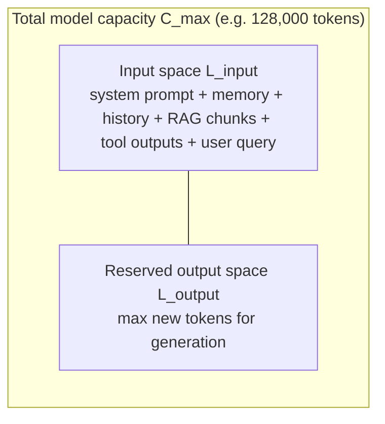
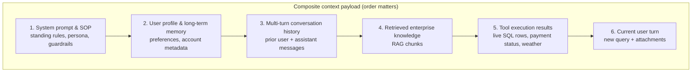
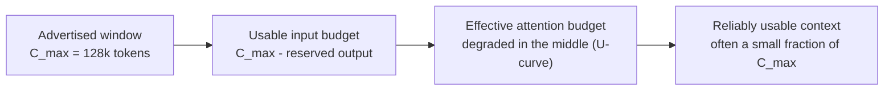
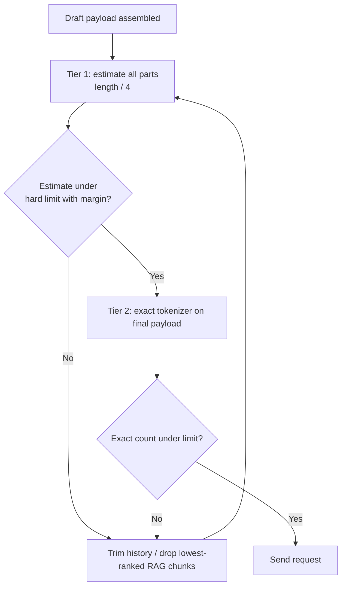
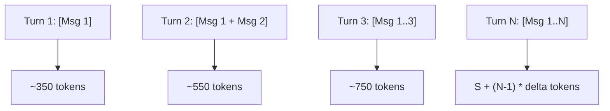
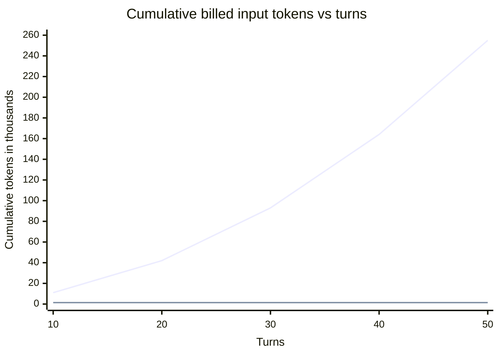
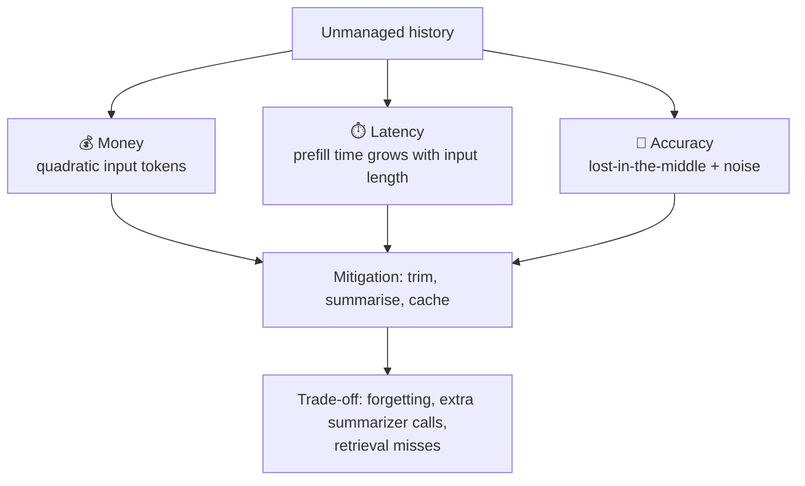
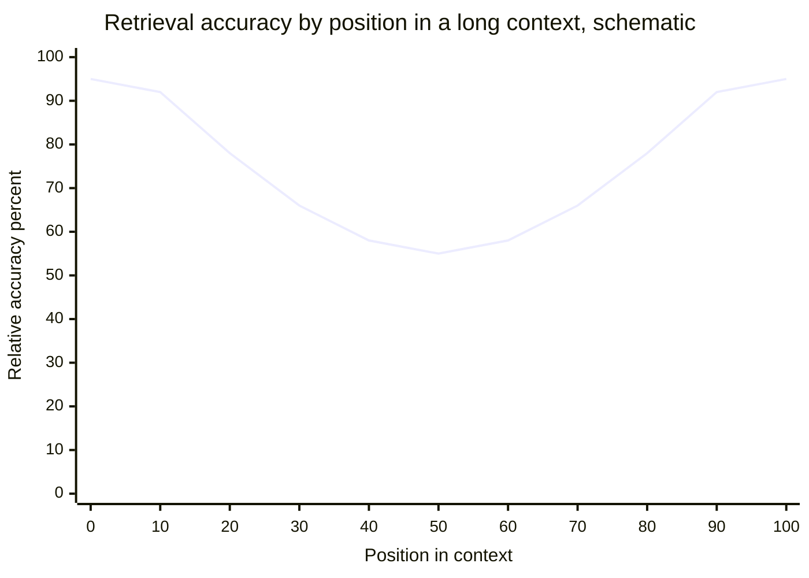
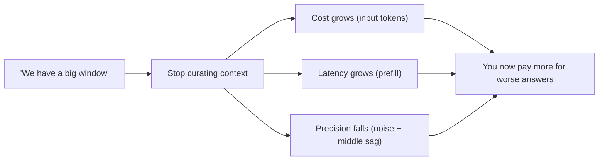
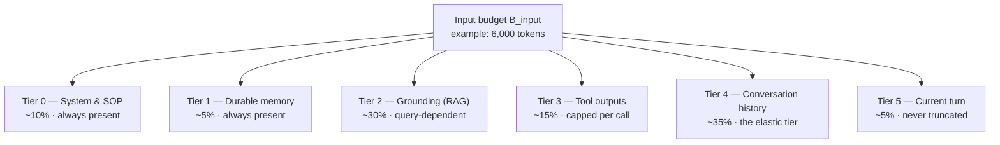

# Chapter 02 — Context Windows & Token Accumulation

> **Lecture 06 · Chapter 02 of 08** · Level: 🟡 Intermediate · Phase 2 — The Application Layer
> **Source:** `Forward-Deployed-Engineer/Lecture 04/notes/02_Context_Windows_Token_Accumulation_and_Context_Management.md` (§2.1–§2.4)
> **Roadmap topics:** context windows · token accumulation · growth arithmetic · the cost of history.
> **Prerequisites:** Chapter 01 (statelessness, hydration) · Lecture 02 (tokens, embeddings, next-token prediction).

---

## 02.0 What this chapter is for

Chapter 01 established that **the application carries the conversation**. This chapter answers the question that
follows immediately and painfully:

> If the application carries the conversation, **how much of it can it carry — and what does carrying it cost?**

There are three hard constraints, and they are all the same constraint viewed from different angles:

| Constraint | Where you feel it | Chapter section |
| :--- | :--- | :--- |
| **Space** | The request is rejected, or the answer is cut off mid-sentence | §02.1, §02.3 |
| **Money & latency** | Your bill and your p95 grow faster than your conversation does | §02.4–§02.6 |
| **Accuracy** | The model "ignores" the fact you carefully included | §02.7 |

By the end of this chapter you should be able to:

1. State the capacity constraint $L_{\text{input}} + L_{\text{output}} \le C_{\text{max}}$ and explain the
   **context starvation trap**.
2. List the six subsystems that compete for the same window, and the failure mode of each.
3. Estimate tokens well enough to run a budget without an exact tokenizer on every path.
4. Derive the **$O(N^2)$ quadratic accumulation** result and compute a real token ledger.
5. Explain the **lost-in-the-middle** effect and why "just use a bigger window" is not a strategy.
6. Allocate a production token budget across system, memory, history, retrieval, tools and reserved output.

> Context *management strategies* (how to choose what to drop) are chapter 03. This chapter is about the arithmetic
> that makes those strategies necessary.

---

## 02.1 The anatomy of the context window

The **context window** is the total finite working capacity of the model for one inference cycle. It is measured
strictly in **tokens** — not words, not characters, not messages.

### The "sheet of paper" mental model

Imagine an expert analyst at a desk with one empty sheet of paper:

1. You write the standing instructions at the top.
2. You transcribe the previous dialogue.
3. You paste in relevant manual pages or database records.
4. You write the user's new question at the bottom.
5. You say: *"Answer using only what is on this sheet."*

The analyst has no filing cabinet, no memory of yesterday's conversation, and no ability to look anything up —
unless it is written on the sheet. The sheet is the context window.



### The capacity constraint

Every foundation model enforces a hard architectural limit on total sequence length $C_{\text{max}}$:

$$L_{\text{total}} = L_{\text{input}} + L_{\text{output}} \le C_{\text{max}}$$

| Symbol | Meaning |
| :--- | :--- |
| $L_{\text{input}}$ | Sum of every prompt token submitted (system, memory, history, retrieval, tools, query) |
| $L_{\text{output}}$ | Tokens the model generates during autoregressive decoding |
| $C_{\text{max}}$ | Architectural maximum sequence length for that model (e.g. 8,192 · 128,000 · 1,000,000) |

### The context starvation trap

> If an application fills 99% of $C_{\text{max}}$ with history and retrieved documents, the model is physically
> throttled. With $C_{\text{max}} = 8{,}192$ and $L_{\text{input}} = 8{,}100$, the model can emit at most **92
> tokens** before hitting the ceiling — truncating the answer mid-sentence with `finish_reason: "length"`.

This failure is insidious because it looks like a model quality problem ("the bot's answers are cut off / too
short") when it is actually a budgeting problem. It is why every production system reserves an explicit output
allowance *before* it fills the input side.

---

## 02.2 What actually enters the context window

In an enterprise application the window is **not** mostly chit-chat. It is a contested workspace shared by six
subsystems, each with a different owner, refresh rate and failure mode.



| Component | Source | Variability | Failure mode if unmanaged |
| :--- | :--- | :--- | :--- |
| **System prompt / SOP** | Application code | Static per deployment | Token bloat if over-engineered; internal instruction conflicts |
| **User profile / memory** | DB or cache | Per user, slow-changing | Stale facts injected confidently |
| **Conversation history** | Session storage | Grows every turn | **Quadratic token expansion**; overflow (§02.5) |
| **RAG knowledge** | Vector + keyword search | Per query | Irrelevant chunks crowd out the real answer |
| **Tool outputs** | Microservice APIs | Per tool call | A 40 KB JSON blob eats 80% of the window |
| **Current query** | End user | Per turn | Prompt injection; adversarial formatting |

Three practical observations that follow from the table:

1. **Only one of the six grows monotonically.** History is the component that *will* eventually break you. The
   others are bounded or refreshed.
2. **Two of the six are attacker-influenced** (the current query, and any content retrieved from documents a user
   can write). Treat both as untrusted data (chapter 07).
3. **Ordering is a design decision.** Whatever sits at the very beginning and very end of the prompt gets the
   strongest attention (§02.7). Put standing rules at the start and the live question at the end.

---

## 02.3 Why the window feels bigger than it is

Three effects make teams systematically overestimate how much room they have.



- **The reserved-output subtraction.** If you want a 1,000-token answer, you have $C_{\text{max}} - 1000$ for input.
- **The attention-quality discount.** A token being *present* is not the same as a token being *used*. Recall
  degrades in the middle of long prompts (§02.7).
- **The noise discount.** Every irrelevant chunk you inject lowers the relative signal of the relevant one. Filling
  a window with plausible-but-unrelated text actively *hurts*.

> **The FDE context principle:** **relevant context ≫ maximum context.** The engineering question is never *"how
> many tokens fit?"* — it is *"which tokens are required, and nothing else?"*

---

## 02.4 Token arithmetic: how to count without counting

You cannot manage a budget you cannot measure. But you also cannot run a full BPE tokenizer over every candidate
payload on every request without paying latency for it. Production systems use a **two-tier estimate**.

### Tier 1 — the cheap heuristic (for planning and guardrails)

For English prose, modern BPE tokenizers average roughly **1 token ≈ 4 characters ≈ 0.75 words**. So:

```ts
// pseudo-code — deliberately approximate; good enough for guardrails
function estimateTokens(text: string): number {
  return Math.ceil(text.length / 4)   // English rule of thumb
}
```

Properties that matter:

| Property | Why it is acceptable |
| :--- | :--- |
| Fast (no model, no WASM) | Runs on every candidate message during trimming |
| Slightly *over*-estimates for prose | Over-estimating is the safe direction — you reserve a little too much |
| Wrong for code, JSON, CJK, emoji | These tokenize much denser/looser; never trust it for exact billing |

### Tier 2 — the exact tokenizer (for billing and hard limits)

When you need exactness — cost reporting, hard `max_tokens` enforcement, context-limit safety margins — use a real
tokenizer library (e.g. a `tiktoken`-style encoder for the target model family) on the final assembled payload only.



### Things that silently break token estimates

- **Non-English text.** Many scripts cost more tokens per character than English.
- **JSON and tool output.** Punctuation-dense strings tokenize poorly; a pretty-printed JSON blob can be 2-3× the
  token cost of its minified form.
- **Code.** Whitespace, identifiers and symbols all cost tokens.
- **Very long single tokens.** Rare words split into many sub-word pieces.
- **Emoji and combining characters.** Multi-codepoint grapheme clusters cost several tokens.

> **Rule:** use the estimate to *decide*, use the tokenizer to *report and to enforce*. Never mix the two.

---

## 02.5 The quadratic token accumulation problem ($O(N^2)$)

The most common beginner pattern is **naive history appending**: take the existing message array, append the new
exchange, resend the whole thing.

```text
Turn 1: [System] + [User 1]                                        -> sent
Turn 2: [System] + [User 1] + [Assistant 1] + [User 2]             -> sent
Turn 3: [System] + [User 1] + [Assistant 1] + [User 2] + [A 2] + [U 3] -> sent
...
Turn N: [System] + [all N-1 prior turns] + [User N]                -> sent
```

Each request is individually reasonable. The *total* is not.



### Derivation

Let:

- $S$ = system prompt size (tokens)
- $U$ = average user message size
- $A$ = average assistant response size
- $\Delta = U + A$ = average expansion per complete turn
- $Q$ = size of the newest user question

For turn $k$, the input token count of **that one request** is:

$$L_{\text{input}}(k) = S + (k-1)\cdot\Delta + Q$$

The **cumulative billed input tokens** across an $N$-turn conversation is the arithmetic series:

$$T_{\text{cumulative}}(N) = \sum_{k=1}^{N}\bigl(S + (k-1)\Delta + Q\bigr)$$

$$T_{\text{cumulative}}(N) = N(S+Q) + \Delta\sum_{k=1}^{N}(k-1) = N(S+Q) + \Delta\cdot\frac{(N-1)N}{2} = \mathcal{O}(N^2)$$

> **The $O(N^2)$ economic explosion:** total tokens processed do not scale linearly with conversation length —
> they scale **quadratically**. Doubling the conversation length roughly **quadruples** the historical tokens you
> re-process and re-pay for.

Note also what is *not* quadratic: the number of tokens the model must **generate** stays roughly linear. The blow-up
is entirely on the **re-sent input** side. That is why the fix (chapter 03) is about *what you resend*, not about
*what the model produces*.

### Concrete token ledger: naive vs managed history

Assume realistic enterprise values:

- System prompt $S = 150$ tokens
- User message $U = 50$ tokens
- Assistant response $A = 150$ tokens
- Expansion per turn $\Delta = 200$ tokens

| Turn $k$ | Naive request tokens $L_{\text{input}}$ | Naive cumulative billed | Managed sliding window ($K=6$ turns) | Saving |
| :---: | :---: | :---: | :---: | :---: |
| **1** | 200 | 200 | 200 | 0% |
| **5** | 1,000 | 3,000 | 1,000 | 0% |
| **10** | 2,000 | 11,000 | 1,400 | 30% |
| **20** | 4,000 | 42,000 | 1,400 | 65% |
| **50** | 10,000 | 255,000 | 1,400 | **86%** |
| **100** | 20,000 | 1,010,000 | 1,400 | **93%** |

In an unmanaged 100-turn support session you pay for **over 1,000,000 input tokens** to hold a dialogue that
contained a few thousand unique words.



> **Read the chart this way:** the managed line is **flat**. That flatness is the entire engineering goal — a
> conversation that grows without cost, latency or failure-mode growth.

---

## 02.6 The cost of history in three currencies

History is not free in any dimension. It is expensive in three, and they trade off against each other.



| Currency | Mechanism | What you can buy back |
| :--- | :--- | :--- |
| **Money** | Every turn re-sends the whole transcript; input tokens dominate chat bills | Trimming, summarisation, prefix caching (chapter 03) |
| **Latency** | Prefill cost scales with prompt length — long prompts delay the **first** token | Smaller prompts, retrieval instead of dumping |
| **Accuracy** | Attention degrades in long contexts; irrelevant history acts as noise | Precision filtering, anchors, summarisation |

Two asymmetries worth remembering:

1. **Latency is paid on the critical path.** Extra input tokens delay Time-To-First-Token (§05.3) *before the user
   sees anything*. Cost is invisible to the user; latency is not.
2. **Accuracy loss is invisible to everyone.** Nobody gets an error when the model ignores a fact in the middle of
   a 100k-token prompt. It just answers wrong — confidently (chapter 06).

---

## 02.7 The "lost-in-the-middle" phenomenon

In *Liu et al. (Stanford / Berkeley, 2023), "Lost in the Middle: How Language Models Use Long Contexts"*, the
researchers showed that retrieval accuracy across a long context follows a pronounced **U-shaped curve**.



1. **Primacy effect (beginning).** The model attends strongly to the first tokens — where your system instructions
   live.
2. **Recency effect (end).** The model attends strongly to the final tokens — the user's current question.
3. **Information sag (middle).** Facts placed in the middle of a large prompt can suffer a **30–50% drop** in
   retrieval accuracy relative to the ends.

### What this changes in practice

| If you were going to… | Do this instead |
| :--- | :--- |
| Dump 50 RAG chunks and hope the right one is in there | Rank and keep the top 3–5; put the best first |
| Bury the output contract in the middle of a long system prompt | Put standing rules first, the output contract last (or repeat it) |
| Assume "it's in the context so it's used" | Assume position matters; re-ask the key fact near the query |
| Trust a 1M-token window to compensate for no retrieval | Keep retrieval precision as the primary lever |

> **The engineering translation:** long context is a *capacity* feature, not a *precision* feature. Bigger windows
> reduce the chance of a hard overflow. They do not remove the need to choose what goes in.

---

## 02.8 The fallacy of "send everything"

Modern models advertise enormous windows:

- GPT-4o — ~128k tokens (≈ 96,000 words)
- Claude 3.5 Sonnet — ~200k tokens (≈ 150,000 words)
- Gemini 1.5 Pro — ~1–2M tokens

This tempts teams into a specific architectural blunder:

> *"We have a million-token window. We'll just dump the whole history, complete tables and all user manuals into
> every prompt."*

### The analyst analogy

You walk into a colleague's office and ask:

> *"What was the key policy decision Rohit made about Java deployments last year?"*

Instead of handing over the **2-page memo**, you dump **50 boxes containing 250,000 pages** of emails, chat logs,
calendar invites and expense receipts on the desk and say: *"It's in there somewhere."*

Four things go wrong, and each maps to a real system metric:

| What happens | Which system cost |
| :--- | :--- |
| The analyst takes far longer to answer | **Latency** (prefill + attention over a huge prompt) |
| The critical memo, buried in box 34, is missed | **Accuracy** (lost-in-the-middle) |
| Conflicting emails from other colleagues distract | **Noise → hallucination risk** |
| The cost of reviewing 250,000 pages is enormous | **Money** |

### Why "just send everything" feels safe but is not



> **The corrected instinct:** treat the window as a **budget to be allocated**, not a **container to be filled**.
> Every token you spend on history is a token you did not spend on retrieved truth, and a token you may have to
> drop from the answer's reserved output space.

---

## 02.9 Budget arithmetic in practice (an added topic)

The source notes describe the constraint but do not give a concrete allocation recipe. Here is one that works
across support bots, copilots and assistants.

### Step 1 — pick the operating budget, not the maximum

Never budget against $C_{\text{max}}$. Budget against a **safe operating limit**:

$$B_{\text{input}} = C_{\text{max}} - B_{\text{output}} - M_{\text{safety}}$$

- $B_{\text{output}}$ — the largest answer you want to allow (e.g. 1,000 tokens)
- $M_{\text{safety}}$ — a margin for tokenizer drift, tool-result surprises and provider-side overhead (e.g. 10%)

### Step 2 — allocate the input budget by tier



| Tier | Content | Policy | If over budget |
| :--- | :--- | :--- | :--- |
| 0 | System prompt + SOP | Never dropped | Fix the prompt — it is too long |
| 1 | Profile, durable facts | Never dropped | Cap the number of facts injected (top-K by relevance) |
| 2 | RAG chunks | Top-K ranked | Reduce K; re-rank; summarise chunks |
| 3 | Tool outputs | Hard cap per tool call | Project only the fields the model needs |
| 4 | Conversation history | **Elastic — absorbs all pressure** | Apply chapter 03 strategies |
| 5 | Current user turn | Never truncated | Reject with a clear error if absurdly large |

The key design insight: **only one tier is elastic**. If you try to make every tier elastic you get unpredictable
behaviour; if you make none elastic you get hard failures. History is the right tier to compress because it is the
one whose loss degrades gracefully.

### Step 3 — reserve output *first*, then fill input

```ts
// pseudo-code — budget-first assembly
const C_MAX = 128_000
const B_OUTPUT = 1_000
const MARGIN   = 0.10

const B_INPUT = Math.floor((C_MAX - B_OUTPUT) * (1 - MARGIN))   // ~114k
const tiers = {
  system:   fixed(systemPrompt),          // tier 0 — must fit, else fail fast at deploy time
  memory:   takeTopK(profileFacts, 12),   // tier 1
  grounded: takeTopK(ragChunks, 5),       // tier 2
  tools:    capPerCall(toolResults),      // tier 3
  history:  [],                           // tier 4 — filled last, absorbs the remainder
  current:  [{ role: 'user', content: userText }], // tier 5
}

tiers.history = fillHistoryUntilBudget(remainingBudgetAfter(tiers), session.turns) // chapter 03
```

### Step 4 — instrument the budget, don't guess it

Emit per-request telemetry: total input tokens, per-tier tokens, trimming events, and overflow rejections. Without
that data, every budget conversation is an argument; with it, it is arithmetic.

| Metric | Why it matters |
| :--- | :--- |
| `input_tokens_p50 / p95` | Detects cost creep before the invoice does |
| `tokens_by_tier` | Shows *which* tier is eating the window |
| `history_trim_events` | Confirms the context manager is actually working |
| `output_truncated_count` | Detects the context starvation trap (§02.1) |
| `cache_hit_ratio` | Measures whether your prompt prefix is stable enough to be cached |

### Step 5 — make the failure mode explicit

Decide, in advance, what happens when the budget cannot be met:

| Policy | Behaviour | When to choose |
| :--- | :--- | :--- |
| **Fail closed** | Reject the request with a clear error | Compliance, billing, safety-critical flows |
| **Degrade gracefully** | Drop the lowest-priority tier (usually history) | Conversational products |
| **Escalate** | Route to a human | Support flows with SLA obligations |

---

## 02.10 Common mistakes

- **Budgeting against $C_{\text{max}}$ instead of a safe operating limit.** You will hit `finish_reason: "length"`
  at exactly the worst moment.
- **Forgetting to reserve output tokens.** The **context starvation trap**: input eats the window, answers get cut
  off mid-sentence.
- **Using a character heuristic for billing.** `length / 4` is fine for trimming decisions, wrong for invoices and
  hard limits.
- **Assuming a big window removes the need for retrieval precision.** Capacity ≠ precision.
- **Treating "present in context" as "used by the model".** Lost-in-the-middle says otherwise.
- **Appending history forever "because it fits".** Fits is not the same as affordable, fast or accurate.
- **Ignoring prefill latency.** Long prompts delay the first token, which is exactly what the user perceives
  (§05.3).
- **No per-tier token telemetry.** You cannot tell whether history, RAG or a tool blob is eating the window.
- **Making every tier elastic.** Unpredictable behaviour; make history the single elastic tier.
- **Pretty-printing tool JSON into the prompt.** Minify and project the fields — the same information can cost a
  fraction of the tokens.

---

## 02.11 Key takeaways

1. **The context window is a hard architectural constraint:** $L_{\text{input}} + L_{\text{output}} \le C_{\text{max}}$.
2. **Six subsystems share the window.** Only history grows without bound; it is the tier that must be managed.
3. **Naive history appending is $O(N^2)$.** Cumulative billed input tokens scale quadratically with turn count.
4. **The blow-up is on the input side.** Generated tokens scale roughly linearly; re-sent history does not.
5. **History costs money, latency and accuracy.** All three, every turn.
6. **Lost-in-the-middle is real.** Middle-position facts can lose 30–50% recall in long prompts.
7. **Relevant context beats maximum context.** Filtering is the primary lever, not window size.
8. **Two-tier token counting.** Estimate to decide, tokenize to report and enforce.
9. **Allocate a budget by tier, and make exactly one tier elastic** — conversation history.
10. **Instrument the budget.** `tokens_by_tier`, trim events and truncation counts turn opinions into arithmetic.
11. **Decide the failure mode in advance.** Fail closed, degrade gracefully, or escalate — never "it depends".

---

## 02.12 Self-check questions

1. Write the capacity constraint and explain the context starvation trap with numbers.
2. Name the six components that compete for the window. Which one is unbounded, and why?
3. Estimate the tokens in a 2,400-character English paragraph, then explain two reasons the estimate could be off
   by 50%.
4. Derive $T_{\text{cumulative}}(N) = N(S+Q) + \Delta\frac{(N-1)N}{2}$ and explain why it is $\mathcal{O}(N^2)$.
5. With $S=150$, $U=50$, $A=150$, how many cumulative input tokens does a 40-turn naive conversation consume?
6. What is "lost in the middle", and what two design changes does it force on your prompt layout?
7. Why is latency a worse user-facing cost than money in this context?
8. Sketch a five-tier token budget for a support bot with a 32k window and a 600-token answer allowance.
9. Which single tier should absorb budget pressure, and why does it degrade gracefully?
10. Name four metrics you would emit to prove your context budget is under control.

---

### Navigation

- **Previous:** [Chapter 01 — Stateless LLMs, Conversation History & Role Architecture](./01_Stateless_LLMs_Conversation_History_and_Role_Architecture.md)
- **Next:** [Chapter 03 — Context Management Strategies](./03_Context_Management_Strategies.md)
- **Source:** `Forward-Deployed-Engineer/Lecture 04/notes/02_Context_Windows_Token_Accumulation_and_Context_Management.md` (§2.1–§2.4)
- **Roadmap:** [Lecture 06 — Chatbots: Statelessness, Context, Memory & Hallucination](../../roadmap.md)
