# Chapter 03 — Context Management Strategies

> **Lecture 06 · Chapter 03 of 08** · Level: 🟡 Intermediate · Phase 2 — The Application Layer
> **Source:** `Forward-Deployed-Engineer/Lecture 04/notes/02_Context_Windows_Token_Accumulation_and_Context_Management.md` (§2.5–§2.7)
> **Roadmap topics:** context management strategies (truncation, summarisation, sliding window — first pass).
> **Prerequisites:** Chapter 02 (the capacity constraint, $O(N^2)$ accumulation, lost-in-the-middle) ·
> Chapter 01 (hydration).

---

## 03.0 What this chapter is for

Chapter 02 proved that you cannot send everything. This chapter is the engineering answer to a deceptively hard
question:

> **Which parts of the conversation do you keep, in what form, and when do you throw them away?**

The naive answer — "keep the last N turns" — is a real strategy, and it is a good one for many products. But it is
only one of four proven architectures, and choosing the wrong one produces a specific, predictable failure:

| Wrong choice | What the user experiences |
| :--- | :--- |
| Sliding window on a long onboarding flow | *"I already told you my account number."* |
| Rolling summarisation on a 3-turn transactional bot | Extra latency and cost for no benefit |
| Pinned anchor without recent turns | *"You're ignoring what I just said."* |
| Semantic RAG on a strict chronological task | Answers assembled out of order |

By the end of this chapter you should be able to:

1. Describe context management as four levers: **retain, compress, retrieve, evict**.
2. Implement (in pseudo-code) a **token-budgeted sliding window** and a **pinned-anchor window**.
3. Design a **rolling summarisation** pipeline, including *what the summary must preserve*.
4. Explain **semantic history RAG** and when recency is the wrong retrieval key.
5. Combine strategies into a layered pipeline and pick one for a given product.
6. Name the operational hazards: summariser drift, prefix-cache breakage, cost of compaction, and how to test it.

---

## 03.1 Context management as four levers

Every strategy in this chapter is a combination of four moves. Naming them separately makes the design space much
easier to reason about.

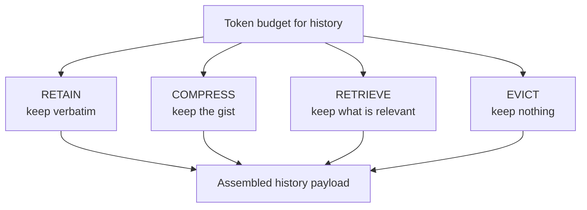

| Lever | Mechanism | Cheapest? | Lossy? | Reversible? |
| :--- | :--- | :--- | :--- | :--- |
| **RETAIN** | Send the turn verbatim | ✅ Cheapest (zero extra compute) | ❌ No loss | — |
| **COMPRESS** | Summarise turns into a paragraph | ❌ Costs an extra model call | ✅ Yes — quotes and exact values may blur | ❌ No |
| **RETRIEVE** | Index turns; fetch by similarity | ❌ Costs embedding + vector query | ✅ Yes — chronological gaps | ⚠️ Retrievable but out of order |
| **EVICT** | Drop the turn entirely | ✅ Cheapest | ✅ Total | ❌ No (unless persisted elsewhere) |

> **The central trade-off:** every lever except RETAIN spends compute or loses information. RETAIN is only expensive
> in *tokens*. So the first question is always: *"can I afford to retain this, given the budget?"*

### The two invariants every strategy must respect

1. **Never evict the current user turn.** It is the request.
2. **Never evict the standing system prompt** (or, if you must shorten it, do so deterministically at deploy time,
   not dynamically per request).

Everything else is negotiable.

---

## 03.2 Strategy 1 — Sliding window (FIFO buffer)

**Mechanism.** Retain only the most recent $K$ turns (or up to a strict token budget $B$). When a new turn arrives,
the oldest turn is evicted from the payload.

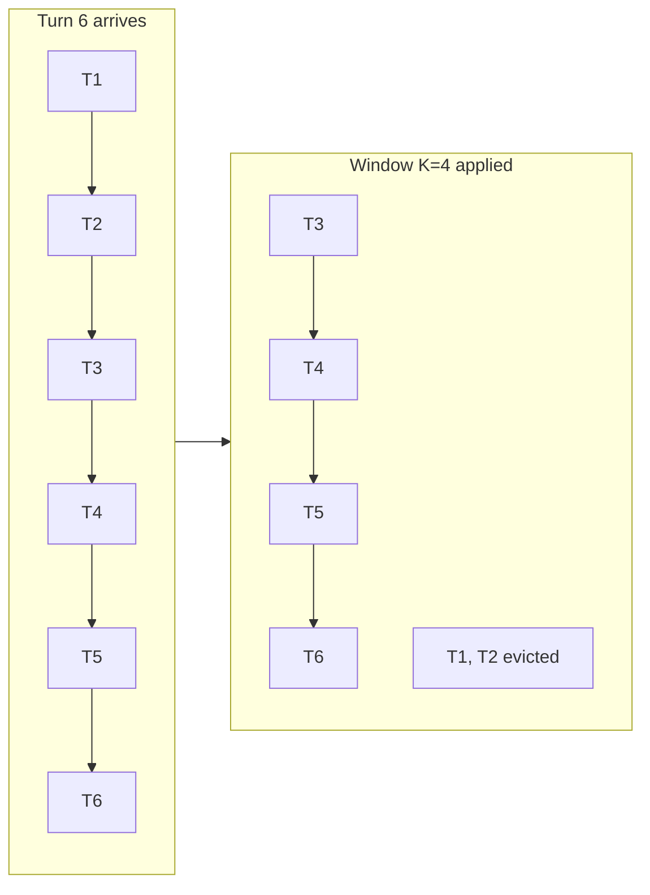

| | |
| :--- | :--- |
| **Pros** | Trivial to implement; guarantees a constant upper bound on per-request tokens, cost and latency; prefix-friendly (the tail is stable) |
| **Cons** | Total amnesia beyond the cutoff — an account number stated in turn 1 is gone by turn 10 |
| **Best for** | Simple transactional bots: order status, FAQ, short task flows |

### Turn-count window vs token-budgeted window

A **turn-count** window is easy to reason about but unfair: one turn with a pasted 20 KB document can blow the
budget on its own. A **token-budgeted** window is the production-correct version.

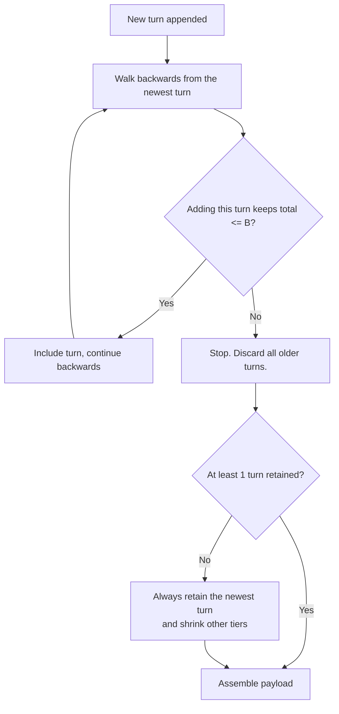

**Why walk backwards?** Because recency is the strongest relevance signal for conversational continuity, and because
the last exchange is usually what the current question refers to.

**Edge case to handle explicitly:** a single user message larger than the entire history budget. The window must
never produce an *empty* history plus an overflowing current turn — detect and either summarise that message or
reject it with a clear error.

---

## 03.3 Strategy 2 — Pinned anchor + sliding window

**Mechanism.** Keep the system prompt, the **first $K$ turns** (identity, goal, initial problem statement,
constraints) *and* the **most recent $M$ turns**. The middle is dropped.

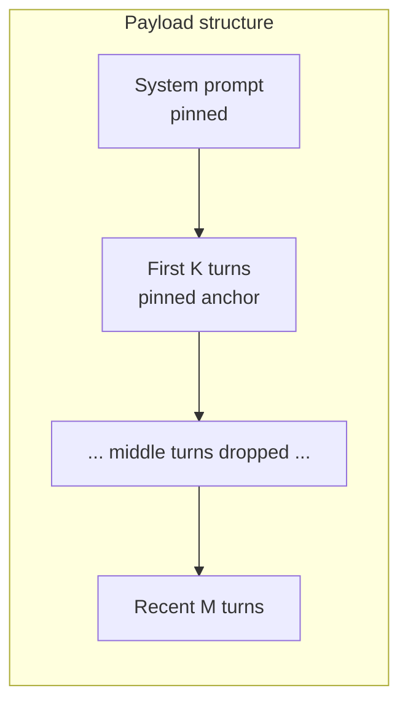

| | |
| :--- | :--- |
| **Pros** | Preserves the original problem scope and stated constraints while keeping tokens bounded; no extra compute |
| **Cons** | Loses intermediate decisions and troubleshooting steps; a fact introduced mid-conversation disappears |
| **Best for** | Diagnostics and tech support: the symptom and constraints are stated up front; the fix is discussed recently |

### Why the anchor works

The "first K turns" are disproportionately information-dense. In a support session they typically contain:

- the account/order identifier,
- the environment and version,
- the stated goal,
- any hard constraints ("I can't restart the server").

These are exactly the facts whose loss produces the *"I already told you that"* complaint. Pinning them costs a
bounded number of tokens and buys a large coherence win.

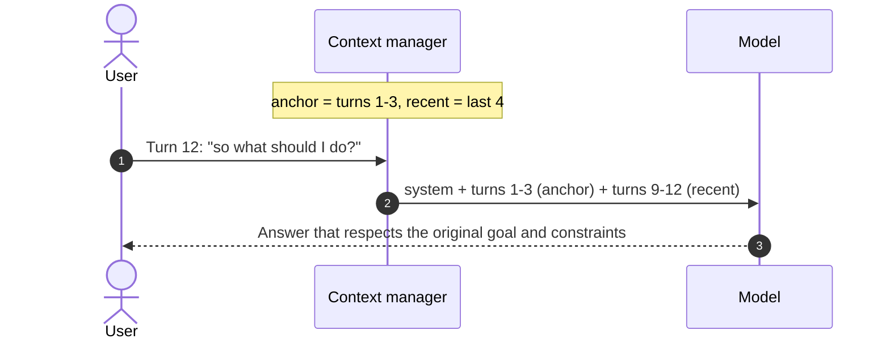

---

## 03.4 Strategy 3 — Rolling conversational summarisation (memory compaction)

**Mechanism.** Maintain an asynchronous background task. When history exceeds a threshold (e.g. 8 turns), an LLM
summarises the oldest block of turns into a compact factual summary. That running summary is injected into the
system prompt, followed by the raw recent turns.

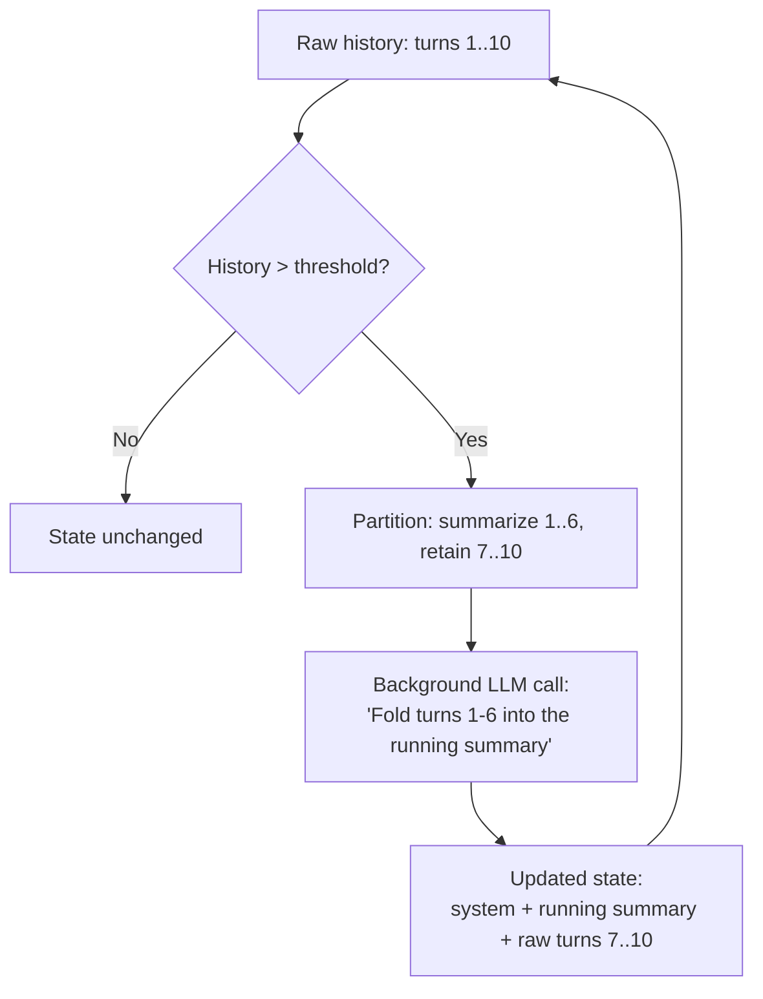

| | |
| :--- | :--- |
| **Pros** | Retains long-range state across hundreds of turns without linear token growth; the summary is a *compression*, so cost stays bounded |
| **Cons** | Extra background model calls (cost + latency); verbatim quotes and exact syntax are lost; summaries can drift |
| **Best for** | Long-form coaching, tutoring, onboarding, multi-session assistants |

### The compaction prompt — what a good summary must preserve

This is where most implementations fail. A generic "summarise the conversation" instruction produces prose that
loses the exact values the application depends on. A production compaction prompt is a **specification**:

```text
You are a context compaction engine.

Existing running summary:
"<previous summary or None>"

Fold the following conversation segment into the running summary.

PRESERVE EXACTLY (never paraphrase these):
- identifiers: order ids, ticket ids, account numbers, error codes
- decisions already made and the reason given
- hard constraints the user stated (e.g. "cannot restart", "budget cap of 500")
- open questions awaiting the user's answer
- entity names, versions and environments

DISCARD:
- pleasantries, acknowledgements, apologies
- restated information already in the summary
- the assistant's stylistic phrasing

Output: <= 150 words, bulleted, factual, no speculation.
```

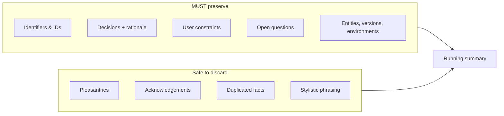

### Incremental vs from-scratch summaries

| Approach | Cost | Drift risk | Recommendation |
| :--- | :--- | :--- | :--- |
| **Incremental** (fold new turns into the old summary) | Low — one call per compaction window | ⚠️ Accumulates drift over many folds | Default for long sessions; re-summarise from raw periodically |
| **From scratch** (re-summarise all turns) | High — grows with history | ✅ Low | Use on milestones, or when the summary has been folded > N times |

**Practical hybrid:** keep the **raw transcript forever** in the durable store, fold incrementally for the hot path,
and rebuild the summary from raw every $X$ folds. The raw transcript is the ground truth; the summary is a cache.

### Where the summary goes

The source injects the running summary **into the system prompt**, ahead of the raw turns:

```ts
// pseudo-code — payload with compaction
const messages = [
  { role: 'system', content: basePrompt + `\n\n[CONVERSATION BACKGROUND]\n${runningSummary}` },
  ...recentRawTurns,
  { role: 'user', content: currentQuery },
]
```

Two consequences to be aware of:

- The summary now sits in the **primacy** position, which is good for recall (§02.7).
- The summary becomes part of the **prompt prefix**. Because it changes only on compaction, the prefix stays stable
  between compactions — which preserves prefix caching for everything except the compaction turns themselves.

---

## 03.5 Strategy 4 — Semantic RAG over historical memory

**Mechanism.** Every completed turn is embedded and stored in a vector index. When the user submits a new query, the
application runs a similarity search over *past turns* and injects only the top-$k$ most relevant historical turns
into the context — regardless of how old they are.

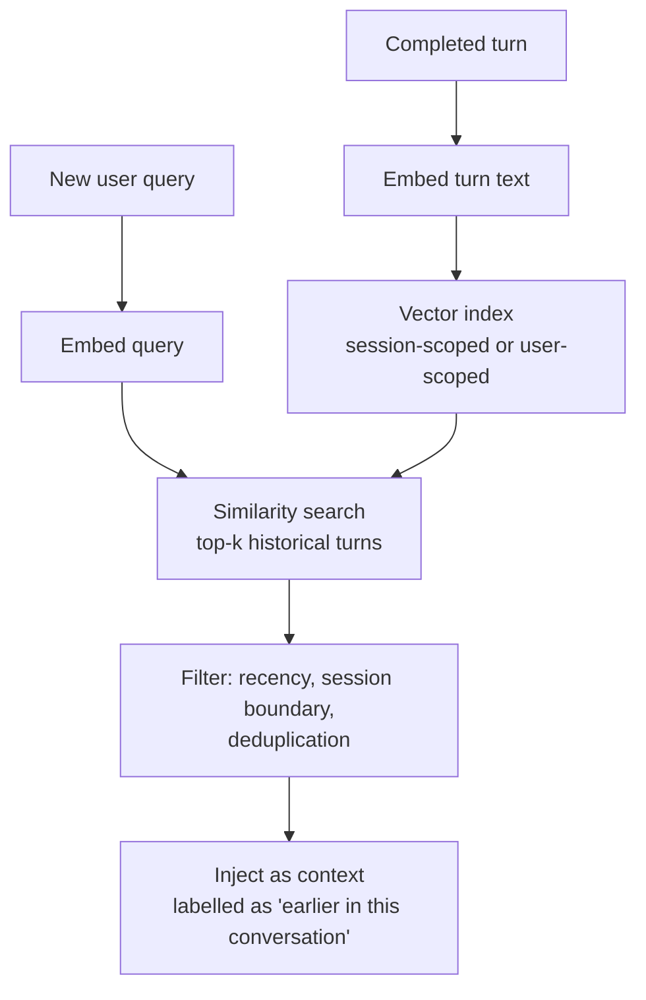

| | |
| :--- | :--- |
| **Pros** | Scales to indefinite multi-week sessions; recalls long-forgotten constraints instantly; recency is no longer the only key |
| **Cons** | Vector search latency; results arrive **out of chronological order**; embedding cost per turn; index lifecycle and deletion obligations |
| **Best for** | Enterprise multi-session agents, long-lived assistants, "what did we decide about X last month?" |

### The ordering problem (the trap of this strategy)

Chronology is load-bearing in conversation. Consider:

```text
Turn 4:  "My budget is $500."          -> retrieved (relevant to "budget")
Turn 11: "Actually, my budget is $900." -> NOT retrieved (different wording, lower similarity)
```

The model now confidently answers with the **superseded** value. Two mitigations:

1. **Always include the most recent N turns verbatim**, and let semantic retrieval *supplement* rather than
   *replace* recency (§03.6).
2. **Preserve timestamps in the injected block** so the model can reason about which statement is later:

```text
[EARLIER IN THIS CONVERSATION — chronological]
- (day 3, 10:12) User: budget is $500
- (day 9, 14:40) User: budget increased to $900   <-- later, supersedes above
```

> **Rule:** semantic memory is a *retrieval* mechanism. Recency is a *precedence* mechanism. Never let retrieval
> silently override precedence.

### Scope: session memory vs user memory

| Scope | Index key | Survives | Risk |
| :--- | :--- | :--- | :--- |
| **Session-scoped** | `sessionId` | Only that conversation | Low — deleted with the session |
| **User-scoped** | `userId` | Across sessions | ⚠️ Cross-session leakage if the user shares an account; needs consent + deletion (chapter 04) |

---

## 03.6 Strategy 5 (hybrid) — the layered pipeline

Real production systems almost never use one strategy. They use a **layered pipeline** where each layer handles a
different time horizon.

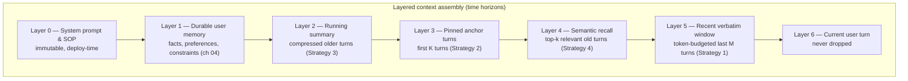

| Layer | Time horizon | Mechanism | Budget priority |
| :--- | :--- | :--- | :--- |
| 0 | Always | Static prompt | Highest (never dropped) |
| 1 | Permanent | DB read | High |
| 2 | Session, old | Summarisation | Medium |
| 3 | Session, start | Anchor | Medium |
| 4 | Any | Vector retrieval | Medium — query-dependent |
| 5 | Session, recent | Token-budgeted window | High |
| 6 | Now | The request itself | Highest |

**Why layering beats picking one:** each layer covers the previous layer's blind spot.

| Blind spot of… | Covered by… |
| :--- | :--- |
| Sliding window (forgets old) | Summarisation + semantic recall |
| Summarisation (loses exact quotes) | Pinned anchor + recent verbatim window |
| Semantic recall (no chronology) | Recent verbatim window (precedence) |
| Pinned anchor (loses the middle) | Semantic recall (finds the middle when relevant) |
| All of the above (cross-session amnesia) | Durable user memory (chapter 04) |

---

## 03.7 Comparative analysis & strategy selection

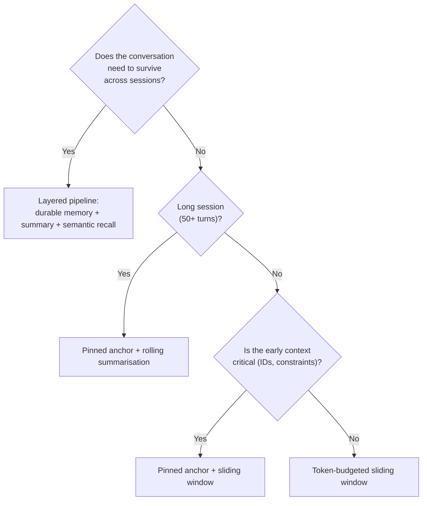

| Architectural dimension | Naive append | Sliding window (FIFO) | Pinned anchor | Rolling summarisation | Semantic memory RAG |
| :--- | :--- | :--- | :--- | :--- | :--- |
| **Token scaling** | $O(N^2)$ | $O(1)$ bounded | $O(1)$ bounded | $O(1)$ bounded | $O(k)$ constant chunks |
| **Max turn capacity** | ~10–30 turns | Unbounded (with amnesia) | Unbounded (partial amnesia) | 100+ turns | Thousands of turns |
| **Retention of early facts** | High (until overflow) | ❌ Zero | ✅ High (first $K$ pinned) | ✅ High (abstracted) | ✅ High (if retrieved) |
| **Latency consistency** | Degrades linearly | Fixed, predictable | Fixed, predictable | Fixed, predictable | Depends on vector store |
| **Local compute overhead** | None | Array slicing | Array slicing | Background summariser call | Embedding + vector query |
| **Extra cost** | Token blow-up | None | None | Summariser tokens | Embedding + query cost |
| **Best production use case** | 2-turn scripts, demos | Simple transactional bots | Tech-support diagnostics | Long-form coaching, tutoring | Enterprise multi-session agents |

### A decision table for real products

| Product | Recommended strategy | Why |
| :--- | :--- | :--- |
| Order-status bot (3-5 turns) | Sliding window, $K=6$ | Short, transactional, cheap |
| IT helpdesk diagnostic session | Pinned anchor + sliding window | Environment/constraints stated up front |
| Coding tutor over 200 turns | Rolling summarisation + anchor | Must remember the learner's level and goals |
| Enterprise account assistant, multi-week | Layered pipeline (memory + summary + semantic) | Cross-session continuity is the product |
| Compliance/audit assistant | Layered + full transcript retention | Auditability requires the raw record |
| Voice assistant, 2-turn commands | Sliding window $K=2$ | Latency dominates everything |

### Cost/latency of each strategy in one line

| Strategy | Extra cost per turn | Added latency | Information lost |
| :--- | :--- | :--- | :--- |
| Sliding window | None | ~0 ms | Everything before the cutoff |
| Pinned anchor | None | ~0 ms | The middle |
| Rolling summarisation | ~1 summariser call per window | ~0 ms on the hot path (async) — but a hard failure if done synchronously | Exact wording of older turns |
| Semantic memory RAG | 1 embedding + 1 vector query | 10–100 ms | Anything below the similarity threshold |

> **Design rule:** if a strategy adds latency, move it **off the hot path**. Summarisation is the classic case —
> compact *after* responding, never before.

---

## 03.8 Reference implementation (pseudo-code)

One `ContextManager` with a declarative policy beats five bespoke code paths. The policy decides which levers are
active; the manager is the only thing that knows about tokens.

```ts
// pseudo-code — one manager, declarative policy, no runnable code
type Policy = {
  budgetTokens: number          // B: max tokens for the history tier
  anchorTurns: number           // K: first K turns pinned (0 = disabled)
  recentTurns: number           // M: most recent turns retained verbatim
  summarise: boolean            // enable rolling compaction
  summariseThreshold: number    // compact when raw turns exceed this
  semanticRecall: number        // top-k old turns to recall (0 = disabled)
}
```

### Step 1 — compaction (off the hot path)

```ts
// pseudo-code — run AFTER responding, never before
async function compactIfNeeded(state: SessionState): Promise<void> {
  if (!policy.summarise) return
  if (state.rawTurns.length <= policy.summariseThreshold) return

  const [old, keep] = split(state.rawTurns, state.rawTurns.length - policy.recentTurns)

  state.runningSummary = await model.summarise({
    existing: state.runningSummary,
    segment: old,
    instruction: COMPACTION_SPEC,   // the PRESERVE/DISCARD spec from §03.4
    maxWords: 150,
  })

  state.rawTurns = keep             // raw older turns stay in the durable store, not the hot path
}
```

### Step 2 — assembly (on the hot path, must be fast)

```ts
// pseudo-code — deterministic, allocation-light, no model calls
function assemble(state: SessionState, query: string): Message[] {
  const out: Message[] = [
    { role: 'system', content: state.basePrompt },
  ]

  // Layer 1 — durable memory (chapter 04)
  if (state.profileFacts.length) {
    out.push({ role: 'system', content: renderFacts(state.profileFacts) })
  }

  // Layer 2 — running summary (compressed old turns)
  if (state.runningSummary) {
    out.push({ role: 'system', content: `[CONVERSATION BACKGROUND]\n${state.runningSummary}` })
  }

  // Layer 3 — pinned anchor (first K turns)
  const anchor = policy.anchorTurns > 0 ? state.rawTurns.slice(0, policy.anchorTurns) : []

  // Layer 4 — semantic recall (supplements, never replaces recency)
  const recalled = policy.semanticRecall > 0
    ? vectorStore.search(state.userId, query, policy.semanticRecall)
    : []

  // Layer 5 — recent verbatim window, token-budgeted, newest-first walk
  const budget = policy.budgetTokens - tokensOf(out) - tokensOf(anchor) - tokensOf(recalled)
  const recent = takeNewestWithinBudget(state.rawTurns, budget)

  out.push(...anchor)
  if (recalled.length) out.push({ role: 'system', content: renderRecalled(recalled) })
  out.push(...recent)

  // Layer 6 — the current turn, never dropped
  out.push({ role: 'user', content: query })

  return out
}
```

### Step 3 — the eviction helper (the only subtle loop)

```ts
// pseudo-code — newest-first walk with a hard guarantee
function takeNewestWithinBudget(turns: Turn[], budget: number): Turn[] {
  const kept: Turn[] = []
  let used = 0
  for (let i = turns.length - 1; i >= 0; i--) {          // newest first
    const cost = estimateTokens(turns[i].content)
    if (used + cost > budget && kept.length > 0) break     // keep at least one turn
    kept.unshift(turns[i])
    used += cost
  }
  return kept
}
```

Three properties this implementation deliberately has:

| Property | Why it matters |
| :--- | :--- |
| **Compaction is separate from assembly** | Summarisation is slow and costs a model call; assembly must be pure and fast |
| **Newest-first walk with a "keep at least one" guard** | Prevents the empty-history / overflowing-turn failure mode |
| **Semantic recall is additive, never a replacement** | Preserves chronological precedence (§03.5) |

---

## 03.9 Operational concerns (an added topic)

The source describes the four strategies. What it does not cover is what breaks *after* you ship them.

### 1. Prefix caching and prompt stability

Providers cache the attention KV tensors of a repeated prompt **prefix**. Any strategy that mutates the prefix
destroys that cache and you pay full prefill again.

| Strategy | Prefix stability | Cache-friendly? |
| :--- | :--- | :--- |
| Sliding window | Stable system prefix; the *history tail* shifts | ✅ Mostly |
| Pinned anchor | Stable | ✅ Yes |
| Rolling summarisation | Changes only on compaction | ✅ Yes, except compaction turns |
| Semantic recall | Changes every query | ⚠️ The recalled block must sit **after** the stable prefix |
| Contaminated prompt (§01.7) | Changes every turn | ❌ Never |

**Design consequence:** order your payload from most-stable to least-stable. System → memory → summary → anchor →
recall → recent → current. That ordering is cache-optimal *and* attention-optimal (§02.7).

### 2. Summariser drift

Every incremental fold is a lossy transformation of a lossy transformation. After 20 folds, a summary can contain
claims that no turn ever made.

Mitigations:

- **Ground truth stays raw.** Never delete the durable transcript because you summarised it.
- **Rebuild periodically.** Re-summarise from raw turns every $X$ folds.
- **Validate the summary.** Run a cheap consistency check: do all IDs/entities in the summary appear in the raw
  transcript? Flag mismatches.
- **Cap the summary length.** An unbounded summary is just a slower form of unbounded history.

### 3. The eviction of pinned facts

A pinned anchor is only pinned *for the configured window*. If a critical fact was stated in turn 4 and your anchor
is turns 1–3, it disappears at turn 30. Fix by promoting such facts out of history and into **durable memory**
(chapter 04) — the place where they belong anyway.

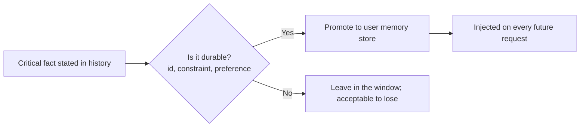

> **Rule of thumb:** if losing a fact would break the product, it should not depend on the history window at all.

### 4. The context-bloat test

You cannot claim a context strategy works without a test that proves it. The lecture's build task calls for exactly
this: a **context-bloat test**.

```ts
// pseudo-code — the shape of a context-bloat test
async function contextBloatTest(turns: number, policy: Policy): Promise<Report> {
  const state = seedSession(turns)
  const rows = []

  for (let i = 0; i < turns; i++) {
    const payload = assemble(state, `follow-up question ${i}`)
    rows.push({
      turn: i,
      inputTokens: exactCount(payload),        // tokenizer, not estimate
      historyTokens: tokensOf(historyOf(payload)),
      trimEvents: state.metrics.trimEvents,
      summaryFolds: state.metrics.folds,
    })
    advance(state, `assistant reply ${i}`)
    await compactIfNeeded(state)
  }

  return assertBounded(rows)   // assert: inputTokens stabilises instead of growing linearly
}
```

**What the test must assert:**

| Assertion | Proves |
| :--- | :--- |
| Input tokens reach a **plateau** | The $O(N^2)$ blow-up is gone |
| The plateau is **below the budget** | No context starvation (§02.1) |
| `trimEvents` occur | Trimming is actually happening (not silently bypassed) |
| Early identifiers survive (anchor test) | The anchor is working |
| Summaries contain the preserved fields | Compaction is not drifting |

### 5. Monitoring in production

| Metric | Alarm condition |
| :--- | :--- |
| `history_tokens_p95` | Approaching the tier budget |
| `trim_events_per_turn` | Spiking (window too small for real usage) |
| `compaction_latency_ms` | Summarisation has crept onto the hot path |
| `summary_folds_since_rebuild` | Exceeds the rebuild threshold |
| `prefix_cache_hit_ratio` | Falling (payload ordering became unstable) |
| `recall_precision` (offline eval) | Semantic recall is injecting noise |

---

## 03.10 Common mistakes

- **Counting turns instead of tokens.** One pasted document can consume the entire budget; a turn-count window will
  not notice.
- **Summarising on the hot path.** The user waits for a summariser call before the real call. Always compact after
  responding.
- **Letting semantic recall replace recency.** Superseded facts get resurrected and the model answers with stale
  values (§03.5).
- **Deleting raw turns once summarised.** The summary is a cache; the transcript is the record. Deleting the record
  breaks audit, deletion and rebuild.
- **Assuming a pinned anchor pins forever.** Anchors have a fixed size; promote truly durable facts to a memory
  store.
- **Mutating the prompt prefix every turn.** Kills prefix caching and pays full prefill on every request.
- **Unbounded summaries.** A 5,000-word "summary" is not a compression.
- **No "keep at least one turn" guard.** Produces empty history with an oversized current turn, or a hard failure.
- **Never testing at scale.** Context bugs appear at turn 40, not turn 4.
- **Picking a strategy by taste instead of by product.** Transactional bots and multi-week assistants have opposite
  requirements.

---

## 03.11 Key takeaways

1. **Context management is four levers:** RETAIN, COMPRESS, RETRIEVE, EVICT. Every strategy is a combination.
2. **Sliding window is the default** — cheap, bounded, predictable. Token-budget it, do not count turns.
3. **Pinned anchor saves the facts that matter most:** the first turns contain the goal, the ID and the constraints.
4. **Rolling summarisation buys unbounded length** at the price of an extra model call and loss of exact wording.
5. **Semantic recall changes the retrieval key** from recency to relevance — and breaks chronology, so keep recency
   as the precedence rule.
6. **Layer the strategies.** Each covers another's blind spot; production systems rarely use one alone.
7. **Compaction is off the hot path.** Assembly is pure and fast; summarisation is async.
8. **Order the payload most-stable → least-stable.** Cache-optimal and attention-optimal.
9. **Promote durable facts out of history.** If losing it breaks the product, it belongs in a memory store.
10. **Prove it with a context-bloat test** that asserts a token plateau, not just a working demo.
11. **Never evict the system prompt or the current turn.** Everything else is negotiable.

---

## 03.12 Self-check questions

1. Name the four context-management levers and give the cost/loss profile of each.
2. Implement (in words) a token-budgeted sliding window. Why walk backwards from the newest turn?
3. What two invariants must every context strategy respect?
4. Give a product where a sliding window is correct and one where it is actively harmful. Justify both.
5. Design a compaction prompt. List five things it must preserve verbatim and three it may discard.
6. What is summariser drift, and what are three mitigations?
7. Why is semantic recall's loss of chronology dangerous? Give a concrete failure with two turns.
8. Draw the layered pipeline and name the time horizon of each layer.
9. Why must the payload be ordered most-stable to least-stable? Name both benefits.
10. Write the assertions for a context-bloat test. Which one proves the $O(N^2)$ problem is solved?
11. A fact stated in turn 4 keeps disappearing at turn 30. Diagnose it and give the correct fix.

---

### Navigation

- **Previous:** [Chapter 02 — Context Windows & Token Accumulation](./02_Context_Windows_and_Token_Accumulation.md)
- **Next:** [Chapter 04 — Context vs Model Weights & the Illusion of Learning](./04_Context_vs_Model_Weights_and_the_Illusion_of_Learning.md)
- **Source:** `Forward-Deployed-Engineer/Lecture 04/notes/02_Context_Windows_Token_Accumulation_and_Context_Management.md` (§2.5–§2.7)
- **Roadmap:** [Lecture 06 — Chatbots: Statelessness, Context, Memory & Hallucination](../../roadmap.md)
