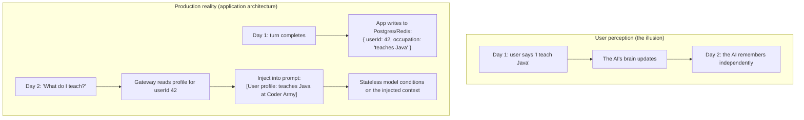
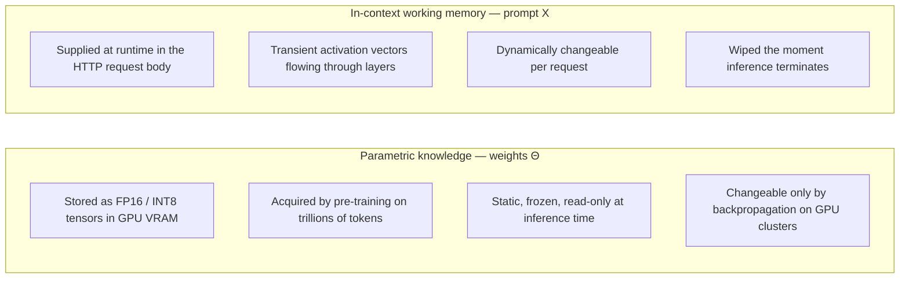
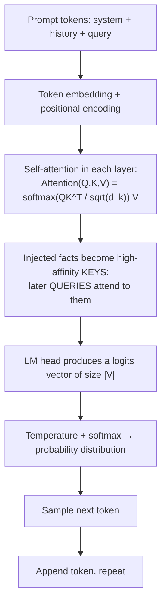
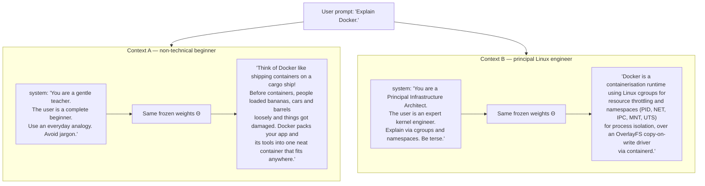
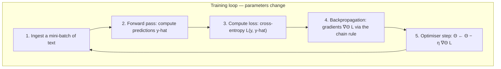
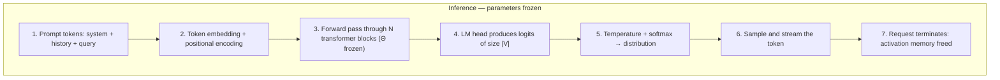
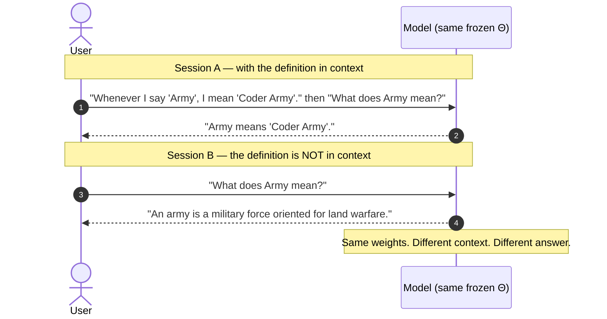
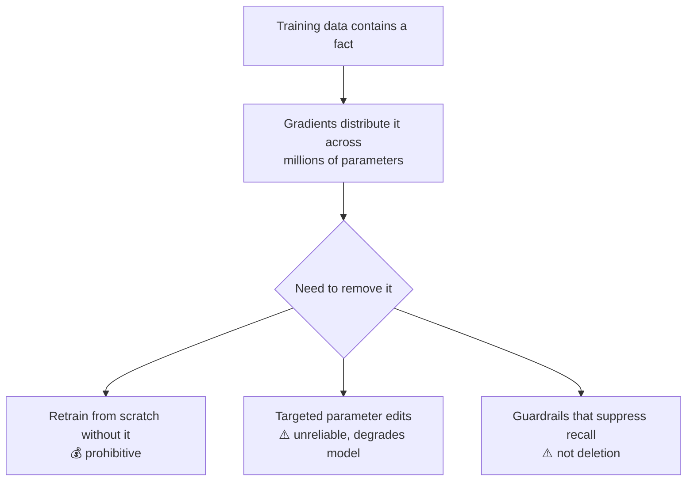

# Chapter 04 — Context vs Model Weights & the Illusion of Learning

> **Lecture 06 · Chapter 04 of 08** · Level: 🟡 Intermediate · Phase 2 — The Application Layer
> **Source:** `Forward-Deployed-Engineer/Lecture 04/notes/03_Context_vs_Model_Weights_and_The_Illusion_of_Learning.md`
> **Roadmap topics:** context vs model weights · the **illusion of learning** · parametric knowledge vs in-context
> working memory · the mechanics of context-conditioned prediction · the LLM as an **unprivileged kernel** (forward
> link to chapter 08).
> **Prerequisites:** Lecture 02 (frozen weights, next-token prediction) · Lecture 03 (attention) ·
> Chapter 01-03 of this lecture (statelessness, token budget, context management).

---

## 04.0 What this chapter is for

Chapter 01 said the model has no memory. Chapter 03 showed how to *fake* memory well. This chapter explains the
mechanism underneath both claims — and then uses it to answer the most expensive architectural question a
stakeholder will ever ask you:

> *"Should we fine-tune a model on our data, or just use a database?"*

By the end of this chapter you should be able to:

1. Explain why "the AI remembered" is always an **application** claim, never a model claim.
2. Distinguish **parametric knowledge** ($\Theta$) from **in-context working memory** ($X_{\text{prompt}}$) across
   seven engineering dimensions.
3. Write the context-conditioned prediction objective $P(w_t \mid w_{<t}, \text{Context})$ and explain how changing
   the context steers the output **without touching a single weight**.
4. Walk the **training loop** (forward → loss → backprop → optimiser step) and the **inference loop**
   (forward-only) side by side.
5. Debunk "in-context learning" with the *Coder Army* experiment.
6. Choose between **application memory** and **fine-tuning** using a decision matrix — and know what fine-tuning is
   actually for.
7. Explain why GDPR's "right to be forgotten" is trivial in a database and a research problem in weights.

---

## 04.1 The illusion of memory

Stakeholders routinely say things like:

> *"The bot remembered that the customer prefers vegetarian food, from yesterday's conversation!"*
> *"I taught it what our internal codename 'GateKeeper' means, so it knows our architecture now."*

Consider this sequence:

```text
[Day 1 — session 101]
User:      "I teach Java at Coder Army."
Assistant: "That's great! Java is a powerful object-oriented language."

[Day 2 — session 205]
User:      "What do I teach?"
Assistant: "You teach Java at Coder Army!"
```

To the user this is biological learning: the AI listened, retained overnight, and recalled in a *new* conversation.
To an engineer it is the **illusion of memory**.



> **The fundamental axiom:** the foundation model remembered **nothing**. Its parameters are byte-identical to
> yesterday. The **application layer** extracted, persisted, indexed, retrieved and re-injected the fact for that
> specific request.

Two consequences that are easy to state and hard to internalise:

1. **If the application does not store it, it is gone.** There is no hidden cache to fall back on.
2. **If the application stores it wrongly, it is confidently wrong.** A stale database row produces a fluent,
   authoritative, outdated answer.

---

## 04.2 Parametric knowledge vs in-context working memory

Two completely different kinds of "knowledge" are in play. Conflating them is the root of most architectural
mistakes in this lecture.



| Dimension | Parametric knowledge ($\Theta$) | In-context working memory ($X_{\text{prompt}}$) |
| :--- | :--- | :--- |
| **Physical storage** | Model weight files in high-bandwidth VRAM | HTTP request buffer + KV cache |
| **Modification mechanism** | SGD + backpropagation | String serialisation in application code |
| **Update latency** | Days to months (retrain / fine-tune) | **Sub-millisecond** (a database read) |
| **Update cost** | Thousands to millions of dollars of compute | A fraction of a cent of API tokens |
| **Persistence horizon** | Permanent until the checkpoint is deprecated | **Ephemeral** — zero cross-request retention |
| **Scope of impact** | Every user of that model, globally | Exactly one HTTP request |
| **Deletion (GDPR)** | Mathematically hard ("machine unlearning") | Trivial: `DELETE FROM user_memory WHERE id = 42` |

### The one-sentence version

> **Weights are *who the model is*. Context is *what the model is looking at right now*.**

A useful analogy for stakeholders:

| | Analogy |
| :--- | :--- |
| **Fine-tuning** | Sending an employee to university for six months |
| **In-context facts** | Handing the employee a briefing note before the meeting |

The briefing note is faster, cheaper, auditable and disposable. The degree is permanent, expensive, and impossible to
partially revoke. Neither is "better" — they solve different problems (§04.7).

---

## 04.3 The mathematics of context-conditioned prediction

At its core, an autoregressive language model is an estimator of conditional probability distributions over a
discrete vocabulary $V$:

$$P(w_t \mid w_1, w_2, \dots, w_{t-1}; \Theta)$$

- $w_t \in V$ — the token being predicted at step $t$
- $w_1 \dots w_{t-1}$ — the preceding token sequence (the context)
- $\Theta$ — the **static, frozen** weight tensor

When you change the prompt context $C$, you are **not** changing $\Theta$. You are changing the **conditioning
vector** the distribution is computed against:

$$P(w_t \mid \text{Context}_A; \Theta) \neq P(w_t \mid \text{Context}_B; \Theta)$$

### Why the distribution moves — in one diagram



The attention formula is the mechanism:

$$\text{Attention}(Q,K,V) = \text{softmax}\!\left(\frac{QK^{\top}}{\sqrt{d_k}}\right)V$$

By injecting specific facts into the prompt, the **Key** vectors for those facts make the **Query** vectors of later
tokens attend heavily to them — steering the logits toward contextually congruent words.

> **The crucial insight:** prompting is **steering a probability distribution**, not teaching. It is reversible,
> per-request, and has zero effect on any other user.

---

## 04.4 "Same question, different context" — a concrete case study

Submit the *exact same* four-word prompt to the *exact same* model, changing only the system context.

```text
USER PROMPT: "Explain Docker."
```



### The engineering reading of that experiment

| Observation | Conclusion |
| :--- | :--- |
| Weights $\Theta$ were identical in both runs | No learning occurred |
| The user prompt was identical | The difference is entirely the **conditioning** |
| Vocabulary shifted from *cargo ship, bananas* to *cgroups, OverlayFS* | Context reshapes the probability distribution |

> **This is the whole reason prompt engineering works** (Lecture 05) and the whole reason it is *per-request*: you
> are choosing which region of the model's behaviour space to activate.

---

## 04.5 What actually happens during training vs inference

Put the two loops side by side. They share only the forward pass.

### The training loop (expensive, offline)



Requirements for training:

1. **Infrastructure** — clusters of hundreds or thousands of networked GPUs.
2. **Backpropagation** — a full backward pass computing partial derivatives of the loss with respect to every weight.
3. **Parameter mutation** — overwriting the floating-point values in the weight matrices.
4. **Time and cost** — days to months of compute; thousands to millions of dollars.

### The inference loop (cheap, forward-only)



### The critical inference invariants

| Invariant | Meaning |
| :--- | :--- |
| **Zero backpropagation** | No gradients are ever computed ($\nabla_{\Theta}\mathcal{L} = \emptyset$) |
| **Zero weight modification** | Every weight tensor in VRAM is effectively read-only |
| **Pure forward pass** | Activations flow strictly forward to produce logits |
| **Complete state teardown** | Intermediate activation tensors are deallocated; the model retains no trace |

> **Why this matters commercially:** it means inference is *stateless, parallelisable and cheap relative to
> training*. It also means the only lever you have at request time is **what you put in the context**.

---

## 04.6 Deconstructing "in-context learning" — the *Coder Army* experiment

Consider this exchange:

```text
USER:      "Whenever I say 'Army', I mean 'Coder Army'."
USER:      "What does Army mean?"
ASSISTANT: "Army means 'Coder Army'."
```

Did you just *teach* the AI a new rule?

| Framing | Answer |
| :--- | :--- |
| Common parlance | *"Yes, it followed my instruction."* |
| Computer-science reality | **No.** You conditioned the self-attention heads to map the token `Army` to the string `Coder Army` for the duration of **that one forward pass**. |

Now open a new tab, or send a separate request *without* the first sentence:

```text
USER:      "What does Army mean?"
ASSISTANT: "An army is a heavily armed, highly organised military force primarily oriented for land warfare."
```

The model has reverted to its **parametric** knowledge.



### Why "in-context learning" is a misleading name

The term describes the **observation** (behaviour adapts to examples in the prompt), not a **mechanism** (no learning
occurs). A more accurate name is **in-context conditioning** or **few-shot conditioning**.

> **The FDE rule:** if a business requirement demands that facts persist across time, **never rely on in-context
> learning alone**. Build an external, deterministic persistence engine that stores the fact and hydrates it into
> future requests.

This single rule is the design justification for **RAG**, for **memory stores**, and for this lecture's chapter 03.

---

## 04.7 Application memory vs fine-tuning — the decision matrix

Executives ask: *"Should we fine-tune on our company data, or use a database with retrieval?"*

| Evaluation vector | Application memory (DB + in-context hydration) | Fine-tuning / continual training |
| :--- | :--- | :--- |
| **Data freshness** | **Instant** — a DB write is < 5 ms; the fact is usable on the next request | **Stale** — dataset curation, training run, redeploy (days to weeks) |
| **Auditability** | **100% deterministic** — every remembered fact is a row with a timestamp | **Opaque** — facts are diffused into weight matrices; no traceability |
| **Deletion (GDPR/CCPA)** | **Trivial** — `DELETE FROM user_memory WHERE user_id = ?` | **Hard research problem** — machine unlearning is intractable and unreliable |
| **Cost per update** | Negligible (a standard DB write) | High GPU compute per training run |
| **Catastrophic forgetting** | **Zero** — base model reasoning untouched | **High risk** — retraining can degrade general reasoning and coding |
| **Primary limitation** | Bounded by the context window and retrieval accuracy | Cannot reliably memorise exact tabular records or fast-changing state |

### Verdict

> For customer memory, personal preferences, user state and business records, **application memory wins**. Fine-tuning
> should be reserved for teaching **specialised output styles, proprietary syntax or internal jargon** — never for
> dynamic state storage.

### What fine-tuning *is* genuinely good for

| Good use | Why it fits |
| :--- | :--- |
| **Output style and tone** | Style is a *distributional* property; it lives in weights naturally |
| **Proprietary formats / DSLs** | Teaching a syntax pattern that appears in thousands of examples |
| **Domain jargon compression** | Saves prompt tokens when the jargon appears in every request |
| **Smaller/faster distilled models** | Distilling a large teacher into a cheaper student |
| **Task specialisation with many examples** | Classification, extraction, structured tagging at scale |
| **Lower per-call cost at high volume** | A smaller fine-tuned model can replace a large prompted one |

| Bad use | Why it fails |
| :--- | :--- |
| Storing user facts | Stale, un-auditable, un-deletable (§04.2 table) |
| Live business state (inventory, prices) | Changes faster than you can retrain |
| Access control | Weights cannot enforce permissions |
| "Making the model not hallucinate" | Hallucination is architectural (chapters 06-07) |
| Compliance-driven memorisation | Directly conflicts with data-deletion rights |

---

## 04.8 Privacy, GDPR and the "right to be forgotten" (an expanded topic)

The source mentions GDPR in one table row. It deserves more, because it is usually the argument that settles the
architecture debate in a real enterprise.

### The asymmetry

| Question | Application memory | Model weights |
| :--- | :--- | :--- |
| "Delete everything you know about user 42" | `DELETE FROM user_memory WHERE user_id = 42` — milliseconds, provable | *Machine unlearning*: no reliable general method |
| "Prove the data is gone" | Query returns zero rows — an auditable assertion | Cannot prove absence; the fact may be diffused across millions of parameters |
| "Show me what you store about me" | A SELECT statement — trivially exportable (DSAR) | No mechanism to enumerate memorised content |
| "Keep the data for 30 days then purge" | TTL + a scheduled job | No TTL concept in weights |
| "Process data in a specific region" | Choose the DB region | Depends on where the checkpoint is served from |

### Why machine unlearning is hard



Three honest engineering positions:

1. **Retrain from scratch without the data** — the only method with a clean guarantee, and usually economically
   impossible for a serving product.
2. **Approximate unlearning / targeted edits** — an active research area; no general reliability guarantee.
3. **Suppression** (blocking the output at inference) — this is *not* deletion and should not be presented as such
   to a regulator.

> **The design conclusion:** keep personal data in systems that support deletion (relational DB, object store with
> lifecycle rules, vector store with per-entity deletes). Do not burn it into weights.

### Practical memory-store requirements this implies

| Requirement | Implementation |
| :--- | :--- |
| **Per-user deletion** | `deleteUserMemory(userId)` as a first-class API, not an afterthought |
| **Export** | Data-subject access request: dump all stored facts for a user |
| **TTL / retention policy** | Facts expire unless refreshed; retention is explicit |
| **Provenance** | Each fact records where it came from and when (auditable) |
| **Consent flag** | Memory capture is opt-in where required; the flag is checked at write time |
| **No PII in prompts longer than needed** | Prompt logs and traces are also personal data — scrub them |

---

## 04.9 Reference implementation (pseudo-code)

The architectural shape: a **memory repository** (durable, deletable) + a **hydration step** (per request) +
a **stateless model call**.

```ts
// pseudo-code — decoupled application memory, no runnable code
type UserFact = {
  factId: string
  category: 'preference' | 'constraint' | 'identity'
  content: string
  source: 'explicit-user' | 'inferred'   // provenance
  recordedAt: number
  expiresAt?: number                      // retention
}
```

### The repository (durable, auditable, deletable)

```ts
// pseudo-code — in production this is PostgreSQL + Redis, not a Map
interface MemoryRepository {
  saveFact(userId: string, fact: Omit<UserFact, 'factId' | 'recordedAt'>): Promise<void>
  getFactsForUser(userId: string, limit: number): Promise<UserFact[]>
  deleteUserMemory(userId: string): Promise<void>   // GDPR right to be forgotten
  exportUserMemory(userId: string): Promise<UserFact[]> // DSAR
}
```

### The orchestrator (hydrate → call → persist)

```ts
// pseudo-code — personalised generation with a stateless model
async function generatePersonalised(userId: string, basePrompt: string, query: string) {
  // 1. Read durable facts — the model has none
  const facts = await memoryRepo.getFactsForUser(userId, TOP_K_FACTS)

  // 2. Synthesise a hydrated system prompt
  let system = basePrompt
  if (facts.length > 0) {
    system += '\n\n[PERSISTENT USER MEMORY & PREFERENCES]'
    for (const f of facts) system += `\n- (${f.category}): ${f.content}`
    system += '\nUse these facts naturally. Do not mention that you were given a list.'
  }

  // 3. Stateless call — same weights as every other user
  const reply = await model.chat({
    model: MODEL,
    messages: [
      { role: 'system', content: system },
      { role: 'user',   content: query },
    ],
    temperature: 0.2,
  })

  return reply
}
```

### Design notes that make this production-grade

| Choice | Reason |
| :--- | :--- |
| **Facts are typed and categorised** | Enables targeted deletion, expiry and relevance ranking |
| **Provenance recorded** | Needed for audit and for deciding trust level |
| **Top-K facts, not all facts** | Facts compete for the token budget (§02.9) |
| **"Do not mention the list" instruction** | Prevents the model narrating its own plumbing |
| **Deletion as an API** | Compliance is a feature, not a migration |

---

## 04.10 Common mistakes

- **Believing the model "learned" from a long conversation.** Weights are frozen; behaviour is per-request.
- **Using in-context definitions for durable requirements.** *"Whenever I say Army…"* works for one request only.
- **Fine-tuning to store user facts.** Stale, opaque, and impossible to delete on request.
- **Fine-tuning to fix hallucination.** Hallucination is a plausibility problem, not a knowledge problem
  (chapters 06-07).
- **Assuming a stale DB row is safer than no row.** A confidently outdated fact is often worse than "I don't know".
- **Treating prompt changes as deployment-free.** They are — which is why they need versioning and evaluation
  (Lecture 05 ch09).
- **Putting PII in prompts and forgetting the traces.** Prompt logs, traces and eval datasets are also personal data.
- **Promising regulators "the model has forgotten".** Only deletion of the stored data supports that claim.
- **Conflating "the model is good at our domain" with "the model knows our data".** The first is a capability; the
  second is a retrieval problem.
- **Skipping the memory-store design until after launch.** Retrofitting deletion, TTL and consent is far more
  expensive than designing for them.

---

## 04.11 Key takeaways

1. **Memory is an application illusion.** Any apparent cross-session memory is an external store plus re-injection.
2. **Weights are frozen; context is fluid.** $\Theta$ is static VRAM; $X_{\text{prompt}}$ is per-request working data.
3. **Context steers probabilities without retraining.** $P(w_t \mid \text{Context}_A;\Theta) \neq P(w_t \mid
   \text{Context}_B;\Theta)$ with identical weights.
4. **Inference does zero backpropagation.** Forward-only, read-only weights, activations wiped on completion.
5. **"In-context learning" is conditioning, not learning.** Behaviour adapts; the model does not.
6. **Application memory beats fine-tuning for facts.** Faster, cheaper, auditable and deletable.
7. **Fine-tune for style, format, jargon and distillation** — never for dynamic state.
8. **GDPR turns the debate.** Database deletion is trivial; machine unlearning is an open research problem.
9. **Design the memory store as a compliance asset** with typed facts, provenance, TTL, export and delete APIs.
10. **Hydrate with top-K facts, not all facts.** Memory competes for the same token budget as everything else.

---

## 04.12 Self-check questions

1. Explain, without using the word "memory", what happened in the Day-1/Day-2 "I teach Java" example.
2. Give four dimensions on which parametric knowledge and in-context memory differ, with a consequence of each.
3. Write the context-conditioned prediction objective. Which symbol does *not* change when you edit a prompt, and why
   does that matter commercially?
4. In the "Explain Docker" experiment, what was identical and what differed between the two runs?
5. List the five steps of the training loop and the four invariants of inference.
6. Why is "in-context learning" a misleading term? Propose a better one.
7. Your CFO wants to fine-tune on customer purchase history to personalise recommendations. Give three arguments
   against it and one alternative design.
8. Name three legitimate uses of fine-tuning.
9. Explain machine unlearning and why "suppressing the output" is not deletion.
10. Design a `UserFact` record for a compliance-reviewed memory store. Justify each field.

---

### Navigation

- **Previous:** [Chapter 03 — Context Management Strategies](./03_Context_Management_Strategies.md)
- **Next:** [Chapter 05 — Real-Time Streaming & SSE](./05_Real_Time_Streaming_and_SSE.md)
- **Source:** `Forward-Deployed-Engineer/Lecture 04/notes/03_Context_vs_Model_Weights_and_The_Illusion_of_Learning.md`
- **Roadmap:** [Lecture 06 — Chatbots: Statelessness, Context, Memory & Hallucination](../../roadmap.md)
