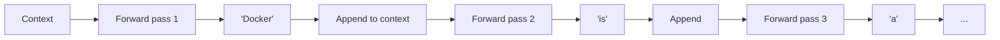
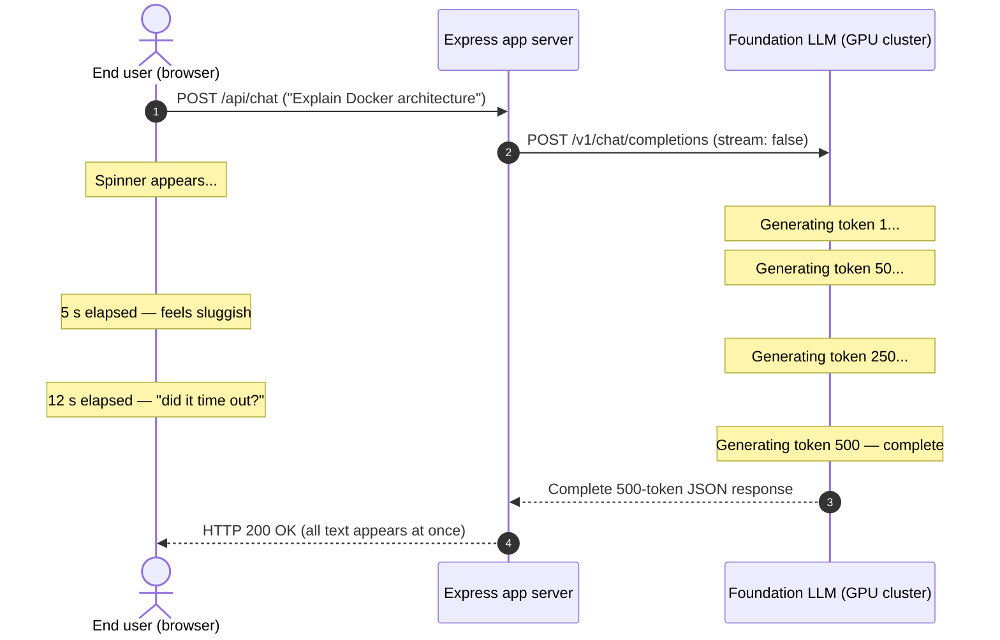
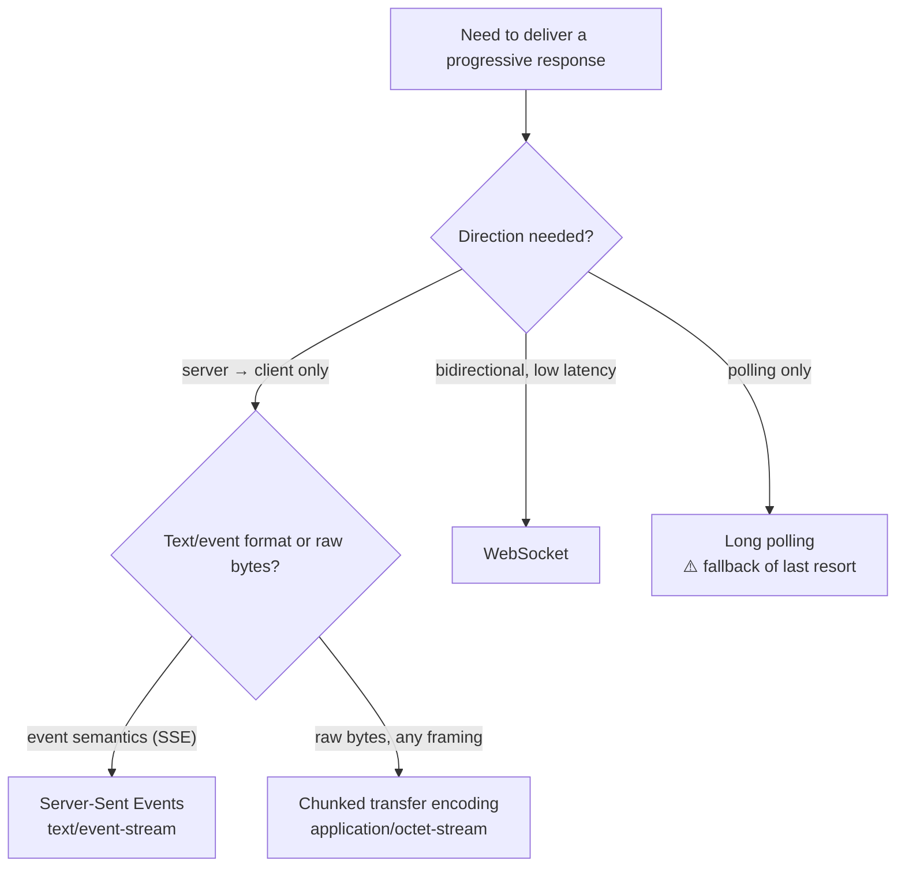
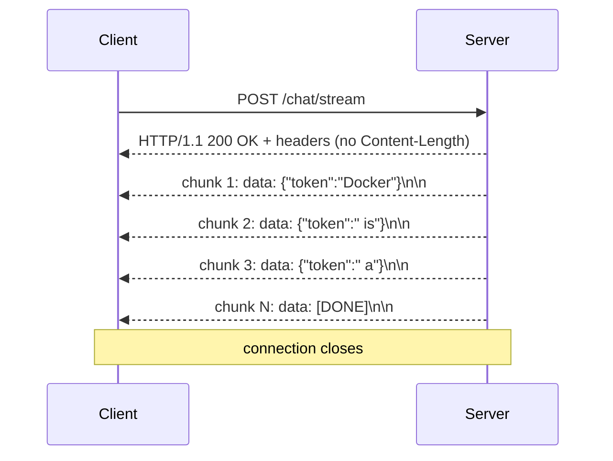
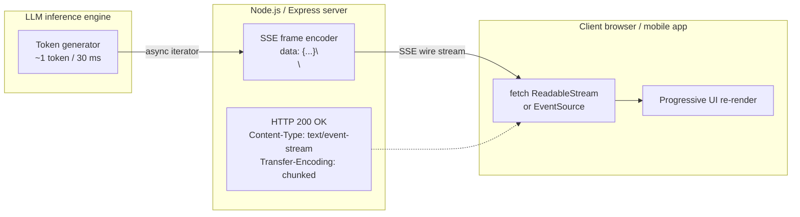
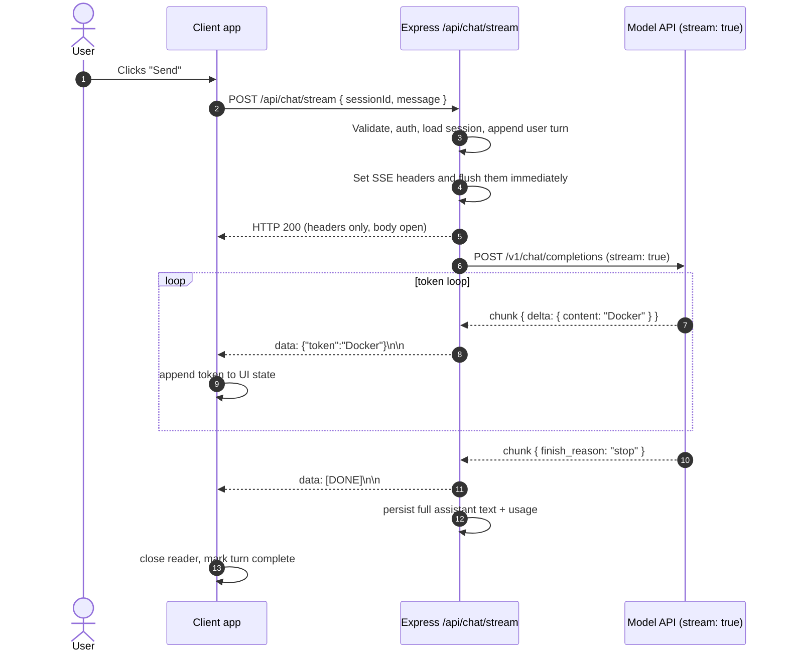
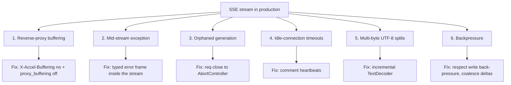
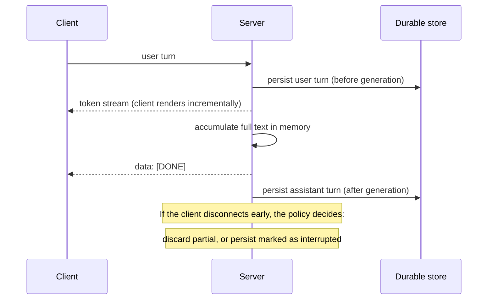

# Chapter 05 — Real-Time Streaming & SSE (First Contact)

> **Lecture 06 · Chapter 05 of 08** · Level: 🟡 Intermediate · Phase 2 — The Application Layer
> **Source:** `Forward-Deployed-Engineer/Lecture 04/notes/04_Real_Time_Streaming_Architecture_and_SSE_Protocols.md`
> **Roadmap topics:** real-time streaming architecture & SSE (first contact — depth in **Lecture 07**).
> **Prerequisites:** Chapter 01 (stateless requests, history as application state) · Chapter 02 (prompt size →
> prefill latency) · Lecture 02-03 (autoregressive decoding).

---

## 05.0 What this chapter is for

A chatbot that takes 18 seconds to answer is not a chatbot — it is a form submission. This chapter explains why that
happens, and the single architectural change that fixes it without making the model any faster.

> **The claim of this chapter:** streaming is not a UI nicety. It is the natural consequence of how the model
> already produces text, and withholding that text on the server is an artificial bottleneck your own architecture
> created.

This is **first contact** with streaming. The full treatment — chunk granularity, backpressure, reactive
operators, chaos testing, UTF-8 torture tests — is **Lecture 07**.

By the end of this chapter you should be able to:

1. Describe autoregressive generation and why it is *already* incremental.
2. Explain why buffered request/response fails for conversational AI.
3. Decompose latency into **TTFT** and **ITL** and compute total response time.
4. Explain why streaming changes **perceived** latency but not total generation time.
5. Choose between SSE, WebSockets and chunked transfer encoding — and justify SSE for chat.
6. Read and write the SSE wire format, including the `[DONE]` sentinel.
7. Sketch the backend and frontend halves of a streaming pipeline in pseudo-code.
8. Name the four production hazards: proxy buffering, mid-stream errors, orphaned generation and history persistence.

---

## 05.1 The autoregressive generation reality

An LLM does not synthesise a paragraph in one instant. It is an **autoregressive decoder**: every token requires a
distinct forward pass through all transformer blocks.

```text
Step 1: Context                                  -> "Docker"
Step 2: Context + "Docker"                       -> "is"
Step 3: Context + "Docker is"                    -> "a"
Step 4: Context + "Docker is a"                  -> "containerisation"
Step 5: Context + "Docker is a containerisation" -> "platform."
```



The loop is:

1. Feed the current context through the layers to compute the next-token distribution.
2. Sample one token from that distribution.
3. Append the sampled token to the context.
4. Repeat.

> **The fundamental realisation:** because the model is *already* producing output progressively, holding back
> tokens on the server until the paragraph finishes is an artificial bottleneck created by the application layer.

In practice the loop is optimised with a **KV cache** so that step *n* only computes attention for the new token —
but the tokens still emerge one at a time, and each one is available to you the moment it is sampled.

---

## 05.2 The bottleneck of buffered request/response

Classical web architecture follows a strict **buffering** lifecycle:

1. Client sends an HTTP POST.
2. Server executes business logic, waits for *all* data to settle, packages the complete JSON payload.
3. Server returns the response; the client renders everything at once.



Everything the user needed was available at second 1. The architecture simply refused to deliver it.

### Three failures caused by buffering

| Failure | Mechanism |
| :--- | :--- |
| **Perceived latency** | The user stares at a spinner for the full generation time |
| **Gateway timeouts** | Proxies and CDNs commonly kill idle connections at 30 s; long generations can exceed it |
| **No graceful degradation** | If the connection drops at second 17, the user loses everything and must retry from scratch |

---

## 05.3 Latency anatomy: TTFT, ITL and total time

Total response time decomposes cleanly:

$$T_{\text{total}} = \text{TTFT} + (N_{\text{output}} \times \text{ITL})$$

| Term | Name | Typical value | What it contains |
| :--- | :--- | :--- | :--- |
| $\text{TTFT}$ | **Time-To-First-Token** | 200–800 ms | Network transit, tokenisation, prefill pass over the whole prompt |
| $N_{\text{output}}$ | tokens generated | task-dependent | Length of the answer |
| $\text{ITL}$ | **Inter-Token Latency** | 20–50 ms/token | One decode step per token (with KV cache) |

### Numerical comparison

Take $N_{\text{output}} = 600$, $\text{TTFT} = 500\ \text{ms}$, $\text{ITL} = 30\ \text{ms}$:

$$T_{\text{total}} = 500\ \text{ms} + (600 \times 30\ \text{ms}) = 500 + 18{,}000\ \text{ms} = 18.5\ \text{s}$$

| Mode | Perceived wait | User experience | Gateway timeout risk |
| :--- | :--- | :--- | :--- |
| **Buffered** | **18.5 s** | Feels frozen; users click again or abandon | High (30 s proxy limits) |
| **Streaming** | **0.5 s** (TTFT) | Immediate, conversational; text arrives at reading speed | Near zero (connection is active) |

> **Crucial distinction:** streaming does **not** make the model generate faster. Total wall-clock time is still
> ~18.5 s. Streaming reduces **perceived latency** by delivering text at human reading speed (3-5 words/second)
> from the moment the first token leaves the GPU.

### What actually improves TTFT

TTFT is the number users feel most. Levers that reduce it:

| Lever | Effect |
| :--- | :--- |
| **Shorter prompts** | Less prefill work — this is where chapter 02 pays off |
| **Prefix caching** | Reuses KV tensors for a stable prompt prefix |
| **Smaller/faster models for the first token** | Or speculative decoding (Lecture 25 territory) |
| **Geographic proximity** | Network transit is part of TTFT |
| **Connection warm-up** | TLS handshake and DNS are part of the user-perceived start |

---

## 05.4 Transport options — and why SSE wins for chat

Four mechanisms can carry a progressive response over HTTP.



| Transport | Direction | Framing | Reconnect | Firewall friendliness | Complexity |
| :--- | :--- | :--- | :--- | :--- | :--- |
| **Buffered HTTP** | request/response | none | n/a | ✅ | Lowest |
| **Chunked transfer encoding** | server → client | raw bytes, you define | manual | ✅ | Low |
| **SSE** | server → client | `data: ...\n\n` events | built into `EventSource` | ✅ standard HTTP ports | Low |
| **WebSocket** | full duplex | frames | manual | ⚠️ often blocked by corporate proxies | High |
| **Long polling** | pseudo-push | HTTP responses | manual | ✅ | Medium, wasteful |

### Why SSE over WebSockets for chat

1. **Unidirectional simplicity.** Chat responses flow server → client. WebSockets require full-duplex framing,
   connection-state management and ping/pong heartbeats — complexity you do not need.
2. **HTTP/2 multiplexing.** SSE runs over standard HTTP. Over HTTP/2, dozens of SSE streams share one TCP
   connection without head-of-line blocking.
3. **Enterprise firewall friendly.** SSE uses ports 80/443 and looks like an ordinary long-lived HTTP response, so
   it survives proxies that routinely terminate WebSocket upgrade requests.
4. **Built-in text event semantics.** `data:` frames, event ids and reconnection are part of the protocol — you get
   a parser in every browser for free.

> **When WebSocket *is* right:** genuinely bidirectional real-time features — collaborative editing, live cursors,
> voice with barge-in, or a client that must push mid-generation controls other than cancellation. For "stream me
> the answer", SSE is the correct default.

### The chunked transfer encoding underneath

SSE is delivered using HTTP **chunked transfer encoding** (`Transfer-Encoding: chunked`), which lets a server send a
response body of unknown length incrementally. Without it, HTTP requires a `Content-Length` up front — which you
cannot know while tokens are still being generated.



---

## 05.5 The SSE wire format

An SSE stream is plain UTF-8 text partitioned into events separated by **double newlines** (`\n\n`).

```http
HTTP/1.1 200 OK
Content-Type: text/event-stream; charset=utf-8
Cache-Control: no-cache, no-transform
Connection: keep-alive
Transfer-Encoding: chunked

data: {"choices":[{"delta":{"content":"Docker"}}]}

data: {"choices":[{"delta":{"content":" is"}}]}

data: {"choices":[{"delta":{"content":" an"}}]}

data: {"choices":[{"delta":{"content":" open"}}]}

data: [DONE]

```

Four details worth memorising:

| Detail | Why it matters |
| :--- | :--- |
| `Content-Type: text/event-stream` | The client (and proxies) must know this is an event stream |
| `\n\n` terminates each event | Parsers split on the blank line, **not** on the JSON |
| `data: ` prefix (with the space) | The payload follows the prefix; multi-line payloads use repeated `data:` lines |
| `data: [DONE]` sentinel | A convention (from the OpenAI-style APIs) that signals clean completion |

### The SSE frame vocabulary (full protocol)

Beyond `data:`, the SSE spec defines a small set of fields that production systems use:

| Field | Purpose | Chat-relevant use |
| :--- | :--- | :--- |
| `data:` | The payload | Tokens, deltas, error objects |
| `event:` | Names the event type | `token`, `tool_call`, `citation`, `error` |
| `id:` | Last-event id | Resume after a dropped connection |
| `retry:` | Client reconnect delay (ms) | Backoff tuning |
| `:comment` | Ignored by clients | **Heartbeats** — keeps idle connections alive |

A richer, production-shaped stream (still plain SSE):

```http
event: start
data: {"messageId":"m_81f","model":"gpt-4o"}

event: token
data: {"delta":"Docker"}

event: token
data: {"delta":" is a containerisation platform"}

event: citation
data: {"docId":"kb_44","title":"Container Basics"}

: keep-alive

event: done
data: {"finishReason":"stop","totalTokens":612}

```

> **Note the two-layer protocol.** SSE is the *transport framing*; the JSON inside `data:` is *your application
> protocol*. Design the second layer deliberately — you will add event types (tool calls, citations, usage) sooner
> than you expect.

---

## 05.6 End-to-end streaming architecture

Three tiers must cooperate: the model SDK (async iterator), the Express server (SSE encoder + lifecycle) and the
client (stream reader + incremental render).



### Full turn lifecycle



### Ordering rule

Note where the persistence happens: **after** the stream completes. But the **user turn** was persisted *before* the
model call (§01.11). That asymmetry is deliberate:

| Turn | When to persist | Why |
| :--- | :--- | :--- |
| **User turn** | Before the model call | Durability — a crash must not lose the user's message |
| **Assistant turn** | After the stream ends | It does not exist until then; buffer it while streaming |

---

## 05.7 Server side (pseudo-code)

Six responsibilities, in order: validate → set headers → wire cancellation → stream → terminate → persist.

```ts
// pseudo-code — SSE streaming endpoint, no runnable code
router.post('/chat/stream', async (req, res) => {
  const { sessionId, message } = req.body
  if (!isValid(message)) return res.status(400).json({ error: 'message required' })

  // 1. Set SSE headers BEFORE any write
  res.writeHead(200, {
    'Content-Type': 'text/event-stream',
    'Cache-Control': 'no-cache, no-transform',
    'Connection': 'keep-alive',
    'X-Accel-Buffering': 'no',      // disables Nginx/Cloudflare response buffering
  })
  res.flushHeaders?.()              // establish the connection immediately

  // 2. Link client disconnection to upstream cancellation
  const abort = new AbortController()
  req.on('close', () => abort.abort())    // tab closed / user pressed stop

  let full = ''

  try {
    // 3. Persist the user turn before generating (chapter 01)
    await store.appendUser(sessionId, message)
    const messages = await assemblePayload(sessionId, message)   // chapter 03

    // 4. Open the upstream stream
    const stream = await model.chat.completions.create(
      { model: MODEL, messages, stream: true },
      { signal: abort.signal },
    )

    // 5. Pump deltas out as SSE frames
    for await (const chunk of stream) {
      const delta = chunk.choices[0]?.delta?.content ?? ''
      if (!delta) continue
      full += delta
      res.write(`data: ${JSON.stringify({ token: delta })}\n\n`)
    }

    // 6. Clean termination
    res.write('data: [DONE]\n\n')
    res.end()

    // 7. Persist the assembled assistant turn AFTER the stream ends
    await store.appendAssistant(sessionId, full)
  } catch (err) {
    if (abort.signal.aborted) return          // client left; nothing to report
    res.write(`data: ${JSON.stringify({ error: 'generation_failed' })}\n\n`)
    res.end()
  }
})
```

### Why each block exists

| Block | Reason |
| :--- | :--- |
| `writeHead` **before** any body write | Once you write, the status is committed. You cannot send a 500 later. |
| `X-Accel-Buffering: no` | Without it, Nginx buffers ~4-16 KB before forwarding — the user sees a stall then a burst. |
| `res.flushHeaders()` | Makes the browser's `fetch` promise resolve immediately, so the UI can show a "streaming" state. |
| `AbortController` wired to `req.on('close')` | Prevents **orphaned generation**: paying for tokens nobody will read. |
| `if (!delta) continue` | Chunks carry role-only or usage-only frames; writing them produces empty frames. |
| `[DONE]` sentinel | Gives the client an unambiguous, protocol-level completion signal. |
| Persist after `end()` | The assistant turn only exists once generation finishes. |
| Error frame instead of a 500 | Status is already 200; typed errors travel **inside** the stream. |

---

## 05.8 Client side (pseudo-code)

The client must do four things: read bytes, decode UTF-8 **incrementally**, split frames on `\n\n`, and render.

```ts
// pseudo-code — consuming an SSE stream with fetch + ReadableStream
async function streamChat(url: string, body: unknown, onToken: (t: string) => void) {
  const res = await fetch(url, {
    method: 'POST',
    headers: { 'Content-Type': 'application/json' },
    body: JSON.stringify(body),
  })
  if (!res.ok || !res.body) throw new Error(`HTTP ${res.status}`)

  const reader  = res.body.getReader()
  const decoder = new TextDecoder('utf-8')   // incremental decoder — critical for multi-byte chars
  let buffer = ''
  let full = ''

  while (true) {
    const { value, done } = await reader.read()
    if (done) break

    // { stream: true } keeps partial multi-byte sequences in the decoder's internal state
    buffer += decoder.decode(value, { stream: true })

    // Frames are separated by a blank line, NOT by the JSON boundary
    const frames = buffer.split('\n\n')
    buffer = frames.pop() ?? ''              // keep the trailing partial frame

    for (const frame of frames) {
      const line = frame.trim()
      if (!line.startsWith('data:')) continue          // ignore comments/heartbeats

      const payload = line.replace(/^data:\s?/, '')
      if (payload === '[DONE]') return full

      try {
        const parsed = JSON.parse(payload)
        if (parsed.error) throw new Error(parsed.error)
        if (parsed.token) { full += parsed.token; onToken(parsed.token) }
      } catch {
        // malformed frame: log and skip rather than killing the stream
      }
    }
  }
  return full
}
```

### Three client-side rules that prevent most streaming bugs

| Rule | Why |
| :--- | :--- |
| **Always decode with `{ stream: true }`** | A UTF-8 character can be split across two network chunks. Without incremental decoding you get mojibake. |
| **Buffer and split on `\n\n`, never on the chunk boundary** | A network chunk can contain half a frame, three frames, or a frame split mid-JSON. |
| **Retain the trailing partial frame** | `frames.pop()` puts it back in the buffer for the next read. |

> **Rendering tip:** do not re-render the entire message on every token. Append the token to a text node, or batch
> updates on `requestAnimationFrame`. At 30 tokens/second, a naive full re-render of a long message will visibly
> stutter.

---

## 05.9 Production hazards and edge cases



### 1. Reverse-proxy buffering

Nginx and CDNs optimise throughput by buffering responses until they reach 4-16 KB.

- **Symptom:** the user waits ~10 s, then receives 300 words in one burst.
- **Fix:** emit `X-Accel-Buffering: no` from the app, and set `proxy_buffering off;` in Nginx.

### 2. Mid-stream exceptions

In REST you would return `HTTP 500`. In streaming you have already committed `HTTP 200` and flushed headers.

- **Fix:** transmit a typed error event *inside* the stream and let the client surface a retry affordance:

```http
data: {"error":"rate_limit_exceeded","code":429,"retryAfterMs":2000}
```

### 3. Orphaned generation (GPU waste)

If a user closes the tab mid-stream, the TCP socket closes — but if the server is not listening, it keeps requesting
and paying for tokens.

- **Fix:** `req.on('close', () => abort.abort())`, propagating the signal into the model SDK call.

### 4. Idle-connection timeouts

Proxies and load balancers close connections that are silent for too long. A model that is "thinking" (e.g. during a
long tool call) emits nothing.

- **Fix:** send a comment heartbeat every 10-15 s — `: ping\n\n`. Clients ignore comments by spec.

### 5. Multi-byte UTF-8 splits

An emoji or a non-Latin character can be split across two network chunks.

- **Fix:** incremental decoding (`{ stream: true }`) on the client, and never slice strings by byte offset.

### 6. Backpressure

If the client reads slowly (mobile network), `res.write()` returns `false` and the server-side buffer grows.

- **Fix:** respect the return value, await `'drain'`, and **coalesce** deltas — batching 3-5 tokens into one frame
  reduces frame overhead dramatically with no perceptible UX change. (Full treatment in **Lecture 07**.)

| Hazard | Symptom | Root cause | Fix |
| :--- | :--- | :--- | :--- |
| Proxy buffering | Stall then burst | Response buffered upstream | `X-Accel-Buffering: no`, `proxy_buffering off` |
| Mid-stream error | Stream stops, no status | Status already 200 | Typed error frame |
| Orphaned generation | Cost with no user | No socket-close handling | `AbortController` on `req.close` |
| Idle timeout | Stream dies mid-thought | Silent connection | Comment heartbeats |
| UTF-8 split | Broken characters | Per-chunk decoding | Incremental decoder |
| Backpressure | Server memory growth | Ignoring `write()` result | Drain + coalesce |

---

## 05.10 Buffering and persisting history during a stream

Two problems appear the moment you stream:

1. **The assistant turn does not exist yet.** You cannot persist it before it is generated.
2. **The UI must show the partial turn immediately** — but the server's transcript should only contain the
   *complete* turn.



**Policy decision — what to do with a partially generated turn:**

| Policy | Behaviour | When to choose |
| :--- | :--- | :--- |
| **Discard partial** | The transcript only ever holds complete turns | Simpler; a retry produces a clean transcript |
| **Persist as `interrupted`** | Store the partial text with a status flag | The user saw it, so the record should match reality |
| **Persist + resume** | Store the partial and allow regeneration from that point | Complex; needs idempotent stream ids |

> **The consistency rule:** the durable transcript must never contain an assistant turn the user never saw, and
> ideally never omit one they did. Whichever policy you pick, state it explicitly — silent inconsistency shows up
> later as "the bot contradicts itself".

---

## 05.11 Where this goes next (Lecture 07 preview)

This chapter covered first contact. **Lecture 07 — AI Streaming** goes deeper on:

- **Granularity:** token vs chunk vs network packet vs byte.
- **Backend transports:** `call` vs `stream` vs reactive `Flux`-style streams, stream pumps, delta coalescing.
- **The 7 pipeline invariants** and flow control.
- **Multi-user isolation** and thread safety on the server.
- **Infrastructure that silently breaks streaming** — proxies, compression, buffering.
- **UTF-8 torture tests** and chaos toggles.
- **Cancellation semantics** and the "stop" button.
- **Rendering rich content** (markdown, code blocks, citations) while it is still arriving.
- **Token accounting *during* a stream** — the bridge back to chapters 02-03.

> **The one thing to carry forward:** streaming changes *when* the user sees text, not *how much* text exists. Every
> context-management decision from chapters 02-03 still applies — and now it also affects TTFT.

---

## 05.12 Common mistakes

- **Writing the response body before setting SSE headers.** The status and content type are committed; the client
  sees JSON instead of a stream.
- **Forgetting `X-Accel-Buffering: no`.** Everything looks fine locally and stalls in production behind Nginx.
- **Not listening for `req.on('close')`.** You keep paying for tokens after the user leaves (orphaned generation).
- **Trying to send a `500` mid-stream.** Impossible — the status was sent. Use a typed error frame.
- **Splitting the client buffer on the network chunk boundary.** Frames arrive split; parse on `\n\n`.
- **Decoding each chunk independently.** Multi-byte UTF-8 characters break. Use `{ stream: true }`.
- **Forgetting the `[DONE]` sentinel.** Clients cannot distinguish "finished" from "connection dropped".
- **Persisting the assistant turn before generation finishes.** You store an empty or partial turn.
- **No heartbeats during long tool calls.** Proxies close the idle connection.
- **Ignoring backpressure.** Server memory grows when clients are slow; coalesce and respect `drain`.
- **Assuming streaming reduces total generation time.** It reduces *perceived* latency only.
- **Building a bidirectional feature on SSE.** If the client must push mid-generation, use WebSockets.

---

## 05.13 Key takeaways

1. **Autoregressive generation is already incremental.** Buffering it is an artificial bottleneck.
2. **Streaming optimises perceived latency, not throughput.** Total time is unchanged; TTFT drops to a few hundred
   milliseconds.
3. **Latency decomposes as** $T_{\text{total}} = \text{TTFT} + N_{\text{output}} \times \text{ITL}$.
4. **TTFT is the metric users feel** — and prompt length is a first-order lever on it.
5. **SSE is the default transport for chat:** unidirectional, firewall-friendly, HTTP/2 multiplexed, with a parser in
   every browser.
6. **Chunked transfer encoding is what makes it possible** — no `Content-Length` needed.
7. **The wire format is simple:** `data: {...}\n\n` frames terminated by `data: [DONE]`.
8. **Headers first, then stream.** Once you write, the status is committed.
9. **Wire cancellation to socket close.** Otherwise you pay for tokens nobody reads.
10. **Disable proxy buffering explicitly.** `X-Accel-Buffering: no`.
11. **Parse on `\n\n` and decode incrementally.** These two rules prevent the majority of streaming bugs.
12. **Persist user turn before, assistant turn after** — and declare a policy for interrupted turns.

---

## 05.14 Self-check questions

1. Why is buffering a "self-inflicted" bottleneck for LLM responses?
2. Compute $T_{\text{total}}$ for $N_{\text{output}} = 400$, $\text{TTFT} = 350\ \text{ms}$,
   $\text{ITL} = 25\ \text{ms}$. What does the user perceive with and without streaming?
3. Does streaming make generation faster? Explain precisely what it does change.
4. Name four levers that reduce TTFT.
5. Give three reasons SSE beats WebSockets for chat, and one case where WebSockets win.
6. Why is `Transfer-Encoding: chunked` required?
7. Write a valid SSE frame carrying the token `"world"` and then a clean termination.
8. What are `event:`, `id:` and comment frames for?
9. Explain the orphaned-generation problem and its fix, with the specific event you must listen to.
10. A user reports garbled characters at the end of streamed emoji. Diagnose it.
11. You must send a rate-limit error 8 seconds into a stream. What can you send, and what can you not?
12. When should you persist a partially generated assistant turn, and what must the transcript never contain?

---

### Navigation

- **Previous:** [Chapter 04 — Context vs Model Weights & the Illusion of Learning](./04_Context_vs_Model_Weights_and_the_Illusion_of_Learning.md)
- **Next:** [Chapter 06 — Hallucination Mechanisms: Fluency vs Truth](./06_Hallucination_Mechanisms_Fluency_vs_Truth.md)
- **Deep dive:** Lecture 07 — [AI Streaming](../Lecture%2007%20-%20AI%20Streaming/)
- **Source:** `Forward-Deployed-Engineer/Lecture 04/notes/04_Real_Time_Streaming_Architecture_and_SSE_Protocols.md`
- **Roadmap:** [Lecture 06 — Chatbots: Statelessness, Context, Memory & Hallucination](../../roadmap.md)
