# Chapter 07 — Engineering Defences: Grounding, RAG, Guardrails & Verification

> **Lecture 06 · Chapter 07 of 08** · Level: 🟡 Intermediate · Phase 2 — The Application Layer
> **Source:** `Forward-Deployed-Engineer/Lecture 04/notes/06_Engineering_Defenses_RAG_Guardrails_and_Verification.md`
> **Roadmap topics:** engineering defences · grounding · RAG (preview) · guardrails · verification · **calibrated
> refusal engineering** ("I don't know") as a shipped product feature.
> **Prerequisites:** Chapter 06 (hallucination mechanisms, sycophancy, over-refusal) · Chapter 02-03 (context budget,
> grounding must not be evicted) · Lecture 05 ch08 (injection first contact).

---

## 07.0 What this chapter is for

Chapter 06 ended with the honest conclusion: **you cannot prompt your way out of hallucination**. This chapter is
the architecture that does work.

> **The claim of this chapter:** reliability comes from wrapping a probabilistic, unprivileged model in
> **deterministic software** — input validation, grounded facts, real tools, enforceable output schemas, programmatic
> verification and continuous measurement.

By the end of this chapter you should be able to:

1. Explain why prompt-only defences fail, with the mechanism.
2. Name and describe the **7 layers** of defence in depth, and the failure each one prevents.
3. Explain what RAG grounding does and does not fix.
4. Describe why arithmetic, lookups and state changes must be **deterministic tools**.
5. Write a calibrated refusal policy and a few-shot refusal exemplar.
6. Explain constrained decoding with a Zod/JSON-Schema contract.
7. Design a **programmatic output guardrail** that verifies citations against sources.
8. Choose evaluation metrics (faithfulness, relevance, context precision/recall) and wire a regression gate.
9. Reason about the cost, latency and false-positive budget of each layer.

---

## 07.1 The fallacy of prompt-only defences

When a system produces an embarrassing hallucination, junior teams append another line to the system prompt:

```text
// ❌ NAIVE PROMPT PATCHING (fragile and insufficient)
"Please do not hallucinate."
"Only speak 100% certified facts."
"If you are not sure, strictly do not guess."
```

> **The FDE reality:** you cannot eliminate hallucination through prompt instructions alone. System prompts influence
> token likelihoods; they do not alter the underlying statistical mechanics of next-token prediction. Under complex
> prompts, long histories or subtle user manipulation, prompt-only constraints degrade.

```mermaid
flowchart TD
    subgraph Naive["❌ Fragile single-layer defence"]
        P["User query"] --> L["LLM with system prompt:<br/>'Do not hallucinate'"]
        L --> F["Hallucinations and vulnerabilities persist"]
    end

    subgraph Depth["✅ Production 7-layer defence in depth"]
        L1["1. Input gateway & injection guard"] --> L2["2. Hybrid RAG retrieval"]
        L2 --> L3["3. Deterministic tool calling"]
        L3 --> L4["4. Grounded prompt & refusal tuning"]
        L4 --> L5["5. Type-safe structured outputs"]
        L5 --> L6["6. Output guardrail & hallucination scorer"]
        L6 --> L7["7. Observability & evaluation"]
    end
```

### Why prompts are a weak control surface

| Reason | Mechanism |
| :--- | :--- |
| **Probabilistic, not deterministic** | A prompt shifts probabilities; it cannot forbid an outcome |
| **Competing instructions** | A long system prompt competes with itself; constraints weaken |
| **Context dilution** | In a 100k-token prompt, the honesty rule is in the middle (lost-in-the-middle, §02.7) |
| **Adversarial pressure** | A user can argue, reframe, or inject; the prompt has no enforcement power |
| **No verification** | A prompt cannot check its own output |

> **The mental model:** the prompt is a *policy suggestion*. The application code is the *enforcement*. You need
> both, and only one of them is trustworthy.

---

## 07.2 The 7-layer defence-in-depth architecture

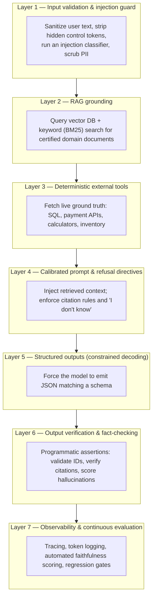

| Layer | Responsibility | Technology / approach | Failure prevented |
| :--- | :--- | :--- | :--- |
| **1. Input sanitisation** | Block injections, jailbreaks and PII leaks before inference | Regex, injection classifiers, guardrail models | Goal hijacking, prompt leakage |
| **2. RAG grounding** | Inject fresh, private, factual documentation | Hybrid search (dense vectors + BM25) | Training cutoff, missing domain facts |
| **3. External tools** | Offload arithmetic, lookups and state changes to code | REST APIs, SQL clients, function calling | Arithmetic errors, invented inventory/pricing |
| **4. Calibrated refusal** | Challenge false premises; admit ignorance | Few-shot refusal demonstrations, explicit rules | Sycophancy, fabricated answers to trick queries |
| **5. Structured outputs** | Guarantee responses parse into application types | JSON Schema / constrained decoding + Zod | Broken parsing, missing fields |
| **6. Output guardrails** | Deterministically verify claims against sources | Citation validators, fact-check classifiers | Subtle entity swaps (IBM vs Sun) |
| **7. Evaluation suite** | Measure faithfulness and recall continuously | Ragas, TruLens, LLM-as-a-judge suites | Silent model drift, prompt regression |

### The layering principle

Each layer assumes **all previous layers may fail**. That is what "defence in depth" means — not redundancy, but
**independent failure modes**.

```mermaid
flowchart LR
    A["Attacker or error"] --> L1["Layer 1 catches?<br/>injection patterns"]
    L1 -- no --> L2["Layer 2 catches?<br/>no source → no answer"]
    L2 -- no --> L3["Layer 3 catches?<br/>tool returns real value"]
    L3 -- no --> L4["Layer 4 catches?<br/>refusal instruction"]
    L4 -- no --> L5["Layer 5 catches?<br/>schema violation"]
    L5 -- no --> L6["Layer 6 catches?<br/>citation mismatch"]
    L6 -- no --> L7["Layer 7 detects<br/>in aggregate, post-hoc"]
```

### The cost of depth (be honest about it)

| Layer | Added latency | Added cost | False-positive risk |
| :--- | :--- | :--- | :--- |
| 1. Input guard | 5-100 ms (classifier) | Low-medium | ⚠️ Blocks legitimate inputs |
| 2. RAG | 20-200 ms | Embedding + vector query | ⚠️ Misses relevant docs |
| 3. Tools | 50-2000 ms | API costs | Low |
| 4. Refusal prompt | ~0 ms | Prompt tokens | ⚠️ Over-refusal (§06.9) |
| 5. Structured output | ~0 ms | ~0 | Low (but can truncate) |
| 6. Output verification | 1-50 ms | Low | ⚠️ Flags correct answers |
| 7. Evaluation | 0 ms (offline) | Eval tokens | None |

> **Design rule:** you do not need every layer for every use case. A FAQ bot needs 2, 4, 5. A payments agent needs
> all seven. Choose per risk, and document the choice.

---

## 07.3 Layer 1 — Input validation & injection guard

**Goal:** stop hostile or malformed input *before* it becomes context.

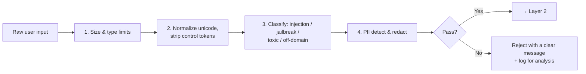

| Control | Example | Why |
| :--- | :--- | :--- |
| **Length caps** | Reject > 8,000 characters | Prevents budget exhaustion and cost attacks |
| **Unicode normalisation** | Strip zero-width and bidi override characters | Invisible characters hide injections from review |
| **Delimiter escaping** | Escape your own delimiters in user text | Prevents delimiter breakout (Lecture 05 ch07) |
| **Injection classifier** | Prompt-injection detection model | Catches *"ignore previous instructions"* families |
| **PII detection** | Credit cards, national IDs, emails | Compliance and data-minimisation |
| **Content moderation** | Safety API | Policy violations, abuse |
| **Rate limiting** | Per-user RPM/TPM | Cost control and abuse mitigation |

> **Security caveat (first contact only):** this layer reduces risk; it does not eliminate prompt injection.
> Indirect injection — hostile text inside a document you retrieved — bypasses it entirely, because the *user* never
> typed it. Full treatment: **Lecture 31 — Security and Guardrails**.

---

## 07.4 Layer 2 — RAG grounding (preview)

**Goal:** put certified facts into the context so the model does not have to guess.

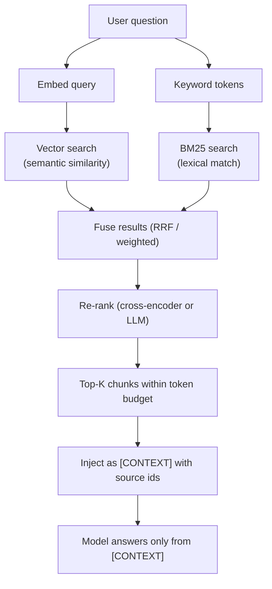

### Why hybrid (dense + BM25)?

| Retrieval mode | Strength | Weakness |
| :--- | :--- | :--- |
| **Dense vectors** | Paraphrase, synonyms, semantic intent | Poor at exact identifiers, error codes, rare names |
| **BM25 / keyword** | Exact strings, IDs, codes, product names | Misses paraphrase |
| **Hybrid** | Both | Slightly more plumbing |

Enterprise questions are full of exact strings — `Order #9482`, `HTTP 429`, `SKU-9911`, `v2.3.1`. Dense-only
retrieval reliably fails on these.

### What RAG fixes, and what it does not

| Fixes | Does not fix |
| :--- | :--- |
| Knowledge cutoff (§06.5 catalyst 1) | Sycophancy (§06.5 catalyst 3) |
| Missing private context (catalyst 2) | Context saturation, if you retrieve too much (catalyst 4) |
| Outdated documentation | Arithmetic and reasoning errors (catalyst 5) |
| Grounds the answer in a source you can cite | Injection from retrieved documents |

> **The RAG honesty rule:** retrieval reduces *missing-context* hallucination. It introduces two new failure modes:
> **retrieval miss** (the answer was in the corpus but not retrieved) and **retrieval noise** (irrelevant chunks
> crowd out the answer). Both must be measured — context **recall** and context **precision** (§07.9).

### Chunking, briefly

| Decision | Guidance |
| :--- | :--- |
| **Chunk size** | 300-800 tokens: large enough to be self-contained, small enough to be precise |
| **Overlap** | 10-20% so facts spanning a boundary survive |
| **Structure-aware splitting** | Split on headings/tables, not fixed character counts |
| **Metadata** | Every chunk carries source id, title, version, date — needed for citations and freshness |
| **Freshness** | Index has a re-index schedule; stale indexes silently produce stale answers |

Depth on retrieval is in **Lecture 12-17**. This chapter only needs the interface: *retrieve certified chunks,
inject them with ids, require citations, and measure retrieval quality*.

---

## 07.5 Layer 3 — Deterministic external tools

**Goal:** never let the model *compute* or *remember* something a database can answer exactly.

| Question type | Wrong approach | Right approach |
| :--- | :--- | :--- |
| *"What is my order status?"* | Ask the model to infer from history | Call `getOrderStatus(orderId)` |
| *"What is 17,432 × 981?"* | Let the model do arithmetic | Call a calculator tool |
| *"Is this SKU in stock?"* | RAG over a stale inventory doc | Call the inventory API |
| *"Refund $50 on order X"* | Ask the model to do it | Tool with server-side authorisation and caps |
| *"What's today's date?"* | Hope the model knows | Inject the date, or call a clock tool |

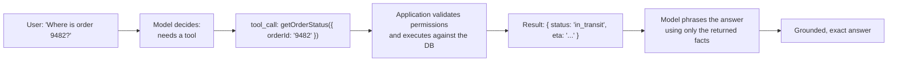

> **The unprivileged-kernel principle (chapter 08):** the model *proposes*; the application *executes*. Never give
> the model a capability that the application does not check. Tool authorisation, limits and side-effect caps live
> in code.

Two rules that prevent most tool-related incidents:

1. **A tool failure is a result, not an exception.** Return `{ ok: false, reason: 'not_found' }` to the model and
   let it respond honestly — instead of throwing and producing a generic 500 (Lecture 08).
2. **Validate every tool argument server-side.** The model can be induced to pass an ID it should not see.

---

## 07.6 Layer 4 — Calibrated refusal engineering ("I don't know")

**Goal:** make refusal a *designed behaviour*, not a hoped-for one.

The default tendency of an ungrounded LLM is to answer even when context is missing. Counteract it with an explicit
refusal policy in the system prompt:

```text
SYSTEM INSTRUCTION (refusal calibration)
1. Rely ONLY on the facts explicitly stated in the [CONTEXT] section below.
2. Do not assume or extrapolate from outside knowledge.
3. If the user asks about an event, person, order or policy detail that is not
   explicitly confirmed in [CONTEXT], you MUST respond:
   "I do not have sufficient verified information to answer this question."
4. If the user's question contains an unverified premise (e.g. asking about a
   nonexistent event or product), explicitly reject the premise before proceeding.
5. Never invent identifiers, dates, amounts, names or citations.
```

### Few-shot refusal exemplars

Models follow demonstrations far better than abstract rules. Two well-chosen examples dramatically reduce
fabrication:

```text
[EXAMPLE 1]
Context: "Tomato delivery operates in Delhi, Mumbai and Bangalore."
User:    "Can I order food in Hyderabad?"
Assistant: "Based on the information available to me, Tomato does not currently
            operate in Hyderabad."

[EXAMPLE 2]
Context: "Order #4812 was placed at 12:30 PM for a Margherita Pizza."
User:    "Who is the delivery rider for Order #4812?"
Assistant: "I do not have access to rider details for Order #4812 in the current
            system records."
```

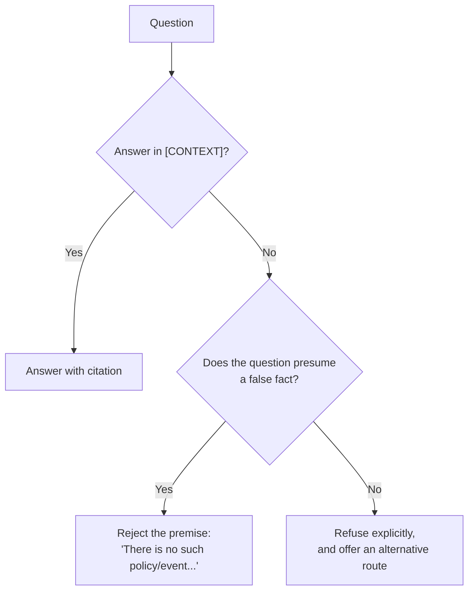

### The UX of refusal (a product concern, not an engineering one)

A refusal is a user-facing outcome. Design it:

| Bad refusal | Good refusal |
| :--- | :--- |
| *"I cannot answer that."* | *"I don't have verified details about that order in this system. I can connect you to a support agent, or you can check the tracking link in your confirmation email."* |
| Silent failure / empty response | Explicit, honest, with a next step |
| Refusing the whole conversation | Refusing only the unverifiable claim |

> **The product framing:** *"I don't know"* is not a limitation to hide. It is the feature that makes every other
> answer trustworthy. Track its rate (§07.9) the way you track error rates.

---

## 07.7 Layer 5 — Structured outputs via constrained decoding

**Goal:** make the response *parseable by construction*, so downstream code never guesses.

Instead of free-form markdown that you hope contains the right facts, constrain the model's sampling to a
context-free grammar defined by a JSON Schema.

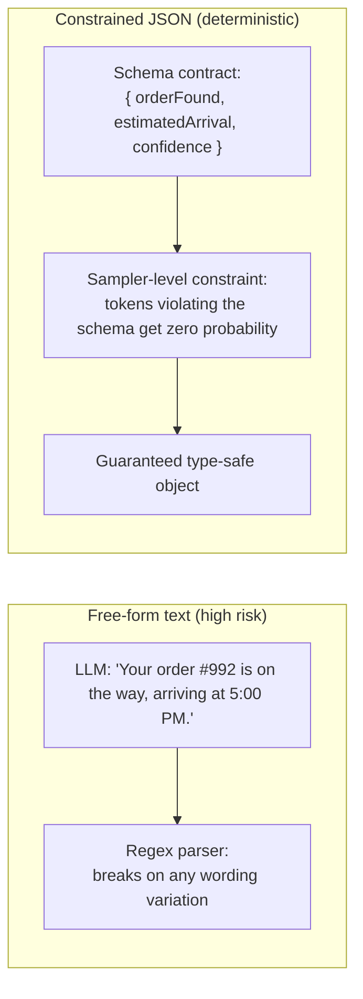

A schema shaped for **grounded, verifiable** responses:

```ts
// pseudo-code — a grounded response contract (Zod-style shape)
const GroundedResponse = {
  answer: string,                 // the direct, empathetic answer
  confidenceScore: number,        // 0..1, based on context only
  citedFacts: string[],           // exact factual statements drawn from [CONTEXT]
  isRefusal: boolean,             // true if refused for missing/contradictory context
  unverifiedClaimsDetected: boolean, // true if the user's premise was false
}
```

### Why this shape and not just `{ answer: string }`

| Field | Enables |
| :--- | :--- |
| `answer` | The user-facing text |
| `confidenceScore` | A cheap routing signal: below a threshold → human review |
| `citedFacts` | **Machine-checkable** grounding (Layer 6) |
| `isRefusal` | Refusal becomes a typed outcome, not a string you grep |
| `unverifiedClaimsDetected` | Sycophancy becomes measurable |

> **The design insight:** a structured output is not just about parsing. It is how you make the model **declare its
> own grounding claims** in a form your code can verify. `citedFacts` is the hook that Layer 6 hangs on.

### Constrained decoding in one paragraph

With JSON-Schema-constrained decoding, the inference engine masks the logits at each step: any token that would
violate the grammar gets probability zero. The result is *syntactically* guaranteed — the model cannot emit an
unclosed brace or a missing required field. What it does **not** guarantee is that the *values* are true. That is
Layer 6's job.

---

## 07.8 Layer 6 — Output verification & fact-checking guardrails

**Goal:** never trust the model's output implicitly. Verify it in code.

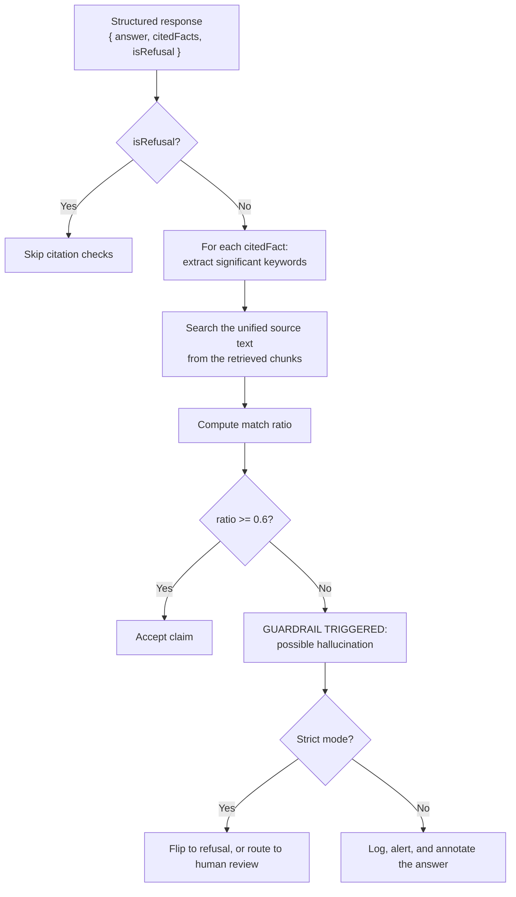

### The verifier (pseudo-code)

```ts
// pseudo-code — deterministic post-generation verification
function verifyCitations(response: GroundedResponse, sourceChunks: string[]): Verdict {
  if (response.isRefusal) return 'refusal_ok'

  const sourceText = sourceChunks.join(' ').toLowerCase()
  const problems: string[] = []

  for (const cited of response.citedFacts) {
    // Keep only content words; punctuation and stopwords are noise
    const keywords = cited
      .toLowerCase()
      .replace(/[^a-z0-9 ]/g, '')
      .split(' ')
      .filter(w => w.length > 4)

    const hits  = keywords.filter(w => sourceText.includes(w))
    const ratio = keywords.length ? hits.length / keywords.length : 1

    if (ratio < 0.6) problems.push(cited)     // <-- threshold is a policy decision
  }

  return problems.length ? { ok: false, problems } : { ok: true }
}
```

### Beyond keyword matching: the verifier toolbox

| Verification technique | Catches | Cost |
| :--- | :--- | :--- |
| **Keyword/entity overlap** | Fabricated entities, wrong names, invented IDs | Very low (pure string ops) |
| **Identifier validation** | Invented order IDs, SKUs, ticket numbers | Very low (regex + DB lookup) |
| **Numeric consistency** | Amounts and totals that do not match the source | Low |
| **Citation existence** | Cited documents that were never retrieved | Low |
| **Entailment check (NLI model)** | Claims not supported by the source even if word-overlapping | Medium |
| **LLM-as-a-judge** | Subtle contradictions and logical inconsistencies | Medium-high |
| **Schema invariants** | Internal contradictions (e.g. `isRefusal=true` with a confident answer) | Very low |

> **The guardrail contract:** a guardrail must be **deterministic** and **cheap enough to run on every request**.
> If it is probabilistic or expensive, it belongs in Layer 7 (offline evaluation), not Layer 6 (inline enforcement).

### What to do when a guardrail fires

| Policy | Behaviour | When to use |
| :--- | :--- | :--- |
| **Fail closed** | Replace the answer with a refusal | Regulated/financial content |
| **Degrade** | Answer, but with a visible "unverified" caveat | Low-stakes informational bots |
| **Escalate** | Route to a human with the flagged claims attached | Support with SLA |
| **Log only** | Record the event, serve the answer | Early rollout, measuring the guardrail's false-positive rate |

**Start in log-only mode.** A guardrail that has never been calibrated will produce false positives, and shipping it
in fail-closed mode on day one will break your product for correct answers.

---

## 07.9 Layer 7 — Observability & continuous evaluation

**Goal:** make reliability measurable, so it can be regression-tested rather than argued about.

### The metric set

| Metric | Question | Framework name |
| :--- | :--- | :--- |
| **Faithfulness** | Is every claim supported by the retrieved context? | Ragas `faithfulness` |
| **Answer relevance** | Does the answer address the question? | Ragas `answer_relevancy` |
| **Context precision** | Were the retrieved chunks relevant? | Ragas `context_precision` |
| **Context recall** | Did retrieval find everything needed? | Ragas `context_recall` |
| **Groundedness / hallucination rate** | How often does an unsupported claim ship? | Custom / TruLens |
| **Abstention & over-refusal rate** | Is refusal calibrated? | Custom (chapter 06) |
| **Guardrail trigger rate** | How often does Layer 6 fire? | Custom |
| **Citation accuracy** | Do cited sources support the claims? | Custom + judge |

### The evaluation loop

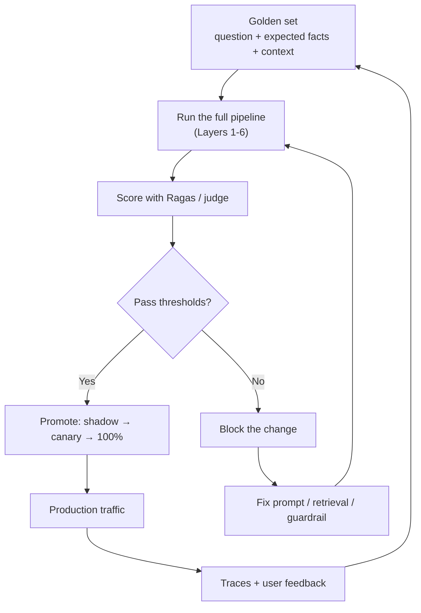

### The two classes of evaluation

| Class | Runs | Cost | Purpose |
| :--- | :--- | :--- | :--- |
| **Offline eval (CI gate)** | On every prompt/model/retrieval change | High (many judge calls) | Prevent regressions |
| **Online monitoring** | Continuously in production | Low (sampled) | Detect drift, model deprecation, traffic shifts |

> **The gate:** a prompt edit is a deployment. It must pass the same golden set as a code change
> (**Lecture 05 ch09**, **Lecture 30 — Evals and Testing**).

### LLM-as-a-judge: rules for using it honestly

| Rule | Why |
| :--- | :--- |
| **Calibrate the judge against human labels** | An uncalibrated judge is a random number generator with confidence |
| **Use a rubric, not a vibe** | *"Is this faithful? 0-1"* is unreliable; *"does each claim appear in the source?"* is better |
| **Prefer a different model family as judge** | Reduces self-preference bias |
| **Report judge disagreement** | If the judge and humans disagree 30% of the time, the metric is noise |
| **Never let the judge be the only gate for safety** | Safety needs deterministic checks |

---

## 07.10 Guardrail engineering realities (an added topic)

The seven layers are easy to list and hard to operate. Four realities separate a design from a working system.

### 1. The false-positive budget

Every guardrail that can block an answer will sometimes block a **correct** answer. Treat that as a first-class
budget.

| Layer | Typical FP source | Mitigation |
| :--- | :--- | :--- |
| Input guard | Legitimate technical text flagged as injection | Allowlist patterns; tune thresholds; log-only first |
| Retrieval | Missing a relevant doc | Hybrid retrieval; re-ranking; query rewriting |
| Refusal prompt | Over-refusal | Scope refusal to factual claims only; measure abstention rate |
| Structured output | Truncation of a long answer | Raise `max_tokens`; simplify the schema |
| Output verification | Keyword mismatch on paraphrased truth | Lower the ratio threshold; add NLI; log-only first |

### 2. Ordering matters

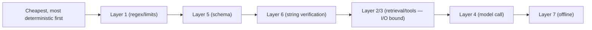

Cheap deterministic checks should run **before** expensive model calls. Rejecting a 1 MB payload with a length check
costs nothing; discovering it at the model call costs a request and a retry.

### 3. Human-in-the-loop (HITL) as a first-class layer

For high-stakes actions, no combination of layers is sufficient. Route to a human.

| Trigger | Route to human |
| :--- | :--- |
| `confidenceScore` below threshold | ✅ |
| Output guardrail fired in strict mode | ✅ |
| Tool call is irreversible (payment, deletion, email) | ✅ (approval step) |
| User explicitly requests escalation | ✅ |

This connects directly to **Lecture 09 — AI Agents and HITL**.

### 4. Observability must include the guardrails themselves

Instrument the defences, not just the model:

| Metric | Reveals |
| :--- | :--- |
| `guardrail_trigger_rate` by layer | Which layer is doing the work |
| `guardrail_false_positive_rate` | Whether the guardrail is too strict |
| `refusal_rate` and `over_refusal_rate` | Calibration of Layer 4 |
| `retrieval_miss_rate` (offline) | Whether Layer 2 is the bottleneck |
| `schema_violation_rate` | Whether Layer 5 is being bypassed |
| `p95_latency_by_layer` | Which layer you cannot afford |

> **A guardrail you do not measure is a guardrail you will eventually disable.** Track trigger *and* false-positive
> rates from day one.

---

## 07.11 Reference implementation (pseudo-code)

A single `GroundedChatEngine` that unifies retrieval, structured output, refusal and verification. Note how each of
the seven layers maps to one step.

```ts
// pseudo-code — grounded chat with post-generation verification
async function groundedAnswer(userId: string, question: string): Promise<Answer> {

  // ---- Layer 1: input validation -------------------------------------------
  const input = sanitize(question)                    // limits, unicode, escaping
  if (!input.ok) return reject('invalid_input')
  if (await isInjection(input.text)) return reject('blocked_by_guard')

  // ---- Layer 2: hybrid retrieval (grounding) -------------------------------
  const chunks = await hybridSearch(input.text, { k: 5, budgetTokens: RAG_BUDGET })

  // ---- Layer 3: deterministic tools (only if needed) -----------------------
  const toolFacts = await runAllowedTools(input.text, { userId })  // permissions checked inside

  // ---- Layer 4: calibrated, grounded prompt -------------------------------
  const system = buildGroundedSystemPrompt({ refusalPolicy: STRICT, examples: REFUSAL_EXAMPLES })
  const context = renderContext([...chunks, ...toolFacts])          // with source ids

  // ---- Layer 5: constrained decoding --------------------------------------
  const raw = await model.parse({
    model: MODEL,
    messages: [
      { role: 'system', content: system },
      { role: 'system', content: `[CONTEXT]\n${context}` },
      { role: 'user',   content: input.text },
    ],
    schema: GroundedResponse,       // JSON Schema / Zod -> constrained decoding
    temperature: 0.0,
  })

  // ---- Layer 6: programmatic verification ---------------------------------
  const verdict = verifyCitations(raw, chunks.map(c => c.text))
  const idsOk   = verifyIdentifiers(raw.answer, [...chunks, ...toolFacts])

  if (!verdict.ok || !idsOk.ok) {
    logGuardrail({ userId, question, problems: verdict.problems })
    if (STRICT_MODE) return refuse('unverified_answer', { reason: verdict.problems })
  }

  // ---- Layer 7: telemetry for offline evaluation --------------------------
  emitTrace({
    question, contextIds: chunks.map(c => c.id),
    faithfulnessSample: verdict, confidence: raw.confidenceScore,
    isRefusal: raw.isRefusal, premiseRejected: raw.unverifiedClaimsDetected,
    tokensIn, tokensOut, latencyMs,
  })

  return { text: raw.answer, citations: chunks.map(c => c.id), confidence: raw.confidenceScore }
}
```

### Layer-by-layer checklist for code review

| # | Question to ask in review |
| :--- | :--- |
| 1 | Are size, unicode, escaping, PII and injection checks present *before* any model call? |
| 2 | Is retrieval hybrid, re-ranked, budgeted, and does every chunk carry a source id? |
| 3 | Are irreversible actions executed by code with server-side authorisation? |
| 4 | Does the prompt contain an explicit refusal policy and at least one refusal exemplar? |
| 5 | Is the response schema enforced (not just requested) with constrained decoding? |
| 6 | Does a deterministic verifier run on every non-refusal response? |
| 7 | Are faithfulness, refusal rate and guardrail trigger rate emitted as metrics? |

---

## 07.12 Common mistakes

- **Adding *"do not hallucinate"* and calling it done.** Prompts shift probabilities; they do not enforce.
- **Grounding without citations.** If the model does not declare its sources, you cannot verify anything.
- **RAG over stale or missing sources.** Retrieval quality is a *content* problem as much as a code problem.
- **Dense-only retrieval for identifier-heavy queries.** Exact strings need lexical search.
- **Letting the model do arithmetic or lookups.** Tools exist to be used.
- **A refusal policy that blocks the whole conversation.** Scope refusal to unverifiable claims.
- **Free-form output when a schema is available.** You lose the machine-checkable hook (`citedFacts`).
- **Treating the schema as a truth guarantee.** Constrained decoding guarantees syntax, never facts.
- **Shipping a guardrail in fail-closed mode without calibration.** You will block correct answers on day one.
- **No false-positive metric.** A guardrail without one gets disabled the first time it annoys a customer.
- **Evaluation that only runs before launch.** Providers change models; regressions are continuous.
- **An uncalibrated LLM-as-a-judge.** You get a confident number that means nothing.

---

## 07.13 Key takeaways

1. **Prompts are policy suggestions; code is enforcement.** You need both, and only one is trustworthy.
2. **Defence in depth means independent failure modes**, not redundancy.
3. **Layer 1 sanitises, Layer 2 grounds, Layer 3 executes, Layer 4 refuses, Layer 5 constrains, Layer 6 verifies,
   Layer 7 measures.**
4. **RAG fixes missing context and cutoff** — not sycophancy, not arithmetic, not saturation.
5. **Tools make facts exact.** Never let the model compute or remember what a database can answer.
6. **Calibrated refusal is a shipped feature.** *"I don't know"* is what makes every other answer trustworthy.
7. **Few-shot refusal exemplars beat abstract rules.**
8. **Structured output is the hook for verification.** `citedFacts` makes grounding machine-checkable.
9. **Verify claims against sources deterministically** — entity overlap, IDs, numerics, citation existence.
10. **Measure both hallucination and over-refusal.** They trade off; choose the operating point deliberately.
11. **Cheap deterministic layers run first.** Reject before you spend a model call.
12. **A guardrail you do not measure will be disabled.** Track trigger rate *and* false-positive rate.
13. **High-stakes actions need human-in-the-loop**, no matter how many layers you have.

---

## 07.14 Self-check questions

1. Why can a system prompt never eliminate hallucination? Give three distinct reasons.
2. List the seven layers and the specific failure each prevents.
3. Explain "defence in depth means independent failure modes" with an example of two layers that would *not* be
   independent.
4. Which of the five hallucination catalysts does RAG fix, and which does it definitely not fix?
5. Why is dense-only retrieval bad for enterprise queries? Give three example query strings.
6. Write a refusal policy with four rules and one few-shot exemplar.
7. What does constrained decoding guarantee, and what does it not guarantee?
8. Why does the response schema include `citedFacts` and `isRefusal` instead of just `answer`?
9. Write the verification algorithm for a cited claim. What threshold would you pick, and why is it a policy choice?
10. Name four verification techniques and rank them by cost.
11. You deploy an output guardrail in fail-closed mode and customer satisfaction drops. Diagnose and propose the
    correct rollout sequence.
12. Design the metric dashboard for this system: which six numbers, and what does each tell you?

---

### Navigation

- **Previous:** [Chapter 06 — Hallucination Mechanisms: Fluency vs Truth](./06_Hallucination_Mechanisms_Fluency_vs_Truth.md)
- **Next:** [Chapter 08 — Complete Enterprise Chatbot Architecture](./08_Complete_Enterprise_Chatbot_Architecture.md)
- **Deep dives:** Lecture 16-17 (RAG) · Lecture 08 (Tool Calling) · Lecture 10 (Structured Outputs) ·
  Lecture 30 (Evals) · Lecture 31 (Security)
- **Source:** `Forward-Deployed-Engineer/Lecture 04/notes/06_Engineering_Defenses_RAG_Guardrails_and_Verification.md`
- **Roadmap:** [Lecture 06 — Chatbots: Statelessness, Context, Memory & Hallucination](../../roadmap.md)
