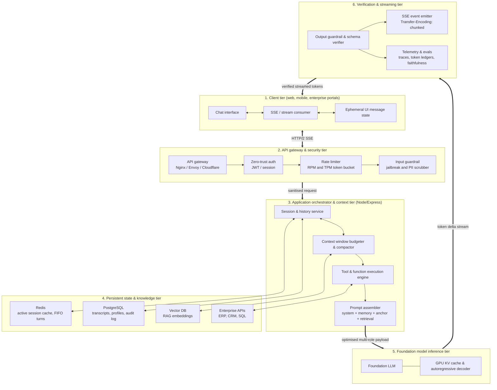
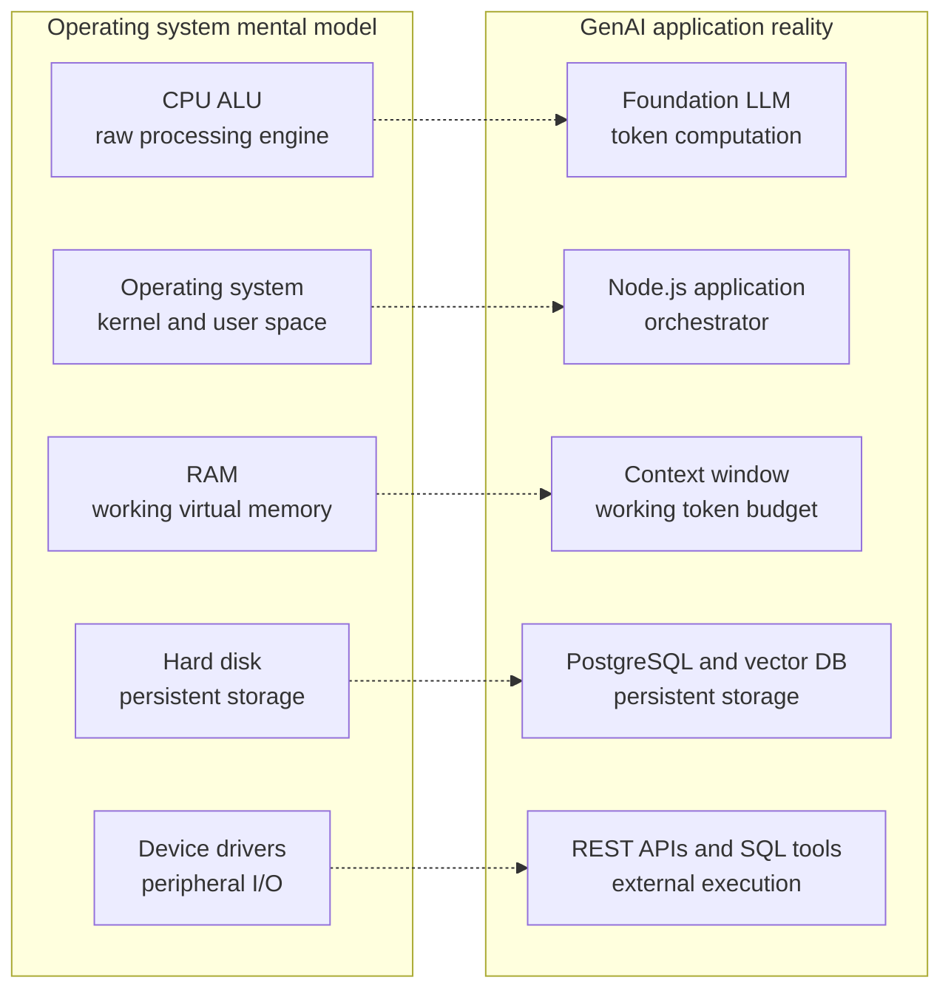
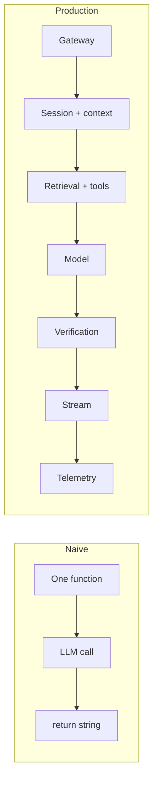
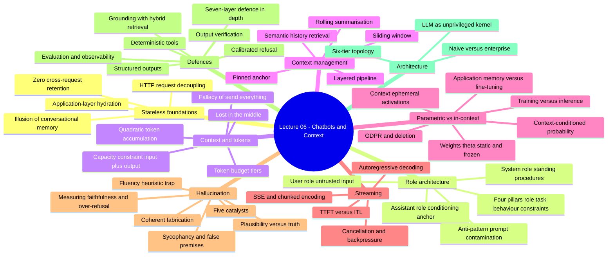
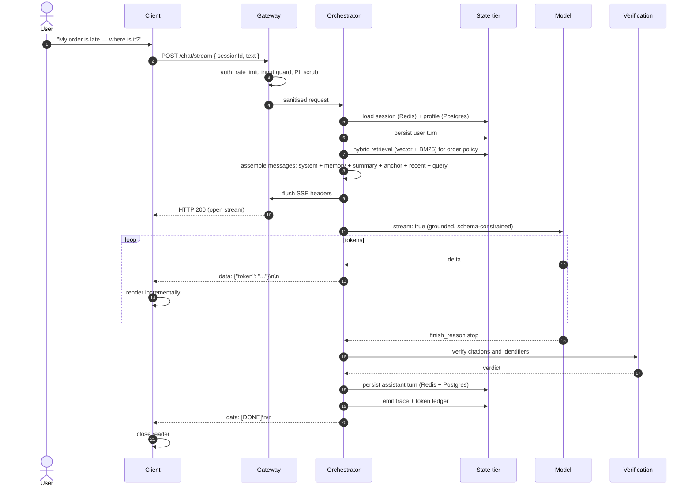
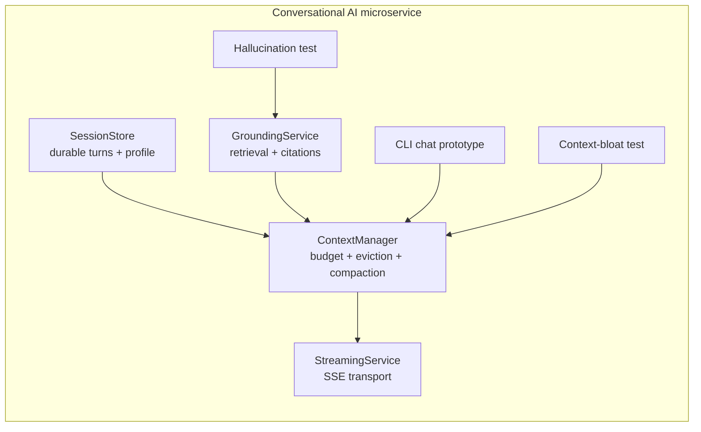
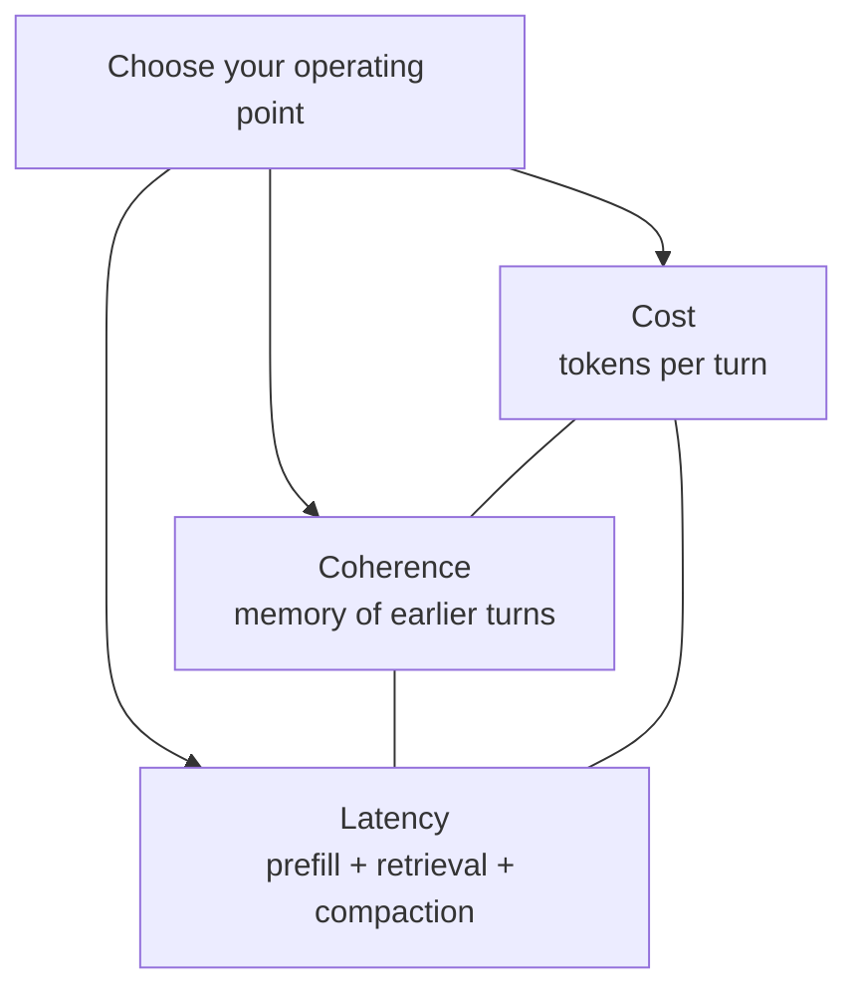

# Chapter 08 — Complete Enterprise Chatbot Architecture

> **Lecture 06 · Chapter 08 of 08** · Level: 🟡 Intermediate · Phase 2 — The Application Layer
> **Source:** `Forward-Deployed-Engineer/Lecture 04/notes/07_Complete_Enterprise_Chatbot_Architecture_and_Takeaways.md`
> **Roadmap topics:** the complete enterprise chatbot architecture · the LLM as an **unprivileged kernel** ·
> the 7-layer defence-in-depth · the "coder army" case study · consolidated principles.
> **Prerequisites:** chapters 01-07 of this lecture.

---

## 08.0 What this chapter is for

Chapters 01-07 each solved one problem: state, budget, eviction, memory, delivery, truth, defence. This chapter
assembles them into **one architecture** and gives you the mental model that keeps the design honest.

> **The claim of this chapter:** connecting an application to an LLM is never a one-line `fetch()`. The model is a
> cognitive computation engine *inside* a multi-tiered software system, and every tier exists because the model
> cannot be trusted to do that tier's job.

By the end of this chapter you should be able to:

1. Draw the six-tier enterprise chatbot topology and explain each tier's responsibility.
2. Apply the **unprivileged-kernel** mental model and state its three invariants.
3. Contrast a naive prototype with a production system across nine architectural vectors.
4. Reproduce the lecture's conceptual map from memory.
5. State the consolidated engineering principles, grouped by theme.
6. Trace one user message end-to-end through every tier.
7. Prove the completion gate: *a conversation that stays coherent past the context limit*, with the trade-off named.

---

## 08.1 Master enterprise chatbot topology

### Tier responsibilities and the chapter that owns each

| Tier | Responsibility | Owned by |
| :--- | :--- | :--- |
| **1. Client** | Render progressively; hold only ephemeral state | Chapter 05 |
| **2. Gateway & security** | Authenticate, rate limit, sanitise input | Chapter 07 (§07.3), Lecture 31 |
| **3. Orchestrator** | Session, context budget, tools, prompt assembly | Chapters 01-03 |
| **4. State & knowledge** | Durable transcripts, memory, embeddings, enterprise APIs | Chapters 03-04, Lecture 16 |
| **5. Model** | Token computation only | Chapters 04, 06 |
| **6. Verification & streaming** | Verify, stream, observe | Chapters 05, 07 |

> **Notice the pattern:** the model tier is the *smallest* box. Everything else exists to give it the right inputs
> and to check its outputs. That ratio is the mark of a production design.

---

## 08.2 The FDE mental model: the LLM as an unprivileged kernel

Treat the model not as a magic "all-knowing brain" but as an **operating-system kernel** — a powerful, fast,
*unprivileged* computation unit that cannot be trusted with raw access.

| OS concept | GenAI analogue |
| :--- | :--- |
| CPU / ALU | Foundation LLM |
| Operating system (kernel + user space) | Application layer (Node.js / Express) |
| RAM and page files | Context window and Redis cache |
| Hard disk | PostgreSQL and vector databases |
| System calls and device drivers | External APIs and tool calling |
| User permissions (ring 3) | Input and output guardrails |

### The three invariants of the OS model

1. **The CPU has no persistent memory.** When a thread is context-switched off the CPU, its registers are saved to
   RAM. When an LLM call completes, its state is gone — the application must save the turns (chapter 01).
2. **The CPU cannot perform raw I/O.** An ALU cannot send an email without drivers and kernel mediation. An LLM
   cannot execute business logic without the application orchestrating tool calls (chapter 07, Lecture 08).
3. **The CPU runs unprivileged code.** The OS does not trust user-space binaries with root. Likewise, an enterprise
   application never trusts raw user prompts or unverified model output with access to sensitive infrastructure.

### What the analogy predicts (and it is accurate)

| Prediction | What it looks like in practice |
| :--- | :--- |
| You need a scheduler | Rate limiting, queuing, concurrency control |
| You need memory management | Token budgeting and context management (chapters 02-03) |
| You need a filesystem | Durable transcripts, memory stores, vector indexes |
| You need a syscall boundary | Tool definitions with server-side authorisation |
| You need a privilege model | Guardrails, RBAC, per-tenant isolation |
| You need an audit log | Traces, token ledgers, evaluation records |

> **Why this model is worth adopting:** it makes the correct architecture *feel obvious*. Nobody expects an ALU to
> remember yesterday's computation, so nobody should expect the model to. Nobody gives ring-3 code root access, so
> nobody should let a prompt decide permissions.

---

## 08.3 Naive prototype vs enterprise production chatbot

| Architectural vector | Naive prototype | Enterprise production (FDE grade) |
| :--- | :--- | :--- |
| **API networking** | Blocking HTTP POST; user waits 15 s on a spinner | SSE streaming; TTFT < 500 ms |
| **State handling** | Client browser memory or an unbounded in-process array | Redis session cache backed by a PostgreSQL audit log |
| **Context management** | Blindly appends all turns; $O(N^2)$ cost runaway | Token-budgeted sliding window + rolling summarisation; bounded cost |
| **Role separation** | Rules concatenated into the user string | Strict semantic role decoupling with structural priority |
| **Factuality** | Relies on parametric memory; confident hallucinations | Hybrid RAG grounding + deterministic enterprise tools |
| **Refusal handling** | Eagerly answers trick questions; sycophantic | Calibrated refusal; challenges false premises |
| **Output type safety** | Free-form markdown; string parsing breaks the UI | Constrained decoding against a schema, validated in code |
| **Security** | *"Don't do bad things"* in the prompt | Input injection scanners, PII scrubbers, citation validators |
| **Observability** | `console.log(response)` | OpenTelemetry tracing, dashboards, token ledgers, automated evals |

> **The engineering lesson:** the gap between a demo and a product is not the model. It is the nine boxes around it.

---

## 08.4 The conceptual map of this lecture

---

## 08.5 Consolidated engineering principles

The source lists 25 principles. Grouped by theme, they become easier to recall and to apply.

### A. State and roles (principles 1-3)

1. **The LLM has zero native memory.** Every conversation is a brand-new interaction; the application alone
   constructs state.
2. **Context hydration is mandatory.** Omitting prior assistant outputs destroys pronoun resolution, commitment
   tracking and agreement interpretation.
3. **Decouple semantics via message roles.** Never concatenate system rules with user text; enforce `system`,
   `user` and `assistant` boundaries.

### B. Context and cost (principles 4-9)

4. **Prompts are guidelines, not security boundaries.** Enforce security in deterministic code, RBAC and
   sanitisation.
5. **Context space is a zero-sum budget.** $L_{\text{input}} + L_{\text{output}} \le C_{\text{max}}$; avoid
   starvation.
6. **Beware the $O(N^2)$ token explosion.** Unbounded history compounds cost and latency quadratically.
7. **Relevant context beats maximum context.** Lost-in-the-middle makes dumping worse than filtering.
8. **Implement proactive context management.** Sliding windows for transactional bots; rolling summarisation for
   long-form assistants.
9. **Order the payload most-stable to least-stable.** Cache-optimal and attention-optimal.

### C. Weights, memory and learning (principles 10-14)

10. **Prompting does not retrain the model.** Facts in a prompt are transient activations, not weight updates.
11. **Context modulates probability distributions.** Identical weights, different conditioning, different behaviour.
12. **Inference involves zero backpropagation.** Weights stay frozen; activations are discarded on completion.
13. **Application memory beats fine-tuning for facts.** Databases are faster, auditable and deletable.
14. **Respect the right to be forgotten.** Keep personal data in relational stores, never in weights.

### D. Delivery and streaming (principles 15-19)

15. **Autoregressive generation demands streaming.** Holding tokens back is a self-inflicted bottleneck.
16. **Streaming optimises perceived latency (TTFT), not throughput.** Total time is unchanged.
17. **Use SSE for text delivery.** Lightweight, unidirectional, firewall-friendly, HTTP/2 multiplexed.
18. **Disable reverse-proxy buffering.** Emit `X-Accel-Buffering: no`.
19. **Propagate socket disconnections via AbortController.** Otherwise you pay for orphaned generation.

### E. Truth and reliability (principles 20-25)

20. **Hallucination is inherent to probabilistic generation.** The model optimises likelihood, not truth.
21. **Fluency is decoupled from truth.** Reject the fluency heuristic.
22. **Coherent fabrication is the real hazard.** It looks like researched fact with one entity swapped.
23. **Guard against model sycophancy.** Without calibrated refusal, models agree with false premises.
24. **Enforce type safety with structured outputs.** Constrained decoding plus schema validation.
25. **Deploy defence in depth.** Input sanitisation, RAG grounding, deterministic tools, output guardrails and
    continuous evaluation.

---

## 08.6 One message, end to end

Trace a single support message through every tier. This is the diagram to redraw from memory when designing a
system.

### The same flow, annotated with the failure it prevents

| Step | Failure prevented | Chapter |
| :--- | :--- | :--- |
| Auth + rate limit | Abuse, cost attacks, cross-tenant leakage | 07, L31 |
| Input guard | Injection, PII leakage | 07 |
| Load session + profile | Amnesia, lost preferences | 01, 04 |
| Persist user turn | Transcript corruption on crash | 01 |
| Hybrid retrieval | Missing private context, cutoff | 07, L16 |
| Context assembly | $O(N^2)$ cost, lost-in-the-middle, starvation | 02, 03 |
| Flush headers first | Perceived latency, buffering | 05 |
| Constrained decoding | Parsing failures downstream | 07, L10 |
| Incremental render | 18 s spinner | 05 |
| Citation verification | Coherent fabrication (entity swaps) | 07 |
| Persist assistant turn | Lost history, inconsistent transcript | 05 |
| Trace + ledger | Unmeasurable reliability, cost creep | 07, L30 |

> **Note the two "persist" steps are not adjacent.** The user turn is written *before* generation (durability), the
> assistant turn *after* (it does not exist until then). That asymmetry is a design decision, not an accident
> (§05.6).

---

## 08.7 The build task and the completion gate

### What this lecture builds

A **conversational AI microservice** containing:

| Deliverable | Proves |
| :--- | :--- |
| `SessionStore` | State lives in the application, not the model (chapter 01) |
| `ContextManager` | Token budget is enforced and eviction is deliberate (chapters 02-03) |
| `StreamingService` | Perceived latency is bounded; cancellation works (chapter 05) |
| `GroundingService` | Answers cite retrieved sources (chapter 07) |
| CLI chat prototype | End-to-end integration of all of the above |
| **Context-bloat test** | Input tokens reach a plateau instead of growing quadratically (chapter 03, §03.9) |
| **Hallucination test** | False-premise probes are refused; citations verify (chapters 06-07) |

### The completion gate

> **Gate:** you can show a conversation that stays coherent **past the context limit** — and explain the exact
> trade-off you chose.

Unpacking the gate into a demonstrable checklist:

| # | Requirement | How you demonstrate it |
| :--- | :--- | :--- |
| 1 | The conversation exceeds the configured window | Run 60+ turns with a small budget |
| 2 | Early facts survive | State an identifier in turn 1; ask about it in turn 60 |
| 3 | Cost stays bounded | Show the token-per-turn curve plateauing |
| 4 | No starvation | No truncated answers; `finish_reason` is `stop` |
| 5 | Refusal is calibrated | False-premise probes refused; answerable probes answered |
| 6 | **The trade-off is named** | *"I chose a 6-turn window + rolling summary; the cost is loss of exact older wording, mitigated by promoting durable facts to the memory store."* |

### The three trade-off axes you must choose between

| If you optimise for… | You accept… |
| :--- | :--- |
| **Lowest cost** | Aggressive windows; earlier facts lost (mitigate with durable memory) |
| **Maximum coherence** | Larger prompts; higher cost and slower TTFT |
| **Lowest latency** | No synchronous compaction; no large retrieval; shorter answers |

> **The gate is not "make it work".** It is "make it work, and be able to defend the point you chose on that
> triangle". A candidate who cannot name the trade-off has copied an implementation; one who can has designed a
> system.

---

## 08.8 Common mistakes

- **Designing the model first and the surrounding tiers last.** The model is the smallest box in the diagram.
- **Treating the OS analogy as decoration.** It predicts the components you will need: scheduler, memory manager,
  filesystem, syscall boundary, privilege model, audit log.
- **Optimising one axis of the cost/coherence/latency triangle and claiming victory.** The other two move.
- **Skipping the context-bloat test.** Without it you cannot distinguish a working system from a demo.
- **Skipping the hallucination test.** Same reason, on the truth axis.
- **Building the six tiers before the two tests.** Tests shape the design; retrofitting them is expensive.
- **Assuming the naive-vs-production table is aspirational.** Every row is a specific, testable requirement.
- **Believing a bigger model replaces architecture.** A stronger model with no context management still runs out of
  room, still hallucinates, and still costs quadratically.
- **Ignoring observability until an incident.** Token ledgers and traces are how you find the tier at fault.
- **Not being able to name the trade-off.** It means the design was copied, not chosen.

---

## 08.9 Key takeaways

1. **The model is a component, not the system.** Six tiers exist around it, and each has one job.
2. **The LLM is an unprivileged kernel.** No memory, no raw I/O, no privileges — the application supplies all three.
3. **The naive-vs-production gap is nine architectural vectors**, none of which is the model itself.
4. **Every tier maps to a failure it prevents.** Architecture is defence, expressed as structure.
5. **Persistence is asymmetric:** user turn before generation, assistant turn after.
6. **Two tests prove the lecture:** context-bloat (cost plateaus) and hallucination (false premises refused).
7. **The gate is a trade-off statement**, not a feature list: coherence past the context limit, with the chosen cost.
8. **Cost, coherence and latency form a triangle.** You pick a point; you defend the point.
9. **Twenty-five principles collapse into five themes:** state and roles · context and cost · weights and memory ·
   delivery · truth and reliability.
10. **Everything in this lecture is one sentence:** *the application carries the conversation, and the application is
    responsible for the truth.*

---

## 08.10 Self-check questions

1. Draw the six-tier topology from memory and name one responsibility per tier.
2. Which tier is the smallest, and why is that the correct ratio?
3. State the three invariants of the unprivileged-kernel model.
4. Give three components the OS analogy predicts that teams commonly forget to build.
5. Pick three rows of the naive-vs-production table and describe a specific incident each prevents.
6. Trace one message end-to-end and name the failure prevented at each step.
7. Why is the user turn persisted before generation and the assistant turn after? What breaks if you swap them?
8. Write the six-point checklist that proves the completion gate.
9. Name the three axes of the trade-off triangle and give a product where each extreme is the right choice.
10. Your system is coherent but costs 4× the budget. Which tier do you change first, and what is the expected
    consequence?
11. Group the 25 principles into five themes and state the theme of each in one sentence.
12. A stakeholder asks: *"Can't we just use a model with a 1M-token window and skip all this?"* Answer in four
    sentences, using this lecture's vocabulary.

---

### Navigation

- **Previous:** [Chapter 07 — Engineering Defences: Grounding, RAG, Guardrails & Verification](./07_Engineering_Defences_Grounding_RAG_Guardrails_and_Verification.md)
- **Complete notes:** [Lecture_06_Complete_Notes.md](./Lecture_06_Complete_Notes.md)
- **Next lecture:** Lecture 07 — [AI Streaming](../Lecture%2007%20-%20AI%20Streaming/)
- **Source:** `Forward-Deployed-Engineer/Lecture 04/notes/07_Complete_Enterprise_Chatbot_Architecture_and_Takeaways.md`
- **Roadmap:** [Lecture 06 — Chatbots: Statelessness, Context, Memory & Hallucination](../../roadmap.md)
