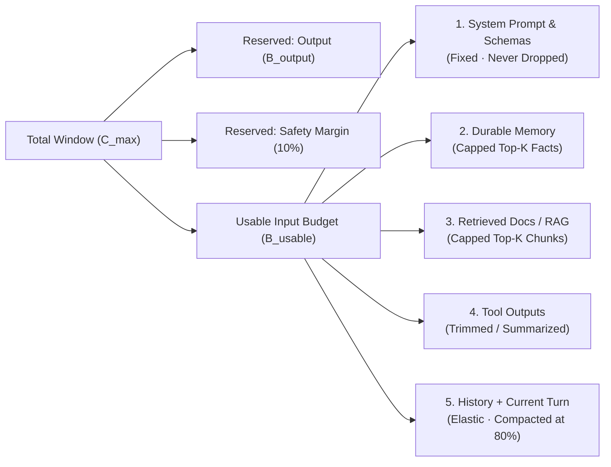
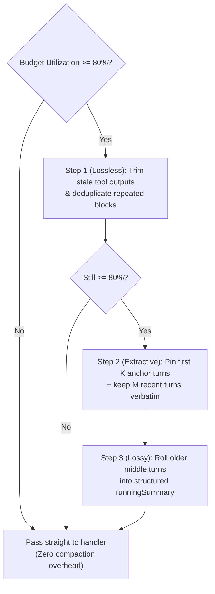

# Chapter 09 — Explicit Context Budgeting, Compaction & Long-Horizon Sessions

> **Lecture 06 · Chapter 09 of 09** · Level: 🟡 Intermediate · Phase 2 — Application Layer & Harness Velocity
> **Roadmap Reference:** `roadmap-v1.md` (S01 — Context Budgeting, 80% Compaction & 50-Turn Survival)
> **Roadmap topics:** explicit context budgeting (system + memory + retrieved docs + tool outputs + output reserve) ·
> context compaction strategies (extractive pruning, rolling summarization, tool-output trimming, lossy vs. lossless) ·
> avoiding context rot across 50+ turn agent sessions.

---

## 09.0 What this chapter is for

Chapters 02 and 03 introduced the context window limit and the four management levers. This chapter turns those
ideas into an **exact engineering blueprint** for multi-turn chatbots and 50+ turn agent sessions.

Think of the context window like a **cargo airplane with a strict maximum takeoff weight**:
- If you load fuel, crew, and passengers without weighing each compartment, the plane either refuses to take off
  (provider HTTP 400 `context_length_exceeded`) or runs out of fuel mid-air (output truncated mid-sentence).
- Even worse, if you keep stuffing old luggage into the cabin for 50 flights in a row without unloading, the
  cabin becomes so cluttered that the crew cannot find the emergency manual when they need it (**context rot**).

By the end of this chapter, you will be able to:
1. Build an **explicit, tier-by-tier context budget** that accounts for *every* token consumer, including tool
   outputs and the output reserve.
2. Choose and combine **four compaction strategies** — extractive pruning, rolling summarization, tool-output
   trimming, and lossless vs. lossy compaction — and know what each one preserves or destroys.
3. Trigger compaction **automatically at 80% budget utilization** before a session ever hits the wall.
4. Diagnose and prevent **context rot** so a 50+ turn session stays accurate, grounded, and within budget.

---

## 09.1 Explicit context budgeting (the 5+1 tier model)

A common beginner mistake is to think: *"My model has a 128k context window, so I have 128k tokens for chat
history."* That is false. **Chat history is only one slice of the pie — and it is the *last* slice to get fed.**

Every single LLM request must satisfy the fundamental budget equation:

$$B_{\text{usable}} = \lfloor (C_{\max} - B_{\text{output}}) \times (1 - M_{\text{safety}}) \rfloor$$

Where:
- $C_{\max}$ is the model's advertised context window (e.g., `128,000` tokens).
- $B_{\text{output}}$ is the **Output Reserve** (`max_tokens` / `AI_MAX_TOKENS`), locked aside so the model always
  has room to finish its answer.
- $M_{\text{safety}}$ is a **Safety Margin** (typically `0.10`, i.e., 10%) to absorb differences between your local
  `chars / 4` heuristic and the provider's exact BPE tokenizer.

Inside $B_{\text{usable}}$, every token belongs to one of **five input tiers**, allocated in strict priority order:

### Concrete worked example (a 16,000-token operating budget)

Suppose you configure an agent with $C_{\max} = 16{,}000$, $B_{\text{output}} = 1{,}000$, and $M_{\text{safety}} = 0.10$:

$$B_{\text{usable}} = (16{,}000 - 1{,}000) \times (1 - 0.10) = 15{,}000 \times 0.90 = 13{,}500\text{ tokens}$$

| Priority | Tier | Allocation rule | Example tokens | What happens if it overflows? |
| :---: | :--- | :--- | :---: | :--- |
| **1 (Highest)** | **System prompt + tool schemas** | Fixed at deploy time | 1,200 | Never truncated; fix in code |
| **2** | **Durable memory** (`UserFact[]`) | Capped at `MEMORY_TOP_K` (e.g. 12 facts) | 400 | Drop lowest-relevance / expired facts |
| **3** | **Retrieved docs (RAG)** | Capped at `RAG_TOP_K` (e.g. 5 chunks) | 2,500 | Drop lowest-similarity chunks |
| **4** | **Tool outputs** | Capped per call + trimmed | 2,000 | Trim raw JSON/logs, keep structured summary |
| **5** | **Current user turn** | Never truncated (unless > max input) | 300 | Reject with HTTP 413 if alone > budget |
| **6 (Elastic)** | **Conversation history** | Remainder: $13{,}500 - 6{,}400 = 7{,}100$ | **7,100** | **Compact at 80% ($5{,}680$ tokens)** |

> [!IMPORTANT]
> **Why history is always elastic.** System rules, user memory, RAG evidence, and the current question are what
> the model *needs right now* to answer accurately. Old conversational turns are the *only* tier you can safely
> compress or evict without breaking grounding.

---

## 09.2 Context compaction strategies (and when to use each)

When the elastic history (or tool-heavy trace) grows past **80% of its budget** ($\text{utilization} \ge 0.80$),
waiting until 100% is too late: one large tool output or user paste will blow past the ceiling. Instead, you run
**compaction** proactively.

There are **four** distinct compaction strategies. Production systems rarely use just one — they combine them:

### 1. Extractive pruning (drop low-signal turns verbatim)
- **How it works:** Score or classify older turns and **delete** low-value ones (greetings, `"thanks"`, `"ok"`,
  superseded clarifications) while keeping high-signal turns (initial goal, constraints, decisions) **verbatim**.
- **Pros:** Zero LLM cost, zero latency, zero risk of paraphrasing errors on the turns you keep.
- **Cons:** Coarse — if a turn mixes fluff with one crucial constraint, dropping it loses the constraint.

### 2. Rolling summarization (compress older turns into a running brief)
- **How it works:** Take the oldest unpinned turns `[anchor ... splitAt]`, pass them (plus the previous
  `runningSummary`) to a fast model with a strict **Compaction Spec** (preserve facts, numbers, decisions,
  unresolved questions; drop chatter), and replace those raw turns with one compact `[CONVERSATION BACKGROUND]`
  block.
- **Pros:** Compresses 20–50 turns into ~200–400 tokens while keeping narrative continuity.
- **Cons:** **Lossy** and costs an LLM call (so always run it *off the hot path* after returning the response, or
  via middleware only when utilization crosses 80%).

### 3. Tool-output trimming (the #1 saver in agent sessions)
- **How it works:** In agent loops (Lectures 09–14), a single `read_file`, `grep`, or SQL query can dump 4,000
  tokens of raw JSON or terminal logs into the history. Once the assistant has consumed that tool output and
  recorded its takeaway, **replace the raw tool payload** with a 1–2 line stub:
  `[tool: search_logs → 42 rows returned; key finding: 502 spike at 14:03 UTC on payment-svc]`.
- **Pros:** Cuts 70%–90% of token bloat in coding/ops agents with almost zero information loss.
- **Cons:** Requires keeping the raw payload in a cold store (DB/disk) in case the user asks for exact lines later.

### 4. Lossless vs. lossy compaction (knowing what you cannot afford to lose)

| Dimension | **Lossless Compaction** | **Lossy Compaction** |
| :--- | :--- | :--- |
| **Definition** | Reduces tokens without discarding recoverable meaning (or keeps exact pointers to cold storage) | Summarizes or drops details that cannot be reconstructed from the prompt alone |
| **Examples** | Deduplicating repeated system blocks; stripping pretty-printed JSON whitespace; replacing old tool outputs with `{ pointerId, summary }` | Rolling prose summarization; dropping old turns via sliding window; truncating long logs |
| **Risk** | Minimal — original data is either intact or 1 click away via `pointerId` | Exact IDs, error codes, numbers, and subtle constraints can be smoothed away |
| **Rule of thumb** | **Always do lossless first** (free & safe) | **Use lossy only on aged history**, and never on pinned anchors or durable facts |

---

## 09.3 Avoiding context rot across 50+ turn agent sessions

**Context rot** is the silent degradation of model accuracy, instruction following, and tool reliability as a
session grows past 20, 50, or 100 turns — *even when the total tokens still technically fit inside $C_{\max}$*.

Why does a 50-turn session rot even inside a 128k window? Four mechanisms:

1. **Lost-in-the-middle attention decay:** Transformers attend strongly to the **beginning** (system prompt,
   pinned anchor) and the **very end** (latest turns), while recall in the middle drops by 30%–50%.
2. **Summary-of-a-summary drift ("telephone game"):** If you re-summarize a prose summary 10 times in a row,
   exact numbers, file paths, and negative constraints (`"never delete prod tables"`) get blurred into vague
   generalities.
3. **Stale/contradictory state accumulation:** Turn 5 says *"use PostgreSQL"*, Turn 22 says *"actually switch to
   SQLite"*, and Turn 40 has both facts floating in history. The model may follow the older one.
4. **Persona & instruction dilution:** After 40,000 tokens of casual user chatter or noisy stack traces, the
   1,000-token `system` prompt is drowned out statistically by the sheer mass of recent context.

### Five engineering defenses against context rot

| Defense | What it prevents | How to implement it |
| :--- | :--- | :--- |
| **1. Pin the Anchor ($K$ turns)** | Goal drift ("I already told you at the start!") | Never compact or evict `turns[0..K-1]` where the core goal and constraints were set. |
| **2. Structured State over Prose** | Summary-of-summary telephone drift | Keep `runningSummary` as a **structured schema** (`Goal`, `Confirmed Decisions`, `Active Constraints`, `Open Questions`), not free-form paragraphs. |
| **3. Supersede, Don't Append, Facts** | Stale/contradictory instructions | Store durable preferences/decisions in Tier 2 (`UserFact[]` / state KV) and **overwrite** old values when the user changes their mind. |
| **4. Compact at 80% Utilization** | Last-second truncation & OOM spikes | Attach a **compaction middleware** that checks `usedTokens / budgetTokens >= 0.80` on every turn and compacts proactively. |
| **5. Cold Store + Semantic Recall** | Permanent amnesia after compaction | Archive every compacted turn in a cold store (`session.compacted` / Postgres) and re-inject only the top-$k$ relevant turns when queried. |

> [!TIP]
> **The 50-turn survival test.** A healthy 50-turn architecture keeps **input tokens bounded in a sawtooth curve**
> (rising toward 80%, snapping back down after compaction, rising again) instead of an $O(N^2)$ ramp — while
> still recalling Turn 1's constraint on Turn 50.

---

### Navigation

- **Previous:** [Chapter 08 · Complete Enterprise Chatbot Architecture](./08_Complete_Enterprise_Chatbot_Architecture.md)
- **Complete notes:** [Lecture_06_Complete_Notes.md](./Lecture_06_Complete_Notes.md)
- **Lecture index:** [../index.md](../index.md)
- **Assignment:** [../Assignment/task.md](../Assignment/task.md)

