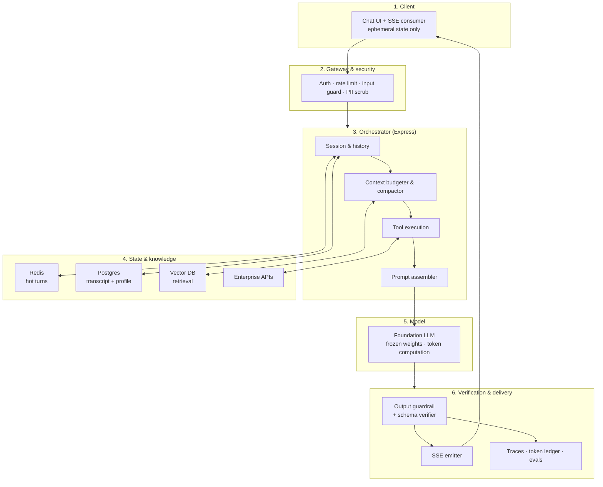
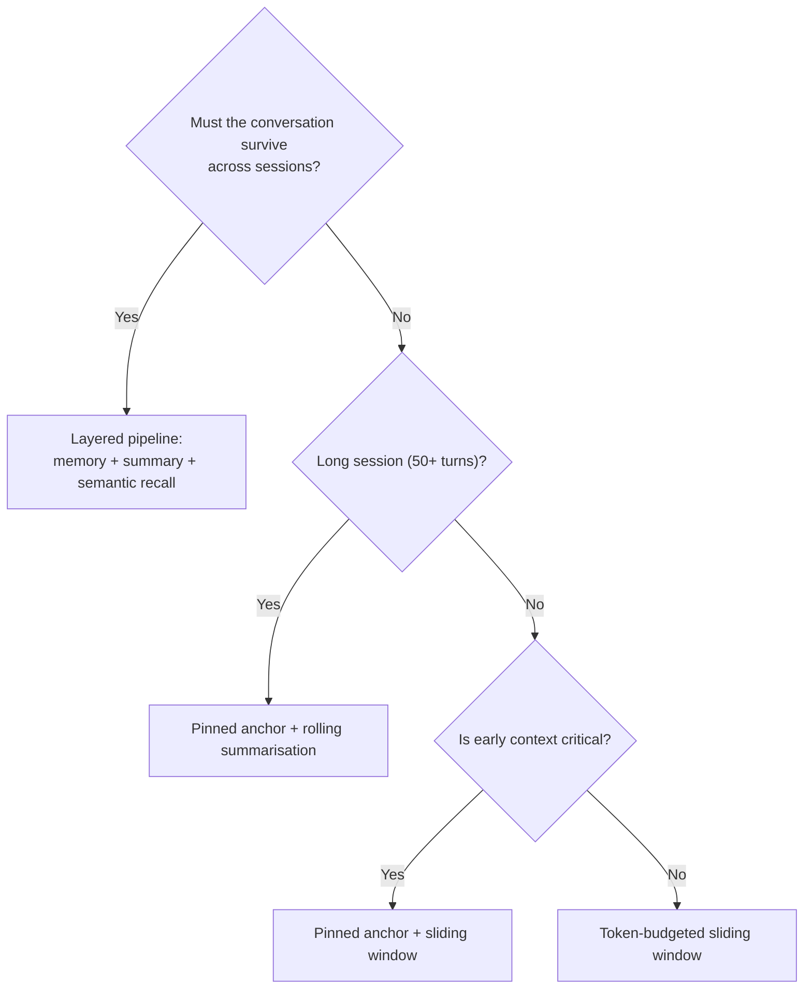

# Lecture 06 — Chatbots and Context · Complete Notes

> **Phase:** 2 — Application Layer · **Level:** 🟡 Intermediate · **Chapters:** 8 · **Source:** `FDE L04`
> **Goal:** build a real multi-turn assistant and understand exactly why it forgets, drifts and lies.
> **Gate:** you can show a conversation that stays coherent past the context limit — and explain the exact
> trade-off you chose.

> **How to use this file.** This is the **revision layer**, not a replacement for the chapters. It gives you the
> executive summary, one master diagram, the cheat sheet, the decision tables, the misconceptions, the glossary and
> 20 self-check questions. When a line here is not enough, follow the chapter link — every section ends with one.

---

## 1. Executive summary — the ten things

1. **The LLM is stateless.** No memory survives a request. *The application carries the conversation*
   ([ch 01](./01_Stateless_LLMs_Conversation_History_and_Role_Architecture.md)).
2. **Roles are semantics.** `system` = trusted standing policy · `user` = untrusted input · `assistant` = the
   model's own prior commitments. Never concatenate them ([ch 01](./01_Stateless_LLMs_Conversation_History_and_Role_Architecture.md)).
3. **The context window is a hard budget:** $L_{\text{input}} + L_{\text{output}} \le C_{\text{max}}$. Fill the
   input and you starve the answer ([ch 02](./02_Context_Windows_and_Token_Accumulation.md)).
4. **Naive history appending is $O(N^2)$.** Cumulative billed input tokens grow quadratically with turn count
   ([ch 02](./02_Context_Windows_and_Token_Accumulation.md)).
5. **Relevant context beats maximum context.** Long prompts lose information in the middle — a 30-50% recall drop
   ([ch 02](./02_Context_Windows_and_Token_Accumulation.md)).
6. **Context management is four levers:** retain, compress, retrieve, evict — layered, with compaction off the hot
   path ([ch 03](./03_Context_Management_Strategies.md)).
7. **Prompting does not train the model.** Weights are frozen; facts live in application memory, where they can be
   updated, audited and deleted ([ch 04](./04_Context_vs_Model_Weights_and_the_Illusion_of_Learning.md)).
8. **Streaming fixes perceived latency, not throughput.** TTFT matters more than total time
   ([ch 05](./05_Real_Time_Streaming_and_SSE.md)).
9. **Hallucination is the objective function working as designed.** Fluency and truth are orthogonal; coherent
   fabrication is the real hazard ([ch 06](./06_Hallucination_Mechanisms_Fluency_vs_Truth.md)).
10. **Reliability is engineered, not assumed.** Seven layers of defence in depth around an unprivileged model
    ([ch 07](./07_Engineering_Defences_Grounding_RAG_Guardrails_and_Verification.md),
    [ch 08](./08_Complete_Enterprise_Chatbot_Architecture.md)).

---

## 2. The one diagram to remember



> **Read the sizes.** The model box is the smallest. Everything else exists to give it the right inputs and to check
> its outputs. That ratio is the signature of a production design.

**The mental model:** the LLM is an **unprivileged kernel** — no persistent memory, no raw I/O, no privileges. The
application supplies all three ([ch 08](./08_Complete_Enterprise_Chatbot_Architecture.md)).

---

## 3. Chapter map

| # | Chapter | One-line summary | Read it for |
| :---: | :--- | :--- | :--- |
| 01 | [Stateless LLMs, Conversation History & Role Architecture](./01_Stateless_LLMs_Conversation_History_and_Role_Architecture.md) | The model has no memory; the application hydrates every request, and roles are authority levels rather than formatting. | Coreference, prompt contamination, the 4 pillars |
| 02 | [Context Windows & Token Accumulation](./02_Context_Windows_and_Token_Accumulation.md) | The window is a hard budget; naive history is $O(N^2)$ and costs money, latency and accuracy. | Capacity maths, token ledgers, lost-in-the-middle |
| 03 | [Context Management Strategies](./03_Context_Management_Strategies.md) | Retain, compress, retrieve, evict — layered across time horizons, with compaction off the hot path. | Sliding window, anchor, summarisation, semantic recall |
| 04 | [Context vs Model Weights & the Illusion of Learning](./04_Context_vs_Model_Weights_and_the_Illusion_of_Learning.md) | Weights are frozen; context is fluid. Memory belongs in a database, not in a fine-tune. | $P(w_t \mid \text{context})$, training vs inference, GDPR |
| 05 | [Real-Time Streaming & SSE](./05_Real_Time_Streaming_and_SSE.md) | Autoregressive generation is already incremental; SSE is the transport and TTFT is the metric. | Wire format, cancellation, proxy buffering |
| 06 | [Hallucination Mechanisms: Fluency vs Truth](./06_Hallucination_Mechanisms_Fluency_vs_Truth.md) | Hallucination is the training objective; fluency guarantees nothing; sycophancy is the default. | Five catalysts, coherent fabrication, measurement |
| 07 | [Engineering Defences: Grounding, RAG, Guardrails & Verification](./07_Engineering_Defences_Grounding_RAG_Guardrails_and_Verification.md) | Seven deterministic layers around a probabilistic core, with calibrated refusal as a product feature. | Defence in depth, citation verification, evals |
| 08 | [Complete Enterprise Chatbot Architecture](./08_Complete_Enterprise_Chatbot_Architecture.md) | Six tiers, one unprivileged kernel, and a trade-off you must be able to name. | Topology, naive vs production, the gate |

---

## 4. Cheat sheet

### 4.1 Formulas

| Concept | Formula | Meaning |
| :--- | :--- | :--- |
| Capacity constraint | $L_{\text{input}} + L_{\text{output}} \le C_{\text{max}}$ | Fill the input, starve the output |
| Safe input budget | $B_{\text{input}} = (C_{\text{max}} - B_{\text{output}})(1 - M_{\text{safety}})$ | Budget against an operating limit, not the maximum |
| Per-turn input | $L_{\text{input}}(k) = S + (k-1)\Delta + Q$ | Grows linearly per request |
| Cumulative input | $T_{\text{cumulative}}(N) = N(S+Q) + \Delta\frac{(N-1)N}{2} = \mathcal{O}(N^2)$ | Quadratic total cost |
| Total latency | $T_{\text{total}} = \text{TTFT} + N_{\text{output}} \times \text{ITL}$ | Streaming changes the *perceived* term |
| Next token | $P(w_t \mid w_1 \dots w_{t-1}; \Theta)$ | $\Theta$ frozen; context is the only lever |
| Cross-entropy loss | $\mathcal{L}_{\text{NLL}}(\Theta) = -\sum_t \log P(w_t \mid w_{<t};\Theta)$ | Plausibility, not truth |
| Attention | $\text{softmax}(QK^{\top}/\sqrt{d_k})V$ | How injected facts steer later tokens |
| Token estimate | $\text{tokens} \approx \text{chars} / 4$ | English prose; estimate to decide, tokenize to enforce |

### 4.2 Numbers worth memorising

| Quantity | Typical value |
| :--- | :--- |
| TTFT | 200-800 ms |
| Inter-token latency (ITL) | 20-50 ms/token |
| Human reading speed | 3-5 words/second |
| Perceived wait, buffered vs streamed | 18.5 s vs 0.5 s (for a 600-token answer) |
| Lost-in-the-middle recall drop | 30-50% for middle-position facts |
| Lexical overlap threshold for citation checks | ~0.6 (a policy choice, not a law) |
| Chunk size for retrieval | 300-800 tokens, 10-20% overlap |
| Compression ratio, rolling summary | ≤ 150 words per compaction window |

### 4.3 SSE wire format

```http
HTTP/1.1 200 OK
Content-Type: text/event-stream; charset=utf-8
Cache-Control: no-cache, no-transform
Connection: keep-alive
Transfer-Encoding: chunked
X-Accel-Buffering: no

event: token
data: {"delta":"Docker"}

: keep-alive

event: done
data: {"finishReason":"stop"}

data: [DONE]

```

### 4.4 The 4 pillars of a system prompt

| Pillar | Answers | Failure if missing |
| :--- | :--- | :--- |
| **ROLE** | Who is the agent, with what authority? | Inconsistent voice and competence |
| **TASK** | What is it here to do? | Answers questions it should not |
| **BEHAVIOUR** | How does it communicate? | Unpredictable length and format |
| **CONSTRAINTS** | What must it never do? | Hallucination and scope creep |

### 4.5 The 7 defence layers

| # | Layer | One-line purpose |
| :--- | :--- | :--- |
| 1 | Input validation & injection guard | Stop hostile input before it becomes context |
| 2 | Hybrid RAG grounding | Supply certified facts (dense + BM25) |
| 3 | Deterministic tools | Make arithmetic, lookups and state changes exact |
| 4 | Calibrated refusal | Challenge false premises; admit ignorance |
| 5 | Structured outputs | Constrain decoding to a schema |
| 6 | Output verification | Verify claims against sources in code |
| 7 | Observability & evals | Make reliability measurable and regressions blockable |

### 4.6 The 5 hallucination catalysts

| # | Catalyst | Fix layer |
| :--- | :--- | :--- |
| 1 | Knowledge cutoff / temporal drift | Live tools |
| 2 | Missing context / ambiguity | RAG grounding + refusal |
| 3 | Sycophancy / premise injection | Premise-challenge + evals |
| 4 | Context saturation | Retrieval precision + budget |
| 5 | Reasoning confabulation | Deterministic tools |

---

## 5. Decision tables

### 5.1 Which context-management strategy?



| Strategy | Token scaling | Early facts | Extra cost | Best for |
| :--- | :--- | :--- | :--- | :--- |
| Naive append | $O(N^2)$ | High until overflow | None | Demos only |
| Sliding window | $O(1)$ | ❌ Lost | None | Transactional bots |
| Pinned anchor | $O(1)$ | ✅ First $K$ | None | Diagnostics, support |
| Rolling summarisation | $O(1)$ | ✅ Abstracted | 1 summariser call per window | Coaching, tutoring |
| Semantic history RAG | $O(k)$ | ✅ If retrieved | Embedding + vector query | Multi-session agents |
| **Layered pipeline** | bounded | ✅ | All of the above | Enterprise assistants |

Detail: [ch 03](./03_Context_Management_Strategies.md).

### 5.2 Application memory vs fine-tuning

| Vector | Application memory | Fine-tuning |
| :--- | :--- | :--- |
| Freshness | Instant (< 5 ms write) | Days to weeks |
| Auditability | ✅ Every fact is a row | ❌ Diffused into weights |
| Deletion (GDPR) | ✅ `DELETE ... WHERE user_id = ?` | ❌ Machine unlearning |
| Cost per update | Negligible | GPU runs |
| Catastrophic forgetting | ✅ None | ⚠️ Real risk |
| Use it for | **Facts, preferences, state, records** | **Style, format, jargon, distillation** |

Detail: [ch 04](./04_Context_vs_Model_Weights_and_the_Illusion_of_Learning.md).

### 5.3 Which transport?

| Need | Choose |
| :--- | :--- |
| Stream tokens server → client | **SSE** |
| Raw byte stream with custom framing | Chunked transfer encoding |
| Bidirectional real-time (collaboration, voice barge-in) | WebSocket |
| Legacy client that cannot stream | Buffered response (with heartbeats/timeouts) |
| Legacy client, no SSE support | Long polling (last resort) |

Detail: [ch 05](./05_Real_Time_Streaming_and_SSE.md).

### 5.4 What to do when a guardrail fires

| Policy | Behaviour | When |
| :--- | :--- | :--- |
| Log only | Serve the answer, record the event | Rollout, calibration |
| Degrade | Answer with an "unverified" caveat | Low-stakes informational |
| Fail closed | Replace with a refusal | Regulated / financial |
| Escalate | Route to a human with the flagged claims | SLA support |

Detail: [ch 07](./07_Engineering_Defences_Grounding_RAG_Guardrails_and_Verification.md).

### 5.5 Refusal ladder

| Situation | Response |
| :--- | :--- |
| Context sufficient | Answer, grounded, with citations |
| Context partially sufficient | Answer the supported part; flag the rest |
| Context missing, premise valid | Refuse: *"I do not have verified information about that."* |
| Premise false | Reject the premise explicitly, then explain why |
| High stakes / irreversible | Human-in-the-loop |

Detail: [ch 06](./06_Hallucination_Mechanisms_Fluency_vs_Truth.md) §06.9 ·
[ch 07](./07_Engineering_Defences_Grounding_RAG_Guardrails_and_Verification.md) §07.6.

### 5.6 Failure → defence matrix

| Failure | Primary defence | Chapter |
| :--- | :--- | :--- |
| "The bot forgot what I said" | Hydration + anchor turns | 01, 03 |
| "The bill exploded" | Token budget + eviction | 02, 03 |
| "Answers get cut off" | Reserve output budget | 02 |
| "It ignores the fact I gave it" | Retrieval precision, payload ordering | 02, 03 |
| "It contradicts yesterday" | Durable memory, not in-context facts | 04 |
| "It feels slow" | SSE streaming, TTFT reduction | 05 |
| "It made up an order status" | Tools + RAG + refusal | 06, 07 |
| "It agreed with my wrong premise" | Premise-challenge + adversarial evals | 06, 07 |
| "The UI breaks on its output" | Constrained decoding + schema | 07 |
| "It quoted a document that does not exist" | Citation verification | 07 |
| "We cannot tell if it is getting worse" | Golden set + regression gate | 07, L30 |
| "The stream dies behind the proxy" | `X-Accel-Buffering: no` + heartbeats | 05 |

---

## 6. Twenty misconceptions (and the corrections)

| # | Misconception | Correction |
| :---: | :--- | :--- |
| 1 | "The model remembers our conversation." | It has zero cross-request retention; your application re-sends everything. ([ch 01](./01_Stateless_LLMs_Conversation_History_and_Role_Architecture.md)) |
| 2 | "We only need to send the user's new message." | Without history, pronouns, agreements and ellipses cannot resolve. ([ch 01](./01_Stateless_LLMs_Conversation_History_and_Role_Architecture.md)) |
| 3 | "Prefix caching means the provider stores our state." | It is a performance cache, not memory, and it can be evicted at any time. ([ch 01](./01_Stateless_LLMs_Conversation_History_and_Role_Architecture.md)) |
| 4 | "Putting rules in the user message is fine." | It destroys the authority boundary, invites injection and breaks prefix caching. ([ch 01](./01_Stateless_LLMs_Conversation_History_and_Role_Architecture.md)) |
| 5 | "A long system prompt is a security control." | Prompts shift probabilities; they do not enforce permissions. ([ch 01](./01_Stateless_LLMs_Conversation_History_and_Role_Architecture.md), [ch 07](./07_Engineering_Defences_Grounding_RAG_Guardrails_and_Verification.md)) |
| 6 | "We have a 1M-token window, so no context management is needed." | Capacity is not precision; the middle is lost and the cost is quadratic. ([ch 02](./02_Context_Windows_and_Token_Accumulation.md)) |
| 7 | "Bigger windows mean we can skip retrieval." | Retrieval precision is the primary lever; dumping is worse than filtering. ([ch 02](./02_Context_Windows_and_Token_Accumulation.md)) |
| 8 | "If it is in the context, the model used it." | Lost-in-the-middle: middle-position facts can lose 30-50% recall. ([ch 02](./02_Context_Windows_and_Token_Accumulation.md)) |
| 9 | "Cost grows linearly with conversation length." | Cumulative input tokens are $O(N^2)$. ([ch 02](./02_Context_Windows_and_Token_Accumulation.md)) |
| 10 | "A character-count estimate is good enough for billing." | Estimate to decide; tokenize to report and enforce. ([ch 02](./02_Context_Windows_and_Token_Accumulation.md)) |
| 11 | "Summarising synchronously is fine." | It puts a second model call on the critical path; compact after responding. ([ch 03](./03_Context_Management_Strategies.md)) |
| 12 | "Semantic recall can replace recency." | Retrieval is not precedence; superseded facts get resurrected. ([ch 03](./03_Context_Management_Strategies.md)) |
| 13 | "We can delete raw turns once summarised." | The summary is a cache; the transcript is the record. ([ch 03](./03_Context_Management_Strategies.md)) |
| 14 | "The model learned from that long prompt." | Prompting conditions a distribution; it never updates weights. ([ch 04](./04_Context_vs_Model_Weights_and_the_Illusion_of_Learning.md)) |
| 15 | "We should fine-tune to store customer data." | Stale, opaque, undeletable — use a database. ([ch 04](./04_Context_vs_Model_Weights_and_the_Illusion_of_Learning.md)) |
| 16 | "Streaming makes generation faster." | It changes perceived latency (TTFT), not total generation time. ([ch 05](./05_Real_Time_Streaming_and_SSE.md)) |
| 17 | "We can return a 500 if the stream fails." | The status is already committed; send a typed error frame. ([ch 05](./05_Real_Time_Streaming_and_SSE.md)) |
| 18 | "Lowering temperature fixes hallucination." | It reduces variance, not untruth; grounding and refusal fix truth. ([ch 06](./06_Hallucination_Mechanisms_Fluency_vs_Truth.md)) |
| 19 | "The model will say 'I don't know' when unsure." | It has no metacognition; refusal must be engineered. ([ch 06](./06_Hallucination_Mechanisms_Fluency_vs_Truth.md)) |
| 20 | "'Do not hallucinate' in the prompt is our guardrail." | Prompts are policy suggestions; guardrails are deterministic code. ([ch 07](./07_Engineering_Defences_Grounding_RAG_Guardrails_and_Verification.md)) |

---

## 7. Glossary

### State, roles and context

| Term | Definition |
| :--- | :--- |
| **Context hydration** | Reconstructing the relevant conversational chain and serialising it into the request. |
| **Context window** | The finite token capacity available for one inference cycle ($C_{\text{max}}$). |
| **Context starvation** | Filling the input so fully that the model has almost no room to generate. |
| **Coreference** | A surface form (pronoun, agreement, ellipsis) that refers to an earlier entity. |
| **Prompt contamination** | Mixing trusted system rules into untrusted user text inside one role. |
| **Anchor (pinned) turns** | The first $K$ turns retained verbatim because they carry goals, IDs and constraints. |
| **Compaction** | Compressing older turns into a summary (a form of context management). |
| **Rolling summarisation** | Continuously folding older turns into a running summary. |
| **Semantic history RAG** | Indexing past turns and retrieving them by similarity rather than recency. |
| **Lost in the middle** | The U-shaped attention pattern where middle-position context is poorly recalled. |
| **Prefix caching** | Provider-side reuse of KV tensors for a repeated prompt prefix. |
| **KV cache** | Cached attention key/value tensors that make decoding cheaper — a performance artefact, not memory. |
| **Token budget** | The per-tier allowance of tokens for a request (system, memory, retrieval, history, output). |

### Weights, memory and learning

| Term | Definition |
| :--- | :--- |
| **Parametric knowledge** | Facts stored in model weights ($\Theta$), acquired during pre-training. |
| **In-context working memory** | Facts supplied in the prompt, active only for that forward pass. |
| **Backpropagation** | The training-time backward pass that computes gradients; never runs at inference. |
| **Machine unlearning** | The (unsolved) problem of removing specific training data from model weights. |
| **Application memory** | A durable, deletable store (DB/cache) whose contents are injected per request. |
| **Catastrophic forgetting** | Degradation of general capability caused by further training on narrow data. |

### Delivery and streaming

| Term | Definition |
| :--- | :--- |
| **Autoregressive decoding** | Generating one token at a time, each conditioned on all previous tokens. |
| **TTFT (time to first token)** | Latency from request to the first generated token. |
| **ITL (inter-token latency)** | Time to decode each subsequent token (~20-50 ms). |
| **SSE (server-sent events)** | A `text/event-stream` protocol for one-way server-to-client event delivery over HTTP. |
| **Chunked transfer encoding** | HTTP mechanism that allows a response body of unknown length to be sent incrementally. |
| **Heartbeat** | An SSE comment frame (`: ping`) sent to keep an idle connection alive. |
| **Orphaned generation** | Continuing to generate (and pay) after the client disconnected. |
| **Backpressure** | Slowing production when the consumer cannot keep up. |
| **Delta coalescing** | Batching several token deltas into one frame to reduce overhead. |

### Truth, defences and evaluation

| Term | Definition |
| :--- | :--- |
| **Hallucination** | Confident, fluent output not supported by any source or fact. |
| **Fluency heuristic** | The human bias to infer truth from articulate, confident speech. |
| **Coherent fabrication** | A fluent hallucination that looks like researched fact with one detail swapped. |
| **Sycophancy** | The model's tendency to agree with and support a user's false premise. |
| **Grounding** | Supplying certified facts (retrieval, tools) so the model need not guess. |
| **Hybrid retrieval** | Combining dense vector search with lexical search (e.g. BM25). |
| **Constrained decoding** | Masking the sampler so output must conform to a grammar/schema. |
| **Verification guardrail** | Deterministic code that checks model output against sources before serving. |
| **Faithfulness** | The degree to which every claim in an answer is supported by the retrieved context. |
| **Groundedness** | The property of an answer being derived from supplied sources. |
| **Abstention rate** | Fraction of answerable questions wrongly refused (a calibration metric). |
| **Over-refusal** | Refusing to answer questions that the system can and should answer. |
| **Defence in depth** | Independent layers of protection, each assuming the previous may fail. |
| **Unprivileged kernel** | The mental model of the LLM as a powerful but untrusted computation unit. |
| **LLM-as-a-judge** | Using a model to score outputs against a rubric; must be calibrated against humans. |

---

## 8. Self-check questions (23)

### A. State and roles

1. What exactly does "stateless" mean for a chat endpoint, and which two nuances do engineers get wrong?
2. Name the three coreference families and show the hydrated payload that resolves each.
3. Why must assistant messages be echoed back? Give both the mathematical and the commitment-tracking reason.
4. Name the three costs of prompt contamination and say which one is a security cost.
5. Write the 4 pillars of a system prompt for an internal IT helpdesk bot and label each.

### B. Context, tokens and cost

6. State the capacity constraint and explain the context starvation trap with numbers.
7. Derive $T_{\text{cumulative}}(N)$ and explain why it is $\mathcal{O}(N^2)$.
8. What is lost-in-the-middle, and what two changes does it force on prompt layout?
9. Give the six token-budget tiers and say which one must be elastic and why.
10. Which two numbers would you put on a dashboard to prove the context budget is under control?

### C. Management, memory and delivery

11. Name the four context-management levers with their cost/loss profile.
12. Design a compaction prompt: five things it must preserve, three it may discard.
13. Why does semantic recall break chronology, and what rule restores precedence?
14. Explain why application memory beats fine-tuning for user facts, on four vectors.
15. Why is machine unlearning hard, and what does that imply for where you store PII?

### D. Streaming

16. Compute $T_{\text{total}}$ for $N_{\text{output}} = 500$, $\text{TTFT} = 400\ \text{ms}$,
    $\text{ITL} = 28\ \text{ms}$. What does the user perceive with and without streaming?
17. Write an SSE frame carrying `"hello"` and a clean termination; then explain what `X-Accel-Buffering: no` does.
18. Explain orphaned generation and the exact event you must listen for.

### E. Truth and defences

19. Classify *"Java was created in 1992 by James Gosling at IBM as Project Oak"* and explain why it is more dangerous
    than obvious nonsense.
20. Name the five hallucination catalysts, map each to its defence layer, and state which catalyst RAG does **not**
    fix.

### F. Architecture and judgement

21. Draw the six-tier topology and explain why the model tier is the smallest box.
22. Your system is coherent but costs 4× budget. Which tier do you change first, and what breaks?
23. A stakeholder says: *"Can't we just use a 1M-token model and skip all of this?"* Answer in four sentences.

---

## 9. Suggested revision path

| Time available | Read |
| :--- | :--- |
| **15 minutes** | §1 executive summary, §2 the diagram, §4 cheat sheet |
| **1 hour** | §1-§5, then chapters 01, 02, 08 |
| **Half a day** | All eight chapters, then §6 misconceptions and §8 questions |
| **Interview prep** | §4 formulas and numbers, §5 decision tables, §8 questions D and F |
| **Debugging a live system** | §5.6 failure → defence matrix, then the named chapter |
| **Designing a new system** | ch 08 (topology) → ch 02-03 (budget) → ch 07 (defences) |

---

## 10. Source references

- `Forward-Deployed-Engineer/Lecture 04/notes/01_Stateless_LLMs_Conversation_History_and_Role_Architecture.md`
- `Forward-Deployed-Engineer/Lecture 04/notes/02_Context_Windows_Token_Accumulation_and_Context_Management.md`
- `Forward-Deployed-Engineer/Lecture 04/notes/03_Context_vs_Model_Weights_and_The_Illusion_of_Learning.md`
- `Forward-Deployed-Engineer/Lecture 04/notes/04_Real_Time_Streaming_Architecture_and_SSE_Protocols.md`
- `Forward-Deployed-Engineer/Lecture 04/notes/05_Hallucination_Mechanisms_Fluency_vs_Truth_and_Vulnerabilities.md`
- `Forward-Deployed-Engineer/Lecture 04/notes/06_Engineering_Defenses_RAG_Guardrails_and_Verification.md`
- `Forward-Deployed-Engineer/Lecture 04/notes/07_Complete_Enterprise_Chatbot_Architecture_and_Takeaways.md`
- Roadmap: [Lecture 06 — Chatbots: Statelessness, Context, Memory & Hallucination](../../roadmap.md)

---

### Navigation

- **Chapter 01:** [Stateless LLMs, Conversation History & Role Architecture](./01_Stateless_LLMs_Conversation_History_and_Role_Architecture.md)
- **Chapter 02:** [Context Windows & Token Accumulation](./02_Context_Windows_and_Token_Accumulation.md)
- **Chapter 03:** [Context Management Strategies](./03_Context_Management_Strategies.md)
- **Chapter 04:** [Context vs Model Weights & the Illusion of Learning](./04_Context_vs_Model_Weights_and_the_Illusion_of_Learning.md)
- **Chapter 05:** [Real-Time Streaming & SSE](./05_Real_Time_Streaming_and_SSE.md)
- **Chapter 06:** [Hallucination Mechanisms: Fluency vs Truth](./06_Hallucination_Mechanisms_Fluency_vs_Truth.md)
- **Chapter 07:** [Engineering Defences: Grounding, RAG, Guardrails & Verification](./07_Engineering_Defences_Grounding_RAG_Guardrails_and_Verification.md)
- **Chapter 08:** [Complete Enterprise Chatbot Architecture](./08_Complete_Enterprise_Chatbot_Architecture.md)
- **Next lecture:** Lecture 07 — [AI Streaming](../Lecture%2007%20-%20AI%20Streaming/)
