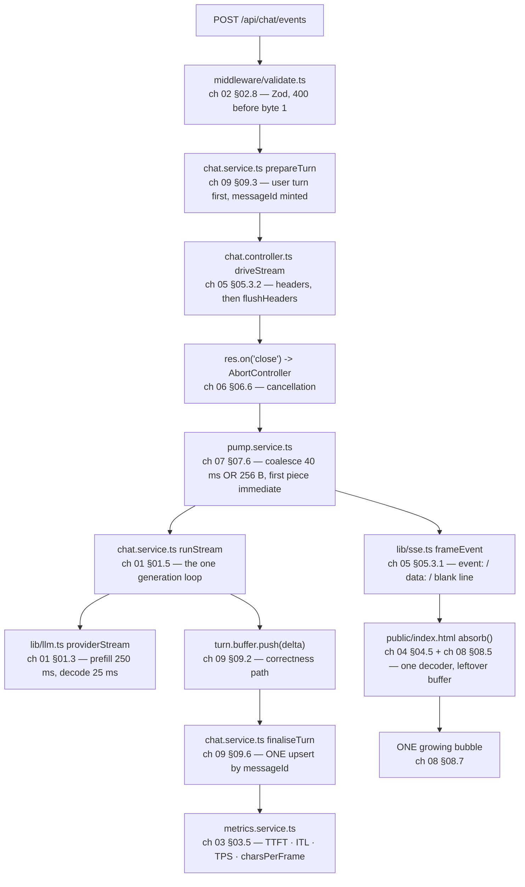

# 📝 Lecture 07 — Assignment

**AI Streaming: From LLM Tokens to a Live Chat Experience**
Phase 2 · The Application Layer · 🟡 Intermediate · **Estimated effort: 9–11 hours**

> **Read first:** the nine chapters in **[../notes](../notes)** (index: **[../index.md](../index.md)**).
> Every question below is answerable from those notes — the chapter and section number sits next to each part,
> so you never have to guess where the material lives.
> The lecture's **goal**, **build task** and **completion gate** live in **[../README.md](../README.md)** and
> **[../../roadmap.md](../../roadmap.md)** → *Phase 2 · Lecture 07*.
> The code this assignment refers to is in **[../code/Basic Code](../code/Basic%20Code)** — **15 TypeScript
> files**, **1 browser client**, **9 endpoints**, and a **14-chapter implementation guide** (00 → 13) that shows
> every file in full.

---

## 🎯 What this assignment is for

Lecture 06 asked **where does the conversation state live, and what does it cost?** This lecture asks the
question that arrives the moment the first token exists: **what happens between that token and the character
the user sees — and who is responsible for every hop in between?**

The answer is the whole lecture, and it is counter-intuitive in a specific way. **Generation is not the
problem.** A model has always produced one token at a time; that is what it *is* (§01.2). The problem is that
your stack — every HTTP client, every proxy, every framework, every `await response.text()` — was built to
deliver a **complete document**, and quietly buffers anything that is not one.

So streaming is not a flag you turn on. It is a **property of every hop**, expressible as **seven verifiable
invariants** (§06.3), and **any single buffering hop silently converts the whole system back into a buffered
one** — with no error, no log line and no failing test. The user simply waits eight seconds and then watches
text appear all at once, and nobody can say which of six components did it.

That is why this lecture is measured in **numbers, not adjectives**: TTFT, ITL, TPOT, TPS, chars-per-frame, the
client−server TTFT gap, abort rate, finish reasons. Every one of them is observable against a running service —
which is why the deliverable is a **streaming microservice with a browser client, a UTF-8 torture test and a
benchmark script**, not an essay.

| Weight | Part | What it tests | Output |
| :---: | :--- | :--- | :--- |
| **30%** | **A** — Chapter-wise practice | Can you explain why generation is sequential, decompose a latency number into TTFT + ITL, name the four granularities, read an SSE frame byte-by-byte, prove which hop is buffering, choose a return type, write the client loop from memory, and say what happens to a half-finished answer — not recite | Written answers, per chapter (A1–A9) |
| **25%** | **B** — Code tasks | Can you run the service, read the numbers it reports, break it on purpose, and extend it without crossing a chapter boundary | `../code/Basic Code` + your extensions |
| **30%** | **C** — Capstone: the **streaming microservice + browser client** + the **chaos hunt** + the **UTF-8 torture test** + the **benchmark** | The roadmap's actual build task and its gate | A working service + 3 transports + a CLI consumer + a benchmark table + a chaos report |
| **15%** | **D** — The gate | Can you render a streamed response with correct UTF-8 multi-byte handling and cancel it mid-flight **without leaking the connection** — live | 6 short answers + 1 live demonstration |

> **The one sentence this whole lecture turns on:**
> *streaming is not a transport you switch on — it is a property of every hop between the token and the painted
> character, and one buffering hop silently undoes all of them.*

Almost every bug in this lecture is a violation of that sentence: a `res.json()` at the end of a "streaming"
handler, a `Content-Encoding: gzip` on a progressive body, a fresh `TextDecoder` per chunk, a `StringBuilder`
on the service instead of the request, an abort that nobody propagates upstream, a 200-chunk answer stored as
200 messages.

---

## 🧭 How to work through it

Work **in order** — A → B → C → D. Part A builds the vocabulary the code assumes; Part B proves you can read
the numbers; Part C is the roadmap's actual build task; Part D is the gate, and it is a *live demonstration*
against a running service.

1. **The gate is a live demonstration, not a paragraph.** Part D's D1 happens with the terminal visible, the
   browser open and **no notes**. Practise it twice before you submit.
2. **Diagrams in [mermaid](https://mermaid.js.org/) only.** No screenshots, no Excalidraw exports. Every diagram
   you submit must be a `mermaid` fenced block that renders.
3. **Every number must come from a real call.** Any figure in your submission — a TTFT, an ITL, a frame count, a
   `charsPerFrame`, a status code, a byte length — must be reproducible by re-running the command you pasted
   beside it. "It felt fast" is not a measurement.

> [!IMPORTANT]
> **The habit this lecture is really testing.** Before you answer any Part A question, ask two things:
> **which hop is this?** (token → delta → network chunk → byte → frame → character → pixel) and **what happens
> to the *next* token if this hop buffers?**
> The first question stops you from blaming "the model" for a proxy. The second is the entire difference between
> a demo that streams on localhost and a product that streams through a real CDN.

> [!NOTE]
> **Offline mode is the point, not a limitation.** With an empty `OPENAI_API_KEY` the lab boots in **OFFLINE
> mode**: a deterministic stub with a real **prefill delay** (~250 ms → TTFT) and a real **decode cadence**
> (~25 ms/piece → ~40 TPS). Every endpoint, both streaming transports, the codec, the torture test and the
> metrics work exactly as they do live — so every question in this assignment is answerable with **zero spend**
> and **reproducible byte-for-byte**.

---

## 📋 Contents

| Part | Topic | Chapter | Type |
| :---: | :--- | :--- | :--- |
| **A1** | How LLMs generate text — the sequential loop, prefill vs decode, the KV-cache tax | [01](../notes/01_How_LLMs_Generate_Text.md) | Written + 🧮 + 💻 |
| **A2** | Generation vs delivery — two independent processes, the buffered lifecycle, changed failure semantics | [02](../notes/02_Generation_vs_Delivery_Non_Streaming_and_Streaming_Responses.md) | Written + 🖊️ + 💻 |
| **A3** | Latency anatomy — TTFT, ITL, TPOT, TPS, the reading-speed threshold, the prompt-token tax | [03](../notes/03_Latency_Anatomy_TTFT_ITL_and_Perceived_Performance.md) | Written + 🧮 + 💻 |
| **A4** | Granularity — token · delta · network chunk · byte, and the UTF-8 split | [04](../notes/04_Token_Chunk_Network_and_Byte_Granularity.md) | Written + 🧮 + 💻 |
| **A5** | HTTP streaming mechanics — chunked encoding, the SSE grammar, heartbeats, SSE vs WebSockets | [05](../notes/05_HTTP_Streaming_Mechanics_Chunked_Encoding_SSE_and_WebSockets.md) | Written + 🖊️ + 💻 |
| **A6** | End-to-end architecture & the 7 pipeline invariants — the bridge, backpressure, cancellation | [06](../notes/06_End_to_End_Streaming_Architecture_and_Pipeline_Invariants.md) | Written + 🖊️ + 🎯 |
| **A7** | Backend: `call` vs `stream`, `Flux` & stream pumps — the return type is the architecture | [07](../notes/07_Backend_Streaming_Call_vs_Stream_Flux_and_Stream_Pumps.md) | Written + 🧮 + 💻 |
| **A8** | Frontend: `fetch`, `ReadableStream` & `TextDecoder` — one bubble, cancellable, sanitised | [08](../notes/08_Frontend_Streaming_Fetch_ReadableStream_TextDecoder.md) | Written + 💻 + 🎯 |
| **A9** | History, persistence & production hardening — the dual write, interrupted turns, observability | [09](../notes/09_History_Persistence_and_Production_Hardening.md) | Written + 🎯 + 💻 |
| **B** | Code tasks — run, prove, break, extend | [../code/Basic Code](../code/Basic%20Code) | TypeScript + Express + browser |
| **C** | Capstone — the streaming microservice, the chaos hunt, the torture test, the benchmark | roadmap **Build** + **Gate** | Service + client + CLI + tests + report |
| **D** | The completion gate | roadmap **Gate** | Live + written |
| **E** | Self-grade rubric | — | Self-assessment |
| **F** | Submission checklist · scope guard · progress | — | Admin |

> **How to read the question markers.**
> 🧮 = a numeric or table problem with a checkable answer · 🖊️ = draw it as mermaid · 💻 = run it and paste the
> real output · 🎯 = an FDE-consequence question (what you would *do* differently).

---

## Part A — Chapter-wise practice

Nine parts, one per chapter. Each part is answerable from its chapter alone plus the matching endpoints in
`code/Basic Code`. **Write your answers in your own file `Assignment/answers.md`**, keeping the numbering.

---

### A1 — How LLMs generate text: the root cause of streaming

📖 [Chapter 01](../notes/01_How_LLMs_Generate_Text.md) · sections 01.1–01.9

1. **The experiment** (§01.1). Describe what the chapter's "The capital of India is" experiment demonstrates.
   Then answer the question the chapter raises: at the moment the model produced the word *New*, had it already
   "decided" the rest of the sentence? State what the answer implies about how output can be delivered.
2. **One decoding step** (§01.2). Name the five steps of a single decoding step in order, and state for each one
   whether it depends on the *previous* step's output. Then answer: which single step makes the whole process
   **irreducibly sequential**, and why can it not be parallelised the way prefill can?
3. 🧮 **Prefill vs decode** (§01.3). Fill in the table below for a 1,000-token prompt on a machine that prefills
   at 2,000 tokens/s and decodes at 50 tokens/s. Then answer: which phase sets **TTFT**, which sets **TPS**, and
   why can adding GPUs reduce one but not the other in the same proportion?

   | Phase | Work | Parallel? | Time for this case |
   | :--- | :--- | :---: | :--- |
   | Prefill | | | |
   | Decode | | | |

4. **The KV-cache tax** (§01.4). Explain in two sentences what the KV cache is and what it buys. Then answer:
   why does the *cost per turn* grow with conversation length even though the model is stateless, and which
   chapter 09 metric does this connect to?
5. **The same loop, two delivery shapes** (§01.5). The chapter's central claim is that streaming does not change
   generation. Reproduce the two shapes as a two-column comparison (buffered vs streamed) with these rows:
   *who decides when the user sees text*, *what the return type is*, *how many times the model is called*, and
   *what the user sees at 250 ms*. Then answer: which rows are **identical**, and what does that prove?
6. **What the model optimises** (§01.6). State what the training objective actually maximises, and name the one
   property of the output it does **not** guarantee. Then answer: why is this the reason a fluent answer can be
   wrong, and why is that a *delivery* concern as much as a *correctness* concern?
7. 🖊️ **Where streaming comes from** (§01.7). Draw the chapter's one picture as a mermaid diagram: from the
   prompt through prefill, the decode loop, and the two ways the resulting pieces can be delivered. Mark the
   point at which a delivery layer can **destroy** the stream, and label the invariant that prevents it.
8. 💻 **Watch the two phases.** With `code/Basic Code` running, make one buffered call and one streamed call and
   compare the timings the server reports:

   ```bash
   # buffered — the server had text early, but delivered nothing
   curl -s -X POST localhost:8097/api/chat -H 'content-type: application/json' \
     -d '{"conversationId":"a1","message":"hello"}' \
     | node -pe 'const d=JSON.parse(require("fs").readFileSync(0,"utf8")).data;
         JSON.stringify({serverFirstDeltaMs:d.serverFirstDeltaMs, clientSeesTextAtMs:d.clientSeesTextAtMs,
                         deltas:d.deltasConsumed})'

   # streamed — the same generation, delivered as it happens
   curl -sN -X POST localhost:8097/api/chat/events -H 'content-type: application/json' \
     -d '{"conversationId":"a1b","message":"hello"}' | grep -A1 '^event: done'
   ```

   Paste both outputs. Then answer: (a) which number is the prefill time, (b) which is prefill + all of decode,
   and (c) what is the **gap** between them, in ms — and which of the seven invariants does that gap violate?
9. 🎯 **The stakeholder sentence.** A product manager says: *"Can we just stream it so the model gets faster?"*
   Correct the sentence in **one** sentence that is technically exact, then add the one number you would put in
   front of them to show the change did something real.

---

### A2 — Generation vs delivery: non-streaming and streaming responses

📖 [Chapter 02](../notes/02_Generation_vs_Delivery_Non_Streaming_and_Streaming_Responses.md) · sections 02.1–02.10

1. **Two independent processes** (§02.1). Name the two processes, state which one your application controls, and
   give the one-sentence reason you cannot make the other faster. Then answer: what *is* available to you
   instead, and what is the user-visible effect?
2. **The buffered lifecycle** (§02.2). Walk the chapter's timeline for an 8-second answer: what does the client
   do at t=0, what does the server do at t=0.3 s, what is on the socket at t=7.9 s, and what appears at t=8.0 s?
   Then answer: which of those four moments does the user *experience* as "the wait"?
3. **The streaming lifecycle** (§02.3). Walk the same timeline for a streamed answer with the same 250 ms TTFT
   and the same 40 TPS. Then answer: at t=1.0 s, how much of the answer has the user read, and what is the
   user's *perceived* latency? Give both numbers.
4. **The wire-level comparison** (§02.4). Reproduce the comparison table with these rows: *Content-Type*,
   *Content-Length*, *Transfer-Encoding*, *number of body writes*, *first byte*, *completion signal*,
   *error representation*. Then answer: which two rows explain why a buffering proxy is *invisible* to the
   server, and why does the server's own metrics therefore look healthy while the user waits?
5. 🖊️ **The endpoint decision framework** (§02.5). Draw the decision as a mermaid flowchart with at least four
   decision nodes. Then answer: which single question is the *first* one you should ask, and why does asking it
   first save the most work?
6. **The hybrid pattern** (§02.6). Describe the pattern in three sentences. Then answer: which problems does it
   solve that pure streaming does not, and what new failure mode does it introduce?
7. **The delivery-path taxonomy** (§02.7). List the delivery paths the chapter names. Then answer: which paths
   does `code/Basic Code` implement, which ones does the lab **not** implement, and for each missing one, name a
   use case where it would be the right choice.
8. 🎯 **Failure semantics** (§02.8). Explain how streaming changes what an error *means*. Then answer: why must
   request validation happen **before** the first byte, what HTTP status can no longer be sent afterwards, and
   what replaces it?
9. 💻 **Prove the failure-semantics change.** With the server running, trigger both error kinds and paste both
   results:

   ```bash
   # a) BEFORE the first byte — a real status code is still possible
   curl -s -o /tmp/a2a.json -w 'status -> %{http_code}\n' -X POST localhost:8097/api/chat \
     -H 'content-type: application/json' -d '{"conversationId":"a2","message":""}'
   cat /tmp/a2a.json; echo

   # b) an accepted request that streams — status is 200, and errors travel IN-BAND
   curl -sN -X POST localhost:8097/api/chat/events -H 'content-type: application/json' \
     -d '{"conversationId":"a2b","message":"hello"}' | head -4
   ```

   Then answer: in case (b), what would a client that only checks `response.ok` conclude, and how does the
   `error` event fix that?

---

### A3 — Latency anatomy: TTFT, ITL and perceived performance

📖 [Chapter 03](../notes/03_Latency_Anatomy_TTFT_ITL_and_Perceived_Performance.md) · sections 03.1–03.8

1. **The eight-second example** (§03.1). Describe the scenario and the surprising conclusion. Then answer: why is
   an 8-second streamed answer experienced as *"fast"* while a 4-second buffered answer is experienced as
   *"broken"* — using the chapter's own vocabulary, not "it feels better".
2. 🧮 **The decomposition** (§03.2). Write the full latency decomposition formula and name every term. Then
   compute $T_{\text{total}}$ for: TTFT 250 ms, 120 output tokens, ITL 25 ms. Then answer: which term dominates,
   and what does that imply about which lever you should pull first?
3. 🧮 **TTFT, ITL, TPOT, TPS** (§03.3). Define all four in one line each, and give the conversion between ITL and
   TPS. Then answer: at what TPS does generation become **faster than a human reads**, what does that mean for
   the value of a faster model, and why is `fasterThanReading` a boolean worth logging per stream rather than a
   dashboard average?
4. 🧮 **The prompt-token tax** (§03.4). Explain why *every* prompt token is a latency cost, and why that cost
   lands on **TTFT** rather than on TPS. Then compute: if prefill runs at 3,000 tokens/s, what does a 6,000-token
   prompt cost you before the first token — and what does that number do to a 300 ms TTFT target?
5. **Instrumentation** (§03.5). List the numbers the chapter says you must log per stream. Then answer: which one
   of them can the **server** not measure at all, why not, and what is the only alert that becomes possible once
   you measure it on the client?
6. 🖊️ **Latency budgets** (§03.6). Draw the chapter's latency budget as a mermaid diagram with a target for each
   segment (queue → prefill → first token → decode → paint). Then answer: which two segments belong to *you*
   rather than to the provider, and what is your remediation for each?
7. 🎯 **The wrong optimisation.** A team is told "TTFT is too high". They buy a faster model tier. TTFT improves
   by 30%, TPS improves by 3×. Users report no change. Using §03.3 and §03.6, explain why in three sentences, and
   name the metric that would have predicted this before the purchase.
8. 💻 **Measure your own stream.** With the server running, send three streamed requests and read the aggregate:

   ```bash
   for i in 1 2 3; do
     curl -sN -X POST localhost:8097/api/chat/stream -H 'content-type: application/json' \
       -d "{\"conversationId\":\"a3-$i\",\"message\":\"hello\"}" > /dev/null
   done
   curl -s localhost:8097/api/metrics | node -pe 'const d=JSON.parse(require("fs").readFileSync(0,"utf8")).data;
     JSON.stringify({ttft:d.ttftMs, itl:d.itlMs, tps:d.tps, reading:d.readingSpeedTps,
                     fasterThanReadingRate:d.fasterThanReadingRate, charsPerFrame:d.charsPerFrame,
                     last:d.lastStream && {frames:d.lastStream.frames, chars:d.lastStream.chars,
                       totalMs:d.lastStream.totalMs}}, null, 1)'
   ```

   Paste the output. Then answer: (a) is TTFT or total time the larger share of the wait, (b) is the stream
   already faster than a human reads, and (c) what would you change in `.env` to make the *stream* look
   deliberately slow, and why would you want to?
9. 💻 **The client−server gap.** Open <http://localhost:8097/> and send one message. Read the HUD line, then
   answer: what are `server TTFT`, `client TTFT` and the `gap` — and if the gap were 800 ms, name the three
   components you would suspect *before* you suspected the model.

---

### A4 — Token, provider chunk, network chunk and byte

📖 [Chapter 04](../notes/04_Token_Chunk_Network_and_Byte_Granularity.md) · sections 04.1–04.8

1. **The four layers** (§04.1). Name all four granularities in order and, for each, state (a) who produces the
   boundary and (b) whether you can rely on it. Then answer: which two layers are **never** aligned with each
   other, and what is the practical consequence for a client?
2. **Tokens → deltas** (§04.2). Explain why a provider coalesces tokens into deltas, and what the chapter says
   about the ratio. Then answer: why is a "one token = one delta" assumption *harmful* rather than merely
   imprecise — name the two frontend bugs it causes.
3. **Deltas → network chunks** (§04.3). Describe the classic frontend bug precisely: what does the code do, what
   is lost, and why does it work in testing? Then answer: why is this bug **invisible on a fast localhost** and
   common in production, and name the two rules that fix it.
4. 🧮 **The UTF-8 split** (§04.4). Reproduce the byte-length table for `A`, `é`, `₹` and `😀`. Then answer:
   (a) what is the difference between a *character* and a *byte*, (b) what does a decoder do when a multi-byte
   sequence is incomplete, and (c) what is the one rule for the decoder's lifetime and flags — stated as code,
   not prose.
5. **The safe UI contract** (§04.5). State the contract in three rules. Then answer: why is *blind
   accumulation* the right approach for raw text but not for SSE, and what does an SSE client have to do
   instead — in two rules?
6. 🖊️ **The torture test** (§04.6). Draw the test as a mermaid flowchart: one payload → N fragmentation
   strategies → the client algorithm → one assertion. Then answer: which strategy is the one that makes the
   dangerous case **certain** rather than likely, and why must the random strategy be **seeded**?
7. 🎯 **The `charsPerFrame` signal** (§04.6). State what a healthy `charsPerFrame` distribution looks like, what
   one giant frame means, and what a periodic large frame means. Then answer: why is this metric the *only* one
   in the chapter with no analogue in a buffered system?
8. 💻 **Prove the UTF-8 split, both ways.** Run the same payload through the decoder two ways and paste both:

   ```bash
   # one byte per chunk: the per-chunk decoder corrupts, the streaming decoder does not
   curl -s -X POST localhost:8097/api/codec/decode -H 'content-type: application/json' \
     -d '{"text":"₹500 café 😀","chunkSize":"byte"}' \
     | node -pe 'const d=JSON.parse(require("fs").readFileSync(0,"utf8")).data;
         JSON.stringify({bytes:d.byteLength, chunks:d.chunks, naive:d.naive, streaming:d.streaming,
                         naiveOk:d.naiveIsCorrect, streamingOk:d.streamingIsCorrect}, null, 1)'

   # split on CHARACTER boundaries instead: even the naive decoder survives
   curl -s -X POST localhost:8097/api/codec/decode -H 'content-type: application/json' \
     -d '{"text":"₹500 café 😀","chunkSize":"char"}' \
     | node -pe 'const d=JSON.parse(require("fs").readFileSync(0,"utf8")).data;
         JSON.stringify({chunks:d.chunks, naiveOk:d.naiveIsCorrect, streamingOk:d.streamingIsCorrect})'
   ```

   Paste both. Then answer: which decoder failed, in **exactly** which situation, and what does the second run
   prove about where the bug lives?
9. 💻 **Prove the leftover buffer.** Now run the SSE frame parser over the same byte-level fragmentation:

   ```bash
   curl -s -X POST localhost:8097/api/codec/frames -H 'content-type: application/json' \
     -d '{"text":"₹500 café 😀","chunkSize":"byte"}' \
     | node -pe 'const d=JSON.parse(require("fs").readFileSync(0,"utf8")).data;
         JSON.stringify({chunks:d.chunks, correct:d.correct, naive:d.naive, equal:d.equal}, null, 1)'
   ```

   Paste it. Then answer: (a) how much text did the naive parser recover, (b) what is in `correct.leftover` and
   why is it `""` at the end, and (c) which **one line** separates the two parsers?
10. 🎯 **The production argument.** An engineer says: *"This works fine, I tested it."* Using §04.3 and §04.6,
    write two sentences explaining why "I tested it" is not evidence for a streaming client, and name the one
    artefact that would be evidence.

---

### A5 — HTTP streaming mechanics: chunked encoding, SSE and WebSockets

📖 [Chapter 05](../notes/05_HTTP_Streaming_Mechanics_Chunked_Encoding_SSE_and_WebSockets.md) · sections 05.1–05.8

1. **Conventional vs streaming HTTP** (§05.1). Explain what is actually different at the protocol level between
   a normal response and a streaming one — and what is **not** different. Then answer: why is "streaming" not a
   special transport, and what does that imply about proxies?
2. **Chunked transfer encoding** (§05.2). Explain why HTTP needs a mechanism for an incomplete response. Then
   answer: which header appears, which header must be **absent**, and what is a "flush" at the socket level —
   and why is `res.write()` alone not enough?
3. **The SSE grammar** (§05.3.1). Reproduce the exact wire grammar: which fields exist, how a frame is
   terminated, and what dispatches an event. Then answer: what is the difference between the **transport**
   protocol and **your** application protocol inside `data:`, and why must you design the second one
   deliberately?
4. 🧮 **SSE headers** (§05.3.2). Reproduce the header table with a one-line reason for each. Then answer: what
   specifically breaks without `Cache-Control: no-cache, no-transform`, what breaks without
   `X-Accel-Buffering: no`, and what breaks without `charset=utf-8`?
5. **Heartbeats** (§05.3.3). Explain what a comment frame is, what it does, and what it does **not** do. Then
   answer: why is a heartbeat impossible in raw-text streaming, and what does that force you to accept as a
   limitation of that transport?
6. 🖊️ **SSE vs WebSockets** (§05.4). Draw the decision as a mermaid flowchart. Then reproduce the comparison
   table (direction, protocol, reconnection, binary, proxies, auth, best-for). Then answer: for a chat answer
   stream, why does SSE win — and name the one requirement that would flip the decision to WebSockets.
7. **Raw text vs `text/event-stream`** (§05.5). State the difference in one sentence each for: framing, event
   types, completion signal, heartbeats, and client parsing cost. Then answer: which of the two does
   `code/Basic Code` expose at `/api/chat/stream`, which at `/api/chat/events`, and what is the *only*
   difference in the code that produces them?
8. 🎯 **Infrastructure that breaks streaming** (§05.6). Name every hop the chapter lists that can silently
   buffer, compress or time out a stream. Then answer: for each, give the header or setting that fixes it, and
   explain why the server's own metrics **cannot** detect the problem.
9. 💻 **Read the wire.** Make the same request over both transports and compare headers and bodies:

   ```bash
   # raw text — chunked, no Content-Length, no framing
   curl -sN -D /tmp/a5-raw.headers -o /tmp/a5-raw.txt -X POST localhost:8097/api/chat/stream \
     -H 'content-type: application/json' -d '{"conversationId":"a5","message":"hello"}'
   grep -iE 'HTTP/|content-type|content-length|transfer-encoding|cache-control|x-accel' /tmp/a5-raw.headers
   echo "body bytes: $(wc -c < /tmp/a5-raw.txt)"

   # SSE — the same answer, framed
   curl -sN -X POST localhost:8097/api/chat/events -H 'content-type: application/json' \
     -d '{"conversationId":"a5b","message":"hello"}' > /tmp/a5-sse.txt
   echo "frames: $(grep -c '^event:' /tmp/a5-sse.txt)  tokens: $(grep -c '^event: token' /tmp/a5-sse.txt)"
   grep -E '^(event|data)' /tmp/a5-sse.txt | tail -6
   ```

   Paste the header lines, the byte count, the frame counts and the tail. Then answer: (a) which header proves
   the response is incomplete-by-design, (b) why is there no `Content-Length`, and (c) in the SSE body, what
   tells the client the stream is finished?
10. 🎯 **The diagnosis order.** A user reports "it doesn't stream". Write the **ordered** list of five things you
    would check, from cheapest to most expensive, and say what each one rules out.

---

### A6 — End-to-end architecture and the 7 pipeline invariants

📖 [Chapter 06](../notes/06_End_to_End_Streaming_Architecture_and_Pipeline_Invariants.md) · sections 06.1–06.9

1. **The two streams** (§06.1). Name both streams, say where each one lives, and explain why **both** must stay
   streamed. Then answer: what happens to the user's experience if stream A is streamed and stream B is buffered,
   and what happens if it is the other way round?
2. 🖊️ **The full pipeline** (§06.2). Draw the end-to-end pipeline as a mermaid diagram with every hop from the
   provider to the pixel, and for each hop write its **owner**. Then answer: which hop has no owner in most
   teams, and what is the consequence?
3. **The 7 invariants** (§06.3). List all seven, each in the chapter's own wording. Then answer: which invariant
   is the one most commonly violated **in application code** rather than in infrastructure, and which is the one
   most commonly violated **outside** the application?
4. **The sequence diagram** (§06.4). Reproduce the both-streams sequence diagram in mermaid, with the two streams
   visually distinguished. Then answer: at which numbered step does the user first see a character, and which two
   steps must happen **before** it?
5. 🎯 **Backpressure** (§06.5). Explain what backpressure is, and the chapter's surprising claim about where it
   usually originates in an AI streaming system. Then answer: what is the *correct* server-side response to a
   slow client, and what is the wrong one — and why does the wrong one eventually hurt every user, not just the
   slow one?
6. **Cancellation propagation** (§06.6). Explain what "propagate upstream" means concretely: which component
   fires, which component must notice, and what stops as a result. Then answer: what is the cost of *not*
   propagating it, in money and in capacity — and what does the chapter say the user has already seen at that
   point?
7. 🖊️ **Naïve vs production** (§06.7). Draw both pipelines side by side in one mermaid diagram and label the
   three differences. Then answer: which single difference explains most real-world "it doesn't stream" reports?
8. 💻 **Prove cancellation propagates.** Kill a stream mid-flight and inspect what the server did about it:

   ```bash
   timeout 0.7 curl -sN -X POST localhost:8097/api/chat/stream -H 'content-type: application/json' \
     -d '{"conversationId":"a6-cancel","message":"interrupt me"}' | wc -c
   sleep 0.6
   curl -s localhost:8097/api/conversation/a6-cancel \
     | node -pe 'const d=JSON.parse(require("fs").readFileSync(0,"utf8")).data; const t=d.turns[d.turns.length-1];
         JSON.stringify({turns:d.turnCount, assistantTurns:d.assistantTurns, lastRole:t.role,
                         status:t.status, finishReason:t.finishReason, tail:t.content.slice(-40)}, null, 1)'
   curl -s localhost:8097/api/metrics \
     | node -pe 'const d=JSON.parse(require("fs").readFileSync(0,"utf8")).data;
         JSON.stringify({activeStreams:d.activeStreams, abortedStreams:d.abortedStreams, abortRate:d.abortRate,
                         byFinishReason:d.byFinishReason})'
   ```

   Paste all three outputs. Then answer: (a) did the abort reach the server, (b) what was persisted, and (c) what
   would `activeStreams` have been if the abort had **not** propagated — and what would that mean for a service
   handling 500 streams a minute?
9. 🎯 **The one-hop audit.** You are handed a service that streams correctly on `localhost` and not at all behind
   the company gateway. Using the seven invariants as a checklist, write the **five** questions you would ask in
   order, and for each, the artefact you would request as proof.

### A7 — Backend: `call` vs `stream`, `Flux` and stream pumps

📖 [Chapter 07](../notes/07_Backend_Streaming_Call_vs_Stream_Flux_and_Stream_Pumps.md) · sections 07.1–07.10

1. **The buffered starting point** (§07.1). Describe the normal AI call in terms of its return type, and explain
   what that type *implies* about when the user can see anything. Then answer: what is the return type literally
   called in the chapter, and what is the one-word summary of its behaviour?
2. **Switching to streaming** (§07.2). Describe the change to the same method. Then answer: how many characters
   of the method body actually change, and what does that tell you about where the difficulty of streaming
   actually lives?
3. 🧮 **`Flux<String>`: box vs conveyor belt** (§07.3). Reproduce the box-vs-conveyor-belt analogy and the
   return-type comparison table. Then answer: (a) what can you do with a conveyor belt that you cannot do with a
   box, and (b) what is the one thing a conveyor belt makes *harder*?
4. **One method, one return-type change** (§07.4). Explain why the chapter insists the streaming service stays
   *tiny*. Then answer: where does the buffering that history requires actually belong, and what is the name the
   chapter gives that pattern?
5. **The four operators** (§07.5). Name all four and, for each, state in one line what it does and why a streaming
   pipeline needs it. Then answer: which one is the "observer, not a terminator" pattern, and why does that
   distinction matter for a dual write?
6. 🧮 **Stream pumps and coalescing** (§07.6). Explain what delta coalescing is and why it is not an optimisation
   but a correctness-of-experience decision. Then answer: name the two coalescing thresholds, state what happens
   if you only use the time threshold, and state the one rule about the **first** piece.
7. 🎯 **Error handling before and after the first byte** (§07.7). Reproduce the two-column table. Then answer:
   why can a `500` never be sent after the first byte, what must replace it, and what must the client's state
   machine do when it receives it?
8. **Multi-user isolation and thread safety** (§07.8). Explain the specific bug the chapter warns about — where
   the buffer must live, and why. Then answer: what is the concurrency-control unit for a conversation (not a
   user), and what breaks if you get the unit wrong in each direction?
9. 💻 **Prove the return-type difference.** Run one buffered and one streamed call, then read the delivery
   signature the server recorded for each:

   ```bash
   curl -s -X POST localhost:8097/api/chat -H 'content-type: application/json' \
     -d '{"conversationId":"a7-buf","message":"hello"}' > /dev/null
   curl -s localhost:8097/api/metrics | node -pe 'const s=JSON.parse(require("fs").readFileSync(0,"utf8")).data.lastStream;
     JSON.stringify({transport:s.transport, frames:s.frames, chars:s.chars, charsPerFrame:s.charsPerFrame,
                     ttftMs:s.ttftMs, totalMs:s.totalMs})'

   curl -sN -X POST localhost:8097/api/chat/stream -H 'content-type: application/json' \
     -d '{"conversationId":"a7-raw","message":"hello"}' > /dev/null
   curl -s localhost:8097/api/metrics | node -pe 'const s=JSON.parse(require("fs").readFileSync(0,"utf8")).data.lastStream;
     JSON.stringify({transport:s.transport, frames:s.frames, chars:s.chars, charsPerFrame:s.charsPerFrame,
                     ttftMs:s.ttftMs, totalMs:s.totalMs})'
   ```

   Paste both. Then answer: (a) both answers are the same text — so what exactly differs, (b) which number is the
   buffering smoke alarm, and (c) for the buffered row, what is `ttftMs` measuring and why is that number
   *misleading* from the user's point of view?
10. 🎯 **The pump policy.** A colleague proposes setting `FLUSH_INTERVAL_MS=0` so every delta is flushed
    immediately. Write three sentences: what you gain, what you lose, and the one metric you would watch for
    24 hours after the change to decide whether to keep it.

---

### A8 — Frontend: `fetch`, `ReadableStream` and `TextDecoder`

📖 [Chapter 08](../notes/08_Frontend_Streaming_Fetch_ReadableStream_TextDecoder.md) · sections 08.1–08.14

1. **Half the work** (§08.1). State the chapter's claim about where streaming is won or lost. Then answer: how
   few lines of client code are needed to *undo* a correct backend, and what are they?
2. **The common mistake** (§08.2). Name the single most common frontend streaming mistake, write it as code, and
   explain exactly what it destroys. Then answer: why does this mistake produce **no error at all**?
3. **What `await fetch()` waits for** (§08.3). Answer the question precisely. Then answer: what does that imply
   about when you may show a "streaming…" indicator, and why is that not the same moment as the first token?
4. **`response.body`** (§08.4). What type is it, what is it a stream *of*, and what is the one method you need
   from it? Then answer: what is the difference between `response.body` and `await response.text()` in terms of
   how many times you can consume it, and what happens to the rest of the body if you never read it?
5. **Reading the loop** (§08.5). Write the read loop from memory. Then answer: what does the `done` flag mean —
   is it text, is it an error, and what must you do *after* the loop ends?
6. 🧮 **Why not a string** (§08.6). Explain why a chunk arrives as bytes rather than as text. Then answer: what is
   the exact rule for the decoder's lifetime and its flags, and what is the one extra call that is easy to
   forget — and what does forgetting it cost?
7. 🖊️ **One bubble** (§08.7). Draw the wrong and the right DOM update as two annotated sketches or two mermaid
   diagrams. Then answer: what are the *two* user-visible symptoms of the wrong version, and which one does the
   user notice first?
8. **The complete flow** (§08.8). Reproduce `sendMessage()` as an ordered list of steps, marking which ones are
   per-request and which are per-chunk. Then answer: which step must be reset **before** each request, and what
   breaks if it is not?
9. 💻 **Auto-scroll and rich content** (§08.9–§08.10). Open <http://localhost:8097/> and send a message. While it
   is streaming, scroll up and hold. Then answer: (a) did the view stay where you put it, (b) what is the rule
   the code implements, and (c) for rich content (markdown, code blocks, tables), name the two hazards of
   re-rendering on every chunk and the two mitigations.
10. 🎯 **Cancellation** (§08.11). Explain what the Stop button must do at three layers: the client, the HTTP
    connection, and the provider call. Then answer: what must the UI do with the **partial text**, and why is
    treating `AbortError` as a failure a *product* bug rather than a technical one?
11. 🎯 **Performance, frameworks and accessibility** (§08.12). Name the three performance rules, the one
    framework pattern, and the accessibility requirement — and for each, state the failure it prevents. Then
    answer: why is a per-token `aria-live` announcement worse than no announcement at all?

---

### A9 — History, persistence and production hardening

📖 [Chapter 09](../notes/09_History_Persistence_and_Production_Hardening.md) · sections 09.1–09.13

1. **The problem streaming introduces** (§09.1). State the problem in one sentence. Then answer: what are the two
   *wrong* things you could store, and for each, what does the next prompt look like as a result?
2. 🖊️ **The dual-write pattern** (§09.2). Draw it as a mermaid diagram with both paths labelled (latency path,
   correctness path). Then answer: which path is allowed to fail without affecting the other, and which one must
   never be skipped?
3. **Why the reference implementation is only a teaching pattern** (§09.3). Name the two places the chapter says
   state must live, and the one place it must **never** live. Then answer: what is the specific failure you get
   if you get this wrong, and which class of bug does it belong to?
4. **Interrupted turns** (§09.4). Explain why a partial answer must be persisted rather than discarded, using the
   user's point of view. Then answer: what status and `finishReason` does the lab record for that case, and what
   would break in the *next* turn if you dropped the partial text?
5. 🧮 **Token accounting during a stream** (§09.5). Explain why usage is not known until the end, and reproduce
   the chapter's options table with an accuracy and a cost for each. Then answer: what is the reconciliation
   rule, and what must your ledger do if the provider never sends usage at all?
6. **Persistence engineering** (§09.6). List the requirements the chapter gives for writing streamed history
   correctly (atomicity, idempotency, ordering, timestamps). Then answer: why is an id generated **before**
   streaming starts the thing that makes the write idempotent?
7. **The hardening checklist** (§09.7). Reproduce the checklist. Then answer: which item is the one most teams
   skip, what is the user-visible symptom when it is missing — and which item did `code/Basic Code` add as the
   21st?
8. 🎯 **Observability** (§09.8). List the streaming-specific metrics. Then answer: which single metric is the
   *only* one that can detect a buffering proxy, why can the server not compute it, and what alert threshold
   would you set?
9. **Cost, security and privacy** (§09.9). Reproduce the cost model and name its levers. Then answer: name the
   two streaming-specific security concerns and the two privacy requirements from the checklist.
10. 🎯 **Testing strategy** (§09.10). Reproduce the two assertions the chapter puts in CI, and explain what class
    of regression each one catches. Then answer: why is neither of them a unit test?
11. **The anti-pattern catalogue** (§09.11). Name every anti-pattern the chapter lists and, for each, the
    invariant or requirement it violates. Then answer: which one is the most expensive in production, and why?
12. 💻 **Prove one exchange is one turn.** Send the same message through all three transports into one
    conversation, then inspect the transcript:

    ```bash
    for t in chat chat/stream chat/events; do
      curl -sN -X POST "localhost:8097/api/$t" -H 'content-type: application/json' \
        -d "{\"conversationId\":\"a9\",\"message\":\"turn via $t\"}" > /dev/null
    done
    curl -s localhost:8097/api/conversation/a9 \
      | node -pe 'const d=JSON.parse(require("fs").readFileSync(0,"utf8")).data;
          JSON.stringify({turns:d.turnCount, assistantTurns:d.assistantTurns,
            rows:d.turns.map(t=>({role:t.role, status:t.status, len:t.content.length}))}, null, 1)'
    ```

    Paste it. Then answer: (a) how many assistant turns exist for three exchanges, (b) how many frames did the
    clients see in total (check `/api/metrics`), and (c) what would `turnCount` have been if you had stored one
    message per chunk?

---

## Part B — Code tasks



### B1 — Basic Code: run it, then prove you understand it

`../code/Basic Code` is a complete, runnable service that implements every chapter of this lecture. With **no
API key** it boots in **OFFLINE mode**, so **all nine endpoints work** — the pump, both transports, the codec,
the torture test and the metrics are all real; only the generation step is a deterministic stub.

```text
code/Basic Code/
├── .env  ·  .env.example                  # port, provider, PUMP policy, heartbeat, offline cadence
├── package.json  ·  package-lock.json  ·  tsconfig.json
├── public/index.html                      # ch 08 — the browser client (getReader · TextDecoder · AbortController)
├── implementations guide/                 # chapters 00 → 13 (every file in full, block by block)
└── src/
    ├── server.ts                          # boot banner + graceful shutdown (ch 09 §09.7 item 21)
    ├── app.ts                             # Express app, static client, request log, 404, error → status
    ├── config/config.ts                   # Zod env + PUMP_POLICY + READING_TPS
    ├── types/streaming.types.ts           # StreamEvent · StreamMetrics · PersistedTurn · the 3 reports
    ├── middleware/validate.ts             # the 4 request schemas
    ├── routes/index.ts                    # the 9 endpoints
    ├── controllers/
    │   ├── chat.controller.ts             # health · buffered · raw · SSE · conversation · metrics
    │   └── codec.controller.ts            # decode · frames · torture
    ├── lib/
    │   ├── llm.ts                         # ch 01 §01.5 — the ONE generator + the OFFLINE stub
    │   └── sse.ts                         # ch 05 — raw + SSE headers, framing, heartbeat, [DONE]
    └── services/
        ├── chat.service.ts                # ch 07 §07.4 — one loop, two consumers · dual write
        ├── pump.service.ts                # ch 07 §07.6 — coalescing + backpressure
        ├── codec.service.ts               # ch 04 — fragment · decode · frames · torture
        ├── conversation.service.ts        # ch 07 §07.8 + ch 09 §09.6 — store · lock · upsert
        └── metrics.service.ts             # ch 03 §03.5 — the ledger and the percentiles
```

**Setup**

```bash
cd "Lecture 07 - AI Streaming/code/Basic Code"
npm install
cp .env.example .env      # leave the key empty — OFFLINE mode is the point
npm run typecheck         # must exit 0
npm run dev               # http://localhost:8097
```

Then open <http://localhost:8097/> in a browser — the client is served by the same process.

**Your task:** run every check below, paste the **real** output, and answer the question attached to it. Write it
up as `Assignment/b1-notes.md`, one section per number. This is not a formality — several of these assertions
depend on settings you can change in `.env`, and one of them reveals a bug that shipped in the first version of
this lab.

```bash
# ---- boot & wiring ---------------------------------------------------------------
#  1) GET /api/health: mode is "OFFLINE", and pipelineInvariants has exactly 7 entries
#  2) The boot banner and /api/health agree on pumpPolicy and heartbeatMs
#  3) /api/health reports transports: buffered, raw text, sse — the three shapes of ch 02 §02.7

# ---- generation vs delivery -----------------------------------------------------
#  4) POST /api/chat: serverFirstDeltaMs ≈ 276 but clientSeesTextAtMs ≈ 1100 — the gap is the whole point
#  5) Same call: deltasConsumed > 30 — the deltas existed; the endpoint accumulated them
#  6) POST /api/chat/stream: bytes arrive progressively (use `curl -N` and watch, do not pipe to a file)
#  7) Same call: the BYTE count (`wc -c`) is larger than the CHARACTER count (`lastStream.chars` in
#     /api/metrics). Print both and explain the difference — which character in the payload causes it?
#  8) POST /api/chat/events: frames are status, token ×N (N ≈ 15–20), usage, done, [DONE]
#  9) Same call: the done event carries ttftMs and itlMs — the two numbers from §03.3
# 10) Same call: the usage event is the LAST data event — why can it not come earlier? (§09.5)

# ---- the pump & the metrics -----------------------------------------------------
# 11) GET /api/metrics: `lastStream.charsPerFrame` for streamed traffic is in the low tens
# 12) Now POST /api/chat (buffered) and read lastStream again: frames = 1, charsPerFrame in the hundreds
# 13) Same call: transport = "buffered" — the delivery signature, not just the answer, is recorded
# 14) GET /api/metrics: fasterThanReadingRate is 1 with the shipped cadence — what does that imply for buying
#     a faster model tier? (§03.3)
# 15) Change OFFLINE_ITL_MS from 25 to 150, restart, repeat 11: TPS drops below READING_TPS and the rate
#     becomes 0. Which metric moved, and which did not?

# ---- the codec (chapter 04) -----------------------------------------------------
# 16) POST /api/codec/decode with chunkSize "byte": naiveIsCorrect false, streamingIsCorrect true
# 17) Same call: byteLength is 17 for 11 characters — list the byte length of each character
# 18) POST /api/codec/decode with chunkSize "char": BOTH are true — so where does the bug live?
# 19) POST /api/codec/frames with chunkSize "byte": correct.text equals the payload, naive.text is "" 
# 20) Same call: correct.leftover is "" — explain why the tail is empty at the end
# 21) POST /api/codec/torture: 10 cases, all ok true, and HTTP 200
# 22) Same call with a payload you choose (include at least one emoji): still 10/10

# ---- conversation & persistence (chapter 09) -----------------------------------
# 23) Three exchanges through three transports into one conversationId:
#     GET /api/conversation/<id> -> turnCount 6, assistantTurns 3
# 24) Same call: every assistant row has a messageId, a status and a usage object
# 25) GET /api/conversation/does-not-exist -> 404 (the handler, not the router)

# ---- validation (chapter 02 §02.8) ---------------------------------------------
# 26) POST /api/chat with {"message":""} -> 400 with details.message — BEFORE the first byte
# 27) POST /api/codec/decode with a newline in text -> 400 with the single-line message. Why does the codec
#     reject newlines but /api/chat accept them? (§05.3.1)
```

Then run the **two gate rehearsals** — the fragmentation torture test and the mid-flight cancellation:

```bash
# GATE REHEARSAL 1 — fragmentation invariance (ch 04 §04.6, ch 09 §09.10)
curl -s -X POST localhost:8097/api/codec/torture -H 'content-type: application/json' \
  -d '{"text":"Spring ₹500 café naïve 日本語 😀","seed":42}' \
  | node -pe 'const d=JSON.parse(require("fs").readFileSync(0,"utf8"));
      JSON.stringify({ok:d.ok, rows:d.data.cases.map(c=>[c.strategy,c.mode,c.chunks,c.ok])}, null, 1)'

# GATE REHEARSAL 2 — cancel mid-flight, then prove nothing leaked
timeout 0.7 curl -sN -X POST localhost:8097/api/chat/stream -H 'content-type: application/json' \
  -d '{"conversationId":"b1-cancel","message":"interrupt me"}' | wc -c
sleep 0.6
curl -s localhost:8097/api/conversation/b1-cancel \
  | node -pe 'const d=JSON.parse(require("fs").readFileSync(0,"utf8")).data; const t=d.turns.at(-1);
      JSON.stringify({assistantTurns:d.assistantTurns, status:t.status, finishReason:t.finishReason,
                      tail:t.content.slice(-30)})'
curl -s localhost:8097/api/metrics \
  | node -pe 'const d=JSON.parse(require("fs").readFileSync(0,"utf8")).data;
      JSON.stringify({activeStreams:d.activeStreams, abortedStreams:d.abortedStreams, abortRate:d.abortRate})'
```

Report: (a) how many bytes reached the client before the kill, (b) what `status`/`finishReason` the partial turn
got, (c) what `activeStreams` is afterwards, and (d) **what `activeStreams` would be if the abort had not
propagated** — then explain why that number is the difference between a lab and a service that survives Black
Friday.

> [!NOTE]
> **The bug rehearsal 2 is guarding against.** The first version of `writeWithBackpressure` in this lab was
> `const ok = res.write(text); if (!ok) await once(res, 'drain');`. It passed every happy-path test and **hung
> forever** on cancellation, because a destroyed socket never emits `drain`. The symptom was exactly the one you
> just checked for: `activeStreams: 1` with `streams: 0`. Open
> [`../code/Basic Code/src/services/pump.service.ts`](../code/Basic%20Code/src/services/pump.service.ts) and read
> the comment above that function, then answer: **which two events must a correct implementation race, and why
> does the wrong one only fail in production?**

---

### B2 — Eight extension tasks

Each task is deliberately small, and each one stays **inside** a chapter boundary. Implement them in
`code/Basic Code/src`, keep `npm run typecheck` clean, and paste the before/after output for each.

1. **§05.3.3 — heartbeat the SSE stream for real.** `lib/sse.ts` exports `sendHeartbeat()`, and the controller
   wires a timer for SSE only. Prove it fires: temporarily set `HEARTBEAT_MS=2000`, start a slow stream (raise
   `OFFLINE_ITL_MS` to 300 so the answer takes ~10 s), and capture two `: keep-alive` frames with
   `curl -sN … | grep -c '^: keep-alive'`. Then answer: **why is the same trick impossible on
   `/api/chat/stream`**, and what does the lab do instead?
2. **§05.5 — make raw text carry a completion signal.** Raw text has no `[DONE]`. Add one without breaking the
   contract: emit a final sentinel a client can recognise, document it in a response header, and update
   `public/index.html` to stop on it. Then answer: **why is "just append a marker" a worse design than SSE**, and
   name the specific hazard if the model itself ever generates your marker.
3. **§07.6 — make coalescing visible.** Set `FLUSH_INTERVAL_MS=0` and `FLUSH_BYTES=1`, restart, and record
   `frames` and `charsPerFrame` from `/api/metrics` for one stream. Then set `FLUSH_INTERVAL_MS=1000` and
   `FLUSH_BYTES=100000`, and record the same two numbers. Paste both rows, and answer: **which setting hurt TTFT
   and which hurt the *feel* of the stream** — and how can you tell the two apart from the metrics alone?
4. **§06.5 — handle backpressure honestly.** Write a deliberately slow consumer (`curl --limit-rate 1k`, or a
   Node script that pauses its reader) and stream to it while logging whether `res.write()` ever returned
   `false`. Paste the log. Then answer: what did the server do while the client was slow, and what would have
   happened to memory if the code had ignored the return value?
5. **§09.6 — make the write idempotent and prove it.** `upsertAssistantTurn` is already an upsert keyed by
   `messageId`. Call `finaliseTurn` twice for the same turn (temporarily, from the controller) and show that
   `assistantTurns` stays at 1. Then answer: which field makes that possible, when is it generated, and what
   would break if it were generated *after* the stream ended?
6. **§03.5 — add the missing metric.** The lab logs TTFT, ITL, TPS and `charsPerFrame`. Add **TPOT**
   (time-per-output-token) as a separate field and report it in `/api/metrics`. Then answer: how does it differ
   from ITL, and in which situation would reporting only one of them mislead you?
7. **§08.12 — make the client resilient.** Add resume behaviour to `public/index.html`: if the stream ends
   without a `done` event, show a "resume?" affordance and (on click) re-request with the **same** `messageId`.
   Then answer: what does the server need to support that, and why is `messageId` (not `conversationId`) the
   right key?
8. **§09.8 — add the alert.** Add a threshold check to `/api/metrics` (or a new read-only endpoint) that reports
   a boolean `ttftAlert` when `p95(ttftMs)` exceeds a value read from `.env`. Then answer: why can the **server**
   not compute the client−server gap itself, and what would the client have to send back for you to be able to?

> **Rules for B2.** No new dependency. No new endpoint unless the task asks for one. Every change stays in the
> chapter it cites — if you find yourself editing three files for one task, re-read the chapter's section.

---

### B3 — Read the implementation guide, then defend one chapter

`code/Basic Code/implementations guide/` contains **14 chapters** (00 → 13). Every chapter shows its file(s) in
full and then explains them block by block.

| Guide chapter | What it builds |
| :--- | :--- |
| **00** — Overview, architecture and file structure | The map: which file belongs to which notes chapter, and the life of one message |
| **01** — Project setup and environment | `package.json`, `tsconfig.json`, `.env` — and why each `.env` value exists |
| **02** — Config and types: the wire contract | The Zod env, `PUMP_POLICY`, `READING_TPS`, and the discriminated `StreamEvent` union |
| **03** — The model layer: generation vs delivery | `providerStream` — one generator, `usage` at the end, the OFFLINE cadence |
| **04** — The stream pump: coalescing and backpressure | `pump`, `writeWithBackpressure`, the serialized writer, the tail flush |
| **05** — Transports: raw text and SSE | Both openers, `frameEvent`, heartbeats, `[DONE]`, in-band errors |
| **06** — Conversation store and the dual write | `withLock`, `toMessages`, `upsertAssistantTurn` — one row per exchange |
| **07** — Buffered vs streamed orchestration | `LiveTurn`, `runStream`, `toMetrics`, `finaliseTurn`, `chatBuffered` |
| **08** — Granularity: codec and frame reassembly | `fragment`, the two decoders, `reassembleFrames`, `reassembleNaive` |
| **09** — The fragmentation torture test | `clientConsume`, the two reports, and the 5 × 2 test matrix |
| **10** — Metrics and the TTFT gap | The bounded ledger, percentiles, `charsPerFrame`, why the gap is client-side |
| **11** — Validation, controllers and routes | The 4 schemas, `driveStream`, cancellation wiring, the 9 routes |
| **12** — App, server and graceful shutdown | Static client, error mapping, and the drain loop |
| **13** — Browser client and end-to-end verification | `public/index.html` line by line, plus the 17-check matrix |

**Your task:** pick **one** chapter and defend it aloud in **three minutes** — no notes open. Your defence must
cover:

1. What the chapter builds, in one sentence.
2. The **one design decision** in it that you would change, and what you would change it to.
3. One thing you had to look up, and where you found it.

Write the three points in `b1-notes.md` under a heading `## B3 — chapter defence`, then add one paragraph
explaining whether the guide's block-by-block explanation was enough or whether you needed the source file.

> [!NOTE]
> **Why chapter 09 is the one to read even if you read nothing else.** It is the only chapter in this codebase
> whose subject is a **bug**: the SSE parser stripped *all* leading whitespace instead of exactly one space, so a
> payload beginning with a space lost a character (`日本語😀` instead of `日本語 😀`). No other test in the lab
> would have caught it — the torture test did, on 5 of 10 cases. Reading "accumulate before splitting and retain
> the tail" is not the same experience as watching a correct parser report `equal: false` because of one
> `trimStart()`.

---

## Part C — Capstone: the streaming microservice and browser client

This part delivers the roadmap's **Build** task and its **Gate**, in one deliverable.

> **Roadmap Build:** *the streaming microservice + browser client: Express + TS server with **3 transports**, a
> **telemetry HUD**, **wire inspector**, **chaos toggles**, **CLI consumer**, **UTF-8 torture test**, **benchmark
> script**.*
>
> **Roadmap Gate:** *you can render a streamed response with correct UTF-8 multi-byte handling and cancel it
> mid-flight without leaking the connection.*

```mermaid
flowchart LR
    subgraph Given["Already built — do not duplicate"]
        TR["3 transports<br/>/chat · /chat/stream · /chat/events"]
        PM["Stream pump<br/>coalescing + backpressure"]
        CD["Codec + torture test<br/>/codec/*"]
        HUD["Server metrics<br/>/api/metrics"]
        CL["Browser client<br/>public/index.html"]
    end
    subgraph Yours["Your deliverables"]
        SC["Your scenario<br/>your prompts, your cadence"]
        CLI["A CLI consumer<br/>streams and prints the HUD"]
        CH["Chaos toggles<br/>break it on purpose, find the hop"]
        WI["Wire inspector<br/>headers + frame timing"]
        TORT["Torture test in CI<br/>10/10 must hold"]
        BENCH["Benchmark script<br/>TTFT/ITL/TPS distribution"]
        REP["The report<br/>one number per claim"]
    end
    Given --> Yours
```



### C1 — The service on **your own** scenario, with a CLI consumer

1. Pick a scenario that is **not** the lab's generic assistant: a log-triage helper, a SQL explainer, a
   release-notes summariser, a ticket deflector, a code-review narrator. Write it down in one sentence.
2. Change the **generation cadence** in `.env` to match your scenario's expectation: a *snappy* product
   (TTFT ≤ 300 ms, ITL ≤ 30 ms) or a *long-form* product (TTFT ≤ 800 ms, ITL ≥ 60 ms). Justify the numbers from
   §03.6's budget.
3. Write `code/Basic Code/cli.ts` — a streaming chat loop that:
   - sends a message to `/api/chat/events` with `fetch`,
   - prints each delta to stdout **as it arrives** (`process.stdout.write`, no newline per chunk),
   - prints a one-line HUD at the end: `server TTFT`, `client TTFT`, `gap`, `ITL`, `frames`, `chars`,
     `finishReason`,
   - supports Ctrl-C, which must abort the request **and** print `partial text kept: N chars`.
4. Paste the CLI transcript for two runs: one completed, one Ctrl-C'd.

Then answer: **which number in your HUD is the one your product manager will ask about, and what will you say
when it is bad?**

---

### C2 — The chaos hunt: break it on purpose, then find the hop

This is the exercise the lecture is really about. Add **chaos toggles** to your service — an env flag or a
`?chaos=` query parameter that injects one fault at a time. Implement at least these five:

| Toggle | What it injects | Which invariant it violates |
| :--- | :--- | :--- |
| `chaos=buffer` | accumulate the whole answer, then write it once | forward, do not accumulate |
| `chaos=flush-end` | write per delta but never call `flushHeaders()` | flush per chunk |
| `chaos=compress` | add `Content-Encoding: gzip` / a transform header | intermediaries must not buffer |
| `chaos=slow-client` | make the server ignore `res.write()`'s return value | backpressure / flow control |
| `chaos=no-abort` | do not wire `res.on('close')` | cancellation must propagate upstream |

For **each** toggle, record:

1. What the **browser HUD** shows (`server TTFT`, `client TTFT`, gap, frames, chars).
2. What `curl -N` shows (does text appear progressively, or all at once?).
3. What `/api/metrics` shows (`frames`, `charsPerFrame`, `activeStreams` after you cancel).
4. **Which single line of code caused it**, and which invariant it violates.

Produce the table below, filled with real numbers, and then answer the two questions underneath.

| Toggle | server TTFT | client TTFT | gap | frames | charsPerFrame | visible symptom |
| :--- | ---: | ---: | ---: | ---: | ---: | :--- |
| *(none — healthy)* | | | | | | |
| `chaos=buffer` | | | | | | |
| `chaos=flush-end` | | | | | | |
| `chaos=compress` | | | | | | |
| `chaos=slow-client` | | | | | | |
| `chaos=no-abort` | | | | | | |

Then answer:

- **Which toggle produced a stream that *looked* fine on `curl` but failed in the browser, and why?** (This is
  the one that teaches the most.)
- **Which toggle is the only one that `charsPerFrame` detected, and which ones did it miss entirely?**

---

### C3 — The wire inspector

Build a small inspector — a script, or a page in your client — that shows what actually crossed the socket. It
must record, for one request:

1. Every **response header** as received (`content-type`, `cache-control`, `transfer-encoding`, `content-length`,
   `x-accel-buffering`), with a one-line note on what each one protects.
2. The **arrival time of every frame** (`performance.now()` per frame), and from that:
   - the time of the **first** frame (= TTFT),
   - the **median** gap between token frames (= ITL),
   - the **distribution** of frame sizes (min / median / max), which is `charsPerFrame` on the client side,
   - the **largest** gap between two frames (the "stall" — the number that exposes a buffer).
3. A **verdict line** the inspector prints itself: `STREAMING` or `BUFFERED`, based on a rule you define and can
   defend.

Paste the inspector output for a healthy stream and for `chaos=buffer`.

Then answer: **what rule did you use for the verdict, what is its false-positive case, and how would you harden
it?** (Hint: `frames > 1` is not enough — name the two conditions you actually used.)

---

### C4 — The UTF-8 torture test, wired into CI

The lab ships `/api/codec/torture` returning HTTP `500` when any case fails. Make it part of a build gate.

1. Add a `npm run test:stream` script that:
   - boots the server (or reuses a running one),
   - asserts **`POST /api/codec/torture` returns 200 and `ok: true`** for **three** payloads of your choosing,
     each containing at least one 1-, 2-, 3- and 4-byte character,
   - asserts the **streaming invariant**: for one streamed request, `frames > 2` **and**
     `ttftMs < totalMs / 2` (chapter 09 §09.10's first assertion),
   - exits non-zero on any failure.
2. Run it twice: once with your payloads, once after deliberately breaking `frameText` in
   `codec.service.ts` (change the one-space rule back to `trimStart()`). **Paste both runs**, including the
   failing `actual` string from the second one.
3. Then answer:
   - Which **class** of bug does each assertion catch (buffering vs decoding/framing)?
   - Why is **neither** of them a unit test?
   - Which payload character is the one that exposes the `trimStart()` bug, and why is it specifically a
     **space** rather than an emoji?

> [!IMPORTANT]
> **Do not skip step 2.** Reintroducing the bug is the only way to prove your test can fail. A green test that
> has never been red is a test you do not have.

---

### C5 — The benchmark script

Write `code/Basic Code/benchmark.ts` that runs **N = 30** streamed requests (sequentially, `conversationId`
varying) and prints a table:

| Metric | p50 | p95 | min | max |
| :--- | ---: | ---: | ---: | ---: |
| server TTFT (ms) | | | | |
| client TTFT (ms) | | | | |
| gap (ms) | | | | |
| ITL (ms) | | | | |
| TPS | | | | |
| total (ms) | | | | |
| frames per stream | | | | |
| chars per frame | | | | |

Then run the **same** benchmark twice more:

- with `FLUSH_INTERVAL_MS=0`, `FLUSH_BYTES=1` (flush-everything),
- with `FLUSH_INTERVAL_MS=250`, `FLUSH_BYTES=4096` (heavy coalescing).

Paste all three tables and answer:

1. Which change moved **TTFT**, and by how much? Was it the p50 or the p95 that moved more?
2. Which change moved **frames per stream**, and did **TPS** change at all? Why not?
3. Which configuration would you ship for a *chat* product, and which for a *long document* product — and what
   single number in the table justifies each choice?
4. **Why is p95 the number you report and not the mean?** (§09.8)

---

### C6 — The report

Write `Assignment/lab-report.md`, **under 1,500 words**, with these seven sections:

1. **Scenario** — what your service does, in two sentences, and the two latency targets you chose with the
   §03.6 justification.
2. **Architecture** — one mermaid diagram: the pipeline with the **three transports** branching at the transport
   hop, and the **dual write** branching at the persistence hop.
3. **The chaos table** — the C2 table, filled with real numbers, plus one paragraph naming the hop that was
   hardest to find and why.
4. **The benchmark table** — the three C5 configurations side by side, with the two shipping recommendations.
5. **The gate evidence** — the two C4 runs (green and deliberately red), and the cancellation proof with
   `activeStreams: 0`.
6. **What breaks at scale** — three specific failure modes your design still has (name the hop, the invariant,
   and the mitigation), written as an engineer, not as an apology.
7. **What you would change** — the single design decision in `code/Basic Code` you disagree with most, and what
   you would replace it with.

> **Rule.** Every number in the report must be reproducible from a command you paste in an appendix. If a number
> cannot be re-derived, delete the claim rather than the command.

---

### C7 — Three stretch goals (optional, but they are where the lecture gets real)

1. **Compression that does not destroy streaming.** Enable response compression (`compression` middleware or
   your own `zlib` stream) and make it stream correctly: `flush` the compressor per frame, or prove that
   compression must be disabled on this route. Paste the HUD before and after, and state your conclusion.
2. **A second transport for the same stream.** Add a **WebSocket** sink reusing the *same* pump and the *same*
   service (chapter 04 §4.5's payoff). Then answer: which parts of your code changed, and which did not — and
   what does that prove about where the transport boundary belongs?
3. **Resume after disconnect.** Support `Last-Event-ID`-style resumption: the server remembers the turn's buffer
   and, on reconnect, replays only the missing frames. Then answer: what new state did you have to keep, where
   does it live (chapter 09 §09.3), and what is its lifetime?

---

### Scope guard — what this assignment does **not** ask for

- ❌ **A real model.** OFFLINE mode is the point; the cadence is the *controllable* part and the whole lecture is
  about the controllable part. Set a key only if you want to see the real numbers beside the simulated ones.
- ❌ **A database.** The conversation store is a `Map`. Persistence is a swap, not the lesson.
- ❌ **A frontend framework.** The client is one HTML file with one `getReader()` loop. React is *named* in
  §08.12 and deliberately not used — the state machine is the lesson, not the renderer.
- ❌ **Authentication.** There is no `x-user-id` here; the lecture is about the wire, not the identity provider.
- ❌ **Tool-call frames, structured output or agents.** Lecture 08 and Lecture 10 stream *other things*; this
  lecture streams **text**, and text is where every one of the seven invariants is easiest to see.
- ❌ **A markdown renderer with syntax highlighting.** §08.10 names the hazards; implementing them is not the
  exercise, and re-rendering markdown per chunk would obscure the timing you are trying to measure.
- ❌ **HTTP/2, HTTP/3 or server push.** The invariants are protocol-independent, and the notes keep the scope to
  HTTP/1.1 chunked + SSE on purpose.
- ❌ **A distributed tracing stack.** `/api/metrics` plus the browser HUD is the whole observability layer. If you
  cannot see the gap with two numbers, more tooling will not help.
- ❌ **An evals harness.** Chapter 09 §09.10's two assertions are the testing story here. Faithfulness evals are
  Lecture 30.

If you find yourself reaching for any of the above, stop and re-read the chapter the question cites. The lecture
is about **which hop buffers, what the user sees while it happens, and how you know** — nothing more.

---

## Part D — The completion gate

The roadmap's gate for Lecture 07 is:

> *"you can render a streamed response with correct UTF-8 multi-byte handling and cancel it mid-flight **without
> leaking the connection**."*

Answer all six below in **≤ 150 words each**, from memory, then check against the notes. Do not copy bullet
points out of a chapter. D1 is the live demonstration; D2–D6 are the written half.

### D1 — The gate question, demonstrated live

**This is the gate.** With the terminal visible, the browser open and no notes, demonstrate in **under five
minutes**:

1. **Render a stream.** Send a message in the browser and point at the text appearing **character by character**,
   not all at once.
2. **Prove the multi-byte handling.** Make the payload contain `₹`, `é`, `日本語` and `😀`, and show them rendering
   correctly. Then run the byte-level decoder comparison and read out the two outputs side by side.
3. **Prove the framing.** Show `/api/codec/frames` with `correct.text` equal to the payload and `naive.text`
   empty — and say the **one line** that separates the two parsers.
4. **Cancel mid-flight.** Press Stop (or `timeout 0.7 curl -N`). Point at the partial text **still on screen**,
   flagged, not deleted.
5. **Prove no leak.** Read `activeStreams: 0` and `abortedStreams: 1` from `/api/metrics`, and show the persisted
   turn with `status: "interrupted"`.
6. **Prove it is not a localhost artefact.** Read out `frames > 2` and `ttftMs < totalMs / 2` from the metrics —
   the two numbers that a buffering hop would have destroyed.

Then answer, still live: **which of the seven invariants would you bet is the next one to break in production,
and what would you add to the build to catch it?**

### D2 — The gate question, spoken: streaming without the words "streaming" or "SSE"

Explain, in **90 seconds**, what happens between a user pressing Enter and the first character appearing on
screen.
**Banned words:** `stream`, `streaming`, `SSE`, `chunk`, `buffer`, `flush`, `LLM`, `AI`.
You must also name **which hop is allowed to be slow without the user noticing**, and **which hop must not be
slow** — and say why those two are not the same hop.

### D3 — The latency arithmetic, from memory

Without looking anything up, write:

1. The full decomposition formula, and which term dominates for a long answer.
2. The conversion between ITL and TPS, and the reading-speed threshold.
3. The two phases of generation, which latency metric each one sets, and why one of them cannot be parallelised
   away.
4. The formula for the **gap**, and the three components you would suspect if it were 800 ms.
5. The two conditions in chapter 09 §09.10's **first** CI assertion, and what a violation of each one means.

### D4 — The four granularities, and the one rule that matters for each

Draw the four layers as a single mermaid diagram, and next to each boundary write the **one rule** that keeps it
safe. Then answer: **which layer's boundary is the only one you can actually control**, and what does that imply
about where you should spend your testing effort?

### D5 — The trade-off, named

Every streaming design is a trade-off. Name **yours**, in the §09.11 style:

> *"I chose X; the cost is Y, mitigated by Z."*

Then answer: what would you have to give up to remove the cost entirely, and why is that trade worse?

### D6 — Why streaming is not a performance optimisation

Explain, in **four sentences**, why "we turned on streaming" is not a performance claim — and state the two
numbers that would turn it into one. Then answer: what does streaming make **worse**, and what do you do about
that?

---

## Part E — Self-grade rubric

Score yourself **before** you submit. The point is not the number — it is that each row names the evidence you
should be able to produce.

| Criterion | Weight | 0 — missing | 1 — partial | 2 — solid | 3 — FDE-ready |
| :--- | :---: | :--- | :--- | :--- | :--- |
| **A. Chapter answers** | 30% | Copied from the notes | Definitions only, no reasoning | Every part answered with reasoning | Every part answered **and** one place where you disagreed with the notes |
| **B1. The 27 checks + 2 rehearsals** | 8% | Ran some, pasted none | Ran most, pasted a few | All run, all pasted | All run, pasted, **and** you found one thing the checks did not cover |
| **B2. Extensions** | 7% | Not attempted | 1–3 attempted | 4–6 attempted, typecheck clean | All 8, each inside its chapter boundary, with before/after numbers |
| **B3. Chapter defence** | 5% | No defence | A summary of the chapter | Three points delivered | Three points **and** a change the guide does not suggest |
| **C1. Your scenario + CLI** | 8% | The lab scenario | Renamed, unchanged cadence | Your scenario, justified cadence, working CLI | CLI with abort + HUD, and you can explain every field |
| **C2. The chaos hunt** | 10% | No toggles | 1–2 toggles | 5 toggles with the table filled | 5 toggles, the table, **and** both follow-up questions answered with the right hop named |
| **C3. Wire inspector** | 4% | Not built | Headers only | Headers + per-frame timing | Plus a defensible verdict rule with its false-positive case named |
| **C4. Torture test in CI** | 5% | Not wired | Green run only | Green + deliberately red run | Plus the follow-ups answered, including why a **space** exposes the bug |
| **C5. Benchmark** | 4% | No script | One configuration | Three configurations | Plus the p95 argument and both shipping recommendations |
| **C6. Report** | 4% | Missing | Sections incomplete | All seven sections | Under 1,500 words, every number re-derivable from an appendix command |
| **D. The gate** | 15% | Cannot demonstrate | Demonstrates with notes | Demonstrates without notes, all six steps | Plus a correct answer to the "next invariant to break" question |

**Interpreting your score**

| Score | What it means |
| :--- | :--- |
| **≥ 90%** | You can own a streaming path in production. Move to Lecture 08. |
| **75–89%** | Solid, but one of C2 / C4 / D is thin. Re-do that one — those three *are* the lecture. |
| **60–74%** | You can read streaming code, not yet defend it. Re-read §04.5, §06.3 and §09.10, then re-run C2. |
| **< 60%** | The gate has not been passed. Do **not** move on: the next lecture streams tool calls, which is strictly harder. |

---

## Part F — Submission checklist

### Before you close the lecture

- [ ] All **nine** Part A chapters answered in `Assignment/answers.md`, keeping the numbering
- [ ] Every Part A 💻 question has **pasted real output**, not a description of it
- [ ] Every Part A 🖊️ diagram is a **mermaid** block that renders
- [ ] The **27 B1 checks** run, with the output and the answer for each in `Assignment/b1-notes.md`
- [ ] Both **gate rehearsals** run (torture 10/10, and cancellation with `activeStreams: 0`)
- [ ] The **`trimStart()` bug** reproduced on purpose and its failing `actual` string pasted (B2 / C4)
- [ ] At least **four** of the eight B2 extensions implemented, with `npm run typecheck` clean
- [ ] **One** implementation-guide chapter defended aloud in three minutes, notes closed
- [ ] `code/Basic Code/cli.ts` written, and its transcript pasted — including a Ctrl-C run
- [ ] All **five chaos toggles** implemented and the C2 table filled with real numbers
- [ ] The wire inspector built, with its own verdict rule and its false-positive case named
- [ ] `npm run test:stream` wired, **and** proven red by reintroducing the bug
- [ ] `benchmark.ts` run in **three** configurations, with all three tables pasted
- [ ] `Assignment/lab-report.md` written, under 1,500 words, with the seven sections
- [ ] The **live gate demonstration** (D1) done with no notes, all six steps, in under five minutes
- [ ] D2 done with the banned-word list respected
- [ ] I can state, without notes, the **four granularities**, the **7 invariants** and the **two CI assertions**
- [ ] No `.env`, no `dist/`, no `node_modules/` and no real API key committed

---

### Submission table

| Path | What must exist |
| :--- | :--- |
| `Assignment/answers.md` *(your own file)* | A1–A9 written answers + the Part D gate answers |
| `Assignment/b1-notes.md` | The 27 findings (one per check) + the two gate rehearsals + the B2 write-up + the B3 chapter defence |
| `Assignment/lab-report.md` | The C6 report: chaos table, benchmark tables, gate evidence, what breaks at scale |
| `code/Basic Code/` | The working service — running, typechecked, with **your** scenario and cadence |
| `code/Basic Code/cli.ts` | Your streaming CLI consumer with the HUD and Ctrl-C handling |
| `code/Basic Code/benchmark.ts` | The benchmark script (three configurations) |
| `code/Basic Code/src/**` | The chaos toggles, the wire inspector support, and your B2 extensions |
| `code/Basic Code/public/index.html` | Your client, with any C7 resume behaviour you added |
| `code/Basic Code/implementations guide/` | The 14 chapter documents (already present; add your own notes if you changed anything) |

### Tracking your progress

| Where | What to do |
| :--- | :--- |
| `../README.md` → **✅ Checklist** | Tick *"Build / rebuild the code in `code/`"* and *"Pass the lecture's completion gate"* as you finish each |
| `../README.md` → **Notes status** | Tick the `Assignment/task.md` row once you have worked through every part of it |
| `../../roadmap.md` → **Appendix D — Progress Tracker** | Row **07**: `Notes written` ✅ once your notes are read, `Code built` ✅ once B1 + B2 + C1 run, `Gate passed` ✅ only after the C2 chaos table and the C4 red run exist with **your own scenario's** numbers |
| `../../roadmap.md` → **Appendix E** | Re-read the reading contract — progress is only verifiable when you can **show the artefact and the number** |

> **Revision before you close the lecture:** skim
> **[../notes/Lecture_07_Complete_Notes.md](../notes/Lecture_07_Complete_Notes.md)** — the cheat sheet, the five
> decision tables, the 7 invariants, the 20 misconceptions and the 35 self-check questions. If a self-check
> question makes you hesitate, go back to that chapter rather than moving on.
>
> **What Lecture 08 assumes from here:** that you own a stream end to end — that you can name every hop, prove
> which one buffers, decode multi-byte text correctly, cancel without leaking, and persist a half-finished
> answer. **Tool Calling** starts from there, and it makes the problem harder in a specific way: the thing
> arriving over your stream is no longer text you can append. It is a **tool call**, then a **result**, then
> more text — several different payload shapes on one connection, each with its own delivery requirements. Every
> invariant you proved here still applies; the in-band event protocol you designed in chapter 07 §07.7 is what
> you will extend next.

---

*Assignment for **[Lecture 07 — AI Streaming](../README.md)** ·*
*Phase 2 · The Application Layer · notes: **[../notes](../notes)** · index: **[../index.md](../index.md)** ·*
*code: **[../code/Basic Code](../code/Basic%20Code)** · roadmap: **[../../roadmap.md](../../roadmap.md)***
