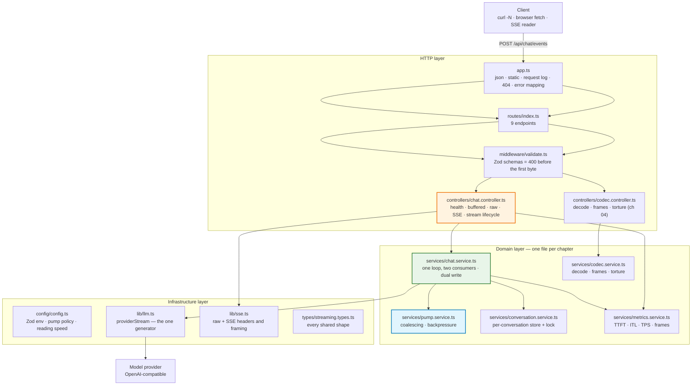
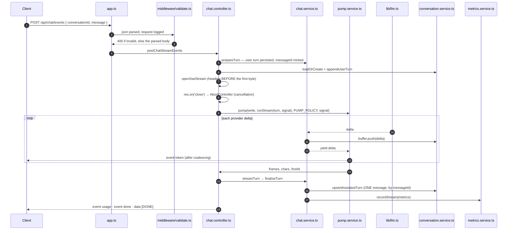

# Chapter 00: Overview, Architecture & File Structure

> **Chapter goal:** understand *what* this codebase is, *why* it is deliberately small, how one message
> travels through it, and which file belongs to which notes chapter — before reading a line of code.
> **Notes chapters covered:** all of 01–09 (this is the map).

---

## 0.1 What this codebase is

This is the **minimum working streaming service** that proves the Lecture 07 notes. It is the roadmap's
streaming microservice, reduced to the parts the notes actually explain:

- one **generation loop** and **three delivery shapes** (buffered, raw text, SSE);
- the **stream pump** — delta coalescing and socket backpressure;
- the **four granularities** made runnable: bytes, one streaming `TextDecoder`, frame reassembly with a
  leftover buffer, and the **fragmentation torture test**;
- the **dual-write pattern** — stream out, buffer in, persist exactly one assistant turn;
- **cancellation** that propagates upstream, plus **graceful shutdown**;
- the **metrics** that catch streaming regressions, including the server half of the TTFT gap.

| Rule followed | Why |
| :--- | :--- |
| One notes chapter → one file | You can read the code for chapter 04 without reading the routing layer |
| One generation loop, two consumers | Chapter 01 §01.5 says streaming is the same loop with `yield` instead of `append` — so the code must *show* that |
| Configuration validated once, at boot | A bad `.env` must not become a 3 a.m. incident |
| Every comment names its chapter and section | The code is *evidence* for the notes, not a second curriculum |
| Nothing is a black box | Every claim the notes make (the `₹` corruption, the leftover buffer, the TTFT gap, the aborted turn) is observable through an endpoint |

**What it is not:** no database, no auth server, no tool-calling loop, no vector store, no markdown
renderer, no benchmark harness. Those belong to other lectures. Here we answer only: *what does the model
produce, how does it travel, how do I not corrupt it, and how do I know it is still streaming?*

> **It runs with no API key.** With an empty `OPENAI_API_KEY` the service boots in **OFFLINE mode** and
> every endpoint still works against a deterministic stub — so every chapter is studyable with zero spend.
> Set a real key and the same code path calls the real provider; nothing else changes.

---

## 0.2 Architecture



**Read it against chapter 06 §06.2.** The controller owns the HTTP lifecycle (headers, flush, cancel,
close). The service owns the bridge between the two streams. The pump owns delivery policy. Nothing
accumulates except the per-request buffer, which is deliberately a side channel.

---

## 0.3 File structure

```text
Basic Code/
├── .env                       # PORT 8097, provider, pump policy, offline cadence
├── .env.example               # the same file with every comment kept
├── .gitignore                 # node_modules/ · dist/ · .env
├── package.json               # express · openai · zod · dotenv (+ tsx · typescript)
├── package-lock.json
├── tsconfig.json              # ES2022 · NodeNext · strict
├── public/
│   └── index.html             # ch 08 — the one browser client (getReader · TextDecoder · AbortController)
├── src/
│   ├── app.ts                 # express app: json · static · request log · 404 · error mapping
│   ├── server.ts              # listen · banner · graceful shutdown (ch 09 §09.7 item 21)
│   ├── config/
│   │   └── config.ts          # Zod env → frozen config + PUMP_POLICY + READING_TPS
│   ├── types/
│   │   └── streaming.types.ts # Role · StreamEvent · StreamMetrics · PersistedTurn · reports
│   ├── lib/
│   │   ├── llm.ts             # providerStream (the one generator) · estimateTokens · OFFLINE stub
│   │   └── sse.ts             # openRawTextStream · openSseStream · frameEvent · heartbeat · done · error
│   ├── middleware/
│   │   └── validate.ts        # 4 Zod schemas + validateBody
│   ├── routes/
│   │   └── index.ts           # the wiring table (ch 06 §06.2)
│   ├── controllers/
│   │   ├── chat.controller.ts # health · buffered · raw · SSE · conversation · metrics
│   │   └── codec.controller.ts# decode · frames · torture
│   └── services/
│       ├── chat.service.ts        # one loop, two consumers · dual write · metrics row
│       ├── pump.service.ts        # coalescing pump + writeWithBackpressure
│       ├── conversation.service.ts# store · lock · upsert by messageId
│       ├── codec.service.ts       # fragment · decode · frames · torture
│       └── metrics.service.ts     # ledger · percentiles · active streams
└── implementations guide/     # these chapters
```

---

## 0.4 Which file belongs to which notes chapter

| Notes chapter | Files |
| :--- | :--- |
| 01 · Generation & why streaming is natural | `lib/llm.ts` (whole file) · `config/config.ts` (offline cadence) |
| 02 · Generation vs delivery | `services/chat.service.ts` (`chatBuffered`) · `controllers/chat.controller.ts` (`postChatBuffered`) · `lib/sse.ts` (`openRawTextStream`) |
| 03 · Latency anatomy (TTFT/ITL/TPS) | `services/metrics.service.ts` (whole file) · `chat.service.ts` (`toMetrics`) · `public/index.html` (client TTFT + gap) |
| 04 · The four granularities | `services/codec.service.ts` (whole file) · `controllers/codec.controller.ts` · `public/index.html` (`absorb`) |
| 05 · HTTP streaming mechanics | `lib/sse.ts` (whole file) · `chat.controller.ts` (`driveStream`) |
| 06 · End-to-end & the 7 invariants | `chat.controller.ts` (`driveStream`, `INVARIANTS`) · `pump.service.ts` (`writeWithBackpressure`) · `routes/index.ts` |
| 07 · Backend: `call` vs `stream` | `services/chat.service.ts` (`runStream`, `streamTurn`) · `services/pump.service.ts` · `conversation.service.ts` (`withLock`) |
| 08 · Frontend: `fetch`/`ReadableStream` | `public/index.html` (whole file) · `codec.service.ts` (`clientConsume`) |
| 09 · History, persistence, hardening | `services/conversation.service.ts` (whole file) · `chat.service.ts` (`prepareTurn`/`finaliseTurn`/`interruptTurn`) · `server.ts` (graceful shutdown) · `metrics.service.ts` |

> **Why the guide order is not exactly the notes order.** These chapters follow the **code dependency
> order** — you cannot read `chat.service.ts` before `pump.service.ts`, because it calls it. The table above
> is the bridge: use it to jump from a notes chapter to the file that implements it.

---

## 0.5 The life of one message

`POST /api/chat/events` — the full path, in the order the code executes it:



The two "persist" steps are **not adjacent**: the user turn is written *before* generation (durability),
the assistant turn *after* it (it does not exist until then). That asymmetry is the design, not an
accident — chapter 09 §09.3.

---

## 0.6 Commands you will use in every chapter

```bash
npm install        # once
npm run typecheck  # after every file
npm run dev        # tsx watch — http://localhost:8097
npm run build && npm start   # the compiled path
```

Open <http://localhost:8097/> for the browser client (chapter 08), and use `curl -N` for the wire
(chapter 05 §05.6).

---

**Next:** [Chapter 01 — Project Setup & Environment](./01_Project_Setup_and_Environment.md)