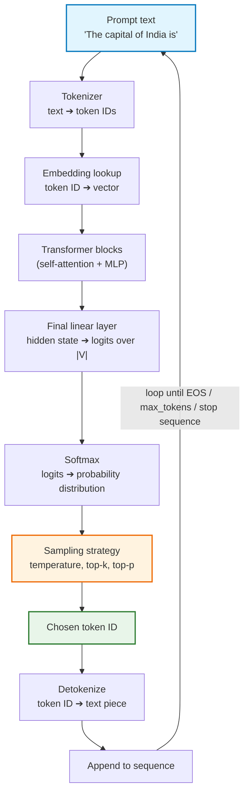
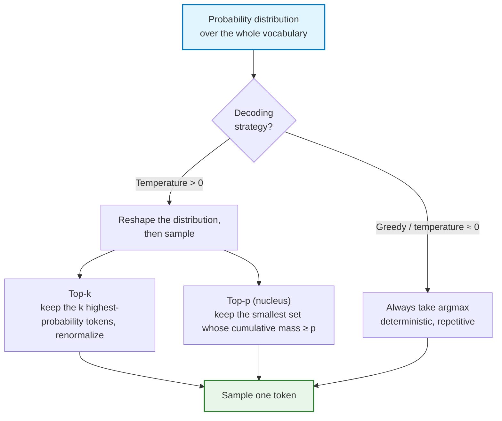
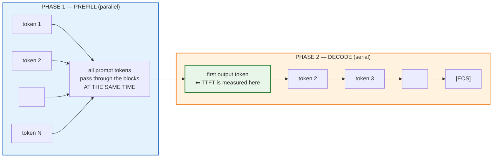
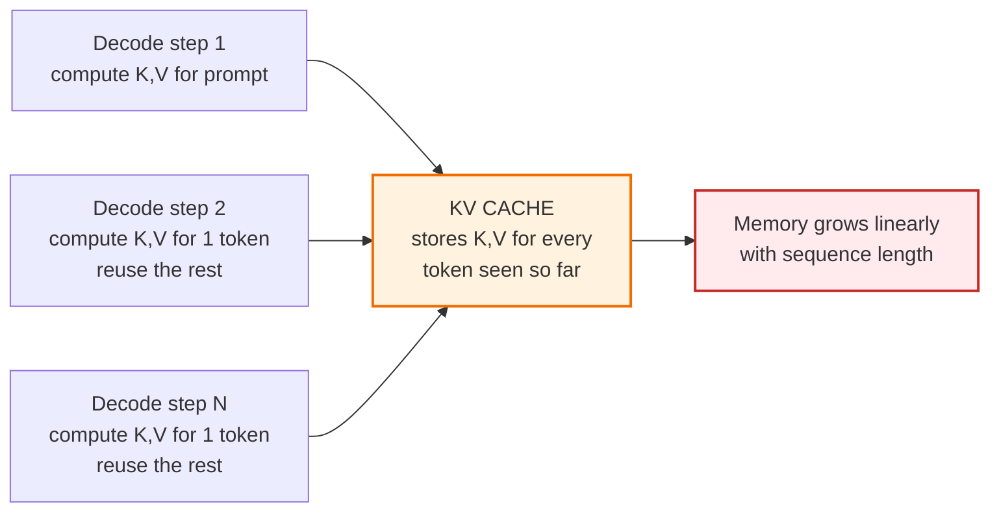
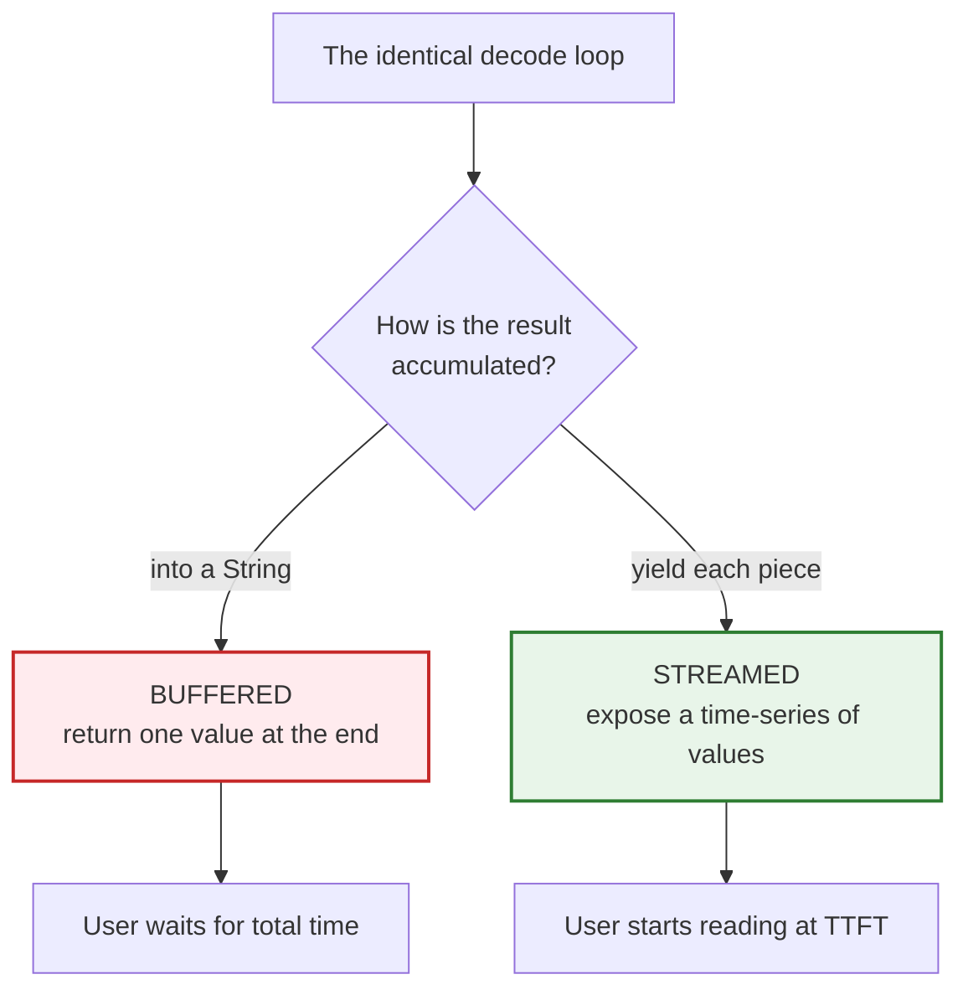
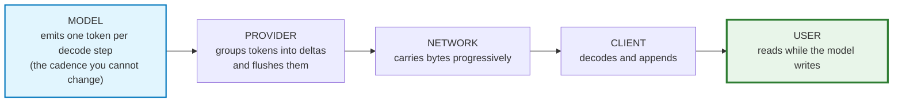

# Chapter 01 — How LLMs Generate Text: The Mechanical Root Cause of Streaming

> **Lecture 07 · Chapter 01 of 09** · Level: 🟡 Intermediate · Phase 2 — The Application Layer
> **Source:** `Forward-Deployed-Engineer/Lecture 06/notes/01_How_LLMs_Generate_Text.md` (slide deck §1)
> **Roadmap topics:** how LLMs generate text (recap) and why generation ≠ delivery.
> **Prerequisites:** Lecture 02 (LLM foundations, tokenization, embeddings) · Lecture 03 (attention &
> decoding, sampling) · Lecture 06 (stateless LLMs, context windows).

---

## 01.0 What this chapter is for

Every streaming bug you will ever debug is, at bottom, a misunderstanding about **what the model is
physically doing while you wait**. If you believe the model "computes an answer and then sends it", then
a buffered endpoint looks reasonable, a spinner looks inevitable, and `response.text()` looks harmless.

This chapter removes that belief. It re-derives, from first principles, the fact that an LLM produces
output as **a serial stream of small pieces**, and that this is not an implementation detail you can
engineer away — it is the shape of the computation itself.

> **The claim of this chapter:** streaming is not a UX feature bolted onto a language model. It is the
> *natural consequence* of how a language model computes. The application layer is what throws that
> natural cadence away.

By the end of this chapter you should be able to:

1. Explain why generation is **irreducibly sequential** during decode.
2. Walk one decoding step end to end: tokenize → forward pass → logits → softmax → sample → append.
3. Separate the two latency-governing phases: **prefill** (parallel, sets TTFT) and **decode** (serial,
   sets tokens/second).
4. Explain the **KV cache** and why longer conversations are slower and more expensive every turn.
5. Describe why sampling settings change *what* is generated while hardware changes *how fast*.
6. Show that streaming is the *same* loop with `yield` instead of `append`.

---

## 01.1 The experiment: "The capital of India is"

Send a model the single prompt:

```text
The capital of India is
```

An untrained intuition says the model looks the answer up and emits it whole:

```text
The capital of India is New Delhi.
```

That is **not** what happens. What happens is an iterative loop in which the model produces **one token
at a time**, appends it to the sequence, and runs the entire prediction machinery **again** for the next
token.

```text
The capital of India is
        ↓
   Predict next token
        ↓
       "New"

The capital of India is New
        ↓
   Predict next token
        ↓
      "Delhi"

The capital of India is New Delhi
        ↓
   Predict next token
        ↓
        "."

The capital of India is New Delhi.
```

So generation is intrinsically sequential:

```text
Token 1 → Token 2 → Token 3 → Token 4 → ... → [EOS]
```

> **The cardinal insight:** *A language model is a next-token predictor, not an answer generator.* It has
> no representation of "an answer" as a whole object. "The answer" is an emergent artifact of many tiny
> prediction steps chained together — and that is exactly why streaming is not a hack, but a natural
> consequence of how the model computes.

Notice what this already implies about delivery. At the moment the token `"New"` is sampled, **the model
has produced something a user could read**. Everything after that moment is application-layer choice: do
we show it now, or do we hold it until the sentence — or the whole answer — is finished?

---

## 01.2 The complete mental model of one decoding step

The one-line intuition expands into a full pipeline. Every arrow below is a place where a streaming
system can lose or corrupt data.



### 01.2.1 Step 1 — Tokenization

Text is split into **tokens** by a subword tokenizer (typically **BPE** — Byte Pair Encoding). Tokens are
frequently *not* words, and they very often carry their leading space:

```text
"The capital of India is"  ➔  ["The", " capital", " of", " India", " is"]
"Spring Boot is great"     ➔  ["Spring", " Boot", " is", " great"]
"tokenization"             ➔  ["token", "ization"]
"Streaming"                ➔  ["Stream", "ing"]     (or ["Streaming"], model-dependent)
```

Two properties matter for the rest of this lecture:

| Property | Consequence for streaming |
| :--- | :--- |
| Tokens are the **atomic unit of generation** | The model emits them one at a time |
| Tokens are **almost never the atomic unit of delivery** | A `"New"` and a `" Delhi"` arriving separately would look broken in a UI |

Providers therefore **coalesce** tokens into larger pieces before sending them. That coalescing is the
subject of **Chapter 04** — and it is why you must never build UI logic on token boundaries.

### 01.2.2 Step 2 — The forward pass and logits

The token IDs index into an **embedding table**, producing a vector per token. Those vectors flow through
the transformer blocks (self-attention mixing information across positions, then an MLP per position).
After the final block, one position — the last one — is projected to a vector of **logits**, one raw score
per entry in the vocabulary:

```text
hidden state  ➔  logits:  [ 2.1, -4.7, 0.3, ..., 8.9, ... ]
                            ↑                 ↑
                          "cat"            "New"   ← highest score here
```

A raw logit is not a probability. It is an unbounded score. Only **softmax** turns it into a
distribution:

$$P(t_i) = \frac{e^{z_i / T}}{\sum_j e^{z_j / T}}$$

where $T$ is the temperature. The full distribution has one entry per vocabulary item — typically
**32k–200k numbers** — computed for *every single token you will ever receive*.

### 01.2.3 Step 3 — Sampling

The distribution is now a menu. The **sampling strategy** decides how to pick from it:



| Knob | What it does | Effect |
| :--- | :--- | :--- |
| `temperature` | Divides the logits before softmax | Low → sharp, safe, repetitive. High → flat, creative, incoherent |
| `top_k` | Truncates to the $k$ most likely tokens | Removes the long tail of nonsense |
| `top_p` | Truncates to the smallest nucleus with cumulative probability ≥ $p$ | Adaptive width; the modern default |
| `stop` / `max_tokens` | Termination conditions | Bound cost and latency |

> **Keep two axes separate.** Sampling settings change **what** is generated. Hardware, batching and load
> change **how fast**. A "the model got slower" complaint is never fixed by changing temperature.

### 01.2.4 Step 4 — Detokenize, append, repeat

The sampled token ID is mapped back to its text piece, appended to the sequence, and the loop repeats
with the *extended* sequence as input. The loop terminates on one of three conditions:

| Condition | Meaning | Consequence for the client |
| :--- | :--- | :--- |
| `[EOS]` token | The model chose to stop | A complete answer (`finish_reason: "stop"`) |
| `max_tokens` reached | The application's cap was hit | A **truncated** answer (`finish_reason: "length"`) |
| `stop` sequence matched | A configured string appeared | A deliberately terminated answer |

> **Engineering note:** the client must distinguish "complete" from "cut off". A streamed answer that
> simply stops is indistinguishable from a network hiccup unless you carry `finish_reason` through to the
> UI. This is why a well-designed stream ends with an explicit terminal frame, not just silence.

---

## 01.3 The two phases that govern latency: prefill and decode

A single request to an LLM splits into **two mechanically different phases**. Almost every streaming
latency question is answered by knowing which phase you are in.



| | Prefill | Decode |
| :--- | :--- | :--- |
| Input | The **entire prompt** at once | One new token per step |
| Parallelism | **Fully parallel** across prompt positions | **Strictly serial** — token $n+1$ needs token $n$ |
| Hardware bound | **Compute-bound** (large matrix multiplies, high GPU utilisation) | **Memory-bandwidth-bound** (tiny matrix ops, moving the KV cache dominates) |
| Output | The first token | All remaining tokens |
| Scales with | **Prompt length** | **Output length** |
| Governs | **TTFT** | **Tokens per second (TPS)** |
| Streaming helps? | No — you cannot show a token before it exists | Yes — it is the only phase that produces user-visible progress |

The prefill/decode asymmetry explains a paradox that confuses engineers for years: **GPU utilisation
drops while generation is running**. Prefill saturates the arithmetic units; decode spends most of its
time waiting on memory. That is why a single request can feel slow while the GPU reports 20% utilisation
— and why batching (many users' decodes together) is the primary throughput lever on the provider side.

> **Why this matters to you:** a long prompt makes TTFT worse *and* is invisible in the streaming UI. The
> user sees a blank bubble for 2 seconds and blames "the network". It is prefill, and the fix is a smaller
> prompt (**Chapters 03 and 09**), not a faster transport.

---

## 01.4 The KV cache — the hidden tax on conversation length

Attention compares every token with every other token. Naively, step $n$ of decode would recompute the
key/value projections for all $n-1$ previous tokens. The **KV cache** stores those projections so each
decode step only computes the new token's contribution.



The memory cost is roughly:

$$M_{\text{KV}} \approx 2 \times L_{\text{layers}} \times H_{\text{heads}} \times d_{\text{head}} \times N_{\text{tokens}} \times b_{\text{bytes}}$$

For a 32-layer model with 32 heads of dimension 128 in fp16, that is about **0.5 MB per token per
sequence** — so a 4,000-token conversation occupies ~2 GB of KV cache. Multiply by concurrent users.

| Consequence | Why | What you can do |
| :--- | :--- | :--- |
| **TTFT grows with history** | The prompt — including all prior turns — must be prefilled | Prune or summarise history (**Chapter 09**) |
| **Throughput falls in long chats** | Less cache memory → smaller batches → lower TPS | Shorter contexts; provider prefix caching |
| **Cost grows super-linearly** | History tokens are re-billed on **every** turn | A token budget, enforced before dispatch |
| **Interleaved state can be corrupted** | Two concurrent streams writing one cache/session | Per-conversation isolation and locking (**Chapter 07**) |

> **Prefix caching** is the important mitigation: providers cache the KV entries for a *stable* prompt
> prefix (system prompt + few-shot examples) and reuse them across requests. Keeping the prefix
> byte-identical — same wording, same order, same tools — turns a large chunk of prefill into a cache hit.

---

## 01.5 The same loop, two delivery shapes

This is the single most useful idea in the chapter. Here is the loop written as buffered generation, and
then as streaming generation. The **only** difference is one keyword.

```typescript
// PSEUDOCODE — buffered ("call") generation
async function generateBuffered(prompt: string): Promise<string> {
  const sequence = tokenize(prompt);
  let text = "";

  while (sequence.length < config.maxTokens) {
    const logits = forwardPass(sequence);
    const next = sample(softmax(logits, config.temperature), config.topP, config.topK);

    if (next === EOS_TOKEN) break;

    sequence.push(next);
    text += detokenize([next]);   // ⬅ ACCUMULATE — the user sees nothing yet
  }

  return text;                    // ⬅ one value, at the end
}
```

```typescript
// PSEUDOCODE — streaming ("stream") generation
async function* generateStream(prompt: string) {
  const sequence = tokenize(prompt);

  while (sequence.length < config.maxTokens) {
    const logits = forwardPass(sequence);
    const next = sample(softmax(logits, config.temperature), config.topP, config.topK);

    if (next === EOS_TOKEN) return;

    sequence.push(next);
    yield detokenize([next]);     // ⬅ EMIT IMMEDIATELY — same loop, same math
  }
}
```

> **The one-line truth:** *streaming is not a different generation algorithm; it is the same
> autoregressive loop with the accumulator replaced by an async iterator.* This is why every streaming API
> in existence — `stream: true`, `Flux<String>`, `ReadableStream`, `AsyncIterator`, `IAsyncEnumerable` —
> ultimately exposes the same shape: **zero, one, or many values over time.**



This is also the correct mental model for the **backend** (Chapter 07): changing a service's return type
from `string` to a stream type is what changes the *architecture*, not the method name.

---

## 01.6 What the model actually optimises (and what it does not)

The model is trained on next-token cross-entropy:

$$\mathcal{L} = -\frac{1}{N}\sum_{n=1}^{N} \log P(w_n \mid w_{<n})$$

It learns **statistical continuation** — not truth, not intent, and not formatting guarantees. Three
consequences land directly on streaming systems:

| Learned property | Streaming-relevant consequence |
| :--- | :--- |
| Local fluency is optimised at every step | The **first** token can be confidently wrong — you stream wrongness smoothly |
| No global planning objective exists | The model may revise direction mid-stream; early chunks may be contradicted later |
| Formatting is a *tendency*, not a guarantee | You cannot naively `JSON.parse` partial content (**Chapters 04 and 08**) |

This is the deep reason streaming is a **product-risk amplifier**: a buffered answer can be validated
before display; a streamed answer is displayed *while it is still being written*, and the user forms an
opinion from the first 10% of it. If the first 10% is wrong, the perceived quality collapses even if the
final text is correct.

> **Design consequence:** if an output must be *validated* before it is shown (JSON, SQL, a security
> decision), do not stream it raw. Either stream **progress** while validating at the end, or do not
> stream that endpoint at all. See the hybrid pattern in **Chapter 02**.

---

## 01.7 Where streaming comes from, in one picture



Read it as a chain of custody. The model's cadence is fixed. Every layer after it is an **application
decision**, and any one of those layers can convert the stream back into a buffer:

- the provider may batch aggressively (fewer, larger deltas),
- your backend may `await` the whole response,
- a proxy may buffer the body,
- the browser may call `response.text()`.

**Chapter 06** formalises this as the *seven pipeline invariants*: the rule that streaming is a property of
the whole path, not of one flag.

---

## 01.8 Common mistakes

| # | Mistake | Reality |
| :--- | :--- | :--- |
| 1 | "The model computes the full answer, then sends it." | It computes **one token**, appends it, then recomputes. |
| 2 | "Streaming makes the model faster." | Total time is essentially unchanged; **perceived** latency collapses. |
| 3 | "One token in equals one token out of the API." | Providers coalesce tokens into arbitrary chunks. |
| 4 | "A longer prompt only affects cost." | It also raises TTFT, because prefill is proportional to prompt length. |
| 5 | "Streaming means the model remembers the stream." | The **model** is stateless; continuity is reconstructed by your app each turn. |
| 6 | "With `temperature = 0` I get byte-identical output forever." | False in practice: batching, kernel nondeterminism and provider version changes introduce variance. |
| 7 | "If the GPU is idle, the model is fast." | Decode is memory-bandwidth-bound; low utilisation is normal and expected. |
| 8 | "A chunk boundary means something." | Boundaries are an implementation detail of the provider, the network and your decoder. |
| 9 | "I can parse JSON as it streams." | Partial text is invalid syntax by construction. |
| 10 | "Cancelling the request is a UI concern." | Cancellation stops token billing only if it propagates upstream (**Chapter 06**). |

---

## 01.9 Key takeaways

1. **LLMs are next-token predictors.** Generation is a loop, not a lookup, and the loop is *irreducibly
   sequential* during decode.
2. **One step = tokenize → forward pass → logits → softmax → sample → append → repeat.** Every iteration
   produces a small piece — the raw material of streaming.
3. **Two phases govern latency:** parallel **prefill** (sets TTFT, scales with input length) and serial
   **decode** (sets tokens/second, scales with output length).
4. **Prefill is compute-bound; decode is memory-bandwidth-bound.** This is why GPU utilisation falls while
   generation is running, and why batching is the provider's throughput lever.
5. **The KV cache is the hidden tax on conversation length** — longer history means more memory, lower
   throughput, worse TTFT, and a bigger bill every turn.
6. **Streaming is the same algorithm with `yield` instead of `append`.** No new model capability is
   involved; the change lives in the delivery layer.
7. **Sampling settings change *what* is generated; hardware and load change *how fast*.** Keep the axes
   separate when diagnosing.
8. **The model optimises plausibility per token, not truth per answer** — so a stream of locally fluent
   tokens can still be globally wrong, and streaming exposes that wrongness earlier.
9. **Boundaries of a piece are an implementation detail**, never a contract your UI should depend on.
10. **You cannot speed up generation from the application layer — but you can stop hiding it.** That is the
    entire thesis of this lecture.

---

**Next:** [Chapter 02 — Generation vs Delivery: Non-Streaming and Streaming Responses](./02_Generation_vs_Delivery_Non_Streaming_and_Streaming_Responses.md)
