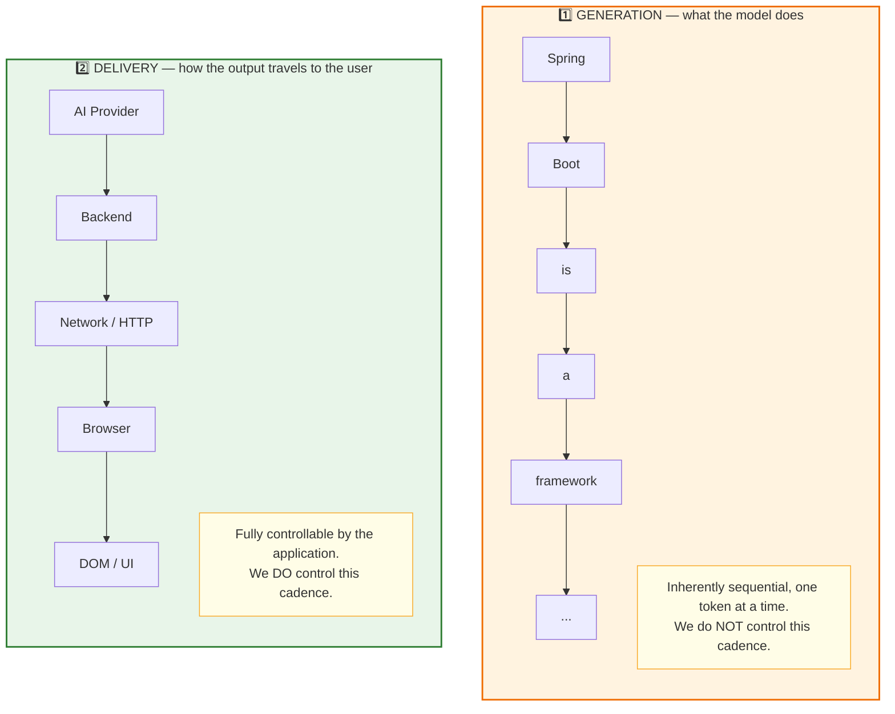
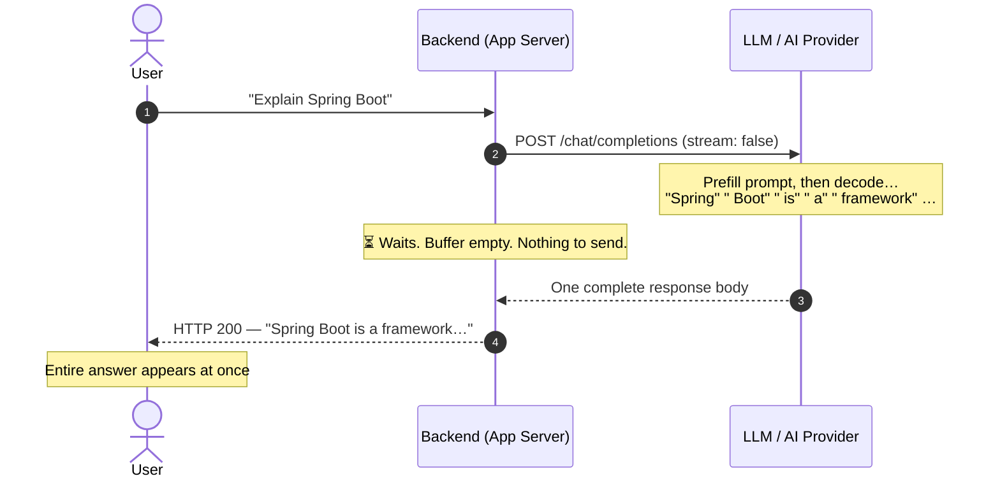
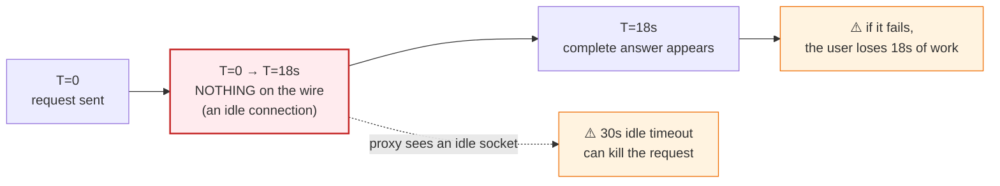
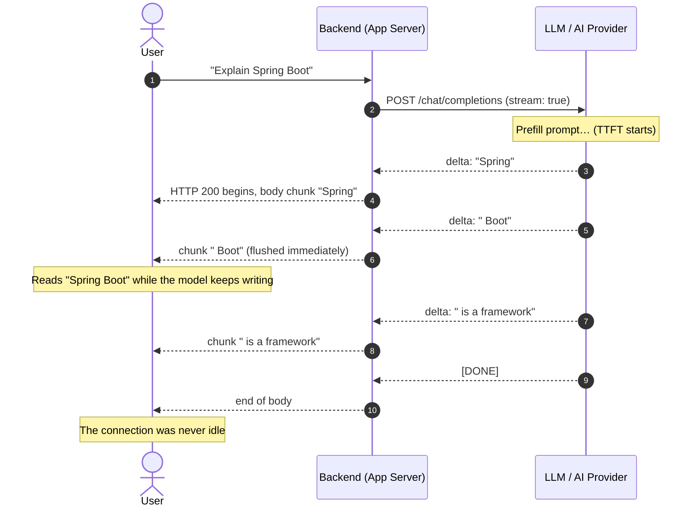
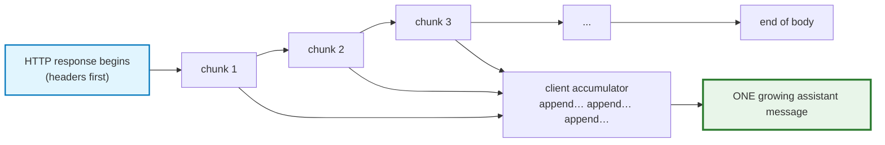
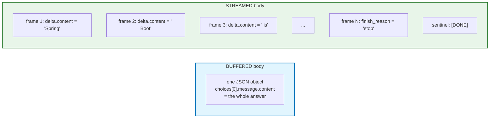
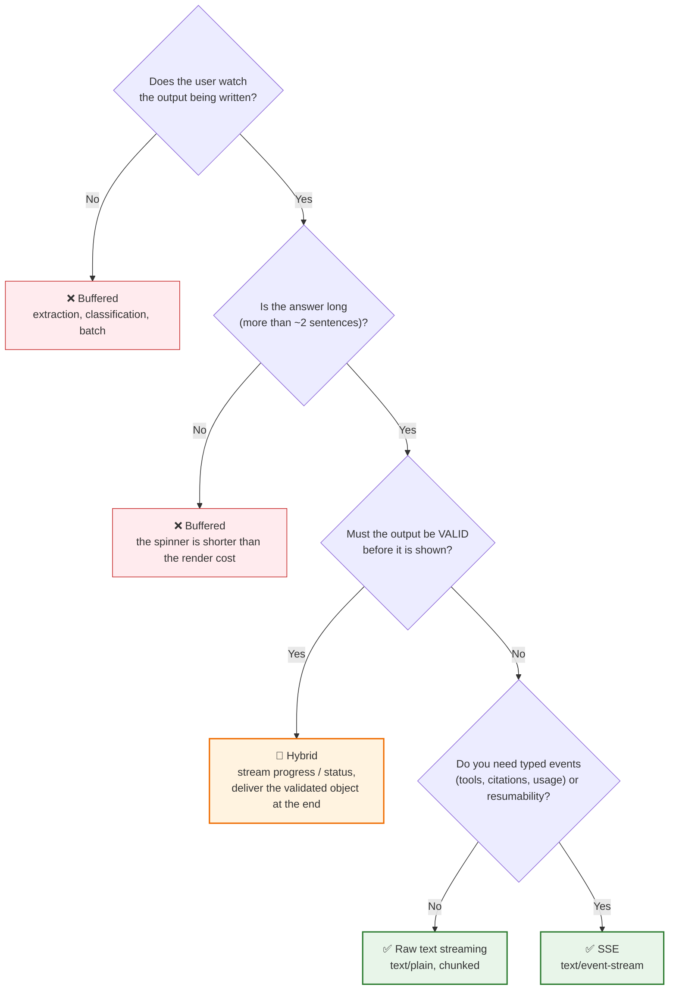
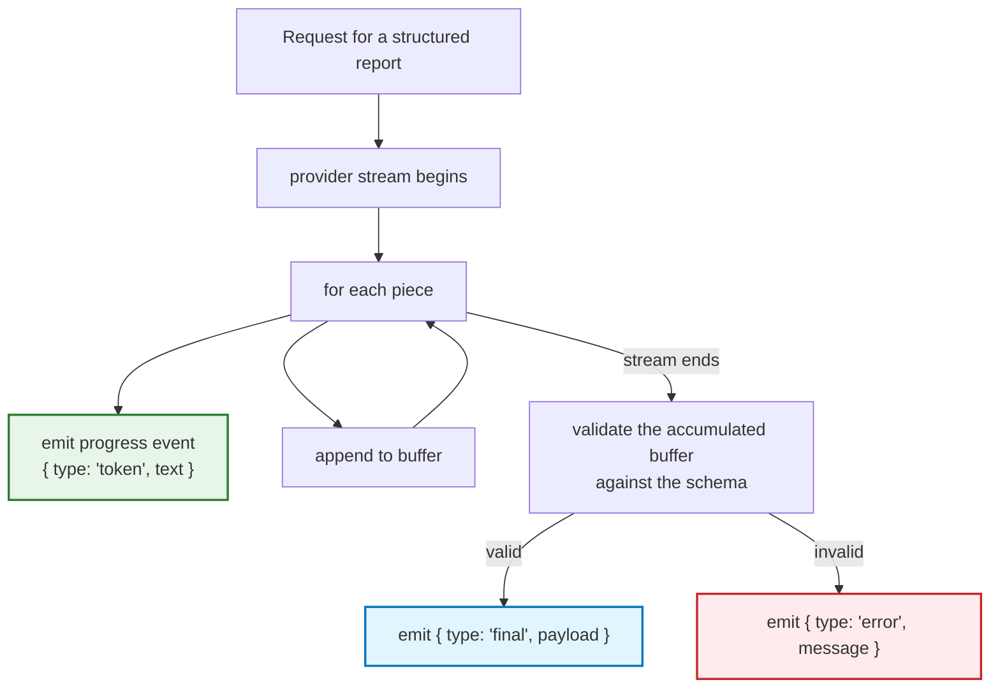
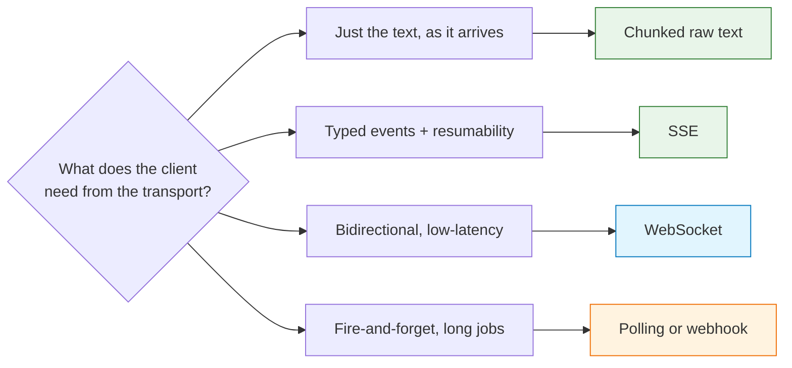
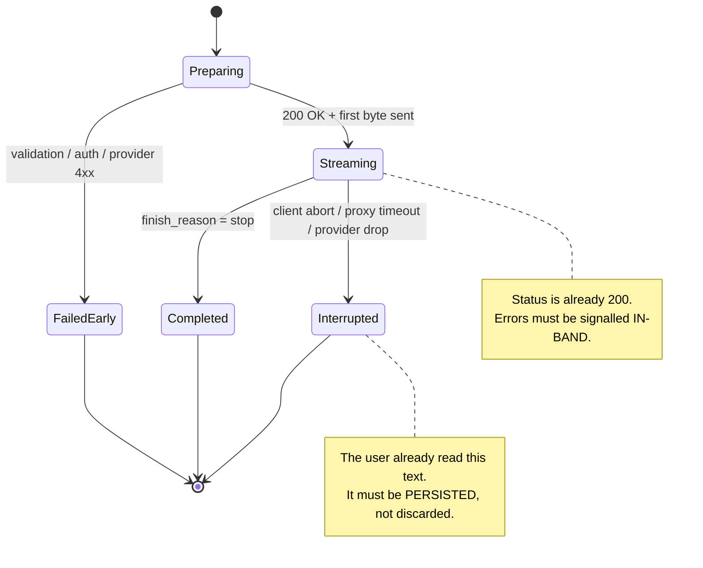

# Chapter 02 — Generation vs Delivery: Non-Streaming and Streaming Responses

> **Lecture 07 · Chapter 02 of 09** · Level: 🟡 Intermediate · Phase 2 — The Application Layer
> **Source:** `Forward-Deployed-Engineer/Lecture 06/notes/02_Generation_vs_Delivery_Non_Streaming_and_Streaming_Responses.md`
> (slides §2, §3, §4)
> **Roadmap topics:** non-streaming vs streaming responses; why generation ≠ delivery.
> **Prerequisites:** Chapter 01 (autoregressive decoding, prefill/decode).

---

## 02.0 What this chapter is for

Chapter 01 established that the model already produces output progressively. This chapter draws the
boundary that the whole lecture depends on: **generation and delivery are two separate processes**, and
only one of them is yours to change.

Once you internalise that boundary, a large class of arguments disappears. "Can we make streaming
faster?" becomes a precise question with a precise answer: *no, but we can stop delaying it*. And "should
we stream this endpoint?" becomes an engineering decision with criteria, not a matter of taste.

By the end of this chapter you should be able to:

1. Separate the **generation** path (not yours) from the **delivery** path (entirely yours).
2. Describe the buffered response lifecycle and name its three hidden costs.
3. Describe the streaming response lifecycle and how the client assembles the answer.
4. Compare the two at the **wire level** (`message` vs `delta` frames, the `[DONE]` sentinel).
5. Apply a **decision framework** to choose buffered vs streamed vs hybrid — including when *not* to
   stream.
6. Name the six delivery paths and pick deliberately between them.

---

## 02.1 Two independent processes

The source material states it plainly: **two independent processes are happening in an AI application.**



> **The most important sentence in this lecture:** *Streaming mainly changes how generated output is
> **delivered** to the user. It does not fundamentally change the autoregressive way in which the model
> **generates** text.*

### Why this separation matters architecturally

| Layer | Who controls it | Can we make it faster? | Can we make it *visible* faster? |
| :--- | :--- | :--- | :--- |
| Model decode rate | Provider (GPU, batching, model size) | Only by model choice / tier upgrade | No |
| Provider → Backend transport | Provider + SDK + your network | Partially (region, connection reuse) | Yes — consume chunks as they arrive |
| Backend processing | **You** | Yes (avoid re-buffering) | Yes — forward immediately |
| Backend → Browser transport | **You** (+ proxies/CDN) | Yes (disable proxy buffering) | Yes — flush per chunk |
| Browser rendering | **You** | Yes (batched DOM writes) | Yes — incremental append |

**The lesson:** every fix available to a Forward Deployed Engineer lives in the **delivery** column.
Trying to fix streaming by "making the model faster" is attacking the wrong layer.

> **Diagnostic rule of thumb:** if a user says "the AI is slow", first ask **which** number they mean —
> the time until the first visible character (a delivery problem you own) or the time until the answer is
> complete (largely a generation property you can only influence). Confusing the two produces
> infrastructure work that changes nothing the user notices. See **Chapter 03**.

---

## 02.2 The non-streaming (buffered) response lifecycle

A conventional AI request looks like this:



The model *still* generates `Spring → Boot → is → a → framework` internally. The difference is that the
**backend deliberately discards the intermediate structure** and waits for the final concatenation.

### The three hidden costs

| Cost | Mechanism | Who feels it |
| :--- | :--- | :--- |
| **Perceived latency** | The user stares at a spinner for the whole generation time | The user — the primary product cost |
| **Idle-connection risk** | Nothing is written to the socket while generating, so proxies and load balancers see an idle connection and may kill it at 30 s / 60 s | The user, as a hard failure |
| **All-or-nothing delivery** | A drop at second 17 loses everything; the user must retry from scratch | The user, and your token budget (you paid twice) |



> **The misconception to kill here:** the buffered path is *not* "the case where no chunks exist". Chunks
> existed the whole time — inside the SDK, inside your process, inside the HTTP client. The buffered path
> is the case where **someone chose to accumulate them**. Chapter 06 turns this into a checklist of
> suspects.

---

## 02.3 The streaming response lifecycle

The streaming version changes only the delivery decisions:



The client's job is **progressive assembly**: it maintains one growing string and appends each decoded
piece to it. Two properties follow directly:

- **The connection is never idle** for longer than the inter-chunk gap, so proxy idle timeouts are far
  less likely to fire.
- **Failure is graceful**: if the stream breaks at second 17, the user keeps the 17 seconds of text they
  already read.



### The perceived-latency arithmetic

Take a 600-token answer with a 500 ms TTFT and a 30 ms inter-token latency:

$$T_{\text{total}} = 500\ \text{ms} + 600 \times 30\ \text{ms} = 18.5\ \text{s}$$

| Mode | Time until the user sees something | Time until the answer is complete |
| :--- | :--- | :--- |
| Buffered | **18.5 s** | 18.5 s |
| Streamed | **0.5 s** | 18.5 s |

**The total is identical. The experience is not.** That single row is the entire business case for
streaming, and it is worth being able to quote from memory in a design review.

---

## 02.4 The wire-level comparison

Both modes hit the *same* endpoint family and the *same* model. What changes is the **shape of the
response body** and therefore what the client must do with it.

### Non-streaming response (one `message` object)

```json
{
  "id": "chatcmpl-9f2",
  "choices": [
    { "index": 0, "message": { "role": "assistant", "content": "Spring Boot is a framework…" },
      "finish_reason": "stop" }
  ],
  "usage": { "prompt_tokens": 210, "completion_tokens": 64 }
}
```

### Streaming response (a sequence of `delta` frames)

```text
data: {"choices":[{"delta":{"role":"assistant","content":""}}]}

data: {"choices":[{"delta":{"content":"Spring"}}]}

data: {"choices":[{"delta":{"content":" Boot"}}]}

data: {"choices":[{"delta":{"content":" is"}}]}

data: {"choices":[{"delta":{},"finish_reason":"stop"}]}

data: {"usage":{"prompt_tokens":210,"completion_tokens":64}}

data: [DONE]
```



| Aspect | Non-streaming | Streaming |
| :--- | :--- | :--- |
| Body shape | One object | A sequence of frames |
| Content field | `message.content` | `delta.content` (often `""` on the first frame) |
| Termination | Implicit (body ends) | Explicit (`finish_reason`, then a `[DONE]` sentinel) |
| Usage tokens | Always present | Often only in a final frame — or absent entirely |
| Client work | `response.json()` | Frame reassembly + accumulation |
| Error signalling | HTTP status | HTTP status **only before the first byte** |

> **Two traps worth memorising.** (1) The first streamed frame often carries an **empty** `content` — it is
> the role declaration. A client that treats "first frame" as "first text" creates an empty bubble. (2)
> The `[DONE]` sentinel is **not** text: appending it to the UI is a classic beginner bug that prints
> literal `data: [DONE]` in the chat.

---

## 02.5 The endpoint decision framework

Streaming is not universally better. It buys perceived responsiveness at the cost of client complexity,
partial-failure semantics and observability work. Choose deliberately.



| Endpoint type | Stream? | Why |
| :--- | :--- | :--- |
| Conversational chat | **Yes** | The user reads while it writes; this is the canonical case |
| Long-form drafting / report generation | **Yes** | Completion is expected to be slow; early text builds trust |
| Code generation | **Yes** | The user can start reading the code immediately |
| Structured extraction → JSON | **No** (or hybrid) | Partial JSON is invalid; validate before display |
| Classification / routing / tagging | **No** | The output is tiny; the render cost exceeds the wait |
| Batch enrichment / nightly jobs | **No** | Throughput matters, TTFT is irrelevant |
| Anything with a strict output contract | **No** (or hybrid) | A consumer must never see an unvalidated object |
| Agentic pipelines with tool calls | **Yes** (SSE) | Progress, tool events and errors are user-visible value |

> **A useful way to state the criterion:** stream when the *content itself* is the user interface. Buffer
> when the content is an *input to something else* — a parser, a database write, a downstream service.

---

## 02.6 The hybrid pattern: stream progress, deliver a validated object

The most useful pattern for structured outputs is neither pure buffering nor pure streaming. It separates
**two different kinds of value** that the same response produces:

- **UX value** — "something is happening, here is what it is doing" (available immediately)
- **Contract value** — "here is the final, validated object" (only available at the end)



```typescript
// PSEUDOCODE — hybrid: progress now, contract at the end
async function* structuredReport(query: string, docs: Doc[]) {
  let buffer = "";

  for await (const piece of llmStream({ query, docs })) {
    buffer += piece;
    yield { type: "token", text: piece };          // UX value immediately
  }

  const parsed = safeParseReport(buffer);
  if (!parsed.ok) yield { type: "error", message: "Invalid model output" };
  else            yield { type: "final", payload: parsed.value };  // contract value
}
```

This gives the best of both worlds: **early perceived progress** for the human, and **late, atomic,
validated data** for the system. It is also the natural bridge to **Lecture 10 (Structured Outputs)** and
**Lecture 08 (Tool Calling)**, where streams carry typed events rather than plain text.

---

## 02.7 The delivery-path taxonomy

"Streaming" is not one thing. These are the distinct delivery paths you can choose between, and they are
frequently confused.

| Mode | Shape | Boundaries visible to client? | Typical use |
| :--- | :--- | :--- | :--- |
| **Buffered JSON** | One body | N/A | Extraction, classification, batch |
| **Chunked raw text** | Bytes over time | Yes (raw) | Simplest chat streaming (Chapter 05) |
| **SSE (`text/event-stream`)** | Named, framed events | Yes (framed) | Chat + tool/status events; resumable |
| **WebSocket** | Bidirectional frames | Yes | Voice, collaboration, multi-agent control |
| **Progress polling** | Repeated GETs | No (poll interval) | Legacy systems, very long jobs |
| **Webhook callback** | Server pushes later | No | Async batch pipelines |



> **Naming trap:** in the source material the simplest approach for a chat endpoint is **raw text
> streaming** (`text/plain`) — *not* SSE. Streaming and SSE are different concepts:
> `Streaming = data arrives progressively` versus `SSE = one particular protocol/format for delivering
> events`. Always be explicit about which one you mean in design docs and PR reviews. **Chapter 05**
> develops this distinction properly.

---

## 02.8 Streaming changes failure semantics

This is the part of streaming that architecture diagrams never show. In a buffered world there are two
outcomes: success, or an error. In a streamed world there is a third, and it is the most common one:



| Failure | When | How it must be handled |
| :--- | :--- | :--- |
| Bad request, auth, rate limit | Before the first byte | Normal HTTP status + JSON error body |
| Provider timeout / 5xx | Before the first token | Server-side retry with jitter, then HTTP error |
| Provider drops mid-answer | After the first token | In-band `error` event + persist the partial text |
| Proxy idle timeout | Mid-stream | Heartbeats + raised timeout; client may resume (SSE `Last-Event-ID`) |
| User presses Stop | Any time | Abort the upstream stream, keep the partial text, flag it as stopped |

> **The rule that follows from this:** never send `200 OK` until you are certain the *response shape* is
> valid. Validate the request, authorise it, and confirm the provider accepted the call **before** you
> flush headers. Everything after the first byte must be signalled in-band. **Chapter 07** designs that
> in-band protocol.

---

## 02.9 Common mistakes

| # | Mistake | Consequence | Fix |
| :--- | :--- | :--- | :--- |
| 1 | Believing streaming makes the model faster | Wrong optimization target | Optimize delivery + TTFT, not decode rate |
| 2 | Streaming internally but buffering at the edge | Zero UX improvement | Verify every hop (Chapter 06) |
| 3 | Appending raw SSE frames (incl. `data:` / `[DONE]`) to the UI | Garbage text in the chat bubble | Parse frames; strip the sentinel |
| 4 | Using streaming for strict-JSON contracts | Broken parser mid-stream | Stream tokens, validate only at the end |
| 5 | Forgetting the non-streaming path entirely | Batch clients pay 3× latency | Offer both modes behind one service |
| 6 | Treating partial output as authoritative | Users act on an incomplete answer | Mark a "still generating" state in the UI |
| 7 | Building the bubble on the first *frame* rather than the first *text* | Empty or ghost assistant bubbles | Create lazily on first non-empty text |
| 8 | Assuming usage tokens always arrive in stream mode | Billing and context dashboards go blank | Estimate with a tokenizer; reconcile later |
| 9 | Retrying mid-stream | Duplicated text in the answer | Retry only **before** the first token |
| 10 | Assuming the buffered path "has no chunks" | Misdiagnosis; you look in the wrong layer | Chunks always exist — find who accumulated them |

---

## 02.10 Key takeaways

1. **Generation and delivery are separate processes.** You cannot make the model decode faster; you *can*
   stop hiding its output.
2. **The non-streaming path is not "no chunks exist"** — it is "someone chose to throw the chunks away and
   wait."
3. **Streaming preserves the natural time-structure of generation**: the user reads while the model writes.
4. **Total generation time is roughly constant; perceived latency collapses.** That is the entire value
   proposition — and the entire business case.
5. **Streaming changes failure semantics** — partial answers arrive before errors do. Design for
   "partial + error", not just "success".
6. **Streaming is not free:** it costs persistence complexity, transport tuning, observability work and
   client complexity.
7. **Raw text streaming vs. SSE are different tools.** Choose deliberately, and say which one you mean.
8. **Use a decision framework, not fashion.** Short outputs and strict contracts are often better served
   by buffered responses — optionally with streamed *progress* events.
9. **The hybrid pattern is the answer for structured output:** stream progress, deliver a validated object.
10. **Never send `200 OK` before the response shape is certain** — after the first byte, everything must be
    signalled in-band.

---

**Previous:** [Chapter 01 — How LLMs Generate Text](./01_How_LLMs_Generate_Text.md) ·
**Next:** [Chapter 03 — Latency Anatomy: TTFT, ITL & Perceived Performance](./03_Latency_Anatomy_TTFT_ITL_and_Perceived_Performance.md)