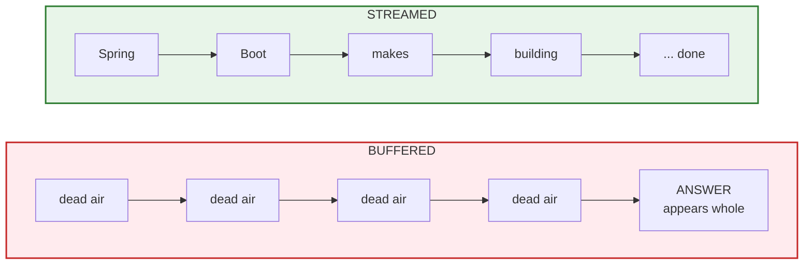
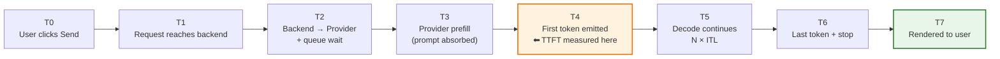
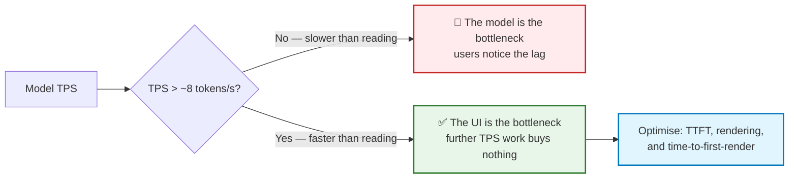
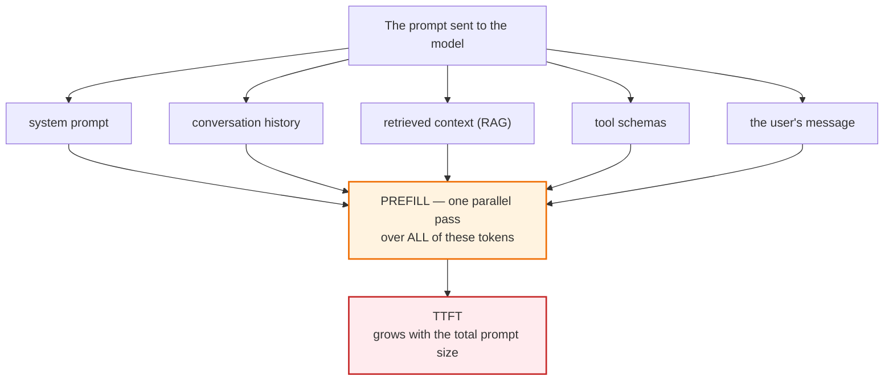
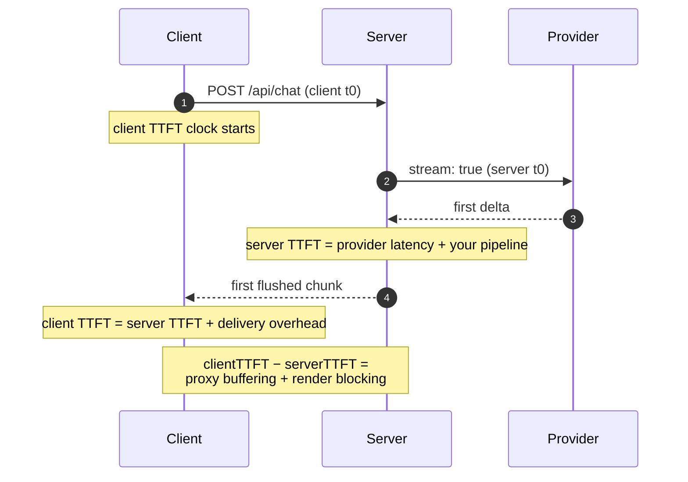
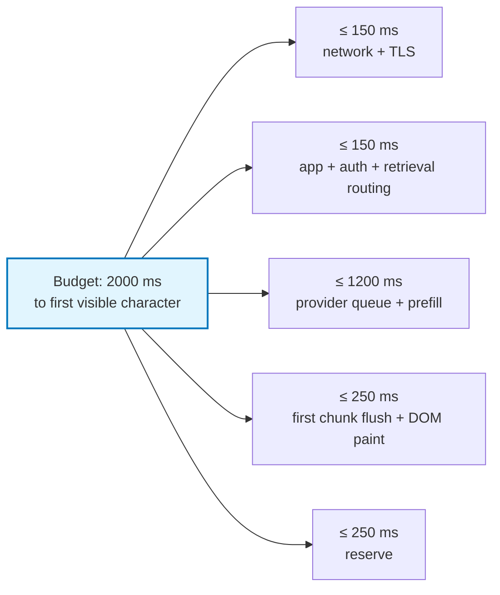

# Chapter 03 — Latency Anatomy: TTFT, ITL & Perceived Performance

> **Lecture 07 · Chapter 03 of 09** · Level: 🟡 Intermediate · Phase 2 — The Application Layer
> **Source:** `Forward-Deployed-Engineer/Lecture 06/notes/03_Latency_Anatomy_TTFT_ITL_and_Perceived_Performance.md`
> (slides §5, §6)
> **Roadmap topics:** latency anatomy — **TTFT**, ITL, perceived performance.
> **Prerequisites:** Chapter 01 (prefill vs decode, KV cache) · Chapter 02 (generation ≠ delivery).

---

## 03.0 What this chapter is for

"Streaming feels faster" is a slogan. This chapter turns it into arithmetic. It replaces a vague user
complaint ("the AI is slow") with a decomposition you can measure, attribute to a specific hop, and
assign to an owner.

The output of this chapter is a **latency budget**: a table of millisecond allowances for a
customer-facing assistant, plus the small set of metrics that prove the budget is being met in production.

By the end of this chapter you should be able to:

1. Distinguish **TTFT** (perceived responsiveness) from **total generation time** (task completion).
2. Decompose end-to-end latency into network, queue, prefill, decode and tail components.
3. Define ITL, TPS and TPOT, and explain why throughput only matters up to reading speed.
4. Explain why **prompt engineering is latency engineering** — every prompt token is a TTFT tax.
5. Instrument a stream per hop and state the observability rule that makes aggregates useless.
6. Write a defensible latency budget and a TTFT SLA for a product tier.

---

## 03.1 The eight-second example

One concrete timeline is enough to separate the two numbers that everyone conflates:

```text
0 sec      User clicks Send
1 sec      First output arrives
2 sec      More output
3 sec      More output
...
8 sec      Complete answer
```

Two different measurements hide in that timeline:

| Metric | Value here | Definition | What it controls |
| :--- | :--- | :--- | :--- |
| **Time to First Token (TTFT)** | ≈ 1 second | Delay from request to the first visible piece of output | *Perceived responsiveness* — "is this thing alive?" |
| **Total Generation Time** | ≈ 8 seconds | Delay from request to the final token | *Task completion* — how long until the user can act |

### Visual contrast

Without streaming — one long dead period, then everything:

```text
|──────────────── 8 sec ────────────────|
                                        ANSWER
```

With streaming — output begins at second 1 and grows continuously:

```text
|--1 sec--| Spring
                   Boot
                       makes
                            building
                                    ...
                                     COMPLETE at 8 sec
```



> **The key sentence from the source:** *The total generation time may remain similar, but the perceived
> latency is dramatically lower. That is one of the major reasons streaming is so useful for conversational
> interfaces.*

**Why the perception is not an illusion.** The user is not idle while the text arrives — they are *reading
it*. If tokens arrive at or above reading speed, the experienced wait is essentially TTFT plus the time to
read the answer, which they were going to spend anyway. Buffering serialises generation and reading;
streaming overlaps them.

---

## 03.2 The full latency decomposition

Real systems have far more than two components. The honest budget is:



Formally:

$$T_{\text{TTFT}} = T_{\text{network up}} + T_{\text{queue}} + T_{\text{prefill}} + T_{\text{first step}}$$

$$T_{\text{total}} = T_{\text{TTFT}} + (N_{\text{out}} - 1)\cdot T_{\text{ITL}} + T_{\text{tail}}$$

### Component-by-component engineering table

| Component | Typical culprit | Can streaming help? | Mitigations |
| :--- | :--- | :--- | :--- |
| `T_network up` | Geolocation, TLS setup, cold connections | No | Edge termination, connection reuse, HTTP/2 |
| `T_queue` | Provider rate limits, GPU saturation | No | Higher tier, provisioned throughput, retry with jitter |
| `T_prefill` | Long prompt: system + history + RAG + tools | No | Shrink prompt, prompt caching, prune history, cut tool schemas |
| `T_first step` | Kernel warm-up, cold cache, first-batch scheduling | No | Keep connections warm; avoid cold starts |
| `N_out × T_ITL` | Output length × per-token decode cost | No | `max_tokens`, terser prompts, smaller/faster model |
| `T_tail` | Stop detection, final frame, DB write, UI paint | **Partly** | Never block the stream on the DB write |
| `T_delivery` (yours) | Proxy buffering, `response.text()`, render jank | **Yes** | Disable buffering, incremental reads, rAF rendering |

> **The engineering insight:** streaming does not touch a single one of the "No" rows. It attacks
> `T_delivery` and the *perception* of the "No" rows — by making the wait **legible** instead of blank.
> That is why the first move in a latency investigation is to measure the gap between the provider's TTFT
> and the client's TTFT. **Chapter 09** makes that gap the single most valuable production alert.

---

## 03.3 TTFT, ITL, TPS and TPOT — and the reading-speed threshold

| Term | Definition | Units | Sensitive to |
| :--- | :--- | :--- | :--- |
| **TTFT** | Request → first visible token | ms | Prompt length (prefill), queue, network |
| **ITL** | Gap between successive pieces | ms | Model size, batch size, hardware, load |
| **TPOT** | Time per output token (≈ ITL) | ms/token | Same as ITL |
| **TPS** | Output tokens per second $= 1000 / \text{ITL}$ | tokens/s | Same as ITL |
| **Total** | TTFT + (N−1)×ITL + tail | ms | Everything |

### The threshold nobody optimises for

Human reading speed is roughly **6–8 tokens per second** (about 200–250 words per minute). Anything
faster than that and the user is waiting for *themselves*, not for the model.



> **A very common waste of money:** paying for a faster tier to improve TPS when TPS already exceeds
> reading speed. The correct next investment is TTFT (prompt discipline, prompt caching, model tier) and
> client-side render performance — not raw throughput.

**Corollary for chunk coalescing.** Because the UI cannot consume faster than a human reads, there is no
product benefit in forwarding every single token as a separate network write. Coalescing deltas into
slightly larger frames (for example, flush on a ~30–50 ms timer or a byte threshold) reduces per-frame
overhead with no perceptible difference. This is a *delivery* optimisation, and it is one of the reasons
"one token per HTTP chunk" is a myth (**Chapter 04**).

---

## 03.4 Every prompt token is a latency tax

Prefill is **proportional to prompt length** (Chapter 01). That single fact makes prompt engineering a
latency discipline, not just a quality discipline.



### The turn-20 problem

The naive chat architecture resends the entire history every turn (Lecture 06). The prompt therefore
grows linearly, and TTFT grows with it. Two compounding effects:

| Effect | Mechanism | Symptom |
| :--- | :--- | :--- |
| **Prompt grows** | Turn *N* resends *N*−1 prior turns | Turn 20 is visibly slower than turn 2 |
| **KV cache grows** | Longer sequences need more cache memory → smaller batches at the provider | TPS also degrades, not just TTFT |

> **This is why "the model got worse/slower" is usually an application bug.** The model did not change —
> your prompt doubled. Track **prompt tokens per turn** as a first-class metric, and alert on its trend,
> not just its value.

### The four levers, cheapest first

| Lever | Extra cost | Effect on TTFT | Notes |
| :--- | :--- | :--- | :--- |
| **Prompt prefix caching** | Provider feature | Large | Keep the prefix byte-identical so it hits the cache |
| **Sliding window over history** | None | Good | Keep the system prompt pinned + the last *N* turns |
| **Prune tool schemas** | None (capability loss) | Good | Every tool description is prompt tokens on **every** call |
| **Retrieval selectivity** | Engineering effort | Good | Retrieve 3 chunks, not 30 — relevance beats volume |

---

## 03.5 Instrumentation: the numbers you must log

A single "request took 7.4 s" number is diagnostically useless. You need per-hop timing, and the timing
must be attached to the **stream**, not the request object.

```typescript
// PSEUDOCODE — per-hop timing around a streaming call
async function* timedStream(prompt: string) {
  const t0 = performance.now();
  let ttftMs: number | null = null;
  let tokens = 0;
  let chars = 0;

  for await (const piece of providerStream(prompt)) {
    if (ttftMs === null) ttftMs = performance.now() - t0;   // ⬅ the metric that matters
    tokens += 1;
    chars += piece.length;
    yield piece;
  }

  const totalMs = performance.now() - t0;
  return {
    ttftMs,
    totalMs,
    itlMs: tokens > 1 ? (totalMs - (ttftMs ?? 0)) / (tokens - 1) : null,
    tps: (tokens / (totalMs - (ttftMs ?? 0))) * 1000,
    charsPerToken: chars / Math.max(tokens, 1),   // validates your chunk assumptions
  };
}
```

> **Observability rule:** never log only "request took 7.4s". Log **TTFT, ITL, TPS, prompt tokens,
> completion tokens.** A single total-latency number cannot tell you whether to fix the prompt, the model
> tier, the network, or the UI.

### Measure at both ends

The most valuable measurement in a streaming system is a **difference**, not a value:



| Metric | Where measured | What it isolates |
| :--- | :--- | :--- |
| **Server TTFT** | Backend, request → first provider delta | Provider + queue + prefill + your pre-processing |
| **Client TTFT** | Browser, click → first painted character | **What the user actually feels** |
| **The gap** | `clientTTFT − serverTTFT` | Buffering, compression, transport and render cost |

If the gap is small, latency work belongs in the prompt or the model tier. If the gap is large, the problem
is in your own delivery path — and no model upgrade will fix it.

---

## 03.6 Latency budgets: setting an SLA for a chat product

A defensible budget for a customer-facing assistant:



| Tier | TTFT target | Rationale |
| :--- | :--- | :--- |
| Interactive chat (consumer) | < 1.0 s | Must feel conversational |
| Internal enterprise assistant | < 2.0 s | Users tolerate a slight pause |
| Batch / nightly enrichment | not applicable | Throughput matters, not TTFT |
| Long-form document drafting | < 2.5 s | Start writing early; completion is expected to be slow |

| Budget component | Owner | Failure mode if exceeded |
| :--- | :--- | :--- |
| Network + TLS | Platform / infra | Users blame the product |
| App, auth, retrieval routing | Backend team | "The AI is slow" — but it is your middleware |
| Provider queue + prefill | Backend + provider tier | Pay for a better tier, or shrink the prompt |
| First chunk flush + DOM paint | **Frontend** | Backend dashboards look perfect; users see nothing |

> **Write the budget down and name an owner per hop.** Unowned milliseconds are where products die — and
> in a streaming system they are *invisible* unless you measure the client-side TTFT as well as the
> server-side one.

---

## 03.7 Common mistakes

| # | Mistake | Consequence | Fix |
| :--- | :--- | :--- | :--- |
| 1 | Conflating TTFT with total time | You "fix" latency by shrinking answers, not by streaming | Measure both, separately |
| 2 | Measuring TTFT at the UI but not at the backend | You blame the model for a proxy buffer delay | Instrument every hop |
| 3 | Ignoring prompt growth | Slow turn-20 responses blamed on "model quality" | Track prompt tokens per turn |
| 4 | Optimising TPS when TPS already exceeds reading speed | Zero UX gain for real cost | Benchmark TPS vs. perceived quality first |
| 5 | Assuming streaming fixes prefill | The first token still waits for the entire prompt | Shrink context, enable prompt caching |
| 6 | No latency budget in the design doc | Unbounded regressions ship silently | Write the budget table before writing code |
| 7 | Treating the model tier as the only lever | Expensive, and often the wrong layer | Check the client−server TTFT gap first |
| 8 | Instrumenting the request but not the stream | You cannot see inter-token stalls at all | Time the iterator, per piece |
| 9 | Blocking the stream on the DB write | `T_tail` grows by hundreds of milliseconds | Buffer, persist after the last token |
| 10 | Reporting only averages | Streaming regressions live in the p95 tail | Alert on p95, not on the mean |

---

## 03.8 Key takeaways

1. **Two metrics, two purposes:** TTFT governs *perceived responsiveness*; total generation time governs
   *task completion*.
2. **Streaming attacks TTFT and perceived latency, not total time.** Total wall-clock time is essentially
   unchanged.
3. **Every prompt token is a latency tax on TTFT** — input processing always precedes the first output
   token, and prefill is proportional to prompt length.
4. **Model throughput (TPS/TPOT) is only relevant up to human reading speed (~6–8 tokens/s).** Beyond that,
   the UI is the bottleneck and further throughput spend buys nothing.
5. **Latency is a pipeline sum**, not a single number —
   `T_network + T_queue + T_prefill + T_first + N × ITL + T_tail + T_delivery`.
6. **Instrument TTFT, ITL, TPS, prompt tokens and completion tokens** — one aggregate number is
   diagnostically useless.
7. **Measure TTFT at both ends; the difference is the diagnostic.** A large `clientTTFT − serverTTFT` gap
   means the problem is in your own delivery path.
8. **Longer conversations degrade TTFT and ITL together** because both the prompt and the KV cache grow.
9. **Coalescing deltas slightly costs nothing perceptible** and reduces per-frame overhead — a free
   delivery optimisation.
10. **Write the latency budget down** and assign each hop an owner; unowned milliseconds are where products
    die.

---

**Previous:** [Chapter 02 — Generation vs Delivery](./02_Generation_vs_Delivery_Non_Streaming_and_Streaming_Responses.md) ·
**Next:** [Chapter 04 — Token, Provider Chunk, Network Chunk & Byte](./04_Token_Chunk_Network_and_Byte_Granularity.md)