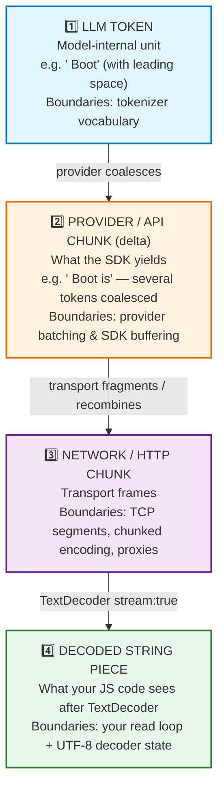
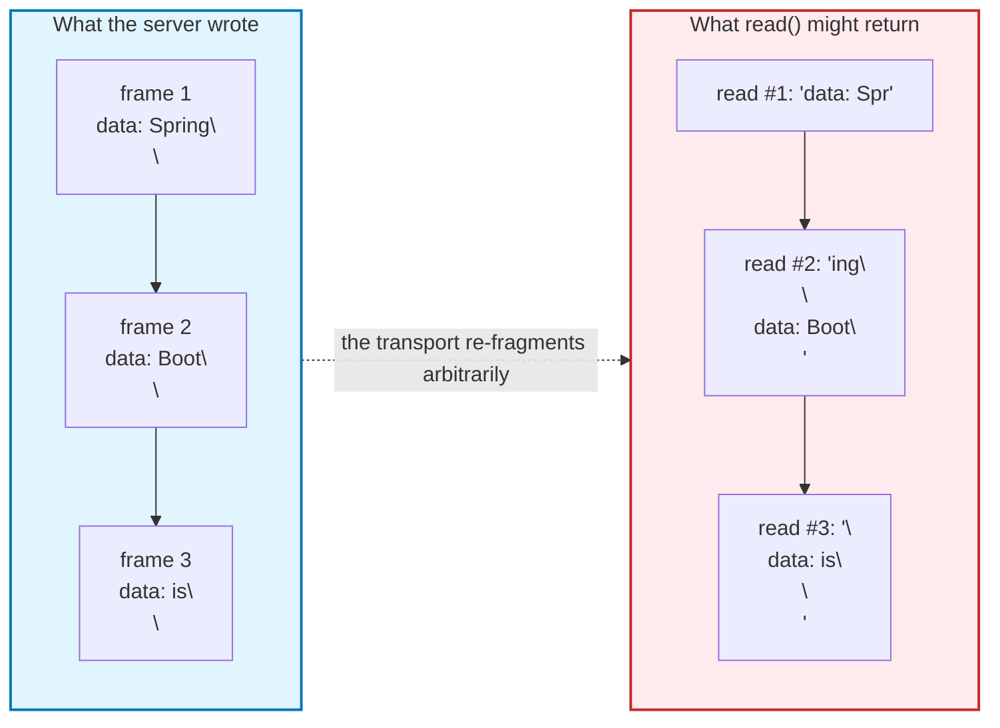
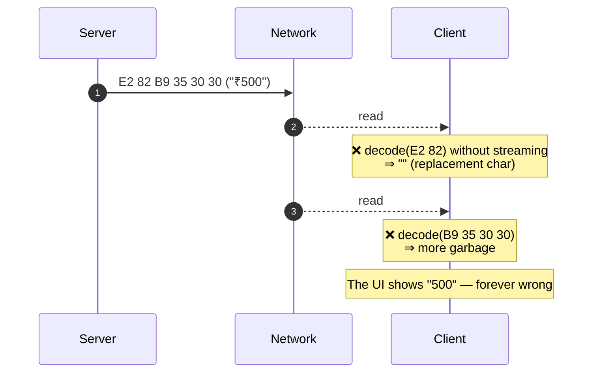
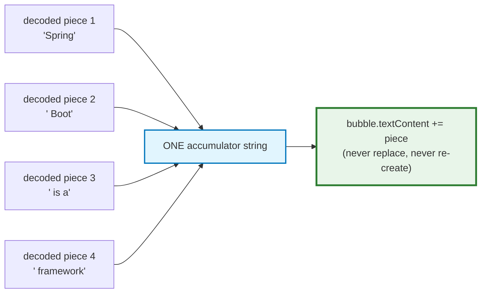
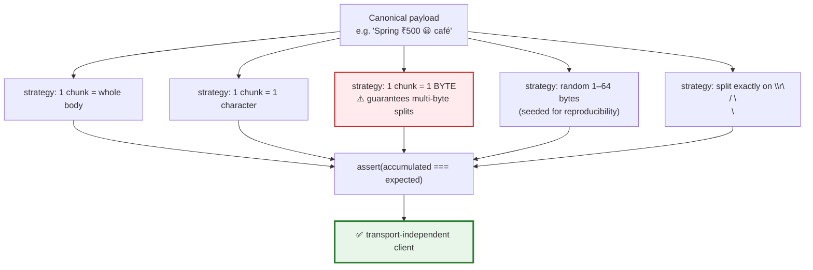

# Chapter 04 — Token, Provider Chunk, Network Chunk & Byte: Four Layers of Granularity

> **Lecture 07 · Chapter 04 of 09** · Level: 🟡 Intermediate · Phase 2 — The Application Layer
> **Source:** `Forward-Deployed-Engineer/Lecture 06/notes/04_Token_Chunk_Network_and_Byte_Granularity.md`
> (slides §7, §35)
> **Roadmap topics:** token vs chunk vs network-packet vs byte granularity; UTF-8 handling.
> **Prerequisites:** Chapter 01 (tokens are the unit of generation) · Chapter 03 (delivery latency).

---

## 04.0 What this chapter is for

This chapter eliminates the single most common source of streaming bugs: **conflating four different units
that all look like "a small piece of text."** Almost every "weird character in the chat", "text got
duplicated", "only the last word appeared" and "the markdown is broken" bug is a granularity bug.

The discipline this chapter installs is simple to state and hard to internalise: **never build logic on a
boundary that no layer guarantees.**

By the end of this chapter you should be able to:

1. Name the four granularities and say what controls each one's boundaries.
2. Explain why a provider delta may contain several tokens and a network chunk may contain part of a delta.
3. Explain how a UTF-8 multi-byte character can be split across two reads — and why one streaming decoder
   fixes it.
4. Write the *only* correct client contract: blind accumulation.
5. Describe the **fragmentation torture test** and the `charsPerChunk` diagnostic metric.

---

## 04.1 The four layers



The formal statement, straight from the source:

```text
LLM Token  ≠  API Provider Chunk  ≠  HTTP / Network Chunk  ≠  reader.read() Result
```

> **There is no guarantee that the same chunk boundaries remain intact through every layer.**

Each layer has a *different* reason for its boundaries, and none of them is under your control:

| Layer | Boundary decided by | Stable? |
| :--- | :--- | :--- |
| LLM token | The model's tokenizer vocabulary | Fixed per model, but opaque to you |
| Provider delta | The provider's batching/flush policy | **No** — changes with load and version |
| Network chunk | TCP segmentation, chunked encoding, proxies, compression | **No** — changes with MTU, proxy config, timing |
| Decoded piece | Your read loop + decoder internal state | **No** — depends on when bytes happen to arrive |

---

## 04.2 Layer 1 → Layer 2: tokens are coalesced into deltas

The model may internally generate:

```text
T1 = "Spring"
T2 = " Boot"
T3 = " is"
T4 = " great"
```

The provider might expose them as:

```text
"Spring"
" Boot"
" is great"
```

Three observable consequences:

| Observation | Why it happens | Design rule |
| :--- | :--- | :--- |
| Some chunks contain multiple tokens | The provider batches decode steps before flushing (reduces per-frame overhead) | Never count chunks to count tokens |
| Some chunks may split a token's printed form | Byte-level BPE can emit partial UTF-8 sequences | Always decode with a *streaming* decoder |
| Timing is irregular | GPU scheduling and continuous batching | Never animate based on an assumed token cadence |

> **Correction of a very common beginner belief:** "streaming gives me tokens one at a time." It does not.
> **Streaming gives you whatever the provider chooses to flush, whenever it chooses to flush it.** A
> streamed piece might contain `"Spring"`, or `"Spring Boot"`, or `"Spring Boot makes"`. The exact grouping
> depends on the provider, the framework, the networking layer, buffering, and the protocol.

**Why this matters for billing.** If your cost dashboard counts chunks and calls them tokens, it is wrong
by a factor that varies per request. Token counts come from the provider's `usage` object or from a real
tokenizer — never from counting frames.

---

## 04.3 Layer 2 → Layer 3: transport fragmentation (the classic frontend bug)

Developers routinely assume `reader.read()` returns one API delta. It does not, for two independent
reasons.

### Reason A — TCP/HTTP is a byte stream, not a message stream

HTTP does not deliver "messages". It delivers **ordered bytes**. A single `read()` may return:

- **part** of one SSE frame,
- **exactly** one frame,
- **several** frames concatenated,
- or, at the very end, everything that was buffered.



> **The consequence:** any code that parses frames must keep a **leftover buffer**. Splitting each read on
> `\n\n` and discarding the tail silently drops or duplicates text. This is one of the two bugs that
> appear in nearly every hand-written streaming client.

### Reason B — the last chunk is not special

`read()` does not align with anything semantic. There is no "final full frame" guarantee: the last read
may contain the tail of a frame and nothing else. Only `done: true` tells you the stream is finished.

### The failure taxonomy at this layer

| Symptom | Root cause |
| :--- | :--- |
| Text appears duplicated | The leftover tail was re-processed on the next read |
| Text silently disappears | The leftover tail was discarded |
| Markdown/code fences break intermittently | Frames were consumed out of alignment |
| JSON parse errors that only happen in production | Partial frame parsed as a complete one |
| Works locally, fails behind a proxy | The proxy changed the fragmentation pattern |

---

## 04.4 Layer 3 → Layer 4: the UTF-8 multi-byte split

This is the single most instructive failure in the whole lecture, because it cannot be fixed by clever
string handling — only by a stateful decoder.

HTTP transfers **bytes**, not characters. In UTF-8, a character occupies 1 to 4 bytes:

| Character | UTF-8 bytes | Length |
| :--- | :--- | :--- |
| `A` | `41` | 1 byte |
| `é` | `C3 A9` | 2 bytes |
| `₹` | `E2 82 B9` | 3 bytes |
| `😀` | `F0 9F 98 80` | 4 bytes |

Now suppose the answer contains the price `₹500` and the network happens to split **inside** the rupee
sign:

```text
Server writes:   ₹     5     0     0
UTF-8 bytes:     E2 82 B9  35  30  30

Network delivers:
  read #1:  E2 82        ← an incomplete 3-byte sequence!
  read #2:  B9 35 30 30
```



### Why the naive fixes all fail

| Attempted fix | Why it fails |
| :--- | :--- |
| `new TextDecoder()` inside the loop | The decoder is stateless between calls, so it cannot hold the partial sequence |
| `String.fromCharCode(...value)` | Treats bytes as Latin-1 code points; corrupts every non-ASCII character |
| Appending `Uint8Array` with `+=` | Type-coerces to a string of comma-separated numbers |
| Retrying the read | The bytes are already consumed; they cannot be re-fetched |
| Detecting `` and repairing later | Information is already destroyed |

### The correct contract

**One** `TextDecoder` per response, created **outside** the loop, called with `{ stream: true }`, and
**flushed** after the loop ends.

```typescript
// PSEUDOCODE — the only correct byte-to-text contract
const reader  = response.body.getReader();
const decoder = new TextDecoder("utf-8");     // ⬅ created ONCE, outside the loop

while (true) {
  const { value, done } = await reader.read();
  if (done) break;

  // value is a Uint8Array. stream:true tells the decoder to BUFFER any
  // incomplete multi-byte sequence internally until the next read completes it.
  const text = decoder.decode(value, { stream: true });
  if (text) appendToBubble(text);
}

// Flush anything the decoder is still holding (a trailing incomplete sequence
// that the server legitimately ended with).
const tail = decoder.decode();
if (tail) appendToBubble(tail);
```

> **Why `{ stream: true }` is non-negotiable:** it is the flag that converts the decoder from a
> *stateless per-call* converter into a *stateful stream* converter. Without it, a split multi-byte
> character is unrecoverable. With it, the split is invisible.

> **Forgetting the final `decoder.decode()` flush** is the subtler bug: the *last* multi-byte character of
> an answer can be silently dropped, and it will only reproduce for certain languages and certain
> network timings — which is exactly why it survives testing and ships.

---

## 04.5 The only safe UI contract: blind accumulation

Because no layer guarantees a boundary, the UI must not care about boundaries at all.

> **The correct client contract:** *whenever more text becomes available, append it to the current
> assistant message.*



| ❌ Never do this | ✅ Do this instead |
| :--- | :--- |
| Assume a chunk ends at a word boundary | Append the raw piece |
| Assume a chunk is a sentence | Append the raw piece |
| Assume a chunk is a token | Append the raw piece |
| Re-create the bubble per chunk | Create once (lazily), then append |
| `textContent = chunk` (replace) | `textContent += chunk` (append) |
| Split on `\n` and style per line mid-stream | Accumulate raw; render a projection on top |

> **Rendering is a layer *above* the accumulator, never entangled with framing.** The raw accumulated
> string is the source of truth; markdown/HTML is a projection of it, regenerated at a bounded rate
> (**Chapter 08**).

### If you *do* need frame parsing (SSE/JSON), keep a leftover buffer

```typescript
// PSEUDOCODE — frame reassembly with a leftover buffer (never split-and-discard)
let leftover = "";

function onBytes(text: string) {
  leftover += text;                       // ⬅ carry the partial frame forward

  const frames = leftover.split("\n\n");  // SSE frames are \n\n delimited
  leftover = frames.pop() ?? "";          // ⬅ keep the trailing incomplete frame

  for (const frame of frames) {
    if (!frame.trim()) continue;
    if (frame === "data: [DONE]") return finish();
    const payload = frame.replace(/^data:\s*/, "");
    appendToBubble(JSON.parse(payload).choices?.[0]?.delta?.content ?? "");
  }
}
```

The two invariants of this function are worth memorising: **accumulate before splitting**, and **retain
the tail**. Everything else about frame parsing is detail.

---

## 04.6 Testing: the fragmentation torture test

Fragmentation is not a theoretical hazard — it is **testable**, deterministically. Feed the same payload
in artificially hostile fragment sizes and assert that the final text is byte-identical.



```typescript
// PSEUDOCODE — the fragmentation torture test
const PAYLOAD = "Spring ₹500 😀 café — naïve";

for (const strategy of [
  wholeBody, oneChar, oneByte, randomSizes(seed = 42), newlineAligned,
]) {
  const state = freshState();
  for (const piece of strategy.fragments(PAYLOAD)) {
    onTextPiece(state, piece);              // the client's real ingestion path
  }
  assert(state.text === PAYLOAD, `Failed with ${strategy.name}`);
}
```

> **This one test catches the three most common client defects at once:** (1) a `TextDecoder` instantiated
> per chunk, (2) frame parsing without a leftover buffer, and (3) UI code that replaces `textContent`
> instead of appending. **If a streaming client passes the one-byte-at-a-time case, it is
> transport-independent.**

### A useful production metric: `charsPerChunk`

Because chunk sizes vary wildly, tracking the distribution of decoded piece lengths is diagnostic — and
it detects hidden buffering that no other metric reveals:

| Observation | Likely meaning |
| :--- | :--- |
| `charsPerChunk` ≈ 1–3 | Provider streaming at fine granularity (or `TextDecoder` splitting per byte) |
| `charsPerChunk` ≈ 5–40 | Normal token/small-bundle cadence |
| `charsPerChunk` in the hundreds every ~1 s | **Someone is buffering and flushing periodically** |
| One chunk, then `done` | Streaming is broken somewhere in the pipeline (Chapter 06) |

That third row is the highest-value one: a healthy stream has a *narrow* distribution of small pieces. A
bimodal or "one giant chunk" distribution is a smoking gun for a buffering hop — often a proxy, a
compression middleware, or a client that reintroduced `response.text()`.

---

## 04.7 Common mistakes

| # | Pitfall | Consequence | Fix |
| :--- | :--- | :--- | :--- |
| 1 | Assuming one chunk = one token | Token counters and rate meters are wrong | Count tokens via usage APIs, not chunks |
| 2 | Creating a `TextDecoder` inside the loop | Corrupted multi-byte characters (``) | One decoder per response + `stream: true` |
| 3 | Appending `value` as if it were a string (`+=` on `Uint8Array`) | Silent garbage / type coercion bugs | Decode *before* concatenating |
| 4 | Splitting a buffer on `\n\n` and discarding the remainder | Dropped or duplicated text | Keep the leftover tail in a buffer |
| 5 | Assuming a chunk ends at a word/sentence boundary | Broken markdown, mid-word syntax errors | Layer rendering on top of blind accumulation |
| 6 | Assuming chunk size is stable for animation timing | Janky typewriter effects | Animate on the *rendered* text, not on arrivals |
| 7 | Forgetting the final `decoder.decode()` flush | The last multi-byte character of the answer is lost | Add the flush call after the loop |
| 8 | Treating `done: true` as "we received text" | Empty bubble on an empty/errored stream | Handle `done` before touching the DOM |
| 9 | Testing only with ASCII payloads | Multi-byte bugs ship to production | Torture test with `₹`, `😀`, `café`, CJK |
| 10 | Assuming HTTP/2 preserves HTTP/1.1 chunk framing | A parser written against the wrong layer | Treat `fetch`/`ReadableStream` as the framing boundary |
| 11 | Trusting that the provider keeps delta sizes stable | Regression after a provider SDK upgrade | Assert on accumulated text, not on chunk shapes |
| 12 | Parsing JSON per chunk | Parse errors on every partial object | Buffer, parse once at the end (Chapter 08) |

---

## 04.8 Key takeaways

1. **Four granularities exist:** LLM token ⇒ provider delta ⇒ network chunk ⇒ decoded string piece. **None
   of their boundaries is stable** across layers.
2. **One provider delta may contain several tokens; one network chunk may contain part of a delta.** Never
   build logic on the assumption of a 1:1 mapping.
3. **Bytes, not characters, travel the wire.** UTF-8 characters are 1–4 bytes, so a read can split a
   character — and the damage is irreversible without a stateful decoder.
4. **Use ONE `TextDecoder` with `{ stream: true }` per response**, created outside the loop, and **flush
   it at the end**.
5. **The only correct client contract is blind accumulation**: append whatever text arrives to the current
   assistant message.
6. **Frame parsing requires a leftover buffer** — accumulate before splitting, retain the tail.
7. **Fragmentation is testable.** A one-byte-at-a-time torture test proves your client is
   transport-independent, and it catches three classic bugs at once.
8. **Chunk-size distribution is a first-class diagnostic metric** for detecting hidden buffering in the
   pipeline.
9. **Rendering (markdown, code fences, citations) must be layered *above* the accumulator**, never
   entangled with framing decisions.
10. **Chunk count is not token count.** Billing, budgeting and rate meters must use provider usage or a
    real tokenizer.

---

**Previous:** [Chapter 03 — Latency Anatomy](./03_Latency_Anatomy_TTFT_ITL_and_Perceived_Performance.md) ·
**Next:** [Chapter 05 — HTTP Streaming Mechanics: Chunked Encoding, SSE & WebSockets](./05_HTTP_Streaming_Mechanics_Chunked_Encoding_SSE_and_WebSockets.md)