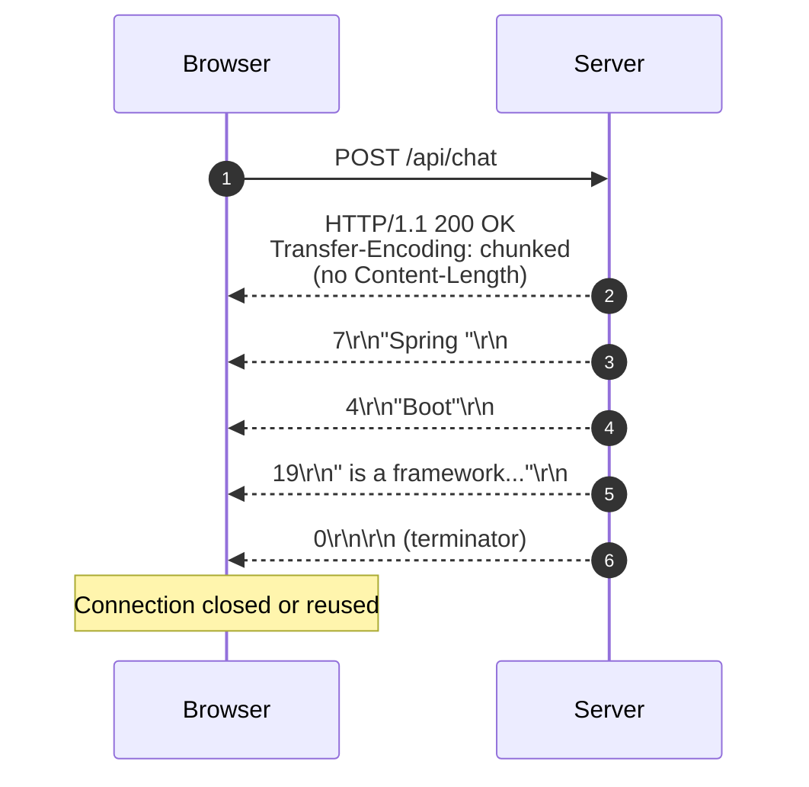
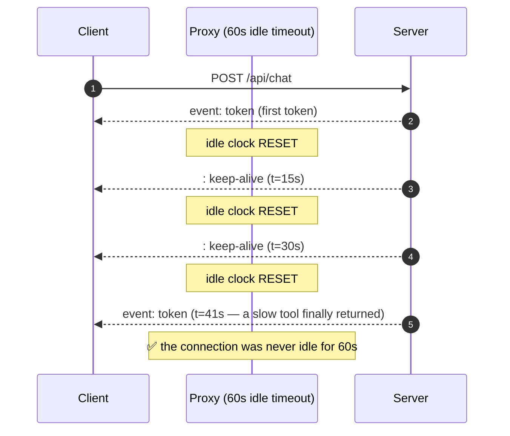
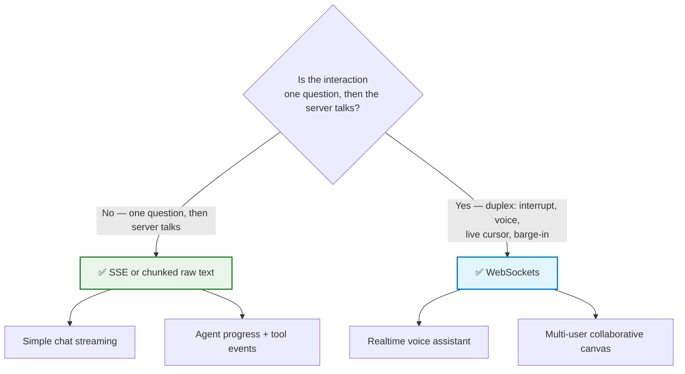
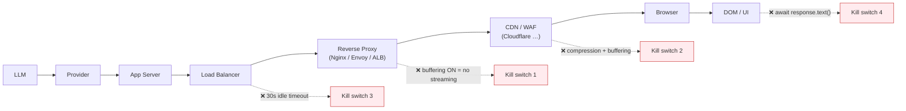
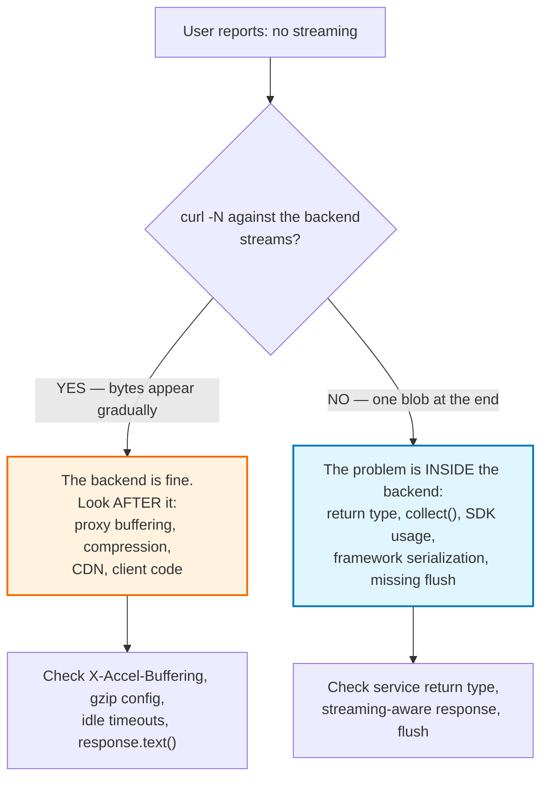

# Chapter 05 — HTTP Streaming Mechanics: Chunked Encoding, SSE & WebSockets

> **Lecture 07 · Chapter 05 of 09** · Level: 🟡 Intermediate · Phase 2 — The Application Layer
> **Source:** `Forward-Deployed-Engineer/Lecture 06/notes/05_HTTP_Streaming_Mechanics_Chunked_Encoding_SSE_and_WebSockets.md`
> (slides §8, §9, §10, §18)
> **Roadmap topics:** HTTP streaming mechanics — chunked transfer encoding, **SSE**, WebSockets — when to
> use which; infrastructure that silently breaks streaming.
> **Prerequisites:** Chapter 04 (bytes vs characters, framing) · Chapter 02 (delivery-path taxonomy).

---

## 05.0 What this chapter is for

Chapters 01–04 were about the model and about granularity. This chapter is about the **transport**: how a
response can legally begin before it is finished, what the two canonical "real-time" transports actually
are, and — most importantly — **what in your infrastructure silently destroys streaming** without a single
error in any log.

By the end of this chapter you should be able to:

1. Explain how HTTP sends an incomplete response (chunked transfer encoding, no `Content-Length`).
2. Read and write the **SSE wire format** precisely: `data:`, `event:`, `id:`, `retry:`, comments.
3. Name the four response headers that make SSE work, and why each one matters.
4. Choose between **SSE**, **raw text streaming** and **WebSockets** using a decision rule, not fashion.
5. Explain why `EventSource` is often the wrong client API — and what to use instead.
6. Diagnose a "streaming doesn't work" ticket with `curl -N` and a per-hop checklist.

---

## 05.1 Conventional HTTP vs. streaming HTTP

A conventional HTTP API behaves like a vending machine:

```text
REQUEST
   ↓
SERVER WORKS
   ↓
SERVER FINISHES
   ↓
RESPONSE
```

For example, `GET /users/10` returns one completed object:

```json
{ "id": 10, "name": "Rohit" }
```

AI responses are different because **the result naturally develops over time**. We want the connection to
stay open and deliver data repeatedly:

```text
REQUEST
   ↓
Connection remains open
   ↓
data
   ↓
data
   ↓
data
   ↓
data
   ↓
DONE
```

**That is streaming.**

> **The source's clarifying statement:** *Streaming does not mean abandoning HTTP.* The server simply
> begins an HTTP response without waiting to construct the entire response body.

| | Conventional | Streaming |
| :--- | :--- | :--- |
| HTTP response | `[ COMPLETE BODY ]` | `HTTP response begins` → `chunk` → `chunk` → `chunk` → `HTTP response ends` |
| Body arrives | All at once | Progressively |
| `Content-Length` | Present | Usually absent |
| `Transfer-Encoding` | Not needed | `chunked` |

> **The mental model to keep:** streaming is not a different protocol. It is the *same* HTTP response with
> a body that is written over time instead of all at once. Every mechanism below is about making that
> legal and making it survive the network path.

---

## 05.2 How HTTP can send an incomplete response: chunked transfer encoding

HTTP/1.1 solves an obvious problem: *how do I send a body when I don't know its final length?*

The answer is **chunked transfer encoding**: the body is split into self-describing chunks, each prefixed
by its size in hexadecimal, terminated by a zero-length chunk.

```text
HTTP/1.1 200 OK
Content-Type: text/plain; charset=utf-8
Transfer-Encoding: chunked
Cache-Control: no-cache, no-transform
Connection: keep-alive
X-Accel-Buffering: no

7\r\n
Spring \r\n
4\r\n
Boot\r\n
19\r\n
 is a framework for...\r\n
0\r\n
\r\n
```



Key implications:

1. **No `Content-Length` means the client cannot know the total size in advance** — it must read until the
   terminator. This is exactly what `ReadableStream` is designed for.
2. **HTTP/2 has no chunked encoding** — it uses DATA frames instead. The *semantics* (progressive body) are
   identical, but the wire format differs. This is why you should **never hand-parse chunk headers below
   the `fetch` layer**.
3. **`Connection: keep-alive` plus an idle-timeout mismatch** is the classic cause of streams dying at
   suspiciously round times (30 s, 60 s, 100 s).
4. **A zero-length chunk is the end-of-body marker.** A proxy that strips or rewrites it corrupts the
   stream; a client that treats it as data produces a stray empty append.

### What "flush" actually means

The single most important server-side idea in this chapter:

> A write to the response object is **not** the same as a flush to the socket. Frameworks and middleware
> commonly buffer writes for efficiency; streaming requires an explicit flush (or a streaming-aware
> response type) after each piece.

```typescript
// PSEUDOCODE — the shape of a streaming handler (mechanism, not a framework tutorial)
async function chatHandler(req, res) {
  res.status(200);
  res.setHeader("Content-Type", "text/plain; charset=utf-8");
  res.setHeader("Cache-Control", "no-cache, no-transform");
  res.setHeader("X-Accel-Buffering", "no");   // ⬅ disables nginx response buffering
  res.flushHeaders();                         // ⬅ 200 + headers leave NOW

  try {
    for await (const piece of providerStream(buildPrompt(req))) {
      res.write(piece);                       // write
      // flush()/cork-uncork behaviour is framework-specific — verify it, don't assume it
    }
  } finally {
    res.end();                                // ⬅ the zero-length chunk
  }
}
```

> **Why `flushHeaders()` matters:** if the first byte is not written until the first token arrives, the
> client's `fetch()` cannot resolve, the socket looks idle, and proxies may time out. Sending headers
> early also lets you return a **real** error status for failures that happen before the first token.

---

## 05.3 Server-Sent Events (SSE)

SSE stands for **Server-Sent Events**. Its primary direction is strictly:

```text
SERVER  ──event──►  CLIENT
SERVER  ──event──►  CLIENT
```

A single HTTP connection delivers many **events**; the client progressively assembles them:

```text
data: Spring

data: Boot

data: is

data: awesome
```

becomes, in the UI:

```text
Spring Boot is awesome
```

### 05.3.1 The exact SSE wire grammar

An SSE stream is a `text/event-stream` body in which each event is:

```text
field: value\n
field: value\n
\n                 ← blank line DISPATCHES the event
```

| Field | Purpose | Notes |
| :--- | :--- | :--- |
| `data:` | Payload line(s) | Multiple `data:` lines are joined with `\n` |
| `event:` | Event type name | Maps to `addEventListener("token", …)` |
| `id:` | Last-Event-ID for resumption | Enables reconnect-and-resume |
| `retry:` | Reconnect delay (ms) | Browser hint |
| `:` (leading colon) | Comment / heartbeat | Keeps intermediaries from idling the connection |

A production-shaped SSE stream for a chat assistant:

```text
: heartbeat

event: status
data: {"phase":"retrieving"}

event: token
id: 41
data: {"text":"Spring"}

event: token
id: 42
data: {"text":" Boot"}

event: usage
data: {"prompt_tokens":210,"completion_tokens":64}

event: done
data: {"finish_reason":"stop"}

```

> **Critical parser rule:** SSE framing uses **double newline (`\n\n`) as the event delimiter**, and the
> framing is *line-oriented*. Because network chunks can split anywhere (Chapter 04), a robust client must
> buffer bytes, split on `\n\n`, and keep the trailing partial frame for the next read. Naively doing
> `chunk.split("\n\n")` on each read **will** corrupt output.

### 05.3.2 SSE response headers (the ones that matter)

```http
HTTP/1.1 200 OK
Content-Type: text/event-stream; charset=utf-8
Cache-Control: no-cache, no-transform
Connection: keep-alive
X-Accel-Buffering: no
Transfer-Encoding: chunked
```

| Header | Why it is mandatory |
| :--- | :--- |
| `text/event-stream` | Tells the client/proxies this is an SSE body |
| `Cache-Control: no-cache, no-transform` | Prevents caching **and** prevents proxies from rewriting the body |
| `X-Accel-Buffering: no` | **Nginx-specific: disables response buffering.** Without it, Nginx accumulates the entire body and streaming vanishes |
| `charset=utf-8` | Multi-byte safety for non-ASCII output |

> **The `no-transform` directive is underrated.** Some middleboxes "helpfully" minify or re-encode text
> bodies. On an SSE stream that destroys the framing. `no-transform` is the standard way to forbid it.

### 05.3.3 Heartbeats: why a comment line keeps the stream alive

An AI stream can be quiet for seconds at a time — a slow tool call, a long retrieval, a slow first token.
During those gaps the socket carries **no bytes**, and every intermediary with an idle timeout starts
counting. The fix is a periodic no-op that the client ignores:

```text
: keep-alive

```



| Heartbeat property | Recommendation |
| :--- | :--- |
| Interval | **10–15 s** — comfortably below the smallest common idle timeout (30 s) |
| Format | `: comment` (SSE) or a whitespace write (raw text) |
| Client handling | Must be **ignored**, not appended — another reason to parse frames rather than append raw bytes |
| Cost | Negligible bytes; the alternative is a mid-answer disconnect |

---

## 05.4 SSE vs. WebSockets — choosing the right pipe

The source contrasts the two canonical real-time transport options:

| | **SSE (Server-Sent Events)** | **WebSockets** |
| :--- | :--- | :--- |
| Direction | `SERVER ➔ CLIENT` (unidirectional) | `CLIENT ↔ SERVER` (bidirectional) |
| Protocol | Plain HTTP | Upgraded TCP (`ws://` / `wss://`) |
| Framing | Text lines, `\n\n`-delimited | Own frame protocol |
| Auto-reconnect | **Built in** (browser `EventSource`) | Manual |
| Message replay / resume | Supported via `Last-Event-ID` | Manual |
| Binary support | Poor (text-oriented) | Native |
| Proxies / firewalls | Very friendly (it is just HTTP) | Sometimes blocked; needs upgrade support |
| Browser API | `EventSource` (simple) or `fetch` (flexible) | `WebSocket` |
| Server resources | One long-lived HTTP request | Persistent socket per client |
| Best for | **AI token streaming**, notifications, progress | Voice, collaboration, live cursors, barge-in |



> **The decisive argument for AI chat:** after the prompt is sent, the flow is **unidirectional** — the
> server talks, the client listens. SSE matches that shape exactly, rides plain HTTP (so auth, proxies,
> CORS and load balancers all work as they already do), and gives you reconnect semantics for free.
> WebSockets buy duplex capability you are not using, and pay for it with proxy/firewall complexity.

### The `EventSource` problem (and the modern answer)

`EventSource` is the built-in browser client for SSE. It is convenient and it reconnects automatically, but
it has two hard limitations for AI products:

| Limitation | Why it hurts |
| :--- | :--- |
| **`GET` only** | You cannot send a prompt body; the whole prompt must go in the query string or be stored server-side first |
| **No custom headers** | You cannot attach an `Authorization: Bearer …` header — the usual workaround is a cookie or a query-string token, both of which leak into logs |

> **The production default is `fetch` + `ReadableStream`.** It is a *plain HTTP request* (so you can set
> headers, use `POST`, and send a JSON body) while still giving you manual, frame-by-frame consumption. It
> is the hybrid that dominates modern AI chat clients, and it is the subject of **Chapter 08**.

---

## 05.5 Raw text streaming vs. `text/event-stream`

The source devotes real attention to a distinction that trips up many engineers:

```text
Streaming = data arrives progressively

SSE       = one particular protocol/format for delivering events
```

If we deliberately use SSE, the endpoint must produce:

```text
MediaType.TEXT_EVENT_STREAM_VALUE   →   Content-Type: text/event-stream
```

But for a simple chatbot, **raw text is enough**:

```text
produces = MediaType.TEXT_PLAIN_VALUE
```

| Aspect | Raw text (`text/plain`) | SSE (`text/event-stream`) |
| :--- | :--- | :--- |
| Body format | Arbitrary text fragments | `field: value` events, `\n\n` framed |
| Client parser needed | None — append directly | Yes — SSE frame reassembly |
| Typed events (status, tokens, usage) | Not supported (needs a convention) | Native via `event:` |
| Resume after disconnect | No | Yes, with `id:` + `Last-Event-ID` |
| Heartbeats | Manual blank writes | `: comment` lines |
| Complexity | Minimal | Moderate |
| Right for | Simple demo chat, single-stream answers | Product-grade assistants, agents, observability |

> **Engineering guidance:** start with raw text (it teaches the essentials with zero framing bugs), then
> graduate to SSE when you need *event types* (tool calls, citations, usage stats, errors) or *resumable*
> streams. A very common production pattern is **raw text for the token channel plus a separate JSON
> control channel** — but SSE unifies both in one connection, which is usually the better long-term shape.

---

## 05.6 Infrastructure that silently breaks streaming

This section is the reason most "streaming doesn't work" tickets exist. Streaming is an **end-to-end
property**: any component that buffers, rewrites, or times out the body will collapse it.



| Layer | Failure | Symptom | Fix |
| :--- | :--- | :--- | :--- |
| App server | Framework serializes the whole body | Nothing until the end | Return a stream/iterator type, not a string |
| App middleware | A body parser or logger reads the request/response stream | Stream consumed twice; empty UI | Exclude streaming routes from body parsers |
| Nginx | `proxy_buffering on` (the default) | The whole answer at once | `proxy_buffering off;` + `X-Accel-Buffering: no` |
| Nginx | `proxy_read_timeout 60s` | Stream dies after 60 s | Raise the timeout **or** send heartbeats every 10–15 s |
| ALB / Envoy | Idle timeout on the connection | Connection reset mid-answer | Increase idle timeout; add heartbeats |
| Compression middleware | `gzip`/`br` buffers to fill blocks | Choppy, delayed delivery | Exclude `text/event-stream` from compression |
| CDN / WAF | Response buffering or HTML injection | Unexpected latency; injected scripts | Bypass the CDN for streaming routes |
| Browser code | `await response.text()` | Perfect backend, broken UX | Use `response.body.getReader()` (Chapter 08) |
| HTTP client library | Client buffers chunks by default | Same as above, server side | Stream-enabled SDK / `ReadableStream` consumption |

> **Debugging heuristic:** put a `curl -N` (no-buffering) call directly against the backend. **If `curl -N`
> streams but the browser does not, the problem is *after* the backend. If `curl -N` does *not* stream, the
> problem is *inside* the backend (or the provider SDK).**

```text
# Curl shows you the truth, unbuffered, byte by byte
curl -N -X POST http://localhost:8080/api/chat \
     -H "Content-Type: text/plain" \
     --data "Explain Spring Boot"
```

### Why `curl -N` is the single best first diagnostic

`curl -N` disables curl's own output buffering and prints bytes as they arrive. It therefore tests the
**server + provider + SDK** path while bypassing the browser, the CDN, the proxy configuration and the
client code. A two-minute experiment splits the entire search space in half:



---

## 05.7 Common mistakes

| # | Pitfall | Consequence | Fix |
| :--- | :--- | :--- | :--- |
| 1 | Assuming `Content-Length` will be present | Broken progress indicators | Read until done; never size-based |
| 2 | Parsing SSE by splitting raw chunks on `\n\n` | Silently dropped/corrupted tokens | Maintain a leftover buffer |
| 3 | Leaving proxy buffering on | Streaming works locally, dies behind Nginx | Disable buffering + `X-Accel-Buffering: no` |
| 4 | Using `EventSource` when you need `POST` + headers | Auth tokens cannot be attached cleanly | Use `fetch` + `ReadableStream` |
| 5 | Ignoring idle timeouts | Streams die at 30/60/100 s, exactly | Heartbeats + explicit timeout config |
| 6 | Compressing `text/event-stream` | Choppy or delayed chunk delivery | Exclude SSE from compression |
| 7 | Assuming HTTP/2 keeps HTTP/1.1 chunk framing | Parser written against the wrong layer | Treat `fetch` as the framing boundary |
| 8 | No `charset=utf-8` | Mojibake for non-ASCII languages | Always declare UTF-8 |
| 9 | Appending heartbeat comments to the UI | Stray `: keep-alive` text in the answer | Ignore comment lines in the parser |
| 10 | Sending `200 OK` only when the first token arrives | No way to signal early failures; idle socket | Flush headers immediately, then stream |
| 11 | Forgetting `no-transform` | A middlebox rewrites the body and breaks framing | Send `Cache-Control: no-cache, no-transform` |
| 12 | Testing only locally, never through the real proxy topology | The bug only exists in staging/prod | Test with the production-shaped path |

---

## 05.8 Key takeaways

1. **Streaming is HTTP with an incomplete, progressive body** — normally via `Transfer-Encoding: chunked`
   and **no `Content-Length`**.
2. **A write is not a flush.** Frameworks and middleware buffer writes; streaming requires explicit flush
   behaviour or a streaming-aware response type.
3. **SSE is a *format* over HTTP**, not a different transport: `data:`/`event:`/`id:`/`retry:` fields,
   `\n\n`-delimited frames, `Content-Type: text/event-stream`.
4. **SSE is unidirectional (server → client) and therefore ideal for AI output**, which is itself
   unidirectional after the prompt.
5. **WebSockets are for duplex interaction** (voice, collaboration, barge-in) — usually unnecessary for
   simple answer streaming, and harder to get through proxies.
6. **Streaming ≠ SSE.** Raw `text/plain` chunked streaming is a valid, simpler choice and is what the
   source's chat example uses.
7. **`EventSource` is convenient but limited** (`GET` only, no custom headers); `fetch` + `ReadableStream`
   is the production default.
8. **Heartbeats every 10–15 s** are the cheapest insurance against idle-timeout disconnects — and they must
   be ignored by the client parser, never appended.
9. **The infrastructure is the usual culprit.** Proxy buffering, compression and idle timeouts break
   streaming far more often than model or application code.
10. **`curl -N` is the best first diagnostic**, because it splits the search space: before the backend, or
    after it.
11. **Never parse below `fetch`.** Chunk framing is not a stable contract; treat `ReadableStream` as your
    framing boundary.

---

**Previous:** [Chapter 04 — Granularity](./04_Token_Chunk_Network_and_Byte_Granularity.md) ·
**Next:** [Chapter 06 — End-to-End Streaming Architecture & the 7 Pipeline Invariants](./06_End_to_End_Streaming_Architecture_and_Pipeline_Invariants.md)