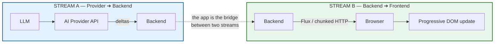
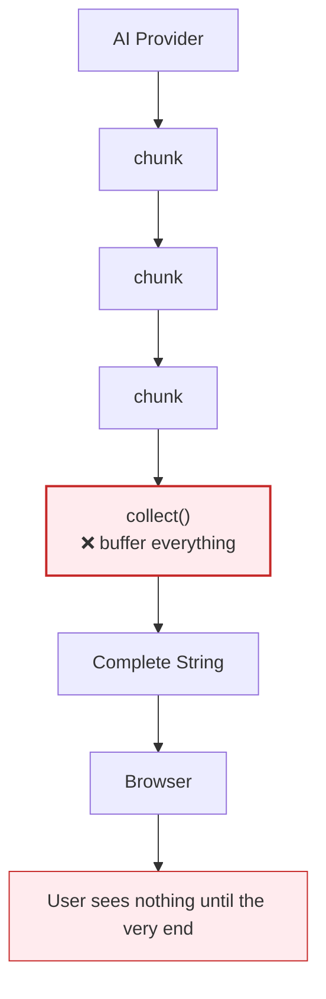
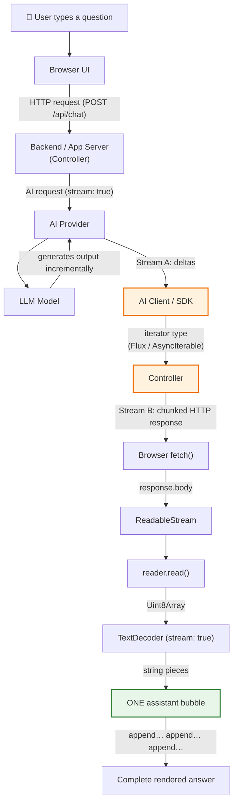
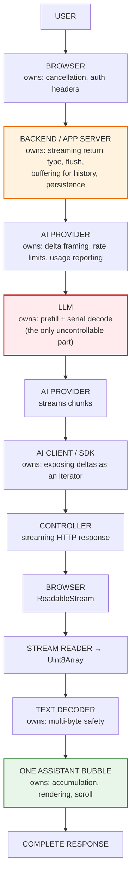
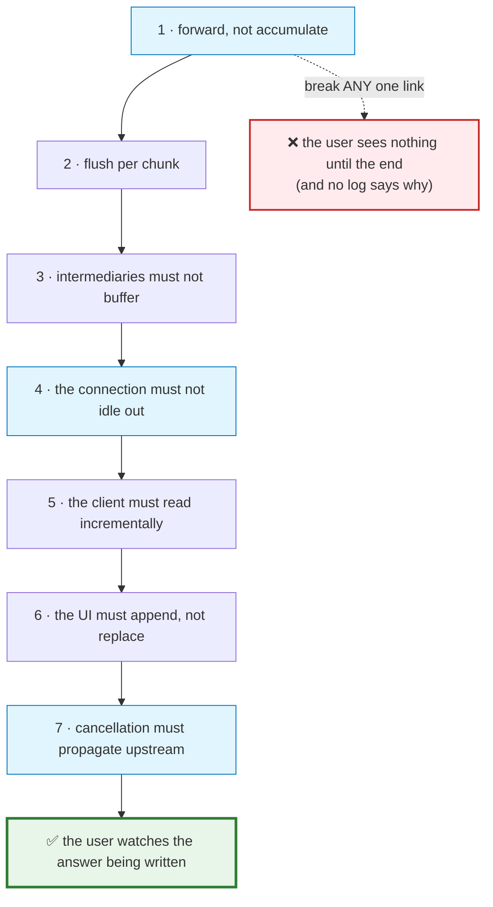
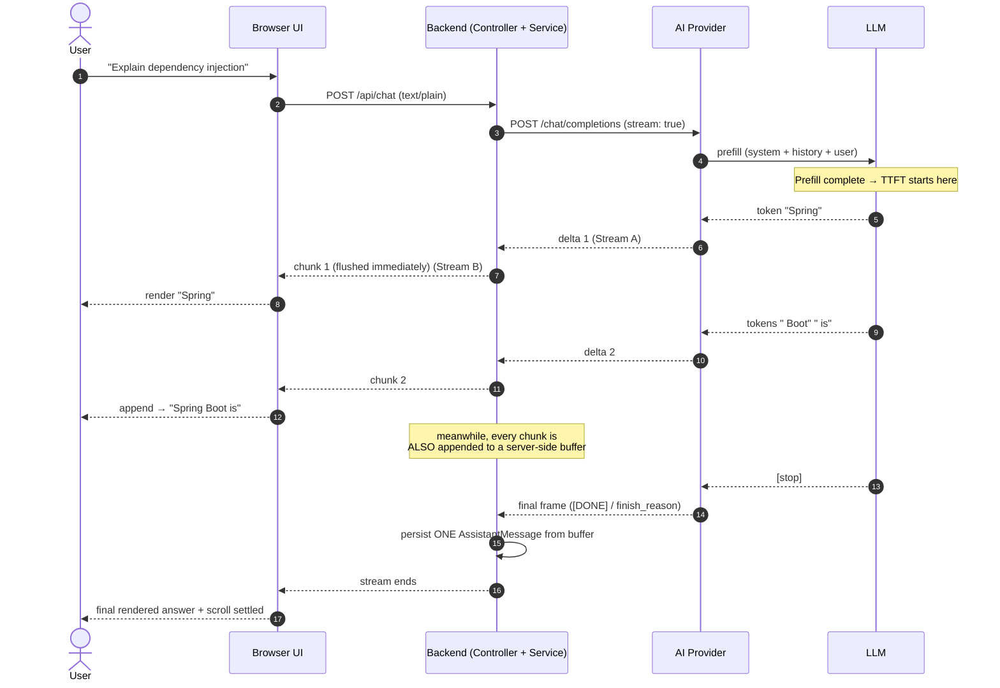
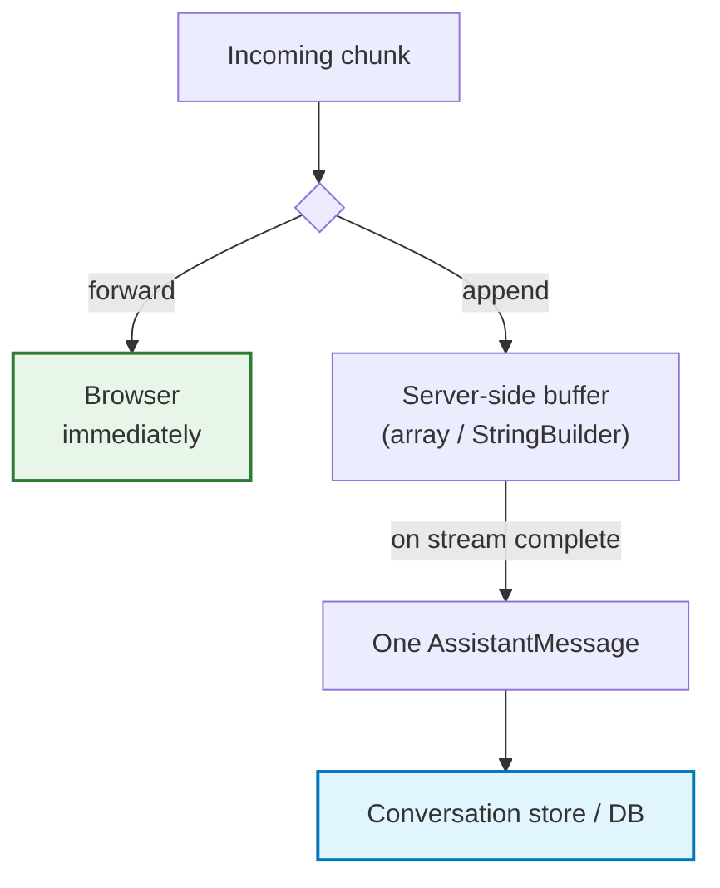
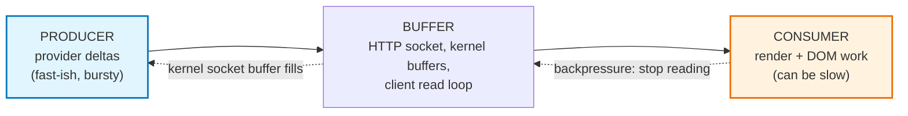
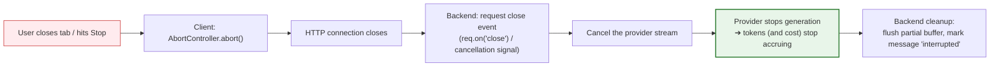

# Chapter 06 — End-to-End Streaming Architecture & the 7 Pipeline Invariants

> **Lecture 07 · Chapter 06 of 09** · Level: 🟡 Intermediate · Phase 2 — The Application Layer
> **Source:** `Forward-Deployed-Engineer/Lecture 06/notes/06_End_to_End_Streaming_Architecture_and_Pipeline_Invariants.md`
> (slides §11, §12, §36, §37)
> **Roadmap topics:** end-to-end streaming architecture & pipeline invariants; the **7 pipeline
> invariants**; backpressure & flow control; cancelling generation.
> **Prerequisites:** Chapters 02–05 (delivery, latency, granularity, transport).

---

## 06.0 What this chapter is for

The previous chapters each described one layer. This chapter assembles them into **one pipeline** and
proves the central structural claim of the lecture:

> **Streaming is an end-to-end property of the application, not just an LLM feature.**

That sentence has teeth. It means a single buffering hop — a proxy default, a framework serialization, one
`await response.text()` — silently converts your entire "streaming" system back into a buffered one, with
no error, no log line, and no dashboard change. This chapter turns that risk into seven checkable
invariants.

By the end of this chapter you should be able to:

1. Name the **two streams** and explain why both must remain streamed.
2. Draw the full pipeline and assign an **owner** to every hop.
3. State and test the **seven pipeline invariants**.
4. Explain what backpressure looks like in an AI streaming system — and why it is usually a UI problem.
5. Design **cancellation propagation** from the Stop button to the provider.
6. Compare a naïve and a production pipeline line by line.

---

## 06.1 The two streams — and why both must stay streamed

From the application's perspective there are exactly **two** important streams:

```text
Stream A:  AI Provider ➔ Backend      (consumption stream)
Stream B:  Backend ➔ Frontend         (production stream)
```



> **The source's exact framing:** *From our application's perspective, there are really two important
> streams… **Both must remain streamed.***

A backend that consumes Stream A eagerly and releases Stream B lazily is a **buffer**, not a bridge:



The mirror image is equally fatal — a perfectly streamed backend wasted by a client that waits:

```text
Backend could stream perfectly,
but if JavaScript waits for the complete body before displaying anything,
streaming disappears again.
```

> **The structural rule:** *the backend is a bridge, not a buffer.* Its job is to **map and forward**, not
> to collect. Any operator that collects — `collect()`, `collectList()`, `blockLast()`, `join()`, `await
> response.text()` — is a streaming killer wherever it appears.

---

## 06.2 The full end-to-end pipeline

Combining the source's architecture diagram (§11) with its pipeline diagram (§12):



### The pipeline as a chain of "must not break" links

```text
LLM
 ↓   must not be awaited as a whole
AI Provider
 ↓   must be consumed as a stream
AI Client / SDK
 ↓   must not be collected into a collection
Controller / HTTP Response
 ↓   must flush each write
JavaScript fetch
 ↓   must not call response.text()
DOM
```

The source states the invariant directly:

> *Streaming is an end-to-end property of the application, not just an LLM feature.*

### Every hop has an owner



> **Why naming owners matters:** streaming failures are always *someone's* buffering choice. "Streaming is
> broken" is not actionable; "the ALB idle timeout closed the socket at 60 s" is. A design review for a
> streaming feature should walk this diagram and ask each owner how their hop forwards bytes.

---

## 06.3 The 7 pipeline invariants

Each invariant is a rule that, if violated at any single layer, silently converts your "streaming" system
into a buffered one.

| # | Invariant | Violated by | Detection |
| :--- | :--- | :--- | :--- |
| 1 | **Every layer must forward, not accumulate** | `collect()`, `List<String>`, `join()` | TTFT ≈ total time |
| 2 | **The response must flush per chunk** | Framework auto-serialization | `curl -N` shows one blob |
| 3 | **Intermediaries must not buffer** | Nginx default, CDN, compression | Works locally, breaks in staging/prod |
| 4 | **The connection must not idle out** | 30/60/100 s timeouts | Stream dies at suspiciously round times |
| 5 | **The client must read incrementally** | `await response.text()` | Backend logs show streaming; the UI does not |
| 6 | **The UI must append, not replace** | Re-creating the bubble per chunk | Flicker, duplicated messages, lost scroll |
| 7 | **Cancellation must propagate upstream** | Closing the tab but still paying for tokens | Provider usage billing exceeds user sessions |



> **Engineering insight — "streaming works in my terminal."** `curl -N` bypasses proxies, compression and
> browsers, so it validates invariants **1, 2 and 4 only**. Most production failures live in invariants
> **3, 5 and 6** — which is why a **staging environment with the real proxy topology** is mandatory test
> infrastructure for streaming features.

### Turning each invariant into a test

| Invariant | Cheap, automatable check |
| :--- | :--- |
| 1 | Assert `chunkCount > 2` and `ttftMs < totalMs * 0.5` in an integration test |
| 2 | `curl -N` smoke test in CI against the staging deployment |
| 3 | The same test **through** the proxy; compare chunk-count distributions |
| 4 | A deliberate 90 s generation with heartbeats; assert no disconnect |
| 5 | A browser-side assertion that the first paint happens long before `done` |
| 6 | A component test over a scripted fragment sequence; assert exactly one message node |
| 7 | Kill the client mid-stream; assert the provider reports a cancelled generation |

---

## 06.4 The end-to-end sequence diagram (both streams)



Note the **two concurrent responsibilities** of the backend during the stream:



The **latency path** and the **correctness path** diverge at the chunk and rejoin only at persistence.
Keeping them separate is what allows the stream to be fast *and* the history to be correct — the
**dual-write pattern**, developed fully in **Chapter 09**.

---

## 06.5 Backpressure and flow control in AI streaming

Backpressure is the mechanism by which a slow consumer tells a fast producer to slow down. In classic
systems (file streams, queues) it is well understood. In AI streaming it behaves unusually.



| Property of AI streaming | Consequence |
| :--- | :--- |
| The producer's total output is **bounded** (a few thousand tokens) | Backpressure rarely needs to slow the *model*; the stream finishes anyway |
| The producer is **not** a local iterator — it is a remote GPU | You cannot "pause" the provider cheaply; you can only stop reading (and eventually cancel) |
| The consumer is usually **the browser main thread** | Backpressure shows up as **render jank**, not as a stalled producer |
| Output is **human-paced by nature** | The system has huge slack: ~8 tokens/s satisfies a human; a UI can handle hundreds |

> **The key insight:** in AI streaming, backpressure is almost always a **UI-rendering problem, not a
> producer problem.** The fix is not to throttle the model; it is to decouple *reading* from *rendering*.

```typescript
// PSEUDOCODE — decouple network reads from rendering
let pending = "";        // text received but not yet rendered
let scheduled = false;

function onTextPiece(piece: string) {
  pending += piece;                       // cheap: accumulate
  if (scheduled) return;
  scheduled = true;
  requestAnimationFrame(() => {           // ⬅ render at most once per frame
    scheduled = false;
    render(pending);                      // one DOM update per frame, not per chunk
    pending = "";
  });
}
```

| Symptom | Actual cause | Wrong fix | Right fix |
| :--- | :--- | :--- | :--- |
| Chunks arrive in clumps, then a pause | A buffering hop, or a slow reader | Slow down the model | Decouple reads from rendering |
| Jank / dropped frames while streaming | Markdown re-parsed per chunk on the main thread | Reduce TPS | rAF-batched rendering, incremental parse |
| Provider stream stalls after a while | The consumer stopped reading (socket buffer full) | Increase `max_tokens` | Drain the reader promptly; render separately |
| Memory grows during long answers | Every chunk retained in a UI list | — | Cap DOM size; virtualise long conversations |

---

## 06.6 Cancellation propagation: stop paying for abandoned answers

Streaming makes cancellation economically meaningful: a generation can be stopped mid-flight, and
providers bill for what was produced. Production systems must therefore propagate cancellation
**upstream**:



| Failure to propagate | Consequence |
| :--- | :--- |
| Client aborts, backend keeps consuming | **You pay for tokens nobody will ever read** |
| Backend cancels, partial text discarded | Conversation history loses what the user actually saw |
| No cancellation at all | "Stop" button is cosmetic; GPU time is wasted |
| Cancellation without cleanup | Leaked subscriptions/connections, degraded pool health |

```typescript
// PSEUDOCODE — cancellation that actually reaches the provider
async function* chat(req, res) {
  const controller = new AbortController();

  // The client's disconnect is the ONLY reliable cancellation signal.
  req.on("close", () => controller.abort());

  const pieces: string[] = [];
  try {
    for await (const piece of providerStream(prompt, { signal: controller.signal })) {
      pieces.push(piece);
      res.write(piece);
    }
  } catch (err) {
    if (err.name === "AbortError") {
      await persistInterrupted(pieces.join(""));   // keep what the user read
      return;                                      // ⬅ not an error
    }
    throw err;
  } finally {
    releaseConversationLock();                     // ⬅ never leak the lock
  }
}
```

> **Two rules that make cancellation correct:** (1) an abort is **not** an error — it must not produce an
> error toast or an error log line; (2) the partial text the user already read must be **persisted**, not
> discarded. Chapter 08 covers the client half; Chapter 09 covers persistence.

---

## 06.7 Naïve vs. production streaming pipeline

| Concern | Naïve implementation | Production implementation |
| :--- | :--- | :--- |
| Backend return type | `String` (buffers) | Stream type (`Flux` / `AsyncIterable` / `ReadableStream`) |
| Provider consumption | `await` full response | Incremental deltas |
| Proxy configuration | Defaults | Buffering off, UTF-8, idle timeout raised |
| Heartbeats | None | `: comment` every 10–15 s (SSE) / periodic whitespace |
| Cancellation | Ignored | `AbortController` → upstream cancel → cost stops |
| History persistence | One message per chunk (or nothing) | Dual-write: forward + buffer, persist once on completion |
| Partial failure | Message lost or duplicated | Persist partial with `interrupted` flag |
| Client consumption | `await response.text()` | `getReader()` loop with one `TextDecoder` |
| UI updates | Rebuild bubble per chunk | Append to one bubble, render on animation frame |
| Observability | Total latency only | TTFT, ITL, TPS, tokens, chunk sizes, abort rate |
| Multi-user state | Shared mutable list | Session-scoped, isolated conversation state |

---

## 06.8 Common mistakes

| # | Pitfall | Consequence | Fix |
| :--- | :--- | :--- | :--- |
| 1 | Assuming the model is the bottleneck | Optimizing the wrong layer | Measure each hop's TTFT contribution |
| 2 | "Streaming is on" because the SDK call used `stream: true` | Delivery is still buffered | Verify invariants 1–7 end to end |
| 3 | No cancellation propagation | Paying for abandoned generations | Wire close/abort events to the provider |
| 4 | Persisting only on success | Cancelled/aborted chats vanish from history | Persist partial text with a flag |
| 5 | Ignoring backpressure-induced stalls | Coalesced chunks, janky UX | Decouple reads from rendering |
| 6 | No heartbeats | Mid-stream disconnects at proxy timeouts | Send periodic keep-alives |
| 7 | No end-to-end test | Works in dev, breaks behind the gateway | `curl -N` + staging proxy topology tests |
| 8 | Treating `AbortError` as a failure | Error toasts every time a user presses Stop | Handle abort as a distinct, expected state |
| 9 | Leaking the per-conversation lock on abort | The conversation becomes permanently stuck | Release in a `finally` block |
| 10 | Letting the client's disconnect go unnoticed | The provider keeps generating (and billing) | Listen for the request close event |

---

## 06.9 Key takeaways

1. **There are two streams** — provider → backend and backend → browser — and **both must remain
   streamed**.
2. **The backend is a bridge, not a buffer.** Mapping and forwarding is the job; collecting defeats the
   purpose.
3. **Streaming is an end-to-end property**, verifiable through **seven invariants** spanning code,
   infrastructure and UI.
4. **The pipeline has an owner per hop** — name them in design reviews, because streaming failures are
   always *someone's* buffering choice.
5. **`curl -N` validates only invariants 1, 2 and 4.** The failures that reach users live in 3, 5 and 6,
   and require a production-shaped staging environment to catch.
6. **Backpressure in AI streaming shows up as stalls and chunk coalescing**, so it is usually a
   UI-rendering problem, not a producer problem.
7. **Cancellation must propagate upstream** or you pay for tokens nobody reads — and the partial text the
   user already saw must be preserved, not deleted.
8. **A streamed answer and a stored answer are two different objects produced from the same data** (the
   dual-write pattern, Chapter 09).
9. **Observability is the only way to prove streaming works** — TTFT at every hop, chunk-size distribution
   and abort rate.
10. **Streaming is fast only as a whole.** Optimising any single hop while another buffers produces zero
    user-visible improvement.

---

**Previous:** [Chapter 05 — HTTP Streaming Mechanics](./05_HTTP_Streaming_Mechanics_Chunked_Encoding_SSE_and_WebSockets.md) ·
**Next:** [Chapter 07 — Backend Streaming: `call` vs `stream`, `Flux` & Stream Pumps](./07_Backend_Streaming_Call_vs_Stream_Flux_and_Stream_Pumps.md)