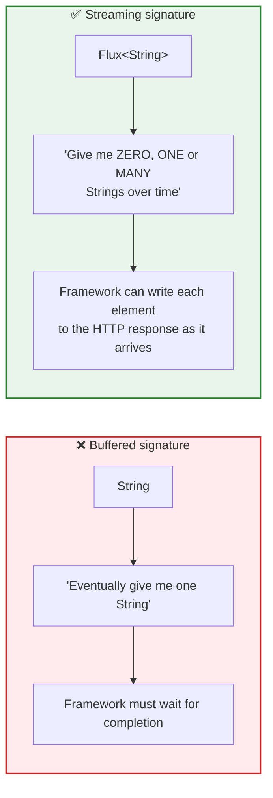
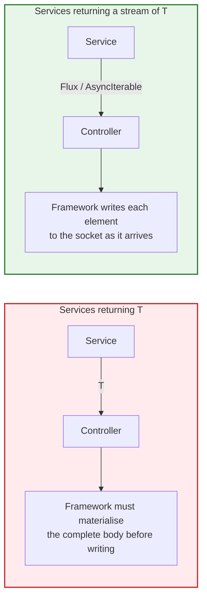
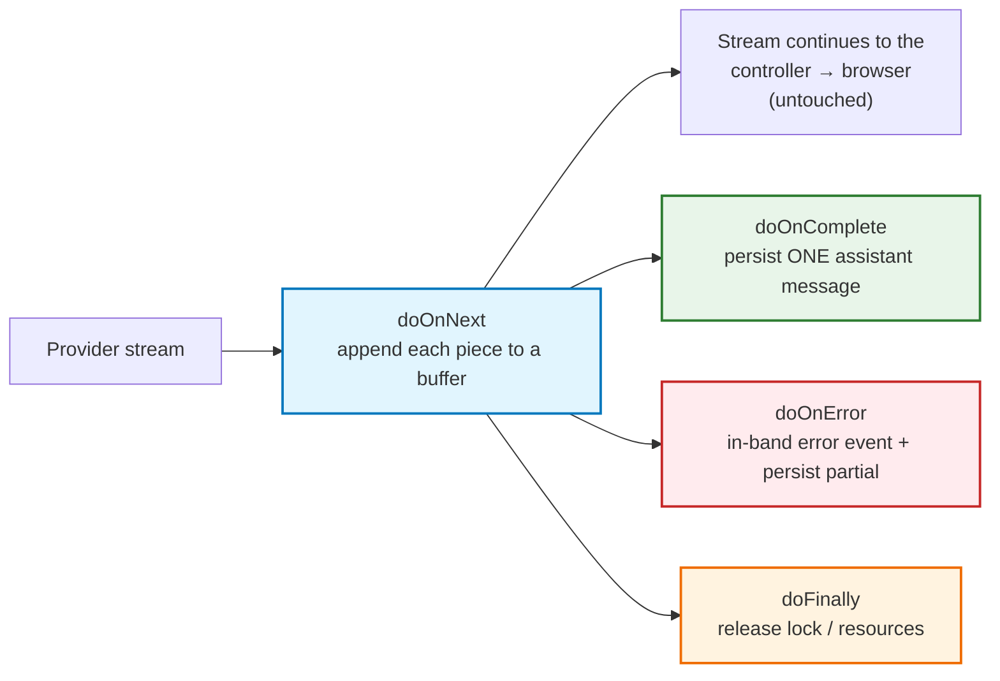
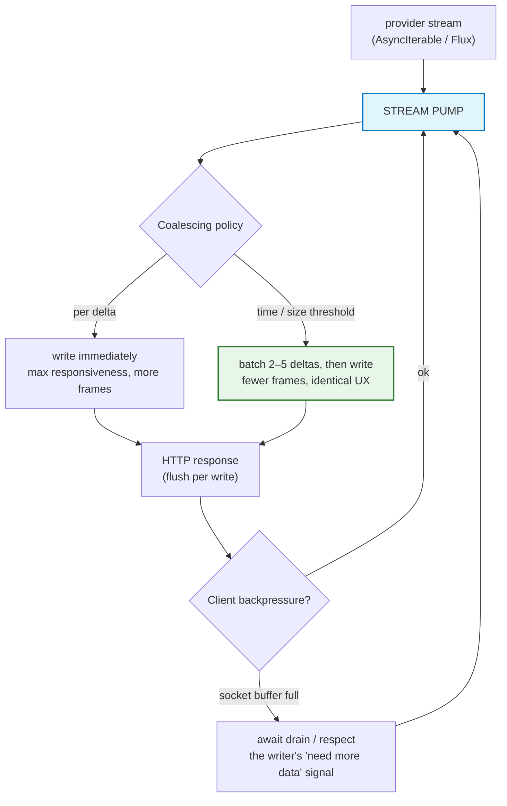
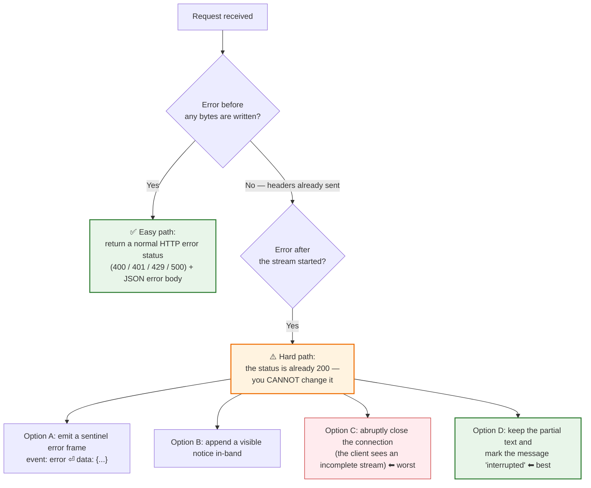
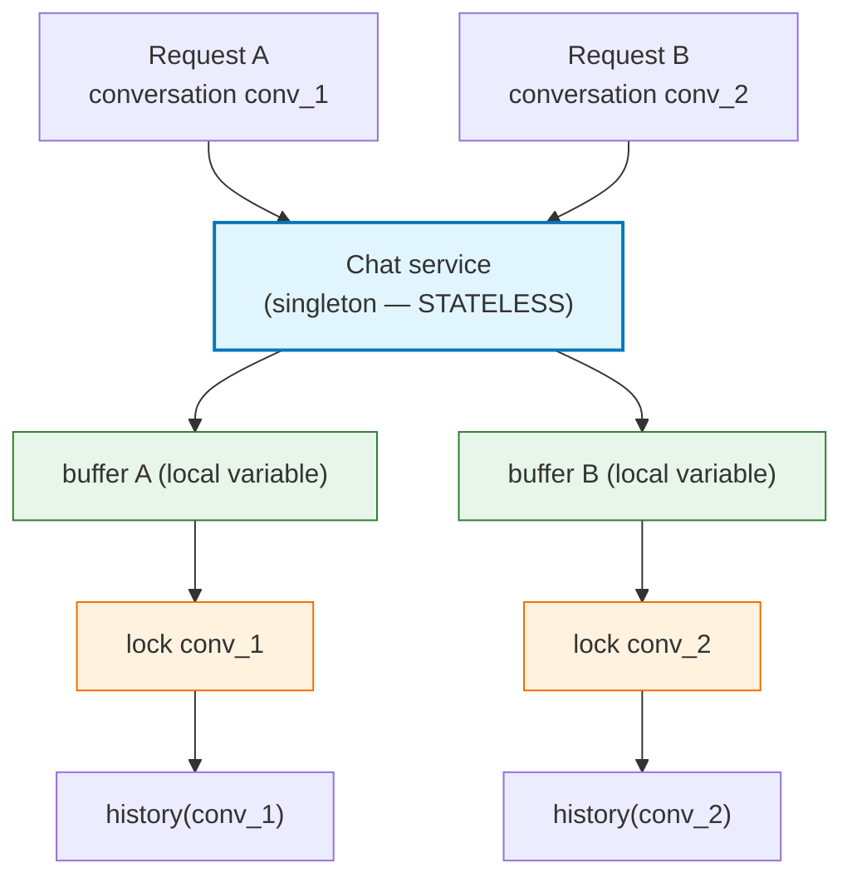

# Chapter 07 — Backend Streaming: `call` vs `stream`, `Flux` & Stream Pumps

> **Lecture 07 · Chapter 07 of 09** · Level: 🟡 Intermediate · Phase 2 — The Application Layer
> **Source:** `Forward-Deployed-Engineer/Lecture 06/notes/07_Backend_Streaming_Call_vs_Stream_and_Flux.md`
> (slides §13–§17)
> **Roadmap topics:** backend `call` vs `stream` vs `Flux`; stream pumps, delta coalescing, backpressure;
> multi-user isolation & thread safety.
> **Prerequisites:** Chapter 06 (two streams, invariants) · Chapter 05 (HTTP flush behaviour).

> **Note on language:** the source material uses **Java / Spring AI** (`Flux<String>`, `ChatClient`). The
> concepts are language-agnostic, so each one is paired below with its **TypeScript/Node.js equivalent**,
> which is the environment used for the pseudocode in these notes.

---

## 07.0 What this chapter is for

This is the backend half of streaming — and the single most important idea in it is embarrassingly small:

> **The method name is cosmetic. The *return type* is the architecture.**

`String` means "there is exactly one object, and it exists only after completion." Every framework, every
caller, and every serialiser in the codebase reads that type and behaves accordingly — which is why
buffering happens. Change the type to a stream, and the same framework starts writing bytes to the socket
as they arrive.

By the end of this chapter you should be able to:

1. Explain why `String` versus a stream type determines whether streaming is possible at all.
2. Use the box-versus-conveyor-belt mental model for `String` versus `Flux<String>`.
3. Translate the reactive type across ecosystems (`Flux`, `Flow`, `AsyncIterable`, `ReadableStream`).
4. Name the four operators that matter for buffering, persistence, errors and cleanup.
5. Explain **stream pumps** and **delta coalescing**, and why you should not forward every token.
6. Design an **in-band error protocol** for failures after the first byte.
7. Make a streaming service **multi-user safe**.

---

## 07.1 The starting point: a normal (buffered) AI call

A normal AI call looks like this:

```text
public String chat(String message) {
    return chatClient.prompt()
            .user(message)
            .call()
            .content();
}
```

Decomposing the chain:

| Element | Meaning |
| :--- | :--- |
| `chatClient.prompt()` | Starts constructing the prompt (a builder) |
| `.user(message)` | Adds the user's message to the conversation being sent |
| `.call()` | Requests the **normal, non-streaming** interaction |
| `.content()` | Extracts the generated content from the response object |
| Return type `String` | **One completed value**, delivered when everything is finished |

Conceptually:

```text
String answer;   // ⬅ one complete thing, arriving at one moment in time
```

> **The architectural significance is the return type, not the method name.** `String` is a *single-value*
> contract: it tells every caller in the codebase (and the framework itself) "there is exactly one object,
> and it exists only after completion." That type is the reason buffering happens — not the network, not
> the model.

---

## 07.2 Switching to streaming

For streaming, the change is:

```text
.call()   ➔   .stream()
```

```text
public Flux<String> chat(String message) {
    return chatClient.prompt()
            .user(message)
            .stream()
            .content();
}
```

> **The source's key observation:** *The important change is not just `.call()` → `.stream()`. The
> important change is the return type: `String` becomes `Flux<String>`.*



### The TypeScript equivalent

```typescript
// PSEUDOCODE — the same decision, expressed in TS types
type Buffered = Promise<string>;          // ❌ one value, at the end
type Streamed = AsyncIterable<string>;    // ✅ zero, one or many values over time

// The buffered service CANNOT stream, no matter what the controller does:
async function chatBuffered(msg: string): Promise<string> {
  let full = "";
  for await (const piece of providerStream(msg)) full += piece;   // ⬅ the accumulator
  return full;
}

// The streaming service hands the caller a handle to a time-series:
function chatStreamed(msg: string): AsyncIterable<string> {
  return providerStream(msg);            // ⬅ no loop, no accumulator, no join
}
```

> **Rule of thumb:** *the moment a service method returns `string` (or `Promise<FullResponse>`), streaming
> is already dead for that path* — regardless of how the model was invoked. The return type is the
> contract, and it is decided in the **service** layer, not the controller.

---

## 07.3 Understanding `Flux<String>` — box vs. conveyor belt

The source's mental models are worth preserving exactly, because they explain reactive types better than
any specification.

### `String` is a box

```text
┌────────────────────────────────────┐
│ Hello Rohit, how can I help?       │
└────────────────────────────────────┘
```

One value. One moment. Fully materialised.

### `Flux<String>` is a conveyor belt

```text
time ─────────────────────────────────────────→

"Hello"  →  " Rohit"  →  ", how"  →  " can"  →  " I help?"
```

```text
→ ["Hello"] → [" Rohit"] → [", how"] → [" can"] → [" I help?"]
```

| Concept | `String` | `Flux<String>` |
| :--- | :--- | :--- |
| Cardinality | Exactly 1 | 0, 1, or N |
| Timing | One instant | Spread over time |
| Memory profile | Whole value resident | Element-at-a-time |
| Backpressure | Impossible | First-class (subscriber requests N) |
| Terminal signals | Return | `onComplete` / `onError` |
| Cancellation | Not meaningful | `Disposable` / `abort()` |

### The cross-language translation table

| Ecosystem | Streaming abstraction | Consuming idiom |
| :--- | :--- | :--- |
| Java / Reactor | `Flux<T>` | `.subscribe(...)` / a WebFlux return type |
| JavaScript / Node | `ReadableStream`, `AsyncIterable` | `for await (const x of stream)` |
| Python | `AsyncIterator`, `AsyncGenerator` | `async for x in stream` |
| Go | channel `chan T` | `for v := range ch` |
| Kotlin | `Flow<T>` | `.collect { }` |
| C# / .NET | `IAsyncEnumerable<T>` | `await foreach` |

> **The unifying statement:** *the syntax changes, but the underlying concept remains: **values become
> available progressively over time**.* In one sentence, that is the entire mental model of backend
> streaming — and it is why every streaming API you will ever meet looks the same once you strip the
> syntax.

### Why the type matters more than the operator



Notice what the controller does in both cases: nothing. It returns what the service gave it. **All the
streaming capability — or the lack of it — was decided one layer below.**

---

## 07.4 The streaming service: one method, one return-type change

The source's streaming service is deliberately tiny:

```text
@Service
public class ChatService {
    private final ChatClient chatClient;

    public ChatService(ChatClient.Builder builder) {
        this.chatClient = builder.build();
    }

    public Flux<String> chat(String message) {
        return chatClient.prompt()
                .user(message)
                .stream()
                .content();
    }
}
```

> **Why the method is so short is the point:** *instead of waiting for one complete String, the service
> exposes pieces of generated text as they arrive.* The service does not buffer, does not join, does not
> loop — it hands the caller a **handle to a time-series**, not a value.

```typescript
// PSEUDOCODE (TS) — the same service, idiomatic
async function* chat(message: string): AsyncIterable<string> {
  for await (const piece of provider.stream({ prompt: message })) {
    yield piece;              // forward only. No accumulation, no join.
  }
}
```

> **The three anti-operators to grep for in a streaming code path.** Every one of them recreates the
> buffering bug, and they are easy to introduce during refactors:
>
> | Language | Anti-operator | Effect |
> | :--- | :--- | :--- |
> | Java / Reactor | `collectList()`, `blockLast()`, `.block()` | Waits for the whole stream |
> | JS / TS | `await streamToArray(...)`, `for await … full += piece` | Accumulates before returning |
> | Python | `"".join(stream)`, `await anext` in a loop then return | Same |
>
> **Grep the streaming path for collectors in code review.** It is the cheapest possible guard for
> invariant 1.

---

## 07.5 The four operators that matter

The source's teaching example attaches **observers** to the stream. The crucial property of these operators
is that they **observe** the stream without terminating or intercepting it.



| Operator | Purpose | TypeScript equivalent |
| :--- | :--- | :--- |
| `doOnNext` | Side-effect per element — **the streaming-to-buffered bridge** | `pieces.push(piece)` inside the loop |
| `doOnComplete` | Success terminal — persist, emit `done` | code after the `for await` loop |
| `doOnError` | Failure terminal — emit in-band error, persist partial | `catch` block |
| `doFinally` | Always runs — release locks, close resources, emit telemetry | `finally` block |

### The reference pattern, decomposed line by line

```text
public Flux<String> chat(String userMessage) {

    history.add(new UserMessage(userMessage));

    StringBuilder fullResponse = new StringBuilder();

    return chatClient.prompt()
            .messages(history)
            .stream()
            .content()
            .doOnNext(fullResponse::append)
            .doOnComplete(() -> {
                history.add(
                    new AssistantMessage(fullResponse.toString())
                );
            });
}
```

| Line | What it does | Why it matters |
| :--- | :--- | :--- |
| `history.add(new UserMessage(userMessage))` | Record the user turn **before** calling the model | The prompt must contain the new turn |
| `StringBuilder fullResponse = new StringBuilder()` | Allocate one accumulator for this request | **One buffer per request — never shared** |
| `.messages(history)` | Send the full conversation | Context for coreference resolution |
| `.stream().content()` | Get a stream of text pieces | The streaming contract |
| `.doOnNext(fullResponse::append)` | *Whenever another chunk arrives, append it to the local buffer* | **The streaming-to-buffered bridge** |
| `.doOnComplete(…)` | *When the stream finishes successfully, convert the buffered output into one assistant message and save it* | Correct history, exactly one message |

> **The source's note on the pattern:** *the stream itself continues flowing to the controller and
> browser.* In other words, `doOnNext`/`doOnComplete` are **observers, not terminators**. They do not
> intercept or buffer the outward flow.

```typescript
// PSEUDOCODE (TS) — the same pattern with an explicit accumulator and completion hook
async function* chatWithHistory(session: Session, userMessage: string) {
  session.history.push({ role: "user", content: userMessage });

  const pieces: string[] = [];        // per-request accumulator

  try {
    for await (const piece of providerStream(session.history)) {
      pieces.push(piece);             // buffer (correctness path)
      yield piece;                    // forward (latency path)
    }
    // completion hook: exactly ONE assistant message
    session.history.push({ role: "assistant", content: pieces.join("") });
    await session.persist();
  } catch (err) {
    // failure hook: keep what the user already saw
    await session.persistInterrupted(pieces.join(""), err);
    throw err;
  } finally {
    session.releaseLock();            // ⬅ the doFinally equivalent
  }
}
```

This is the **dual-write pattern** in its natural form: two writes per chunk — one outbound (fast, lossy
tolerated) and one in-memory (correct, durable at completion). Chapter 09 covers the persistence side in
detail.

---

## 07.6 Stream pumps, delta coalescing and backend backpressure

A **stream pump** is the small piece of code that moves values from the provider stream into the HTTP
response. It looks trivial, and it is where most of the subtle behaviour lives.



### Delta coalescing: why you should *not* forward every token

The provider may emit dozens of tiny deltas per second. Writing each one as a separate HTTP chunk means:

- more frames, more headers-per-write overhead, more syscalls,
- more DOM updates on the client (Chapter 08),
- **no perceptible UX benefit**, because the user reads at ~6–8 tokens/s (Chapter 03).

```typescript
// PSEUDOCODE — coalescing pump: flush on a timer or a size threshold, whichever comes first
const FLUSH_MS = 40;         // below the perception threshold of a 60 fps frame
const FLUSH_BYTES = 256;

let pending = "";
let timer: NodeJS.Timeout | null = null;

function schedule() {
  if (timer) return;
  timer = setTimeout(() => { timer = null; flush(); }, FLUSH_MS);
}

function flush() {
  if (!pending) return;
  res.write(pending);        // one write instead of N
  pending = "";
}

for await (const piece of providerStream(prompt)) {
  pending += piece;
  if (pending.length >= FLUSH_BYTES) { if (timer) clearTimeout(timer), timer = null; flush(); }
  else schedule();
}
flush();                     // never leave a tail unflushed
res.end();
```

| Coalescing policy | Frames per second | UX | When to use |
| :--- | :--- | :--- | :--- |
| Per delta (no coalescing) | 20–100 | Identical | Debugging, wire inspection, teaching |
| Time-based (≈40 ms) | ~25 | Identical | **Production default** |
| Size-based (≈256 B) | variable | Identical | When deltas are very uneven |
| Hybrid (time **or** size) | ~25 | Identical | Best of both — flush on whichever hits first |
| Coalesce to sentences | ~1–3 | Slightly chunky | Cheap TTS / screen-reader pipelines |

> **The pitfall to avoid:** coalescing must never delay the **first** piece. TTFT is the metric the user
> feels, so flush the first delta immediately, then coalesce thereafter. A "flush on timer only" pump that
> waits 40 ms before the first token is a self-inflicted latency regression.

### Backend backpressure: respecting the socket

The HTTP response object is a writable stream with its own buffer. If you write faster than the socket
drains, memory grows. Node-style APIs signal this with the return value of `write()`:

```typescript
// PSEUDOCODE — never ignore the write() backpressure signal
async function writeWithBackpressure(res, text: string) {
  const ok = res.write(text);
  if (!ok) {
    await once(res, "drain");   // ⬅ wait until the socket can accept more
  }
}
```

| Ignoring backpressure causes | Because |
| :--- | :--- |
| Memory growth per connection | The response buffer accumulates unwritten bytes |
| Bursty, clumped delivery | The socket flushes in large blocks when it finally drains |
| Slow-consumer denial of service | One slow client can pin memory on the server |
| Janky client rendering | The client receives a burst instead of a smooth stream |

> **Remember from Chapter 06:** in AI streaming the *producer* is not really the problem — it is bounded.
> Backend backpressure exists to protect **your process and the socket**, not to slow the model down.

---

## 07.7 Error handling: before and after the first byte

This is the most under-designed aspect of streaming systems. Errors fall into two categories by *when*
they occur:



**Why the second category is hard:** once `200 OK` and the first chunk have left the server, the HTTP status
is immutable. The client's `response.ok` is `true`, and there is no way to retroactively say "actually, this
failed." You must therefore design an **in-band error protocol**:

```text
event: token
data: {"text":"Spring Boot is"}

event: error
data: {"code":"upstream_timeout","recoverable":true,"partial":true}

event: done
data: {"finish_reason":"error"}
```

| Failure mode | Where it happens | Recommended handling |
| :--- | :--- | :--- |
| Invalid input / auth / rate limit | Before the first byte | Real HTTP status + JSON body |
| Provider 429 / 5xx | Before the first token | Server-side retry with jitter, then HTTP error |
| Provider disconnect mid-answer | After the first token | In-band `error` event + persist partial |
| Proxy idle timeout | Mid-stream | Heartbeats + raised timeout; client reconnects (SSE `Last-Event-ID`) |
| Client network drop | Any time | Client retries with a new request; server marks interruption |
| Downstream consumer aborts | Any time | Propagate cancellation; persist partial |

> **Design rule:** *never* return `200 OK` before you are certain the *response shape* is valid. Validate the
> request, authorise it, and confirm the provider accepted the call **before** flushing headers. Everything
> after the first byte must be signalled in-band.

### The in-band event contract

A minimal, complete event vocabulary for a streaming endpoint is worth standardising early — it makes the
client a state machine instead of a pile of special cases:

| Event | Payload | Client behaviour |
| :--- | :--- | :--- |
| `status` | `{ phase: "retrieving" \| "thinking" \| "tool" }` | Show progress UI; do not append text |
| `token` | `{ text }` | Append to the accumulator |
| `usage` | `{ prompt_tokens, completion_tokens }` | Record for billing; do not render |
| `error` | `{ code, recoverable, partial }` | Show a notice; keep the partial text |
| `done` | `{ finish_reason }` | Finalise; stop the "generating" state |

> **Why `finish_reason` must reach the client:** without it, a truncated answer (`length`) is
> indistinguishable from a complete one (`stop`) or from a broken connection. Three different product
> situations collapse into one silent failure.

---

## 07.8 Multi-user isolation and thread safety

The source's own production warning:

> *A shared `ArrayList` and mutable conversation history like this are useful for teaching but are **not
> suitable as-is for a real multi-user application**. Production applications need proper **conversation
> isolation** and **thread-safe state management**.*

| Anti-pattern | Failure it causes |
| :--- | :--- |
| One shared `List<Message> history` in the service | User A sees User B's answers; prompts cross-contaminate |
| A `StringBuilder` field on a singleton service | Interleaved halves of two different answers |
| Mutable per-request state on a singleton service | Race conditions under concurrent streaming |
| `ThreadLocal` used with async/reactive pipelines | Wrong thread → wrong context, silently cleared |
| Assuming reactive callbacks run on the request thread | Data races and lost state |
| No lock per conversation | Two tabs interleave writes into one transcript, permanently corrupting it |



```typescript
// PSEUDOCODE (TS): isolation by conversation key, buffer created per request
type ConversationKey = string;   // conversationId — NEVER userId alone

async function* chat(conversationId: ConversationKey, userMessage: string) {
  // 1. Load history SCOPED to this conversation
  const history = await conversationStore.load(conversationId);

  // 2. The buffer lives on the REQUEST, not on the service instance
  const buffer: string[] = [];

  // 3. Guard against concurrent generations in the same conversation
  await conversationStore.withLock(conversationId, async () => {
    history.push({ role: "user", content: userMessage });

    for await (const piece of providerStream(history)) {
      buffer.push(piece);
      yield piece;
    }

    history.push({ role: "assistant", content: buffer.join("") });
    await conversationStore.save(conversationId, history);   // atomic, idempotent
  });
}
```

> **Two rules prevent almost all multi-user streaming bugs:**
> 1. **State lives per-request / per-conversation — never on a shared singleton.**
> 2. **Per-conversation concurrency control is mandatory** — otherwise two parallel tabs interleave writes
>    into the same history and permanently corrupt it.

> **Why the lock key is `conversationId`, not `userId`:** a single user legitimately runs several
> conversations in parallel. Locking per user serialises them unnecessarily; locking per conversation
> prevents the corruption that actually matters.

---

## 07.9 Common mistakes

| # | Pitfall | Consequence | Fix |
| :--- | :--- | :--- | :--- |
| 1 | Returning `String` from the service "but streaming in the controller" | Impossible — the buffering happens earlier | Change the **service** return type |
| 2 | `collectList()` / `blockLast()` / `join()` somewhere in the chain | Whole response buffered, streaming gone | Audit for collector operators on the streaming path |
| 3 | Heavy work inside `doOnNext` | Throttles the stream; janky output | Buffer only; do I/O on completion |
| 4 | Returning `200` before validating the request | Cannot signal failures properly | Validate/auth first, then flush headers |
| 5 | Mid-stream retry | Duplicated text fragments in the answer | Retry only before the first token |
| 6 | No heartbeat / no idle-timeout alignment | Silent disconnects at proxy timeouts | Heartbeats every 10–15 s |
| 7 | Shared conversation state | Cross-user leakage | Conversation-scoped state + locks |
| 8 | Unhandled stream error | The client sees a truncated answer with no explanation | In-band `error` event + partial persistence |
| 9 | Forgetting the `doFinally` equivalent | Leaked locks, exhausted connections | Always release resources |
| 10 | No usage capture in stream mode | Billing blind spot | Enable usage in the stream, or estimate with a tokenizer |
| 11 | Coalescing that delays the **first** token | Self-inflicted TTFT regression | Flush the first piece immediately |
| 12 | Ignoring `res.write()`'s backpressure signal | Memory growth, bursty delivery | Await `drain` when the buffer is full |

---

## 07.10 Key takeaways

1. **The method name is cosmetic; the *return type* is the architecture.** `String` buffers; a stream type
   forwards.
2. **`Flux<String>` means "zero, one, or many values over time"** — a conveyor belt, not a box.
3. **All ecosystems express the same idea**: `Flux`, `Flow`, `AsyncIterable`, `ReadableStream`,
   `IAsyncEnumerable`, `chan`.
4. **A streaming service stays tiny** because it does no buffering, joining or assembling — that work
   belongs to the consumer (and to a side-channel buffer for history).
5. **The controller simply returns the stream**, and the framework writes each element to the HTTP response
   as it is emitted.
6. **`doOnNext` / `doOnComplete` / `doOnError` / `doFinally` are the four operators that matter** for
   buffering, persistence, error signalling and cleanup — and they are observers, not terminators.
7. **Stream pumps should coalesce deltas** on a small time/size threshold (≈40 ms / ≈256 B), but must never
   delay the first piece.
8. **Respect socket backpressure** — it protects your process, not the model.
9. **Errors after the first byte cannot change the HTTP status** — design an in-band error protocol with a
   standard event vocabulary including `finish_reason`.
10. **Isolation and concurrency control are required for multi-user correctness**, and the source's shared
    `ArrayList` example is explicitly a teaching-only pattern.

---

**Previous:** [Chapter 06 — End-to-End Architecture & the 7 Invariants](./06_End_to_End_Streaming_Architecture_and_Pipeline_Invariants.md) ·
**Next:** [Chapter 08 — Frontend Streaming: `fetch`, `ReadableStream` & `TextDecoder`](./08_Frontend_Streaming_Fetch_ReadableStream_TextDecoder.md)