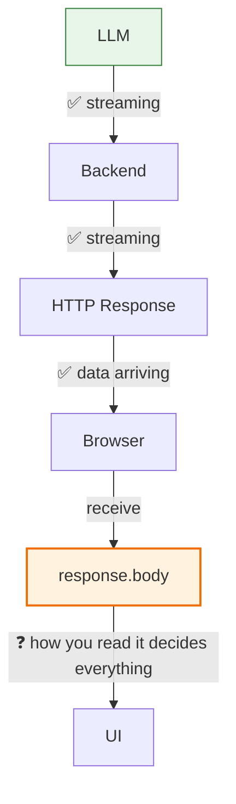
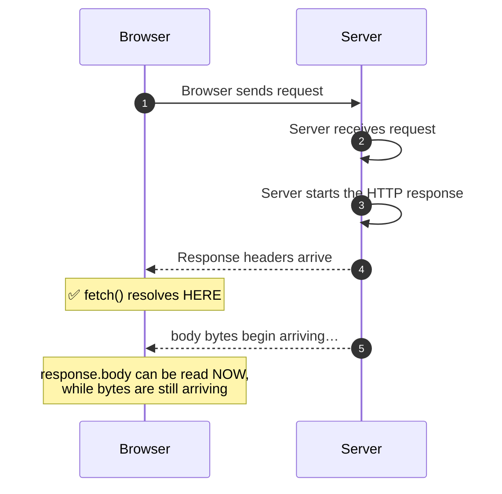
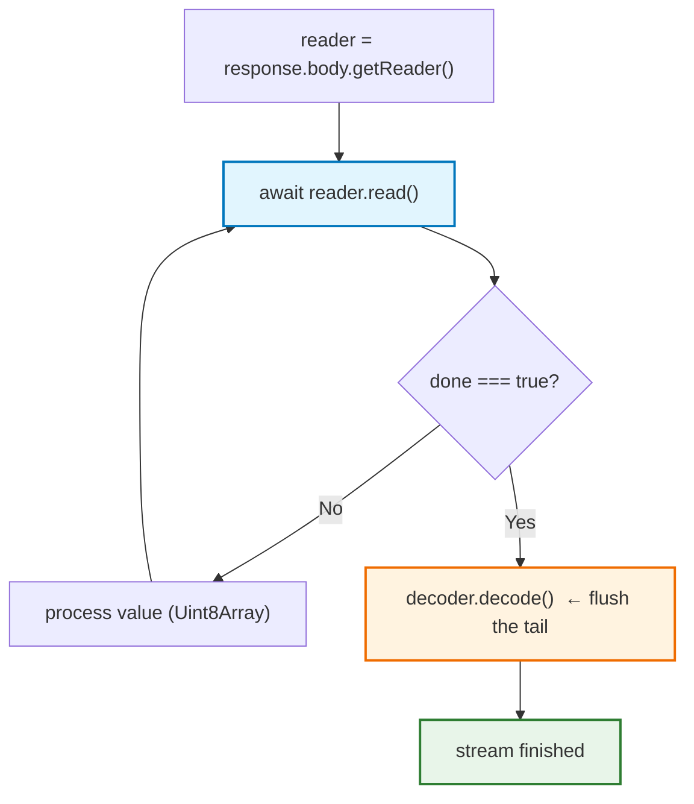
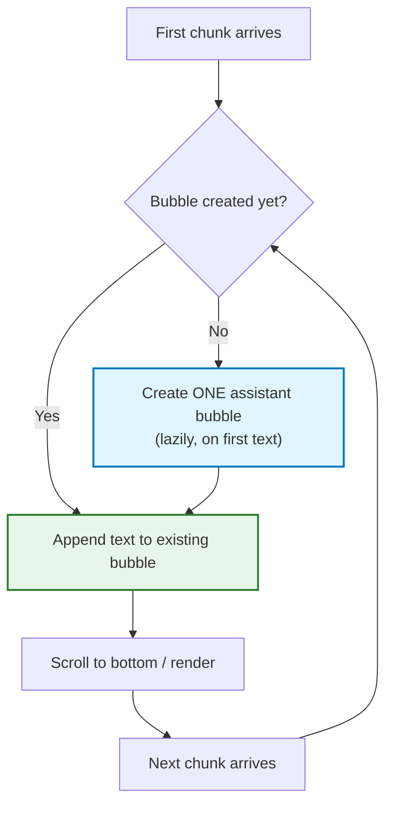
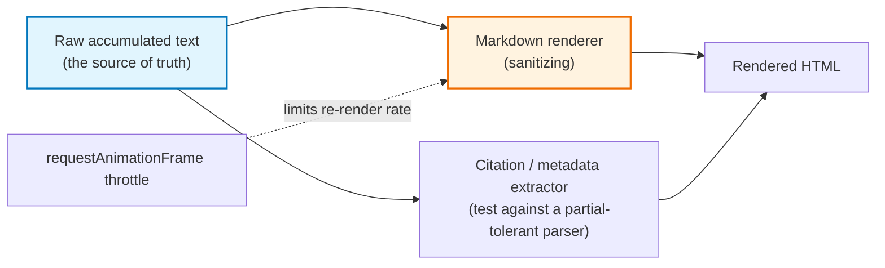

# Chapter 08 — Frontend Streaming: `fetch`, `ReadableStream` & `TextDecoder`

> **Lecture 07 · Chapter 08 of 09** · Level: 🟡 Intermediate · Phase 2 — The Application Layer
> **Source:** `Forward-Deployed-Engineer/Lecture 06/notes/09_Frontend_Streaming_Fetch_ReadableStream_TextDecoder.md`
> (slides §23–§34)
> **Roadmap topics:** frontend `fetch`, `ReadableStream`, `TextDecoder`, rAF rendering, cancellation,
> recovery; rendering rich content while it is still arriving; accessibility.
> **Prerequisites:** Chapter 04 (bytes vs characters, framing) · Chapter 05 (SSE/raw text, heartbeats) ·
> Chapter 06 (invariant 5 & 6).

> **Note:** all snippets in this chapter are **JS/TS-style pseudocode**, written for clarity of mechanism,
> not as a drop-in production module.

---

## 08.0 What this chapter is for

Everything built on the server can be erased by **one line** of client code. This chapter is about the
half of streaming that is easiest to get wrong, because when it is wrong nothing looks broken: the backend
logs show perfect streaming, the network tab shows progressive bytes, and the user still sees a frozen
spinner.

By the end of this chapter you should be able to:

1. Explain what `await fetch()` actually waits for — and why that matters.
2. Consume `response.body` as a `ReadableStream` with `getReader()`.
3. Explain why `read()` returns bytes, and decode them correctly with one `TextDecoder`.
4. Build the canonical experience: **one growing assistant bubble**, created lazily.
5. Implement **cancellation** that preserves partial text and does not look like an error.
6. Handle auto-scroll, rich rendering, sanitisation, performance and accessibility.

---

## 08.1 Backend streaming is only half the work

At the end of the backend effort:

```text
AI Provider ➔ App Server      ✅ streaming
```

But we still need:

```text
App Server ➔ Browser          ❓
```

> **The source's warning:** *If the browser waits for the complete HTTP body, the user still sees the
> entire answer appear at once.*



Everything you built on the server can be erased by **one line** of client code.

---

## 08.2 The common frontend mistake

Suppose the backend correctly emits:

```text
"Spring"
" Boot"
" is"
" a"
" framework"
```

But the frontend does this:

```javascript
const assistantReply = await response.text();
```

Then the browser effectively says:

> *Read the complete response body, combine everything, convert it to text, and give it to me only after it
> has finished.*

Resulting in:

```text
LLM                                 ✅ streaming
 ↓
App Server                          ✅ streaming
 ↓
HTTP                                ✅ streaming
 ↓
Browser                             ✅ receiving data
  ↓
response.text()                     ❌ waits for the complete body
 ↓
UI                                  ⛔ nothing until the end
```

> **One line has removed the visible streaming experience.** This is the most common "streaming doesn't
> work" bug in production, and it is invisible to every backend log and dashboard. It is invariant 5 from
> Chapter 06, and it is why the `clientTTFT − serverTTFT` alert exists (Chapter 09).

| Call | What it does | Streaming-friendly? |
| :--- | :--- | :--- |
| `await fetch(url)` | Resolves on **headers** | ✅ |
| `await response.text()` | Reads & concatenates the **entire** body | ❌ |
| `await response.json()` | Same, then parses | ❌ |
| `response.body` | The raw byte stream | ✅ |
| `response.body.getReader()` | A cursor over the stream | ✅ |

---

## 08.3 What does `await fetch()` actually wait for?

Consider:

```javascript
const response = await fetch(API_URL, {
  method: "POST",
  headers: { "Content-Type": "text/plain" },
  body: message
});
```

A very common misconception:

```text
❌ await fetch()  waits until the complete response body has been downloaded
```

Conceptually, it does **not**. The real flow:



At the moment `fetch()` resolves:

```text
response
   │
   ├── status: 200
   ├── headers: {...}
   └── body:  ← still arriving…
```

> **`await fetch()` resolves when the response headers are received** — long before the body is complete.
> The bug is that `await response.text()` then *drains and concatenates* that body anyway.

**Why this distinction is load-bearing:** it means the browser *already has* a live stream in hand. Nothing
needs to be enabled, no flag needs to be set. You only need to stop collapsing it.

---

## 08.4 `response.body` — the `ReadableStream`

The actual stream is available through:

```text
response
   │
   ├── status
   ├── headers
   └── body  ↓
        ReadableStream
```

A `ReadableStream` represents **data that can become available progressively over time**. We obtain a
reader:

```javascript
const reader = response.body.getReader();
```

```text
HTTP Response Body  →  ReadableStream  →  getReader()  →  Reader
```

| Concept | Role |
| :--- | :--- |
| `ReadableStream` | The body as a *pull-based source of bytes over time* |
| `getReader()` | Acquires a **cursor**; only one reader at a time (locked stream) |
| `reader.read()` | Returns a `Promise<{ value, done }>` for the next fragment |
| `reader.cancel()` | Releases the stream (also useful for early termination) |
| `releaseLock()` | Frees the lock for reuse |
| **Lock rule** | Calling `getReader()` twice without releasing throws `TypeError` — a common bug in React StrictMode/dev double-effects |

> **The lock is a real footgun, not a formality.** A `ReadableStream` can have only one active reader. In
> development, React StrictMode intentionally double-invokes effects, so a `getReader()` inside an effect
> will throw `TypeError: ReadableStream is locked` on the second invocation. Acquire readers **inside event
> handlers**, or guard and release explicitly.

---

## 08.5 Reading the stream

We repeatedly ask the reader for more data:

```javascript
const { value, done } = await reader.read();
```

The result looks like:

```javascript
{ value: Uint8Array(6), done: false }   // mid-stream
{ value: Uint8Array(9), done: false }   // more data
{ value: undefined,     done: true }    // stream finished
```

So the natural structure is:

```javascript
while (true) {
  const { value, done } = await reader.read();
  if (done) break;
  // Process incoming data
}
```



> **Now the browser is actively consuming the response while it is still arriving.** This loop is the single
> most important piece of client-side streaming code — everything else in this chapter is detail around it.

**Two rules about this loop:**

1. **`done` is not text.** Check `done` *before* touching the DOM. Treating `done: true` as "we received
   text" produces empty or ghost bubbles.
2. **Read fast, render separately.** Do not do heavy work inside the loop — accumulate, and let a render
   scheduler (rAF) decide when to paint (Chapter 06, §06.5).

---

## 08.6 Why isn't `value` already a string?

At the network level, HTTP transfers **bytes**:

```text
"Spring"  →  UTF-8 encoding  →  83 112 114 105 110 103  →  Network
```

So `value` is byte data represented as a **`Uint8Array`**:

```text
[83, 112, 114, 105, 110, 103]
```

Our UI needs text. Therefore:

```text
Bytes  →  Decode  →  Text
```

### `TextDecoder`

JavaScript provides `TextDecoder` for this job. Create it **once**:

```javascript
const decoder = new TextDecoder();
```

Then decode every incoming piece:

```javascript
const chunk = decoder.decode(value, { stream: true });
```

```text
Uint8Array  →  TextDecoder  →  "Spring"
```

> **Why `{ stream: true }` is non-negotiable:** it tells the decoder to hold any *incomplete* multi-byte
> sequence internally until the next read supplies the remaining bytes (the `₹` case from Chapter 04). The
> decoder must also be created **once per response**, outside the loop.

The complete loop:

```javascript
const reader = response.body.getReader();
const decoder = new TextDecoder();

while (true) {
  const { value, done } = await reader.read();
  if (done) break;

  const chunk = decoder.decode(value, { stream: true });
  console.log(chunk);
}
```

The console might gradually show:

```text
Spring
 Boot
 makes
 building
 Java
 applications
 easier
```

> **Reminder:** *a browser chunk is not guaranteed to be one token or one word.* It might receive
> `"Spring Boot"`, then `" makes building"`, then `" Java applications"`. **The UI should not depend on
> chunk boundaries.**

---

## 08.7 One assistant bubble, not one bubble per chunk

Suppose the response arrives as:

```text
"Spring"     " Boot"     " is"     " great"
```

We should **not** create:

```text
[Spring]  [ Boot]  [ is]  [ great]
```

> **These are not four assistant messages. They are four pieces of ONE assistant message.**

The correct approach:

```text
Create assistant bubble once
          ↓
     Append chunk
          ↓
   Append next chunk
          ↓
   Append next chunk
          ↓
   Complete message
```

The UI gradually changes from:

```text
Spring  →  Spring Boot  →  Spring Boot is  →  Spring Boot is great
```



### Reusing an existing chat UI

If your existing helper returns the newly created row:

```javascript
return row;
```

then create one empty assistant message:

```javascript
const assistantRow = addMessage("assistant", "");
```

and get its message bubble:

```javascript
const assistantBubble = assistantRow.querySelector(".message");
```

Whenever text arrives:

```javascript
assistantBubble.textContent += chunk;   // the same bubble keeps growing
```

> **Why laziness matters:** creating the bubble on the *first text piece* (rather than before the request)
> avoids an empty bubble if the request fails before producing any output — one fewer edge case in the UI.
> It also makes the "still generating" state easier to express: no bubble means nothing has been generated
> yet.

---

## 08.8 The complete `sendMessage()` flow

Reproduced from the source as pseudocode, with the flow made explicit:

```javascript
async function sendMessage() {
  const message = messageInput.value.trim();
  if (!message) return;

  addMessage("user", message);
  messageInput.value = "";
  messageInput.focus();

  sendButton.disabled = true;
  showTyping();

  let assistantRow = null;
  let assistantBubble = null;
  let hasStartedStreaming = false;

  try {
    const response = await fetch(API_URL, {
      method: "POST",
      headers: { "Content-Type": "text/plain" },
      body: message,
      signal: controller.signal,          // ⬅ enables the Stop button
    });

    if (!response.ok) throw new Error("Request failed");

    const reader = response.body.getReader();
    const decoder = new TextDecoder();

    while (true) {
      const { value, done } = await reader.read();
      if (done) break;

      const chunk = decoder.decode(value, { stream: true });

      // ---- Create the bubble ONCE, on the first real text ----
      if (!hasStartedStreaming) {
        hideTyping();
        assistantRow = addMessage("assistant", "");
        assistantBubble = assistantRow.querySelector(".message");
        hasStartedStreaming = true;
      }

      assistantBubble.textContent += chunk;   // append, never replace
      scrollToBottom();
    }

    // ---- Flush any bytes still held inside the decoder ----
    const remainingText = decoder.decode();
    if (remainingText && assistantBubble) {
      assistantBubble.textContent += remainingText;
    }

  } catch (error) {
    hideTyping();

    if (error.name === "AbortError") {
      // ⬅ an abort is NOT an error: keep the partial text, mark it stopped
      if (assistantRow) assistantRow.dataset.status = "stopped";
    } else {
      if (assistantRow) assistantRow.remove();   // discard the partial bubble
      addMessage(
        "assistant",
        "Sorry, I couldn't connect to Tomato Support. Please try again.",
        "error"
      );
    }
  } finally {
    hideTyping();
    sendButton.disabled = false;
  }
}
```

### What happens, step by step

```text
User submits message
        ↓
Show typing indicator
        ↓
Send HTTP request
        ↓
Receive response headers          ← fetch() resolves here
        ↓
Get response.body
        ↓
Create stream reader
        ↓
Wait for the first chunk
        ↓
Hide typing indicator
        ↓
Create ONE assistant bubble
        ↓
Decode chunk
        ↓
Append text
        ↓
Read next chunk
        ↓
Append text
        ↓
...
        ↓
Stream completes
        ↓
Flush the decoder tail
```

> **This produces the familiar ChatGPT-style experience where the answer appears progressively.** — the
> source's §33, and the canonical target shape for every streaming chat client.

---

## 08.9 Auto-scrolling: why `scrollToBottom()` after every chunk?

As the response grows:

```text
Line 1
Line 2
Line 3
Line 4
Line 5
...
```

the assistant bubble becomes taller. **Without updating the scroll position, newly generated content may
move outside the visible area.** Calling:

```javascript
scrollToBottom();
```

after each chunk keeps the latest generated output visible.

> **The source's production caveat:** *for production applications, we may want smarter behaviour so that
> automatic scrolling stops if the user manually scrolls upward. For a basic chatbot demo, continuous
> scrolling is sufficient.*

### The smarter policy (used by real assistants)

```typescript
// PSEUDOCODE (TS): sticky auto-scroll that respects the user's intent
const scrollState = { pinnedToBottom: true };

container.addEventListener("scroll", () => {
  const distanceFromBottom =
    container.scrollHeight - container.scrollTop - container.clientHeight;
  scrollState.pinnedToBottom = distanceFromBottom < 40;   // near the bottom?
});

function onChunkAppended() {
  if (scrollState.pinnedToBottom) scrollToBottom();
  else showScrollToLatestAffordance();   // a "jump to latest" button
}
```

| Policy | Behaviour | When to use |
| :--- | :--- | :--- |
| Always scroll | Every chunk jumps to the bottom | Short answers, demos |
| Sticky (pin unless the user scrolls up) | Respects reading | **Production default** |
| Never auto-scroll | The user scrolls manually | Long-form document generation, side-by-side review |
| Scroll on sentence/paragraph boundaries | Smoother, less jittery | Polished products |

> **Accessibility note:** every scroll triggered by new content is a visual *and* screen-reader *and*
> motion event. Respect `prefers-reduced-motion` and throttle scrolls to one per animation frame.

---

## 08.10 Rendering rich content while it is still arriving

Plain `textContent += chunk` is correct, fast and safe. The moment you render **markdown**, **code blocks**
or **citations**, new problems appear — because **partial text is frequently invalid syntax**:

| Stage in the stream | What the raw text looks like | Naive markdown renderer output |
| :--- | :--- | :--- |
| Mid-code-fence | ` ```js\nconst a = 1` (no closing fence) | Broken/unclosed `<pre>` |
| Mid-table | `\| Name \| Rol` (row incomplete) | Malformed table |
| Mid-bold | `**import` | Literal asterisks or flashing bold |
| Mid-link | `[docs](https://exa` | Broken anchor / XSS surface |

### The recommended rendering architecture



Four rules that keep streaming rendering correct and cheap:

1. **Never delete or "fix" the raw text.** The raw accumulated string is canonical; the rendered HTML is a
   *projection* of it, regenerated (or incrementally patched) as text arrives.
2. **Re-render at a bounded rate**, not per chunk. Re-parsing markdown 200 times per answer burns
   main-thread time and causes visible jank (and, per Chapter 06, can even slow the stream).
3. **Use a partial-tolerant markdown renderer**, or explicitly close open fences/blocks before rendering the
   tail.
4. **Always sanitize.** Streaming output is untrusted input the moment it can contain HTML, links or images.

```typescript
// PSEUDOCODE (TS): one render per animation frame, sanitized
let raw = "";
let scheduled = false;

function appendChunk(piece: string) {
  raw += piece;                        // ⬅ canonical, never mutated
  if (scheduled) return;
  scheduled = true;
  requestAnimationFrame(() => {
    scheduled = false;
    bubble.innerHTML = sanitize(markdownToHtml(closeOpenBlocks(raw)));  // ⬅ sanitize ALWAYS
  });
}
```

> **Why XSS is a *streaming* problem, not just a general web problem:** the model can emit a link or an HTML
> fragment that only becomes dangerous once rendered — and it renders while you are still receiving it. The
> attack surface is "model output plus anything the model was fed" (retrieved documents, user content).
> Sanitisation is not optional because the content is "the AI's"; it is untrusted exactly like any other
> user-generated input.

---

## 08.11 Cancellation: the Stop button

Cancellation is a first-class feature, not a nicety. `AbortController` is the mechanism:

```typescript
// PSEUDOCODE (TS): cancellation with partial-text preservation
const controller = new AbortController();      // ⬅ ONE per request, never reused

// Stop button
stopButton.onclick = () => controller.abort();

try {
  const res = await fetch(URL, { method: "POST", body: msg, signal: controller.signal });
  // ... read loop as before ...
} catch (err) {
  if (err.name === "AbortError") {
    markBubbleAsStopped();                     // ⬅ NOT an error state
  } else {
    showErrorState(err);
  }
} finally {
  reader?.releaseLock?.();                     // free the stream lock
}
```

| Concern | Behaviour to implement |
| :--- | :--- |
| Preserve partial text | Abort ≠ delete. Keep what was rendered and flag it as stopped |
| Persist the partial turn | Notify the server (or rely on backend close detection) so history stays consistent |
| Dispose of the reader | `reader.cancel()` if you still hold the lock, to free the stream |
| Prevent double aborts | Guard the abort handler; aborts are idempotent but the UI should be too |
| Reset for the next turn | A fresh `AbortController` per request — never reuse one |

> **Naming caution:** an abort is **not** an error. Treating `AbortError` as a failure produces spurious
> error toasts every time a user presses Stop — and it makes the UI look broken for a feature the user
> deliberately used.

---

## 08.12 Performance, framework patterns & accessibility

### 08.12.1 Performance rules

| Rule | Why |
| :--- | :--- |
| Read as fast as possible; **render on `requestAnimationFrame`** | Decouples network I/O from main-thread work (Chapter 06) |
| Batch DOM writes; avoid layout thrash | Reading `scrollHeight` after every write forces reflow |
| Never re-parse markdown per chunk | 200 parses per answer ⇒ jank and dropped frames |
| Cap DOM size for very long answers | Huge single nodes are expensive to repaint |
| Virtualise long conversations | Only render visible messages |
| Keep the input enabled while streaming | Users should be able to queue the next message |
| Show a subtle streaming cursor | Communicates "still generating" without blocking |

### 08.12.2 React (and similar state-manager) patterns

```typescript
// PSEUDOCODE (TSX): the idiomatic React streaming shape
function useChatStream() {
  const [text, setText] = useState("");          // accumulated content
  const [phase, setPhase] = useState<"idle"|"streaming"|"error"|"stopped">("idle");
  const controllerRef = useRef<AbortController | null>(null);

  async function send(message: string) {
    setText("");
    setPhase("streaming");
    controllerRef.current = new AbortController();

    try {
      const res = await fetch(URL, {
        method: "POST", body: message, signal: controllerRef.current.signal,
      });
      const reader = res.body!.getReader();
      const decoder = new TextDecoder();

      while (true) {
        const { value, done } = await reader.read();
        if (done) break;
        const piece = decoder.decode(value, { stream: true });
        setText(prev => prev + piece);            // append-only update
      }
      setPhase("idle");
    } catch (e: any) {
      setPhase(e.name === "AbortError" ? "stopped" : "error");
    }
  }

  const stop = () => controllerRef.current?.abort();
  return { text, phase, send, stop };
}
```

Two framework-specific traps worth memorising:

1. **React StrictMode double-invokes effects in development.** If your effect calls
   `response.body.getReader()`, the second invocation throws `TypeError: ReadableStream is locked`. Acquire
   readers in event handlers, or release/guard explicitly.
2. **Never store an entire conversation in one state blob updated per chunk.** Use a dedicated append-only
   slice (or imperative DOM writes) so a single token does not re-render the whole message list.

### 08.12.3 Accessibility

| Requirement | Implementation |
| :--- | :--- |
| Announce streaming progress | `aria-live="polite"` on the assistant region (never `assertive` — it would interrupt constantly) |
| Rate-limit announcements | Screen readers must not be flooded per token; update at sentence granularity |
| Show a "generating" state | `aria-busy="true"` while streaming |
| Respect motion preferences | Honour `prefers-reduced-motion` for typing/scroll animations |
| Focus management | Keep focus in the input; do not steal focus as text arrives |
| Keyboard access to Stop | Stop must be reachable and clearly labelled |
| Final state announcement | Announce completion once, with the message role |

> **Why this matters more in streaming than in classic UIs:** the DOM changes dozens of times per second. An
> `aria-live` region updated per chunk makes a screen reader unusable; updated per sentence, it mirrors the
> visual experience.

---

## 08.13 Common mistakes

| # | Pitfall | Consequence | Fix |
| :--- | :--- | :--- | :--- |
| 1 | `await response.text()` | All backend streaming wasted | `response.body.getReader()` |
| 2 | `TextDecoder` created per chunk | Corrupted multi-byte characters | One decoder + `{ stream: true }` |
| 3 | New bubble per chunk | Message list polluted with fragments | One bubble, append-only |
| 4 | Replacing (`textContent =`) instead of appending (`+=`) | Only the last piece remains | Append |
| 5 | Treating `AbortError` as a failure | Error toasts on every Stop press | Handle abort separately |
| 6 | Unconditional `scrollToBottom()` | The user cannot read while scrolled up | Sticky-scroll policy |
| 7 | Unsanitised `innerHTML` of streamed markdown | XSS from the model or injected content | Sanitize every render |
| 8 | Re-parsing markdown per chunk | Jank, dropped frames, slower streams | Render on animation frame |
| 9 | Ignoring `done` before touching the DOM | Empty or ghost bubbles | Create the bubble on first text |
| 10 | No reader-lock handling in React effects | `ReadableStream is locked` in dev | Acquire readers in handlers; guard/release |
| 11 | Forgetting the final `decoder.decode()` flush | The last character(s) silently dropped | Flush after the loop |
| 12 | No `aria-live`, or an unruly one | Invisible or unusable for screen readers | Polite live region, sentence-granular updates |
| 13 | One giant state blob per conversation updated per chunk | Whole message list re-renders per token | Append-only slice or imperative writes |
| 14 | Reusing one `AbortController` across turns | Stop may cancel the wrong request | A fresh controller per request |
| 15 | Assuming a chunk is a word/token | Broken markdown, mid-word styling | Blind accumulation, render above it |

---

## 08.14 Key takeaways

1. **The frontend can undo the entire backend.** One `await response.text()` reverts to zero perceived
   streaming.
2. **`await fetch()` resolves on response headers, not on body completion** — the body arrives afterwards.
3. **`response.body` is a `ReadableStream` of bytes**; `getReader()` gives a cursor with `{ value, done }`
   results.
4. **Decode with exactly one `TextDecoder`, using `{ stream: true }`, and flush at the end** — this is what
   makes multi-byte characters safe.
5. **Create exactly one assistant bubble and append to it forever.** Chunks are not messages.
6. **Create the bubble lazily on the first text piece** so failures cannot leave ghost bubbles.
7. **Cancellation is a first-class feature** (`AbortController`) and must preserve, not discard, partial
   text.
8. **Auto-scroll must be respectful** — sticky-to-bottom with a "jump to latest" affordance.
9. **Rich rendering must be sanitised and rate-limited**, because partial text is invalid syntax and
   streamed content is untrusted input.
10. **`done` is not text, `AbortError` is not an error, and a chunk is not a message.** These three
    distinctions prevent most client-side streaming bugs.
11. **Decouple reading from rendering** — read fast, paint on animation frames. This is the client-side
    answer to backpressure.
12. **Accessibility is a streaming-specific design problem**, not an afterthought: a per-token live region is
    worse than none at all.

---

**Previous:** [Chapter 07 — Backend Streaming](./07_Backend_Streaming_Call_vs_Stream_Flux_and_Stream_Pumps.md) ·
**Next:** [Chapter 09 — History, Persistence & Production Hardening](./09_History_Persistence_and_Production_Hardening.md)