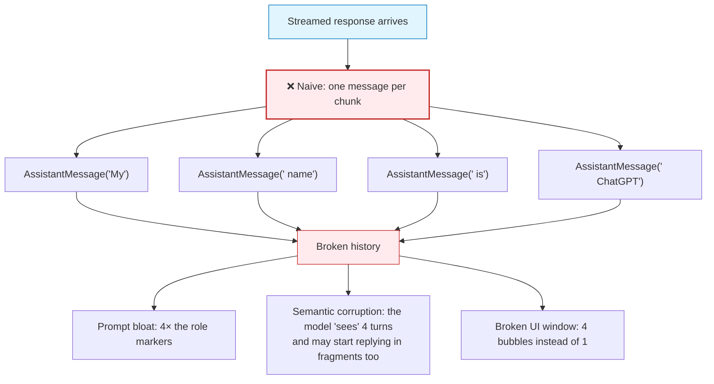
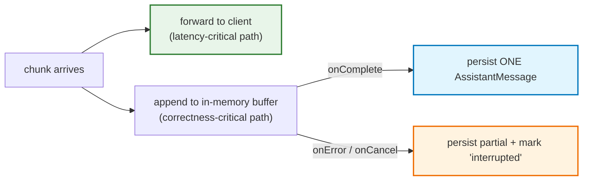
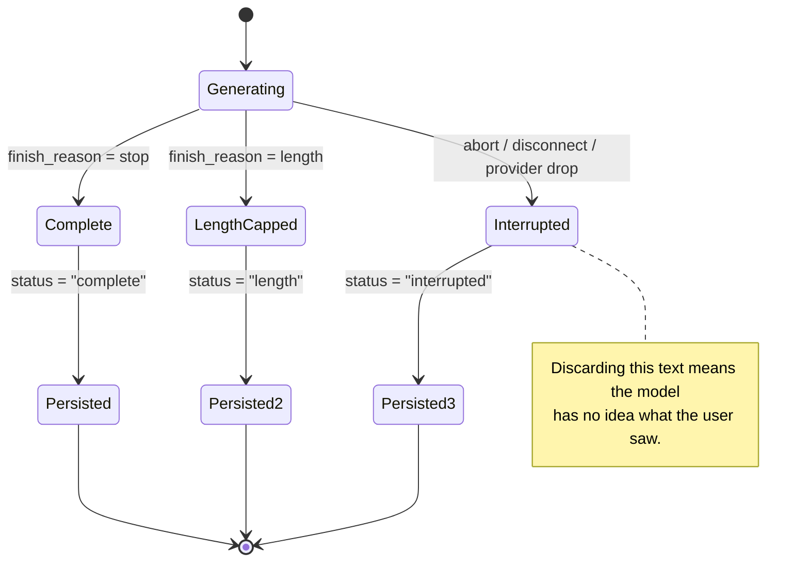
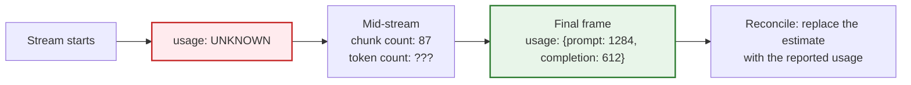
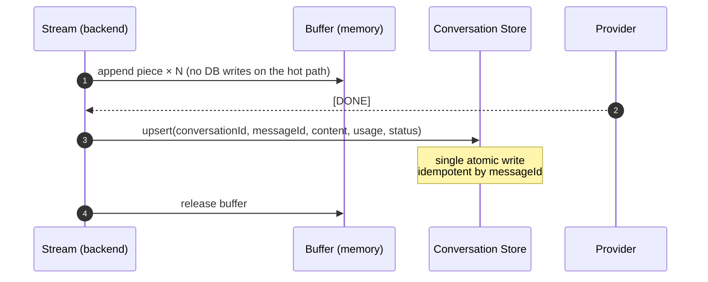
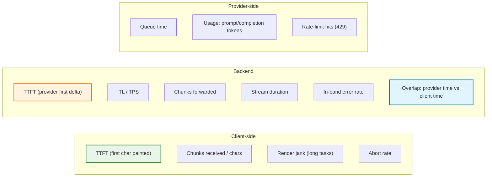
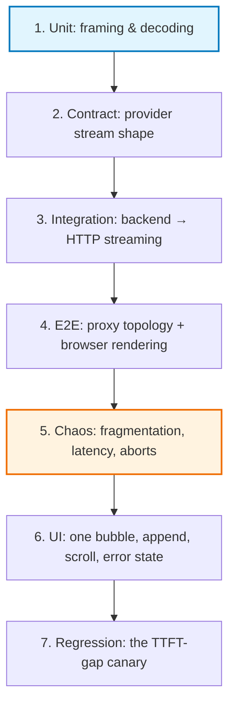

# Chapter 09 — Conversation History, Persistence & Production Hardening

> **Lecture 07 · Chapter 09 of 09** · Level: 🟡 Intermediate · Phase 2 — The Application Layer
> **Source:** `Forward-Deployed-Engineer/Lecture 06/notes/08_Conversation_History_Buffering_and_Persistence.md`
> and `…/10_Production_Hardening_Observability_and_Takeaways.md` (slides §19–§22, §35, §37)
> **Roadmap topics:** conversation history buffering & persistence during streams; token accounting &
> context management *during* a stream; production hardening (timeouts, heartbeats, observability, graceful
> shutdown); infrastructure that silently breaks streaming.
> **Prerequisites:** Chapters 06–08 (invariants, backend bridge, client).

---

## 09.0 What this chapter is for

Streaming creates a problem that buffered code never had: **if the assistant's answer arrives as hundreds of
fragments, what exactly do you store as history for the next turn?**

This chapter answers that question, then turns a working streaming demo into a production system:
persistence engineering, token accounting during a stream, the hardening checklist, the observability
metrics that actually detect streaming regressions, and a testing strategy.

By the end of this chapter you should be able to:

1. Explain why transport chunks must never become conversation messages.
2. Implement the **dual-write pattern** — stream out, buffer in.
3. Handle partial failure: interrupted turns still belong in history.
4. Do **token accounting** correctly during a stream (chunks ≠ tokens) and budget the context.
5. Write history **idempotently, atomically and in order**.
6. Run the 20-point production hardening checklist.
7. Instrument the metrics that catch streaming regressions, including the **TTFT-gap alert**.
8. Test streaming at six levels, with two CI assertions that catch most regressions.

---

## 09.1 The problem streaming introduces

Non-streaming code makes history trivial — the assistant response is already one complete `String`:

```text
history.add(new UserMessage("My name is Rohit"));
String response = "...";                       // complete value
history.add(new AssistantMessage(response));   // store it
```

Streaming changes this. The response arrives as many fragments:

```text
"My"        " name"        " is"        " ChatGPT"
```

and the naive adaptation collapses:



> **The source's rule:** *those are transport chunks. Logically, the model generated **one** assistant
> message:* `"My name is ChatGPT"`. *Our conversation history should therefore contain:*

```text
UserMessage(...)
AssistantMessage("My name is ChatGPT")
```

**Where the naive approach is even worse than it looks:** each extra message adds role tokens
(`assistant:`), so a 200-chunk answer inflates the prompt with 200 redundant role markers on every
subsequent turn. The cost is not linear annoyance — it is compounding **prompt bloat**, and it degrades
TTFT as well as quality (Chapter 03).

---

## 09.2 The dual-write pattern: stream out, buffer in

The fix is that **every chunk must perform two jobs**:

```text
                        chunk
                          │
              ┌───────────┴───────────┐
              ↓                       ↓
      Send to browser          Append to buffer
        immediately
```

Illustrated concretely:

```text
"Java"        ├──→ Browser        └──→ Buffer
" is"         ├──→ Browser        └──→ Buffer
" a"          ├──→ Browser        └──→ Buffer
" language"   ├──→ Browser        └──→ Buffer
```

When generation completes:

```text
Buffer
  ↓
"Java is a language"
  ↓
Store ONE AssistantMessage
```



This yields **both** properties at once:

- **Real-time output for the user** (the browser sees each chunk instantly), and
- **Correct conversation history for future prompts** (the DB sees one message).

> **The one-line summary:** the **latency path** and the **correctness path** share the same input and
> diverge immediately. Never let one block the other — a DB write inside the emission callback throttles
> the stream the user is watching.

---

## 09.3 The reference implementation, and why it is only a teaching pattern

The source provides a minimal teaching implementation:

```text
public Flux<String> chat(String userMessage) {

    history.add(new UserMessage(userMessage));

    StringBuilder fullResponse = new StringBuilder();

    return chatClient.prompt()
            .messages(history)
            .stream()
            .content()
            .doOnNext(fullResponse::append)
            .doOnComplete(() -> {
                history.add(
                    new AssistantMessage(fullResponse.toString())
                );
            });
}
```

Decomposing it line by line — this pattern is worth memorising verbatim:

| Line | What it does | Why it matters |
| :--- | :--- | :--- |
| `history.add(new UserMessage(userMessage))` | Record the user turn **before** calling the model | The prompt must contain the new turn |
| `StringBuilder fullResponse = new StringBuilder()` | Allocate one accumulator for this request | **One buffer per request — never shared** |
| `.messages(history)` | Send the full conversation | Context for coreference resolution |
| `.stream().content()` | Get a stream of text pieces | The streaming contract |
| `.doOnNext(fullResponse::append)` | *Whenever another chunk arrives, append it to the local buffer* | **The streaming-to-buffered bridge** |
| `.doOnComplete(…)` | *When the stream finishes successfully, convert the buffered output into one assistant message and save it* | Correct history, one message |

> **The source's note on the pattern:** *the stream itself continues flowing to the controller and browser.*
> The observers do not intercept or buffer the outward flow.

### The production warning: shared mutable state

Immediately after the teaching example, the source flags this:

> *A shared `ArrayList` and mutable conversation history like this are useful for teaching but are **not
> suitable as-is for a real multi-user application**. Production applications need proper **conversation
> isolation** and **thread-safe state management**.*

```typescript
// PSEUDOCODE (TS): the production shape — per-request buffer, per-conversation state, explicit hooks
async function* chatWithHistory(session: Session, userMessage: string) {
  session.history.push({ role: "user", content: userMessage });

  const pieces: string[] = [];        // per-request accumulator

  try {
    for await (const piece of providerStream(session.history)) {
      pieces.push(piece);             // buffer (correctness path)
      yield piece;                    // forward (latency path)
    }
    session.history.push({ role: "assistant", content: pieces.join("") });
    await session.persist();          // one atomic, idempotent write
  } catch (err) {
    await session.persistInterrupted(pieces.join(""), err);   // keep what the user read
    throw err;
  } finally {
    session.releaseLock();
  }
}
```

| Element | Naïve version | Production version |
| :--- | :--- | :--- |
| Buffer location | Field on a shared service | **Local variable on the request** |
| History | Shared list | **Conversation-scoped store** |
| Concurrency | None | **Per-conversation lock** |
| Failure | Message lost | **Partial persisted with a status flag** |
| Writes | Per chunk | **Once, at completion** |

---

## 09.4 Partial failure: interrupted turns belong in history

Streaming's most counter-intuitive persistence rule:

> **If the user already read it, it is part of the conversation — even if the stream was interrupted.**



| Situation | Wrong behaviour | Correct behaviour |
| :--- | :--- | :--- |
| User presses Stop at 60% | Delete the bubble, store nothing | Keep the text, store with `status: "interrupted"` |
| Provider drops at 40% | Show a generic error, lose the text | Show the notice, keep the text, store as interrupted |
| `max_tokens` reached | Treat it as a complete answer | Store with `finish_reason: "length"` and surface it |
| Network drop on the client | Nothing stored | Server detects the close event and persists partial |
| Retry after a failure | Two turns appear | Upsert by a stable `messageId` (see §09.6) |

> **Why this is not merely nice-to-have:** the next turn's prompt is built from history. If the interrupted
> text is missing, the model answers as if the user never saw it — producing a visible contradiction in the
> conversation. Persisting the partial turn is what keeps the transcript *and* the model's context aligned
> with reality.

> **Checkpointing for very long generations.** For multi-minute generations, a single in-memory buffer is a
> crash risk: a process restart loses everything. The mitigation is a **periodic checkpoint** (every few
> seconds) of the accumulated text into a scratch record, overwritten each time — cheap, and it converts a
> total loss into a few seconds of loss.

---

## 09.5 Token accounting and context management *during* a stream

Two facts collide here:

1. **Chunk count is not token count** (Chapter 04). The number of chunks depends on provider batching, the
   network and your decoder.
2. **Usage tokens are not known until generation ends.** In stream mode, the `usage` object arrives in a
   final frame — or not at all.



| Approach | Accuracy | Cost | When to use |
| :--- | :--- | :--- | :--- |
| Count chunks as tokens | **Wrong**, unpredictably | Free | Never |
| Count characters ÷ average chars-per-token | ±10–15% | Free | Live progress bars, in-stream budgeting |
| Run a real tokenizer on the accumulated text | ±1% | CPU per update (throttle it) | Per-turn accounting |
| Provider `usage` in the final frame | Exact | Free | **Authoritative — always prefer this** |
| Provider `stream_options: { include_usage: true }` | Exact | Free (provider-dependent) | Enable it; not all providers support it |

> **Design a fallback.** Not every provider or model sends usage in stream mode. Estimate with a tokenizer
> during the stream, reconcile with the provider's number at completion, and never let the absence of usage
> break your billing or budgeting logic.

### Context management is a *streaming* concern too

Because prompt length drives TTFT (Chapter 03) and KV-cache pressure (Chapter 01), the context window must
be managed on a schedule — not reactively:

```typescript
// PSEUDOCODE (TS): decide the context strategy BEFORE streaming the answer
async function prepareContext(history: Message[], incoming: string): Promise<Message[]> {
  const candidate = [...history, { role: "user", content: incoming }];

  // 1. Hard budget check
  const tokens = countTokens(candidate);
  if (tokens < CONTEXT_BUDGET * 0.7) return candidate;      // comfortable

  // 2. Progressive degradation strategies, cheapest first
  const windowed = keepSystemPlusRecentTurns(candidate, { turns: 8 });
  if (countTokens(windowed) < CONTEXT_BUDGET) return windowed;

  const summarized = await summarizeOlderTurns(windowed);  // costs an extra call
  if (countTokens(summarized) < CONTEXT_BUDGET) return summarized;

  return truncateWithMarker(summarized, CONTEXT_BUDGET);    // last resort, told to the user
}
```

| Strategy | Extra cost | Preserves | Use when |
| :--- | :--- | :--- | :--- |
| Sliding window (last N turns) | None | Recent context | Usually the right default |
| Pinned system + sliding | None | Instructions + recent | Almost always better than plain sliding |
| Rolling summarisation | 1 extra call | Long-range gist | Long sessions, project work |
| Semantic retrieval of old turns | Embeddings | Topic-relevant history | Multi-topic long-lived chats |
| Hard truncation | None (quality loss) | Nothing reliably | Emergency fallback only |

> **The important sequencing rule:** context preparation happens **before** the stream starts, never during
> it. Shrinking history mid-generation is impossible — the prompt has already been prefill-ed. If you
> discover mid-stream that the context was too large, you have already paid the TTFT penalty.

---

## 09.6 Persistence engineering: writing history correctly

Streaming makes persistence a *late-bound* operation: the content is only known when the stream ends. That
creates ordering, idempotency and concurrency requirements.



| Requirement | Why | Implementation shape |
| :--- | :--- | :--- |
| **No DB writes on the emission path** | Each write would throttle the stream (backpressure, Chapter 06) | Buffer in memory; write once on completion |
| **Stable `messageId`** | Retries after a network failure must not duplicate the turn | Generate the ID **before** streaming; upsert by it |
| **Atomic single write** | A half-written conversation is worse than a missing one | One transaction/upsert per turn, or commit-on-complete |
| **Ordering guarantee** | Interleaved writes corrupt the transcript | Per-conversation lock or monotonic sequence numbers |
| **Usage capture** | Billing and analytics need per-turn tokens | Persist the usage object from the final frame |
| **Timestamps** | Auditability and "generation duration" metrics | Store `createdAt`, `firstTokenAt`, `completedAt` |
| **Retention & redaction** | Compliance and log hygiene | Configurable TTL; redact secrets/PII at write time |
| **Crash safety** | A server restart mid-stream must not lose the user's text | Periodic checkpoint for very long generations |

### The three storage layers worth distinguishing

```text
┌─────────────────────────────────────────────────────────────┐
│ 1. HOT BUFFER (in memory, per request)                      │
│    Lifetime: one generation. Purpose: assemble the answer.  │
├─────────────────────────────────────────────────────────────┤
│ 2. CONVERSATION STORE (DB / cache)                          │
│    Lifetime: the conversation. Purpose: next-turn context.  │
├─────────────────────────────────────────────────────────────┤
│ 3. ANALYTICS LEDGER (append-only, async)                    │
│    Lifetime: forever. Purpose: cost, latency, quality       │
│    analytics. NEVER on the critical path.                   │
└─────────────────────────────────────────────────────────────┘
```

> **Anti-pattern:** writing every chunk to the database "so nothing is lost." It converts a 2-second answer
> into 200 transactions, saturates the connection pool, and simultaneously *slows the stream the user is
> watching*. Buffer in memory; checkpoint only for genuinely long (multi-minute) generations.

---

## 09.7 The production hardening checklist

| # | Area | Requirement | Why |
| :--- | :--- | :--- | :--- |
| 1 | Proxy | `proxy_buffering off` + `X-Accel-Buffering: no` | Otherwise streaming silently disappears |
| 2 | Compression | Exclude `text/event-stream` from `gzip`/`br` | Compression blocks buffer output |
| 3 | Timeouts | Idle timeout > the longest expected gap between chunks | Streams must not die at 60 s |
| 4 | Heartbeats | `: keep-alive` comment / whitespace every 10–15 s | Keeps intermediaries and clients from idling out |
| 5 | Headers | `Content-Type: text/event-stream; charset=utf-8`, `Cache-Control: no-cache, no-transform` | Correct framing + no middlebox rewriting |
| 6 | Backend return type | A stream type, never `String`/`Promise<string>` | The contract that makes streaming possible |
| 7 | No `blockLast()` / no `collect()` | Forbidden on the streaming path | Recreates the buffering bug |
| 8 | Cancellation | `AbortController` (client) → cancellation signal (server) → provider cancel | Stops token spend on abandoned answers |
| 9 | Buffering | Per-request accumulator + persist on completion | Correct history (§09.2) |
| 10 | Partial failure | Persist with `status: "interrupted"` | Nothing the user read should vanish |
| 11 | Multi-user | Conversation-scoped state + per-conversation lock | Prevents cross-contamination |
| 12 | Rate limits | Per-user and per-conversation stream concurrency caps | One user must not saturate the GPU quota |
| 13 | Model limits | `max_tokens` / output caps + stop sequences | Bounded cost and bounded wait |
| 14 | Retries | Only *before* the first token; jittered backoff | Mid-stream retries duplicate text |
| 15 | Provider failover | A secondary model/provider behind a flag | A single provider outage should not kill chat |
| 16 | Payload limits | Max prompt tokens enforced **before** dispatch | Fail fast with a clear error, not a provider error |
| 17 | Secrets | Provider keys server-side only | Never expose API keys to the browser |
| 18 | PII | Redaction before dispatch + a retention policy | Compliance, plus log hygiene |
| 19 | Idempotency | Stable `messageId` + upsert | Safe retries after network failures |
| 20 | Rollout | Feature-flag streaming separately from the UI | Enables instant rollback of a UX-visible change |

> **Graceful shutdown is the 21st item worth adding.** On deploy or scale-down, an in-flight stream must be
> allowed to finish (or be cancelled cleanly and its partial text persisted) rather than being cut off. A
> `SIGTERM` handler that stops accepting new streams and drains existing ones for a bounded grace period is
> the difference between "a deploy" and "a deploy that corrupted 40 conversations".

---

## 09.8 Observability: the metrics that detect streaming regressions

A buffered endpoint and a broken-streaming endpoint look **identical** in aggregate latency dashboards. You
need streaming-specific telemetry, measured **per hop**.



| Metric | Definition | Diagnostic value |
| :--- | :--- | :--- |
| **Server TTFT** | Request received → first provider delta | Separates provider latency from your pipeline |
| **Client TTFT** | Click → first painted character | **The number the user feels** |
| **TTFT gap** | Client TTFT − Server TTFT | If large → proxy buffering or render blocking |
| **ITL / TPOT** | Mean gap between successive pieces | Detects stalls and provider throttling |
| **Chunks forwarded** | Count per response | Distribution exposes coalescing/buffering |
| **Chunk size distribution** | p50/p95 bytes per chunk | A single huge chunk = broken streaming |
| **In-band error rate** | `event: error` / total streams | Catches mid-stream failures invisible in HTTP status |
| **Abort rate** | Client-cancelled / started | UX signal; also drives cost-savings measurement |
| **Reuse vs. overlap** | `serverDuration − clientDuration` | A large positive gap = wasted generation |
| **Prompt tokens trend** | Per-turn prompt size | Explains creeping TTFT in long sessions |

### The single most valuable alert

```text
ALERT if  p95(client_ttft - server_ttft) > 500 ms
```

This one rule catches, in production: proxy buffering regressions, a middleware that buffers the body, a CDN
misconfiguration, compression being re-enabled on SSE, and a frontend refactor that accidentally
reintroduced `await response.text()`. **Nothing else in your dashboard detects that class of regressions.**

### Logging shape (per stream)

```json
{
  "event": "stream.completed",
  "conversationId": "conv_7fa1",
  "requestId": "req_9d2c",
  "ttftMs": 812,
  "totalMs": 7430,
  "chunks": 214,
  "avgChunkBytes": 37,
  "promptTokens": 1284,
  "completionTokens": 612,
  "finishReason": "stop",
  "clientAborted": false,
  "provider": "primary",
  "model": "gpt-4o-mini"
}
```

> **Rule:** one structured log line per stream, always including TTFT, chunk count, token usage and finish
> reason. Streaming bugs are statistical (p95 tails), not average-case — averages hide them entirely.

---

## 09.9 Cost, security and privacy in streamed systems

### 09.9.1 The cost model

Because streaming exposes partial output, it creates a *new* cost category: **wasted generation**.

$$\text{Cost}_{\text{turn}} = \underbrace{c_{\text{in}}\cdot T_{\text{prompt}}}_{\text{re-billed history}} + \underbrace{c_{\text{out}}\cdot T_{\text{completion}}}_{\text{produced tokens}}$$

| Cost lever | Effect | Implementation |
| :--- | :--- | :--- |
| Prompt size | Re-billed **every turn** | Context windowing (§09.5) |
| `max_tokens` cap | Bounds worst-case completion cost | Set per route, not globally |
| Cancellation propagation | Eliminates payment for unread output | Chapter 06 §06.6 |
| Model tiering | A big cost win for easy turns | Route by difficulty (small model first) |
| Prompt prefix caching | Reduces repeated system-prompt cost | Provider feature; keep prefixes stable |
| Streaming vs. buffered | **No inherent cost difference** | Do not "optimize cost" by removing streaming |

> **The subtle economic point:** streaming *reduces* cost when users abandon long answers, because
> cancellation stops generation. A non-streaming endpoint must finish (and bill) even when the user has
> already navigated away.

### 09.9.2 Security and privacy checklist

| Risk | Description | Mitigation |
| :--- | :--- | :--- |
| **XSS via streamed markdown** | Partial renders injected into the live DOM | Sanitize every render; no raw `innerHTML` |
| **Prompt injection in retrieved content** | RAG text instructs the model | Instruction/data separation, tool allow-lists, output validation |
| **Cross-user context leakage** | Shared conversation state | Conversation-scoped isolation + locks |
| **Provider key exposure** | Keys in the browser | Server-side proxies only; never client-side keys |
| **PII in logs / telemetry** | Prompts and answers in log pipelines | Redaction, sampling, retention limits, field-level encryption |
| **Data residency** | Streamed content crossing regions | Region-pinned provider endpoints and logs |
| **Model output as commands** | Agentic streaming executing plans | HITL approval gates for high-impact actions (Lecture 09) |
| **Denial-of-wallet** | Many parallel streams consume quota | Per-user concurrency caps + rate limits |
| **Log injection** | Newlines/ANSI in streamed text corrupting logs | Structured logging with escaped fields |

> **The `no-transform` header is also a security control.** A middlebox that rewrites the streamed body can
> inject content. `Cache-Control: no-cache, no-transform` forbids that rewriting, and it is cheap insurance.

---

## 09.10 Testing strategy for streaming systems

Streaming is hard to test because it is **temporal**: correctness depends on *how* data is fragmented over
time, not just on its final value.



| Level | What to test | Technique |
| :--- | :--- | :--- |
| 1. Framing / decoding | Multi-byte splits, partial SSE frames, `[DONE]` handling | **Fragmentation torture test** (Chapter 04): 1 byte at a time, random sizes |
| 2. Provider contract | Delta schema, empty first frame, usage frames, error frames | Recorded fixtures; mock streams with injected anomalies |
| 3. Backend | Return type is a stream; no collector operators; flush timing | Assert **TTFT ≪ total** in an integration test; assert ≥ 2 chunks received |
| 4. End-to-end | Real proxy config, compression off, heartbeats, timeouts | A staging environment with production topology; a `curl -N` smoke test |
| 5. Chaos / resilience | Aborts, provider drops, slow clients, mid-stream 429 | Inject latency/disconnect; verify partial persistence and lock release |
| 6. UI | One bubble, appended text, auto-scroll, error state | Component tests over a scripted fragment sequence |
| 7. Regression | The TTFT-gap alert | A synthetic canary chat every minute with `p95(TTFT gap)` measured |

### Two high-value assertions to put in CI

```typescript
// PSEUDOCODE (TS): the two assertions that catch almost all streaming regressions

// 1) The backend actually streams (not buffered)
const { chunkCount, ttftMs, totalMs } = await measureStream("/api/chat", "Explain DI");
assert(chunkCount > 2, "Response arrived in a single chunk — buffering somewhere!");
assert(ttftMs < totalMs * 0.5, "TTFT is close to total latency — stream is buffered");

// 2) The final text is fragmentation-invariant
for (const size of [1, 3, 17, 1024]) {
  const text = await consumeWithFragmentSize("/api/chat", "Explain DI", size);
  assert(text === canonicalAnswer, `Fragmentation size ${size} changed the output`);
}
```

> **Why these two are enough to start with:** assertion 1 catches every buffering hop (invariants 1–3),
> and assertion 2 catches every decoding/framing defect (the four-granularity problem). Together they cover
> the two failure families that produce 90% of streaming bugs.

---

## 09.11 The anti-pattern catalogue

| # | Anti-pattern | Symptom | Root cause | Fix |
| :--- | :--- | :--- | :--- | :--- |
| 1 | **The black-box spinner** | Nothing until the end | Buffered endpoint / `response.text()` | Stream end to end |
| 2 | **The one-line collapse** | Backend logs show streaming; the UI does not | `await response.text()` | `getReader()` loop |
| 3 | **The 30-second cliff** | Streams die at exactly 30/60 s | Proxy idle timeout | Heartbeats + raised timeout |
| 4 | **The gzip ghost** | Choppy delivery behind the CDN | Compression on `text/event-stream` | Exclude SSE from compression |
| 5 | **The fragment flood** | Hundreds of one-character bubbles | One message per chunk | One bubble, append-only |
| 6 | **The lost tail** | The last character is missing for some languages | No final `decoder.decode()` flush | Flush after the loop |
| 7 | **The mojibake** | `` in the middle of words | A new `TextDecoder` per chunk | One decoder + `stream: true` |
| 8 | **The zombie generation** | Provider billing exceeds user sessions | No cancellation propagation | Wire close → cancel |
| 9 | **The vanishing turn** | Interrupted answers absent from history | Persist only on success | Persist partial with a status |
| 10 | **The cross-talk** | User A sees User B's answer | Shared mutable conversation state | Conversation-scoped state + locks |
| 11 | **The silent truncation** | The answer just stops | Unhandled stream error, no in-band signal | `event: error` + `finish_reason` |
| 12 | **The janky renderer** | Stuttering, dropped frames | Markdown parsed per chunk | Render on `requestAnimationFrame` |
| 13 | **The ID-less insert** | Duplicate turns after a retry | Insert-only persistence | Upsert with a stable `messageId` |
| 14 | **The chunk-as-token counter** | Wildly wrong cost dashboards | Chunks treated as tokens | Provider usage / a real tokenizer |
| 15 | **The unlocked frame parser** | Random `` or dropped text | `TextDecoder` per chunk; no frame buffer | One decoder + a leftover frame buffer |

---

## 09.12 Common mistakes

| # | Pitfall | Consequence | Fix |
| :--- | :--- | :--- | :--- |
| 1 | Storing one message per chunk | Prompt bloat, "fragment" assistant behaviour, UI clutter | Buffer, then persist once |
| 2 | Persisting only on success | Cancelled/aborted turns vanish; the model loses what the user saw | Persist partial with `status: "interrupted"` |
| 3 | Shared mutable `history` in a singleton service | Cross-user contamination and privacy leaks | Conversation-scoped state + locks |
| 4 | Blocking DB writes inside the emission callback | Stream throttling / stalls | Buffer on the hot path; write on completion |
| 5 | No `messageId` (insert-only) | Duplicate turns on retry | Upsert by a pre-generated ID |
| 6 | Counting chunks as tokens | Wrong billing, wrong context budgeting | Use provider usage + a real tokenizer |
| 7 | Sending the *streamed fragments* back as history | The model mimics broken formatting | Send the reconstructed message |
| 8 | No context budget | Provider errors or degraded TTFT at turn 20 | Enforce a token budget before dispatch |
| 9 | Forgetting `finish_reason` | Cannot distinguish "complete" from "cut off by max_tokens" | Store the finish reason with the message |
| 10 | No cleanup on abort | Locks leak; the conversation becomes permanently stuck | Release in a `finally` block |
| 11 | Alerting on average latency | Streaming regressions hide in the p95 tail | Alert on `p95(clientTTFT − serverTTFT)` |
| 12 | No graceful shutdown for in-flight streams | A deploy truncates live conversations | Drain streams for a bounded grace period |
| 13 | Trusting that usage always arrives in stream mode | Blank billing and budgeting | Estimate with a tokenizer; reconcile later |
| 14 | Testing only with ASCII, whole-body payloads | Multi-byte and framing bugs ship | Fragmentation torture test in CI |

---

## 09.13 Key takeaways

1. **Streaming breaks the 1:1 mapping between "chunks received" and "messages stored."** One logical
   assistant message can arrive as hundreds of transport fragments.
2. **Never store chunks as messages.** Store exactly one assistant message per turn, reconstructed from the
   buffer.
3. **The dual-write pattern is mandatory:** forward each chunk to the client *and* append it to a
   per-request buffer.
4. **Persistence happens at stream completion** (plus a failure hook) — never on the hot path.
5. **Interrupted answers still belong in history**, flagged as partial; the user already read them, and the
   next prompt depends on that text being present.
6. **Chunk count is not token count**, and history tokens are re-billed every turn — measure, don't guess.
7. **Context management is a latency *and* cost concern** because prompt length drives TTFT and KV-cache
   pressure — and it must happen **before** the stream starts.
8. **Multi-user isolation plus per-conversation concurrency control** are non-negotiable; the source's
   shared-list teaching example is explicitly not production-safe.
9. **The 20-point hardening checklist** is the difference between a demo and a product: buffering off,
   compression excluded, timeouts aligned, heartbeats, cancellation, partial persistence, idempotency,
   limits and feature flags.
10. **Instrument TTFT, ITL, TPS, chunk sizes, token usage, abort rate and finish reason** — one structured
    log line per stream.
11. **`p95(clientTTFT − serverTTFT) > 500 ms` is the single most valuable alert** in a streaming system; it
    catches the entire class of "somebody reintroduced buffering" regressions.
12. **Streaming is temporal, so it must be tested temporally** — the fragmentation torture test plus a
    "TTFT ≪ total" assertion catch most real bugs.

---

**Previous:** [Chapter 08 — Frontend Streaming](./08_Frontend_Streaming_Fetch_ReadableStream_TextDecoder.md) ·
**Index:** [Lecture 07 chapter index](../index.md) ·
**Consolidated:** [Lecture_07_Complete_Notes.md](./Lecture_07_Complete_Notes.md)