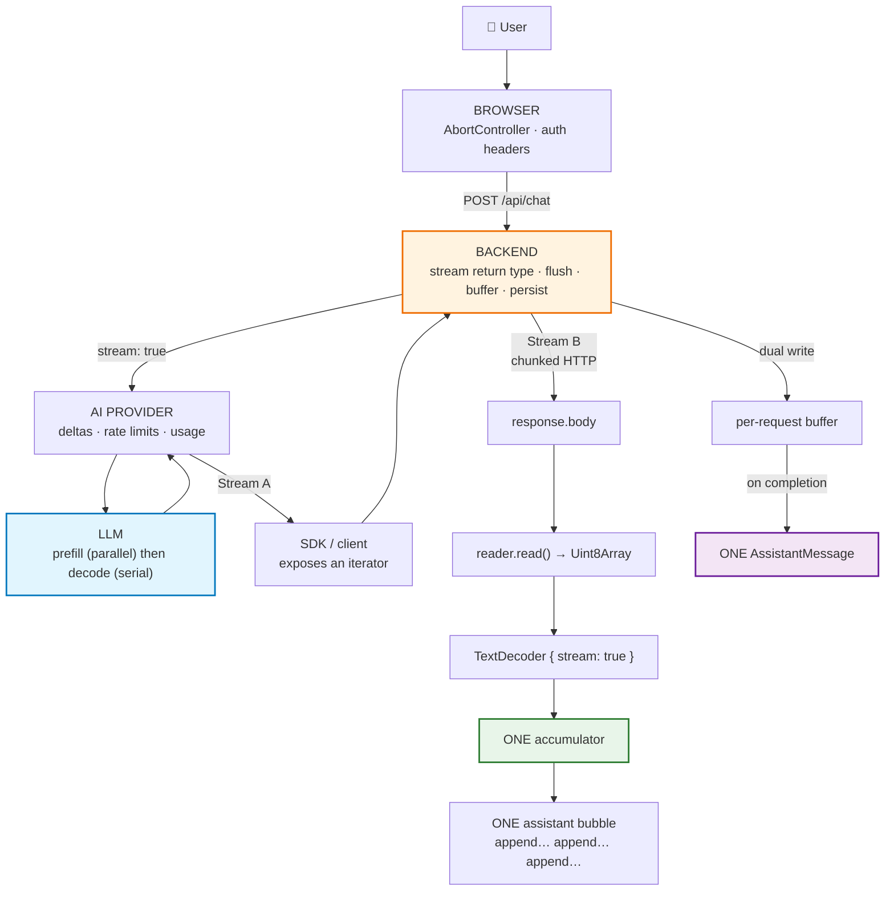
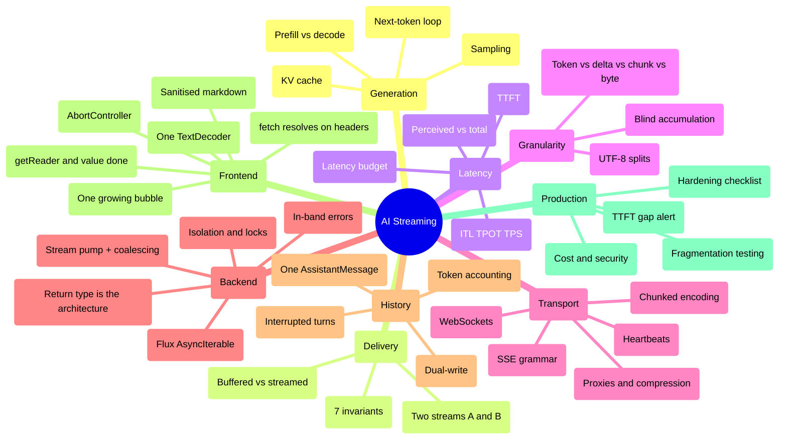
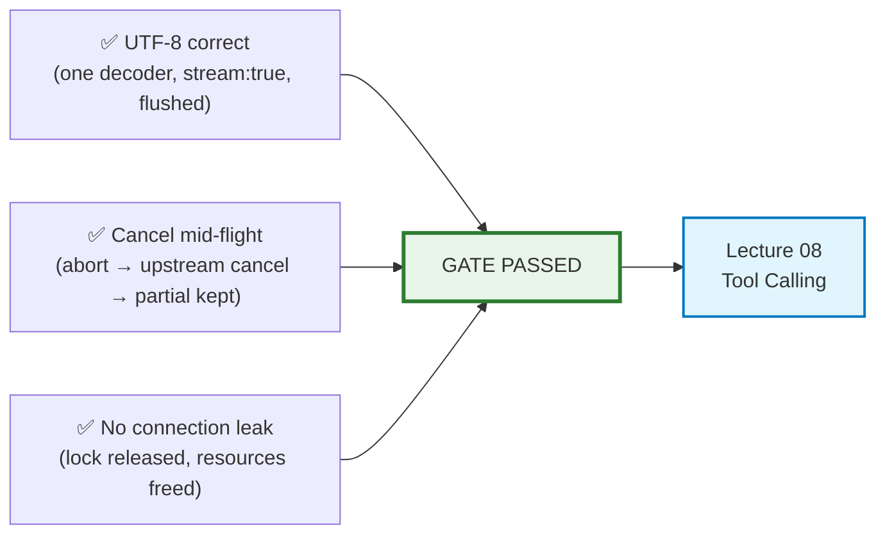

# Lecture 07 — Complete Notes
## AI Streaming: From LLM Tokens to a Live Chat Experience

> **Phase:** 2 · Application Layer · **Level:** 🟡 Intermediate · **Prerequisites:** Lecture 06
> **Goal:** own the full streaming path end to end — token → network frame → rendered character.
> **Scope:** a single-pass consolidation of the nine chapter notes in this folder.
> **How to use this file:** read it to *revise and navigate*. It is deliberately shorter than the chapters,
> and every section links to the chapter that explains it in full.
>
> | Chapter | File |
> | :--- | :--- |
> | 01 · How LLMs generate text — the root cause of streaming | [01_How_LLMs_Generate_Text.md](./01_How_LLMs_Generate_Text.md) |
> | 02 · Generation vs delivery: non-streaming & streaming responses | [02_Generation_vs_Delivery_Non_Streaming_and_Streaming_Responses.md](./02_Generation_vs_Delivery_Non_Streaming_and_Streaming_Responses.md) |
> | 03 · Latency anatomy: TTFT, ITL & perceived performance | [03_Latency_Anatomy_TTFT_ITL_and_Perceived_Performance.md](./03_Latency_Anatomy_TTFT_ITL_and_Perceived_Performance.md) |
> | 04 · Token vs provider chunk vs network chunk vs byte | [04_Token_Chunk_Network_and_Byte_Granularity.md](./04_Token_Chunk_Network_and_Byte_Granularity.md) |
> | 05 · HTTP streaming mechanics: chunked, SSE, WebSockets | [05_HTTP_Streaming_Mechanics_Chunked_Encoding_SSE_and_WebSockets.md](./05_HTTP_Streaming_Mechanics_Chunked_Encoding_SSE_and_WebSockets.md) |
> | 06 · End-to-end architecture & the 7 pipeline invariants | [06_End_to_End_Streaming_Architecture_and_Pipeline_Invariants.md](./06_End_to_End_Streaming_Architecture_and_Pipeline_Invariants.md) |
> | 07 · Backend: `call` vs `stream`, `Flux` & stream pumps | [07_Backend_Streaming_Call_vs_Stream_Flux_and_Stream_Pumps.md](./07_Backend_Streaming_Call_vs_Stream_Flux_and_Stream_Pumps.md) |
> | 08 · Frontend: `fetch`, `ReadableStream` & `TextDecoder` | [08_Frontend_Streaming_Fetch_ReadableStream_TextDecoder.md](./08_Frontend_Streaming_Fetch_ReadableStream_TextDecoder.md) |
> | 09 · History, persistence & production hardening | [09_History_Persistence_and_Production_Hardening.md](./09_History_Persistence_and_Production_Hardening.md) |

---

## 1. Executive summary

**The lecture in eight sentences.**

1. An LLM is a **next-token predictor**; generation is an *irreducibly sequential* loop of
   tokenize → forward pass → logits → softmax → sample → append. Output therefore arrives as a stream of
   small pieces, and that is the mechanical root cause of streaming
   ([01](./01_How_LLMs_Generate_Text.md)).
2. **Generation and delivery are independent processes.** You cannot make the model decode faster, but you
   can stop *hiding* its output — and that single distinction is the whole lecture
   ([02](./02_Generation_vs_Delivery_Non_Streaming_and_Streaming_Responses.md)).
3. Streaming does not shorten total generation time; it **collapses perceived latency** by making the wait
   legible, measured as **TTFT** rather than total time
   ([03](./03_Latency_Anatomy_TTFT_ITL_and_Perceived_Performance.md)).
4. Four units look alike and are not: **LLM token ≠ provider delta ≠ network chunk ≠ decoded string piece**.
   No layer guarantees a boundary, so the only safe client contract is *blind accumulation*
   ([04](./04_Token_Chunk_Network_and_Byte_Granularity.md)).
5. Streaming is still HTTP with a **progressive body** (`Transfer-Encoding: chunked`, no `Content-Length`).
   **SSE is a format, not a transport**, and raw `text/plain` streaming is a legitimate simpler choice
   ([05](./05_HTTP_Streaming_Mechanics_Chunked_Encoding_SSE_and_WebSockets.md)).
6. **Streaming is an end-to-end property**, expressible as **seven verifiable invariants**; any single
   buffering hop silently converts the system back into a buffered one
   ([06](./06_End_to_End_Streaming_Architecture_and_Pipeline_Invariants.md)).
7. On the backend, the **return type is the architecture**: `String` buffers, a stream type forwards — and
   the streaming service is deliberately tiny because buffering for history is a side-channel concern
   ([07](./07_Backend_Streaming_Call_vs_Stream_Flux_and_Stream_Pumps.md)).
8. On the client, **one `await response.text()` erases everything**; the correct shape is
   `response.body.getReader()` → one `TextDecoder` with `{ stream: true }` → one growing assistant bubble,
   cancellable and sanitised ([08](./08_Frontend_Streaming_Fetch_ReadableStream_TextDecoder.md)); and the
   answer must be **persisted once** from a per-request buffer, with interrupted turns kept
   ([09](./09_History_Persistence_and_Production_Hardening.md)).

### The four sentences that carry the most weight

> - *Streaming mainly changes how generated output is **delivered**, not how the model **generates**.*
> - *Streaming does not make the model finish faster. It makes the application **feel** faster.*
> - *Streaming is an **end-to-end** property of the application, not just an LLM feature.*
> - *The only safe UI contract: **whenever more text becomes available, append it to the current assistant
>   message**.*

---

## 2. The one master diagram

**Read it as a chain of custody.** The model's cadence is fixed; every hop after it is an application
decision — and every hop is a place where streaming can die silently.

### The complete concept mindmap

---

## 3. Cheat sheet

### 3.1 The pipeline, in order

| # | Step | Where | Failure if skipped | Chapter |
| :---: | :--- | :--- | :--- | :---: |
| 1 | Tokenize the prompt | Model | — | [01](./01_How_LLMs_Generate_Text.md) |
| 2 | Prefill the prompt (parallel) | Model | High TTFT | [01](./01_How_LLMs_Generate_Text.md), [03](./03_Latency_Anatomy_TTFT_ITL_and_Perceived_Performance.md) |
| 3 | Decode one token at a time (serial) | Model | — | [01](./01_How_LLMs_Generate_Text.md) |
| 4 | Coalesce tokens into deltas | Provider | Too many frames | [04](./04_Token_Chunk_Network_and_Byte_Granularity.md) |
| 5 | Expose deltas as an iterator | SDK | Whole response buffered | [07](./07_Backend_Streaming_Call_vs_Stream_Flux_and_Stream_Pumps.md) |
| 6 | Forward without accumulating | Backend | Invariant 1 broken | [07](./07_Backend_Streaming_Call_vs_Stream_Flux_and_Stream_Pumps.md) |
| 7 | Flush headers, then flush per write | Backend | Nothing until the end | [05](./05_HTTP_Streaming_Mechanics_Chunked_Encoding_SSE_and_WebSockets.md) |
| 8 | Buffer the same piece for history | Backend | Lost or fragmented history | [09](./09_History_Persistence_and_Production_Hardening.md) |
| 9 | Carry bytes progressively (chunked/SSE) | Transport | Buffered at a proxy | [05](./05_HTTP_Streaming_Mechanics_Chunked_Encoding_SSE_and_WebSockets.md) |
| 10 | `fetch()` → resolves on headers | Client | — | [08](./08_Frontend_Streaming_Fetch_ReadableStream_TextDecoder.md) |
| 11 | `getReader()` → `{ value, done }` loop | Client | All streaming lost | [08](./08_Frontend_Streaming_Fetch_ReadableStream_TextDecoder.md) |
| 12 | Decode with ONE streaming `TextDecoder` | Client | Mojibake | [04](./04_Token_Chunk_Network_and_Byte_Granularity.md) |
| 13 | Append to ONE growing bubble | Client | Fragment flood | [08](./08_Frontend_Streaming_Fetch_ReadableStream_TextDecoder.md) |
| 14 | Flush the decoder, persist ONE message | Both | Lost tail, broken history | [09](./09_History_Persistence_and_Production_Hardening.md) |

### 3.2 Terminology

| Term | Meaning | Chapter |
| :--- | :--- | :---: |
| **Prefill** | One parallel pass over the whole prompt; sets TTFT | [01](./01_How_LLMs_Generate_Text.md) |
| **Decode** | One forward pass per output token; sets TPS | [01](./01_How_LLMs_Generate_Text.md) |
| **KV cache** | Stored key/value projections that make decoding cheap but grow with length | [01](./01_How_LLMs_Generate_Text.md) |
| **TTFT** | Time to first visible token — the perceived-responsiveness metric | [03](./03_Latency_Anatomy_TTFT_ITL_and_Perceived_Performance.md) |
| **ITL / TPOT** | Inter-token latency; mean gap between successive pieces | [03](./03_Latency_Anatomy_TTFT_ITL_and_Perceived_Performance.md) |
| **TPS** | Output tokens per second (≈ 1000 / ITL) | [03](./03_Latency_Anatomy_TTFT_ITL_and_Perceived_Performance.md) |
| **TTFT gap** | `clientTTFT − serverTTFT`; isolates buffering/render overhead | [03](./03_Latency_Anatomy_TTFT_ITL_and_Perceived_Performance.md), [09](./09_History_Persistence_and_Production_Hardening.md) |
| **Provider delta** | A chunk as exposed by the API/SDK (may contain several tokens) | [04](./04_Token_Chunk_Network_and_Byte_Granularity.md) |
| **Network chunk** | A transport fragment (TCP segment, chunked frame, proxy flush) | [04](./04_Token_Chunk_Network_and_Byte_Granularity.md) |
| **Decoded piece** | What your code sees after `TextDecoder` | [04](./04_Token_Chunk_Network_and_Byte_Granularity.md) |
| **Chunked transfer encoding** | HTTP/1.1 mechanism for a body of unknown length | [05](./05_HTTP_Streaming_Mechanics_Chunked_Encoding_SSE_and_WebSockets.md) |
| **SSE** | `text/event-stream` format: `data:`/`event:`/`id:`/`retry:`, `\n\n` frames | [05](./05_HTTP_Streaming_Mechanics_Chunked_Encoding_SSE_and_WebSockets.md) |
| **Heartbeat** | `: comment` keep-alive every 10–15 s | [05](./05_HTTP_Streaming_Mechanics_Chunked_Encoding_SSE_and_WebSockets.md) |
| **Pipeline invariant** | A rule that, if violated at any layer, silently buffers the stream | [06](./06_End_to_End_Streaming_Architecture_and_Pipeline_Invariants.md) |
| **Backpressure** | A slow consumer signalling a fast producer; in AI, usually UI-render-bound | [06](./06_End_to_End_Streaming_Architecture_and_Pipeline_Invariants.md) |
| **Stream pump** | The code that moves provider deltas into the HTTP response | [07](./07_Backend_Streaming_Call_vs_Stream_Flux_and_Stream_Pumps.md) |
| **Delta coalescing** | Batching a few deltas per write (≈40 ms / ≈256 B) with no UX change | [07](./07_Backend_Streaming_Call_vs_Stream_Flux_and_Stream_Pumps.md) |
| **In-band error** | An `event: error` frame, because the HTTP status is already 200 | [07](./07_Backend_Streaming_Call_vs_Stream_Flux_and_Stream_Pumps.md) |
| **Dual-write** | Forward each chunk *and* append it to a per-request buffer | [09](./09_History_Persistence_and_Production_Hardening.md) |
| **Interrupted turn** | A partial answer the user already read; persisted with a status | [09](./09_History_Persistence_and_Production_Hardening.md) |
| **Fragmentation torture test** | Feeding a payload in 1-byte / random fragments and asserting equality | [04](./04_Token_Chunk_Network_and_Byte_Granularity.md), [09](./09_History_Persistence_and_Production_Hardening.md) |

### 3.3 The formulas

| Formula | Meaning | Chapter |
| :--- | :--- | :---: |
| $T_{\text{TTFT}} = T_{\text{net}} + T_{\text{queue}} + T_{\text{prefill}} + T_{\text{first step}}$ | What the user waits for before seeing anything | [03](./03_Latency_Anatomy_TTFT_ITL_and_Perceived_Performance.md) |
| $T_{\text{total}} = T_{\text{TTFT}} + (N_{\text{out}}-1)\cdot T_{\text{ITL}} + T_{\text{tail}}$ | What completion costs | [03](./03_Latency_Anatomy_TTFT_ITL_and_Perceived_Performance.md) |
| $\text{TPS} = 1000 / T_{\text{ITL}}$ | Throughput from inter-token latency | [03](./03_Latency_Anatomy_TTFT_ITL_and_Perceived_Performance.md) |
| $M_{\text{KV}} \approx 2 L H d N b$ | KV-cache memory grows linearly with sequence length | [01](./01_How_LLMs_Generate_Text.md) |
| $\text{Cost} = c_{\text{in}} T_{\text{prompt}} + c_{\text{out}} T_{\text{completion}}$ | History is re-billed every turn | [09](./09_History_Persistence_and_Production_Hardening.md) |
| `clientTTFT − serverTTFT > 500 ms` (p95) | **The one alert worth having** | [03](./03_Latency_Anatomy_TTFT_ITL_and_Perceived_Performance.md), [09](./09_History_Persistence_and_Production_Hardening.md) |

---

## 4. Decision tables

### 4.1 Should this endpoint stream?

| Situation | Decision | Why |
| :--- | :--- | :--- |
| Conversational chat | **Stream** | The user reads while it writes |
| Long-form drafting, code generation | **Stream** | Completion is expected to be slow |
| Structured extraction → JSON | **Buffer or hybrid** | Partial JSON is invalid |
| Classification / routing / tagging | **Buffer** | Tiny output; render cost exceeds the wait |
| Batch / nightly enrichment | **Buffer** | Throughput matters, TTFT does not |
| Agentic pipeline with tool calls | **Stream (SSE)** | Progress and tool events are user-visible value |
| Strict output contract | **Buffer or hybrid** | Never show an unvalidated object |

### 4.2 Which transport?

| Need | Choose | Why |
| :--- | :--- | :--- |
| Text as it arrives, nothing else | **Chunked raw text** | Zero framing bugs; simplest possible |
| Typed events (status, tokens, usage, errors) | **SSE** | Native `event:` field; resumable via `id:` |
| Resumability after disconnect | **SSE** | `Last-Event-ID` |
| Duplex / interrupt / voice / live cursor | **WebSockets** | Bidirectional, low latency |
| Legacy clients, very long jobs | **Polling** | No long-lived connection needed |
| Async batch pipelines | **Webhook** | Server pushes when ready |
| `POST` + custom auth headers + incremental reads | **`fetch` + `ReadableStream`** | The production default for AI chat |

### 4.3 Backend return type

| Signature | Can it stream? | Notes |
| :--- | :--- | :--- |
| `String chat(...)` / `Promise<string>` | ❌ **Never** | The buffer happens in the service |
| `List<String>` / `string[]` | ❌ Never | Collected by definition |
| `Flux<String>` / `Flow<string>` | ✅ Yes | Reactive streams; backpressure-aware |
| `AsyncIterable<string>` | ✅ Yes | Idiomatic Node/TS |
| `ReadableStream` | ✅ Yes | Web-standard; ideal at the HTTP edge |
| `chan string` (Go) | ✅ Yes | Idiomatic Go |

### 4.4 Error timing

| When the error happens | How to signal it | Chapter |
| :--- | :--- | :---: |
| Before the first byte | Real HTTP status (400/401/429/500) + JSON body | [07](./07_Backend_Streaming_Call_vs_Stream_Flux_and_Stream_Pumps.md) |
| After the first token | In-band `event: error` + persist the partial text | [07](./07_Backend_Streaming_Call_vs_Stream_Flux_and_Stream_Pumps.md) |
| Provider 429/5xx before any token | Server-side retry with jitter, then an HTTP error | [07](./07_Backend_Streaming_Call_vs_Stream_Flux_and_Stream_Pumps.md) |
| Provider drops mid-answer | In-band error + keep what the user read | [07](./07_Backend_Streaming_Call_vs_Stream_Flux_and_Stream_Pumps.md) |
| Client aborts | Not an error: mark the turn `interrupted` | [08](./08_Frontend_Streaming_Fetch_ReadableStream_TextDecoder.md), [09](./09_History_Persistence_and_Production_Hardening.md) |
| Proxy idle timeout | Heartbeats + raised timeout; allow resume | [05](./05_HTTP_Streaming_Mechanics_Chunked_Encoding_SSE_and_WebSockets.md) |

### 4.5 Auto-scroll policy

| Policy | Behaviour | When |
| :--- | :--- | :--- |
| Always scroll | Jumps to the bottom per chunk | Demos, short answers |
| **Sticky (pin unless the user scrolls up)** | Respects reading | **Production default** |
| Never scroll | Manual control | Long-form drafting, side-by-side review |
| Scroll on sentence boundaries | Smoothest | Polished products |

---

## 5. The two checklists worth memorising

### 5.1 The 7 pipeline invariants

| # | Invariant | Violated by | Detection |
| :--- | :--- | :--- | :--- |
| 1 | Every layer must **forward, not accumulate** | `collect()`, `List<String>`, `join()` | TTFT ≈ total time |
| 2 | The response must **flush per chunk** | Framework auto-serialization | `curl -N` shows one blob |
| 3 | Intermediaries must **not buffer** | Nginx default, CDN, compression | Works locally, breaks in staging |
| 4 | The connection must **not idle out** | 30/60/100 s timeouts | Streams die at round times |
| 5 | The client must **read incrementally** | `await response.text()` | Backend streams; the UI does not |
| 6 | The UI must **append, not replace** | Re-creating the bubble per chunk | Flicker, duplicates, lost scroll |
| 7 | **Cancellation must propagate upstream** | Closing the tab but still paying | Provider usage exceeds sessions |

> **`curl -N` validates 1, 2 and 4 only.** The failures users actually see live in 3, 5 and 6.

### 5.2 The production hardening checklist (condensed)

| Area | Requirement |
| :--- | :--- |
| Proxy / CDN | Buffering off, `X-Accel-Buffering: no`, bypass the CDN for streaming routes |
| Compression | Exclude `text/event-stream` from gzip/br |
| Timeouts | Idle timeout > the longest inter-chunk gap |
| Heartbeats | `: comment` every 10–15 s |
| Headers | `text/event-stream; charset=utf-8`, `no-cache, no-transform` |
| Return type | A stream type — never `String`/`Promise<string>` |
| Collectors | `blockLast()` / `collect()` / `.text()` forbidden on the streaming path |
| Cancellation | Client abort → server cancel → provider cancel |
| Buffering | Per-request accumulator; persist once on completion |
| Partial failure | Persist with `status: "interrupted"` |
| Multi-user | Conversation-scoped state + per-conversation lock |
| Limits | Concurrency caps, `max_tokens`, a prompt-token ceiling **before** dispatch |
| Retries | Only before the first token, jittered |
| Failover | A secondary provider behind a flag |
| Secrets / PII | Server-side keys; redaction; retention policy |
| Idempotency | Stable `messageId` + upsert |
| Rollout | Feature-flag streaming separately from the UI |
| Shutdown | Drain in-flight streams on `SIGTERM` |

---

## 6. Twenty misconceptions, corrected

| # | Misconception | Reality | Chapter |
| :---: | :--- | :--- | :---: |
| 1 | "The model computes the whole answer, then sends it." | It computes **one token**, appends it, recomputes. | [01](./01_How_LLMs_Generate_Text.md) |
| 2 | "Streaming makes the model faster." | Total time is unchanged; **perceived** latency collapses. | [02](./02_Generation_vs_Delivery_Non_Streaming_and_Streaming_Responses.md) |
| 3 | "The buffered path has no chunks." | Chunks always exist; someone chose to accumulate them. | [02](./02_Generation_vs_Delivery_Non_Streaming_and_Streaming_Responses.md) |
| 4 | "Streaming means SSE." | Streaming = progressive arrival. SSE = one format for it. | [05](./05_HTTP_Streaming_Mechanics_Chunked_Encoding_SSE_and_WebSockets.md) |
| 5 | "Streaming abandons HTTP." | It is HTTP with a progressive body and no `Content-Length`. | [05](./05_HTTP_Streaming_Mechanics_Chunked_Encoding_SSE_and_WebSockets.md) |
| 6 | "`await fetch()` waits for the body." | It resolves on **headers**. `response.text()` waits for the body. | [08](./08_Frontend_Streaming_Fetch_ReadableStream_TextDecoder.md) |
| 7 | "Streaming gives me one token at a time." | It gives whatever the provider flushes, whenever it flushes. | [04](./04_Token_Chunk_Network_and_Byte_Granularity.md) |
| 8 | "One chunk = one token." | A chunk may hold several tokens, or part of one. | [04](./04_Token_Chunk_Network_and_Byte_Granularity.md) |
| 9 | "A chunk ends at a word boundary." | Boundaries are arbitrary at every layer. | [04](./04_Token_Chunk_Network_and_Byte_Granularity.md) |
| 10 | "`response.json()` is fine if the server streams JSON." | Partial JSON is invalid by construction. | [04](./04_Token_Chunk_Network_and_Byte_Granularity.md) |
| 11 | "One `TextDecoder` per chunk is fine." | It destroys split multi-byte characters. | [04](./04_Token_Chunk_Network_and_Byte_Granularity.md) |
| 12 | "A `ReadableStream` can be read twice." | Only one reader at a time; the second `getReader()` throws. | [08](./08_Frontend_Streaming_Fetch_ReadableStream_TextDecoder.md) |
| 13 | "`AbortError` is an error." | It is a user action; partial text must be kept. | [08](./08_Frontend_Streaming_Fetch_ReadableStream_TextDecoder.md) |
| 14 | "`done: true` means text arrived." | It means the stream ended; handle it before touching the DOM. | [08](./08_Frontend_Streaming_Fetch_ReadableStream_TextDecoder.md) |
| 15 | "Streaming in the controller is enough." | The service's return type decides; a `String` service cannot stream. | [07](./07_Backend_Streaming_Call_vs_Stream_Flux_and_Stream_Pumps.md) |
| 16 | "We can change the HTTP status if it fails mid-stream." | After the first byte the status is frozen; use in-band errors. | [07](./07_Backend_Streaming_Call_vs_Stream_Flux_and_Stream_Pumps.md) |
| 17 | "Store each chunk so nothing is lost." | That is prompt bloat plus 200 DB transactions. Buffer, persist once. | [09](./09_History_Persistence_and_Production_Hardening.md) |
| 18 | "Only persist completed answers." | The user already read the partial one; the next prompt depends on it. | [09](./09_History_Persistence_and_Production_Hardening.md) |
| 19 | "Chunk count is a token count." | It is not, and the error varies per request. | [04](./04_Token_Chunk_Network_and_Byte_Granularity.md), [09](./09_History_Persistence_and_Production_Hardening.md) |
| 20 | "If streaming works locally, it works in production." | Proxies, compression and timeouts break it **after** the backend. | [05](./05_HTTP_Streaming_Mechanics_Chunked_Encoding_SSE_and_WebSockets.md), [06](./06_End_to_End_Streaming_Architecture_and_Pipeline_Invariants.md) |

---

## 7. Glossary

| Term | Definition |
| :--- | :--- |
| **Autoregressive decoding** | Generating text one token at a time, feeding each output back as input |
| **Backpressure** | A consumer signalling a producer to slow down; in AI streaming it usually surfaces as render jank |
| **Blind accumulation** | Appending whatever text arrives to one message without assuming any boundary |
| **Chunked transfer encoding** | HTTP/1.1 framing for a body whose length is unknown at header time |
| **Coalescing (delta)** | Batching several provider deltas into one write to reduce frame count |
| **`curl -N`** | curl with output buffering disabled — the primary streaming diagnostic |
| **Delta** | One streamed piece as exposed by a provider API/SDK |
| **Dual-write** | Forwarding a chunk to the client *and* appending it to a server-side buffer |
| **`EventSource`** | The browser's built-in SSE client; `GET`-only, no custom headers |
| **`finish_reason`** | Why generation stopped (`stop`, `length`, `error`) — must reach the client |
| **Heartbeat** | A periodic no-op frame (e.g. `: keep-alive`) that keeps the connection from idling out |
| **In-band error** | An error signalled inside the stream body because the HTTP status is already sent |
| **Invariant (pipeline)** | A rule that, if violated at any single hop, silently buffers the whole stream |
| **ITL / TPOT** | Inter-token latency: the mean time between successive streamed pieces |
| **KV cache** | Cached key/value projections that make each decode step cheap but grow with sequence length |
| **Prefill** | The parallel pass over the whole prompt; the dominant component of TTFT |
| **Provider delta** | The unit the API yields — not a token, not a network frame |
| **`ReadableStream`** | The web-standard pull-based byte source exposed as `response.body` |
| **SSE** | Server-Sent Events: a `text/event-stream` format with `\n\n`-delimited frames |
| **Stream pump** | The backend code that moves deltas from the provider into the HTTP response |
| **`TextDecoder`** | The byte→text converter; must be created once per response with `{ stream: true }` |
| **TTFT** | Time to first token/character — the perceived-responsiveness metric |
| **TTFT gap** | `clientTTFT − serverTTFT`; isolates buffering and render overhead |
| **Upsert** | Insert-or-update keyed by a stable `messageId`, making retries idempotent |

---

## 8. Self-check questions (35)

**Foundations**

1. Why is decode *irreducibly sequential*, while prefill is parallel? What does each phase control?
   → [01](./01_How_LLMs_Generate_Text.md) §01.3
2. Why does GPU utilisation fall while an answer is being generated?
   → [01](./01_How_LLMs_Generate_Text.md) §01.3
3. What is the KV cache, and why does turn 20 of a conversation cost more and feel slower than turn 2?
   → [01](./01_How_LLMs_Generate_Text.md) §01.4, [03](./03_Latency_Anatomy_TTFT_ITL_and_Perceived_Performance.md) §03.4
4. Show that buffered and streamed generation are the same loop. What exactly changes?
   → [01](./01_How_LLMs_Generate_Text.md) §01.5

**Delivery and latency**

5. Which layer can a Forward Deployed Engineer actually speed up — and which one can they only *influence*?
   → [02](./02_Generation_vs_Delivery_Non_Streaming_and_Streaming_Responses.md) §02.1
6. A 600-token answer with a 500 ms TTFT and 30 ms ITL: what are the buffered and streamed waits?
   → [02](./02_Generation_vs_Delivery_Non_Streaming_and_Streaming_Responses.md) §02.3
7. Name three endpoint types that should **not** stream, with a reason for each.
   → [02](./02_Generation_vs_Delivery_Non_Streaming_and_Streaming_Responses.md) §02.5
8. Explain the hybrid pattern and why it exists.
   → [02](./02_Generation_vs_Delivery_Non_Streaming_and_Streaming_Responses.md) §02.6
9. Decompose end-to-end latency into its six components. Which can streaming improve?
   → [03](./03_Latency_Anatomy_TTFT_ITL_and_Perceived_Performance.md) §03.2
10. Why is optimising TPS above ~8 tokens/s usually wasted money?
    → [03](./03_Latency_Anatomy_TTFT_ITL_and_Perceived_Performance.md) §03.3

**Granularity and transport**

11. Name the four granularities and say what controls each one's boundaries.
    → [04](./04_Token_Chunk_Network_and_Byte_Granularity.md) §04.1
12. Walk through what happens when the byte stream splits the character `₹` across two reads. Why does a
    per-chunk `TextDecoder` fail?
    → [04](./04_Token_Chunk_Network_and_Byte_Granularity.md) §04.4
13. What two invariants must every frame parser satisfy?
    → [04](./04_Token_Chunk_Network_and_Byte_Granularity.md) §04.5
14. Describe the fragmentation torture test and the three bug classes it catches.
    → [04](./04_Token_Chunk_Network_and_Byte_Granularity.md) §04.6
15. What does `charsPerChunk` in the hundreds tell you about a pipeline?
    → [04](./04_Token_Chunk_Network_and_Byte_Granularity.md) §04.6
16. How can HTTP send a response whose length it does not know? What happens on HTTP/2?
    → [05](./05_HTTP_Streaming_Mechanics_Chunked_Encoding_SSE_and_WebSockets.md) §05.2
17. Write the SSE wire grammar from memory, including the four field types and the heartbeat comment.
    → [05](./05_HTTP_Streaming_Mechanics_Chunked_Encoding_SSE_and_WebSockets.md) §05.3
18. Why is SSE usually the right choice for AI chat, and when do you actually need WebSockets?
    → [05](./05_HTTP_Streaming_Mechanics_Chunked_Encoding_SSE_and_WebSockets.md) §05.4
19. Why is `EventSource` often the wrong client API for an AI product?
    → [05](./05_HTTP_Streaming_Mechanics_Chunked_Encoding_SSE_and_WebSockets.md) §05.4
20. Name five infrastructure components that silently break streaming, with the symptom of each.
    → [05](./05_HTTP_Streaming_Mechanics_Chunked_Encoding_SSE_and_WebSockets.md) §05.6

**Architecture, backend, frontend and production**

21. State all seven pipeline invariants and one way to detect each violation.
    → [06](./06_End_to_End_Streaming_Architecture_and_Pipeline_Invariants.md) §06.3
22. Why does `curl -N` validate only three of the seven invariants?
    → [06](./06_End_to_End_Streaming_Architecture_and_Pipeline_Invariants.md) §06.3
23. What does backpressure look like in an AI streaming system, and what is the correct fix?
    → [06](./06_End_to_End_Streaming_Architecture_and_Pipeline_Invariants.md) §06.5
24. Trace cancellation from the Stop button to the provider. What must happen to the partial text?
    → [06](./06_End_to_End_Streaming_Architecture_and_Pipeline_Invariants.md) §06.6
25. Why is the *return type* of the service method the architecture, rather than the method name?
    → [07](./07_Backend_Streaming_Call_vs_Stream_Flux_and_Stream_Pumps.md) §07.2
26. What do the four reactive operators do, and why are they described as observers, not terminators?
    → [07](./07_Backend_Streaming_Call_vs_Stream_Flux_and_Stream_Pumps.md) §07.5
27. Design the in-band error protocol for a streamed endpoint. Why can the status not change?
    → [07](./07_Backend_Streaming_Call_vs_Stream_Flux_and_Stream_Pumps.md) §07.7
28. What is `await fetch()` actually waiting for? Why does `await response.text()` destroy streaming?
    → [08](./08_Frontend_Streaming_Fetch_ReadableStream_TextDecoder.md) §08.3
29. Why must the assistant bubble be created *lazily*, on the first text piece?
    → [08](./08_Frontend_Streaming_Fetch_ReadableStream_TextDecoder.md) §08.7
30. Which two traps does React StrictMode introduce for streaming readers?
    → [08](./08_Frontend_Streaming_Fetch_ReadableStream_TextDecoder.md) §08.12
31. Explain the dual-write pattern and where persistence must happen.
    → [09](./09_History_Persistence_and_Production_Hardening.md) §09.2
32. Why must an interrupted answer be persisted rather than discarded?
    → [09](./09_History_Persistence_and_Production_Hardening.md) §09.4
33. Why is chunk count not a token count, and what do you use instead?
    → [09](./09_History_Persistence_and_Production_Hardening.md) §09.5
34. What is the single most valuable streaming alert, and which five production failures does it catch?
    → [09](./09_History_Persistence_and_Production_Hardening.md) §09.8
35. Write the two CI assertions that catch most streaming regressions.
    → [09](./09_History_Persistence_and_Production_Hardening.md) §09.10

> **How to use these:** answer them out loud, in order, without notes. If you can do questions 11, 21, 27,
> 28 and 34 fluently, you can pass the lecture's completion gate.

---

## 9. The completion gate, and the bridge forward

**The lecture's gate:** *you can render a streamed response with correct UTF-8 multi-byte handling and
cancel it mid-flight without leaking the connection.*

### Why the next lecture depends on this one

Streaming and tool calling are the same pipeline carrying a richer payload:

| This lecture | Lecture 08 — Tool Calling |
| :--- | :--- |
| One stream of text deltas | A stream that also carries **tool-call** frames |
| A `done` event with `finish_reason` | A `tool_calls` finish reason that **requires another turn** |
| In-band `error` events | Tool failures returned as **results**, not exceptions |
| Cancellation stops a generation | Cancellation stops an agent loop mid-hop |
| Typed SSE events (`status`, `token`, `usage`) | Typed SSE events for tool proposals and results |

If you have understood the granularity model and the in-band event protocol, tool calling becomes a change
of **payload** rather than a change of architecture — which is exactly the point of building streaming
properly first.

### The one-sentence summary of the lecture

> *An LLM emits tokens one at a time; the provider exposes them as deltas; your backend forwards them
> without buffering while buffering them internally for history; HTTP carries them progressively; and the
> browser appends each decoded piece to a single assistant message — and that continuous, unbroken pipeline
> is what makes an AI appear to type in real time.*

---

**Chapter notes:** [01](./01_How_LLMs_Generate_Text.md) · [02](./02_Generation_vs_Delivery_Non_Streaming_and_Streaming_Responses.md) ·
[03](./03_Latency_Anatomy_TTFT_ITL_and_Perceived_Performance.md) · [04](./04_Token_Chunk_Network_and_Byte_Granularity.md) ·
[05](./05_HTTP_Streaming_Mechanics_Chunked_Encoding_SSE_and_WebSockets.md) · [06](./06_End_to_End_Streaming_Architecture_and_Pipeline_Invariants.md) ·
[07](./07_Backend_Streaming_Call_vs_Stream_Flux_and_Stream_Pumps.md) · [08](./08_Frontend_Streaming_Fetch_ReadableStream_TextDecoder.md) ·
[09](./09_History_Persistence_and_Production_Hardening.md)